# TFM2-League-Heroes

团战经理2（Teamfight Manager 2）的英雄联盟英雄 Mod，mod_id 是 `league`。英雄本身都是数据（`league/`）；主包从 0.97.0 起带一个自己的 DLL（`league.dll`，源码 [`addons/league_main`](addons/league_main/src/lib.rs)，`mod.mod_info` 是 `contains_code` / `native`，订阅时游戏会提示这是代码 mod），只做数据做不到的事：高清帧（PPU）、界面小图集、选人卡片的动画、音频预读。仓库里还有第二个 mod `tft`（金铲铲之战系列，源文件在 [`tft/`](tft/)），和一组可选的原生代码附加包（[`addons/`](addons/)，合成一个 `league_addons`）。

- **每位英雄现在的技能、附加包、高清帧和开发记录**：见下面的 [英雄一览](#英雄一览)，或者 [`docs/heroes/`](docs/heroes/) 里每位英雄一页；表格版是 [`docs/heroes.xlsx`](docs/heroes.xlsx)。
- 原来 README 里很长的技术说明搬到了 [`docs/tech-notes.md`](docs/tech-notes.md)，演示动图在 [`docs/gallery.md`](docs/gallery.md)，不属于某位英雄的几节在 [`docs/dev-notes.md`](docs/dev-notes.md)，性能调查在 [`docs/perf.md`](docs/perf.md)。

## 目录

- [安装测试](#安装测试)
- [附加包](#附加包)
- [高清帧（PPU）和界面](#高清帧ppu和界面)
- [游戏版本更新时](#游戏版本更新时)
- [持续集成](#持续集成)
- [金铲铲之战系列（tft 包）](#金铲铲之战系列tft-包)
- [英雄一览](#英雄一览)
- [英雄文档怎么生成](#英雄文档怎么生成)
- [仓库里的 skill](#仓库里的-skill) · [快速开始](#快速开始) · [知识来源](#知识来源) · [声明](#声明)

## 安装测试

英雄的音频（英雄联盟的音效和配音）版权属于 Riot Games，**不提交到仓库**，要先在本地从英雄联盟客户端提取：每位英雄的提取命令在他那一页「开发记录」的「重新生成」里（`tools/lol/extract_<英雄>.py`），通用说明见 [盖伦那一页的「从本地英雄联盟提取音频和图标」](docs/heroes/league_garen.md#从本地英雄联盟提取音频和图标)。装进游戏和上传创意工坊都用 `tools/package_mod.py` 打包，不要直接复制 `league` 文件夹：

```bash
pip install pillow numpy soundfile
python tools/package_mod.py --install                  # 全部英雄装进 Teamfight Manager2/mods/league
python tools/package_mod.py --hero fiora --install     # 只装一个英雄，别的英雄的文件不动
python tools/package_mod.py --out <文件夹>/league       # 打包到别处，例如上传创意工坊用的文件夹
python tools/package_mod.py --src tft --hero powder --install   # tft 包（第一次装要在 Mods 菜单里勾上）
```

然后在游戏的 Mods 菜单里启用 `league`。打包时会编译并带上 `league.dll`（需要 cargo），还会给每位英雄打出界面小图集（`ui_sheets/`）。日志在 `%APPDATA%\TeamSamoyed\TeamfightManager2\data\league.log`。

游戏启动时会把 mod 里除背景音乐外的每个文件整个读进内存，原样复制的 `league` 有 78 MB，其中 66 MB 是 WAV。打包后的内容和仓库里完全一样，只是更小（19 MB）：

- 音效转成 MP3（和原版音效同一格式），名字不变。
- 音频放在 `sound/bgm/`（2026-10-17）：游戏对这里的 mp3 / wav 是播放时才打开，启动时不读，启动要开的文件少了四成（5282 → 3194，机械盘上文件分散时冷启动 88 → 51 秒）。`.sound_info` 还在 `sound/sfx/`，每个音频的 override 指到新位置。游戏第一次播放时在主线程打开文件，所以 `league.dll` 在标题画面出来后把这些音频预读进系统缓存，比赛里第一次响不用等盘。
- 精灵图的图集去掉重复帧、排紧，每一帧的大小和像素不变。
- JSON 去掉空白。
- 英雄的技能效果树去掉不起任何作用的包装（[`tools/kit/slim.py`](tools/kit/slim.py)：套在别的效果列表里的 Combine、只包一个效果的 Combine、两个分支相同的 SwitchByBuff、两个分支开头或结尾相同的效果提到分支外面），执行的效果、顺序、时机都不变。游戏每 tick 都要把每个英雄的 skill、skill2 整棵复制一遍，节点越少越省 CPU（2026-10-18，全部英雄的 skill + skill2 少约 5%，各英雄另外的等价改写见 [docs/perf.md](docs/perf.md) 第 8 节）；附加包合集 `assemble.py` 组装时也这样处理。

每个输出都会和源文件核对。仓库里的文件不变。查到的原因和数字见 [docs/perf.md](docs/perf.md)。

## 附加包

主包 `league` 的英雄不装任何附加包也是完整的。数据做不到的事（读当前生命、读墙和草丛、整身变身、按参与击杀算……）由可选的原生代码附加包补上，全部合进一个 mod **附加包合集 `league_addons`**（玩家只多订阅一个；怎么合、怎么编译和组装见 [`addons/league_addons/README.md`](addons/league_addons/README.md)）：

```bash
cd addons && cargo build --release                      # 得到 target/release/league_addons.dll（和各附加包自己的 DLL）
python addons/league_addons/assemble.py <输出文件夹>       # 全部附加包；--only a,b 只放其中几个
```

把输出文件夹改名 `league_addons` 放进 `<游戏目录>\mods\`（先关掉单独的附加包），在 MOD 菜单里启用并排在主包后面，重启游戏。合集和单独的附加包不能同时启用。

- 每位英雄有哪些附加包、改了什么，见下面英雄一览的「附加包」一列和英雄页里的「附加包」一节（从各附加包的 `mod.override_info`、`README.md` 和文字生成）。
- 不属于某一位英雄的：[`league_ult_press`](addons/league_ult_press/README.md)（游戏 AI 不按或很少按的技能替它按、被 AI 停住时替英雄平 A）、[`league_ult_aim`](addons/league_ult_aim/README.md)（大招挑英雄联盟玩家会挑的目标）、[`league_unlock_guard`](addons/league_unlock_guard/README.md)（兜底：哪个 AI 钩子在技能 2 / 大招解锁前按了，换成普攻或原地站一下并记日志，免得过日卡死）、`league_recall_log`（回城日志，诊断用），以及共用的 [`addons/game_places`](addons/game_places/src/lib.rs)（运行时在 EXE 里找地址，见下）。`league_ult_press`、`league_ult_aim` 管到的英雄，英雄页的「附加包」一节也列出了和他有关的几行。
- 附加包里的英雄副本由各自的 `make_override.py` 从主包生成：**主包改了英雄就要重跑**，CI 会用 `--check` 核对（见 [持续集成](#持续集成)）。

## 高清帧（PPU）和界面

详细的来龙去脉见 [docs/tech-notes.md](docs/tech-notes.md)（「高清帧」「画风统一」「待机和选人卡片的动画」「界面小图集」「平涂像素画」各节）。要点：

- **高清帧**：登记在 [`addons/league_main/src/hd.rs`](addons/league_main/src/hd.rs) `HEROES` 里的英雄（每位的 PPU 见英雄一览，画出来的大小 `SIZES`）在自己的图里多一套 `hd_<动作>` 帧，每帧是 1 倍帧的 PPU 倍大。游戏里画出来大小不变、像素细 PPU 倍：`league.dll` 挂在游戏按名字取动画表和贴图的函数上，把每个动作换成高清帧、矩形和贴图尺寸除以 PPU；战场画真实的高清帧、实体的绘制缩放写成 1/PPU。没有 DLL 或游戏版本不认得时，照旧画 1 倍帧。
- **工具**：[`tools/art/ppu_hd.py`](tools/art/ppu_hd.py) 把高清帧写进图里（`python tools/art/ppu_hd.py --hero <英雄>`）；[`tools/art/ppu_restyle.py`](tools/art/ppu_restyle.py) 把原来的高清帧（`assets/source/ppu/orig/`）统一成泽丽那样「像素多但清晰」的画风（每个游戏像素约 2.2 格）；[`pack_ppu_strips.py`](tools/art/pack_ppu_strips.py) / [`import_ppu_strips.py`](tools/art/import_ppu_strips.py) 把动作打包给美术重画、再读回；[`ppu_one.py`](tools/art/ppu_one.py) 把 1 倍帧按高清帧缩回。
- **界面**：图鉴、头像、选人槽位、选中特写用每个游戏像素 1.5 格的 `lo_<动作>` 帧；选人网格（BP 格子）用战场那套 `hd_` 帧播 `bp` 动画（[`tools/art/hero_reels.py`](tools/art/hero_reels.py)：只用图里已有的帧重排，挑哪几帧记在 [`hero_reels.json`](tools/art/hero_reels.json)）；待机 `idle` 不再上下呼吸，而是定住、随机冒一个小动作。
- **界面小图集**：一屏画全部英雄时，整张战斗图集装不进游戏 256 MiB 的图片缓存。`tools/package_mod.py` 给每个英雄打出两张只有界面帧的小图集（`ui_sheets/idle/`、`ui_sheets/bp/`），`league.dll` 让界面改画它们（[`src/ui.rs`](addons/league_main/src/ui.rs)），战场照旧。见 [docs/perf.md](docs/perf.md) 第 9 节。

## 游戏版本更新时

`league.dll` 和整身变身的附加包要在游戏的 EXE 里找函数。[`build.rs`](addons/league_main/src/build.rs) 列着认得的游戏版本（现在是 0.6.5），逐字节核对每一处要改、要调用的代码；对不上（游戏更新了）就由 [`addons/game_places`](addons/game_places/src/lib.rs) 在运行时按特征码找（日志 `game build: found at run time in … ms`），找不到或不唯一才退回 1 倍帧。游戏改了代码形状时：

```bash
python tools/re/find_build.py        # 从上一版 build.rs 在新 EXE 里重新找出地址，更新 build.rs
python tools/re/make_sigs.py         # 重新生成 addons/game_places/src/sigs.rs
cargo test -p league_main            # 拿游戏目录里的 EXE 跑一遍：动态找出的每个地址都和 build.rs 一致
```

结构体里的偏移没有做成动态的。0.6.4、0.6.5 两次更新改了什么（地址、玩家结构体、官方 AI、放逐和韧性、各英雄表）见 [docs/tech-notes.md](docs/tech-notes.md) 的「游戏 0.6.4」「动态寻址」「游戏 0.6.5」三节。

## 持续集成

GitHub Actions（[`.github/workflows/ci.yml`](.github/workflows/ci.yml)，Windows 机器）在每个 PR 和每次合并进 main 时检查（合并进 main 要求这一项通过）：

- PPU 界面小图集（[`tools/ci/ui_sheets.py`](tools/ci/ui_sheets.py)：每个英雄都有两张、和战斗图集逐像素一致，全部英雄加起来 bp ≤ 192 MiB、idle ≤ 64 MiB）；
- 附加包的英雄副本有没有过期（各附加包的 `make_override.py --check`：塞拉斯偷的每个大招、佛耶戈、妮蔻、凯隐等的副本按主包重建后和提交的逐字比对，主包改了英雄却没重跑脚本就会红）；
- `cargo test`：league.dll（高清帧、小图集、运行时寻址）、game_places 和附加包合集的全部测试。

合并进 main 后再构建 league.dll 和附加包合集，打成一个下载附件（Actions 页面那次运行的 Artifacts）；英雄的图、数据和语音不在里面，完整安装和创意工坊上传照旧在本地用 `tools/package_mod.py`。检查红了：PR 页面点 Details 看是哪一步；`make_override.py` 过期就在装着游戏的电脑上重跑那个脚本再提交。

## 金铲铲之战系列（tft 包）

第二个 mod，mod_id `tft`，名字「Teamfight Tactics Heroes」，源文件在 [`tft/`](tft/)：金铲铲之战（云顶之弈）里英雄联盟没有的棋子——爆爆（[`tft_powder`](docs/heroes/tft_powder.md)）和诺拉（[`tft_norra`](docs/heroes/tft_norra.md)，技能照英雄联盟手游）。爆爆的音效是游戏本体自带的音频片段（在她自己的 `.sound_info` 里叠起来播），诺拉的是从英雄联盟客户端借的片段（和主包一样不进仓库，`tools/lol/extract_norra.py` 提取、打包时带上）。tft 包是原生 mod：数据做不到的地方写在它自己的 `tft.dll` 里（[`addons/tft`](addons/tft/README.md)，每个 tft 英雄一个模块，现在是诺拉的手游规则），打包时编好带上，所有 tft 英雄都在这一个 mod 里。高清帧借 `league.dll`（两个包都开着时它也画 `tft_` 开头的英雄的 `hd_` 帧，只开 tft 包时退回 1 倍帧）。工具链共用：`python tools/package_mod.py --src tft --hero powder --install` 装进 `<游戏>/mods/tft`，`ppu_hd.PACKS` 把她们的图写进 `tft/champions/`，`lint_mod.py tft` 检查。

## 英雄一览

每位英雄一页：名字、分路、高清帧、现在的四个技能（游戏里显示的说明）、数值、附加包和它改了什么、演示动图、相关脚本，最下面是这位英雄的「开发记录」（设计、美术、音效、调数值的全部过程，原来 README 里的那一节）。

<!-- HEROES:BEGIN -->
<!-- 这一段由 tools/docs/gen_hero_docs.py 生成，请不要手改。 -->

共 181 位：主包 173 位、tft 包 8 位。点名字看这位英雄现在的技能、附加包和开发记录；表格版见 [docs/heroes.xlsx](docs/heroes.xlsx)。

### 上单（40）

| 头像 | 英雄 | 分路 | 技能 | 附加包 | 高清帧 |
|---|---|---|---|---|---|
|  | [亚托克斯](docs/heroes/league_aatrox.md)<br>Aatrox | 上单 | 被动 赐死剑气 · 暗裔利刃 · 恶火束链 · 大招 大灭 | [剑魔 W 锁链附加包](addons/league_aatrox_chain/README.md) | — |
| 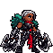 | [安蓓萨](docs/heroes/league_ambessa.md)<br>Ambessa | 上单 | 暗袭 · 血戮 · 大招 公开处刑 | [安蓓萨附加包](addons/league_ambessa/README.md) | PPU 2 |
|  | [卡蜜尔](docs/heroes/league_camille.md)<br>Camille | 上单 | 被动 适应性防御 · 战术横扫 · 钩索 · 大招 海克斯最后通牒 | [青钢影钩墙附加包](addons/league_camille_wall/README.md) | PPU 1.5 |
| 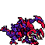 | [科加斯](docs/heroes/league_chogath.md)<br>Cho'Gath | 上单 | 破裂 · 野性尖叫 · 大招 盛宴 | [科加斯附加包](addons/league_chogath/README.md) | PPU 1.2 |
|  | [德莱厄斯](docs/heroes/league_darius.md)<br>Darius | 上单 | 被动 出血 · 大杀四方 · 无情铁手 · 大招 诺克萨斯断头台 | [诺手大招读血附加包](addons/league_darius_ult/README.md) | PPU 1.45 |
|  | [蒙多医生](docs/heroes/league_drmundo.md)<br>Dr. Mundo | 上单 | 病毒屠刀 · 电击疗法 · 大招 极限剂量 | [蒙多附加包](addons/league_drmundo/README.md) | PPU 1.5 |
|  | [菲奥娜](docs/heroes/league_fiora.md)<br>Fiora | 上单 | 被动 决斗之舞 · 破空斩 · 劳伦特心眼刀 · 大招 无双挑战 | [剑姬破绽附加包](addons/league_fiora_duel/README.md) | PPU 1.5 |
|  | [普朗克](docs/heroes/league_gangplank.md)<br>Gangplank | 上单 | 枪火谈判 · 火药桶 · 大招 加农炮幕 | [普朗克附加包](addons/league_gangplank/README.md) | PPU 1.5 |
|  | [盖伦](docs/heroes/league_garen.md)<br>Garen | 上单 | 致命打击 · 审判 · 大招 德玛西亚正义 | [盖伦大招斩杀附加包](addons/league_garen_ult/README.md) | PPU 1.9 |
|  | [纳尔](docs/heroes/league_gnar.md)<br>Gnar | 上单 | 投掷回力标/投掷顽石 · 轻跳/猛踏 · 大招 呐啊！ | [纳尔附加包](addons/league_gnar/README.md) | PPU 1.5 |
|  | [格温](docs/heroes/league_gwen.md)<br>Gwen | 上单 | 被动 千穿百孔 · 快刀剪乱 · 断续疾走 · 大招 引针簇射 | [格温被动附加包](addons/league_gwen/README.md) | PPU 2.84 |
| 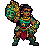 | [俄洛伊](docs/heroes/league_illaoi.md)<br>Illaoi | 上单 | 严酷训诫 · 灵魂试炼 · 大招 过界信仰 | [俄洛伊附加包](addons/league_illaoi/README.md) | PPU 1.5 |
|  | [艾瑞莉娅](docs/heroes/league_irelia.md)<br>Irelia | 上单 | 被动 艾欧尼亚热诚 · 利刃冲击 · 比翼双刃 · 大招 先锋之刃 | [艾瑞莉娅附加包：Q「利刃冲击」真正的刷新 + 跳兵线](addons/league_irelia/README.md) | PPU 2 |
| 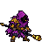 | [贾克斯](docs/heroes/league_jax.md)<br>Jax | 上单 | 被动 无情连打 · 跳斩 · 反击风暴 · 大招 武器大师 | — | PPU 1.5 |
|  | [杰斯](docs/heroes/league_jayce.md)<br>Jayce | 上单 | 苍穹之跃 / 电能震荡 · 雷霆一击 / 超能电荷 · 大招 加速之门 | [杰斯附加包](addons/league_jayce/README.md) | PPU 1.5 |
|  | [奎桑提](docs/heroes/league_ksante.md)<br>K'Sante | 上单 | 无双陀斧 · 辟路先锋 · 大招 傲岸雄姿 | [奎桑提附加包](addons/league_ksante/README.md) | PPU 1.2 |
|  | [凯尔](docs/heroes/league_kayle.md)<br>Kayle | 上单 | 耀焰冲击 · 星火符刃 · 大招 圣裁之刻 | [凯尔升阶附加包：按真实等级升阶、死后不掉](addons/league_kayle/README.md) | — |
|  | [凯南](docs/heroes/league_kennen.md)<br>Kennen | 上单 | 被动 雷缚印 · 奥义！千鸟 · 奥义！雷铠 · 大招 秘奥义！万雷天牢引 | [目标标记附加包](addons/league_marks/README.md) | — |
|  | [克烈](docs/heroes/league_kled.md)<br>Kled | 上单 | 飞索捕熊器 · 比武 · 大招 冲啊——！！ | [克烈附加包](addons/league_kled/README.md) | PPU 2 |
|  | [墨菲特](docs/heroes/league_malphite.md)<br>Malphite | 上单 | 被动 花岗岩护盾 · 地震碎片 · 大地震颤 · 大招 势不可挡 | — | — |
| 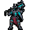 | [莫德凯撒](docs/heroes/league_mordekaiser.md)<br>Mordekaiser | 上单 | 破灭之锤 · 断魂一扼 · 大招 轮回绝境 | [莫德凯撒附加包](addons/league_mordekaiser/README.md) | PPU 2 |
| 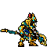 | [内瑟斯](docs/heroes/league_nasus.md)<br>Nasus | 上单 | 汲魂痛击 · 灵魂烈焰 · 大招 死神降临 | [内瑟斯附加包](addons/league_nasus/README.md) | PPU 1.2 |
|  | [奥拉夫](docs/heroes/league_olaf.md)<br>Olaf | 上单 | 逆流投掷 · 鲁莽挥击 · 大招 诸神黄昏 | [奥拉夫读血附加包](addons/league_olaf_rage/README.md) | — |
|  | [奥恩](docs/heroes/league_ornn.md)<br>Ornn | 上单 | 火山突堑 · 炽烈冲锋 · 大招 熔铸之神的召唤 | [奥恩附加包](addons/league_ornn/README.md) | PPU 1.5 |
| 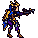 | [奎因](docs/heroes/league_quinn.md)<br>Quinn | 上单 | 炫目攻势 · 旋翔掠杀 · 大招 深入敌后 | [奎因附加包](addons/league_quinn/README.md) | PPU 2 |
| 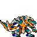 | [雷克顿](docs/heroes/league_renekton.md)<br>Renekton | 上单 | 被动 怒之领域 · 巨鳄狂袭 · 横冲直撞 · 大招 终极统治 | [雷克顿低血怒气附加包](addons/league_renekton/README.md) | — |
|  | [锐雯](docs/heroes/league_riven.md)<br>Riven | 上单 | 被动 符文之刃 · 折翼之舞 · 勇往直前 · 大招 放逐之锋 | [斩杀附加包：伊芙琳、阿卡丽、锐雯](addons/league_executes/README.md) | PPU 1.5 |
|  | [兰博](docs/heroes/league_rumble.md)<br>Rumble | 上单 | 纵火盛宴 · 电子鱼叉 · 大招 恒温灼烧 | [兰博附加包](addons/league_rumble/README.md) | PPU 1.75 |
| 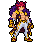 | [瑟提](docs/heroes/league_sett.md)<br>Sett | 上单 | 被动 沙场豪情 · 强手裂颅 · 蓄意轰拳 · 大招 叹为观止 | [瑟提豪意附加包](addons/league_sett_grit/README.md) | — |
|  | [慎](docs/heroes/league_shen.md)<br>Shen | 上单 | 奥义！暮临 · 奥义！影缚 · 大招 秘奥义！慈悲度魂落 | [慎「秘奥义！慈悲度魂落」护盾按生命值附加包](addons/league_shen_shield/README.md) | — |
|  | [辛吉德](docs/heroes/league_singed.md)<br>Singed | 上单 | 过肩摔 · 强力粘胶 · 大招 疯狂药剂 | [辛吉德附加包](addons/league_singed/README.md) | PPU 1.39 |
|  | [赛恩](docs/heroes/league_sion.md)<br>Sion | 上单 | 残虐猛击 · 杀手怒吼 · 大招 蛮横冲撞 | [赛恩附加包](addons/league_sion/README.md) | — |
|  | [提莫](docs/heroes/league_teemo.md)<br>Teemo | 上单 | 被动 毒性射击 · 致盲吹箭 · 小莫快跑 · 大招 种蘑菇 | [提莫蘑菇附加包](addons/league_teemo_shrooms/README.md) | — |
| 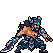 | [泰达米尔](docs/heroes/league_tryndamere.md)<br>Tryndamere | 上单 | 被动 战斗狂怒 · 旋风斩 · 蔑视 · 大招 无尽怒火 | [蛮王残血开大附加包](addons/league_tryndamere_rage/README.md) | — |
|  | [厄加特](docs/heroes/league_urgot.md)<br>Urgot | 上单 | 腐蚀电荷 · 鄙弃 · 大招 超越死亡的恐惧 | [厄加特附加包](addons/league_urgot/README.md) | PPU 1.2 |
|  | [弗拉基米尔](docs/heroes/league_vladimir.md)<br>Vladimir | 上单 | 被动 血色契约 · 鲜血转换 · 血之潮汐 · 大招 血之瘟疫 | [弗拉基米尔残血血池附加包](addons/league_vladimir_pool/README.md) | PPU 1.8 |
|  | [沃利贝尔](docs/heroes/league_volibear.md)<br>Volibear | 上单 | 擂首一击 · 霹天雳地 · 大招 天声震落 | [沃利贝尔附加包](addons/league_volibear/README.md) | PPU 1.2 |
|  | [约里克](docs/heroes/league_yorick.md)<br>Yorick | 上单 | 临终仪式 · 哀伤之雾 · 大招 海屿悼词 | [约里克附加包](addons/league_yorick/README.md) | PPU 1.75 |
|  | [亚恒](docs/heroes/league_zaahen.md)<br>Zaahen | 上单 | 暗裔长刀 · 厄影回锋 · 大招 大赦 | [亚恒附加包](addons/league_zaahen/README.md) | PPU 1.75 |
|  | [可酷伯](docs/heroes/tft_kobuko.md)<br>Kobuko（tft 包） | 上单 | 金爪真言 · 猛虎扑 · 大招 游戏结束！ | — | PPU 2 |

### 打野（41）

| 头像 | 英雄 | 分路 | 技能 | 附加包 | 高清帧 |
|---|---|---|---|---|---|
|  | [阿木木](docs/heroes/league_amumu.md)<br>Amumu | 打野 | 被动 诅咒之触、绝望光环 · 绷带牵引 · 阿木木的愤怒 · 大招 木乃伊之咒 | — | — |
|  | [卑尔维斯](docs/heroes/league_belveth.md)<br>Bel'Veth | 打野 | 虚空激流 · 上觐沉渊 · 大招 万载豪筵 | [卑尔维斯附加包](addons/league_belveth/README.md) | PPU 1.75 |
|  | [贝蕾亚](docs/heroes/league_briar.md)<br>Briar | 打野 | 被动 猩红诅咒 · 冲头 · 惊吼 · 大招 毙除 | [贝蕾亚附加包](addons/league_briar_frenzy/README.md) | — |
|  | [黛安娜](docs/heroes/league_diana.md)<br>Diana | 打野 | 被动 月银之刃 · 新月打击 · 月神冲刺 · 大招 月之降临 | [目标标记附加包](addons/league_marks/README.md) | — |
|  | [艾克](docs/heroes/league_ekko.md)<br>Ekko | 打野 | 被动 Z型驱动共振 · 时间卷曲器 · 相位俯冲 · 大招 时空断裂 | [艾克时间倒转附加包](addons/league_ekko_rewind/README.md) | — |
|  | [伊莉丝](docs/heroes/league_elise.md)<br>Elise | 打野 | 神经毒素 / 剧毒之蜇 · 结茧 / 盘丝 · 大招 蜘蛛形态 | [伊莉丝附加包](addons/league_elise/README.md) | PPU 1.8 |
|  | [伊芙琳](docs/heroes/league_evelynn.md)<br>Evelynn | 打野 | 憎恨之刺 · 引诱 · 大招 最终抚慰 | [斩杀附加包：伊芙琳、阿卡丽、锐雯](addons/league_executes/README.md) | — |
| 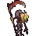 | [费德提克](docs/heroes/league_fiddlesticks.md)<br>Fiddlesticks | 打野 | 被动 巫骇草人 · 恐惧 · 五骨丰登 · 大招 群鸦风暴 | — | — |
|  | [古拉加斯](docs/heroes/league_gragas.md)<br>Gragas | 打野 | 滚动酒桶 · 肉弹冲击 · 大招 爆破酒桶 | [古拉加斯大招智能落点附加包](addons/league_gragas/README.md) | PPU 1.45 |
|  | [格雷福斯](docs/heroes/league_graves.md)<br>Graves | 打野 | 穷途末路 · 快速拔枪 · 大招 终极爆弹 | [格雷福斯附加包](addons/league_graves/README.md) | PPU 1.5 |
| 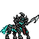 | [赫卡里姆](docs/heroes/league_hecarim.md)<br>Hecarim | 打野 | 暴走 · 毁灭冲锋 · 大招 暗影冲击 | — | — |
|  | [艾翁](docs/heroes/league_ivern.md)<br>Ivern | 打野 | 种豆得瓜 · 根深敌固 · 大招 小菊！ | [艾翁附加包](addons/league_ivern/README.md) | PPU 1.5 |
| 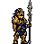 | [嘉文四世](docs/heroes/league_jarvaniv.md)<br>Jarvan IV | 打野 | 德邦军旗 · 巨龙撞击 · 大招 天崩地裂 | [嘉文四世附加包](addons/league_jarvaniv/README.md) | PPU 1.5 |
|  | [凯隐](docs/heroes/league_kayn.md)<br>Kayn | 打野 | 巨镰横扫 · 利刃纵贯 · 大招 裂舍影 | [凯隐「暗裔魔镰」附加包](addons/league_kayn_form/README.md) | — |
|  | [卡兹克](docs/heroes/league_khazix.md)<br>Kha'Zix | 打野 | 被动 无形威胁 · 品尝恐惧 · 跃击 · 大招 虚空来袭 | [卡兹克视野与进化附加包](addons/league_khazix/README.md) | — |
| 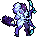 | [千珏](docs/heroes/league_kindred.md)<br>Kindred | 打野 | 乱箭之舞 · 横生惧意 / 狼灵狂热 · 大招 羊灵生息 | [千珏附加包](addons/league_kindred/README.md) | PPU 2.2 |
|  | [李青](docs/heroes/league_leesin.md)<br>Lee Sin | 打野 | 被动 疾风骤雨 · 天音波 · 天雷破 · 大招 猛龙摆尾 | [盲僧 W 位移附加包](addons/league_leesin_hop/README.md) | PPU 1.5 |
|  | [莉莉娅](docs/heroes/league_lillia.md)<br>Lillia | 打野 | 被动 梦满枝 · 飞花挞 · 流涡种 · 大招 夜阑谣 | [莉莉娅梦尘与昏睡附加包](addons/league_lillia/README.md) | — |
|  | [易](docs/heroes/league_masteryi.md)<br>Master Yi | 打野 | 被动 双重打击 · 阿尔法突袭 · 无极剑道 · 大招 高原血统 | [参与击杀附加包：金克丝、崔丝塔娜、易、图奇](addons/league_takedowns/README.md) | — |
|  | [纳亚菲利](docs/heroes/league_naafiri.md)<br>Naafiri | 打野 | 暗裔犬牙 · 剔骨本能 · 大招 猎狗血性 | [纳亚菲利附加包](addons/league_naafiri/README.md) | PPU 1.5 |
|  | [奈德丽](docs/heroes/league_nidalee.md)<br>Nidalee | 打野 | 标枪投掷 / 推倒 · 野性奔腾 / 猛扑 · 大招 美洲狮形态 | [奈德丽附加包](addons/league_nidalee/README.md) | PPU 2.2 |
|  | [魔腾](docs/heroes/league_nocturne.md)<br>Nocturne | 打野 | 被动 暗影之刃 · 梦魇之径 · 无言恐惧 · 大招 鬼影重重 | [魔腾黑暗附加包](addons/league_nocturne_dark/README.md) | — |
|  | [努努和威朗普](docs/heroes/league_nunu.md)<br>Nunu & Willump | 打野 | 史上最大雪球！ · 雪球飞射 · 大招 绝对零度 | — | PPU 1.37 |
| 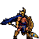 | [潘森](docs/heroes/league_pantheon.md)<br>Pantheon | 打野 | 贯星长枪 · 斗盾跃击 · 大招 大荒星陨 | [潘森附加包](addons/league_pantheon/README.md) | PPU 1.5 |
|  | [奇亚娜](docs/heroes/league_qiyana.md)<br>Qiyana | 打野 | 以绪塔尔之锋 · 天纵之勇 · 大招 惊才绝景 | [奇亚娜附加包](addons/league_qiyana/README.md) | PPU 1.5 |
|  | [拉莫斯](docs/heroes/league_rammus.md)<br>Rammus | 打野 | 动力冲刺 · 狂乱嘲讽 · 大招 冲天猛撞 | [拉莫斯附加包](addons/league_rammus/README.md) | PPU 1.2 |
| 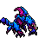 | [雷克塞](docs/heroes/league_reksai.md)<br>Rek'Sai | 打野 | 女王之怒 · 遁地 · 大招 虚空猛冲 | [雷克塞附加包](addons/league_reksai/README.md) | PPU 1.2 |
|  | [雷恩加尔](docs/heroes/league_rengar.md)<br>Rengar | 打野 | 战争咆哮 · 套索打击 · 大招 狩猎律动 | [雷恩加尔草丛附加包](addons/league_rengar_bush/README.md) | PPU 1.48 |
|  | [瑟庄妮](docs/heroes/league_sejuani.md)<br>Sejuani | 打野 | 极寒突袭 · 凛冬之怒 · 大招 极冰寒狱 | [瑟庄妮附加包](addons/league_sejuani/README.md) | PPU 2 |
|  | [萨科](docs/heroes/league_shaco.md)<br>Shaco | 打野 | 被动 背刺 · 欺诈魔术 · 惊吓魔盒 · 大招 幻像 | [萨科背刺附加包](addons/league_shaco_backstab/README.md) | — |
|  | [希瓦娜](docs/heroes/league_shyvana.md)<br>Shyvana | 打野 | 焚焰打击 · 爆炎吐息 · 大招 魔龙降世 | [希瓦娜附加包](addons/league_shyvana/README.md) | PPU 1.5 |
|  | [斯卡纳](docs/heroes/league_skarner.md)<br>Skarner | 打野 | 撼地 · 以绪塔尔冲击 · 大招 毒刺贯体 | [斯卡纳附加包](addons/league_skarner/README.md) | PPU 1.75 |
|  | [特朗德尔](docs/heroes/league_trundle.md)<br>Trundle | 打野 | 利齿撕咬 · 寒冰之柱 · 大招 强权至上 | [特朗德尔附加包](addons/league_trundle/README.md) | PPU 2 |
|  | [乌迪尔](docs/heroes/league_udyr.md)<br>Udyr | 打野 | 狂暴爪击 · 踏火蛮冲 · 大招 极凌飓风 | [乌迪尔附加包](addons/league_udyr/README.md) | PPU 1.5 |
|  | [蔚](docs/heroes/league_vi.md)<br>Vi | 打野 | 强能冲拳 · 透体之劲 · 大招 天霸横空烈轰 | — | — |
|  | [佛耶戈](docs/heroes/league_viego.md)<br>Viego | 打野 | 破败王剑 · 千载幽咽 · 大招 痛贯天灵 | [佛耶戈「君命已决」附加包](addons/league_viego_soul/README.md) | — |
| 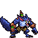 | [沃里克](docs/heroes/league_warwick.md)<br>Warwick | 打野 | 野兽之口 · 远祖嗥叫 · 大招 无尽束缚 | [沃里克附加包](addons/league_warwick/README.md) | PPU 1.2 |
|  | [孙悟空](docs/heroes/league_wukong.md)<br>Wukong | 打野 | 腾云突击 · 真假猴王 · 大招 大闹天宫 | [悟空附加包](addons/league_wukong/README.md) | PPU 1.2 |
| 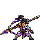 | [赵信](docs/heroes/league_xinzhao.md)<br>Xin Zhao | 打野 | 被动 果决 · 无畏冲锋 · 风斩电刺 · 大招 新月护卫 | [赵信大招远程免伤附加包](addons/league_xinzhao_guard/README.md) | PPU 1.5 |
|  | [扎克](docs/heroes/league_zac.md)<br>Zac | 打野 | 延伸打击 · 橡筋弹弓 · 大招 动感弹球 | [扎克附加包](addons/league_zac/README.md) | PPU 1.5 |
|  | [范德尔](docs/heroes/tft_vander.md)<br>Vander（tft 包） | 打野 | 地下猎犬 · 铁拳突进 · 大招 桥头死守 | — | PPU 2 |

### 中单（46）

| 头像 | 英雄 | 分路 | 技能 | 附加包 | 高清帧 |
|---|---|---|---|---|---|
|  | [阿狸](docs/heroes/league_ahri.md)<br>Ahri | 中单 | 被动 摄魂夺魄 · 欺诈宝珠 · 魅惑妖术 · 大招 灵魄突袭 | [阿狸附加包](addons/league_ahri/README.md) | PPU 2.2 |
| 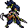 | [阿卡丽](docs/heroes/league_akali.md)<br>Akali | 中单 | 被动 我流忍法！潜龙印 · 我流奥义！寒影 · 我流奥义！隼舞 · 大招 我流秘奥义！表里杀缭乱 | [斩杀附加包：伊芙琳、阿卡丽、锐雯](addons/league_executes/README.md) | PPU 1.8 |
| 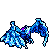 | [艾尼维亚](docs/heroes/league_anivia.md)<br>Anivia | 中单 | 寒冰闪耀 · 霜寒刺骨 · 大招 冰川风暴 | [艾尼维亚附加包](addons/league_anivia/README.md) | PPU 1.2 |
|  | [安妮](docs/heroes/league_annie.md)<br>Annie | 中单 | 被动 嗜火 · 碎裂之火 · 焚烧 · 大招 提伯斯之怒 | [安妮附加包：Q 返还、提伯斯换目标](addons/league_annie_q/README.md) | PPU 2.2 |
|  | [奥瑞利安·索尔](docs/heroes/league_aurelionsol.md)<br>Aurelion Sol | 中单 | 星河冲荡 · 星芒凝汇 · 大招 星天落瀑 | [奥瑞利安·索尔附加包](addons/league_aurelionsol/README.md) | PPU 1.75 |
|  | [阿萝拉](docs/heroes/league_aurora.md)<br>Aurora | 中单 | 飞去来咒 · 怪奇喷涌 · 大招 双界合一 | [阿萝拉附加包](addons/league_aurora/README.md) | PPU 2.25 |
| 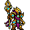 | [阿兹尔](docs/heroes/league_azir.md)<br>Azir | 中单 | 狂沙猛攻 · 流沙移形 · 大招 禁军之墙 | [阿兹尔附加包](addons/league_azir/README.md) | PPU 1.5 |
|  | [布兰德](docs/heroes/league_brand.md)<br>Brand | 中单 | 被动 炽热之焰 · 烈焰之柱 · 烈火燃烧 · 大招 烈焰风暴 | [布兰德被动层数附加包](addons/league_brand/README.md) | — |
| 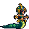 | [卡西奥佩娅](docs/heroes/league_cassiopeia.md)<br>Cassiopeia | 中单 | 瘟毒爆炸 · 剧毒迷雾 · 大招 石化凝视 | [卡西奥佩娅附加包](addons/league_cassiopeia/README.md) | PPU 1.2 |
|  | [库奇](docs/heroes/league_corki.md)<br>Corki | 中单 | 磷光炸弹 · 格林机枪 · 大招 火箭轰击 | [库奇智能火箭 + 脱身方向附加包](addons/league_corki/README.md) | PPU 2.2 |
|  | [菲兹](docs/heroes/league_fizz.md)<br>Fizz | 中单 | 被动 伶俐斗士 · 淘气打击 · 古灵精怪 · 大招 巨鲨强袭 | — | — |
| 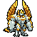 | [加里奥](docs/heroes/league_galio.md)<br>Galio | 中单 | 战争罡风 · 正义冲拳 · 大招 英雄登场 | [加里奥附加包](addons/league_galio/README.md) | PPU 1.65 |
|  | [黑默丁格](docs/heroes/league_heimerdinger.md)<br>Heimerdinger | 中单 | H-28 G 进化炮台 · CH-2电子风暴手雷 · 大招 升级！！！ | [黑默丁格附加包](addons/league_heimerdinger/README.md) | PPU 1.2 |
|  | [彗](docs/heroes/league_hwei.md)<br>Hwei | 中单 | 主题：灾 · 主题：悚 · 大招 焚心绚华绘 | — | PPU 1.5 |
| 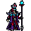 | [卡尔萨斯](docs/heroes/league_karthus.md)<br>Karthus | 中单 | 荒芜 · 亵渎 · 大招 安魂曲 | [卡尔萨斯附加包](addons/league_karthus/README.md) | PPU 1.5 |
| 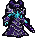 | [卡萨丁](docs/heroes/league_kassadin.md)<br>Kassadin | 中单 | 虚无法球 · 能量脉冲 · 大招 虚空行走 | [卡萨丁附加包](addons/league_kassadin/README.md) | PPU 2.42 |
|  | [卡特琳娜](docs/heroes/league_katarina.md)<br>Katarina | 中单 | 弹射之刃 · 伺机待发 · 大招 死亡莲华 | [卡特琳娜附加包](addons/league_katarina/README.md) | PPU 1.5 |
|  | [乐芙兰](docs/heroes/league_leblanc.md)<br>LeBlanc | 中单 | 被动 镜花水月 · 恶意魔印 · 魔影迷踪 · 大招 故技重施 | [低血量附加包：布里茨、乐芙兰、丽桑卓](addons/league_lowhp/README.md) | PPU 2 |
|  | [丽桑卓](docs/heroes/league_lissandra.md)<br>Lissandra | 中单 | 被动 冰脉驱役 · 寒冰碎片 · 冰霜之环 · 大招 冰封陵墓 | [低血量附加包：布里茨、乐芙兰、丽桑卓](addons/league_lowhp/README.md) | — |
|  | [洛克](docs/heroes/league_locke.md)<br>Locke | 中单 | 伏魔三钉 · 灰猎无影 · 大招 万魔狱 | [洛克附加包](addons/league_locke/README.md) | PPU 2 |
|  | [拉克丝](docs/heroes/league_lux.md)<br>Lux | 中单 | 被动 光芒四射 · 光之束缚 · 透光奇点 · 大招 终极闪光 | [目标标记附加包](addons/league_marks/README.md) | PPU 2.2 |
|  | [玛尔扎哈](docs/heroes/league_malzahar.md)<br>Malzahar | 中单 | 被动 虚空穿越 · 煞星幻象 / 虚空虫群 · 虚空召唤 · 大招 冥府之握 | [玛尔扎哈附加包](addons/league_malzahar/README.md) | PPU 1.38 |
|  | [妮蔻](docs/heroes/league_neeko.md)<br>Neeko | 中单 | 盛开花种 · 缠结倒刺 · 大招 怒放 | [妮蔻附加包](addons/league_neeko/README.md) | PPU 2.5 |
|  | [奥莉安娜](docs/heroes/league_orianna.md)<br>Orianna | 中单 | 指令：攻击 · 指令：防卫 · 大招 指令：冲击波 | [奥莉安娜附加包](addons/league_orianna/README.md) | PPU 2.25 |
|  | [瑞兹](docs/heroes/league_ryze.md)<br>Ryze | 中单 | 被动 奥术专精 · 超负荷 · 符文禁锢 · 大招 曲境折跃 | — | — |
|  | [斯维因](docs/heroes/league_swain.md)<br>Swain | 中单 | 解脱之触 · 永不复行 · 大招 恶魔升华 | [斯维因附加包](addons/league_swain/README.md) | PPU 1.5 |
| 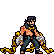 | [塞拉斯](docs/heroes/league_sylas.md)<br>Sylas | 中单 | 锁链鞭击 · 潜掠/强掳 · 大招 其人之道 | [塞拉斯附加包](addons/league_sylas/README.md) | PPU 1.2 |
|  | [辛德拉](docs/heroes/league_syndra.md)<br>Syndra | 中单 | 被动 卓尔不凡 · 暗黑法球 · 弱者退散 · 大招 能量倾泻 | [辛德拉举小兵附加包](addons/league_syndra/README.md) | PPU 1.86 |
|  | [塔莉垭](docs/heroes/league_taliyah.md)<br>Taliyah | 中单 | 石穿 · 岩突 · 大招 墙幔 | [塔莉垭附加包](addons/league_taliyah/README.md) | PPU 1.75 |
| 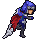 | [泰隆](docs/heroes/league_talon.md)<br>Talon | 中单 | 斩草除根 · 诺克萨斯式外交 · 大招 暗影突袭 | [泰隆「刺客之道」翻墙附加包](addons/league_talon_vault/README.md) | — |
|  | [崔斯特](docs/heroes/league_twistedfate.md)<br>Twisted Fate | 中单 | 被动 灌铅骰子 · 万能牌 · 选牌 · 大招 命运 | — | — |
|  | [维迦](docs/heroes/league_veigar.md)<br>Veigar | 中单 | 被动 超凡邪力 · 黑暗祭祀 · 扭曲空间 · 大招 能量爆裂 | [维迦法强常驻附加包](addons/league_veigar_power/README.md) | — |
| 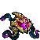 | [维克兹](docs/heroes/league_velkoz.md)<br>Vel'Koz | 中单 | 等离子裂变 · 构造分解 · 大招 生命形态瓦解射线 | [维克兹附加包](addons/league_velkoz/README.md) | PPU 1.5 |
|  | [薇古丝](docs/heroes/league_vex.md)<br>Vex | 中单 | 寒心波云 · 溟濛渐染 · 大招 愁煞 | [薇古丝附加包](addons/league_vex/README.md) | PPU 1.5 |
|  | [维克托](docs/heroes/league_viktor.md)<br>Viktor | 中单 | 被动 光荣进化 · 虹吸能量 · 海克斯射线 · 大招 奥术风暴 | — | — |
|  | [泽拉斯](docs/heroes/league_xerath.md)<br>Xerath | 中单 | 被动 法力澎湃 · 奥能脉冲 · 冲击法球 · 大招 奥术仪式 | — | PPU 1.55 |
|  | [亚索](docs/heroes/league_yasuo.md)<br>Yasuo | 中单 | 被动 浪客之道 · 斩钢闪 · 踏前斩 · 大招 狂风绝息斩 | [亚索风之障壁附加包](addons/league_yasuo_wall/README.md) | PPU 2.2 |
| 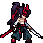 | [永恩](docs/heroes/league_yone.md)<br>Yone | 中单 | 被动 狩人之道 · 错玉切 · 凛神斩 · 大招 封尘绝念斩 | [永恩 R 附加包](addons/league_yone_r/README.md) | — |
| 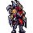 | [劫](docs/heroes/league_zed.md)<br>Zed | 中单 | 影奥义！分身 · 影奥义！诸刃 · 大招 禁奥义！瞬狱影杀阵 | [劫读血附加包](addons/league_zed_mark/README.md) | — |
|  | [吉格斯](docs/heroes/league_ziggs.md)<br>Ziggs | 中单 | 弹跳炸弹 · 海克斯爆破雷区 · 大招 科学的地狱火炮 | [吉格斯附加包](addons/league_ziggs/README.md) | PPU 1.2 |
|  | [佐伊](docs/heroes/league_zoe.md)<br>Zoe | 中单 | 飞星乱入！ · 催眠气泡 · 大招 折返跃迁 | [佐伊附加包](addons/league_zoe/README.md) | PPU 1.5 |
|  | [婕拉](docs/heroes/league_zyra.md)<br>Zyra | 中单 | 致命棘刺 · 缠绕之根 · 大招 绞杀之藤 | [婕拉附加包](addons/league_zyra/README.md) | PPU 1.7 |
|  | [拉露恩](docs/heroes/tft_alune.md)<br>Alune（tft 包） | 中单 | 月之降临 · 月华 · 大招 月曜降临 | — | PPU 2 |
|  | [诺拉](docs/heroes/tft_norra.md)<br>Norra（tft 包） | 中单 | 回忆涌现 · 思乡线缕 · 大招 传送门欢腾！ | — | PPU 2 |
|  | [爆爆](docs/heroes/tft_powder.md)<br>Powder（tft 包） | 中单 | 猴子炸弹 · 快跑，爆爆！ · 大招 海克斯水晶炸弹 | — | PPU 1.75 |
|  | [希尔科](docs/heroes/tft_silco.md)<br>Silco（tft 包） | 中单 | 罐装畸变体 · 微光注射 · 大招 炼金狂潮 | — | PPU 2 |

### ADC（26）

| 头像 | 英雄 | 分路 | 技能 | 附加包 | 高清帧 |
|---|---|---|---|---|---|
| 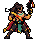 | [阿克尚](docs/heroes/league_akshan.md)<br>Akshan | ADC | 去而复还 · 骄行荡寇 · 大招 恩怨相抵 | [阿克尚扩展包](addons/league_akshan/README.md) | PPU 1.2 |
| 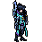 | [厄斐琉斯](docs/heroes/league_aphelios.md)<br>Aphelios | ADC | 武器技能 · 月相轮转 · 大招 清辉夜凝 | [厄斐琉斯附加包](addons/league_aphelios/README.md) | PPU 1.5 |
|  | [艾希](docs/heroes/league_ashe.md)<br>Ashe | ADC | 被动 冰霜射击 · 射手的专注 · 万箭齐发 · 大招 魔法水晶箭 | — | PPU 2.2 |
|  | [凯特琳](docs/heroes/league_caitlyn.md)<br>Caitlyn | ADC | 被动 爆头 · 和平使者 · 约德尔诱捕器 · 大招 让子弹飞 | [凯特琳附加包](addons/league_caitlyn/README.md) | PPU 1.45 |
|  | [德莱文](docs/heroes/league_draven.md)<br>Draven | ADC | 旋转飞斧 · 开道利斧 · 大招 冷血追命 | — | PPU 2.2 |
|  | [伊泽瑞尔](docs/heroes/league_ezreal.md)<br>Ezreal | ADC | 被动 咒能高涨 · 秘术射击 · 奥术跃迁 · 大招 精准弹幕 | — | — |
|  | [烬](docs/heroes/league_jhin.md)<br>Jhin | ADC | 被动 低语 · 曼舞手雷 · 致命华彩 · 大招 完美谢幕 | [烬低语附加包](addons/league_jhin_whisper/README.md) | — |
|  | [金克丝](docs/heroes/league_jinx.md)<br>Jinx | ADC | 震荡电磁波！ · 嚼火者手雷！ · 大招 超究极死神飞弹！ | [参与击杀附加包：金克丝、崔丝塔娜、易、图奇](addons/league_takedowns/README.md) | PPU 2.2 |
|  | [卡莎](docs/heroes/league_kaisa.md)<br>Kai'Sa | ADC | 艾卡西亚暴雨 · 虚空索敌 · 大招 猎手本能 | [目标标记附加包](addons/league_marks/README.md) | PPU 1.45 |
|  | [卡莉丝塔](docs/heroes/league_kalista.md)<br>Kalista | ADC | 穿刺 · 撕裂 · 大招 命运的召唤 | [卡莉丝塔附加包](addons/league_kalista/README.md) | PPU 1.4 |
|  | [克格莫](docs/heroes/league_kogmaw.md)<br>Kog'Maw | ADC | 腐蚀唾液 · 虚空淤泥 · 大招 活体大炮 | — | — |
|  | [卢锡安](docs/heroes/league_lucian.md)<br>Lucian | ADC | 被动 圣光银弹 · 透体圣光 · 冷酷追击 · 大招 圣枪洗礼 | — | PPU 2.02 |
|  | [梅尔](docs/heroes/league_mel.md)<br>Mel | ADC | 耀光齐射 · 阳炎涡旋 · 大招 鎏金蚀日 | [梅尔附加包](addons/league_mel/README.md) | PPU 1.5 |
|  | [厄运小姐](docs/heroes/league_missfortune.md)<br>Miss Fortune | ADC | 被动 厄运的眷顾 · 一箭双雕 · 枪林弹雨 · 大招 弹幕时间 | [目标标记附加包](addons/league_marks/README.md) | — |
| 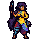 | [尼菈](docs/heroes/league_nilah.md)<br>Nilah | ADC | 游刃万变 · 纵情逐流 / 轻纱飞漾 · 大招 神恩激荡 | [尼菈附加包](addons/league_nilah/README.md) | PPU 1.98 |
| 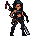 | [莎弥拉](docs/heroes/league_samira.md)<br>Samira | ADC | 被动 悍勇本色 · 交火 · 狂飙 · 大招 炼狱扳机 | [莎弥拉边走边射附加包](addons/league_samira_r/README.md) | PPU 2.84 |
| 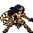 | [希维尔](docs/heroes/league_sivir.md)<br>Sivir | ADC | 被动 敏锐疾行 · 回旋之刃 · 法术护盾 · 大招 狩猎 | — | — |
|  | [斯莫德](docs/heroes/league_smolder.md)<br>Smolder | ADC | 被动 龙之研习 · 超级灼热龙息 · 阿嚏！ / 扑棱，扑棱，扑棱！ · 大招 妈----！ | [斯莫德附加包](addons/league_smolder/README.md) | PPU 1.5 |
|  | [崔丝塔娜](docs/heroes/league_tristana.md)<br>Tristana | ADC | 被动 瞄准 · 爆炸火花 · 火箭跳跃 · 大招 毁灭射击 | [参与击杀附加包：金克丝、崔丝塔娜、易、图奇](addons/league_takedowns/README.md) | — |
| 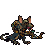 | [图奇](docs/heroes/league_twitch.md)<br>Twitch | ADC | 被动 死亡毒液 · 埋伏 · 剧毒之桶 · 大招 火力全开 | [参与击杀附加包：金克丝、崔丝塔娜、易、图奇](addons/league_takedowns/README.md) | PPU 2.2 |
| 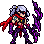 | [韦鲁斯](docs/heroes/league_varus.md)<br>Varus | ADC | 被动 复仇之欲 · 穿刺之箭 · 恶灵箭雨 · 大招 腐败锁链 | [韦鲁斯枯萎附加包](addons/league_varus_blight/README.md) | PPU 1.35 |
|  | [薇恩](docs/heroes/league_vayne.md)<br>Vayne | ADC | 被动 暗夜猎手 · 闪避突袭 · 恶魔审判 · 大招 终极时刻 | [薇恩圣银弩箭附加包](addons/league_vayne_bolts/README.md) | PPU 2.2 |
|  | [霞](docs/heroes/league_xayah.md)<br>Xayah | ADC | 被动 锐切 · 双刃·倒钩 · 致死羽衣 · 大招 暴风羽刃 | [霞羽毛附加包](addons/league_xayah_feathers/README.md) | — |
|  | [芸阿娜](docs/heroes/league_yunara.md)<br>Yunara | ADC | 善恶轮 · 明踪步 · 大招 定圣诀 | [芸阿娜附加包](addons/league_yunara/README.md) | PPU 1.5 |
|  | [泽丽](docs/heroes/league_zeri.md)<br>Zeri | ADC | 被动 内能迁转 · 强穿激光 · 灿丽花火 · 大招 超限爆闪 | [泽丽附加包：W 撞墙激光 + 被动偷盾](addons/league_zeri/README.md) | PPU 3 |
|  | [麦迪](docs/heroes/tft_maddie.md)<br>Maddie（tft 包） | ADC | 连拨击锤 · 通缉令 · 大招 执法狙杀 | — | PPU 1.5 |

### 辅助（28）

| 头像 | 英雄 | 分路 | 技能 | 附加包 | 高清帧 |
|---|---|---|---|---|---|
|  | [阿利斯塔](docs/heroes/league_alistar.md)<br>Alistar | 辅助 | 被动 凯旋怒吼 · 大地粉碎 · 野蛮冲撞 · 大招 坚定意志 | — | — |
|  | [巴德](docs/heroes/league_bard.md)<br>Bard | 辅助 | 被动 旅者的召唤 · 星界束缚 · 游神圣坛 / 神奇旅程 · 大招 调和命运 | [巴德「神奇旅程」穿墙门附加包](addons/league_bard/README.md) | — |
|  | [布里茨](docs/heroes/league_blitzcrank.md)<br>Blitzcrank | 辅助 | 被动 法力屏障 · 机械飞爪 · 能量铁拳 · 大招 静电力场 | [低血量附加包：布里茨、乐芙兰、丽桑卓](addons/league_lowhp/README.md) | — |
|  | [布隆](docs/heroes/league_braum.md)<br>Braum | 辅助 | 寒冬之咬 · 坚不可摧 · 大招 冰川裂隙 | 布隆附加包 | PPU 1.98 |
|  | [迦娜](docs/heroes/league_janna.md)<br>Janna | 辅助 | 被动 顺风而行 · 飓风呼啸 · 风暴之眼 · 大招 复苏季风 | [辅助挑人附加包：迦娜、娑娜、璐璐](addons/league_support_pick/README.md) | PPU 1.5 |
|  | [卡尔玛](docs/heroes/league_karma.md)<br>Karma | 辅助 | 心灵烈焰 · 坚定不移 · 大招 梵咒 | — | PPU 2.2 |
|  | [蕾欧娜](docs/heroes/league_leona.md)<br>Leona | 辅助 | 被动 日光 · 破晓之盾 · 天顶之刃 · 大招 日炎耀斑 | — | — |
|  | [璐璐](docs/heroes/league_lulu.md)<br>Lulu | 辅助 | 闪耀长枪 · 奇思妙想 · 大招 狂野生长 | [辅助挑人附加包：迦娜、娑娜、璐璐](addons/league_support_pick/README.md) | — |
|  | [茂凯](docs/heroes/league_maokai.md)<br>Maokai | 辅助 | 荆棘重击 · 扭曲突刺 · 大招 自然之握 | [茂凯附加包](addons/league_maokai/README.md) | PPU 1.3 |
|  | [米利欧](docs/heroes/league_milio.md)<br>Milio | 辅助 | 被动 热情洋溢！ · 火爆飞踢 · 融融情谊 / 依依不舍 · 大招 生生不息 | [米利欧附加包](addons/league_milio/README.md) | PPU 2.2 |
|  | [莫甘娜](docs/heroes/league_morgana.md)<br>Morgana | 辅助 | 被动 灵魂吸取 · 暗之禁锢 · 黑暗之盾 · 大招 灵魂镣铐 | — | PPU 1.5 |
| 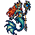 | [娜美](docs/heroes/league_nami.md)<br>Nami | 辅助 | 被动 踏浪之行 · 冲击之潮 · 碧波之牢 · 大招 怒涛之啸 | — | PPU 1.5 |
|  | [诺提勒斯](docs/heroes/league_nautilus.md)<br>Nautilus | 辅助 | 疏通航道 · 泰坦之怒 · 大招 深海冲击 | [诺提勒斯钩墙附加包](addons/league_nautilus/README.md) | — |
| 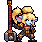 | [波比](docs/heroes/league_poppy.md)<br>Poppy | 辅助 | 圣锤猛击 · 英勇冲锋 · 大招 持卫的裁决 | [波比附加包](addons/league_poppy/README.md) | PPU 1.2 |
|  | [派克](docs/heroes/league_pyke.md)<br>Pyke | 辅助 | 被动 溺水之幸 · 透骨尖钉 · 魅影浪洄 · 大招 涌泉之恨 | [派克精确斩杀附加包](addons/league_pyke/README.md) | — |
|  | [洛](docs/heroes/league_rakan.md)<br>Rakan | 辅助 | 被动 异色羽裳 · 微光飞翎 · 盛大登场·轻舞成双 · 大招 惊鸿过隙 | — | — |
| 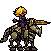 | [芮尔](docs/heroes/league_rell.md)<br>Rell | 辅助 | 裂阵 · 驭铁术：轰落 · 大招 极涌 | [芮尔附加包](addons/league_rell/README.md) | PPU 1.5 |
|  | [烈娜塔](docs/heroes/league_renata.md)<br>Renata | 辅助 | 忠诚激励 · 铁腕竞合 · 大招 恶意收购 | [烈娜塔附加包](addons/league_renata/README.md) | PPU 1.5 |
|  | [赛娜](docs/heroes/league_senna.md)<br>Senna | 辅助 | 黑暗洞灭 · 无尽厮守 · 大招 暗影燎原 | [赛娜黑雾常驻附加包](addons/league_senna_mist/README.md) | — |
|  | [萨勒芬妮](docs/heroes/league_seraphine.md)<br>Seraphine | 辅助 | 被动 星光漫射 · 清籁穿云 · 增幅节拍 · 大招 炫音返场 | — | — |
|  | [娑娜](docs/heroes/league_sona.md)<br>Sona | 辅助 | 被动 能量和弦 · 英勇赞美诗 · 坚毅咏叹调 · 大招 狂舞终乐章 | [辅助挑人附加包：迦娜、娑娜、璐璐](addons/league_support_pick/README.md) | — |
|  | [索拉卡](docs/heroes/league_soraka.md)<br>Soraka | 辅助 | 流星坠落 · 星之灌注 · 大招 祈愿 | — | PPU 2.2 |
|  | [塔姆](docs/heroes/league_tahmkench.md)<br>Tahm Kench | 辅助 | 巨舌鞭笞 · 深渊潜航 · 大招 大快朵颐 | [塔姆附加包](addons/league_tahmkench/README.md) | PPU 1.2 |
|  | [塔里克](docs/heroes/league_taric.md)<br>Taric | 辅助 | 被动 正气凌人 · 炫光 · 星光之触 · 大招 宇宙之辉 | — | — |
| 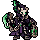 | [锤石](docs/heroes/league_thresh.md)<br>Thresh | 辅助 | 被动 厄运钟摆 · 死亡判决 · 厄运钟摆 · 大招 幽冥监牢 | [锤石灯笼附加包](addons/league_thresh_lantern/README.md) | — |
|  | [悠米](docs/heroes/league_yuumi.md)<br>Yuumi | 辅助 | 摸鱼飞弹 · 悠米出动！ · 大招 魔典终章 | [悠米附加包](addons/league_yuumi/README.md) | PPU 1.5 |
|  | [基兰](docs/heroes/league_zilean.md)<br>Zilean | 辅助 | 被动 瓶中时光 · 定时炸弹 · 时光发条 · 大招 时光倒流 | [基兰复活附加包](addons/league_zilean_rewind/README.md) | — |
| 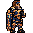 | [洛里斯](docs/heroes/tft_loris.md)<br>Loris（tft 包） | 辅助 | 皮城争斗 · 盾卫 · 大招 钢铁防线 | — | PPU 2 |

<!-- HEROES:END -->

## 英雄文档怎么生成

英雄一览、[`docs/heroes/`](docs/heroes/) 里每页的上半部分和 [`docs/heroes.xlsx`](docs/heroes.xlsx) 都由 [`tools/docs/gen_hero_docs.py`](tools/docs/gen_hero_docs.py) 按仓库里**现在的**数据生成（不联网）：名字和技能说明来自 `league/text/champion.i18n`（简体中文，去掉颜色和图标），冷却、距离、数值来自 `league/champion/<id>.data_champion`，PPU 来自 `addons/league_main/src/hd.rs`，附加包来自 `addons/*/mod.override_info`、`README.md` 和 `text/`，动图是 `docs/preview/<id>_*.gif`，头像是待机第一帧（`docs/heroes/img/`）。改了英雄、加了英雄或附加包之后重跑：

```bash
pip install pillow openpyxl                                   # 头像要 pillow，xlsx 要 openpyxl（都不是 mod 的依赖）
python tools/docs/gen_hero_docs.py                            # 写英雄页、这里的英雄一览和 docs/heroes.xlsx
python tools/docs/gen_hero_docs.py --released <已发布名单>      # xlsx 里填「工坊已发布」（一行一个英雄 id，如 ahri）
python tools/docs/gen_hero_docs.py --check                    # 只检查：有页面或英雄一览过期就返回 1（不看 xlsx 和头像）
```

- 每页 `## 开发记录` 以下是手写的，生成时原样保留：**新英雄的设计、美术、音效、改动说明写在这里**，不再写进 README。分路从「开发记录」表格的「定位」一行读（`| 定位 | 上单（……）|`），没有这一行的在脚本的 `LANE_FALLBACK` 里补。
- README 里只有 `<!-- HEROES:BEGIN -->` 和 `<!-- HEROES:END -->` 之间是生成的，其余手写。
- 脚本可以重复跑，结果一样；在稀疏检出（没有图和动图）的工作区里也能跑，缺的文件从 git 的 HEAD 读。

## 仓库里的 skill

`.claude/skills/tfm2-hero-mod/` 是一个团战经理2英雄 mod 开发 skill。在本仓库里用 Claude Code 时会自动加载。

| 路径 | 内容 |
|---|---|
| `SKILL.md` | 英雄从数据到上架的完整流程，以及防止"静默失效"的硬规则 |
| `references/mod-structure.md` | mod 文件结构、`mod.mod_info` / `mod.override_info`、资源路径、本地测试、官方上传器 |
| `references/champion-data.md` | `.data_champion` 全字段、时间和距离单位、官方英雄的属性和冷却区间、54 种可用效果类型、buff 字段、特效绑定、常用写法 |
| `references/art-spec.md` | 像素画规范（实测数据）、动画 tag 和帧时长、锚点、特效和图标风格、AI 生成图的导入方法、QA 清单 |
| `references/text-audio.md` | 多语言文本、富文本颜色和图标、`champion_view`、音效 |
| `references/porting-heroes.md` | 把 LoL、Dota 的技能移植到 TFM2：机制对照表、选英雄评分法、LoL 客户端文件提取 |
| `references/workshop-page.md` | 创意工坊页面模板：缩略图、演示动图、收藏页、简介、更新说明 |
| `scripts/lint_mod.py` | 整包校验：路径、动画 tag、特效绑定、文本 key、音效注入、override 目标等 |
| `scripts/tfm2_ase.py` | 精灵图查看、预览和量化：身高、描边、颜色数、半透明像素等 |
| `scripts/strips.py` | 把 AI 生成的动作条导入成游戏精灵图：切帧、对齐、像素化、调色板、描边、导出 |
| `scripts/bundle_tool.py` | 只读浏览游戏本体资源：可引用的原版特效、音效名、官方英雄数据 |
| `templates/mymod/` | 可直接复制的示例 mod，已通过校验 |

## 快速开始

```bash
pip install pillow numpy
python .claude/skills/tfm2-hero-mod/scripts/lint_mod.py league
python .claude/skills/tfm2-hero-mod/scripts/tfm2_ase.py metrics <英雄>.aseprite
python .claude/skills/tfm2-hero-mod/scripts/bundle_tool.py sfx --grep fighter
```

脚本会在常见的 Steam 路径里找游戏。找不到时加上 `--game "<Teamfight Manager2 目录>"`，或者设置环境变量 `TFM2_GAME_DIR`。

在别的项目里也想用这个 skill：把 `.claude/skills/tfm2-hero-mod` 复制到 `~/.claude/skills/`。其他支持 SKILL.md 格式的工具，复制到它们各自的 skills 目录即可。

## 知识来源

- 游戏本体：68 个官方英雄的数据、78 套官方精灵图、官方上传器
- 创意工坊高分英雄包：oppi 等人的 *League of Legends Reborn*（3774304166）和 *Dota 2 Heroes*（3770621310），以及 *Touhou Project*

文档里的数字都是实测的。只靠推断得出的结论会标 *(inferred)*。

## 声明

非商业粉丝作品。英雄联盟及其角色、音频、图标版权归 Riot Games 所有，团战经理2 版权归其开发商所有。
