# TFM2-League-Heroes

团战经理2（Teamfight Manager 2）的英雄联盟英雄 Mod，mod_id 是 `league`。英雄本身都是数据（`league/`）；主包从 0.97.0 起带一个自己的 DLL（`league.dll`，源码 [`addons/league_main`](addons/league_main/src/lib.rs)，`mod.mod_info` 是 `contains_code` / `native`，订阅时游戏会提示这是代码 mod），只做数据做不到的事：高清帧（PPU）、界面小图集、选人卡片的动画、音频预读（高清帧和小图集的画法在 [`addons/hd_engine`](addons/hd_engine/src/lib.rs)，和 tft 包的 `tft.dll` 共用）。仓库里还有第二个 mod `tft`（金铲铲之战系列，源文件在 [`tft/`](tft/)），和一组可选的原生代码附加包（[`addons/`](addons/)，合成一个 `league_addons`）。

- **每位英雄现在的技能、附加包、高清帧和开发记录**：见下面的 [英雄一览](#英雄一览)，或者 [`docs/heroes/`](docs/heroes/) 里每位英雄一页；表格版是 [`docs/heroes.xlsx`](docs/heroes.xlsx)。
- 原来 README 里很长的技术说明搬到了 [`docs/tech-notes.md`](docs/tech-notes.md)，演示动图在 [`docs/gallery.md`](docs/gallery.md)，不属于某位英雄的几节在 [`docs/dev-notes.md`](docs/dev-notes.md)，性能调查在 [`docs/perf.md`](docs/perf.md)。

<table>
<tr>
<td align="center"><a href="docs/heroes/league_shen.md">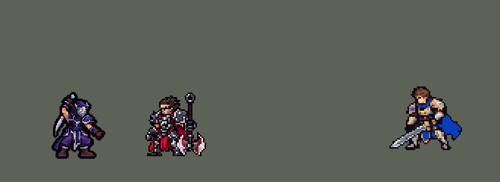</a><br>慎</td>
<td align="center"><a href="docs/heroes/league_zoe.md">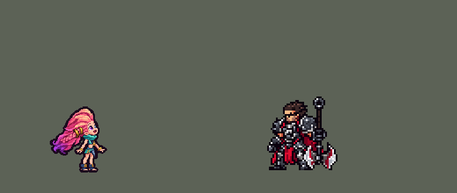</a><br>佐伊</td>
</tr>
<tr>
<td align="center"><a href="docs/heroes/league_milio.md">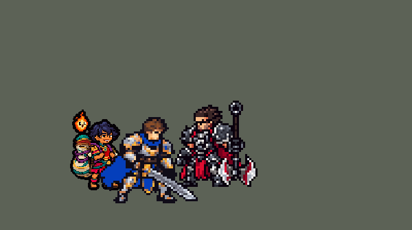</a><br>米利欧</td>
<td align="center"><a href="docs/heroes/league_seraphine.md"></a><br>萨勒芬妮</td>
</tr>
<tr>
<td align="center"><a href="docs/heroes/league_hecarim.md">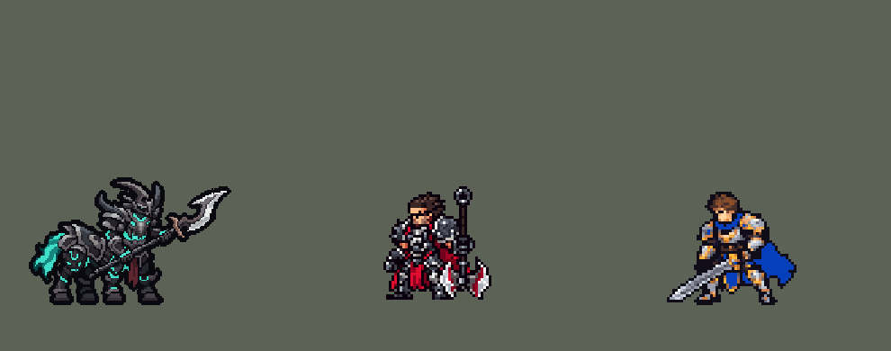</a><br>赫卡里姆</td>
<td align="center"><a href="docs/heroes/league_jhin.md">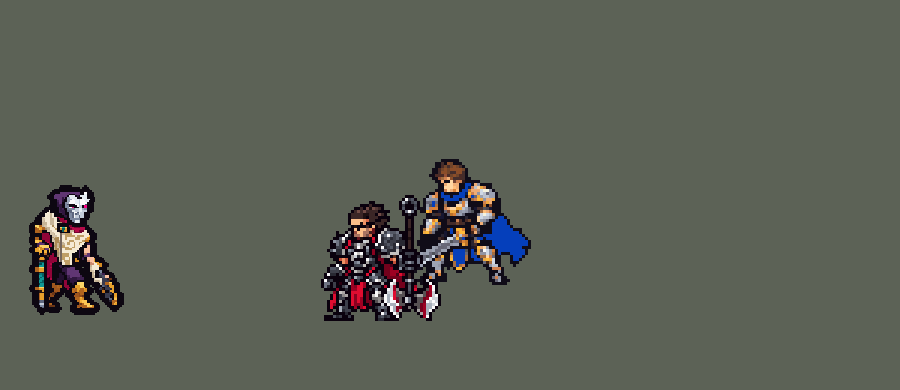</a><br>烬</td>
</tr>
</table>

上面是最近用 PPU 重做的几位（点图看那位英雄的一页）。全部演示动图见 [`docs/gallery.md`](docs/gallery.md)，每位英雄的动图也在他自己那一页。

## 目录

- [最近的改动](#最近的改动)
- [安装测试](#安装测试)
- [附加包](#附加包)
- [高清帧（PPU）和界面](#高清帧ppu和界面)
- [游戏版本更新时](#游戏版本更新时)
- [持续集成](#持续集成)
- [踩坑记录](#踩坑记录)
- [金铲铲之战系列（tft 包）](#金铲铲之战系列tft-包)
- [英雄一览](#英雄一览)
- [英雄文档怎么生成](#英雄文档怎么生成)
- [仓库里的 skill](#仓库里的-skill) · [快速开始](#快速开始) · [知识来源](#知识来源) · [声明](#声明)

## 最近的改动

2026-11-26（英雄联盟大小龙 0.5.12：Rin 的召唤师峡谷上小龙转身朝坑口，元素峡谷的地形也有了）：

- **Rin 的召唤师峡谷上小龙朝着坑口**（用户：「我们的小龙在大地图的龙坑站位方向应该朝着外面吧 要和原版地图不一样吧 这个得改一下吧」）：
  那张地图的小龙坑被墙围了大半圈、只朝河道开口，原来正面朝着镜头的龙等于脸对着坑后面的墙。Codex 把六种元素亚龙和远古巨龙转身朝
  画面右上方重画了一套（设计、攻击、死亡，照英雄联盟同一个角度的姿势），`tools/art/dragons_rift_hd.py` 读成 7 张
  `league_drake_<元素>_rift`：攻击从嘴里朝坑口喷出去、远处炸开，待机扇远处那只翅膀；死亡第 2 帧 Codex 画小了，放大 1.5 倍对齐前后帧。
  只在 Rin 的地图上换（读阵容时认出地图），游戏自带的地图照旧是正面那套。
- **元素峡谷的地形在 Rin 的召唤师峡谷上也有了**（用户：「小龙的地形特效是不是也要兼容大地图啊」）：风道、海克斯传送门、海洋草丛和蜂蜜
  果实、化学科技毒雾、山脉碎石、炼狱烧墙，同样多、同样的规则和画面，位置另一套（`rift::RIN`：按 Rin 0.1.68 的寻路网格离墙、离兵线和
  营地够远，红方是蓝方绕地图中心转 180 度，完全对称）；比赛里还会拿读到的墙再对一遍，日志写出来。原版地图上不变。
- **0.5.13、`lol_audio` 0.3.3：读档后再看同一场，横幅、语音不再跟着上一遍走**（用户在大地图上：「第一条是土龙吧」——横幅说红色方拿了化学科技亚龙，坑里的龙
  和左上的小框是蓝色方拿了山脉亚龙；「不然自动导播的时候会没有声音」）：游戏会把屏幕上的一局快跑第二遍，种子一样、事一样，两个
  模组都按（比赛, 局）认作同一遍——大小龙的画面记录只记一次，lol_audio 第二遍整场不放。可读档后再看同一场，游戏换了种子重新模拟，
  结果完全不同：大小龙把两遍的事混在一起（横幅放的是上一遍的），lol_audio 把它当成第二遍一句不放（日志 `AGAIN … ignored`）。
  现在两个都带上模拟的种子认：种子不同就是新的一遍，从头记、从头播；游戏自己的第二遍种子一样，照旧。声音不是地图大的问题：
  游戏的音效不按离镜头多远减弱。
- `league_dragons` 0.5.12 → 0.5.13、`lol_audio` 0.3.3。见 [`addons/league_dragons/README.md`](addons/league_dragons/README.md) 的「模型」和「元素峡谷的地形」。

2026-11-26（蕾欧娜的选人格子）：

- **蕾欧娜的选人格子不再冒出格子顶**（用户：「蕾欧娜BP格子显示不对 看看能不能改？」，截图里头冠顶着格子上沿、剑伸出格子）：她在 `league/style/champion_view.champion_view` 里的 `banpick_center` 从加入时起就是 `{0, 0}`，游戏把它当成没设值，按默认 -12 摆、不裁边，高个子就冒出格子。当初的 0 是按待机里最高的一格算的（-39 - (-39.3)），那一格是高举过头的剑尖；按 `tools/art/bp_card_audit.py` 的规则量头不量剑：头冠顶在帧中心上 30 游戏像素，-39 - (-30) = **-9**，和盖伦一样，头冠在画布上沿下 1 格，举剑那几帧的剑尖照惯例裁在格子里。`tools/art/hero_reels.py --hero leona` 重算过，选人格子的帧表不用改。
- 主包 0.474.0（只换了这个数据文件，league.dll 不变）。

2026-11-26（凯尔、艾达斯的选人格子；选人格子的值不再有 0 和正数）：

- **为什么蕾欧娜会冒出格子**（用户：「为什么会有这问题」，然后「一起修」）：`banpick_center` 照 `-39 - 待机最高的一格` 算，最高的一格是剑尖、翅膀尖时会算出 0 或正数；正数不许用就写成了 0，可游戏把 `{0, 0}` 当成没设（按 -12 摆、不裁），我们自己的 `tools/art/bp_card_audit.py`、`tools/art/hero_reels.py` 却把 0 当成正常的值，所以一直查不出来。
- **凯尔**也是 `{0, 0}`（翅膀尖 -40，算出 +1 被压成 0），翅膀冒出格子顶约 12 游戏像素：改成 **-1**（翅膀只裁掉最尖的 1 格，小腿在名字栏下面；-4、-7 会把翅膀裁平）。**艾达斯**（`tft_idas`）是 +1（接入时待机顶 -40 算的，后来她的待机顶只到 -33.3，而且正数从来不对：易大师以前 +5 时格子画成了 1 倍）：照规则改成 **-6**，`tools/kit/setup_idas.py` 的 `VIEW` 一起改。三个人的选人格子帧表都不用变（`hero_reels.py --check`）。
- **检查工具照游戏算**：`bp_card_audit.py` 和 `hero_reels.py` 把 `{0, 0}` 当成没设；表里标出 `ZERO=NONE` / `POSITIVE`，规则算出来不会是 0 或正数（那时量头，或者取 -1）。新的 `bp_card_audit.py --check` 进了 CI：哪个包的 `champion_view` 里有 `{0, 0}` 或正数就失败（在改之前的 main 上正好报出凯尔、蕾欧娜、艾达斯三个）。
- 主包 0.475.0、云顶包 0.79.0（只换两份数据文件，league.dll、tft.dll 不变）。

2026-11-26（终末的女武神 0.13.0：第十、十一回合四人，22 人的技能照原作对过）：

- **新英雄冲田总司（打野，刺客）**（「女武神可以做下一轮两个了」）：剑之刻（刀把他一生的剑技压进一刻，放技能后攻速提高）、天然理心流奥义·三段突（神速三刺）、鬼子（红眼：攻击、攻速、移速都提高）、天翔散段突（极快地突进再连刺三下，第三刺按最大生命打）。六句日语台词是 Codex 用语音合成做的（官方声优还没有能用的原声，用户说要用）。
- **新英雄须佐之男（上路，战士）**：天魔反·无间（每第三刀不蓄力地带出一道真空刃）、奥义·天魔反（月牙真空刃飞出去，越远越弱）、神罗八百万（正眼构：普攻打不疼他，再回敬一刀眩晕）、无装剑（空手挥出看不见的剑，只砍骨头，真实伤害，减速、降攻击；每挥一次扣自己的血，ragnarok.dll）。没有配音。
- **新英雄西蒙·海耶（下路，射手）**（「海耶耶做完了 一起完成」）：死神的契约（技能打出去的是器官换来的弑神弹，每发扣自己一点血，不会扣死，ragnarok.dll）、对神狙击术（万花缭乱、天穿白鸟、精灵的气息照原作的顺序轮着打）、雪中隐踪（往后一跃、隐身加速，原作里他每开一枪就换个地方）、天空的残光（最快最强的一枪，按目标最大生命打）。台词同冲田，是合成的。
- **新英雄洛基（中路，法师）**（「洛基也做完了 一起装进去」）：虚伪之神影（满力的分身照着他再挥一钩）、锁链钩、欺瞒之种·回生之门（黑雾里留下复制体，和远处的复制体换位、隐身）、道化师之环（复制出来的神兵大军在目标周围打三轮）。松冈禎丞的六句原声，见到释迦有一句挑衅。
- **22 人照原作改技能**（「已经做完的英雄和没做的这两个对比官方动漫 哪些技能做的不还原的需要你帮忙改成还原的 我需要的是完美的还原度」）：技能名一律换成原作的招式名（比如宙斯的黄昏流星群、小次郎的双燕斩虎万刃撩乱、哈迪斯的冥府的铁锤 / 大地崩碎者 / 血之引导曙光、特斯拉的众神的监狱和等离子脉冲拳·交叉、阿波罗的光辉的支配 / 阿尔忒弥斯的月影 / 射穿灵魂的银矢）；对不上原作的机制改掉：吕布压戟突刺改成定身、索尔斗神之雷槌的冲击波击飞、杰克的伞改成真的格挡（原作没有雾和隐身）、雷电八咫乌先瞬间贴近、释迦的十二天斧横扫（原作没有枪形态）、秦始皇的波流龟削弱对方的招、始皇承力燕斩把挨的打存进剑里还回去（ragnarok.dll）、别西卜的虚神对自己也有反噬、列奥尼达斯的链盾不再拽人、阿波罗的被动换成白夜的拥抱（身边英雄越多越强，ragnarok.dll）。
- **Codex 补画的 14 个动作接进来了**（「需要补画的到时候全部整理给我 我让codex补」）：索尔的铁手套格挡、杰克的 Dear GOD 和神器之伞、雷电的狮子舞、零福的斧爻岚阵、波旬的魔廻天衝和灼、吕布骑赤兔挥天喰、波塞冬跳起下刺、哈迪斯的冥府的铁锤、湿婆的虎爪炎舞、刻耳柏洛斯的贴近爪击、宙斯的黄昏流星群、冲田的天翔散段突、海耶两发子弹的特效，技能跟着按原作重做；Q 版里比待机大一圈的动作（赫拉克勒斯、湿婆、小次郎、哈迪斯）缩回待机的大小；索尔整套是 Codex 照动画重画的新造型，原样接进来（「用codex原样」，`tools/art/thor_q_redo.py`）。
- 版本：终末包 0.13.0；league.dll 0.9.145（主包 0.473.0：俄洛伊的灵魂图）、附加包 league_illaoi 0.3.15、league_viego_soul 0.2.84、league_yuumi 0.2.38、league_sylas 0.2.82；智能锁位置 1.3.76。

2026-11-26：

- **阿萝拉的大招照英雄联盟高手的放法，技能照 V26.22 核对**（用户：「检查一下阿罗拉和薇古丝完美还原英雄联盟了没有 阿罗拉这个大招释放的没有英雄联盟高手的感觉」）。附加包 `league_aurora` 0.4.0 重做了大招判断（`src/realm.rs`）：
  - 估算一整套伤害（冲击波、怪奇喷涌、飞去来咒的去和回、凑满的驱灵奇术、领域里两下普攻），够打死就放（`R COMBO`），不再只等对面残血。
  - 队友在打的人，就开大跟队友一起抓（`R PICK`）。
  - 被贴身时 70% 血就反开（`R PEEL`）。
  - 冲击波瞄着炸在目标身上，目标远了先走近。放完接 R → E → Q。
  - 领域里有人贴身才穿边界；圈里没有敌方英雄了就提前关（英雄联盟里再按一次 R），带着加速去追。

  技能照 V26.22 改：
  - 驱灵奇术在每个敌方英雄身上分别叠，第三层按目标最大生命和她的法强算。
  - 灵物在 4 秒里慢慢回血，不再加速。
  - 飞去来咒回程按目标已损失的生命加伤。
  - 击杀或助攻刷新灵纱洞开。
  - 怪奇喷涌减速 80%，1 秒内减弱；后跳变短。
  - 冲击波炸开 0.75 秒后领域才成形；领域时长、边界减速和 Realm Hopper 都按等级。
  - 领域的光圈拆成开场和循环两段，领域关了光圈就停。

  经典引擎模拟（720 局）：
  - 装附加包时击杀差从 −0.74 变成 +0.55。
  - 放 R 后 4 秒内拿到击杀或助攻：56% → 60%。
  - 三分之二的领域提前关掉。
  - 主包从 +1.56 变成 +0.80。

  怪奇喷涌保留锥形：英雄联盟的直线在模拟里每局只打中英雄 4.3 次，锥形打中 10 次。
- **薇古丝照英雄联盟 V26.13 核对**。主包：
  - 寒心波云先飞一道宽的慢波，再从前沿冲出一道窄的快波，画面只用她自己的特效帧拼。
  - 终焉先击倒（打断冲刺）再恐惧，恐惧时减速。
  - 伤害和护盾照英雄联盟的比例。
  - 溟濛渐染的冷却跟着英雄联盟下调，10 秒 → 9.2 秒。

  附加包 `league_vex` 0.2.0：
  - 终焉冷却和恐惧时长按等级。恐惧时的减速按离她的远近，在 60% 到 99% 之间。溟濛渐染带的恐惧，敌人背着它的中心跑。
  - 暮气只被普攻和寒心波云、生人勿近引爆。对小兵和野怪伤害打折，终焉返还 10%（英雄 25%）；溟濛渐染打死人也返还。
  - 她身边突进或闪现的敌方英雄和野怪会挂上暮气。英雄自己的突进带着施法动作，被别人推着走的不算。
  - 愁煞能杀才冲到目标身上，冲刺时免控。标记后 8 秒内目标阵亡就刷新，0.5 秒后能再放。

  模拟：主包 +0.67 → +0.66，装附加包 +1.41。
- 跟着重出：塞拉斯偷来的这两个大招。版本：league.dll 0.9.144、主包 0.472.0、附加包 league_aurora 0.4.0、league_vex 0.2.0（两个都要主包 0.472.0 以上：新的特效动画在主包里）。
- **技能语音 10 秒内最多说一次**（用户：「EZ的语音一直在重复」——他 Q 的那句——「放得勤的都一起改」）：
  [#829](https://github.com/BoDUD/TFM2-League-Heroes/pull/829) 补的 41 条技能施法语音原来是技能自己 `.sound_info` 里多的一条，每放一次都说，
  伊泽瑞尔的 Q（5 秒）整局都在说。现在每条语音有自己的 `league_<英雄>_<技能>_vo.sound_info`，打包时 `tools/kit/vo_gate.py`
  照生成脚本自己的语音写法（`league_<英雄>_<技能>_vo_cd` 标记，600 tick）在技能音效后面接上它：10 秒内最多一次，主包和附加包副本
  （`assemble.py`）都一样；冷却 10 秒以上的技能照旧每次都说。`extract_missing_spell_vo.py --wire` 按新方式接线，CI 加
  `vo_gate.py --check`。主包 0.471.0。
  0.471.1：这 41 个 `.sound_info` 补上 `mod.override_info` 的登记（游戏按 `asset/base/sound/sfx/<名字>` 的登记找音效，
  每个音效都有一条，0.471.0 漏了它们，语音不会响），`vo_gate.py --check` 也查登记。

- **两张 5v5 地图：原版和 Rin 的召唤师峡谷 0.1.65**（[#767](https://github.com/BoDUD/TFM2-League-Heroes/pull/767)，用户：「这个大地图的PR可以重新开始了 大地图已经更新了 你看看我们的英雄还有没有要适配的」「官方原版的地图也要兼容啊 别出错」）：Rin 的第三方地图 mod 放大了 1.2 倍（1937454 见方，游戏 0.7.3），`game_places::terrain` 改读它的新资料：墙体坐标.json 换成每格一个矩形的新格式（旧的 0.1.28 不再读），站位照旧是墙往外长一格、拿作者的寻路网格核对过一格不差，草丛第一次有了资料。奈德丽草丛加速、茂凯草丛里的树苗、提莫种蘑菇、雷恩加尔从草丛起扑、奇亚娜的草元素在峡谷上接上；佐伊的催眠气泡按峡谷的墙踢过墙。大小龙（0.5.11）只认游戏自己的小龙和莫甘德，峡谷的虚空巢虫、峡谷先锋不当成小龙或纳什男爵（「增加了虚空潮虫的话 我们大小龙也要调一下进行适配了吧」）；`lol_audio` 0.3.2 不把它们播成拿龙，改放它们自己在英雄联盟里的声音（播报员本来就没有它们的台词：「巢虫、先锋应该报相应的吧」）。原版地图上什么都不变。另外合进了 11-14 以后的 main（13 处冲突），附加包的版本都往上升了一个补丁号。见 [`addons/league_addons/README.md`](addons/league_addons/README.md) 的「两张 5v5 地图」。
- **新的单独 mod：海克斯大乱斗（`league_hextech` 0.5.1）**（用户：「分析一下这个项目能做海克斯乱斗那种模式对局里选海克斯吗」「海克斯可以让玩家自己选 AI就自动选」「这游戏最高等级都没15级吧」「开始第 1 步」）：每个英雄一局 4 次选择——开局、6 级、9 级、12 级（本游戏最高 12 级；第 10 分钟没选满的补齐），每次三选一、每张卡能刷新一次，档位（银 / 金 / 棱彩）每次随机、全场同一档、前两次不会都是银、不拿重复的。第一步全员由 AI 按英雄的分类和标签选（射手拿攻击 / 攻速 / 暴击，坦克拿生命 / 双抗，法师拿法强 / 冷却），20 个属性类海克斯；屏幕上有开局对阵面板、每次选择的提示（三张候选和刷新掉的）、头像上的小色块（鼠标放上去看全部）。全在模拟里、只按种子，预演和画面一样，不碰 AI 的走位和出手。0.2.0 加上玩家在 BP 阶段给自己的队伍选（「就在 BP 阶段选」：屏幕上那场比赛开场就在后台算完了，游戏记的是这份结果，比赛中途点不了）：标题栏右边的「海克斯」按钮或 F7 打开面板，每个英雄四次各三张卡、能刷新，没动的按 AI 推荐，比赛开始锁定、存进存档给回放用；看了第一版的截图（「感觉挡住了英雄的技能面板？」）以后，说明框贴在游戏的英雄大面板旁边、不再压住它，小色块挪到两侧的选手栏，提示挪到右上角。0.3.0 是第 3 步（「做第 3 步」「还有触发特效也要做吧」）：再加 27 个比赛里会触发的海克斯（一共 47 个：命中点燃、连锁闪电、轨道激光、超级雪球、残忍的彗星、残血护盾和回血、参与击杀叠层……），每个触发时战场上有自己的像素特效（照大小龙的画法画进比赛世界），歌利亚巨人、最终形态、坦克引擎让身体变大（高清帧引擎的通配变身行）。0.3.1：海克斯的 29 段特效和大小龙的 25 段（龙魂、远古龙、元素峡谷的地形，`league_dragons` 0.5.9）一起由 Codex 重画成统一的风格（「小龙的特效也借这次机会重做怎么样 让codex 一起重新再整理一下」），以后改图用 `tools/art/fx_frames.py` 拆帧、拼回。0.3.2：BP 面板上 AI 默认换掉的牌算在发牌里，不再显示成「已刷新」（「有点bug吧 AI默认选择的直接显示已刷新」）。0.3.3：海克斯和大小龙（0.5.10）都加上韩语、日语（「加上韩语日语」）；比赛开局画面中间的对阵面板默认不画（「游戏内开局海克斯那个显示提示不需要 太占屏幕了」，`settings.ini` 的 `show_opening = 1` 才画）；海克斯给的护盾还在时英雄身上一圈光，盾没了就灭（「现在有些海克斯比如什么加护盾我是看不到特效的」）；`lol_audio` 0.3.1：每个英雄的击杀、阵亡、复活各取最多三句轮着放（「还有EZ的语音一直在重复 炸飞他们这个语音」）。见 [`addons/league_hextech/README.md`](addons/league_hextech/README.md)。0.4.0（「还有没有其他的海克斯可以做的」→「对齐+数值触发」，「现在是能做的海克斯都做了 这个理解对吗」）：照英雄联盟 26.23 的海克斯大乱斗把过时的 10 个对齐，再加 62 个（渴血、小蜜蜂、亡命之徒、无尽收割、史莱姆时间、回旋刃、狐火……），一共 109 个；AI 先刷分最低的卡、桌上最好的那张最后决定。0.5.0（「接着做」）：金币 / 随机 / 任务类（捐赠、夺金、属性铁砧、质变、潘朵拉的盒子、超远狙击、高压锻炉）、龙魂（四种龙魂、全能龙魂、男爵之手，照大小龙的数在本包里做，不装大小龙也能用）、技能海克斯（BP 面板里选放在技能 / 技能 2 / 大招上）再加 31 个，一共 140 个；改技能形状、召唤师技能、法力、装备类做不了。 0.5.1（「怎么没6级就显示了？」）：游戏的场次编号会重复，编号一样的另一场比赛不再把上一场的海克斯混进说明框和小色块。

2026-11-25（游戏 0.7.4）：

- **适配游戏 0.7.4**（用户：「游戏的sdk更新了 和之前更新0.7.3的时候一样帮我更新0.7.4 特殊机制的英雄还有ppu都要全方位的检查」）：稳定版 SDK 和 0.7.3 一样（ABI 11），变的是 EXE 和英雄信息表。高清帧引擎的版本表加上 0.7.4（`find_build.py` 不用手动指定就找全，界面五处画英雄的地方和 0.7.3 的间距一模一样），`game_places` 的特征码重新生成；拿 0.7.3 的旧特征码运行时也能在 0.7.4 上找全。冰鸟的蛋在 0.7.4 上照旧清显示计时（艾尼维亚 0.1.12）；阿克尚 / 卡尔萨斯复活读的两个函数、GPU 缓存放大的特征码、比赛 AI 认坦克的规则、BP 界面布局在 0.7.4 上都核对过，没变。
- **凯隐大招钻进死歌后跟到对面泉水**（玩家在创意工坊：「凯影开大钻死歌，死歌在凯影大招时间内死亡，凯影出来就会直接到对面泉水去，直接被泉水搞死」）：死歌化成灵体时身体会回到他家泉水里等着，凯隐大招每 10 tick「冲向目标」一次，就跟着冲了过去。凯隐附加包 0.3.12 起，钻着的人没了或者一 tick 里被挪出 80000 以上（回泉水、回城传送），凯隐就不再跟，在原地出来。
- **僵尸改成坦克**（官方 0.7.4 改的）：佛耶戈 / 妮蔻 / 塞拉斯按职业的表里坦克用近战那一套，用 0.7.4 的数据重新生成一字不差；它本来就有 `Tank` 标签，比赛里的打法不变。
- 版本：内嵌高清引擎的五个 DLL 都重编——league.dll 0.9.142（主包 0.470.0）、tft.dll 0.73.0（tft 包 0.77.0）、大小龙 0.5.7、ragnarok 0.12.2、abysspact 0.4.1。

2026-11-23（终末的女武神 0.12.0：Q 版像素画）：

- **终末包 18 个英雄换成 Q 版像素画**（「女武神换成了Q版像素风格 帮我整体更换一下 还有BP格子也是 现在这个系列的就用Q版像素风格就行了 但是还是要用PPU保持高清」）：Codex 重画了全员连 6 套形态的战斗帧，1 倍、高清、界面三档都是 Q 版；帧表和 PPU 不动，高清帧照旧，选人格子和百科的界面图跟着变成 Q 版。只修了一处：索尔待机第 0 帧扛锤的手挡住半张脸，换成第 1 帧的画（「只把索尔那个问题修复了就行」）。特效、技能图标、选人立绘照旧。
- 跟着画重出：俄洛伊的灵魂图（主包里）、悠米骑乘的头顶高度。版本：league.dll 0.9.138、主包 0.465.0、附加包 league_yuumi 0.2.32、终末包 0.12.0。

2026-11-23（英雄联盟大小龙 0.5.6：界面上的小龙头像跟着元素）：

- **百科和比赛里的小龙头像换成联盟的元素亚龙**（用户：「小龙有个问题 这里模型没变 导致游戏对局里小龙头像也会一直显示这个官方的小龙 而不是随机的元素龙」）：战场上的身体早就按元素换了，可游戏百科「地图资源」、比赛里的击杀记录 / 击杀大字 / 点选小龙的面板这些地方是游戏按 `ingame/serpen` 自己取图、自己算 UV，一直是原版的绿龙。`addons/league_dragons/mod.override_info` 把 `ingame/serpen` 指到炼狱亚龙，再加 7 个和 `serpen` 一样长的别名（`drk_oc` 等）各指到一种元素亚龙和远古巨龙；新的 [`src/portrait.rs`](addons/league_dragons/src/portrait.rs) 每帧读界面的命令表，把画 `ingame/serpen` 的名字就地换成这一刻那条的别名，UV 按帧换算到那张图上。比赛里是这一条的元素（远古巨龙时是远古巨龙），百科里六种每 2 秒换一种。
- `league_dragons` 0.5.6。

2026-11-23（终末的女武神 0.11.0）：

- **新英雄别西卜（中路，法师）**（用户：「继续完成别西卜和尼古拉特斯拉吧」；位置问过以后定的「中路法师」）：包里第一个打魔法伤害的。振动（技能打中的敌人魔抗降低）、暴食的堕天使（一条振动波，减速）、地狱之门（护盾、不受控制，再把身边的人震开）、虚神〈混沌〉（把身边的人拉过来再爆发、眩晕）；浪川大辅的五句原声。
- **新英雄尼古拉·特斯拉（打野，战士）**：等离子脉冲（每一拳加魔法伤害）、特斯拉步（冲过去减速；神之监狱还在时直接瞬移、眩晕）、神之监狱（方块牢笼罩住目标、减速，牢笼走高清：「这个弄高清点」）、双向电光拳（第一拳眩晕，第二拳一道电光击飞）；古川慎的八句原声。
- **新英雄列奥尼达斯（辅助，坦克）**（「列奥尼达斯codex也交付了 继续在这个pr里也帮我完成」；位置问过以后定的「辅助」）：方阵（放技能给身边队友加护甲魔抗）、链盾（砸中眩晕、收链把人拽回来）、举盾（身边队友一起减伤，自己反伤，把身边的敌人嘲讽过来）、方阵冲锋（换真理之盾冲过去，撞上时身边的人击飞）；白熊寛嗣的六句原声。Codex 的盾一会儿大一会儿小（举盾时大一圈、甩出去的飞盘小一圈），一律按同一面盾重贴。
- **新英雄阿波罗（中路，刺客）**（「阿波罗codex也交付了也请一起完成 位置你看着定就行」：普攻是拳，放中路刺客）：日轮（放技能以后下一拳加伤）、阿尔忒弥斯之丝（定身）、光之矢（光弓射出追着目标的箭）、银箭突进（女神像拉开光索，把自己当银箭射出去，撞上眩晕）；鈴村健一的三句原声。光弓和女神像也是一会儿大一会儿小，按满的大小重贴。两人对上时各有一句对方的台词，举盾的反伤一样挡阿波罗的箭。
- **终末包全包的跑步放慢到联盟的节奏**（「这跑步节奏是加速了吗 gif图 这么快」→「全包都放慢」）：Codex 交的跑步一圈 0.50–0.64 秒，比联盟英雄（中位数 0.90 秒）快六成；18 个英雄连各形态的跑步一律一圈 0.92 秒，只改帧时长、不动像素（`tools/art/ragnarok_run_pace.py`，CI 查）。
- 数值照同一套模拟对局里的联盟英雄调（别西卜 +2.5，联盟中单中位数约 +2.5；特斯拉 +1.1，打野中位数约 +1.2；列奥尼达斯 +0.2，辅助中位数约 +0.25；阿波罗 +2.5，中单中位数约 +2.5）。4+6 的符文和装备按各自的技能配。
- 联盟这边跟着重出：俄洛伊的灵魂、塞拉斯偷大招、佛耶戈附身、悠米骑乘的头顶高度。版本：附加包 league_sylas 0.2.78、league_viego_soul 0.2.80、league_illaoi 0.3.9、league_yuumi 0.2.31；league.dll 0.9.137、主包 0.464.0（灵魂图在主包里）；智能位置锁定 1.3.74（别西卜、阿波罗中路，特斯拉打野，列奥尼达斯辅助）。

2026-11-23（海克斯霸龙的特效做醒目，酒桶局内放大到 100%）：

- **海克斯霸龙的激光看得见了**（用户：「海克斯霸龙的激光特效看不到 什么问题？」「事没做吗」）：激光的图一直在，可它是一颗 37 x 9 的小光弹，每拍飞 9000、10 拍（0.17 秒）就飞完，屏幕上一闪而过。现在 `r_beam` 是一整条从嘴前打出去的光束（空 16 再打 90 游戏像素，亮起、打满、闪、变细、散，270 毫秒），[`tools/kit/build_thex.py`](tools/kit/build_thex.py) 让这颗投射物每拍只走 60、活 17 拍（`BEAM_SPEED` / `BEAM_TICKS`），画面只播一次。
- **别的特效也放大放亮**（「其他特效效果也感觉挺淡的 起码做明显一点酷炫一点啊」）：新工具 [`tools/art/fx_thex_bold.py`](tools/art/fx_thex_bold.py) 在高清（PPU 2）上重画 Q 导弹落地的爆炸、大招护盾、普攻子弹和命中、暴击、大招命中、E 冲撞的尘土和咬中，1x 由高清缩出；颜色沿用原图的火焰、海克斯青蓝、烟三套，硬边，打在身上的抬到中心往上 27、脚下的放在往下 16（照原图量的）。塞拉斯偷霸龙大招的拷贝跟着换了特效图和投射物（`league_sylas` 0.2.77）。
- **酒桶局内放大到 100%**（「还有酒桶模型有点小 新模型 在一个pr里顺带修复一下」）：11-19 GPT 重画的新模型比旧的矮、瘦，还套着给旧模型定的 90%，在战场上只有 38 游戏像素高（盖伦 42、瑟提 43、德莱厄斯 44）。`hd.rs` 的 `SIZES` 改成 1.00，高 43。新帧的脚底本来就画在 100% 踩地的位置（每个动作都在中心下 11.7 游戏像素左右，90% 时反而浮起 1 格），帧不用挪。悠米骑他时的头顶高度 26 -> 29（`league_yuumi` 0.2.30）。
- `league.dll` 0.9.136、主包 0.463.0、`tft.dll` 0.72.0、云顶包 0.76.0。

2026-11-22（终末的女武神 0.10.0）：

- **新英雄哈迪斯（打野，战士）**（用户：「哈迪斯和秦始皇的美术素材应该也好了 你可以继续完成」）：伊科尔（放完技能下一下普攻带血加伤）、珀耳塞福涅·风压斩、冥府重砸（原地击飞）、伊科尔·德斯莫斯（用血锻出枪头，朝目标直线突刺、穿过去眩晕）；置鮎龍太郎的七句原声。Codex 的双叉枪待机时每帧角度来回跳、枪尖左右抖，重贴成固定角度（只动了枪）。
- **新英雄秦始皇（辅助，坦克）**（问过理由以后定的「辅助」）：星（技能打中的敌人受到的伤害加深）、波流龟气弹（追着目标飞，眩晕）、神罗铠袖·承力天凤（举袖减伤、身边队友一起上护盾，再把力推回去眩晕）、始皇勾践剑（大扇形原地击飞）；石川界人的七句原声。两人对上时各有一句对方的台词。
- 数值照同一套模拟对局里的联盟英雄调（哈迪斯 +1.2，联盟打野中位数约 +1.2；秦始皇 +0.7，联盟辅助中位数约 +0.25）。4+6 的符文和装备按技能配（「装备怎么配你要根据技能特性啊 女武神所有系列的 而不是无脑抄啊 还有符文」），已经装的 12 人也一起重配了。
- 联盟这边跟着重出：俄洛伊的灵魂、塞拉斯偷大招、佛耶戈附身、悠米骑乘的头顶高度。版本：附加包 league_sylas 0.2.75、league_viego_soul 0.2.79、league_illaoi 0.3.8、league_yuumi 0.2.28；league.dll 0.9.134、主包 0.461.0（灵魂图在主包里）；智能位置锁定 1.3.73（哈迪斯打野、秦始皇辅助）。

2026-11-22（图奇的跑步）：

- **图奇的跑步由 Codex 重画**（「老鼠的跑步姿势有点怪 让codex帮忙重做一下」「你需要把不干净的黑边都处理了」「让 Codex 重画弩」）：以前的 `run` 头、背包、弩八帧钉在一个地方，两条腿在斗篷下只挪小碎步；英雄联盟的跑步是压低身子往前蹿，两步一圈。`tools/art/pack_twitch_run.py` 出模板和参考图（联盟跑步同 8 帧按我们的镜头渲；影子只放设计图的头和弩），提示词 `assets/source/twitch/RUN_PROMPT.md`。Codex 正好画在 8 像素网格上、只用设计图的颜色，`tools/art/read_twitch_run.py` 逐格读回；它的外缘只有三成是设计图的近黑描边，其余拿深棕、深灰冒充，还有毛边、碎点、毛刺：最外一圈那几种颜色换成描边色、毛边碎点毛刺删掉（设计图自己那截浮着的弩弦和弩尖留着），描边厚度交给 `thin_outline.py`。弩第一版短了约 10 格，用 `tools/art/pack_twitch_bow.py` （`RUN_BOW_PROMPT.md`）让 Codex 只重画弩，和设计图对上（第一版留作 `codex_run/run_*_v1.png`）。`rig_twitch_hd.py` 有这 8 帧就拿它们当 `run`（`TWITCH_RIG_RUN=1` 还是原来那版），只换 `run` / `hd_run` / `lo_run`；图奇的帧表编在 league.dll 里，所以 league.dll 0.9.133、主包 0.460.0。

2026-11-22（技能层数：自检不再把所有人关掉，比赛里点开的大面板也显示）：

- **层数格停在 0**（用户截图里龙王 12 级层数格还是 0：「这个显示层数小面板也是有问题的 龙王12级0层吗」）：league.dll 写层数时有道自检，「写完以后游戏还没重算」全场累计满 40 次，就把所有英雄的层数都关掉，一直关到重开游戏。过日时后台模拟的比赛也在数，当天第 790 秒亚恒的层数一秒里涨涨落落，凑满了 40 次（日志 `STACKS OFF`），之后开的每一局层数格都停在 0。现在「还没跟上」不算错：这一轮先不写，下一轮再看；一个英雄连着 40 轮没跟上只记一行日志（`STACKS LAG`），不关掉任何人；只有写进去读回来不对才整个关。改在 league.dll 和 tft.dll 共用的 `addons/league_main/src/stacks.rs`。
- **大面板也显示层数**（「大面板也加上」）：比赛里点开英雄出来的大面板（游戏拿 `champion_tooltip` 布局生成的 `champion_info_tooltip`）原来只有名字、属性和技能说明，没有层数格。屏幕上这一局（看比赛、观战、回放；过日后台模拟的不算）数出来的层数记一份，大面板开着、名字是层数表上的英雄，就在层数格那个技能图标的右下角叠一个小数字牌，和英雄联盟技能图标上的层数一样。`tools/kit/stack_nums.py` 生成的两张表多了一列 `skill`（叠在哪个技能上）。
- league.dll 0.9.132、主包 0.459.0、tft.dll 0.71.0、云顶包 0.75.0。

2026-11-22（终末的女武神 0.9.0）：

- **终末的女武神英雄整体放大到联盟英雄的个子**（用户：「我发现女武神在格子里普遍偏小 不像英雄联盟那样」「放大到联盟大小」）：联盟英雄在战场上待机中位数 41.5 个游戏像素，终末 12 人原来只有 35（当初照索尔把吕布缩小，整个包都跟着小了一圈），游戏百科、选人格子照实画所以也小。现在 12 人一起放大 1.2 倍（同样的像素，不重画），战场、百科、选人格子一起变大，彼此的高矮不变；打在别人身上的特效图大小不变（命中和范围按游戏距离走）。百科和选人卡的摆放照联盟英雄的规则重新算；放大后选人卡会挡腿的赫拉克勒斯、小次郎、吕布、雷电在选人卡里单独缩小，和联盟的高个子一样。
- 版本：终末包 0.9.0；附加包 league_sylas 0.2.74（拷的特效）、league_yuumi 0.2.27（骑乘高度）；league.dll 0.9.131、主包 0.458.0（俄洛伊的灵魂图）。

2026-11-22（阿克尚的复活字幕、巨型纳尔的跑步、锤石的灯笼、龙女龙形态的跑步，一个 PR）：

- **阿克尚复活的大字不再挂到下一局**（用户截图是下一局的禁选画面：「对局结束后阿克尚的这个复活提示还在」）：复活后一两秒比赛就结束，屏幕时钟停在大字的 3 秒里，`is_in_game()` 在禁选、结算画面也是真的，大字就一直挂着。现在只在比赛画面上画（时钟标签在屏幕上、游戏说的界面不是结算之类，龙魂 0.3.11 修同样毛病的判断）。league_akshan 0.2.10。
- **巨型纳尔的跑步由 Codex 重画**（「纳尔变大后没有动画效果」「像一张图在平移」「纳尔变大后右上腿不动了？」「不然你让codex帮忙 这个大纳尔」，三版对比后「用 Codex 版」）：游戏换动作、循环都没问题，是 8 帧本身只把小腿挪几格、身子不动。先自己重绑了一版（`tools/art/rig_gnar.py`，`GNAR_RIG_RUN=1` 还能出这版），最后装的是 Codex 照提示词（`assets/source/gnar/MEGA_RUN_PROMPT.md`）重画的 8 帧：撑着拳头往前蹦，身子前后摇、上下起伏，四条腿都迈。`tools/art/read_gnar_mega_run.py` 按 3.75 像素一格读回，颜色归到设计图的调色板，脚落在地面线上。只换 `m_run` / `hd_m_run` / `lo_m_run`，别的标签逐像素不变；纳尔的帧表编在 league.dll 里，所以 league.dll 0.9.127、主包 0.454.0。
- **锤石的灯笼照英雄联盟做**（「锤石的灯笼是不是完全没有 我是没见过」「用PPU弄成高清的啊」）：灯笼以前每 tick 飞 5000、一眨眼就到，落地只剩护盾。现在每 tick 飞 1400、看得见；落在最危险的队友身边，在地上亮 6 秒，灯边上有危险的队友碰灯就被拉回锤石身边。灯笼照锤石手里那盏由 Codex 重画（`assets/source/thresh/LANTERN_PROMPT.md`），做成单独一张 PPU 5 的特效图 `league_thresh_lantern`（`tools/art/fx_thresh_lantern.py`：飞的 `w_lantern`、地上的 `w_ground`）。league_thresh_lantern 0.2.0；league.dll 0.9.125（特效表多了这张图）、主包 0.452.0。
- **龙女龙形态的跑步由 Codex 重画**（「龙女变形的龙的跑步姿势也可以让codex重画一下 现在也很僵硬」「codex交付了」，两版对比后「收小前后晃」）：以前的 `d_run` 身子原样不动、四只爪各挪 3 格。`tools/art/pack_shyvana_dragon_run.py` 出模板（影子只有头、身子、两只翅膀，按英雄联盟 run1 每帧的起伏挪；腿和尾巴照联盟同一帧画）和参考图（联盟 run1 同 8 帧在我们镜头下的渲染），提示词 `assets/source/shyvana/DRAGON_RUN_PROMPT.md`。Codex 的第二版正好画在模板的 8 像素网格上、只用设计图的颜色，`tools/art/read_shyvana_dragon_run.py` 逐格读回；Codex 画的第 6–8 帧整条龙靠前 6–7 格、接回第 1 帧往回跳 8 格，`--steady` 每帧整帧平移 0–6 格（不改一个方块），身子照联盟的节奏前后晃 ±2 格。头和设计图一样大；近侧翅膀右半边比设计图窄 4–6 格（Codex 的画法，8 帧一致）。`rig_shyvana.py` 有这 8 帧就拿它们当 `d_run`（`SHYVANA_RIG_RUN=1` 还是挪方块那版），只换 `d_run` / `hd_d_run` / `lo_d_run`，再过一遍 `thin_outline.py`；龙女的帧表编在 league.dll 里，所以 league.dll 0.9.128、主包 0.455.0。

2026-11-22（终末的女武神 0.8.0）：

- **新英雄零福／波旬（上路，战士）**（用户：「你可以继续完成 零福／波旬 codex美术应该已经完工了 如果武器有歪的地方你可以帮忙修复一下」）：零福的不幸（打中的敌人受到的伤害增加）、斧爻（吸了不幸斧刃变大后落斧）、怨气冲击；第一次放大招被暗茧吞没、波旬破茧而出，这条命一直是波旬（加攻击、攻速、吸血，换成 Codex 画的那一套动作），技能跟着变成魔钻、魔刃碎击、魔臂横断；六句官方原声（零福四句、波旬两句）。
- 斧爻重贴过：Codex 有几帧为了塞进格子把斧子缩短了（斧柄一会儿长一会儿短），待机有一帧斧头往下点一下，现在每帧长度一样、待机不点头；斧刃吸了不幸变大照留。数值照同一套模拟对局里的联盟英雄调（+1.5，联盟上单中位数约 +1.44）。
- 联盟这边跟着重出：俄洛伊的灵魂、塞拉斯偷大招、佛耶戈附身、悠米骑乘的头顶高度。版本：附加包 league_sylas 0.2.72、league_viego_soul 0.2.77、league_illaoi 0.3.6、league_yuumi 0.2.25；league.dll 0.9.124、主包 0.451.0（灵魂图在主包里）；智能位置锁定 1.3.72（零福上路）。

2026-11-22（终末的女武神 0.7.0）：

- **新英雄雷电为右卫门（辅助，坦克）**（用户：「可以做下两个英雄了 codex美术弄完了 剩下的交给你了」）：肌肉解放（每条命第一次放八咫乌前先放开压了一辈子的肌肉，之后加攻击力、双抗和攻速）、连掌、四股、八咫乌（原地震飞，不把人推远）；木村昴的六句原声。
- **新英雄湿婆（中路，刺客）**：节奏（每放一个技能加一拍攻击力和攻速，ragnarok.dll）、四臂连击、舞步、轮回舞踊（8 秒燃烧形态，换成 Codex 画的那一套动作，结束时一记高踢）；铃木达央的六句原声。燃烧形态的跑步 Codex 多画了一条胳膊，八帧都擦掉了。
- **新英雄释迦（打野，战士）**（用户：「释迦也可以顺便一起做了」）：未来视（普攻、枪刃时看穿接下来的招，一会儿里普攻打不疼他）、六道棍·枪刃、观音盾（护盾，收起时莲光绽开）、大圆寂刀·零；中村悠一的五句原声。
- 三人都是 Codex 直接按两倍密度画的（PPU 3.3），大的特效画在身后、不盖脸。数值照同一套模拟对局里的联盟英雄调（雷电 +0.4，联盟辅助中位数约 +0.25；湿婆 +2.3，联盟中单中位数约 +2.5；释迦 +1.5，联盟打野中位数约 +1.2）。
- 联盟这边跟着重出：俄洛伊的灵魂、塞拉斯偷大招、佛耶戈附身、悠米骑乘的头顶高度。版本：附加包 league_sylas 0.2.71、league_viego_soul 0.2.76、league_illaoi 0.3.5、league_yuumi 0.2.24；league.dll 0.9.123、主包 0.450.0（灵魂图在主包里）；智能位置锁定 1.3.71（雷电辅助、湿婆中路、释迦打野）。

2026-11-22（联盟英雄，约里克和技能栏层数）：

- **约里克的暗灵缠身立起一圈墙**（附加包 league_yorick 0.3.0，用户：「之前玩掘墓我也发现没完美还原 没有那个地形框出来的技能 其他我不知道 你再核对一下」）：以前 W 折在唤醒里，只是 1 秒定身加一张画。现在照英雄联盟拆成单独的技能（没有技能格，控制器放，冷却 20 秒）：铲子插地，0.75 秒后在那名英雄脚下立起一圈 18 个小鬼的墙（[`tools/art/yorick_wall_ring.py`](tools/art/yorick_wall_ring.py) 用他自己鬼手 `w_hit` 里的小鬼拼的：裂地冒头、站起、扭动、塌掉，画在单位下面）。附加包里是真的墙：只挡敌人（英雄、小兵、野怪、召唤物），立墙时墙线上的照英雄联盟拉进圈里或推出去，走路碰墙贴着墙滑，冲刺放回，闪现和无视地形的放过去；被挡住的敌方英雄顶着墙 2 / 3 / 4 下就打塌（按等级），最多立 2 秒（英雄联盟 4 秒，经典引擎模拟里 4 秒击杀差高 0.8）。主包的数据造不了地形，用两圈移速把英雄关在圈里 1 秒。其余照英雄联盟核对着改：坟最多 4 座，3 座起唤醒、每座坟一只雾行者（附加包里附近别的敌人每死第 N 个也挖一座）；哀伤之雾按目标最大生命 5%，打中后约里克加速（附加包：他、雾行者、室女朝被标记的英雄走时加速）；室女跟着约里克、放魂弹挂标记，他下一次普攻或黑雾打中那名英雄时打最大生命 3%（附加包：2 / 2.5 / 3% 魔法伤害，带 2 / 3 / 4 只雾行者，从附近的尸体拉起雾行者）；临终仪式（附加包）按已损失生命回复。唤醒不再定身；连招都留着，W → E 每 120 秒最多一次。技能栏 Q 图标上显示坟数。经典引擎模拟（上路，每组 864 局）：改前 +0.67 / +0.55，主包 +0.52 / +0.81，附加包副本 +0.88 / +0.45。塞拉斯副本里偷来的约里克大招跟着重新生成。游戏里还没看过。
- **技能栏的层数格补全**（用户：「还有很多叠层的技能在技能列表里看不到层数 想个办法解决一下」）：比赛里英雄信息面板三个技能图标右边的层数格以前只有 27 个英雄有。这次每个英雄的技能和附加包都对了一遍，英雄联盟在图标上显示层数、我们的技能里也做了的都进了表（[`tools/kit/stack_nums.py`](tools/kit/stack_nums.py)）：联盟 90 个英雄（102 行；一个英雄几行时显示最大的那个）、云顶 10 个英雄（`tft.dll` 用同一份 `stacks.rs`，云顶包第一次挂比赛钩子）。新的数法：同一组 buff 里取最大的、加起来、按名字前缀数（附加包挂在敌人身上带施法者编号的）、数敌方英雄身上的（卡莎的电浆、布兰德的烈焰这类，取最多的那个）、弹药型技能还剩几次（提莫的蘑菇、库奇的导弹、米利欧的技能2：游戏自己的图标只画冷却秒数）、按一项数值折算。只有附加包原生代码里才有的数，在 league_ahri 0.1.3、league_marks 0.1.10（卡莎）、league_locke 0.1.5、league_zaahen 0.2.3 里照普朗克 / 维克托挂了梯子。英雄数据除了层数格都没变（124 份逐份核对）。

`league.dll` 0.9.122（层数表和约里克的特效图）、主包 0.449.0、`tft.dll` 0.70.0、云顶包 0.74.0。旧存档里的约里克和几个附加包英雄是旧副本，要刷新存档里的英雄。

2026-11-22（联盟英雄，过日更快第三轮）：

- **第二轮之后又采了一次过日，这次栈走全了、内联的代码也认得出，照着最费的几处再改，结果不变**（用户：「做第三轮」）：
  - 替 AI 按技能（`league_ult_press` 0.6.7，合集里最费的一项，模拟 CPU 的 4.5%）：每次 think 把身上的 buff 扫四遍，现在一遍；查普攻距离不再在 173 个英雄里一个个比名字。
  - 雷娜塔（`league_renata` 0.2.1）：狂暴的 AI 钩子每个选手每 tick 都扫自己的 buff 找狂暴，没有她的比赛也扫。狂暴只有她的大招挂，现在这场没有她就不扫（测试守着这个前提）。
  - 凯莎的标记（`league_marks` 0.1.9）：每个敌方单位按 4 种标记各扫一遍，现在一遍。
  - 泰达米尔（`league_tryndamere_rage` 0.3.3）：算怒气层数每 tick 拼几百次字符串，现在不拼。斯莫德、雷克顿、奇亚娜、赛恩同样的写法也改了。
  - 另外 14 个包看 buff 名改成按字节比（雷克塞、卡莉丝塔、阿克尚、纳亚菲利、扎恩、艾克、盖伦、赛娜、斯维因、奎因、婕拉、处决、奥瑞利安·索尔、吉格斯）。
  - 改动的地方都有测试拿原来的写法对照。

2026-11-22（联盟英雄，过日更快第二轮）：

- **又改掉几处每 tick 白做的事，结果不变**（用户：「做第二轮」）：
  - 凯隐（`league_kayn_form` 0.3.11）：掠影步穿墙每 tick 先把三张地图的墙格重建一遍，不在掠影步也建。现在不在掠影步就直接跳过，墙格只建一次；穿墙特效的名字不再每 tick 拼字符串。
  - 替 AI 按技能（`league_ult_press` 0.6.6）：莎弥拉的评价原来每档各扫一遍 buff，现在一遍；看着的技能格不再每次新建列表。
  - 慎（`league_shen_shield` 0.1.5）：没人带护盾画面时不再每 tick 建一个集合。
  - 彩蛋（`league_eggs` 0.2.1）和上面几个包：看 buff 名按字节比，不再每个 buff 做一遍 UTF-8 检查。
  - 每处都有测试和原来的写法对照。

2026-11-22（终末的女武神 0.6.0）：

- **新英雄赫拉克勒斯（打野，坦克）**（用户：「继续完成下两组英雄赫拉克勒斯和开膛手捷克」）：十二御业的刻印（每放一个技能刻印爬一格，加攻击力和双抗，ragnarok.dll）、涅墨亚之狮、克里特公牛、刻耳柏洛斯（变身 8 秒，换成 Codex 画的空手、肩背骨爪那一套动作，Q / E 跟着变成砸地的一拳和护势嘲讽，结束时一拳砸地）；小西克幸的六句原声。
- **新英雄开膛手杰克（下路，射手）**：心之色（对生命低于一半的敌方英雄伤害更高，ragnarok.dll）、飞刀、飞刀扇、伦敦之雾（撑开神器化的伞减伤，退进雾里隐身）、亲爱的神（神器飞刀，之后对方受到的伤害增加）；杉田智和的六句原声。本包第一个远程英雄。
- 两人都是 Codex 直接按两倍密度画的（PPU 3.3），大的特效画在身后、不盖脸；杰克大招起手那道单片镜的光放在被他看穿的人身上。数值照同一套模拟对局里的联盟打野、射手调（赫拉克勒斯 +1.5，联盟打野中位数约 +1.2；杰克 +2.0，联盟射手 +2.1 到 +5.6）。
- 联盟这边跟着重出：俄洛伊的灵魂、塞拉斯偷大招、佛耶戈附身、妮蔻假扮、悠米骑乘的头顶高度。版本：附加包 league_sylas 0.2.70、league_viego_soul 0.2.75、league_neeko 0.2.3、league_illaoi 0.3.4、league_yuumi 0.2.23；league.dll 0.9.121、主包 0.448.0（灵魂图在主包里）；智能位置锁定 1.3.70（赫拉克勒斯打野、杰克下路）。

2026-11-22（联盟英雄，过日更快）：

- **附加包合集里最费 CPU 的几处改便宜了，结果不变**（用户：「为什么游戏加载过日速度这么慢 查一查哪一个mod导致的 能不能优化」→「优化我们的」）：过日时游戏在 4–5 条线程上模拟当天别的比赛，每个 mod 的钩子每 tick 都要跑。采样（每 3 毫秒走一遍忙线程的调用栈）里附加包合集占模拟 CPU 的 18%，前几名：
  - 图奇的被动（`league_takedowns` 0.5.6）：每 tick 数附近敌人的毒层，E 在冷却时也数。现在只在引爆或 E 好了还没放时数，毒层名字先按前缀筛。
  - 奎桑提的全盛生命上限（`league_ksante` 0.1.3）：每份模拟每 tick 扫每个英雄的 buff，没有他的比赛也扫。现在这份模拟里没有他就不扫。
  - 奥瑞利安·索尔的日志计数（`league_aurelionsol` 0.3.4）：一把全局锁 + 每次新建字符串，换成每种行一个原子计数。
  - 只读的 AI 观察 `league_ai_watch` 不再编进合集（要查 AI 时单独装）。
  - 四项合起来约是合集的四成、模拟 CPU 的 6–7%。

2026-11-21（联盟英雄，炼金跑步重画）：

- **炼金的跑步重画，两条腿交替交叉**（用户：「另外炼金的跑步动作是不是让codex重画一下比较好」，看了第一版「没有交叉步明显换腿啊」，第二版「装」）：原来两只脚钉在原地、只有前脚跟抬一下，像原地跺脚往前平移。Codex 照设计图和英雄联盟 `singed_run` 的骨骼重画 8 帧，读回不缩放、脸锁成设计图那张。
  - Codex 的后半圈是同一条腿又领先一次，新工具 [`tools/art/cross_singed_legs.py`](tools/art/cross_singed_legs.py) 只用对的前半圈：第 1–4 帧用两遍，第二遍换另一条腿在前；近侧腿用设计图的颜色、远侧腿暗一档，第 3 帧是两条腿交叉的那一刻。只改腿的颜色，形状一个像素不动。
  - [`tools/art/singed_run_sheet.py`](tools/art/singed_run_sheet.py) 写成 hd_run / run / lo_run，8 帧 × 121 毫秒（英雄联盟一圈 0.967 秒）。
  - `league.dll` 0.9.120（内嵌他的动画表）、主包 0.447.0。

2026-11-21（终末的女武神 0.5.0）：

- **吕布、索尔、亚当换成 Codex 照动画第一季重画的，宙斯两倍密度**（用户：「那三个模型几乎都重画了 你看着处理吧」，宙斯「处理的最好」）：一格 256，个子和原来一样（PPU 吕布 3.88、索尔 2.67、宙斯和亚当 3.3）。Codex 说每帧共用一个头，实际大多各画各的（动起来脸在变形），修成全套同一个头；收到 64 色（选人卡、百科的小图颜色才对）；重画的帧在格子里站的位置不一样，整帧平移回原来的位置（跑步不前后滑、出手不往前跳）。索尔大招第 1 帧锤子横抱在胸前压住了脸，锤子下挪、蓄力雷圈画在身后（「雷神这里有点不对？」）。
- **新英雄波塞冬（中路）**（「另外把波塞冬也顺便一起做了」，Codex 的 PR #802；「波塞冬像素太低」后 Codex 又画了两倍的）：神无须依赖（身边没有队友时攻击更高、受伤更少，ragnarok.dll）、怒涛连刺、暴雨斜刺、四十昼夜的大洪水；樱井孝宏的九句原声。
- **新英雄佐佐木小次郎（上路）**（「顺便把佐佐木小次郎也做了吧」）：预判（每打中一个敌方英雄就记下他一招，之后打他越来越疼，ragnarok.dll）、燕返、千手无双、二天岩流（之后几秒拿两把刀，待机和普攻换成双刀的样子）；山路和弘的八句原声。
- 联盟这边跟着六个人重出：俄洛伊的灵魂、塞拉斯偷大招、佛耶戈附身、妮蔻假扮、悠米骑乘的头顶高度。版本：附加包 league_sylas 0.2.69、league_viego_soul 0.2.74、league_neeko 0.2.2、league_illaoi 0.3.3、league_yuumi 0.2.22；league.dll 0.9.119、主包 0.446.0（灵魂图在主包里）；智能位置锁定 1.3.69（波塞冬中路、小次郎上路）。

2026-11-21（联盟英雄，炼金过肩摔）：

- **炼金的过肩摔在画面上真的把人摔到身后了**（用户：「炼金不能把人背回来 检查一下 估计是bug」）：附加包 `league_singed` 以前是击飞 + 每 tick 自己改坐标，游戏 0.7.x 的画面不跟这种改坐标（奎因的后空翻同一天查出来的），被摔的人在画面上原地飞起、原地落下，下次走动才闪到他身后。现在摔出去那一 tick 给目标一段强制位移，16 tick 从他身上过去、落到他身后，画面连着动；不再击飞（引擎里被击飞的单位不吃强制位移），所以是贴地滑过去。落进粘胶才禁锢照旧。附加包 0.1.5。

2026-11-21（联盟英雄，蛮王局内放大到 115%）：

- **蛮王在局内放大到 1.15 倍**（用户：「蛮王新模型在局内感觉有点小了 还有刀是放大后的吗 你查一查」，看了对比图后「放大到 1.15」）：GPT 重画的腥红之月造型站得直、身子瘦，脚到头顶 38 游戏像素（连发髻）和旧模型差不多，可占的面积只有旧模型的七成（639 对 914 平方游戏像素），在盖伦、德莱厄斯、奥拉夫、亚索、贾克斯、赵信里最小。`league.dll` 的 `SIZES` 加一行 1.15（44 高、845）。
  - 游戏按帧的中心放大，他的脚会陷下去 1.7 游戏像素：新工具 [`tools/art/raise_hd_frames.py`](tools/art/raise_hd_frames.py)（`lower_hd_frames.py` 反过来）给高清帧的框底下加 5 行空行，像素不变，脚底回到原来的地面（差 0.1）。
  - 刀查过：游戏里的就是放大 1.25 倍的那版。悠米骑他时的头顶高度跟着改（`league_yuumi` 0.2.21），俄洛伊的灵魂图重出。
  - `league.dll` 0.9.118、主包 0.445.0。

2026-11-21（联盟英雄，拉莫斯滚久一点）：

- **龙龟的动力冲刺滚得久了**（用户：「龙龟不会滚动好像也是一样的原因么」「改，滚久一点」）：不是奎因那个原因（他滚的时候自己在走，画面跟得上），是每次滚得太短——日志里 99 次滚球 85 次不到半秒就撞上，AI 在敌方英雄 3–4.5 万才开球、路上碰到小兵就停。附加包 league_rammus 0.2.1：AI 从 10 万外就开球（目标在敌方塔下不开），滚向英雄时碾过小兵、AI 想打别的改成冲向那个英雄；副本 Q 冷却 7 → 10 秒把多出来的强度压回去。经典引擎里平均每次滚 0.55 → 1.33 秒，击杀差 +4.18 → +4.50（误差以内）。只换附加包合集和它的拉莫斯数据。

2026-11-21（联盟英雄 × 终末的女武神）：

- **终末的女武神的英雄也能被偷大招、被附身、被假扮，也有自己的灵魂**（用户：「俄洛伊的幽灵图也要画这个动漫系列的 塞拉斯的大招也要能真正的能偷 佛耶戈妮蔻之类的也要真正的能变身成这些角色 这些都要兼容好了」「所有这个系列的角色」）。吕布、索尔、宙斯、亚当都接上了，以后加进终末包的英雄跑一遍生成脚本就有：
  - 塞拉斯偷到的是他们自己的大招。宙斯的阿陀磨须给塞拉斯单独一份，不播膨胀和变回老人；用到的特效图拷进附加包，没开终末包时选塞拉斯也不会崩。
  - 佛耶戈附身、妮蔻假扮时变成他们的样子。
  - 俄洛伊的灵魂试炼扯出他们的灵魂。
  - 悠米骑在他们头上不挡脸。
  - 版本：附加包 league_sylas 0.2.68、league_viego_soul 0.2.73、league_neeko 0.2.1、league_illaoi 0.3.2、league_yuumi 0.2.20；league.dll 0.9.117、主包 0.444.0（灵魂图在主包里）。

2026-11-21（联盟英雄，拉莫斯）：

- **拉莫斯的动力冲刺看得出在滚了**（用户：「龙龟好像也没完全还原吧 而且Q技能目前看起来不会在局内滚动」，「你查出来后就按照你的建议直接改就行了 不用咨询我」）：附加包 0.1.4 在局内其实一直在滚（日志里每次 Q 都走了一段），是画的问题：滚球（`b_run`，主包 Q 冲刺的 `skill_roll` 也是）4 帧、每帧把刺球整转四分之一圈，球上 8–10 根刺大约隔 45 度，转 90 度以后和上一帧几乎一样，看起来是原地闪的一颗球。现在 [`tools/art/rig_rammus.py`](tools/art/rig_rammus.py) 从球的设计图转出 24 帧，每帧顺时针转 15 度、50 毫秒，1.2 秒一圈（他每 tick 走 1324 单位，按球身半径不打滑一圈约 1.21 秒）；转法是 RotSprite 一类（Scale2x 放大 8 倍、最近邻转、按格取回），只用设计图的颜色，球的大小和中心逐帧不变（高清帧球身半径 18.29–18.54、重心 ±0.2 格），别的 60 个动作逐帧没变。`league.dll` 0.9.116（编进了他的新动画表）。
- **拉莫斯照英雄联盟 V26.21 改机制**（附加包 league_rammus 0.2.0，同一次）：锥刺甲壳换成英雄联盟 V25.12 起的「护甲、魔抗换攻击力」——附加包给他挂一个跟着总护甲、总魔抗走的攻击力 buff（各 35%，面板上看得到；英雄联盟是 15%，这里坦克的双抗低得多，15% 时经典引擎里击杀差从 +3.80 掉到 +2.40），普攻不再多一段魔法伤害；尖刺防御只回敬普攻他的敌人 20 + 10% 护甲 + 10% 魔抗 魔法伤害（以前反弹受到每一下伤害的 25%；`on_damaged` 不给伤害类型，按攻击者的冷却认普攻，经典引擎里认出约 93%、认对约 95%），双抗改成「固定 + 总量 %」（护甲 +42（+40%）、魔抗 +28（+40%）），放动力冲刺、冲天猛撞时收起，滚着时不蜷；动力冲刺最多滚 6 秒，从 +0 起每秒加 25%（12 级 41%）的移速，滚着不放狂乱嘲讽。主包数据读不到护甲、也没有「被普攻时」，锥刺甲壳和 25% 反弹照旧，双抗、收起照改，守望只在动力冲刺冷却时蜷（游戏的 AI 一好就放 Q，先蜷会被 Q 收掉；英雄联盟也是滚完再蜷）。经典引擎模拟（打野，每组 720 局）：主包击杀差 +2.41 → +2.50，附加包 +3.80 → +3.85。塞拉斯副本里偷来的拉莫斯大招跟着重新生成。旧存档里的拉莫斯是 0.1.x 的副本，要刷新存档里的英雄（日志 `OLD COPY`）。主包 0.443.0。

2026-11-21（联盟英雄，艾翁的小菊）：

- **艾翁大招落地时只出现一个小菊**（附加包 league_ivern 0.3.0，用户：「艾翁有bug 现在大招会召唤出来两个」，是在「刚召唤落地时」）：以前落下那一下是副本放的画面（小菊掉在目标身上），画面放完附加包才在他身后生成小菊单位，游戏里两个叠在一起出现过。现在副本不放这个画面，附加包一看到大招砸中就生成单位，给她挂动画定身播她图里新加的 `drop`（主包落下那 5 帧，0.9 秒），落完才走、才打；引擎要是不给召唤物播定身里的动作，合集的显示钩子照她身上的标记换成 `drop`。没有单位时附加包自己在目标身上放落下的画面。`league.dll` 0.9.114（小菊的动画表里多了 `drop`），主包 0.441.0。
- **小菊换成四分之三侧面朝右：会走、会转身**（用户：「小菊做成召唤物的话 行走动作也没做 都要补」「起码像安妮的熊那样吧 方向也不对」，看过动图：「可以，装吧」）：以前她是挂在目标身上的特效改出来的正面图，走路只抬两格小腿、也不转身。Codex 照正面定稿画了 15 张侧面图（图包 [`tools/art/pack_daisy_side.py`](tools/art/pack_daisy_side.py)，提示词 [`assets/source/ivern/DAISY_SIDE_PROMPTS.md`](assets/source/ivern/DAISY_SIDE_PROMPTS.md)，交付在 `assets/source/ivern/codex_side`），[`tools/art/unit_ivern_daisy.py`](tools/art/unit_ivern_daisy.py) 拼成她的单位图：站、走四帧、举拳砸拳（第 21 tick 落拳）、防守挨打、扑倒趴地沉下去、从天而降落地；朝左时游戏自己翻图。`league.dll` 0.9.115，主包 0.442.0。

2026-11-21（整身变身、高清帧的显示钩子）：

- **显示钩子晚挂，和别的 mod 共存不看谁先加载**（用户：「变身现在官方没接口吧 我们怎么做的 会不会和别的mod变身引起冲突 导致我们的或者别人的英雄不变身」→「那按你的建议改吧」）：整身变身的 33 个附加包、`league.dll` 的整身外观和战场缩放、龙包的龙外观都挂在游戏的显示更新槽上（官方接口里没有换动作的函数）。以前每个 DLL 加载时就换槽：只认「槽里还是游戏原函数」才肯挂的别的 mod（10 月的 transform_core 就这样）排在我们后面加载就挂不上，用它的英雄不变身。现在合集、`league.dll`、龙包、tft.dll、ragnarok.dll 在 init 里调 `game_places::hook::defer()`，登记时只记下英雄，等所有 mod 都加载完、各自的客户端扩展第一帧调 `tick()` 再换槽，这种 mod 不管排前排后都先挂上，我们接在它后面。之后每帧还看一眼：比赛时钟走了 3 秒、我们这层一次没被调用，就顺着槽往下找（我们自己各 DLL 的层靠环境变量 `LEAGUE_DISPLAY_HOOKS` 看得穿），被后来不接着调用的 mod 跳过了就在最上面再挂一层（一个 DLL 最多 4 层，几层同时被调到时只有最外层把英雄过一遍）。高清帧引擎的战场缩放不再自己换槽，并进同一层。`league.dll` 0.9.113、龙包 0.5.5、tft.dll 0.69.0、ragnarok.dll 0.2.1；见 [`addons/game_places/src/hook.rs`](addons/game_places/src/hook.rs) 和合集 README 的「显示钩子的规矩」。

2026-11-21（联盟英雄，奎因 E 后空翻再修）：

- **奎因 E 踢完往后翻：画面上连着退、一帧一帧翻**（用户：「奎因好像还有问题？我看局内是不会后空翻的」）：日志里有画面记录了。① 模拟里她往后挪了 48000，画面上 13 次后空翻有 11 次整个都钉在踢中的地方，翻完才一下被拉到落点——附加包以前逐 tick 直接改坐标，画面不跟；league_quinn 0.7.2 改成踢中时给一段强制位移（20 tick x 2400），画面上是连着退的。② 0.7.1 让数据挂逐帧标记，被踢的单位一死游戏就跳过，13 次里 7 次只挂上第 0 帧；改回附加包每 tick 自己挂。只换附加包合集和它的奎因数据，主包不动。查的时候反汇编了游戏画身体的函数：每帧按动画名和实体里的动画时间取帧，名字以 idle / run / loop 结尾的才循环（记在 `addons/game_places/src/hook.rs` 开头和 champion-data.md）。

2026-11-20（联盟英雄，奎因 E 后空翻）：

- **奎因 E 往后翻时有动画了**（用户：「奎因E往后拉距离为什么还是没动画 我感觉是你设置错了吧 因为要拉开一段距离的」）：附加包把她往后挪的那 20 tick 里，游戏看来不往下播强制动作，画面停在蹬离那一帧往后滑，挪完才把剩下几帧一闪播掉（0.3 秒那版「一闪而过」、0.6 秒这版「往后拉没动画」都对得上）。现在 league_quinn 0.7.0 每 tick 挂这一帧的标记，画面钩子把她正在播的动画换成单帧标签 `e_flip_0` … `e_flip_6`（后空翻 7 帧各复制一个，1x / 高清 / 界面三套，逐像素和原来的帧一样），她边退边翻，600 毫秒翻完；主包数据踢中时先摘掉冲刺的 `skill2` 动作再翻。主包 0.440.0、league.dll 0.9.112（编进了她的新动画表）。

2026-11-20（选人立绘）：

- **选人和英雄交换界面有立绘了**（用户：「PPU好像可以内置插画图的 我们的英雄没做」→「先做试点」→「装A手绘」→「根据你的品味选出最好的」）：游戏 0.7.3 自己读每个 mod 的 `banpick_illustrations/<英雄id>.png`，不用写代码（304×405，上面 48 行透明，和公主连结的一样）。主包 173 个、金铲铲包 39 个，212 个英雄全都有了。都是 Codex 照我们游戏里的小人画的二次元手游卡，没有参考官方原画；每个英雄从 Codex 交回的几张里挑一张（头、武器、标志性的部分要在卡面里，手臂不能看着像断了）。原图转成卡用 `tools/art/bp_illustrations.py`（按卡片比例裁，不拉伸）；CI 用 `tools/ci/bp_illustrations.py` 查文件名和尺寸；`tools/package_mod.py` 按英雄打包时也带上立绘。

2026-11-20（联盟英雄，卡莉丝塔大招）：

- **卡莉丝塔的命运的召唤能救人也能开团**（附加包 league_kalista 0.2.7，用户：「卡莉斯塔的大招逻辑改了没有 可以救队友 也可以用来开团」）：以前大招只会把誓约者甩向最近的敌方英雄，残血也照样甩进人堆；11-18 Codex 加的救人跟着 #781 一起撤回了。现在誓约者残血（30% 以下）、身边有敌方英雄而她这边更安全时，主动放大招把他拉回身边保护，不甩出去；开团要誓约者血量过半、落点那一圈我方不比对方少（或者目标残血），不满足就留着大招。大招留着的时候接着做 AI 自己上一个打算，不再走向最近的敌方英雄（以前誓约者死了时她会一个人往前送）。只改附加包：主包纯数据的卡莉丝塔还是只会开团。

2026-11-20（联盟英雄，玩家看局后的修正）：

- **奎因后空翻放慢、翻完才出手**（用户在游戏里看：「翻了，但一闪而过」）：后空翻 0.3 → 0.6 秒（7 帧，转圈每帧 70–80 毫秒），踢中后往后翻的位移改成 20 tick（距离不变），她在空中边翻边退、落地再站起来；翻的这 0.6 秒里不普攻、不放技能，以前 AI 贴着目标马上接普攻，后空翻没放完就被切掉。奎因附加包 0.6.1。
- **特朗德尔的冰封领域跟着他走**（用户：「巨魔两个W的问题还在」「你W看隔壁OPPI怎么做的 我们做的明显不对」）：以前附加包把冰面钉在冻住的地方、站进去才有加成，他一走开地上还留着一块冰，主包冻地时也另播一个不跟人的大冰圈，看着像两个 W。现在和隔壁 OPPI 一样，冰面挂在他身上、他走到哪跟到哪，攻速、移速、回血都在这个 buff 上；冰封领域挂着时贡品回血翻倍、受到的治疗多 25% 照旧。特朗德尔附加包 0.2.0，塞拉斯偷他大招的副本跟着更新（0.2.67）。
- 版本：主包 0.439.0，league.dll 0.9.111。

2026-11-20（联盟英雄，GPT 重画）：

- **GPT 重画的英雄合进来**（[#784](https://github.com/BoDUD/TFM2-League-Heroes/pull/784)，用户：「该装的都装了 检查一下都装了后就可以合并了 除了我喊你恢复到之前的那几个模型」）：加里奥、布隆、酒桶、纳斯尔、蛮王、奈德丽、赵信、安蓓萨的整套战斗动作和皮肤特效，弗拉基米尔和洛里斯（金铲铲）的跑步重画，迅捷蟹缩小，霞补了大招。审核时修过的地方一起合进来，详见 [tools/fix/gpt784_review/README.md](tools/fix/gpt784_review/README.md)：纳斯尔的耳朵、黑边，普攻、Q、E 按英雄联盟的动作；奈德丽待机竖着拿枪；布隆跑步的盾和描边；蛮王的刀；纳斯尔施法帧校色。亚索、科加斯、纳亚菲利、奎因照用户的话保持重画前的模型（「亚索恢复到之前的版本吧」「科加斯也还原吧」「纳亚菲利的模型也不改」「奎因用回之前的模型吧」）。
- **奎因后空翻补帧**（[#784](https://github.com/BoDUD/TFM2-League-Heroes/pull/784)，用户：「旧模型你只要把E后空翻的问题解决了 目前游戏里后空翻的动作还是显示的不对」）：原来只把蹬离那一帧转 90°、180°、270° 就落地；GPT 补的 9 帧角度来回乱转。现在是蹬离、翻满一圈、在空中回正、落地、站起 7 帧，还是整张四分之一转（不变形），总长 0.3 秒不变。
- 版本：主包 0.438.0，league.dll 0.9.110。

2026-11-20（联盟英雄）：

- **阿兹尔：Q 挪过去的沙兵不再重新算 10 秒**（[#786](https://github.com/BoDUD/TFM2-League-Heroes/pull/786)，用户问沙皇、蝎子、佐伊是不是完全照英雄联盟了，看了差别以后：「改成联盟的」）：英雄联盟的沙兵从召出来起就是 10 秒，狂沙猛攻挪到哪都不续；以前每挪一次都是新的 10 秒，经典模拟器里挪过的沙兵最长活了 50 秒。主包和附加包一起改（[league_azir](addons/league_azir/README.md) 0.3.1），平衡重新跑过模拟。
- **斯卡纳照英雄联盟改**（[#786](https://github.com/BoDUD/TFM2-League-Heroes/pull/786)，用户问沙皇、蝎子、佐伊是不是完全照英雄联盟了，看了还能改的地方以后：「按照你的建议改吧」）：W 震地壁垒成了他自己的技能、自己的 10 秒冷却：身边有敌方英雄时普攻就放，护盾当场给、震地落在砸地那一帧，不再跟着 E 拖人结束出；举着巨石时 Q 的目标在普攻够不着的地方就马上扔（擎天）。R 的压制查了 exe：附加包加的眩晕本来就不吃韧性，和英雄联盟一样。E 抓大型野怪没做（AI 只对英雄放 E）。主包和附加包一套（[league_skarner](addons/league_skarner/README.md) 0.2.0），平衡重新跑过模拟。
- **佐伊照英雄联盟改**（[#786](https://github.com/BoDUD/TFM2-League-Heroes/pull/786)，用户问沙皇、蝎子、佐伊是不是完全照英雄联盟了，看了还能改的地方以后：「按照你的建议改吧」）：E 催眠气泡碰到第一个敌人就停，小兵、野怪也挡、中了也睡（以前只认英雄、穿过小兵）；为了不变弱，E 冷却 15 → 10 秒，睡眠 2 → 2.25 秒（英雄联盟的时长），气泡宽 7000 → 5000。附加包（[league_zoe](addons/league_zoe/README.md) 0.8.0）里：Q 飞星先往身后扔、再拐回来砸目标，伤害按两段一共飞了多远（英雄联盟 Q 的再按一次）；R 折返跃迁不再触发窃法巧手（英雄联盟只有放召唤师技能才触发），窃法巧手只从捡碎片来，门口那颗飞星改成 350 + 140% 法强；气泡的线上有墙时飞得更远。平衡重新跑过模拟（主包 +1.67 / +1.65 → +1.69 / +1.61）。
- **奎因出泉水骑大招回线、骑过去救队友**（[#787](https://github.com/BoDUD/TFM2-League-Heroes/pull/787)，用户：「还有修复奎因释放大招的逻辑 一般来说有大招后都开了大招去线上的 现在没有这种逻辑的 还有开大招赶路救队友之类的」）：附加包 `league_quinn` 0.6.0。复活或回城后一出泉水就骑华洛回自己那条路的前线；以前只看游戏 AI 的一步，出门回线从来不够骑。离她 15–45 万的队友在打架或残血被追、那边人数不吃亏、她自己血量健康时，骑过去救，骑着时 AI 的命令都改成朝他走。追残血、交战中不骑照旧。
- 版本：主包 0.437.0。

2026-11-19（联盟英雄）：

- **洛的 W、E 拆成两个技能**（[#785](https://github.com/BoDUD/TFM2-League-Heroes/pull/785)，玩家反馈经用户转述：洛不开团就不放 E，只有 W 打到敌人后才给队友上盾；用户：「按 A 改」）：技能1 改成 E「轻舞成双」单独施放（附近有敌方英雄时放，先找被控制的队友，再找最近的），技能2 只剩 W「盛大登场」，Q「微光飞翎」并进普攻（每 5.5 秒一次）；SDK 模拟击杀差 +0.91 → +1.24、+0.30 → +0.62。
- 版本：主包 0.433.0。

2026-11-18（游戏 0.7.3）：

- **适配游戏 0.7.3**（[#778](https://github.com/BoDUD/TFM2-League-Heroes/pull/778)，用户：「游戏又更新SDK到0.7.3了 你按照之前那种方式帮我更新SDK吧」）：高清帧引擎的版本表加上 0.7.3（图鉴 / 头像和选人位又变回 0.7.1 的写法，用图片节点的设置函数），`game_places` 的特征码重新生成；稳定版 SDK 升到 ABI 11（只多了坦克职业），`addons/vendor` 同步；冰鸟的蛋在 0.7.3 上照旧清显示计时；阿克尚 / 卡尔萨斯复活读的两个函数、GPU 缓存放大的特征码在 0.7.3 上都核对过。
- **坦克职业**（[#778](https://github.com/BoDUD/TFM2-League-Heroes/pull/778)，用户：「好像还有英雄加入了坦克标签 另外分析一下我们的mod英雄受影响吗」「有的英雄要改成坦克吧」）：英雄联盟 15 个（阿木木、科加斯、蒙多医生、加里奥、奎桑提、墨菲特、努努和威朗普、奥恩、拉莫斯、瑟庄妮、慎、辛吉德、赛恩、斯卡纳、扎克）和云顶 13 个（纳什男爵、岩宝、远古巨龙、可酷伯、远古石甲虫、荏妮、峡谷先锋、刀疤、苍蓝雕纹魔像、石傲玉、泰拉、海克斯霸龙、范德尔）从战士改成坦克；坦克辅助当时留在辅助（后来也改了，见下一条）。比赛 AI 把坦克职业和 `Tank` 标签一样看，这些英雄本来就有这个标签，打法不变。佛耶戈 / 妮蔻 / 塞拉斯按职业的表里坦克用近战那一套。
- **辅助坦克也改成坦克**（[#780](https://github.com/BoDUD/TFM2-League-Heroes/pull/780)，用户：「坦克英雄现在改了几个 感觉改少了？」「官网有这么多的吧」「改成坦克」）：英雄联盟官网坦克筛选里的 9 个辅助（阿利斯塔、布里茨、布隆、蕾欧娜、茂凯、诺提勒斯、波比、芮尔、塔姆）从辅助改成坦克，英雄联盟的坦克一共 24 个，和官网一样。游戏一个英雄只能有一个职业（0.7.3 的英雄数据和程序里都没有第二职业），所以它们不再出现在辅助筛选里。它们本来就有 `Tank` 标签，比赛 AI 打法不变；佛耶戈 / 妮蔻 / 塞拉斯按职业的表里它们仍用辅助那一套。附加包里的 9 个副本跟着改（阿利斯塔 0.1.1、布隆 0.1.4、蕾欧娜 0.1.1、低血量 0.3.3、茂凯 0.1.6、诺提勒斯 0.1.9、波比 0.1.7、芮尔 0.1.7、塔姆 0.1.10），`league_ai_watch` 0.3.4；主包 0.431.0（league.dll 没变）。
- 版本：league.dll 0.9.101、主包 0.430.0、tft.dll 0.68.0（tft 包 0.72.0）、大小龙 0.5.3。

2026-11-17（联盟英雄）：

- **阿兹尔的沙兵照英雄联盟**（[#773](https://github.com/BoDUD/TFM2-League-Heroes/pull/773)，用户：「我们的沙皇是不是不能移动沙兵？」「感觉有些机制还能和英雄联盟里面不一样 没完全还原」）：狂沙猛攻（Q）的沙兵真的冲过去（任何目标，路上的敌人受伤害和减速），沙兵刺击刺穿一条线，沙兵在目标附近升起、存在 10 秒（[league_azir](addons/league_azir/README.md) 0.3.0）；E 没动。平衡重新跑过模拟。
- **希瓦娜变龙后一直是龙**（[#773](https://github.com/BoDUD/TFM2-League-Heroes/pull/773)，用户：「龙女的变身机制有问题 变了龙之后一直就是龙 然后会龙和人体形态之间切换」）：龙形结束后只有普攻会放 `revert`，她先放 Q / E / R 时画面一直等不到它。现在人形技能一放、或者龙的 buff 没了 120 帧，就画回人形（[league_shyvana](addons/league_shyvana/README.md) 0.1.3）。
- **锐雯的跑步按英雄联盟重画**（[#773](https://github.com/BoDUD/TFM2-League-Heroes/pull/773)，用户：「锐雯这个跑步姿势不太对吧 不然让codex补一补动作？」→「锐雯拿剑的姿势有点怪 联盟里不是这样拿的吧」→「感觉右手和没了一样」→「装 A」）：Codex 按定稿逐帧重画 8 帧，大步、前倾，剑平举在身前；后面那只手握剑，拳头收在下巴下面，用她 E 冲刺时那只拳头。读回工具是 [`tools/art/actions_riven_hd.py`](tools/art/actions_riven_hd.py) `--run`。
- **卡蜜尔 R 场地的地面跟着场地走**（[#773](https://github.com/BoDUD/TFM2-League-Heroes/pull/773)，用户：「顺便查一下卡密尔的大招也有bug吧 怎么敌人走的出去？」「卡密尔离开磁场后 磁场也不消失？」）：主包的地面是一个 240 tick 的区域，放出来就停不下来，场地提前结束后还会留满 4 秒。钩墙附加包的副本改成场地开着时每 5 tick 放一段，场地一结束地面就没了。AI 让她去打场地外的人时，也不再走出场地（[league_camille_wall](addons/league_camille_wall/README.md) 0.4.12）。
- 版本：league.dll 0.9.100、主包 0.429.0。

2026-11-17（云顶）：

- **云顶英雄的跑步（39 位）**（[#772](https://github.com/BoDUD/TFM2-League-Heroes/pull/772)，用户：「继续处理云顶的英雄吧」；每位都先给用户看像素原样的动图再装）：和联盟英雄同一套做法，原画的腿不动，上身随落脚起伏，头发、尾巴、翅膀尖跟着甩，节奏按云顶 / 联盟里这个单位自己的跑步（[`tools/art/run_body_anim.py`](tools/art/run_body_anim.py)，每位的设置在 `assets/source/<英雄>/hd/<英雄>_run_body.json`，新键都默认关）。31 位改了；刀疤、荏妮、诺拉、绯红印记树怪、绯红树怪、魔沼蛙、石傲玉、海克斯霸龙原画本来就活，保留。
- **两步交替**（用户：「希尔科腿部没有交叉步 问题有点严重」「蓝BUFF走路感觉没有交叉步 太僵硬」）：希尔科改成两步一圈，前后腿一深一浅（`shade_steps`，后腿暗两档）；苍蓝雕纹魔像把一帧里两条腿自己的画对调，第二步换另一只脚抬起。
- **统一形状**（「模型不要变大变小」）：诺姆希、赛芬、艾达丝每帧锁成同一个头 / 脸；呲呲的鞍和尾巴、远古石甲虫的身体每帧用同一张画（原画第 5 帧画了两个鞍、背上的石头一帧大一帧小）；迅捷蟹去掉多出来的眼睛。
- **改模型**（用户：「岩宝也是太僵硬」）：岩宝两只石拳沿手臂提 4 格离开地面（待机、受击、跑步，[`tools/art/brock_fists.py`](tools/art/brock_fists.py)，CI 检查），身体才能像云顶里那样起伏。
- **清黑块**：蔚奥莱所有动作里 Codex 涂的黑块（用户：「莫名其妙的黑影 处理干净需要」）；俄洛伊之魂跟着重做（蔚奥莱、岩宝）。
- 版本：tft.dll 0.67.0、云顶包 0.71.0、主包 0.427.0（只换了俄洛伊之魂的图），league.dll 不变。

2026-11-15 到 11-17：

- **联盟英雄的跑步重做（93 位英雄的帧有改动）**（[#771](https://github.com/BoDUD/TFM2-League-Heroes/pull/771)，用户：「都要给我review才行」「按照联盟的做到完美 前提是模型不变形」「我让你改不是让你改原本的走路的腿部的姿势 只是身体有点动画效果 看起来不要那么僵硬」）：原画的腿一格不动，只让身体随落脚起伏、节奏按英雄联盟放慢；每帧同一张头 / 上身，不再一帧大一帧小；头发、尾巴、布片、触须这些按联盟的路线甩（[`tools/art/run_body_anim.py`](tools/art/run_body_anim.py)，每位英雄的设置在 `assets/source/<英雄>/hd/<英雄>_run_body.json`）。每位都先给用户看像素原样的动图再装。凯特琳是 Blender 版：我们自己的像素，加英雄联盟 Run 动作换算出的数字（[`tools/art/caitlyn_run_3d.py`](tools/art/caitlyn_run_3d.py)）。
- **补上设计里缺的部件，所有动作都带上**：卡蜜尔身后的裙摆、奥瑞利安·索尔的四颗星、卑尔维斯的发带、俄洛伊的头发、贾克斯的发辫（[`tools/art/add_design_parts.py`](tools/art/add_design_parts.py)、[`part_sprites.py`](tools/art/part_sprites.py)）；俄洛伊 E 拉出来的灵魂也跟着带上。
- **模型**：扎克变瘦（设计图和 17 张关键姿势一起窄 16 列，头、脸、触须一格不动，[`tools/art/slim_zac.py`](tools/art/slim_zac.py)）；丽桑卓每帧按设计图的身高读回、冠下的黑洞换成她自己的颜色；奎桑提新眼睛（[`tools/art/ksante_eyes.py`](tools/art/ksante_eyes.py)）。
- **去掉忽隐忽现的黑影**（用户：「奎桑提和狼人有一样问题 莫名其妙的黑影 处理干净需要」）：奎桑提、沃里克每一帧（[`tools/art/black_strays.py`](tools/art/black_strays.py)）：黑色只有挨着颜色 1 格内才算描边，更深的去掉；奎桑提的头发、沃里克张开的嘴留着。
- **没进仓库**：凯特琳从英雄联盟客户端直接搬来的技能特效（游戏里已装、用户认可，但图是 Riot 的素材，只留在本地；仓库里还是像素版）。云顶英雄的跑步以后另开 PR。

2026-11-15：

- **黑边统一到约 1 个游戏像素**（[#768](https://github.com/BoDUD/TFM2-League-Heroes/pull/768) [#769](https://github.com/BoDUD/TFM2-League-Heroes/pull/769)，用户：「有些英雄黑边太粗了 都检查一下 发条那种就正常」「菲兹怎么头顶多了一块」「还有劫没有黑边 感觉过度高清了」）：80 位太粗的从外面削掉多出来的一圈，身体一格不动（#768 是把里面的描边涂成身体色，身体会变大，菲兹头顶就多了一块）；31 位太细或没有的往外补上（劫、金克丝、锤石……）（[`tools/art/thin_outline.py`](tools/art/thin_outline.py)，CI 检查）。俄洛伊的灵魂、克格莫的虚空形态、亚托克斯大灭的悬空帧都按新帧重新生成。
- **厄斐琉斯打架站着不动**（[#770](https://github.com/BoDUD/TFM2-League-Heroes/pull/770)，用户：「不知道为什么厄斐琉斯打架就站着不动 从满血被周围2 3个打死」）：不是官方 AI 的问题，是我们的 AI 钩子否决他的 Q / W 时改成普攻，Q 格子一直好着，AI 每 4 tick 再要、又被改，人就钉在原地。打架时（90000 内有敌方英雄）AI 的 Q / W 照放，否决最多拦 2 秒；加阵亡记录器（`league_aphelios.log` 的 `DEATH` / `SUM`：死前 5 秒走着、钉着、被控各多久，钉着时是谁的命令）（[league_aphelios](addons/league_aphelios/README.md) 0.2.4）。
- **百科取景**（[#769](https://github.com/BoDUD/TFM2-League-Heroes/pull/769)，用户：「泰拉和绯红印记树怪在游戏百科的位置不太对」）：这两只比百科卡片的画面宽，改 center.x，让头和前爪那一侧露出来。
- **阿克尚的眼睛**（[#768](https://github.com/BoDUD/TFM2-League-Heroes/pull/768)，用户：「现在看起来和两个黑洞一样」）：PPU 1.2 → 1.61，眼白放回。
- **克格莫死后的虚空形态**（[#768](https://github.com/BoDUD/TFM2-League-Heroes/pull/768)，用户：「按英雄联盟改」）：新附加包 [league_kogmaw](addons/league_kogmaw/README.md)，死后身体化成虚空形态冲向最近的敌方英雄，碰到或 4 秒后爆炸。

2026-11-11 到 11-14：

- **和英雄联盟对齐**（[#766](https://github.com/BoDUD/TFM2-League-Heroes/pull/766)，用户：「全改吧」）：一大批英雄的技能机制按英雄联盟改（新附加包索拉卡、蕾欧娜、娜美、阿利斯塔、赫卡里姆；璐璐大招让目标变大、亚托克斯大灭期间悬空扇翅、莉莉娅的种子落地后滚、奎桑提全盛压血线、派克灰血等）；召唤物做成真的单位（约里克、玛尔扎哈、纳亚菲利、伊莉丝、黑默丁格、婕拉、俄洛伊、萨科、悟空、乐芙兰、妮蔻……），虚空虫和小蜘蛛用代码重画；58 位动作太少的英雄补帧。
- **技能特效高清**：联盟和云顶全部英雄的技能特效加 PPU 2 高清帧，553 个 tag 由我们自己的代码重描（[#730](https://github.com/BoDUD/TFM2-League-Heroes/pull/730)）；婕拉大招、纳亚菲利、普朗克银蛇币、俄洛伊的灵魂、吸血鬼 Q 也补上（[#766](https://github.com/BoDUD/TFM2-League-Heroes/pull/766)）。
- **AI 不平A的英雄**：普攻里对自己放的那一块挪到命中后，再加第二种载体（[#764](https://github.com/BoDUD/TFM2-League-Heroes/pull/764) [#765](https://github.com/BoDUD/TFM2-League-Heroes/pull/765)）；被 AI 冷落的射手自己走 A（[#751](https://github.com/BoDUD/TFM2-League-Heroes/pull/751)）；按韧性放长推人的改动撤回（[#763](https://github.com/BoDUD/TFM2-League-Heroes/pull/763) [#764](https://github.com/BoDUD/TFM2-League-Heroes/pull/764)）；克格莫死后虚空分身放慢到看得清（[#765](https://github.com/BoDUD/TFM2-League-Heroes/pull/765)）。
- **适配游戏 0.7.2**（[#744](https://github.com/BoDUD/TFM2-League-Heroes/pull/744) [#746](https://github.com/BoDUD/TFM2-League-Heroes/pull/746) [#748](https://github.com/BoDUD/TFM2-League-Heroes/pull/748)）。
- **大小龙**：龙魂特效、元素峡谷地形、山脉碎石、云端风道（[#745](https://github.com/BoDUD/TFM2-League-Heroes/pull/745) [#747](https://github.com/BoDUD/TFM2-League-Heroes/pull/747) [#749](https://github.com/BoDUD/TFM2-League-Heroes/pull/749) [#753](https://github.com/BoDUD/TFM2-League-Heroes/pull/753) [#755](https://github.com/BoDUD/TFM2-League-Heroes/pull/755)）。
- **其他**：冰鸟的蛋、奥恩锻造（[#741](https://github.com/BoDUD/TFM2-League-Heroes/pull/741) [#742](https://github.com/BoDUD/TFM2-League-Heroes/pull/742) [#750](https://github.com/BoDUD/TFM2-League-Heroes/pull/750)）；亚恒、卑尔维斯、深红锋喙鸟、特朗德尔局内缩到 85%（[#743](https://github.com/BoDUD/TFM2-League-Heroes/pull/743) [#754](https://github.com/BoDUD/TFM2-League-Heroes/pull/754) [#756](https://github.com/BoDUD/TFM2-League-Heroes/pull/756)）；亚恒按英雄联盟改（[#758](https://github.com/BoDUD/TFM2-League-Heroes/pull/758)）；普朗克银蛇币（[#757](https://github.com/BoDUD/TFM2-League-Heroes/pull/757)）；斯卡纳穿墙（[#760](https://github.com/BoDUD/TFM2-League-Heroes/pull/760)）；泰隆 BP 格（[#761](https://github.com/BoDUD/TFM2-League-Heroes/pull/761)）；卡西奥佩娅不穿鞋（[#762](https://github.com/BoDUD/TFM2-League-Heroes/pull/762)）；11-12 日志修复（[#759](https://github.com/BoDUD/TFM2-League-Heroes/pull/759)）。

2026-10-29 到 11-10 合并了约 120 个 PR，按类别列（编号是 PR）：

- **英雄模型用 PPU 重做**（Codex 画设计图和整帧动作，读回成高清帧，登记进 `league.dll`）：
  - 10-30：娑娜、蕾欧娜、贝蕾亚（[#628](https://github.com/BoDUD/TFM2-League-Heroes/pull/628) [#626](https://github.com/BoDUD/TFM2-League-Heroes/pull/626) [#630](https://github.com/BoDUD/TFM2-League-Heroes/pull/630)）；10-31：泰隆、锤石、厄运小姐（[#643](https://github.com/BoDUD/TFM2-League-Heroes/pull/643)）。
  - 11-01：赛娜、伊芙琳、瑟提、佛耶戈（[#655](https://github.com/BoDUD/TFM2-League-Heroes/pull/655)）；11-02：黛安娜、易、瑞兹（[#665](https://github.com/BoDUD/TFM2-League-Heroes/pull/665)）。
  - 11-03：蔚、崔斯特、艾克、萨科（[#680](https://github.com/BoDUD/TFM2-League-Heroes/pull/680)），魔腾、凯南、亚托克斯、丽桑卓（[#682](https://github.com/BoDUD/TFM2-League-Heroes/pull/682)）。
  - 11-04：阿利斯塔、泰达米尔、派克、布兰德（[#686](https://github.com/BoDUD/TFM2-League-Heroes/pull/686)）；11-05：卡兹克、布里茨、莉莉娅、烬（[#691](https://github.com/BoDUD/TFM2-League-Heroes/pull/691)）。
  - 11-06：凯隐、维克托、永恩、诺提勒斯（[#694](https://github.com/BoDUD/TFM2-League-Heroes/pull/694)）；11-07：霞、洛、费德提克、璐璐（[#706](https://github.com/BoDUD/TFM2-League-Heroes/pull/706)）。
  - 11-08：奥拉夫、伊泽瑞尔、赫卡里姆、雷克顿（[#713](https://github.com/BoDUD/TFM2-League-Heroes/pull/713)），维迦、基兰、克格莫、萨勒芬妮（[#723](https://github.com/BoDUD/TFM2-League-Heroes/pull/723)）。
  - 11-09：提莫、菲兹、泽丽、佐伊、米利欧（[#729](https://github.com/BoDUD/TFM2-League-Heroes/pull/729)）；11-10：慎（[#738](https://github.com/BoDUD/TFM2-League-Heroes/pull/738)）。
  - 每批之后，头像截取点都按新模型对准眼睛（[#701](https://github.com/BoDUD/TFM2-League-Heroes/pull/701) [#708](https://github.com/BoDUD/TFM2-League-Heroes/pull/708) [#715](https://github.com/BoDUD/TFM2-League-Heroes/pull/715) [#727](https://github.com/BoDUD/TFM2-League-Heroes/pull/727) [#732](https://github.com/BoDUD/TFM2-League-Heroes/pull/732)）。
- **金铲铲之战（tft 包）新增 22 位**：艾达丝、迭嘉、石傲玉、索姆、赛芬、泰拉、呲呲、苍蓝雕纹魔像、绯红印记树怪、深红锋喙鸟、远古巨龙、小木灵、暗影狼、迅捷蟹、魔沼蛙、苍蓝哨戒、岩宝、绯红树怪、峡谷先锋、海克斯霸龙、超级机甲、纳什男爵。另外 13 位补全了台词（[#671](https://github.com/BoDUD/TFM2-League-Heroes/pull/671)）。
- **新的 mod 和附加包**：
  - 英雄联盟的小龙、龙魂、远古巨龙和纳什男爵（`league_dragons`，[#725](https://github.com/BoDUD/TFM2-League-Heroes/pull/725)）。从 [#731](https://github.com/BoDUD/TFM2-League-Heroes/pull/731) 起单独成 mod，不依赖主包，原版英雄也能用（[#733](https://github.com/BoDUD/TFM2-League-Heroes/pull/733)）；持续时间可以在 `settings.ini` 里改（[#736](https://github.com/BoDUD/TFM2-League-Heroes/pull/736)）；离开比赛画面后不再留着 HUD（[#745](https://github.com/BoDUD/TFM2-League-Heroes/pull/745)）；龙魂触发、拿到龙魂、远古龙之力的点燃和斩杀有战场特效，本包自己画进比赛世界（[#747](https://github.com/BoDUD/TFM2-League-Heroes/pull/747)）；第二条小龙后峡谷变形（元素峡谷的地形：云端风道、海克斯传送门、海洋草丛和蜂蜜果实、化学科技毒雾、山脉碎石，只在游戏自带的 5v5 地图上，[#749](https://github.com/BoDUD/TFM2-League-Heroes/pull/749)）；山脉的岩石不再挡人、改成减速碎石，免得 AI 卡住、被放过去像瞬移（[#753](https://github.com/BoDUD/TFM2-League-Heroes/pull/753)）。
  - 彩蛋 `league_eggs`：宿命对决、趣味属性互动，每个彩蛋都有提示（[#693](https://github.com/BoDUD/TFM2-League-Heroes/pull/693) [#724](https://github.com/BoDUD/TFM2-League-Heroes/pull/724)）。
  - 比赛 AI 的运营、对线、保护射手、集火、拉扯钩子（[#695](https://github.com/BoDUD/TFM2-League-Heroes/pull/695) 至 [#722](https://github.com/BoDUD/TFM2-League-Heroes/pull/722)；2026-11-10 用户「就是运营钩子 都不要了」删掉，那次删除没进主分支，2026-11-25 连主分支一起删了），以及游戏自带比赛 AI 的逆向笔记（[docs/native_ai.md](docs/native_ai.md)，[#712](https://github.com/BoDUD/TFM2-League-Heroes/pull/712)）。
- **按英雄联盟改机制**：
  - 奇亚娜、奥瑞利安·索尔、阿萝拉、阿兹尔按 V26.21 改（[#688](https://github.com/BoDUD/TFM2-League-Heroes/pull/688)）。
  - 卡尔萨斯灵体选不中、原地施法，敌人不再围着等（[#672](https://github.com/BoDUD/TFM2-League-Heroes/pull/672) [#673](https://github.com/BoDUD/TFM2-League-Heroes/pull/673) [#683](https://github.com/BoDUD/TFM2-League-Heroes/pull/683) [#689](https://github.com/BoDUD/TFM2-League-Heroes/pull/689) [#737](https://github.com/BoDUD/TFM2-League-Heroes/pull/737)）；泽拉斯大招没目标就收招并返还冷却（[#737](https://github.com/BoDUD/TFM2-League-Heroes/pull/737)）。
  - 塞拉斯偷到的大招留到放出（[#711](https://github.com/BoDUD/TFM2-League-Heroes/pull/711) [#717](https://github.com/BoDUD/TFM2-League-Heroes/pull/717)）；沃利贝尔开大变大、跳进人堆（[#648](https://github.com/BoDUD/TFM2-League-Heroes/pull/648) [#668](https://github.com/BoDUD/TFM2-League-Heroes/pull/668)）。
  - 佐伊的闪现和 W 飞弹（[#651](https://github.com/BoDUD/TFM2-League-Heroes/pull/651) [#728](https://github.com/BoDUD/TFM2-League-Heroes/pull/728)）；奥莉安娜 Q+R 连招（[#670](https://github.com/BoDUD/TFM2-League-Heroes/pull/670)）；薇恩 E 撞墙才晕（[#659](https://github.com/BoDUD/TFM2-League-Heroes/pull/659)）。
  - 卡莉丝塔前后左右跳（[#654](https://github.com/BoDUD/TFM2-League-Heroes/pull/654)）；悠米看局势换宿主（[#658](https://github.com/BoDUD/TFM2-League-Heroes/pull/658)）；奥恩出满装备才锻造（[#656](https://github.com/BoDUD/TFM2-League-Heroes/pull/656) [#679](https://github.com/BoDUD/TFM2-League-Heroes/pull/679)）。
  - 提莫把蘑菇种进草丛（[#627](https://github.com/BoDUD/TFM2-League-Heroes/pull/627)）；阿兹尔和沙兵之间的流沙线（[#625](https://github.com/BoDUD/TFM2-League-Heroes/pull/625)）。
- **引擎和工具**：
  - 高清帧引擎 `hd_engine` 由 league.dll 和 tft.dll 共用，只开 tft 包也有高清帧（[#666](https://github.com/BoDUD/TFM2-League-Heroes/pull/666) [#667](https://github.com/BoDUD/TFM2-League-Heroes/pull/667)）。
  - 游戏的 GPU 图片缓存放大，现在是 1.5 GiB（[#622](https://github.com/BoDUD/TFM2-League-Heroes/pull/622)）；适配游戏 0.7.1（[#690](https://github.com/BoDUD/TFM2-League-Heroes/pull/690)）、0.7.3（[#778](https://github.com/BoDUD/TFM2-League-Heroes/pull/778)）、0.7.2（[#744](https://github.com/BoDUD/TFM2-League-Heroes/pull/744)，同一个 PR 里冰鸟的蛋改成按屏幕时钟画；它把 0.7.2 的头像 / 选人位认错了，BP 界面又卡，[#746](https://github.com/BoDUD/TFM2-League-Heroes/pull/746) 改对，[#748](https://github.com/BoDUD/TFM2-League-Heroes/pull/748) 去掉了一个会把这两处的小图集误关掉的保护）。
  - 加射程改走官方的 `range_adjust`（[#703](https://github.com/BoDUD/TFM2-League-Heroes/pull/703)）；区域 `first_delay` 从 0 改成 1（[#700](https://github.com/BoDUD/TFM2-League-Heroes/pull/700)）；英雄死后不再反复触发（[#668](https://github.com/BoDUD/TFM2-League-Heroes/pull/668)）。
  - 存档里英雄副本的迁移工具（[#645](https://github.com/BoDUD/TFM2-League-Heroes/pull/645) [#647](https://github.com/BoDUD/TFM2-League-Heroes/pull/647)）；`pose_ref` 读皮肤真正的隐藏名单（[#726](https://github.com/BoDUD/TFM2-League-Heroes/pull/726)）；撤掉 Mac 版（[#642](https://github.com/BoDUD/TFM2-League-Heroes/pull/642)）。
  - 每天按对局日志修 bug（[#618](https://github.com/BoDUD/TFM2-League-Heroes/pull/618) [#632](https://github.com/BoDUD/TFM2-League-Heroes/pull/632) [#645](https://github.com/BoDUD/TFM2-League-Heroes/pull/645) [#659](https://github.com/BoDUD/TFM2-League-Heroes/pull/659) [#674](https://github.com/BoDUD/TFM2-League-Heroes/pull/674) [#685](https://github.com/BoDUD/TFM2-League-Heroes/pull/685) [#692](https://github.com/BoDUD/TFM2-League-Heroes/pull/692) [#699](https://github.com/BoDUD/TFM2-League-Heroes/pull/699) [#718](https://github.com/BoDUD/TFM2-League-Heroes/pull/718) [#721](https://github.com/BoDUD/TFM2-League-Heroes/pull/721)）。

下面 [踩坑记录](#踩坑记录) 一节是这段时间吃过的亏。

## 安装测试

英雄的音频（英雄联盟的音效和配音）版权属于 Riot Games，**不提交到仓库**，要先在本地从英雄联盟客户端提取：每位英雄的提取命令在他那一页「开发记录」的「重新生成」里（`tools/lol/extract_<英雄>.py`），通用说明见 [盖伦那一页的「从本地英雄联盟提取音频和图标」](docs/heroes/league_garen.md#从本地英雄联盟提取音频和图标)。装进游戏和上传创意工坊都用 `tools/package_mod.py` 打包，不要直接复制 `league` 文件夹：

```bash
pip install pillow numpy soundfile
python tools/package_mod.py --install                  # 全部英雄装进 Teamfight Manager2/mods/league
python tools/package_mod.py --hero fiora --install     # 只装一个英雄，别的英雄的文件不动
python tools/package_mod.py --out <文件夹>/league       # 打包到别处，例如上传创意工坊用的文件夹
python tools/package_mod.py --src tft --hero powder --install   # tft 包（第一次装要在 Mods 菜单里勾上）
```

然后在游戏的 Mods 菜单里启用 `league`。打包时会编译并带上 `league.dll`（需要 cargo），还会给每位英雄打出界面小图集（`ui_sheets/`）。日志在 `%APPDATA%\TeamSamoyed\TeamfightManager2\data\league.log`。

游戏启动时会把 mod 里除背景音乐外的每个文件整个读进内存，原样复制的 `league` 有 78 MB，其中 66 MB 是 WAV。打包后的内容和仓库里完全一样，只是更小（19 MB）：

- 音效转成 MP3（和原版音效同一格式），名字不变。
- 音频放在 `sound/bgm/`（2026-10-17）：游戏对这里的 mp3 / wav 是播放时才打开，启动时不读，启动要开的文件少了四成（5282 → 3194，机械盘上文件分散时冷启动 88 → 51 秒）。`.sound_info` 还在 `sound/sfx/`，每个音频的 override 指到新位置。游戏第一次播放时在主线程打开文件，所以 `league.dll` 在标题画面出来后把这些音频预读进系统缓存，比赛里第一次响不用等盘。
- 精灵图的图集去掉重复帧、排紧，每一帧的大小和像素不变。
- JSON 去掉空白。
- 英雄的技能效果树去掉不起任何作用的包装（[`tools/kit/slim.py`](tools/kit/slim.py)：套在别的效果列表里的 Combine、只包一个效果的 Combine、两个分支相同的 SwitchByBuff、两个分支开头或结尾相同的效果提到分支外面），执行的效果、顺序、时机都不变。游戏每 tick 都要把每个英雄的 skill、skill2 整棵复制一遍，节点越少越省 CPU（2026-10-18，全部英雄的 skill + skill2 少约 5%，各英雄另外的等价改写见 [docs/perf.md](docs/perf.md) 第 8 节）；附加包合集 `assemble.py` 组装时也这样处理。

每个输出都会和源文件核对。仓库里的文件不变。查到的原因和数字见 [docs/perf.md](docs/perf.md)。

## 附加包

主包 `league` 的英雄不装任何附加包也是完整的。数据做不到的事（读当前生命、读墙和草丛、整身变身、按参与击杀算……）由可选的原生代码附加包补上，全部合进一个 mod **附加包合集 `league_addons`**（玩家只多订阅一个；怎么合、怎么编译和组装见 [`addons/league_addons/README.md`](addons/league_addons/README.md)）：

```bash
cd addons && cargo build --release                      # 得到 target/release/league_addons.dll（和各附加包自己的 DLL）
python addons/league_addons/assemble.py <输出文件夹>       # 全部附加包；--only a,b 只放其中几个
```

把输出文件夹改名 `league_addons` 放进 `<游戏目录>\mods\`（先关掉单独的附加包），在 MOD 菜单里启用并排在主包后面，重启游戏。合集和单独的附加包不能同时启用。

- 每位英雄有哪些附加包、改了什么，见下面英雄一览的「附加包」一列和英雄页里的「附加包」一节（从各附加包的 `mod.override_info`、`README.md` 和文字生成）。
- 单独的 mod（不在合集里，模组列表里单独开关，`assemble.py` 的 `STANDALONE`）：[`league_dragons`](addons/league_dragons/README.md)（英雄联盟的大小龙、龙魂、远古巨龙、纳什男爵）、[`league_hextech`](addons/league_hextech/README.md)（海克斯大乱斗：比赛里按等级三选一的海克斯）。
- 不属于某一位英雄的：[`league_ult_press`](addons/league_ult_press/README.md)（游戏 AI 不按或很少按的技能替它按、被 AI 停住时替英雄平 A）、[`league_ult_aim`](addons/league_ult_aim/README.md)（大招挑英雄联盟玩家会挑的目标）、[`league_unlock_guard`](addons/league_unlock_guard/README.md)（兜底：哪个 AI 钩子在技能 2 / 大招解锁前按了，换成普攻或原地站一下并记日志，免得过日卡死）、`league_recall_log`（回城日志，诊断用）、`league_macro_log`（运营日志，诊断用：每场写塔、大小龙、大龙后干了什么、到了对面基地又走掉）、`league_fight_log`（打架日志，诊断用：每场写各位置死了几次、死在哪、团战谁先死、射手被贴脸有没有人救、谁在挨打）、`league_ai_watch`（AI 日志，诊断用：敌方英雄在普攻距离内、普攻也好了时游戏的 AI 让每个英雄干什么，普攻和技能各出手几次）（游戏自带比赛 AI 的逆向笔记：[docs/native_ai.md](docs/native_ai.md)），以及共用的 [`addons/game_places`](addons/game_places/src/lib.rs)（运行时在 EXE 里找地址，见下）。`league_ult_press`、`league_ult_aim` 管到的英雄，英雄页的「附加包」一节也列出了和他有关的几行。
- 附加包里的英雄副本由各自的 `make_override.py` 从主包生成：**主包改了英雄就要重跑**，CI 会用 `--check` 核对（见 [持续集成](#持续集成)）。

## 高清帧（PPU）和界面

详细的来龙去脉见 [docs/tech-notes.md](docs/tech-notes.md)（「高清帧」「画风统一」「待机和选人卡片的动画」「界面小图集」「两个包共用的高清帧引擎」「平涂像素画」各节）。要点：

- **高清帧**：登记在 [`addons/league_main/src/hd.rs`](addons/league_main/src/hd.rs)（tft 包的在 [`addons/tft/src/hd.rs`](addons/tft/src/hd.rs)）`HEROES` 里的英雄（每位的 PPU 见英雄一览，画出来的大小 `SIZES`）在自己的图里多一套 `hd_<动作>` 帧，每帧是 1 倍帧的 PPU 倍大。游戏里画出来大小不变、像素细 PPU 倍：高清帧引擎 [`addons/hd_engine`](addons/hd_engine/src/lib.rs)（`league.dll` 和 `tft.dll` 共用）挂在游戏按名字取动画表和贴图的函数上，把每个动作换成高清帧、矩形和贴图尺寸除以 PPU；战场画真实的高清帧、实体的绘制缩放写成 1/PPU。两个包都开着时，先加载的那个 DLL 挂钩、画两个包的英雄，后加载的只把自己的表交给它（[`src/share.rs`](addons/hd_engine/src/share.rs)），Mods 菜单里谁先谁后都一样。没有 DLL 或游戏版本不认得时，照旧画 1 倍帧。
- **工具**：[`tools/art/ppu_hd.py`](tools/art/ppu_hd.py) 把高清帧写进图里（`python tools/art/ppu_hd.py --hero <英雄>`）；[`tools/art/ppu_restyle.py`](tools/art/ppu_restyle.py) 把原来的高清帧（`assets/source/ppu/orig/`）统一成泽丽那样「像素多但清晰」的画风（每个游戏像素约 2.2 格）；[`pack_ppu_strips.py`](tools/art/pack_ppu_strips.py) / [`import_ppu_strips.py`](tools/art/import_ppu_strips.py) 把动作打包给美术重画、再读回；[`ppu_one.py`](tools/art/ppu_one.py) 把 1 倍帧按高清帧缩回。
- **界面**：图鉴、头像、选人槽位、选中特写用每个游戏像素 1.5 格的 `lo_<动作>` 帧；选人网格（BP 格子）用战场那套 `hd_` 帧播 `bp` 动画（[`tools/art/hero_reels.py`](tools/art/hero_reels.py)：只用图里已有的帧重排，挑哪几帧记在 [`hero_reels.json`](tools/art/hero_reels.json)）；待机 `idle` 不再上下呼吸，而是定住、随机冒一个小动作。
- **界面小图集**：一屏画全部英雄时，整张战斗图集装不进游戏原本 256 MiB 的 GPU 图片缓存，BP 和英雄界面每帧都在重新解码。所以 `tools/package_mod.py` 给每个英雄打出两张只有界面帧的小图集（`ui_sheets/idle/`、`ui_sheets/bp/`），高清帧引擎让界面改画它们（[`src/ui.rs`](addons/hd_engine/src/ui.rs)），战场照旧。见 [docs/perf.md](docs/perf.md) 第 9 节。
- **GPU 图片缓存**：小图集的预算后来也满了，`league.dll` 又把游戏的缓存从 256 MiB 放大到 1.5 GiB（[`src/cache.rs`](addons/league_main/src/cache.rs)）。找不到缓存对象时不改，日志写原因。

## 游戏版本更新时

高清帧引擎（`league.dll` / `tft.dll`）和整身变身的附加包要在游戏的 EXE 里找函数。[`build.rs`](addons/hd_engine/src/build.rs) 列着认得的游戏版本（现在是 0.7.4、0.7.3、0.7.2、0.7.1 和 0.7.0），逐字节核对每一处要改、要调用的代码；对不上（游戏更新了）就由 [`addons/game_places`](addons/game_places/src/lib.rs) 在运行时按特征码找（日志 `game build: found at run time in … ms`），找不到或不唯一才退回 1 倍帧；只是界面画英雄的五处认不全时（0.7.2 改过一次），战场照样高清，只有界面不用小图集。游戏改了代码形状时：

```bash
python tools/re/find_build.py        # 从上一版 build.rs 在新 EXE 里重新找出地址，更新 build.rs（界面某处认不出：--drawer <k>=<rva>）
python tools/re/make_sigs.py         # 重新生成 addons/game_places/src/sigs.rs
cargo test -p hd_engine              # 拿游戏目录里的 EXE 跑一遍：动态找出的每个地址都和 build.rs 一致
```

结构体里的偏移没有做成动态的。0.6.4、0.6.5、0.7.0、0.7.1、0.7.2、0.7.3、0.7.4 七次更新改了什么（地址、新编译器、玩家结构体、官方 AI、放逐和韧性、睡眠、射程和定身修复、界面绘制重写又改回、坦克职业、僵尸改坦克、各英雄表）见 [docs/tech-notes.md](docs/tech-notes.md) 的「游戏 0.6.4」「动态寻址」「游戏 0.6.5」「游戏 0.7.0」「游戏 0.7.1」「游戏 0.7.2」「游戏 0.7.3」「游戏 0.7.4」八节。

## 持续集成

GitHub Actions（[`.github/workflows/ci.yml`](.github/workflows/ci.yml)，Windows 机器）在每个 PR 和每次合并进 main 时检查（合并进 main 要求这一项通过）：

- PPU 界面小图集（[`tools/ci/ui_sheets.py`](tools/ci/ui_sheets.py)：每个英雄都有两张、和战斗图集逐像素一致，全部英雄加起来 bp ≤ 192 MiB、idle ≤ 64 MiB）；
- 附加包的英雄副本有没有过期（各附加包的 `make_override.py --check`：塞拉斯偷的每个大招、佛耶戈、妮蔻、凯隐等的副本按主包重建后和提交的逐字比对，主包改了英雄却没重跑脚本就会红）；
- `cargo test`：高清帧引擎 hd_engine（高清帧、小图集、运行时寻址、两个 DLL 的主 / 客交接）、league.dll 和 tft.dll 的表、game_places、附加包合集和 tft.dll 的全部测试。

合并进 main 后再构建 league.dll 和附加包合集，打成一个下载附件（Actions 页面那次运行的 Artifacts）；英雄的图、数据和语音不在里面，完整安装和创意工坊上传照旧在本地用 `tools/package_mod.py`。检查红了：PR 页面点 Details 看是哪一步；`make_override.py` 过期就在装着游戏的电脑上重跑那个脚本再提交。

## 踩坑记录

最近几周吃过的亏，以后照这些做。细节在各条的链接和英雄页的「开发记录」里。

**数据和机制**

- **存档里有每位英雄的一份副本。** 生涯开始时，游戏把全部英雄的定义抄进存档（7 套规则，每套一整份）。之后改了英雄的数据（`.data_champion`、附加包的 override），已经开着的生涯还是旧的；只有附加包的代码改动会生效。
  - 装完数据，先用 [`tools/save/refresh_save_heroes.py`](tools/save/refresh_save_heroes.py) `存档` 报告哪些副本过期，再加一个输出路径写新存档（存档里的平衡补丁按比例保留）并读回核对，直到 0 份过期。
  - 画面（view）不在存档里，只改图不用刷。
- **游戏自己会打平衡补丁，mod 英雄也打。** 每个补丁按数据挑英雄加强或削弱，不分原版和 mod。赛季开始时还会改比赛规则（比赛太长就改塔的血量和击杀金币），调过的比赛节奏会被它改回去。
- **区域的 `first_delay` 写 0 不是「马上生效」。** 区域出现后要过一整个周期才第一次生效；一次性的区域（周期比持续时间长）写 0 就永远不生效。要立刻生效写 1。25 位英雄的 42 个区域都是这样改的，奥瑞利安·索尔的大招在这之前一直打不中人（[#700](https://github.com/BoDUD/TFM2-League-Heroes/pull/700)）。
- **加射程不要用 buff 的 `range`。** AI 会站到加长后的距离，普攻却只在动作自己的射程里出手，结果站着不打（克格莫 W）。用官方的 `range_adjust`：主包统一走 league.dll 的 `league:range` 标记（[#703](https://github.com/BoDUD/TFM2-League-Heroes/pull/703)），`tools/kit/range_buffs.py --check` 在 CI 里核对。
- **普攻要对自己做的事，放到弹道命中后，别放在出手时。** 普攻的效果树里、弹道命中之外，有目标是自己或友军的 `RangeEffect`（自动开的技能、计数、整套技能轮询的启动），游戏的 AI 就几乎不下「打这个英雄」的指令：奥瑞利安·索尔每存活分钟 0.06 次、阿兹尔 0.07、德莱文 0.16、卡莎 0.60，别的射手 4.5～7 次、法师 2.3～3.3 次，补兵、放技能照常。把这一块原样包进一发朝普攻目标飞的隐形弹道（晚一拍执行），游戏里量到卡莎 5.5（91 局）、阿兹尔 1.9（66 局）、德莱文 6.5，技能次数不变。现有英雄由打包器统一包（[`tools/kit/attack_self.py`](tools/kit/attack_self.py)）：52 位包进这发隐形弹道；包不了的（同一拍别的效果要读这一块写的东西，或者普攻自己的伤害可能先落地、打死人后弹道就打空了）17 位改用第二种载体——每一块放进一发一拍落在自己身上的隐形抛射物，游戏里量到泰达米尔 0.95 → 4.32（130 局）、亚索 1.03 → 2.71（26 局）、李青 1.00 → 1.58（138 局），克格莫不带它 3.37、带它 6.52；另外 7 位量到本来就正常，保持原样（`--check` 列出全部名单）。所以装进游戏的文件有这些隐形抛射物、仓库里的没有，手抄 `.data_champion` 进游戏要抄打包后的那份；新英雄直接写在普攻弹道的命中效果里。给这种普攻加 `league:range` 节点试过，没有用。引擎到底读了什么还没找到，见 [docs/native_ai.md](docs/native_ai.md)。
- **英雄死了，他放下的区域和召唤物还在跑。** 从投射物 `end_effects` 起的区域比施法者活得久，而施法者的 buff 停在死前的状态。茂凯死后，他的树苗每 tick 都在放音效、打伤害（[#668](https://github.com/BoDUD/TFM2-League-Heroes/pull/668)）。区域里真正生效的部分要包一层「施法者活着」。
- **游戏里英雄一死，玩家身上就没有英雄实体了。** 从死到复活，附加包读到的 `champion()` 是空的；复活后是一个新实体（克格莫从 #21 变成 #1020 这样的大号），身上的 buff 也是新的，每条命第一次出手挂的 `Permanent` 标记会重新挂上。他自己的钩子死后不跑，要在他死后做事、或者找他死前放出去的投射物，得由活着的英雄的钩子按他死前那个实体的编号去找（`league_ai_watch` 的 `KOG` 几行，2026-11-14，91 场预模拟加 1 场观战）。克格莫只靠数据做的死后虚空分身在游戏里看不到，正在用这几行日志查原因。
- **数据里的放逐（`Banish`）不看 `cc_immune`。** 塔姆可以吞开着护盾的希维尔。要判断免疫，只能在附加包的代码里做（[#612](https://github.com/BoDUD/TFM2-League-Heroes/pull/612)）。
- **游戏自带的 AI 不打躲在泉水里的敌人，但会在旁边等。** 卡尔萨斯的灵体原来留在死的地方，敌人就围着等；改成灵体回泉水后，敌人就散了（[#737](https://github.com/BoDUD/TFM2-League-Heroes/pull/737)）。
- **n tick 的标记只在 n−1 个 tick 里读得到。** `ult_cooldown_mult` 会把大招剩余冷却封顶在 冷却 /(1 + m/100)，可以拿来做返还冷却。`tools/kit/check_arm_refund.py` 在 CI 里核对这两点。
- **区域的画面放出来就停不下来。** 地面这类该跟着状态走的画面，如果放成一个长区域，状态提前结束后画面还会留满时间，看着就像规则坏了。卡蜜尔 R 就是这样：她被击退出场地、阵亡以后，地面还留着，用户问「卡密尔离开磁场后 磁场也不消失？」。改成让附加包在状态还在时，每几 tick 放一段投射物画面，状态一没就不再放（[#773](https://github.com/BoDUD/TFM2-League-Heroes/pull/773)）。

**美术和 PPU**

- **重画的模型不能一帧大一帧小。** Codex 常把整个人画大来填满轮廓，也会只把头画大。每帧要量头，还要量一个硬部件（武器上的宝石、剑柄），按身体缩放，而不是只按头（瑟提、基兰、慎）。
- **黑边在游戏里有多粗，按「格数 × 大小 / PPU」算。** Codex 画的描边落到细格子上本来就有两三格，`ppu_restyle.py` 的 `edge` 还会再加一圈；PPU 低的英雄就显得黑边粗（菲兹 4 格 / 1.81 = 2.2 个游戏像素，发条 2 格 / 2.25 = 0.89 才正常）。重跑流水线后要再跑 [`tools/art/thin_outline.py`](tools/art/thin_outline.py)，CI 的 `--check` 会提醒（[#768](https://github.com/BoDUD/TFM2-League-Heroes/pull/768)）。 收细要从外面削掉多出来的一圈，不能把里面的描边涂成身体色，那样身体会长进原来的描边里（菲兹头顶多一块，[#769](https://github.com/BoDUD/TFM2-League-Heroes/pull/769)）。从英雄帧派生的图（俄洛伊的灵魂、克格莫的虚空形态、亚托克斯的悬空帧）要跟着重跑，`illaoi_souls.py` 没有 `--check`，不会自己报过期。
- **图像模型交回来的图要自己逐帧看。** 它自己的验收只和底稿比，照着底稿的 8×8 方块整块照抄也算通过，但这样放进游戏和原来一样，要退回重画。
- **读回重画时，软边的细线和小点会被读粗。** 小圆点会读成十字，细斜线会读成两倍粗；所以读回只能落在原来的方块里，方块外面只补台阶的内角。
- **皮肤的隐藏部件以 bin 里的 `initialSubmeshToHide` 为准。** 以前按名字猜，把卡尔萨斯、茂凯、塞恩的整个身体都藏了（[#726](https://github.com/BoDUD/TFM2-League-Heroes/pull/726)，`tools/lol/hide_audit.py`）。
- **界面一次要画全部英雄。** 整张战斗图集装不进游戏原本 256 MiB 的 GPU 缓存，BP 和英雄界面会卡。现在每位英雄另打两张界面小图集，league.dll 还把缓存放大到 1.5 GiB（见 [高清帧（PPU）和界面](#高清帧ppu和界面)）。
- **审动画要用像素原样的动图。** 带缩放平滑（LANCZOS）和 255 色调色板的动图会糊掉描边、合并颜色：丽桑卓 38 种颜色只剩 17 种原样，用户看到的「失去像素」「莫名其妙的阴影」其实是预览的毛病。每个像素用最近邻放大、纯色底、颜色全部保留，再给人看。
- **跑步别做成木偶。** 同一张原画放两帧、第二帧只让上身往下沉而腿停着，看起来像木偶（奎桑提、阿萝拉、妮蔻）；锁住画好的动作（奥拉夫的头盔）、重画手臂（赵信）也都被退回。腿一格不动，身体随落脚起伏，节奏按联盟放慢。
- **整只手臂一起挪，会和脸共用的那条描边拉开。** 扎克变瘦后，跑步里画面右边那只手臂整只左右挪 1 格，从肩到腋下和脸共用一条描边，往外挪就是 2 格宽的黑缝（有一行透出背景）。肩膀和上臂要跟着身体走，只让下巴以下的前臂和手摆。
- **「看着很活」的跑步保留前，也要按一个不动的部件把每帧对齐了查。** 呲呲第 5 帧画了两个鞍、身体和尾巴一帧长一帧短，艾达丝的头和远古石甲虫背上的石头一帧大一帧小，第一眼都看不出来。
- **两条腿画得一样，就看不出交叉步。** 4 帧只画了一步、两条腿同色时，看起来永远是同一条腿在前（希尔科、苍蓝雕纹魔像）。做成两步一圈，第二步要么前后腿一深一浅，要么把那一帧里两条腿自己的画对调；只差一档深浅在游戏里看不出来，要差两档。
- **两个分支各修一次同一个工具问题，会修出两种结果。** `keep_lo` 和 `pad` 一起用时，赛芬那次让留下的 lo_ 帧保持原大小，岩宝那次把它们居中放大；合在一起时加一个默认关的键（`keep_lo_centred`），两人的 `--check` 都要对上。
- **握着东西的手要在游戏大小下看。** Codex 改手臂时，锐雯握剑的拳头只画了 3 × 3 格，游戏里大约 2 个像素，用户：「感觉右手和没了一样」。拳头至少要和另一只手一样大；锐雯换成了她 E 冲刺时那只 5 × 4 的拳头（[#773](https://github.com/BoDUD/TFM2-League-Heroes/pull/773)）。

**安装和发布**

- **league.dll 和附加包合集都是整个文件装的。** league.dll 里内嵌了每位高清英雄的帧表，附加包合集也是一个 DLL。如果用一个缺了「已装但还没合并的 PR」的分支编译再装，那个 PR 的英雄和修复就被换回去了。所以装之前，要把所有已装、未合并的 PR 临时合在一起编。
- **只装几个文件时，图集要拿 `package_mod.py` 打包后的那份，`#sheet.png` 和 `#anim.fanim` 成对装。** 仓库里的图集摆得宽：2026-11-15 那 81 位英雄，仓库里合计 1.79 亿像素，打包后 1.31 亿。图和帧表要同一来源；league.dll 内嵌的帧表只读动作名和宽度，不读位置，所以装打包后的图没问题。
- **装之前确认游戏已关闭，进程名是 `TeamfightManager2.exe`。** 文件夹名有空格，进程名没有；用错名字会以为游戏没开，结果 DLL 被占用、写不进去。
- **`make_override.py --check` 只对 CI 列表里的附加包是只检查。** 其余附加包的这个脚本会直接重写 `override/` 和 `text/`。
- **main 要求 CI 通过才能合并。** CI 加进来之前切出的分支，PR 会一直等一个不会来的检查，要先把 main 合进分支。
- **生涯里一个 mod 英雄都没有。** 新建生涯时「英雄类型」默认是「经典」，mod 英雄不在经典名单里。要选「自定义」→ 英雄设置 → 全选；代码 mod 还要在 Mods 菜单里手动启用一次，再重启游戏。

**性能**

- **掉帧先看是哪块显卡在画。** 显示器接在主板（核显）上时，游戏在核显上画，独显闲着；实测核显 93–99% 满载。把显示器接到独显，或在 Windows 设置的「图形」里给 `TeamfightManager2.exe` 选高性能显卡。
- **别的 mod 也会拖慢。** 第三方的「防御塔镀层」比赛中每 5 秒往盘里写一次观战压缩包，可能造成周期性的小卡顿。
- **游戏每 tick 都要深拷贝每位英雄的技能树。** 技能树越大越费 CPU，写新英雄时要让 `skill` / `skill2` 保持精简（[docs/perf.md](docs/perf.md) 第 8 节，skill 里也有这条规矩）。

## 金铲铲之战系列（tft 包）

第二个 mod，mod_id `tft`，名字「Teamfight Tactics Heroes」，源文件在 [`tft/`](tft/)：金铲铲之战（云顶之弈）里英雄联盟没有的棋子——爆爆（[`tft_powder`](docs/heroes/tft_powder.md)）和诺拉（[`tft_norra`](docs/heroes/tft_norra.md)，技能照英雄联盟手游）。爆爆的音效是游戏本体自带的音频片段（在她自己的 `.sound_info` 里叠起来播），诺拉的是从英雄联盟客户端借的片段（和主包一样不进仓库，`tools/lol/extract_norra.py` 提取、打包时带上）。tft 包是原生 mod：数据做不到的地方写在它自己的 `tft.dll` 里（[`addons/tft`](addons/tft/README.md)，每个 tft 英雄一个模块，现在是诺拉的手游规则），打包时编好带上，所有 tft 英雄都在这一个 mod 里。高清帧是 `tft.dll` 自己的（0.42.0 起；以前借 `league.dll`，只有两个包都开着时才有）：表在 [`addons/tft/src/hd.rs`](addons/tft/src/hd.rs)，画法是和 `league.dll` 共用的 [`addons/hd_engine`](addons/hd_engine/src/lib.rs)——只开 tft 包也有高清帧；两个包都开着时先加载的那个 DLL 挂钩、画两个包的英雄，后加载的把表交给它，Mods 菜单里谁先谁后都一样。`tft.dll` 的日志在 `%APPDATA%\TeamSamoyed\TeamfightManager2\data\tft.log`。工具链共用：`python tools/package_mod.py --src tft --hero powder --install` 装进 `<游戏>/mods/tft`，`ppu_hd.PACKS` 把她们的图写进 `tft/champions/`，`lint_mod.py tft` 检查。

## 英雄一览

每位英雄一页：名字、分路、高清帧、现在的四个技能（游戏里显示的说明）、数值、附加包和它改了什么、演示动图、相关脚本，最下面是这位英雄的「开发记录」（设计、美术、音效、调数值的全部过程，原来 README 里的那一节）。

<!-- HEROES:BEGIN -->
<!-- 这一段由 tools/docs/gen_hero_docs.py 生成，请不要手改。 -->

共 212 位：主包 173 位、tft 包 39 位。点名字看这位英雄现在的技能、附加包和开发记录；表格版见 [docs/heroes.xlsx](docs/heroes.xlsx)。

### 上单（49）

| 头像 | 英雄 | 分路 | 技能 | 附加包 | 高清帧 |
|---|---|---|---|---|---|
| 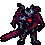 | [亚托克斯](docs/heroes/league_aatrox.md)<br>Aatrox | 上单 | 被动 赐死剑气 · 暗裔利刃 · 恶火束链 · 大招 大灭 | [剑魔 W 锁链附加包](addons/league_aatrox_chain/README.md) | PPU 2.27 |
| 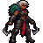 | [安蓓萨](docs/heroes/league_ambessa.md)<br>Ambessa | 上单 | 暗袭 · 血戮 · 大招 公开处刑 | [安蓓萨附加包](addons/league_ambessa/README.md) | PPU 2 |
| 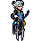 | [卡蜜尔](docs/heroes/league_camille.md)<br>Camille | 上单 | 被动 适应性防御 · 战术横扫 · 钩索 · 大招 海克斯最后通牒 | [青钢影钩墙附加包](addons/league_camille_wall/README.md) | PPU 1.5 |
| 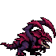 | [科加斯](docs/heroes/league_chogath.md)<br>Cho'Gath | 上单 | 破裂 · 野性尖叫 · 大招 盛宴 | [科加斯附加包](addons/league_chogath/README.md) | PPU 1.2 |
|  | [德莱厄斯](docs/heroes/league_darius.md)<br>Darius | 上单 | 被动 出血 · 大杀四方 · 无情铁手 · 大招 诺克萨斯断头台 | [诺手大招读血附加包](addons/league_darius_ult/README.md) | PPU 1.45 |
| 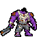 | [蒙多医生](docs/heroes/league_drmundo.md)<br>Dr. Mundo | 上单 | 病毒屠刀 · 电击疗法 · 大招 极限剂量 | [蒙多附加包](addons/league_drmundo/README.md) | PPU 1.5 |
| 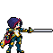 | [菲奥娜](docs/heroes/league_fiora.md)<br>Fiora | 上单 | 被动 决斗之舞 · 破空斩 · 劳伦特心眼刀 · 大招 无双挑战 | [剑姬破绽附加包](addons/league_fiora_duel/README.md) | PPU 1.5 |
| 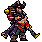 | [普朗克](docs/heroes/league_gangplank.md)<br>Gangplank | 上单 | 枪火谈判 · 火药桶 · 大招 加农炮幕 | [普朗克附加包](addons/league_gangplank/README.md) | PPU 1.5 |
| 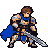 | [盖伦](docs/heroes/league_garen.md)<br>Garen | 上单 | 致命打击 · 审判 · 大招 德玛西亚正义 | [盖伦大招斩杀附加包](addons/league_garen_ult/README.md) | PPU 1.9 |
| 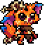 | [纳尔](docs/heroes/league_gnar.md)<br>Gnar | 上单 | 投掷回力标/投掷顽石 · 轻跳/猛踏 · 大招 呐啊！ | [纳尔附加包](addons/league_gnar/README.md) | PPU 1.5 |
|  | [格温](docs/heroes/league_gwen.md)<br>Gwen | 上单 | 被动 千穿百孔 · 快刀剪乱 · 断续疾走 · 大招 引针簇射 | [格温被动附加包](addons/league_gwen/README.md) | PPU 2.84 |
| 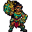 | [俄洛伊](docs/heroes/league_illaoi.md)<br>Illaoi | 上单 | 严酷训诫 · 灵魂试炼 · 大招 过界信仰 | [俄洛伊附加包](addons/league_illaoi/README.md) | PPU 1.5 |
| 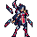 | [艾瑞莉娅](docs/heroes/league_irelia.md)<br>Irelia | 上单 | 被动 艾欧尼亚热诚 · 利刃冲击 · 比翼双刃 · 大招 先锋之刃 | [艾瑞莉娅附加包：Q「利刃冲击」真正的刷新 + 跳兵线](addons/league_irelia/README.md) | PPU 2 |
| 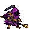 | [贾克斯](docs/heroes/league_jax.md)<br>Jax | 上单 | 被动 无情连打 · 跳斩 · 反击风暴 · 大招 武器大师 | — | PPU 1.5 |
| 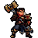 | [杰斯](docs/heroes/league_jayce.md)<br>Jayce | 上单 | 苍穹之跃 / 电能震荡 · 雷霆一击 / 超能电荷 · 大招 加速之门 | [杰斯附加包](addons/league_jayce/README.md) | PPU 1.5 |
| 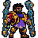 | [奎桑提](docs/heroes/league_ksante.md)<br>K'Sante | 上单 | 无双陀斧 · 辟路先锋 · 大招 傲岸雄姿 | [奎桑提附加包](addons/league_ksante/README.md) | PPU 1.2 |
| 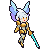 | [凯尔](docs/heroes/league_kayle.md)<br>Kayle | 上单 | 耀焰冲击 · 星火符刃 · 大招 圣裁之刻 | [凯尔升阶附加包：按真实等级升阶、死后不掉](addons/league_kayle/README.md) | PPU 2.29 |
|  | [凯南](docs/heroes/league_kennen.md)<br>Kennen | 上单 | 被动 雷缚印 · 奥义！千鸟 · 奥义！雷铠 · 大招 秘奥义！万雷天牢引 | [目标标记附加包](addons/league_marks/README.md) | PPU 1.81 |
|  | [克烈](docs/heroes/league_kled.md)<br>Kled | 上单 | 飞索捕熊器 · 比武 · 大招 冲啊——！！ | [克烈附加包](addons/league_kled/README.md) | PPU 2 |
| 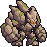 | [墨菲特](docs/heroes/league_malphite.md)<br>Malphite | 上单 | 被动 花岗岩护盾 · 地震碎片 · 大地震颤 · 大招 势不可挡 | — | — |
| 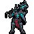 | [莫德凯撒](docs/heroes/league_mordekaiser.md)<br>Mordekaiser | 上单 | 破灭之锤 · 断魂一扼 · 大招 轮回绝境 | [莫德凯撒附加包](addons/league_mordekaiser/README.md) | PPU 2 |
| 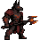 | [内瑟斯](docs/heroes/league_nasus.md)<br>Nasus | 上单 | 汲魂痛击 · 灵魂烈焰 · 大招 死神降临 | [内瑟斯附加包](addons/league_nasus/README.md) | PPU 1.2 |
|  | [奥拉夫](docs/heroes/league_olaf.md)<br>Olaf | 上单 | 逆流投掷 · 鲁莽挥击 · 大招 诸神黄昏 | [奥拉夫读血附加包](addons/league_olaf_rage/README.md) | PPU 1.79 |
| 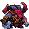 | [奥恩](docs/heroes/league_ornn.md)<br>Ornn | 上单 | 火山突堑 · 炽烈冲锋 · 大招 熔铸之神的召唤 | [奥恩附加包](addons/league_ornn/README.md) | PPU 1.5 |
| 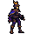 | [奎因](docs/heroes/league_quinn.md)<br>Quinn | 上单 | 炫目攻势 · 旋翔掠杀 · 大招 深入敌后 | [奎因附加包](addons/league_quinn/README.md) | PPU 2 |
| 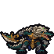 | [雷克顿](docs/heroes/league_renekton.md)<br>Renekton | 上单 | 被动 怒之领域 · 巨鳄狂袭 · 横冲直撞 · 大招 终极统治 | [雷克顿低血怒气附加包](addons/league_renekton/README.md) | PPU 1.81 |
|  | [锐雯](docs/heroes/league_riven.md)<br>Riven | 上单 | 被动 符文之刃 · 折翼之舞 · 勇往直前 · 大招 放逐之锋 | [斩杀附加包：伊芙琳、阿卡丽、锐雯](addons/league_executes/README.md) | PPU 1.5 |
| 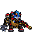 | [兰博](docs/heroes/league_rumble.md)<br>Rumble | 上单 | 纵火盛宴 · 电子鱼叉 · 大招 恒温灼烧 | [兰博附加包](addons/league_rumble/README.md) | PPU 1.75 |
| 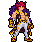 | [瑟提](docs/heroes/league_sett.md)<br>Sett | 上单 | 被动 沙场豪情 · 强手裂颅 · 蓄意轰拳 · 大招 叹为观止 | [瑟提豪意附加包](addons/league_sett_grit/README.md) | PPU 1.79 |
| 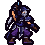 | [慎](docs/heroes/league_shen.md)<br>Shen | 上单 | 奥义！暮临 · 奥义！影缚 · 大招 秘奥义！慈悲度魂落 | [慎「秘奥义！慈悲度魂落」护盾按生命值附加包](addons/league_shen_shield/README.md) | PPU 1.81 |
| 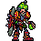 | [辛吉德](docs/heroes/league_singed.md)<br>Singed | 上单 | 过肩摔 · 强力粘胶 · 大招 疯狂药剂 | [辛吉德附加包](addons/league_singed/README.md) | PPU 1.39 |
| 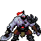 | [赛恩](docs/heroes/league_sion.md)<br>Sion | 上单 | 残虐猛击 · 杀手怒吼 · 大招 蛮横冲撞 | [赛恩附加包](addons/league_sion/README.md) | — |
|  | [提莫](docs/heroes/league_teemo.md)<br>Teemo | 上单 | 被动 毒性射击 · 致盲吹箭 · 小莫快跑 · 大招 种蘑菇 | [提莫蘑菇附加包](addons/league_teemo_shrooms/README.md) | PPU 1.79 |
| 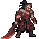 | [泰达米尔](docs/heroes/league_tryndamere.md)<br>Tryndamere | 上单 | 被动 战斗狂怒 · 旋风斩 · 蔑视 · 大招 无尽怒火 | [蛮王残血开大附加包](addons/league_tryndamere_rage/README.md) | PPU 1.81 |
| 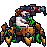 | [厄加特](docs/heroes/league_urgot.md)<br>Urgot | 上单 | 腐蚀电荷 · 鄙弃 · 大招 超越死亡的恐惧 | [厄加特附加包](addons/league_urgot/README.md) | PPU 1.2 |
|  | [弗拉基米尔](docs/heroes/league_vladimir.md)<br>Vladimir | 上单 | 被动 血色契约 · 鲜血转换 · 血之潮汐 · 大招 血之瘟疫 | [弗拉基米尔残血血池附加包](addons/league_vladimir_pool/README.md) | PPU 1.8 |
|  | [沃利贝尔](docs/heroes/league_volibear.md)<br>Volibear | 上单 | 擂首一击 · 霹天雳地 · 大招 天声震落 | [沃利贝尔附加包](addons/league_volibear/README.md) | PPU 1.2 |
|  | [约里克](docs/heroes/league_yorick.md)<br>Yorick | 上单 | 临终仪式 · 哀伤之雾 · 大招 海屿悼词 | [约里克附加包：真的暗灵缠身墙、坟和唤醒照英雄联盟、室女跟着他、雾行者和室女是真的单位](addons/league_yorick/README.md) | PPU 1.75 |
| 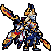 | [亚恒](docs/heroes/league_zaahen.md)<br>Zaahen | 上单 | 暗裔长刀 · 厄影回锋 · 大招 大赦 | [亚恒附加包](addons/league_zaahen/README.md) | PPU 1.75 |
|  | [岩宝](docs/heroes/tft_brock.md)<br>Brock（tft 包） | 上单 | 巨岩投掷 · 苔藤缠握 · 大招 震地猛击 | — | PPU 1.16 |
| 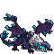 | [远古巨龙](docs/heroes/tft_elderdragon.md)<br>Elder Dragon（tft 包） | 上单 | 烈焰吐息 · 龙翼风暴 · 大招 绝伦火热 | — | PPU 2.84 |
|  | [可酷伯](docs/heroes/tft_kobuko.md)<br>Kobuko（tft 包） | 上单 | 金爪真言 · 猛虎扑 · 大招 游戏结束！ | — | PPU 2 |
| 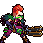 | [荏妮](docs/heroes/tft_renni.md)<br>Renni（tft 包） | 上单 | 链锯冲撞 · 锯刃格挡 · 大招 泥奔者重击 | — | PPU 2 |
| 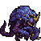 | [峡谷先锋](docs/heroes/tft_riftherald.md)<br>Rift Herald（tft 包） | 上单 | 回旋横扫 · 虚空冲锋 · 大招 扭曲护甲 | — | PPU 2 |
|  | [刀疤](docs/heroes/tft_scar.md)<br>Scar（tft 包） | 上单 | 水坑狙击惊喜 · 长矛横扫 · 大招 野火突袭 | — | PPU 2 |
| 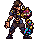 | [塞薇卡](docs/heroes/tft_sevika.md)<br>Sevika（tft 包） | 上单 | 喷火器 · 伸缩拳 · 大招 嚼一嚼 | — | PPU 1.8 |
| 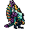 | [石傲玉](docs/heroes/tft_shiohyu.md)<br>Shi Oh Yu（tft 包） | 上单 | 玉拳连打 · 震地 · 大招 玉龙形态 | — | PPU 2.46 |
| 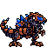 | [海克斯霸龙](docs/heroes/tft_thex.md)<br>T-Hex（tft 包） | 上单 | 追踪导弹 · 霸龙冲撞 · 大招 海克斯军械库 | — | PPU 1.9 |
| 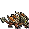 | [泰拉](docs/heroes/tft_terra.md)<br>Terra（tft 包） | 上单 | 裂地咬 · 龙威咆哮 · 大招 地震 | — | PPU 1.45 |

### 打野（50）

| 头像 | 英雄 | 分路 | 技能 | 附加包 | 高清帧 |
|---|---|---|---|---|---|
|  | [阿木木](docs/heroes/league_amumu.md)<br>Amumu | 打野 | 被动 诅咒之触、绝望光环 · 绷带牵引 · 阿木木的愤怒 · 大招 木乃伊之咒 | — | — |
|  | [卑尔维斯](docs/heroes/league_belveth.md)<br>Bel'Veth | 打野 | 虚空激流 · 上觐沉渊 · 大招 万载豪筵 | [卑尔维斯附加包](addons/league_belveth/README.md) | PPU 1.75 |
|  | [贝蕾亚](docs/heroes/league_briar.md)<br>Briar | 打野 | 被动 猩红诅咒 · 冲头 · 惊吼 · 大招 毙除 | [贝蕾亚附加包](addons/league_briar_frenzy/README.md) | PPU 2.94 |
|  | [黛安娜](docs/heroes/league_diana.md)<br>Diana | 打野 | 被动 月银之刃 · 新月打击 · 月神冲刺 · 大招 月之降临 | [目标标记附加包](addons/league_marks/README.md) | PPU 1.81 |
| 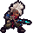 | [艾克](docs/heroes/league_ekko.md)<br>Ekko | 打野 | 被动 Z型驱动共振 · 时间卷曲器 · 相位俯冲 · 大招 时空断裂 | [艾克时间倒转附加包](addons/league_ekko_rewind/README.md) | PPU 1.94 |
|  | [伊莉丝](docs/heroes/league_elise.md)<br>Elise | 打野 | 神经毒素 / 剧毒之蜇 · 结茧 / 盘丝 · 大招 蜘蛛形态 | [伊莉丝附加包：整身变蜘蛛、挑目标、小蜘蛛是真的单位](addons/league_elise/README.md) | PPU 1.8 |
|  | [伊芙琳](docs/heroes/league_evelynn.md)<br>Evelynn | 打野 | 憎恨之刺 · 引诱 · 大招 最终抚慰 | [斩杀附加包：伊芙琳、阿卡丽、锐雯](addons/league_executes/README.md) | PPU 2.78 |
| 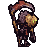 | [费德提克](docs/heroes/league_fiddlesticks.md)<br>Fiddlesticks | 打野 | 被动 巫骇草人 · 恐惧 · 五骨丰登 · 大招 群鸦风暴 | — | PPU 1.8 |
|  | [古拉加斯](docs/heroes/league_gragas.md)<br>Gragas | 打野 | 滚动酒桶 · 肉弹冲击 · 大招 爆破酒桶 | [古拉加斯大招智能落点附加包](addons/league_gragas/README.md) | PPU 1.45 |
| 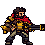 | [格雷福斯](docs/heroes/league_graves.md)<br>Graves | 打野 | 穷途末路 · 快速拔枪 · 大招 终极爆弹 | [格雷福斯附加包](addons/league_graves/README.md) | PPU 1.5 |
| 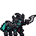 | [赫卡里姆](docs/heroes/league_hecarim.md)<br>Hecarim | 打野 | 暴走 · 毁灭冲锋 · 大招 暗影冲击 | [赫卡里姆附加包](addons/league_hecarim/README.md) | PPU 1.8 |
|  | [艾翁](docs/heroes/league_ivern.md)<br>Ivern | 打野 | 种豆得瓜 · 根深敌固 · 大招 小菊！ | [艾翁附加包](addons/league_ivern/README.md) | PPU 1.5 |
| 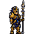 | [嘉文四世](docs/heroes/league_jarvaniv.md)<br>Jarvan IV | 打野 | 德邦军旗 · 巨龙撞击 · 大招 天崩地裂 | [嘉文四世附加包](addons/league_jarvaniv/README.md) | PPU 1.5 |
| 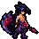 | [凯隐](docs/heroes/league_kayn.md)<br>Kayn | 打野 | 巨镰横扫 · 利刃纵贯 · 大招 裂舍影 | [凯隐「暗裔魔镰」附加包](addons/league_kayn_form/README.md) | PPU 1.8 |
| 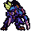 | [卡兹克](docs/heroes/league_khazix.md)<br>Kha'Zix | 打野 | 被动 无形威胁 · 品尝恐惧 · 跃击 · 大招 虚空来袭 | [卡兹克视野与进化附加包](addons/league_khazix/README.md) | PPU 2.24 |
| 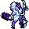 | [千珏](docs/heroes/league_kindred.md)<br>Kindred | 打野 | 乱箭之舞 · 横生惧意 / 狼灵狂热 · 大招 羊灵生息 | [千珏附加包](addons/league_kindred/README.md) | PPU 2.2 |
|  | [李青](docs/heroes/league_leesin.md)<br>Lee Sin | 打野 | 被动 疾风骤雨 · 天音波 · 天雷破 · 大招 猛龙摆尾 | [盲僧 W 位移附加包](addons/league_leesin_hop/README.md) | PPU 1.5 |
|  | [莉莉娅](docs/heroes/league_lillia.md)<br>Lillia | 打野 | 被动 梦满枝 · 飞花挞 · 流涡种 · 大招 夜阑谣 | [莉莉娅梦尘与昏睡附加包](addons/league_lillia/README.md) | PPU 2.62 |
| 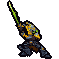 | [易](docs/heroes/league_masteryi.md)<br>Master Yi | 打野 | 被动 双重打击 · 阿尔法突袭 · 无极剑道 · 大招 高原血统 | [参与击杀附加包：金克丝、崔丝塔娜、易、图奇](addons/league_takedowns/README.md) | PPU 2.23 |
|  | [纳亚菲利](docs/heroes/league_naafiri.md)<br>Naafiri | 打野 | 暗裔犬牙 · 剔骨本能 · 大招 猎狗血性 | [纳亚菲利附加包：斩杀、再扑、聪明开大、狗群是真的单位](addons/league_naafiri/README.md) | PPU 1.5 |
|  | [奈德丽](docs/heroes/league_nidalee.md)<br>Nidalee | 打野 | 标枪投掷 / 推倒 · 野性奔腾 / 猛扑 · 大招 美洲狮形态 | [奈德丽附加包](addons/league_nidalee/README.md) | PPU 2.2 |
|  | [魔腾](docs/heroes/league_nocturne.md)<br>Nocturne | 打野 | 被动 暗影之刃 · 梦魇之径 · 无言恐惧 · 大招 鬼影重重 | [魔腾黑暗附加包](addons/league_nocturne_dark/README.md) | PPU 1.8 |
|  | [努努和威朗普](docs/heroes/league_nunu.md)<br>Nunu & Willump | 打野 | 史上最大雪球！ · 雪球飞射 · 大招 绝对零度 | — | PPU 1.37 |
|  | [潘森](docs/heroes/league_pantheon.md)<br>Pantheon | 打野 | 贯星长枪 · 斗盾跃击 · 大招 大荒星陨 | [潘森附加包](addons/league_pantheon/README.md) | PPU 1.5 |
|  | [奇亚娜](docs/heroes/league_qiyana.md)<br>Qiyana | 打野 | 以绪塔尔之锋 · 天纵之勇 · 大招 惊才绝景 | [奇亚娜附加包](addons/league_qiyana/README.md) | PPU 1.5 |
|  | [拉莫斯](docs/heroes/league_rammus.md)<br>Rammus | 打野 | 动力冲刺 · 狂乱嘲讽 · 大招 冲天猛撞 | [拉莫斯附加包](addons/league_rammus/README.md) | PPU 1.2 |
|  | [雷克塞](docs/heroes/league_reksai.md)<br>Rek'Sai | 打野 | 女王之怒 · 遁地 · 大招 虚空猛冲 | [雷克塞附加包](addons/league_reksai/README.md) | PPU 1.2 |
|  | [雷恩加尔](docs/heroes/league_rengar.md)<br>Rengar | 打野 | 战争咆哮 · 套索打击 · 大招 狩猎律动 | [雷恩加尔草丛附加包](addons/league_rengar_bush/README.md) | PPU 1.48 |
|  | [瑟庄妮](docs/heroes/league_sejuani.md)<br>Sejuani | 打野 | 极寒突袭 · 凛冬之怒 · 大招 极冰寒狱 | [瑟庄妮附加包](addons/league_sejuani/README.md) | PPU 2 |
|  | [萨科](docs/heroes/league_shaco.md)<br>Shaco | 打野 | 被动 背刺 · 欺诈魔术 · 惊吓魔盒 · 大招 幻像 | [萨科附加包：背刺看朝向、幻像和惊吓魔盒是真的单位](addons/league_shaco_backstab/README.md) | PPU 2.12 |
|  | [希瓦娜](docs/heroes/league_shyvana.md)<br>Shyvana | 打野 | 焚焰打击 · 爆炎吐息 · 大招 魔龙降世 | [希瓦娜附加包](addons/league_shyvana/README.md) | PPU 1.5 |
|  | [斯卡纳](docs/heroes/league_skarner.md)<br>Skarner | 打野 | 撼地 · 以绪塔尔冲击 · 大招 毒刺贯体 | [斯卡纳附加包](addons/league_skarner/README.md) | PPU 1.75 |
|  | [特朗德尔](docs/heroes/league_trundle.md)<br>Trundle | 打野 | 利齿撕咬 · 寒冰之柱 · 大招 强权至上 | [特朗德尔附加包](addons/league_trundle/README.md) | PPU 2 |
|  | [乌迪尔](docs/heroes/league_udyr.md)<br>Udyr | 打野 | 狂暴爪击 · 踏火蛮冲 · 大招 极凌飓风 | [乌迪尔附加包](addons/league_udyr/README.md) | PPU 1.5 |
|  | [蔚](docs/heroes/league_vi.md)<br>Vi | 打野 | 强能冲拳 · 透体之劲 · 大招 天霸横空烈轰 | — | PPU 1.82 |
|  | [佛耶戈](docs/heroes/league_viego.md)<br>Viego | 打野 | 破败王剑 · 千载幽咽 · 大招 痛贯天灵 | [佛耶戈「君命已决」附加包](addons/league_viego_soul/README.md) | PPU 2.45 |
|  | [沃里克](docs/heroes/league_warwick.md)<br>Warwick | 打野 | 野兽之口 · 远祖嗥叫 · 大招 无尽束缚 | [沃里克附加包](addons/league_warwick/README.md) | PPU 1.2 |
|  | [孙悟空](docs/heroes/league_wukong.md)<br>Wukong | 打野 | 腾云突击 · 真假猴王 · 大招 大闹天宫 | [悟空附加包](addons/league_wukong/README.md) | PPU 1.53 |
|  | [赵信](docs/heroes/league_xinzhao.md)<br>Xin Zhao | 打野 | 被动 果决 · 无畏冲锋 · 风斩电刺 · 大招 新月护卫 | [赵信大招远程免伤附加包](addons/league_xinzhao_guard/README.md) | PPU 1.5 |
|  | [扎克](docs/heroes/league_zac.md)<br>Zac | 打野 | 延伸打击 · 橡筋弹弓 · 大招 动感弹球 | [扎克附加包](addons/league_zac/README.md) | PPU 1.5 |
|  | [纳什男爵](docs/heroes/tft_baronnashor.md)<br>Baron Nashor（tft 包） | 打野 | 腐蚀吐息 · 钻地突袭 · 大招 虚空之怒 | — | PPU 2.04 |
|  | [绯红印记树怪](docs/heroes/tft_brambleback.md)<br>Brambleback（tft 包） | 打野 | 荆棘飞扑 · 绯红咆哮 · 大招 猩红之怒 | — | PPU 1.7 |
|  | [远古石甲虫](docs/heroes/tft_krug.md)<br>Krug（tft 包） | 打野 | 岩之摇滚 · 坚岩外壳 · 大招 远古崩落 | — | PPU 2 |
|  | [暗影狼](docs/heroes/tft_murkwolf.md)<br>Murkwolf（tft 包） | 打野 | 撕裂之爪 · 狂战士之嚎 · 大招 狼群攻击 | — | PPU 1.67 |
|  | [苍蓝雕纹魔像](docs/heroes/tft_sentinel.md)<br>Sentinel（tft 包） | 打野 | 双拳重砸 · 雕纹石肤 · 大招 蔚蓝冲击波 | — | PPU 1.7 |
|  | [史密奇](docs/heroes/tft_smeech.md)<br>Smeech（tft 包） | 打野 | 废铁黑客 · 拆解 · 大招 废铁狂潮 | — | PPU 2.4 |
|  | [赛芬](docs/heroes/tft_syfen.md)<br>Sy'fen（tft 包） | 打野 | 噬咬 · 翼刃横扫 · 大招 暴走 | — | PPU 2.52 |
|  | [范德尔](docs/heroes/tft_vander.md)<br>Vander（tft 包） | 打野 | 地下猎犬 · 铁拳突进 · 大招 桥头死守 | — | PPU 2 |
|  | [蔚奥莱](docs/heroes/tft_violet.md)<br>Violet（tft 包） | 打野 | 1-2-3连招 · 冲拳 · 大招 底城怒拳 | — | PPU 2 |
|  | [呲呲](docs/heroes/tft_zippy.md)<br>Zippy（tft 包） | 打野 | 后空翻踢 · 翻滚冲锋 · 大招 翻滚突袭 | — | PPU 2.2 |

### 中单（49）

| 头像 | 英雄 | 分路 | 技能 | 附加包 | 高清帧 |
|---|---|---|---|---|---|
|  | [阿狸](docs/heroes/league_ahri.md)<br>Ahri | 中单 | 被动 摄魂夺魄 · 欺诈宝珠 · 魅惑妖术 · 大招 灵魄突袭 | [阿狸附加包](addons/league_ahri/README.md) | PPU 2.2 |
|  | [阿卡丽](docs/heroes/league_akali.md)<br>Akali | 中单 | 被动 我流忍法！潜龙印 · 我流奥义！寒影 · 我流奥义！隼舞 · 大招 我流秘奥义！表里杀缭乱 | [斩杀附加包：伊芙琳、阿卡丽、锐雯](addons/league_executes/README.md) | PPU 1.8 |
|  | [艾尼维亚](docs/heroes/league_anivia.md)<br>Anivia | 中单 | 寒冰闪耀 · 霜寒刺骨 · 大招 冰川风暴 | [艾尼维亚附加包](addons/league_anivia/README.md) | PPU 1.2 |
|  | [安妮](docs/heroes/league_annie.md)<br>Annie | 中单 | 被动 嗜火 · 碎裂之火 · 焚烧 · 大招 提伯斯之怒 | [安妮附加包：Q 返还、提伯斯是真的单位](addons/league_annie_q/README.md) | PPU 2.2 |
|  | [奥瑞利安·索尔](docs/heroes/league_aurelionsol.md)<br>Aurelion Sol | 中单 | 星河冲荡 · 星芒凝汇 · 大招 星天落瀑 | [奥瑞利安·索尔附加包](addons/league_aurelionsol/README.md) | PPU 1.75 |
|  | [阿萝拉](docs/heroes/league_aurora.md)<br>Aurora | 中单 | 飞去来咒 · 怪奇喷涌 · 大招 双界合一 | [阿萝拉附加包](addons/league_aurora/README.md) | PPU 2.25 |
|  | [阿兹尔](docs/heroes/league_azir.md)<br>Azir | 中单 | 狂沙猛攻 · 流沙移形 · 大招 禁军之墙 | [阿兹尔附加包](addons/league_azir/README.md) | PPU 1.5 |
|  | [布兰德](docs/heroes/league_brand.md)<br>Brand | 中单 | 被动 炽热之焰 · 烈焰之柱 · 烈火燃烧 · 大招 烈焰风暴 | [布兰德被动层数附加包](addons/league_brand/README.md) | PPU 1.79 |
|  | [卡西奥佩娅](docs/heroes/league_cassiopeia.md)<br>Cassiopeia | 中单 | 瘟毒爆炸 · 剧毒迷雾 · 大招 石化凝视 | [卡西奥佩娅附加包](addons/league_cassiopeia/README.md) | PPU 1.2 |
|  | [库奇](docs/heroes/league_corki.md)<br>Corki | 中单 | 磷光炸弹 · 格林机枪 · 大招 火箭轰击 | [库奇智能火箭 + 脱身方向附加包](addons/league_corki/README.md) | PPU 2.2 |
|  | [菲兹](docs/heroes/league_fizz.md)<br>Fizz | 中单 | 被动 伶俐斗士 · 淘气打击 · 古灵精怪 · 大招 巨鲨强袭 | — | PPU 1.81 |
|  | [加里奥](docs/heroes/league_galio.md)<br>Galio | 中单 | 战争罡风 · 正义冲拳 · 大招 英雄登场 | [加里奥附加包](addons/league_galio/README.md) | PPU 1.65 |
|  | [黑默丁格](docs/heroes/league_heimerdinger.md)<br>Heimerdinger | 中单 | H-28 G 进化炮台 · CH-2电子风暴手雷 · 大招 升级！！！ | [黑默丁格附加包：炮台射击、塔边加速、炮台有了身体](addons/league_heimerdinger/README.md) | PPU 1.2 |
|  | [彗](docs/heroes/league_hwei.md)<br>Hwei | 中单 | 主题：灾 · 主题：悚 · 大招 焚心绚华绘 | — | PPU 1.5 |
|  | [卡尔萨斯](docs/heroes/league_karthus.md)<br>Karthus | 中单 | 荒芜 · 亵渎 · 大招 安魂曲 | [卡尔萨斯附加包](addons/league_karthus/README.md) | PPU 1.5 |
|  | [卡萨丁](docs/heroes/league_kassadin.md)<br>Kassadin | 中单 | 虚无法球 · 能量脉冲 · 大招 虚空行走 | [卡萨丁附加包](addons/league_kassadin/README.md) | PPU 2.42 |
|  | [卡特琳娜](docs/heroes/league_katarina.md)<br>Katarina | 中单 | 弹射之刃 · 伺机待发 · 大招 死亡莲华 | [卡特琳娜附加包](addons/league_katarina/README.md) | PPU 1.5 |
|  | [乐芙兰](docs/heroes/league_leblanc.md)<br>LeBlanc | 中单 | 被动 镜花水月 · 恶意魔印 · 魔影迷踪 · 大招 故技重施 | [低血量附加包：布里茨、乐芙兰、丽桑卓](addons/league_lowhp/README.md) | PPU 2 |
|  | [丽桑卓](docs/heroes/league_lissandra.md)<br>Lissandra | 中单 | 被动 冰脉驱役 · 寒冰碎片 · 冰霜之环 · 大招 冰封陵墓 | [低血量附加包：布里茨、乐芙兰、丽桑卓](addons/league_lowhp/README.md) | PPU 1.81 |
|  | [洛克](docs/heroes/league_locke.md)<br>Locke | 中单 | 伏魔三钉 · 灰猎无影 · 大招 万魔狱 | [洛克附加包](addons/league_locke/README.md) | PPU 2 |
|  | [拉克丝](docs/heroes/league_lux.md)<br>Lux | 中单 | 被动 光芒四射 · 光之束缚 · 透光奇点 · 大招 终极闪光 | [目标标记附加包](addons/league_marks/README.md) | PPU 2.2 |
|  | [玛尔扎哈](docs/heroes/league_malzahar.md)<br>Malzahar | 中单 | 被动 虚空穿越 · 煞星幻象 / 虚空虫群 · 虚空召唤 · 大招 冥府之握 | [玛尔扎哈附加包：虚空穿越、幻象跳转、虚空蜂是真的单位](addons/league_malzahar/README.md) | PPU 1.38 |
|  | [妮蔻](docs/heroes/league_neeko.md)<br>Neeko | 中单 | 盛开花种 · 缠结倒刺 · 大招 怒放 | [妮蔻附加包](addons/league_neeko/README.md) | PPU 2.5 |
|  | [奥莉安娜](docs/heroes/league_orianna.md)<br>Orianna | 中单 | 指令：攻击 · 指令：防卫 · 大招 指令：冲击波 | [奥莉安娜附加包](addons/league_orianna/README.md) | PPU 2.25 |
|  | [瑞兹](docs/heroes/league_ryze.md)<br>Ryze | 中单 | 被动 奥术专精 · 超负荷 · 符文禁锢 · 大招 曲境折跃 | — | PPU 1.66 |
|  | [斯维因](docs/heroes/league_swain.md)<br>Swain | 中单 | 解脱之触 · 永不复行 · 大招 恶魔升华 | [斯维因附加包](addons/league_swain/README.md) | PPU 1.5 |
|  | [塞拉斯](docs/heroes/league_sylas.md)<br>Sylas | 中单 | 锁链鞭击 · 潜掠/强掳 · 大招 其人之道 | [塞拉斯附加包](addons/league_sylas/README.md) | PPU 1.2 |
|  | [辛德拉](docs/heroes/league_syndra.md)<br>Syndra | 中单 | 被动 卓尔不凡 · 暗黑法球 · 弱者退散 · 大招 能量倾泻 | [辛德拉举小兵附加包](addons/league_syndra/README.md) | PPU 1.86 |
|  | [塔莉垭](docs/heroes/league_taliyah.md)<br>Taliyah | 中单 | 石穿 · 岩突 · 大招 墙幔 | [塔莉垭附加包](addons/league_taliyah/README.md) | PPU 1.75 |
|  | [泰隆](docs/heroes/league_talon.md)<br>Talon | 中单 | 斩草除根 · 诺克萨斯式外交 · 大招 暗影突袭 | [泰隆「刺客之道」翻墙附加包](addons/league_talon_vault/README.md) | PPU 1.5 |
|  | [崔斯特](docs/heroes/league_twistedfate.md)<br>Twisted Fate | 中单 | 被动 灌铅骰子 · 万能牌 · 选牌 · 大招 命运 | — | PPU 2.68 |
|  | [维迦](docs/heroes/league_veigar.md)<br>Veigar | 中单 | 被动 超凡邪力 · 黑暗祭祀 · 扭曲空间 · 大招 能量爆裂 | [维迦法强常驻附加包](addons/league_veigar_power/README.md) | PPU 1.8 |
|  | [维克兹](docs/heroes/league_velkoz.md)<br>Vel'Koz | 中单 | 等离子裂变 · 构造分解 · 大招 生命形态瓦解射线 | [维克兹附加包](addons/league_velkoz/README.md) | PPU 1.5 |
|  | [薇古丝](docs/heroes/league_vex.md)<br>Vex | 中单 | 寒心波云 · 溟濛渐染 · 大招 愁煞 | [薇古丝附加包](addons/league_vex/README.md) | PPU 1.5 |
|  | [维克托](docs/heroes/league_viktor.md)<br>Viktor | 中单 | 被动 光荣进化 · 虹吸能量 · 海克斯射线 · 大招 奥术风暴 | [维克托附加包](addons/league_viktor/README.md) | PPU 1.81 |
|  | [泽拉斯](docs/heroes/league_xerath.md)<br>Xerath | 中单 | 被动 法力澎湃 · 奥能脉冲 · 冲击法球 · 大招 奥术仪式 | — | PPU 1.55 |
|  | [亚索](docs/heroes/league_yasuo.md)<br>Yasuo | 中单 | 被动 浪客之道 · 斩钢闪 · 踏前斩 · 大招 狂风绝息斩 | [亚索风之障壁附加包](addons/league_yasuo_wall/README.md) | PPU 2.2 |
|  | [永恩](docs/heroes/league_yone.md)<br>Yone | 中单 | 被动 狩人之道 · 错玉切 · 凛神斩 · 大招 封尘绝念斩 | [永恩 R 附加包](addons/league_yone_r/README.md) | PPU 2.19 |
|  | [劫](docs/heroes/league_zed.md)<br>Zed | 中单 | 影奥义！分身 · 影奥义！诸刃 · 大招 禁奥义！瞬狱影杀阵 | [劫读血附加包](addons/league_zed_mark/README.md) | PPU 1.62 |
|  | [吉格斯](docs/heroes/league_ziggs.md)<br>Ziggs | 中单 | 弹跳炸弹 · 海克斯爆破雷区 · 大招 科学的地狱火炮 | [吉格斯附加包](addons/league_ziggs/README.md) | PPU 1.2 |
|  | [佐伊](docs/heroes/league_zoe.md)<br>Zoe | 中单 | 飞星乱入！ · 催眠气泡 · 大招 折返跃迁 | [佐伊附加包](addons/league_zoe/README.md) | PPU 2.64 |
|  | [婕拉](docs/heroes/league_zyra.md)<br>Zyra | 中单 | 致命棘刺 · 缠绕之根 · 大招 绞杀之藤 | [婕拉附加包：种子、植物、光合作用、植物有了身体](addons/league_zyra/README.md) | PPU 1.7 |
|  | [拉露恩](docs/heroes/tft_alune.md)<br>Alune（tft 包） | 中单 | 月之降临 · 月华 · 大招 月曜降临 | — | PPU 2 |
|  | [敖兴](docs/heroes/tft_aoshin.md)<br>Ao Shin（tft 包） | 中单 | 雷息 · 腾云 · 大招 闪电暴雨 | — | PPU 2 |
|  | [诺姆希](docs/heroes/tft_nomsy.md)<br>Nomsy（tft 包） | 中单 | 火球！ · 龙息 · 大招 龙神飞升 | — | PPU 2.6 |
|  | [诺拉](docs/heroes/tft_norra.md)<br>Norra（tft 包） | 中单 | 回忆涌现 · 思乡线缕 · 大招 传送门欢腾！ | — | PPU 2 |
|  | [爆爆](docs/heroes/tft_powder.md)<br>Powder（tft 包） | 中单 | 猴子炸弹 · 快跑，爆爆！ · 大招 海克斯水晶炸弹 | — | PPU 1.75 |
|  | [希尔科](docs/heroes/tft_silco.md)<br>Silco（tft 包） | 中单 | 罐装畸变体 · 微光注射 · 大招 炼金狂潮 | — | PPU 2 |
|  | [索姆](docs/heroes/tft_sohm.md)<br>Sohm（tft 包） | 中单 | 潮涌 · 海潮护佑 · 大招 潮汐绽放 | — | PPU 1.8 |

### ADC（31）

| 头像 | 英雄 | 分路 | 技能 | 附加包 | 高清帧 |
|---|---|---|---|---|---|
|  | [阿克尚](docs/heroes/league_akshan.md)<br>Akshan | ADC | 去而复还 · 骄行荡寇 · 大招 恩怨相抵 | [阿克尚扩展包](addons/league_akshan/README.md) | PPU 1.61 |
|  | [厄斐琉斯](docs/heroes/league_aphelios.md)<br>Aphelios | ADC | 武器技能 · 月相轮转 · 大招 清辉夜凝 | [厄斐琉斯附加包](addons/league_aphelios/README.md) | PPU 1.5 |
|  | [艾希](docs/heroes/league_ashe.md)<br>Ashe | ADC | 被动 冰霜射击 · 射手的专注 · 万箭齐发 · 大招 魔法水晶箭 | — | PPU 2.2 |
|  | [凯特琳](docs/heroes/league_caitlyn.md)<br>Caitlyn | ADC | 被动 爆头 · 和平使者 · 约德尔诱捕器 · 大招 让子弹飞 | [凯特琳附加包](addons/league_caitlyn/README.md) | PPU 1.45 |
|  | [德莱文](docs/heroes/league_draven.md)<br>Draven | ADC | 旋转飞斧 · 开道利斧 · 大招 冷血追命 | — | PPU 2.2 |
|  | [伊泽瑞尔](docs/heroes/league_ezreal.md)<br>Ezreal | ADC | 被动 咒能高涨 · 秘术射击 · 奥术跃迁 · 大招 精准弹幕 | — | PPU 2.19 |
|  | [烬](docs/heroes/league_jhin.md)<br>Jhin | ADC | 被动 低语 · 曼舞手雷 · 致命华彩 · 大招 完美谢幕 | [烬低语附加包](addons/league_jhin_whisper/README.md) | PPU 1.8 |
|  | [金克丝](docs/heroes/league_jinx.md)<br>Jinx | ADC | 震荡电磁波！ · 嚼火者手雷！ · 大招 超究极死神飞弹！ | [参与击杀附加包：金克丝、崔丝塔娜、易、图奇](addons/league_takedowns/README.md) | PPU 2.2 |
|  | [卡莎](docs/heroes/league_kaisa.md)<br>Kai'Sa | ADC | 艾卡西亚暴雨 · 虚空索敌 · 大招 猎手本能 | [目标标记附加包](addons/league_marks/README.md) | PPU 1.45 |
|  | [卡莉丝塔](docs/heroes/league_kalista.md)<br>Kalista | ADC | 穿刺 · 撕裂 · 大招 命运的召唤 | [卡莉丝塔附加包](addons/league_kalista/README.md) | PPU 1.4 |
|  | [克格莫](docs/heroes/league_kogmaw.md)<br>Kog'Maw | ADC | 腐蚀唾液 · 虚空淤泥 · 大招 活体大炮 | [克格莫附加包](addons/league_kogmaw/README.md) | PPU 1.79 |
|  | [卢锡安](docs/heroes/league_lucian.md)<br>Lucian | ADC | 被动 圣光银弹 · 透体圣光 · 冷酷追击 · 大招 圣枪洗礼 | 卢锡安附加包 | PPU 1.5 |
|  | [梅尔](docs/heroes/league_mel.md)<br>Mel | ADC | 耀光齐射 · 阳炎涡旋 · 大招 鎏金蚀日 | [梅尔附加包](addons/league_mel/README.md) | PPU 1.5 |
|  | [厄运小姐](docs/heroes/league_missfortune.md)<br>Miss Fortune | ADC | 被动 厄运的眷顾 · 一箭双雕 · 枪林弹雨 · 大招 弹幕时间 | [目标标记附加包](addons/league_marks/README.md) | PPU 2.76 |
|  | [尼菈](docs/heroes/league_nilah.md)<br>Nilah | ADC | 游刃万变 · 纵情逐流 / 轻纱飞漾 · 大招 神恩激荡 | [尼菈附加包](addons/league_nilah/README.md) | PPU 1.98 |
|  | [莎弥拉](docs/heroes/league_samira.md)<br>Samira | ADC | 被动 悍勇本色 · 交火 · 狂飙 · 大招 炼狱扳机 | [莎弥拉边走边射附加包](addons/league_samira_r/README.md) | PPU 2.84 |
|  | [希维尔](docs/heroes/league_sivir.md)<br>Sivir | ADC | 被动 敏锐疾行 · 回旋之刃 · 法术护盾 · 大招 狩猎 | — | PPU 2.25 |
|  | [斯莫德](docs/heroes/league_smolder.md)<br>Smolder | ADC | 被动 龙之研习 · 超级灼热龙息 · 阿嚏！ / 扑棱，扑棱，扑棱！ · 大招 妈----！ | [斯莫德附加包](addons/league_smolder/README.md) | PPU 1.5 |
|  | [崔丝塔娜](docs/heroes/league_tristana.md)<br>Tristana | ADC | 被动 瞄准 · 爆炸火花 · 火箭跳跃 · 大招 毁灭射击 | [参与击杀附加包：金克丝、崔丝塔娜、易、图奇](addons/league_takedowns/README.md) | PPU 2.56 |
|  | [图奇](docs/heroes/league_twitch.md)<br>Twitch | ADC | 被动 死亡毒液 · 埋伏 · 剧毒之桶 · 大招 火力全开 | [参与击杀附加包：金克丝、崔丝塔娜、易、图奇](addons/league_takedowns/README.md) | PPU 2.2 |
|  | [韦鲁斯](docs/heroes/league_varus.md)<br>Varus | ADC | 被动 复仇之欲 · 穿刺之箭 · 恶灵箭雨 · 大招 腐败锁链 | [韦鲁斯枯萎附加包](addons/league_varus_blight/README.md) | PPU 1.35 |
|  | [薇恩](docs/heroes/league_vayne.md)<br>Vayne | ADC | 被动 暗夜猎手 · 闪避突袭 · 恶魔审判 · 大招 终极时刻 | [薇恩附加包：圣银弩箭、恶魔审判撞墙](addons/league_vayne_bolts/README.md) | PPU 2.2 |
|  | [霞](docs/heroes/league_xayah.md)<br>Xayah | ADC | 被动 锐切 · 双刃·倒钩 · 致死羽衣 · 大招 暴风羽刃 | [霞羽毛附加包](addons/league_xayah_feathers/README.md) | PPU 1.79 |
|  | [芸阿娜](docs/heroes/league_yunara.md)<br>Yunara | ADC | 善恶轮 · 明踪步 · 大招 定圣诀 | [芸阿娜附加包](addons/league_yunara/README.md) | PPU 1.5 |
|  | [泽丽](docs/heroes/league_zeri.md)<br>Zeri | ADC | 被动 内能迁转 · 强穿激光 · 灿丽花火 · 大招 超限爆闪 | [泽丽附加包：W 撞墙激光 + 被动偷盾](addons/league_zeri/README.md) | PPU 2.08 |
|  | [绯红树怪](docs/heroes/tft_cinderling.md)<br>Cinderling（tft 包） | ADC | 刃叶 · 钻土突袭 · 大招 燎原叶暴 | — | PPU 2.33 |
|  | [迭嘉](docs/heroes/tft_daeja.md)<br>Daeja（tft 包） | ADC | 罡风轰击 · 振翼退风 · 大招 苍穹罡风 | — | PPU 1.72 |
|  | [魔沼蛙](docs/heroes/tft_gromp.md)<br>Gromp（tft 包） | ADC | 打嗝泡泡 · 黏液沼泽 · 大招 毒沼大嗝 | — | PPU 1.69 |
|  | [麦迪](docs/heroes/tft_maddie.md)<br>Maddie（tft 包） | ADC | 连拨击锤 · 通缉令 · 大招 执法狙杀 | — | PPU 1.5 |
|  | [深红锋喙鸟](docs/heroes/tft_raptor.md)<br>Mama Beak（tft 包） | ADC | 羽刃扇射 · 惊飞跃退 · 大招 鸟群之家 | — | PPU 1.56 |
|  | [苍蓝哨戒](docs/heroes/tft_sentry.md)<br>Pebbles（tft 包） | ADC | 蔚蓝激光 · 裂石跃迁 · 大招 棱镜扫射 | — | PPU 1.29 |

### 辅助（33）

| 头像 | 英雄 | 分路 | 技能 | 附加包 | 高清帧 |
|---|---|---|---|---|---|
|  | [阿利斯塔](docs/heroes/league_alistar.md)<br>Alistar | 辅助 | 被动 凯旋怒吼 · 大地粉碎 · 野蛮冲撞 · 大招 坚定意志 | [阿利斯塔附加包](addons/league_alistar/README.md) | PPU 1.73 |
|  | [巴德](docs/heroes/league_bard.md)<br>Bard | 辅助 | 被动 旅者的召唤 · 星界束缚 · 游神圣坛 / 神奇旅程 · 大招 调和命运 | [巴德「神奇旅程」穿墙门附加包](addons/league_bard/README.md) | — |
|  | [布里茨](docs/heroes/league_blitzcrank.md)<br>Blitzcrank | 辅助 | 被动 法力屏障 · 机械飞爪 · 能量铁拳 · 大招 静电力场 | [低血量附加包：布里茨、乐芙兰、丽桑卓](addons/league_lowhp/README.md) | PPU 1.79 |
|  | [布隆](docs/heroes/league_braum.md)<br>Braum | 辅助 | 寒冬之咬 · 坚不可摧 · 大招 冰川裂隙 | 布隆附加包 | PPU 1.98 |
|  | [迦娜](docs/heroes/league_janna.md)<br>Janna | 辅助 | 被动 顺风而行 · 飓风呼啸 · 风暴之眼 · 大招 复苏季风 | [辅助挑人附加包：迦娜、娑娜、璐璐](addons/league_support_pick/README.md) | PPU 1.5 |
|  | [卡尔玛](docs/heroes/league_karma.md)<br>Karma | 辅助 | 心灵烈焰 · 坚定不移 · 大招 梵咒 | — | PPU 2.2 |
|  | [蕾欧娜](docs/heroes/league_leona.md)<br>Leona | 辅助 | 被动 日光 · 破晓之盾 · 天顶之刃 · 大招 日炎耀斑 | [蕾欧娜附加包](addons/league_leona/README.md) | PPU 1.5 |
|  | [璐璐](docs/heroes/league_lulu.md)<br>Lulu | 辅助 | 闪耀长枪 · 奇思妙想 · 大招 狂野生长 | [辅助挑人附加包：迦娜、娑娜、璐璐](addons/league_support_pick/README.md) | PPU 1.79 |
|  | [茂凯](docs/heroes/league_maokai.md)<br>Maokai | 辅助 | 荆棘重击 · 扭曲突刺 · 大招 自然之握 | [茂凯附加包](addons/league_maokai/README.md) | PPU 1.3 |
|  | [米利欧](docs/heroes/league_milio.md)<br>Milio | 辅助 | 被动 热情洋溢！ · 火爆飞踢 · 融融情谊 / 依依不舍 · 大招 生生不息 | [米利欧附加包](addons/league_milio/README.md) | PPU 2.21 |
|  | [莫甘娜](docs/heroes/league_morgana.md)<br>Morgana | 辅助 | 被动 灵魂吸取 · 暗之禁锢 · 黑暗之盾 · 大招 灵魂镣铐 | — | PPU 1.5 |
|  | [娜美](docs/heroes/league_nami.md)<br>Nami | 辅助 | 被动 踏浪之行 · 冲击之潮 · 碧波之牢 · 大招 怒涛之啸 | [娜美附加包](addons/league_nami/README.md) | PPU 1.5 |
|  | [诺提勒斯](docs/heroes/league_nautilus.md)<br>Nautilus | 辅助 | 疏通航道 · 泰坦之怒 · 大招 深海冲击 | [诺提勒斯钩墙附加包](addons/league_nautilus/README.md) | PPU 1.8 |
|  | [波比](docs/heroes/league_poppy.md)<br>Poppy | 辅助 | 圣锤猛击 · 英勇冲锋 · 大招 持卫的裁决 | [波比附加包](addons/league_poppy/README.md) | PPU 1.2 |
|  | [派克](docs/heroes/league_pyke.md)<br>Pyke | 辅助 | 被动 溺水之幸 · 透骨尖钉 · 魅影浪洄 · 大招 涌泉之恨 | [派克精确斩杀附加包](addons/league_pyke/README.md) | PPU 1.78 |
|  | [洛](docs/heroes/league_rakan.md)<br>Rakan | 辅助 | 被动 异色羽裳 · 轻舞成双 · 盛大登场 · 大招 惊鸿过隙 | — | PPU 1.8 |
|  | [芮尔](docs/heroes/league_rell.md)<br>Rell | 辅助 | 裂阵 · 驭铁术：轰落 · 大招 极涌 | [芮尔附加包](addons/league_rell/README.md) | PPU 1.5 |
|  | [烈娜塔](docs/heroes/league_renata.md)<br>Renata | 辅助 | 忠诚激励 · 铁腕竞合 · 大招 恶意收购 | [烈娜塔附加包](addons/league_renata/README.md) | PPU 1.5 |
|  | [赛娜](docs/heroes/league_senna.md)<br>Senna | 辅助 | 黑暗洞灭 · 无尽厮守 · 大招 暗影燎原 | [赛娜黑雾常驻附加包](addons/league_senna_mist/README.md) | PPU 1.87 |
|  | [萨勒芬妮](docs/heroes/league_seraphine.md)<br>Seraphine | 辅助 | 被动 星光漫射 · 清籁穿云 · 增幅节拍 · 大招 炫音返场 | — | PPU 2.2 |
|  | [娑娜](docs/heroes/league_sona.md)<br>Sona | 辅助 | 被动 能量和弦 · 英勇赞美诗 · 坚毅咏叹调 · 大招 狂舞终乐章 | [辅助挑人附加包：迦娜、娑娜、璐璐](addons/league_support_pick/README.md) | PPU 3.88 |
|  | [索拉卡](docs/heroes/league_soraka.md)<br>Soraka | 辅助 | 流星坠落 · 星之灌注 · 大招 祈愿 | [索拉卡附加包](addons/league_soraka/README.md) | PPU 2.2 |
|  | [塔姆](docs/heroes/league_tahmkench.md)<br>Tahm Kench | 辅助 | 巨舌鞭笞 · 深渊潜航 · 大招 大快朵颐 | [塔姆附加包](addons/league_tahmkench/README.md) | PPU 1.2 |
|  | [塔里克](docs/heroes/league_taric.md)<br>Taric | 辅助 | 被动 正气凌人 · 炫光 · 星光之触 · 大招 宇宙之辉 | — | PPU 1.55 |
|  | [锤石](docs/heroes/league_thresh.md)<br>Thresh | 辅助 | 被动 厄运钟摆 · 死亡判决 · 厄运钟摆 · 大招 幽冥监牢 | [锤石灯笼附加包](addons/league_thresh_lantern/README.md) | PPU 2.48 |
|  | [悠米](docs/heroes/league_yuumi.md)<br>Yuumi | 辅助 | 摸鱼飞弹 · 悠米出动！ · 大招 魔典终章 | [悠米附加包](addons/league_yuumi/README.md) | PPU 1.5 |
|  | [基兰](docs/heroes/league_zilean.md)<br>Zilean | 辅助 | 被动 瓶中时光 · 定时炸弹 · 时光发条 · 大招 时光倒流 | [基兰复活附加包](addons/league_zilean_rewind/README.md) | PPU 1.8 |
|  | [艾达丝](docs/heroes/tft_idas.md)<br>Idas（tft 包） | 辅助 | 黄金龙息 · 龙威振翅 · 大招 黄金龙鳞 | — | PPU 2.45 |
|  | [洛里斯](docs/heroes/tft_loris.md)<br>Loris（tft 包） | 辅助 | 皮城争斗 · 盾卫 · 大招 钢铁防线 | — | PPU 2 |
|  | [小木灵](docs/heroes/tft_meepsie.md)<br>Meepsie（tft 包） | 辅助 | 月尘震地 · 治疗木灵 · 大招 宇宙大爆炸 | — | PPU 2.88 |
|  | [迅捷蟹](docs/heroes/tft_scuttlecrab.md)<br>Scuttle Crab（tft 包） | 辅助 | 疾行神龛 · 蟹壳护盾 · 大招 你挖得动吗？ | — | PPU 2.67 |
|  | [斯特卜](docs/heroes/tft_steb.md)<br>Steb（tft 包） | 辅助 | 战地医疗 · 通缉令 · 大招 医疗背包 | — | PPU 2.6 |
|  | [超级机甲](docs/heroes/tft_mightymech.md)<br>The Mighty Mech（tft 包） | 辅助 | 引力矩阵 · 机甲飞跃 · 大招 究极变形·超级战刃 | — | PPU 2 |

<!-- HEROES:END -->

## 英雄文档怎么生成

英雄一览、[`docs/heroes/`](docs/heroes/) 里每页的上半部分和 [`docs/heroes.xlsx`](docs/heroes.xlsx) 都由 [`tools/docs/gen_hero_docs.py`](tools/docs/gen_hero_docs.py) 按仓库里**现在的**数据生成（不联网）：名字和技能说明来自 `league/text/champion.i18n`（简体中文，去掉颜色和图标），冷却、距离、数值来自 `league/champion/<id>.data_champion`，PPU 来自 `addons/league_main/src/hd.rs` 和 `addons/tft/src/hd.rs`，附加包来自 `addons/*/mod.override_info`、`README.md` 和 `text/`，动图是 `docs/preview/<id>_*.gif`，头像是待机第一帧（`docs/heroes/img/`）。改了英雄、加了英雄或附加包之后重跑：

```bash
pip install pillow openpyxl                                   # 头像要 pillow，xlsx 要 openpyxl（都不是 mod 的依赖）
python tools/docs/gen_hero_docs.py                            # 写英雄页、这里的英雄一览和 docs/heroes.xlsx
python tools/docs/gen_hero_docs.py --released <已发布名单>      # xlsx 里填「工坊已发布」（一行一个英雄 id，如 ahri）
python tools/docs/gen_hero_docs.py --check                    # 只检查：有页面或英雄一览过期就返回 1（不看 xlsx 和头像）
```

- 每页 `## 开发记录` 以下是手写的，生成时原样保留：**新英雄的设计、美术、音效、改动说明写在这里**，不再写进 README。分路从「开发记录」表格的「定位」一行读（`| 定位 | 上单（……）|`），没有这一行的在脚本的 `LANE_FALLBACK` 里补。
- README 里只有 `<!-- HEROES:BEGIN -->` 和 `<!-- HEROES:END -->` 之间是生成的，其余手写。
- 脚本可以重复跑，结果一样；在稀疏检出（没有图和动图）的工作区里也能跑，缺的文件从 git 的 HEAD 读。

## 仓库里的 skill

`.claude/skills/tfm2-hero-mod/` 是一个团战经理2英雄 mod 开发 skill。在本仓库里用 Claude Code 时会自动加载。

| 路径 | 内容 |
|---|---|
| `SKILL.md` | 英雄从数据到上架的完整流程，以及防止"静默失效"的硬规则 |
| `references/mod-structure.md` | mod 文件结构、`mod.mod_info` / `mod.override_info`、资源路径、本地测试、官方上传器 |
| `references/champion-data.md` | `.data_champion` 全字段、时间和距离单位、官方英雄的属性和冷却区间、54 种可用效果类型、buff 字段、特效绑定、常用写法 |
| `references/art-spec.md` | 像素画规范（实测数据）、动画 tag 和帧时长、锚点、特效和图标风格、AI 生成图的导入方法、QA 清单 |
| `references/text-audio.md` | 多语言文本、富文本颜色和图标、`champion_view`、音效 |
| `references/porting-heroes.md` | 把 LoL、Dota 的技能移植到 TFM2：机制对照表、选英雄评分法、LoL 客户端文件提取 |
| `references/workshop-page.md` | 创意工坊页面模板：缩略图、演示动图、收藏页、简介、更新说明 |
| `scripts/lint_mod.py` | 整包校验：路径、动画 tag、特效绑定、文本 key、音效注入、override 目标等 |
| `scripts/tfm2_ase.py` | 精灵图查看、预览和量化：身高、描边、颜色数、半透明像素等 |
| `scripts/strips.py` | 把 AI 生成的动作条导入成游戏精灵图：切帧、对齐、像素化、调色板、描边、导出 |
| `scripts/regrid.py` | 把图像模型按游戏大小画的「像素画」（边缘发虚、方块大小不匀）按它自己的格子读回，一格一个像素 |
| `scripts/bundle_tool.py` | 只读浏览游戏本体资源：可引用的原版特效、音效名、官方英雄数据 |
| `scripts/sdk_probe.rs` | 用经典 mod SDK（game_core 0.5.1）引擎自己的类型解析技能或单个效果：查可用的枚举值、引擎忽略的字段、默认值 |
| `templates/mymod/` | 可直接复制的示例 mod，已通过校验 |

## 快速开始

```bash
pip install pillow numpy
python .claude/skills/tfm2-hero-mod/scripts/lint_mod.py league
python .claude/skills/tfm2-hero-mod/scripts/tfm2_ase.py metrics <英雄>.aseprite
python .claude/skills/tfm2-hero-mod/scripts/bundle_tool.py sfx --grep fighter
```

脚本会在常见的 Steam 路径里找游戏。找不到时加上 `--game "<Teamfight Manager2 目录>"`，或者设置环境变量 `TFM2_GAME_DIR`。

在别的项目里也想用这个 skill：把 `.claude/skills/tfm2-hero-mod` 复制到 `~/.claude/skills/`。其他支持 SKILL.md 格式的工具，复制到它们各自的 skills 目录即可。

## 知识来源

- 游戏本体：68 个官方英雄的数据、78 套官方精灵图、官方上传器
- 创意工坊高分英雄包：oppi 等人的 *League of Legends Reborn*（3774304166）和 *Dota 2 Heroes*（3770621310），以及 *Touhou Project*

文档里的数字都是实测的。只靠推断得出的结论会标 *(inferred)*。

## 声明

非商业粉丝作品。英雄联盟及其角色、音频、图标版权归 Riot Games 所有，团战经理2 版权归其开发商所有。
