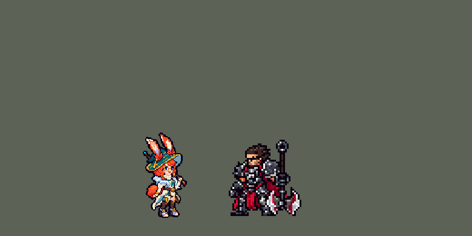
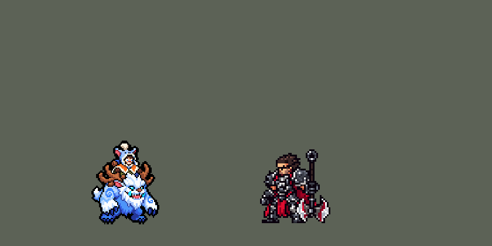
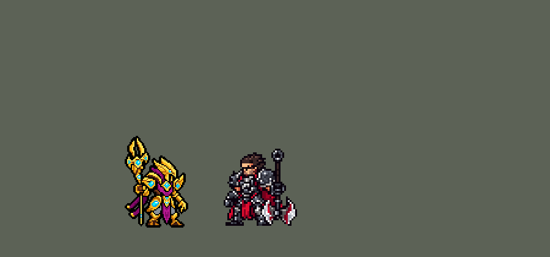
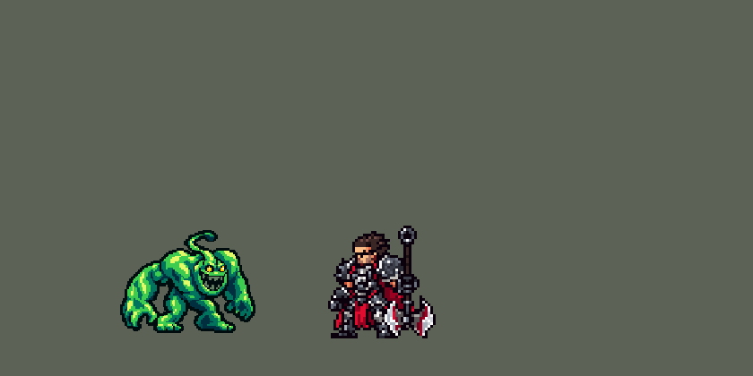
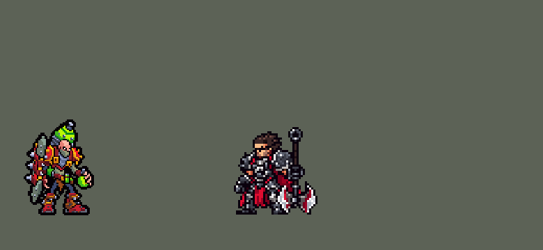
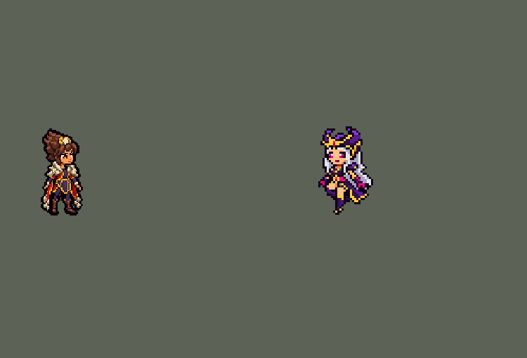
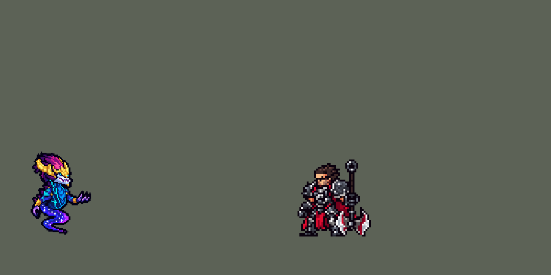
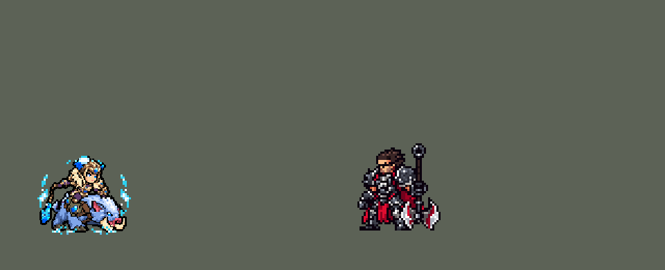
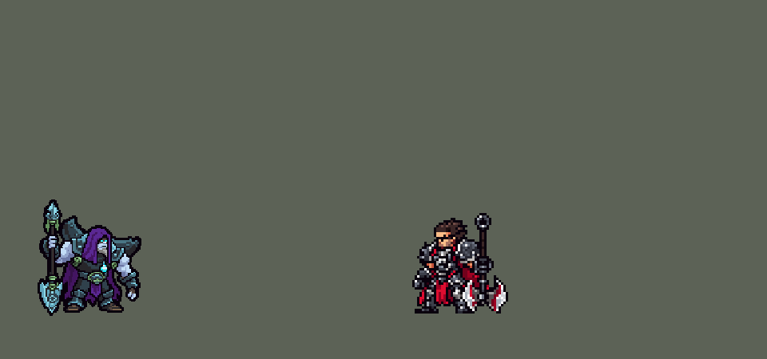
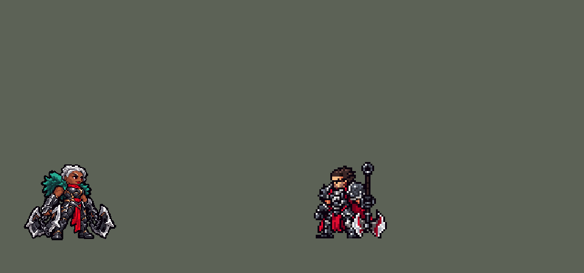

# 演示动图（原 README 开头）

原来 README 开头的全部演示动图，原样搬到这里。每位英雄的动图也在 [英雄页](heroes/) 里。

- 眼睛（10 月 9 日，用户：「重构一下锐雯的眼睛 让他更像英雄联盟的锐雯」，三个方案里选了 B）：原来每只眼是 2×2 的圆眼（白高光 + 绿），改成窄而凶的两行琥珀色眼：睫毛行不变，虹膜行白高光 + 琥珀 `#B5732D`，下排深琥珀 `#6E3F14`（`work/rv/eyes_rv.py`）。改在 `riven_head_master.png` 上，再按 `riven_frames40.json` 每帧的头位置贴进 65 帧、造型和待机。模组版本 0.84.7。

