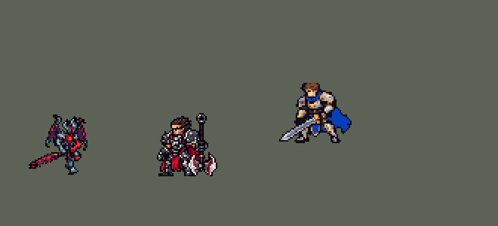

<!-- 本页上半部分由 tools/docs/gen_hero_docs.py 按仓库里现在的数据生成，手改会被覆盖；「开发记录」以下是手写的，生成时原样保留。 -->

# 亚托克斯 Aatrox


| 项目 | 内容 |
|---|---|
| id | `league_aatrox` |
| 所属的包 | 主包（mod_id `league`） |
| 分路 | 上单 |
| 分类 / 标签 | 近战（Melee） · AD / Melee / CC / Heal |
| 高清帧 | 1 倍像素（无高清帧） |
| 附加包 | [剑魔 W 锁链附加包](#附加包)（`league_aatrox_chain`） |



其他预览：[combos](../preview/league_aatrox_combos.gif)、[w_ring](../preview/league_aatrox_w_ring.gif)、[逐帧预览](../preview/league_aatrox_frames.png)、[特效表](../preview/league_aatrox_effects.png)

## 现在的技能

下面是游戏里显示的技能说明（`league/text/champion.i18n` 的简体中文，去掉了颜色和图标），冷却、距离来自 `league/champion/league_aatrox.data_champion`；1 秒 = 60 tick。

### 普攻 / 被动（被动「赐死剑气」）

*攻击间隔 1.1 秒 · 攻击距离 26000*

被动 赐死剑气：每10秒强化一次普攻，额外造成25和英雄6%最大生命值的伤害并回血；命中英雄冷却-2秒，剑刃边缘-4秒。对英雄的伤害回复18%。

### 技能1 · 暗裔利刃

*冷却 15 秒 · 可存 3 次 · 施放距离 44000 · 施放：指定目标 · 敌人（不含防御塔）*

可连放三段，形状各异，每段+25%，造成176% 攻击力物理伤害；剑刃边缘命中再+60%并击飞。暗影冲决就绪时先冲刺，把敌人送到剑刃边缘。

### 技能2 · 恶火束链

*冷却 9 秒 · 施放距离 42000 · 施放：方向 · 敌人（不含防御塔）*

甩出锁链，第一个敌人受到40 + 40% 攻击力物理伤害；被锁住的英雄1.5秒后被拖回再受一次伤害。

### 大招 · 大灭

*冷却 50 秒 · 施放距离 45000 · 施放：无目标 · 敌方英雄*

显现恶魔形态10秒：恐惧附近小兵和野怪，攻击力+25%，自我治疗+50%，移速+45%并逐渐衰减。击杀英雄会刷新持续时间。

### 数值

攻击力 100（每级 +22）、生命 1100（每级 +105）、护甲 36（每级 +8）、魔抗 26（每级 +4）、移速 1030（每级 +10）。

## 附加包

附加包是可选的原生代码 mod（都在附加包合集 `league_addons` 里），**不装主包里的英雄也是完整的**。

### 剑魔 W 锁链附加包

[剑魔 W 锁链附加包](../../addons/league_aatrox_chain/README.md)：`league_aatrox_chain` v0.2.4

主包 `league` 保持纯数据。主包里剑魔的 W「恶火束链」：锁链停在第一个敌人身上（40 + 40% 攻击力、减速 25% 1.5 秒）；
锁链旁边有敌方英雄时在落点放圈，1.5 秒后那个英雄再受一次伤害、被拉向剑魔。League 的两条数据写不出来：
**走出圈锁链就断**，以及拉回的是**圈的中心**。这个附加包用原生代码照 League 原版做：

- **只锁锁链真正打中的那一个**：英雄或野怪（League：英雄和大型野怪；TFM2 的野怪都是单只的大怪）。被小兵挡住时后面的
  英雄不算（主包的「锁链旁边的英雄」会算上）。小兵**再受一次伤害**（League：对小兵双倍）。
- **圈**：圈心是锁链停下的地方（锁链碰到他就停，比他稍微靠近剑魔，League 也是这样），半径 **33000**
  （League 的圈约 460、W 射程 825；主包 W 射程 60000）。
- **走出圈就断**：每 tick 看他在不在圈里，走出去（闪现、冲刺都算）锁链就断，什么都不发生。圈按画出来的样子判：
  横向半径 33000、上下 22000 的扁椭圆（v0.2.1；`w_ring` 画成扁的，锁链外沿横向 ±30 像素、上下 ±20，TFM2 的地面
  没有透视压扁，v0.2 的正圆判定上下比画面多出十几像素，走出画面上的圈锁链也不断）。
- **1.5 秒还在圈里**：被**拉回圈心**（引擎的强制位移，撞墙会停；被韧性截短了会补推剩下的路），再受一次
  40 + 40% 伤害（按剑魔**当下**的攻击力算），播锁链缠身和收紧的画面。
- 打中英雄的那两下都照主包的规矩：剑魔吸血（7 + 7% 攻击力，大灭期间 10 + 10%）、欠被动一次冷却缩减、大灭期间打死人刷新大灭。
- 拴着的时候每 4 tick 从他脚下往圈心飞一节锁链（`league_aatrox_w_link`，贴着地面）。
- 剑魔中途阵亡也照样拉回（第二下没有：数据里排着的效果跟着剑魔没了）；被锁的人中途阵亡就结束。
- League 的「真实视野」（被锁住的人现形）没有接口，没做。

## 相关脚本和素材

- [`tools/lol/extract_aatrox.py`](../../tools/lol/extract_aatrox.py)
- [`tools/art/preview_aatrox.py`](../../tools/art/preview_aatrox.py)
- [`tools/art/rig_aatrox.py`](../../tools/art/rig_aatrox.py)
- [`tools/art/import_aatrox.py`](../../tools/art/import_aatrox.py)
- [`tools/art/design_aatrox.py`](../../tools/art/design_aatrox.py)
- [`assets/source/aatrox/`](../../assets/source/aatrox)

## 开发记录

> 下面是原来 README 里「英雄：亚托克斯」一节，原样搬过来（只改了相对链接）。

| 部分 | 内容 |
|---|---|
| 定位 | 上单（近战战士，分类 Melee），用户 10 月 2 日排的第十一组的上单。暗裔剑魔：三段 Q 的剑刃边缘击飞，W 锁链把人拖回圈心，R 恶魔形态腾空作战 |
| 普攻 / 被动 | 普攻 100% 攻击力，射程 26000。被动「赐死剑气」：每 10 秒强化一次普攻，额外 25 + 英雄 6% 最大生命值的伤害并回血；命中英雄冷却 −2 秒，剑刃边缘命中 −4 秒。对英雄的伤害回复 18%（E 的被动并入） |
| 技能1 | Q「暗裔利刃」：可连放三段，形状各异（Q1 长条、Q2 扇形、Q3 圆形砸地），每段 +25%，176% 物理伤害（2026-10-20 前是 100 + 160%）；剑刃边缘命中再 +60% 并击飞。蓄力的整个过程地上都有警示，劈下前锁定方向，走开就能躲。E「暗影冲决」并入 Q：就绪时在蓄力中途冲刺，把敌人送到剑刃边缘 |
| 技能2 | W「恶火束链」：甩出锁链，第一个敌人受到 40 + 40% 物理伤害；被锁住的英雄 1.5 秒后被拖回圈心再受一次伤害（用户要求去掉了减速）。扩展包 `league_aatrox_chain` 判断他是否已经走出圈：走出去了才不拖。锁链打中任何敌人，落点都会出现地面圈和 1.5 秒后的收紧特效（只有英雄会被拖回；原来只在打中英雄时才出圈，锁链大多被小兵挡住，平时几乎看不到。用户：「剑魔的w应该是释放了地面上就有的吧」，2026-10-05，`tools/fix/fix_aatrox_w_ring.py`） |
| 大招 | R「大灭」：显现恶魔形态 10 秒，恐惧附近的小兵和野怪，攻击力 +25%，自我治疗 +50%，移速 +45% 并逐渐衰减；击杀英雄刷新持续时间。开大期间普攻、强化普攻、W 和三段 Q 都换成空中版本：起手离地，出招时飘在空中（离地 2–11 格，照英雄联盟 ULT 动画的高度），Q 俯冲砸地，收招落回地面。引擎不能在运行时换待机和走路的动画，所以不出招时脚在地上，背后的翅膀光环一直在 |
| 附加包（站桩） | 可选的附加包 [`addons/league_ult_press`](../../addons/league_ult_press/README.md)（在附加包合集里，原生代码，主包不装它也完整）：游戏 0.6.4 的 AI 常让这位英雄在敌方英雄跟前站着不打——只读观察包里身边 50000 内有敌方英雄时站着不动 14.3%，其中 8.7% 是 AI 下令「走到自己脚下」（盖伦 2.7% / 0.7%）。照卡蜜尔、瑟提、奥拉夫的办法（用户：「站桩的按照之前卡密尔那样改 然后合并」）：原地站了 15 tick、普攻好了、AI 还让他原地站时，35000 内最近的敌方英雄——他生命不低于一半、目标离敌方塔 75000 以外、目标身边 60000 内的敌方英雄不多于他身边的我方英雄（含他）——就普攻他，打出一下或 1.5 秒后重新算 |
| 数值 | 攻击 100（+22）、生命 1100（+105）、护甲 36（+8）、魔抗 26（+4）、移速 1030（+10）。数值是自己设计的，用 SDK 对战模拟调：上单，对 5 个原版上单，三套队友阵容、两边各 24 局。W 去掉减速后击杀差 +1.59（带 25% 减速时 +1.69） |
| 精灵图 | 待机、移动、普攻、强化普攻、Q1–Q3、W、R 变身、开大的普攻 / 强化普攻 / W / Q1–Q3、受击、死亡。造型是 Codex 的生图草稿按格子读回到 40 行（`design_aatrox.py`），头和巨剑来自第一版；第 7 步补齐身上的透底小洞、两个膝盖至少两格、描边闭合。跑步、普攻、强化普攻、W、受击、死亡用待机自己的部件摆出来（`rig_aatrox.py`：手肘在臂长之内弯曲，巨剑不重采样、只用精确的方向，跑步左右腿交替、红色护甲片跟着大腿）；Q1–Q3 是 Codex 画的；开大的空中动作用 `air_aatrox.py` 从这些通过的帧拼出（腰部以上不动，待机的腿下垂，翅膀用通过的光环） |
| 修正（Q 前期伤害、射程，2026-10-20） | 用户：「剑魔（亚托克斯）前期 Q 技能直接秒人，这个有可能改一下吗？另外，要是能稍微增加一点技能范围就更好了」。Q 每段去掉固定伤害、只按攻击力加成，加成 ×1.1（Q1 176%、Q2 220%、Q3 264%，剑刃边缘再 +60%；E 的治疗同比例）：1 级三段 Q 本体从 975 降到 660（剑刃边缘全中 1560 → 1056），12 级 2427 → 2257。三段 Q 的形状、施放距离、Q 里 E 判断冲刺的距离都加大 10%，地上的警示图按新尺寸重画（[`tools/art/warn_aatrox.py`](../../tools/art/warn_aatrox.py) RANGE）。改动由 [`tools/fix/aatrox_q_tune.py`](../../tools/fix/aatrox_q_tune.py)（幂等，`--check`）写进数据和说明。经典模拟（16 个种子，对 6 个原版上单，三套阵容两边各打）：原来 +1.45；去掉固定伤害、加成不变 +0.64，×0.94 −0.03，×1.1 **+1.55**（选这个） |

重新生成：

```bash
python tools/art/design_aatrox.py        # 造型
python tools/art/rig_aatrox.py           # 待机、跑步、普攻、强化普攻、W、受击、死亡
python tools/art/import_redo_aatrox.py   # Codex 的 Q1–Q3（之后要再跑 air_aatrox.py）
python tools/art/air_aatrox.py           # 开大的空中动作和变身
python tools/art/import_native.py --hero aatrox
python tools/art/warn_aatrox.py && python tools/art/chain_aatrox.py && python tools/art/import_aatrox.py   # 特效
python tools/art/preview_aatrox.py
```

逐帧预览：[`docs/preview/league_aatrox_frames.png`](../preview/league_aatrox_frames.png?v=1014g)，特效：[`docs/preview/league_aatrox_effects.png`](../preview/league_aatrox_effects.png?v=1014g)。
