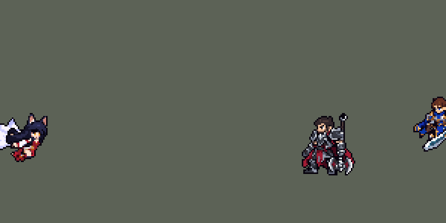

<!-- 本页上半部分由 tools/docs/gen_hero_docs.py 按仓库里现在的数据生成，手改会被覆盖；「开发记录」以下是手写的，生成时原样保留。 -->

# 阿狸 Ahri


| 项目 | 内容 |
|---|---|
| id | `league_ahri` |
| 所属的包 | 主包（mod_id `league`） |
| 分路 | 中单 |
| 分类 / 标签 | 法师（Magician） · AP / Magic / Range / CC |
| 高清帧 | PPU 2.2 |
| 附加包 | [阿狸附加包](#附加包)（`league_ahri`） |



其他预览：[逐帧预览](../preview/league_ahri_frames.png)、[特效表](../preview/league_ahri_effects.png)

## 现在的技能

下面是游戏里显示的技能说明（`league/text/champion.i18n` 的简体中文，去掉了颜色和图标），冷却、距离来自 `league/champion/league_ahri.data_champion`；1 秒 = 60 tick。

### 普攻 / 被动（被动「摄魂夺魄」）

*攻击间隔 1.5 秒 · 攻击距离 55000*

普攻发射妖力球，造成100% 攻击力的物理伤害。被动 摄魂夺魄：普攻每打死1个小兵或野怪积攒1层，满9层回复80 + 20% 法术强度的生命值；她3秒内伤害过的敌方英雄阵亡时，回复160 + 30% 法术强度的生命值。

### 技能1 · 欺诈宝珠

*冷却 6 秒 · 施放距离 65000 · 施放：方向 · 敌人（不含防御塔）*

掷出宝珠再收回，往返各对路径上的敌人造成70 + 55% 法术强度的魔法伤害，回程无视魔法抗性。同时施放 妖异狐火（冷却9秒）：3团狐火追击附近敌人，优先被魅惑的英雄，每团造成45 + 30% 法术强度的魔法伤害，并移动速度提高40%，2秒内递减。

### 技能2 · 魅惑妖术

*冷却 10 秒 · 施放距离 70000 · 施放：方向 · 敌方英雄*

献出飞吻，对命中的第一个敌方英雄造成75 + 75% 法术强度的魔法伤害并魅惑其1.25秒，使其走向阿狸，期间减速65%。

### 大招 · 灵魄突袭

*冷却 60 秒 · 施放距离 70000 · 施放：指定目标 · 敌方英雄*

向前冲刺（离敌方英雄太近时向后冲），再向附近敌人射出3枚精魄弹，优先英雄，每枚造成55 + 35% 法术强度的魔法伤害。施放后15秒内可再施放2次；期间参与击杀英雄再给1次，并至少再开10秒。

### 数值

攻击力 80（每级 +6）、法强 40（每级 +20）、生命 900（每级 +100）、护甲 20（每级 +7）、魔抗 20（每级 +3）、移速 900（每级 +9）。

## 附加包

附加包是可选的原生代码 mod（都在附加包合集 `league_addons` 里），**不装主包里的英雄也是完整的**。

### 阿狸附加包

[阿狸附加包](../../addons/league_ahri/README.md)：`league_ahri` v0.1.0

|  | 主包（纯数据） | 装了附加包 |
|---|---|---|
| 精魄（9 层回血） | 普攻打死的小兵、野怪 | 她补到的每一个小兵、野怪，用什么打死的都算 |
| 参与击杀回血 | 她 3 秒内打过的英雄阵亡；一个窗口只认一次 | 她的**每一次**英雄击杀和助攻，几个人同时阵亡各算一次 |
| 灵魄突袭多给 1 次 | 同上（窗口开着时） | 同上（窗口开着时） |

装上附加包后游戏里显示的说明（和主包不同的部分）：

- **普攻 / 被动（被动「摄魂夺魄」）**：【附加包】普攻发射妖力球，造成100% 攻击力的物理伤害。被动 摄魂夺魄：每补到1个小兵或野怪（用什么打死的都算）积攒1层，满9层回复80 + 20% 法术强度的生命值；她参与击杀的每个敌方英雄都让她回复160 + 30% 法术强度的生命值。

## 相关脚本和素材

- [`tools/lol/extract_ahri.py`](../../tools/lol/extract_ahri.py)
- [`tools/art/preview_ahri.py`](../../tools/art/preview_ahri.py)
- [`tools/art/import_ahri.py`](../../tools/art/import_ahri.py)
- [`assets/source/ahri/`](../../assets/source/ahri)

## 开发记录

> 下面是原来 README 里「英雄：阿狸」一节，原样搬过来（只改了相对链接）。

| 部分 | 内容 |
|---|---|
| 定位 | 法师（Magician），第五组的中单，本包第四个法师（拉克丝、提莫、安妮之后） |
| 普攻 | 发射妖力球，100% 攻击力的物理伤害，射程 55000，攻击间隔 1.5 秒 |
| 被动 | 「摄魂夺魄」，照英雄联盟现在的版本（2026-10-24 改，用户：「你分析分析有哪些地方和英雄联盟不一样」；原来是旧版：技能命中攒 3 层，下一个技能每命中一个敌人回血）：普攻每打死 1 个小兵或野怪攒 1 层精魄，满 9 层回复 80 + 20% 法术强度（第 6 层起腰间亮三颗精魄光点）；她 3 秒内伤害过的敌方英雄阵亡（谁打死的都算），回复 160 + 30% 法术强度。主包只认得出她自己打出的最后一击，所以精魄只数普攻打死的（league_jinx 的击杀检查；Q 和狐火穿过好几个单位时共用一个标记，数不准），英雄阵亡用佛耶戈的击杀窗口，同一个窗口只认一个；附加包数每一次（见「附加包」） |
| 技能1 | Q「欺诈宝珠」：朝目标方向掷出宝珠（半径 9000，飞 75000）再收回，往返各对路上的每个敌人造成 70 + 55% 法术强度的魔法伤害，回程无视魔法抗性。英雄联盟的回程是真实伤害；引擎的真实伤害（`FixedAttack`）只能按攻击力算，所以回程每次命中前给阿狸挂 1 tick 的 100% 法术穿透，伤害仍按法强算。射程 65000，冷却 6 秒，也对小兵和野怪放。合并 W「妖异狐火」（单独冷却 9 秒）：放出 3 团狐火追击 60000 内的敌人，先找被控制（魅惑）的英雄，再找英雄，最后是小兵和野怪，每团造成 45 + 30% 法术强度的魔法伤害；同时移速提高 40%，2 秒内递减（英雄联盟的；原来 1.5 秒） |
| 技能2 | E「魅惑妖术」：朝敌方英雄献出飞吻（穿过小兵），命中第一个敌方英雄：75 + 75% 法术强度的魔法伤害，魅惑 1.25 秒（被魅惑的人朝阿狸走过来），期间减速 65%（英雄联盟的；原来是 2 秒内受到的伤害提高 15%，英雄联盟现在没有）。射程 70000，冷却 10 秒，只对英雄放 |
| 大招 | R「灵魄突袭」：照英雄联盟的连放窗口（2026-10-24 改；原来是 3 次充能，每 25 秒恢复 1 次）。70000 内有敌方英雄时放；第一次放出后 15 秒内可再放 2 次，每次之间冷却 1 秒（`ult_cooldown_mult` 把冷却压到 60 tick），最后一次放完或窗口过了才进 60 秒冷却；窗口开着时参与击杀英雄再给 1 次（最多存 3 次），窗口至少再开 10 秒。每次冲刺 24000：离敌方英雄太近时往后冲（`MoveBack`），否则朝目标冲（`RushTime`，只冲这一段）；再向附近敌人射出 3 枚精魄弹，先打英雄，每枚 55 + 35% 法术强度的魔法伤害。AI 一般在 1.5 秒内连着放完 |
| 连招 | 用户要求：「有连招要做连招」「都要帮我补」。英雄联盟里阿狸 E 魅惑住人，接着 Q 穿过他、去回都打中。**E→Q**：飞吻命中敌方英雄时，阿狸身上开一个 75 tick（1.25 秒，和魅惑一样长）的连招窗口；窗口里放 Q，宝珠先找 70000 内被控制（魅惑）的英雄、朝他扔（被魅惑的人朝阿狸走过来，躲不开，去程回程都打中），找不到才照施法方向扔。原来狐火已经先追被魅惑的人，Q 却是方向型技能，AI 常朝他身边的小兵扔。伤害、出手时间（第 10 tick）、冷却都不变，一次 Q 只扔一颗宝珠；技能树多一份宝珠（Q 333 → 399 个节点）。数据由 [`tools/fix/combo_ahri.py`](../../tools/fix/combo_ahri.py) 改（在 `tools/fix/ahri_essence_count.py` 之后跑） |
| 数值 | 攻击 80（+6）、法强 40（+20）、生命 900（+100）、护甲 20（+7）、魔抗 20（+3）、移速 900（+9），就是原版法师的基础值。数值是自己设计的，用 SDK 对战模拟调：打中路，对 5 个原版中单（`pyromancer`、`ice_mage`、`lightning_mage`、`wind_mage`、`white_mage`），两边、三套队友阵容各 24 局，一批 720 局。团队击杀差：初版（出手时刻还是估的）+0.84；按美术定下的出手帧重跑 +0.68，死得多（每局 2.6 次）、伤害低。试过"目标在射程内就往后冲"（−0.41，更差）、全部伤害 +25%（+2.07）、再加 50 生命（+2.22）、伤害 +15% 且 R 每 20 秒恢复 1 次（+1.31）、伤害 +25% 且永远往前冲（+2.38）；定为伤害 +25%，保留"太近往后冲"，R 每发取整到 +40% 法强：两批种子 +3.04 / +2.27。试验版（R 每发 +38%）在第一批是 +2.07，只改这 2% 就变成 +3.04：一点改动让整局走向不同，差距和两批种子之间一样大，所以看两批的平均（+2.66）。同样两批里：安妮 +1.65 / +1.36、永恩 +2.20 / +2.34、原版 `lightning_mage` +1.19 / +1.62，第一批里拉克丝 +2.23、亚索 +2.30。阿狸每局放 Q 约 44 次、E 10 次、R 15 次。2026-10-01 创意工坊玩家反馈「阿狸有点太强了」，她确实是中单里最高的：同样两批种子试了只削 Q（70 + 55% → 60 + 45%，+2.01 / +2.12）、R 每发 50 + 30%（+1.23 / +1.31）、R 每发 55 + 35%（+1.55 / +1.76）、Q 65 + 50% 加 R 55 + 35%（+1.73 / +1.28）、全部伤害 ×0.9（+0.85，只跑了第一批）；定为 R 每发 55 + 35%，只改这一处，两批平均 +1.66（原来 +2.66），场均伤害 13916 → 12690，和安妮、原版 `lightning_mage`、拉克丝一档。2026-10-24 改成英雄联盟的被动、R 窗口和 E 之后（同一套 5 个原版中单、8 批种子 240 局，中路的 league_lux +3.12、league_annie +2.38、league_syndra +1.40，旧版阿狸 +3.17）：R 冷却 70 秒、回血 60 / 120 时 +1.61（每局回血 1262 → 853），冷却 60 秒 +1.93，回血加到 80 / 160 后 +2.67，就用这一版 |
| 亚索联动 | E 的魅惑算亚索大招要的控制。亚索打上路、阿狸打中路时，亚索每局放 R 1.27 次（同一批中路换成原版 `lightning_mage` 是 3.19 次，之前测过永恩 2.15、安妮 2.19–2.50、`pyromancer` 0.65）。魅惑一次只控一个人，亚索不用调 |
| 附加包 | 可选的附加包 [`addons/league_ahri`](../../addons/league_ahri/README.md)（在附加包合集里，原生代码，主包不装它也完整）：精魄数她补到的每一个小兵、野怪（用什么打死的都算），参与击杀数她的每一次英雄击杀和助攻（几个人同时阵亡各算一次）；回血和 R 多给的一次仍在主包数据里（她每个动作挂的监视器读附加包挂上的标记） |
| 精灵图 | 8 个动作 55 帧：待机、移动（英雄联盟的 `Run`）、普攻、Q、E、R、受击、死亡。连狐耳 38 px，30 色，动作全部取自英雄联盟原版动画；九条尾巴收成身后的一束（2026-09-30 返修，见下） |
| 高清帧（PPU 2.2） | 2026-10-24 用 PPU 重做（用户：「下一个英雄重做阿狸」）。Codex 按设计图包（[`tools/art/pack_ahri_ppu.py`](../../tools/art/pack_ahri_ppu.py) / [`PICTURE_PROMPT_PPU.md`](../../assets/source/ahri/PICTURE_PROMPT_PPU.md)）画的原图按自己的格子读回成 78 × 88 格（[`tools/art/design_ahri_hd.py`](../../tools/art/design_ahri_hd.py)，眼睛和脸手修：「脸上弄干净点」），连狐耳 40 px，和旧版一样高。七个动作（跑步、普攻、Q、E、R、受击、死亡，49 帧）都是 Codex 照旧版同一帧整帧重画（[`tools/art/pack_ahri_actions.py`](../../tools/art/pack_ahri_actions.py) / [`ACTIONS_PROMPT_PPU.md`](../../assets/source/ahri/ACTIONS_PROMPT_PPU.md)），再由 [`tools/art/casts_ahri_hd.py`](../../tools/art/casts_ahri_hd.py) 修到设计图上：按身体定大小，换上设计图的头（倒地时歪着的头和 R 第 4 帧保留 Codex 自己的头），尾巴和头发之间的缝补上（用户：「尾巴和身体分离 不及格」），跑步时头稳住、出招时后脚钉住。待机和选人卡片的小动作由 `hero_reels` 从 E 和普攻里剪。选人卡片 banpick_center -9（待机最高 -30）。普攻妖力球、狐火、精魄弹 y_offset 1200 → -3000（出手帧的手在支点上方约 20 px，追踪弹不超过 8 px）。佛耶戈附身和妮蔻变身的动作表（souls.rs）带上 hd_ / lo_；塞拉斯偷到的 R 副本跟着改（league_sylas 0.2.8） |
| 特效 | 普攻的妖力球和命中、Q 宝珠（里面转着一只狐灵；去程命中、回程真伤命中）、狐火绕身和飞出去的狐火及命中、飞吻爱心、被魅惑时头上的爱心、R 冲刺时留在原地的灵气、精魄弹和命中、被动回血、被动攒满时的精魄光点 |
| 图标 | 官方技能图标（Q / E / R），64×64 |
| 音频 | 从本地客户端提取的 15 条技能音效和 4 条中文语音（W、E、魅惑命中、R）。不提交到仓库，按下面的命令在本地生成 |

```bash
python tools/lol/extract_ahri.py --lol "D:\WeGameApps\lol" --vgmstream "<vgmstream-cli.exe 路径>"
python tools/lol/native_pose.py assets/source/ahri/poses.json --out <渲染文件夹> --alpha --parts
python tools/art/restyle_native.py assets/source/ahri/poses.json --renders <渲染文件夹>   # 角色图
python tools/art/import_native.py --hero ahri
python tools/art/import_ahri.py      # 特效；--raw <Codex 的交付文件夹> 先把原始图转成原尺寸条
python tools/fix/ahri_league.py      # 技能改成英雄联盟现在的样子（对旧版数据跑一次）；ahri_league_text.py 写说明
python addons/league_ahri/make_override.py     # 附加包的副本（主包的阿狸改了就重跑）
python tools/art/preview_ahri.py
python tools/art/pack_ahri_ppu.py --out <文件夹>   # 高清造型（PPU 2.2）：给 Codex 的设计图包
python tools/art/design_ahri_hd.py   # Codex 的原图按自己的格子读回（78 × 88），眼睛和脸手修
python tools/art/pack_ahri_actions.py --out <文件夹>   # 七个动作：给 Codex 的整帧重画包
python tools/art/rig_ahri_hd.py   # 高清帧（动作由 casts_ahri_hd.py 从 hd/casts 修出），写 assets/source/ppu/orig/；--review <文件夹> 先看
python tools/art/ppu_restyle.py --hero ahri
python tools/art/ppu_hd.py --hero ahri
python tools/art/hero_reels.py --hero ahri   # 待机和选人卡片的小动作
```

美术（提示词见 [`assets/source/ahri/PROMPTS.md`](../../assets/source/ahri/PROMPTS.md)）：
- 分工：角色图由 Claude 画，Codex 只画特效。
- 比例和镜头：镜头 yaw 35、pitch 25，不镜像，头 2.0、腿 0.8、头发 0.5、九条尾巴 0.6（A / B / C / D 四种比例里用户选了 A），高度 32（从狐耳下面的头顶量到脚底）。尾巴是单独的部件：用阿狸尾巴自己的贴图 `Ahri_Base_Tails_TX_CM`（用身体的贴图会画成一条条红袖子），按淡紫白的毛色投色、单独描边；大招才出现的那条大尾巴（`Tail_Large`）不渲染。辫子和前面的发束逐帧投色，跟着英雄联盟的动作摆。英雄联盟的光照把她的皮肤照成粉色（大腿的色相 340–357），皮肤按色相 340–40 算（红色的衣服饱和度更高，先认），腿才没被投成灰色。
- 头部：照英雄联盟的头在游戏尺寸下的轮廓逐格描（狐耳外黑内粉、蓝黑色的头发从后面把脸框住），脸放大到基础英雄的大小（英雄联盟的脸在头 2.0 时只有 4 像素宽），用基础英雄的三行眼、金色瞳孔，不画嘴（A / B / C 三种脸里用户选了 A），贴到每一帧英雄联盟头部关节的位置。
- 动作：移动用英雄联盟里阿狸平时移动的动作。`Run` 在基础移速下播的是 `run_base`：先播一遍 `Run.anm`，之后按 50% / 25% / 25% 在 `Run.anm`、`Run_Var1`、`Run_Var2` 里挑（`python tools/lol/anim_graph.py Ahri --grep run` 现在会列出序列和随机选择的内容），所以用 `Run.anm`，8 帧 × 125 ms，一圈 1 秒，是英雄联盟的节奏。待机 6 帧都用第 1 帧，第 3–5 帧靴筒以上下移一格呼吸。R 的原版动作是头朝前水平俯冲，贴上去的头转 90° 后和身体接不上，所以冲刺那几帧往跑步的前倾姿势混合 50–65%，她斜着冲出去，头保持竖直；Q 去掉了空中翻身那一帧（尾巴翻到头上）。
- 尾巴和五官返修（2026-09-30）：用户在选人卡片上看到「尾巴太多，都拖到地面了，看起来很冗杂」（比赛里 1 倍还好）——Codex 第二步重画时把九条尾巴画成一圈扇形，从狐耳上方一直到脚边，身前身后都有，卡片把待机放大约 2.2 倍，整个人被一团白色包住。先试了由 Claude 把第一版（按英雄联盟动画渲染）的尾巴逐帧换进去，Codex 的长发和尾巴互相穿插，去掉尾巴后留下一根根发丝和碎点，没用；按用户说的交给 Codex：返修包 [`TAILS_REDO.md`](../../assets/source/ahri/TAILS_REDO.md) 附上现在的动作条、第一版每帧的尾巴（英雄联盟尾巴在这一帧的位置，对照图里标成橙色）、卡片效果，要求只重画尾巴——一束从后腰往后上方扬开，尾尖在腰到头顶之间，膝盖以下和身前都不要，其余逐格不动。Codex 交回 8 个动作 55 帧（交接在 [`codex_tails/`](../../assets/source/ahri/codex_tails)）：待机的尾束约 20×22 格、露出 5 个尾尖；跑步、突进时大部分被身体和头发挡住，倒地时随身体折叠。用户另外让 Codex 把五官细化（近侧上眼线、金色瞳点、眼白、淡腮红、小嘴；嘴唇新加 `#B16267`，只用在脸上，琥珀色仍只用在眼睛上）。Codex 的尾巴边只有一部分描了黑边（整体 64%），阿狸加进 `import_native.py` 的 `COMPLETE`，在缺黑边的浅色边外补一格描边色（共 1424 格），到 92%。
- 尾巴第二次返修（2026-10-01）：用户「狐狸新模型的尾巴又太小 导致比赛内的尾巴特征不明显 尤其是比赛的时候 尾巴几乎被身体完全遮挡」——上一轮的尾束待机约 20×22 格，跑步、出招时照英雄联盟的遮挡缩到 8×9 格左右、藏在头发后面。先用程序把尾巴放大重摆，用户说「尾巴和屁股那里感觉有点脱节」，又交给 Codex：返修包 [`TAILS_REDO2.md`](../../assets/source/ahri/TAILS_REDO2.md) 给出去掉尾巴的身体和每帧的尾巴根（后腰）、朝向、大致范围，要求每帧都看得见尾巴（优先于原版的遮挡）、从后腰长出来、待机约 24–26×26–28 格、只用 6 种颜色。Codex 交回 8 个动作 55 帧（交接、清单和只有尾巴的图层在 [`codex_tails2/`](../../assets/source/ahri/codex_tails2)）：身体逐格没动；待机的尾束 23×28 格（含描边），五个尾尖叠成往后上方张开的半扇形；跑步时收拢拖在身后，露出 60%–78%；R 冲刺时拉成一束水平拖在身后；倒地时跟着落下。待机最高处是尾尖 −28，选人卡片不用偏移；呼吸的接缝在尾巴下面。用户看到 R 冲刺时「尾巴和身体脱节了」：尾束挂在身后，和腰之间露出一道地面——第 3、4 帧身体只盖住 9、13 格尾巴，第 2、6、7 帧只有头发尖盖着尾巴根（用户又指出「狐狸第二帧没修啊」）。把第 2、3、4、6、7 帧的尾巴图层分别右移 5、7、10、3、5 格（从 Codex 交的图层算起），身体照旧盖在上面，尾巴还露出 56%–81%；`codex_tails2/tail_layers/ahri_ult_tails_1x.png` 存的是挪过的图层。`COMPLETE` 补了 530 格描边；定稿图换成新的待机第 1 帧（放在 x 28、y 46）。
- 黑边（2026-10-01，用户：「阿狸也清理一下」）：她已经在 `COMPLETE` 里，再加进 `CLEAN`：外圈的三种近黑统一成一种，双层描边的内鼓包 102 格、碎点 156 格、斜阶梯多出的一格 35 格、离开身体的 1–2 格碎块 4 格，脸不动。
- 脸（2026-10-02，用户：「阿狸跑动的时候脸部太模糊」「其他帧也有问题吧 要修一起修吧」）：Codex 第二步重画时 `tidy_codex18.py` 只把定稿眼睛周围 6 × 5 格的脸贴回每一帧，贴的位置比 Codex 自己画的眼睛低一行，周围留着 Codex 那张脸的额头、眼白、眼皮、另一种橙黄虹膜和两边的腮红，每帧都不一样，跑起来脸一直在变。`clean_ahri.py` 第 8 步：凡是贴着定稿脸的帧（眼睛周围那 6 × 5 格和待机完全一致），脸周围一圈（眼睛上 3 行、左右各 2 列）里的脸色像素换成待机同一位置的刘海和侧发，举到脸边的手臂和肩膀几格保留（`RING_KEEP`），转头、倒地看不到脸的帧不动。跑步 8 帧、普攻、Q、W、受击、倒地共 209 格，脸现在每帧都和待机一样（用户：「阿狸修复的没问题」）。
- 特效用 Codex 画的 15 张（生图原稿，真透明）：`import_ahri.py --raw` 按交付清单的 `rect` 切帧，每张 16 色、硬透明，按技能范围定大小：普攻妖力球 10 px、宝珠 14 px 高（路径半径 9000）、狐火 12 px、飞吻 18 px、精魄弹 14 px、命中 12–16 px、狐火绕身 30 px 宽、魅惑的爱心 14 px（最低一行在头顶）、回血 30 px、精魄光点 24 px、冲刺的灵气 30 px 高。飞行的特效都上下镜像成对称（往左飞时游戏会把图转 180°），飞吻的爱心横着放、尖朝前。
- 出手时刻和动画对齐：普攻第 14 tick（妖力球出手）、Q 第 10 tick（宝珠出手）、E 第 9 tick（飞吻）、R 第 3 tick 起冲、冲 12 tick（24000），第 19 tick 射出精魄弹。
- 结果：32 色，和右边像素同色的比例 37%（原版英雄 18%–46%）。头像截取点 (1, −35)：狐耳下面的头顶。

逐帧预览：[`docs/preview/league_ahri_frames.png`](../preview/league_ahri_frames.png?v=1024ar)，特效：[`docs/preview/league_ahri_effects.png`](../preview/league_ahri_effects.png?v=1014g)。
