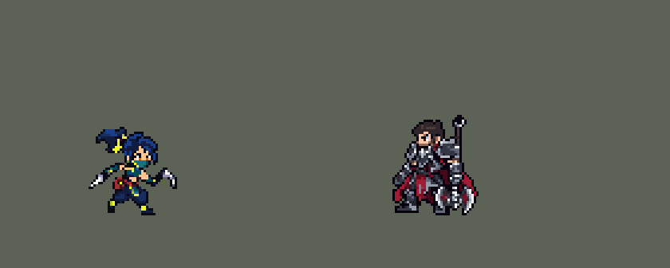

<!-- 本页上半部分由 tools/docs/gen_hero_docs.py 按仓库里现在的数据生成，手改会被覆盖；「开发记录」以下是手写的，生成时原样保留。 -->

# 阿卡丽 Akali


| 项目 | 内容 |
|---|---|
| id | `league_akali` |
| 所属的包 | 主包（mod_id `league`） |
| 分路 | 中单 |
| 分类 / 标签 | 刺客（Assassin） · AP / Magic / Melee |
| 高清帧 | PPU 1.8 |
| 附加包 | [斩杀附加包：伊芙琳、阿卡丽、锐雯](#附加包)（`league_executes`） |



其他预览：[combos](../preview/league_akali_combos.gif)、[逐帧预览](../preview/league_akali_frames.png)、[特效表](../preview/league_akali_effects.png)

## 现在的技能

下面是游戏里显示的技能说明（`league/text/champion.i18n` 的简体中文，去掉了颜色和图标），冷却、距离来自 `league/champion/league_akali.data_champion`；1 秒 = 60 tick。

### 普攻 / 被动（被动「我流忍法！潜龙印」）

*攻击间隔 0.92 秒 · 攻击距离 24000*

普攻造成100% 攻击力的物理伤害。被动 我流忍法！潜龙印：技能命中敌方英雄后4秒内，下一次普攻射程翻倍并额外造成54 + 70% 法术强度的魔法伤害，期间移动速度提高30%。

### 技能1 · 我流奥义！寒影

*冷却 3 秒 · 施放距离 38000 · 施放：指定目标 · 敌人（不含防御塔）*

向前方扇形掷出苦无，造成65 + 76% 法术强度的魔法伤害和30% 攻击力的物理伤害，末端敌人减速50%。连招 E Q A：隼舞二段落到英雄身上后2秒内施放，苦无出手后立刻甩出潜龙印的强化镰刀。

### 技能2 · 我流奥义！隼舞

*冷却 8 秒 · 施放距离 45000 · 施放：指定目标 · 敌人（不含防御塔）*

向后翻身并掷出手里剑，对首个命中的敌人造成54 + 54% 法术强度的魔法伤害并标记它，0.5秒后冲到它身边，造成97 + 97% 法术强度的魔法伤害。附近有敌方英雄时落地施放 我流奥义！霞阵（冷却18秒）：放出烟雾，隐身2秒，移动速度提高40%并递减。

### 大招 · 我流秘奥义！表里杀缭乱

*冷却 50 秒 · 施放距离 50000 · 施放：指定目标 · 敌方英雄*

穿过目标英雄，路径上的敌人受到140 + 70% 法术强度的魔法伤害；2.5秒后再穿过它（死了或跑远就换附近的英雄），86 + 43% 法强，两段之间每命中英雄一次 +25%（最多200%）。连招 R E E R：两段之间隼舞二段落到英雄身上，立刻放第二段。

### 数值

攻击力 85（每级 +12）、法强 50（每级 +20）、生命 900（每级 +85）、护甲 25（每级 +8）、魔抗 20（每级 +4）、移速 1100（每级 +12）。

## 附加包

附加包是可选的原生代码 mod（都在附加包合集 `league_addons` 里），**不装主包里的英雄也是完整的**。

### 斩杀附加包：伊芙琳、阿卡丽、锐雯

[斩杀附加包：伊芙琳、阿卡丽、锐雯](../../addons/league_executes/README.md)：`league_executes` v0.2.0

| 英雄 | 主包（纯数据） | 装了附加包 |
|---|---|---|
| 阿卡丽 R2 | 86 + 43% 法强，两段之间每命中英雄一次 +25%（最多 +200%） | 86 + 43% 法强，按目标已损失生命最多 +200%（损失 70% 时加满） |

## 相关脚本和素材

- [`tools/kit/akali_combos.py`](../../tools/kit/akali_combos.py)
- [`tools/lol/extract_akali.py`](../../tools/lol/extract_akali.py)
- [`tools/art/preview_akali.py`](../../tools/art/preview_akali.py)
- [`tools/art/import_akali.py`](../../tools/art/import_akali.py)
- [`tools/art/design_akali.py`](../../tools/art/design_akali.py)
- [`assets/source/akali/`](../../assets/source/akali)

## 开发记录

> 下面是原来 README 里「英雄：阿卡丽」一节，原样搬过来（只改了相对链接）。

| 部分 | 内容 |
|---|---|
| 定位 | 中单（Assassin），第六组的中单，本包第六个中单（拉克丝、亚索、安妮、永恩、阿狸之后）。和艾克一样走法强 |
| 普攻 | 镰刀横斩，100% 攻击力的物理伤害，射程 24000，攻击间隔 0.92 秒 |
| 被动 | 「我流忍法！潜龙印」：Q、E 打中敌方英雄时他脚下亮起印记圆环，R 第一段冲完时也算，阿卡丽 4 秒内的下一次普攻射程翻倍（48000），甩出镰刀，额外造成 54 + 70% 法强的魔法伤害；印记在身上时移速 +30%。同一次技能打中几个英雄只点亮一次（施法者身上 4 tick 的锁），再打中是刷新不是叠加。英雄联盟里要走出圆环才触发，游戏读不到她离圆环多远，改成打中之后的下一次普攻 |
| 技能1 | Q「我流奥义！寒影」：对 38000 内的敌人施放（小兵和野怪也算，清兵、打野时也用），冷却 3 秒，第 10 tick 朝前扇形甩出五支苦无：半径 45000、±30° 内的敌人受到 65 + 76% 法强的魔法伤害加 30% 攻击力的物理伤害，扇形末端（前方 36000 处半径 12000）的敌人减速 50% 持续 0.5 秒 |
| 技能2 | E「我流奥义！隼舞」（用户选的 A），合并 W「我流奥义！霞阵」（第一版合并在 Q 上，用户改成放在 E 上，照最初方案 B）：对 45000 内的敌人施放，冷却 8 秒。往后翻 21000（第 3–10 tick），第 14 tick 朝目标掷出手里剑（速度 6000、最远 80000、半径 7000），打中的第一个单位（小兵、野怪、英雄都算）受到 54 + 54% 法强的魔法伤害并被标记 0.7 秒；0.5 秒后她冲到它身上（速度 6000）再斩一刀，97 + 97% 法强的魔法伤害。她那时被控住就不冲。放 E 时 40000 内有敌方英雄、霞阵自己的 18 秒冷却也好了，落地时就在落点放一团烟雾，她隐身 2 秒，隐着身冲回去；另外移速 +20% 持续 2 秒、再 +20% 持续 1 秒（开头 1 秒共 +40%，然后减弱）。判定放在出手那一刻：落地时她已经往后退了 21000，离刚才打的人超过 40000。这个游戏里隐身只挡住远处的敌人，贴身的照样能看到、打到，是引擎的限制 |
| 大招 | R「我流秘奥义！表里杀缭乱」（用户选的 A）：50000 内有敌方英雄时施放，冷却 50 秒。先从目标身上穿过去（每 tick 8000、9 tick，共 72000），路上半径 15000 内的敌人受到 140 + 70% 法强的魔法伤害；2.5 秒后自动冲第二段，再穿过第一个目标，它死了或跑出 70000 就换 70000 内另一个英雄，没有就不放，她那时被控住也不放。第二段 86 + 43% 法强，两段之间她每打中英雄一次（普攻和技能都算）+25%，最多 +200%。英雄联盟里第二段按目标损失的生命斩杀，这个游戏读不到血量，改成按两段之间打中的次数加 |
| 附加包 | 可选的附加包 [`addons/league_executes`](../../addons/league_executes/README.md)（在附加包合集里，原生代码，主包不装它也完整）：R2 照英雄联盟按目标已损失生命最多 +200%（主包按两段之间命中英雄的次数分档） |
| 连招 | 用户要求（0.42.6）：「阿卡丽也帮我加点连招逻辑」。和李青一样，每个连招由用掉的那个技能自己打出来，不锁技能栏：**E Q A**——E 的二段突进落到敌方英雄身上后 2 秒内放 Q，苦无扇出手 5 tick 后立刻甩出潜龙印的强化镰刀（打 48000 内的一个英雄，不用等下一次普攻；E 二段和 Q 打中英雄都会点亮印记，印记没亮就不甩）；**R E E R**——大招两段之间，E 的二段突进落到敌方英雄身上，6 tick 后就从这个英雄身上穿过去放第二段，不再等满 2.5 秒，大招自己的第二段随之取消；两段之间的命中照样每次 +25%（E 二段这一下也算）。模拟 12 局（每局 15 分钟，中路）：E 二段落到英雄身上 44 次，其中 17 次接 Q 甩出镰刀（全中）；R E E R 6 次，平均在大招第 90 tick 打出第二段（原来第 152 tick），全中。强度（中路对 5 个原版法师，720 局）：旧版 +1.38，连招版 +1.36，造成的伤害多约 2%，强度不变。 |
| 数值 | 攻击 85（+12）、法强 50（+20）、生命 900（+85）、护甲 25（+8）、魔抗 20（+4）、移速 1100（+12），攻击间隔 0.92 秒。数值是自己设计的，用 SDK 对战模拟调：中路，对 5 个原版法师（`pyromancer`、`ice_mage`、`lightning_mage`、`wind_mage`、`white_mage`），两边、三套队友阵容各 24 局，一批 720 局。初稿 +0.32，偏弱；缩短冷却几乎没用，加属性一般，所有技能伤害 +30% 后 +1.98；按动作帧定下出手时机（普攻第 7 tick 命中，强化普攻第 8 tick，Q 第 10 tick，E 第 14 tick 掷出）后伤害再 +8%，两批种子 +1.82 / +1.73。之后霞阵从 Q 挪到 E（用户的要求），同样两批 +1.43 / +1.45：E 的冷却比 Q 长、隐身固定 2 秒，霞阵放得少了，比永恩（+2.20 / +2.34）、阿狸（+3.04 / +2.27）弱一些，和原版闪电法师（+1.19 / +1.62）相当。阿卡丽每局放 Q 约 56 次（打中英雄约 15 次）、E 约 32 次（对英雄约 11 次，霞阵每 10 分钟 3–6 次）、R 约 4.3 次。R 的第二段（6 局 27 次大招）：11 次冲回第一个目标，7 次换了另一个英雄，9 次附近没有英雄没放，2 次她被控住丢掉 |
| 亚索联动 | 阿卡丽没有击飞和眩晕这类控制（只有 Q 末端的减速），亚索的大招不受影响，不用重跑 |
| 精灵图 | 11 个动作 64 帧：待机、移动、普攻、强化普攻、Q、E 后翻掷出、E 突进、R 第一段、R 第二段、受击、死亡。重做后的造型（用户选的“A40”）：深蓝长发扎高马尾、系青柠色蝴蝶结，青绿面罩贴着脸，琥珀色眼睛，短上衣露腰、淡紫纹身，红色挎包，蓝色灯笼裤配青柠绑带；近侧手拿苦无，远侧手拿镰刀。马尾顶到脚底 40 px、37 px 宽、18 色。每帧的时机和站位照英雄联盟原版动画渲染的参考帧 |
| 特效 | 普攻斩痕，强化普攻的翡翠新月斩，刺客印记圆环（敌人脚下），印记在身上时绕着她的光点，Q 的苦无扇和命中星闪，E 落地时霞阵的烟雾（2 秒），E 旋转的手里剑、命中环和头顶的手里剑标记，E 突进的残影和斩击，R 两段的突进残影、第一段的横斩和第二段的 X 形斩杀 |
| 图标 | 官方技能图标（Q / E / R），64×64 |
| 高清帧（PPU 1.8） | 2026-10-27 用 PPU 重做（用户：「下一个英雄重做阿卡丽」「设计图通过，就用 1.8」）。设计图：Codex 照她的旧精灵描密的第四稿，按原图自己的 16 像素格子逐格读回（71 × 72 格；72 行 / 1.8 = 原来的 40 像素，`design_akali_hd.py`）；武器照这张图：近侧手拿弯钩镰刀、远侧手拿长直刀（用户：「就用这张，不用照旧精灵的手」），手臂上有英雄联盟的纹身。动作：Codex 照旧版同一帧用设计图整帧重画（`pack_akali_actions.py`），每张按头的大小读回到设计图的格子上（`casts_akali_hd.py`：设计图的头按原大小在每帧上找最合适的缩放），和别的帧一模一样的旧帧只画一次；跑步第一版两腿一直分开、不换步，按旧版逐帧写清腿怎么摆后重画（`RUN_REDO_PROMPT_PPU.md`）；待机呼吸由设计图下沉 0–2 行（脚不动）；E 二段和 R 的冲刺特效照旧烤进动作帧（`rig_akali_hd.py`）。高 40 像素和原来一样，没有 SIZES 行；头像点、选人卡片值不变 |
| 音频 | 从本地客户端提取的 15 条技能音效和 4 条中文语音（Q、E、R、R 第二段）。不提交到仓库，按下面的命令在本地生成 |

```bash
python tools/lol/extract_akali.py --lol "D:\WeGameApps\lol" --vgmstream "<vgmstream-cli.exe 路径>"
python tools/lol/native_pose.py assets/source/akali/poses.json --out <渲染文件夹>   # 动作参考帧
python tools/art/design_akali.py      # 造型：Codex 按游戏尺寸画的 A（48 行）整行整列删到 40 行
python tools/art/tidy_akali.py <Codex 的动作条交付文件夹>   # 检查 10 条动作、补一格锁链，写进 native/
python tools/art/import_native.py --hero akali
python tools/art/import_akali.py      # 特效；--raw <Codex 的特效交付文件夹> 先把整理图转成原尺寸条
python tools/kit/akali_combos.py     # 连招写进技能数据（只跑一次，--check 查）
python tools/art/preview_akali.py    # 逐帧图、特效图、演示和连招演示
# PPU 1.8 重做（2026-10-27）：
python tools/art/pack_akali_ppu.py --out <文件夹>          # 给 Codex 的设计图包（照她的旧精灵描密）
python tools/art/design_akali_hd.py                      # Codex 的图（hd/raw/akali-A.png）按自己的格子读回 -> hd/design.png
python tools/art/pack_akali_actions.py --out <文件夹>      # 给 Codex 的动作包（照旧版同一帧整帧重画；--only run 只重画跑步）
python tools/art/casts_akali_hd.py --measure             # 每帧按头量的放大倍数
python tools/art/rig_akali_hd.py                         # 读回、呼吸、烤特效 -> 原始条和 1 倍图
python tools/art/ppu_restyle.py --hero akali && python tools/art/ppu_hd.py --hero akali
python tools/art/ppu_one.py --hero akali && python tools/art/rig_akali_hd.py --one-ground && python tools/art/hero_reels.py --hero akali
python tools/art/review_akali_actions.py --out <文件夹>    # 旧版 / 新版对照动图
```

美术（重做的图片提示词见 [`assets/source/akali/PICTURE_PROMPT_REDO.md`](../../assets/source/akali/PICTURE_PROMPT_REDO.md)，造型的见 [`MODEL_PROMPTS_REDO.md`](../../assets/source/akali/MODEL_PROMPTS_REDO.md)，10 条动作的见 [`MODEL_STRIPS_REDO.md`](../../assets/source/akali/MODEL_STRIPS_REDO.md)，特效的见 [`PROMPTS.md`](../../assets/source/akali/PROMPTS.md)）：
- 分工：模型和特效都由 Codex 画，Claude 写提示词包、整理和导入，按“图片 → 造型 → 动作 → 特效”的顺序。
- 重做（2026-10-01）：第一版（Codex 的 66 格原稿删到 47 行，再删到 40 行）在竞技场的橄榄绿地面上是一团黑：近黑和暗橄榄色，写实比例、头小，脸被面罩遮住。用户：“现在阿卡丽太丑了 重做一下吧”，照崔丝塔娜的路线先定图片再做精灵图。图片：Codex 第 4 轮画的里用户选了 B（[`codex_model/redo7/akali_redraw4_B.png`](../../assets/source/akali/codex_model/redo7/akali_redraw4_B.png)）：身材纤细、瓜子脸、琥珀色眼睛、青绿面罩贴着脸。精灵图前几轮按固定的脸格和“每一格都要画出东西”的要求画，头成了方块、画面碎，用户说“还是做的太差劲了”（脸和眼睛看不清、像素乱）；换成 main 里 18 位英雄重画用的包（“干净，不要细节”：最多 24 色，每种材质 2–3 个平涂色阶，大色块，眼睛至少 2 格高、用只给眼睛的颜色），Codex 画出 44×48、18 色、严格 8×8 方块的 A。它的图像模型画不出正好 40 行，`design_akali.py` 用动态规划整行整列删到 39 行：不连删相邻两行，删掉的行要和留下的邻居最像，眼睛权重 12、钢刃 8、青柠色 3，脸（眼睛上 3 行到下 4 行、左右各 3 列）不删，再补一圈描边成 40 行。用户选了“A40”。
- 动作参考（`poses.json`）：镜头 yaw 45、pitch 25，镜像，头 2.2、腿 0.8、头发 0.7，高度 37（头顶到脚底，照新造型），96×96 的格子，脚底在站位点下 11 行。待机 `Idle1`；移动照英雄联盟的 `Run`（8 帧 × 105 ms），头保持待机时的朝向；普攻 `Attack1`，强化普攻 `Attack_Passive`，Q `Spell1`，E `Spell3`、突进 `Spell3_Dash` / `Spell3_Dash_Attack`，R `Spell4`、`Spell4_Dash1_Hit`，第二段 `Spell4_Dash2`，死亡 `Death`。英雄联盟里 Q、E 的空翻不画，身体最多侧过 90°。每帧的站位点和帧时长在 `native/akali_cells.json`。
- 动作：Codex 照包（定稿、贴头用的头、色板、做好的待机、按游戏尺寸渲染的英雄联盟原版动作）画了 10 条动作 58 帧，8×8 方块，只用定稿的 18 色，脚底线以下没有像素，定稿的头逐格贴进每一帧（受击闭眼；倒地最后两帧是它另画的躺着的头）。有几帧共用原画：Q 第 2–3 帧、第 4–5 帧，W/E 起手第 1、3 帧，R 两段共用三张突进原画，R 第 4 帧借强化普攻举镰刀的姿势；突进时身体比原版前倾得少。`tidy_akali.py` 逐格检查一遍，补一格：强化普攻第 4 帧手和锁链之间断了一格（70 格的锁链单独飘着），照第 3 帧补上。交接说明和清单在 [`codex_model/strips_redo/`](../../assets/source/akali/codex_model/strips_redo/HANDOFF.md)。
- 导入：待机 6 帧用定稿，第 3–5 帧从膝盖往上下沉一格呼吸（`BOB` 5：灯笼裤在膝盖那两行只差 9 格，脚踝和鞋不动）；马尾是每帧的最高处，所以按只在眼睛里用的琥珀色 `#D46A0A` 定头的位置（`EYES`），移动时头稳在同一列。头像截取点 (1, −35) 不变（头顶到脚底还是 37 px）；待机最高处在站位点上 28 px，选人卡片不用 `banpick_center`。
- 特效用 Codex 画的 15 张（81 帧，硬透明，每张 11 色以内）：`import_akali.py --raw` 按交付清单切帧，按技能范围定大小：普攻斩痕 16 px，强化新月斩 28 px，印记圆环 36 px 宽，印记光点的格子 28 px 宽（绕着她 36 px 的身体；缩小前 34 px），苦无扇 45 px 长（扇形半径 45000），命中 12 px，烟雾 70 px 宽（按霞阵在 Q 上时的半径 30000 画的，现在只标出她落地的位置），手里剑 12 px 高，命中 16 px，头顶标记 12 px，E 残影 48 px 长、斩击 20 px，R 残影 64 px 长（一段冲 72000），第一段横斩 22 px，斩杀的 X 30 px。锚点量在图上：命中量白色亮核，圆环和烟雾量中心、放在脚下，光点和苦无扇量格子中间（扇形尖端在左），手里剑量亮核，标记放在头顶，两种残影量左端（她起跑的位置）、放在她身体中间的高度，残影盖住冲刺的路线。时长按技能：苦无扇 14 tick，烟雾 2 秒、和隐身一样长（1–3 帧展开，4–7 帧循环 3 次，8–10 帧散去），光点和标记是 buff 的循环画面。
- 出手时刻和动画对齐：普攻第 3 帧（第 7 tick），强化普攻由 `CasterAnimation` 播 `attack_p`、第 3 帧（第 8 tick），Q 第 4 帧（第 10 tick），E 第 5 帧（第 14 tick 掷出），E 突进播 19 tick 的 `skill2_dash`，R 第一段第 2 帧冲出，第二段播 19 tick 的 `ult2`。
- 结果：18 色，和右边像素同色的比例 39%（原版英雄 18%–46%）。待机每帧 711 个不透明像素（第一版 787），在竞技场地面上能看清脸和眼睛。

逐帧预览：[`docs/preview/league_akali_frames.png`](../preview/league_akali_frames.png?v=1027hd)，特效：[`docs/preview/league_akali_effects.png`](../preview/league_akali_effects.png?v=1014g)。
