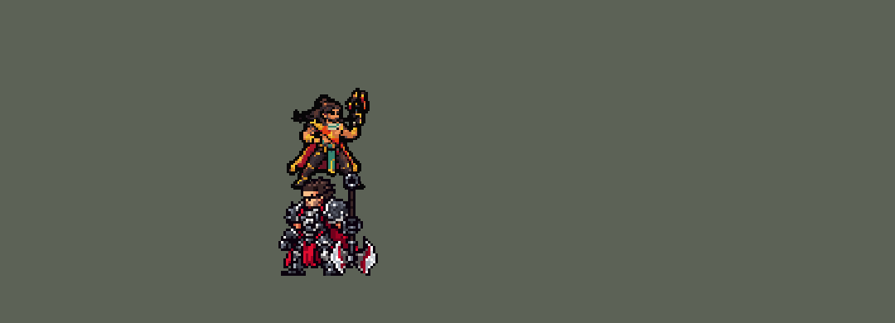

<!-- 本页上半部分由 tools/docs/gen_hero_docs.py 按仓库里现在的数据生成，手改会被覆盖；「开发记录」以下是手写的，生成时原样保留。 -->

# 阿克尚 Akshan


| 项目 | 内容 |
|---|---|
| id | `league_akshan` |
| 所属的包 | 主包（mod_id `league`） |
| 分路 | ADC |
| 分类 / 标签 | 射手（Range） · AD / Range |
| 高清帧 | PPU 1.2 |
| 附加包 | [阿克尚扩展包](#附加包)（`league_akshan`） |



其他预览：[逐帧预览](../preview/league_akshan_frames.png)、[特效表](../preview/league_akshan_effects.png)

## 现在的技能

下面是游戏里显示的技能说明（`league/text/champion.i18n` 的简体中文，去掉了颜色和图标），冷却、距离来自 `league/champion/league_akshan.data_champion`；1 秒 = 60 tick。

### 普攻 / 被动

*攻击间隔 1.07 秒 · 攻击距离 55000*

每次普攻开两枪，第二枪对英雄只有50%伤害。无所不用：普攻和技能每打中3下，多造成20 + 30% 攻击力物理伤害，打中英雄还获得40 + 35% 攻击力护盾2秒。赴险夺人：被2个以上敌方英雄围住时伪装2秒并加速40%。

### 技能1 · 去而复还

*冷却 7 秒 · 施放距离 95000 · 施放：方向 · 敌人（不含防御塔）*

朝敌人扔出回旋镖（先瞄准再出手，能躲开），去程和回程各造成45 + 90% 攻击力物理伤害；打中英雄加速20%，持续1秒。

### 技能2 · 骄行荡寇

*冷却 15 秒 · 施放距离 80000 · 施放：指定目标 · 敌方英雄*

甩出钩索朝敌方英雄荡过去，1.4秒内每0.23秒朝最近的敌人开一枪，造成25 + 60% 攻击力物理伤害，最后翻滚离开再开一枪。

### 大招 · 恩怨相抵

*冷却 50 秒 · 施放距离 160000 · 施放：指定目标 · 刚交过手的敌方英雄*

锁定受伤的敌方英雄蓄力0.5秒，最多存5发子弹，被控制会中断；然后连射，每发打中路上第一个敌人，造成35 + 25% 攻击力物理伤害，前面每打中一发，后面的子弹多30%。

### 数值

攻击力 100（每级 +17）、生命 900（每级 +92）、护甲 20（每级 +7）、魔抗 15（每级 +3）、移速 900（每级 +9）。

## 附加包

附加包是可选的原生代码 mod（都在附加包合集 `league_addons` 里），**不装主包里的英雄也是完整的**。

### 阿克尚扩展包

[阿克尚扩展包](../../addons/league_akshan/README.md)：`league_akshan` v0.2.4

|  | 主包（纯数据） | 扩展包 |
|---|---|---|
| 无所不用（第 3 下） | 数他打中任何人的次数（打 A、B、A 也算 3 下） | 每个目标分别数 3 下（英雄联盟） |
| 恩怨相抵的子弹 | 前面每打中一发，后面的子弹 +30%（近似） | 按目标已损失生命：最低伤害到 3 倍（少 67% 生命时封顶，英雄联盟） |
| 恩怨相抵什么时候开火 | 蓄满 0.5 秒就开火 | 存的子弹打得死射程里血最少的英雄、或者他快跑出射程，就提前开火 |
| 什么时候放大招 | 对“刚被队伍打过”的英雄放（数据读不到生命） | 射程里有英雄生命 ≤ 50%（或存满打得死），身边没有贴脸的敌人、自己生命 ≥ 40% 才放 |
| 骄行荡寇的摆荡 | 钩索扔向目标，分段往前冲 | 钩点挂在他身边（偏离指向目标的方向 60 度、画面上在他上方），他绕钩点荡 120 度（半径 42000）到离目标最近的一端，每 tick 一节绳子从他手到钩点；被硬控就松手（英雄联盟的钩点是墙，团战经理的地图没有墙） |
| 骄行荡寇 | 没有刷新 | 参与击杀英雄后冷却刷新到 0.5 秒 |
| 赴险夺人 | 被 2 个以上敌方英雄围住时伪装加速 | 另外：杀了队友的敌方英雄成为恶徒 60 秒（头上有标记）；阿克尚在恶徒附近加速；阿克尚参与击杀恶徒时，被这个恶徒杀死、还在等复活的队友 **1 秒后在泉水复活**，阿克尚得 100 金 |

装上附加包后游戏里显示的说明（和主包不同的部分）：

- **普攻 / 被动**：【扩展包】普攻开两枪。无所不用：对同一目标每打中3下，多造成20 + 30% 攻击力物理伤害，英雄还给他40 + 35% 攻击力护盾。赴险夺人：被围时伪装2秒；杀了队友的敌人成为恶徒60秒，他参与击杀恶徒时，被恶徒杀死的队友1秒后复活，他得100金。
- **技能2 · 骄行荡寇**：【扩展包】甩出钩索朝敌方英雄荡过去，1.4秒内每0.23秒朝最近的敌人开一枪，造成25 + 60% 攻击力物理伤害，最后翻滚再开一枪。参与击杀英雄后冷却刷新。
- **大招 · 恩怨相抵**：【扩展包】锁定受伤的敌方英雄蓄力0.5秒，最多存5发，被控制会中断；打得死或目标要跑时提前开火。每发打中路上第一个敌人，造成35 + 25% 攻击力物理伤害，目标每少1%生命伤害更高，少67%时3倍。

## 相关脚本和素材

- [`tools/kit/build_akshan.py`](../../tools/kit/build_akshan.py)
- [`tools/kit/setup_akshan.py`](../../tools/kit/setup_akshan.py)
- [`tools/lol/extract_akshan.py`](../../tools/lol/extract_akshan.py)
- [`tools/art/preview_akshan.py`](../../tools/art/preview_akshan.py)
- [`tools/art/rig_akshan.py`](../../tools/art/rig_akshan.py)
- [`assets/source/akshan/`](../../assets/source/akshan)

## 开发记录

> 下面是原来 README 里「英雄：阿克尚」一节，原样搬过来（只改了相对链接）。

| 部分 | 内容 |
|---|---|
| 定位 | ADC（Bottom，标签 AD / Physical / Range），第 129 位英雄。影哨 阿克尚：白色兜帽披风、橙红色金太阳外袍、举着红色圣物枪的游侠（10-17 的分组计划 B 组的 ADC）。用户的选择：技能方案 A（带扩展包 league_akshan），「大招改rust也做不了吗」「做成复活队友的吧 游戏更新你就做动态寻址 方便自动找」。技能 1 = Q 去而复还，技能 2 = E 骄行荡寇，大招 = R 恩怨相抵；被动无所不用和 W 赴险夺人在普攻里（W 的复活在附加包里）。技能名照英雄联盟 16.20 的官方中文（繁体：埃可尚、無賴之道、復仇迴力鏢、離經叛道、英勇勾索、因果蓄能彈） |
| 普攻 / 被动 | 射程 55000，每次普攻**连开两枪**（第 5、12 tick），第二枪对英雄 50% 伤害（英雄联盟一样，对小兵野怪满伤）。**无所不用**：普攻和技能每打中 3 下，多造成 20 + 30% 攻击力物理伤害，打中英雄再给自己 40 + 35% 攻击力的护盾 2 秒（10 秒一次）；主包数他打中任何人的次数，附加包按目标分别数。**赴险夺人**：40000 内有 2 个以上敌方英雄时伪装 2 秒、加速 40%（18 秒一次） |
| 技能1 | **Q 去而复还**（射程 100000，对小兵、野怪也放）：先瞄准再出手（能躲开），回旋镖飞到射程尽头再折回他手里，去程和回程各造成 45 + 90% 攻击力物理伤害（各算一下无所不用）；打中英雄加速 20% 1 秒。冷却 7 秒 |
| 技能2 | **E 骄行荡寇**（射程 80000，只对敌方英雄）：甩出钩索荡过去，1.4 秒里每 14 tick 朝最近的敌人开一枪（6 枪），每枪 25 + 60% 攻击力物理伤害，最后翻滚离开再开一枪。英雄联盟的钩点是墙，团战经理的地图没有墙：**附加包**里钩点挂在他身边、偏离指向目标的方向 60 度、画面上在他上方，他绕钩点荡 120 度（半径 42000）到离目标最近的一端，每 tick 一节绳子从他手到钩点（用户：「这技能怎么回事 看着这么奇怪 要和LOL一样啊」）；被硬控就松手。主包是把钩索扔向目标、分段往前冲。冷却 15 秒，附加包里参与击杀英雄刷新到 0.5 秒 |
| 大招 | **R 恩怨相抵**（射程 160000）：锁定受伤的敌方英雄蓄力 0.5 秒（身上红色锁定标记），最多存 5 发，被控制就中断；然后连射，每发打中路上第一个敌人，35 + 25% 攻击力物理伤害。主包里前面每打中一发、后面的子弹 +30%；附加包按目标已损失生命加伤（少 67% 生命时 3 倍），存的子弹打得死人或目标快跑出射程就提前开火，AI 只在射程里有生命不到一半的英雄、身边没有贴脸的敌人、自己生命不低于 40% 时放。冷却 50 秒 |
| 附加包 | 可选的附加包 [`addons/league_akshan`](../../addons/league_akshan/README.md)（在附加包合集里，原生代码，主包不装它也完整）：无所不用按目标数第 3 下、子弹按已损失生命加伤、提前开火、AI 看时机放 R、E 的弧线摆荡和刷新，以及**赴险夺人的恶徒和复活**：敌方英雄杀了他的队友就成为恶徒 60 秒（头上标记），他在恶徒附近加速；他参与击杀恶徒时，被这个恶徒杀死、还在等复活的队友 **1 秒后在泉水复活**，他得 100 金。稳定接口没有改复活时间的函数，附加包运行时读游戏自己的 `player_respawn_time` / `player_is_alive` 的机器码找到“剩余复活 tick”在内存里的位置（动态寻址，游戏更新后自己重新找；认不出就不写），每次写前核对、只改小、绝不写 0（见附加包说明）。日志 `league_akshan.log`（LAYOUT、MARK、REVIVE、SWING、BULLET、R CAST）。**复活和弧线摆荡还没在游戏里看过** |
| 数值 | 攻击 100（+17）、生命 900（+92）、护甲 20（+7）、魔抗 15（+3）、移速 900（+9）、射程 55000（射手基准，同卢锡安） |
| 平衡 | 10 分钟经典引擎模拟，下路对原版五个射手（弓箭手、枪手、回旋镖猎人、吹箭猎人、投弹手），三套阵容两边各打：初稿 −1.92；攻击 100 / 20、Q 90%、E 25 + 60%、R 60 + 40% 后 1–8 号种子 **+1.37**、9–16 号 **+0.57**（平均约 +1.0；同批卢锡安 +1.58） |
| 精灵图（高清帧 PPU 1.5） | Codex 第 0 步画了 A（英雄联盟的待机：枪举在头边）和 B（枪平端在胸前）两张原画（[`tools/art/pack_akshan_picture.py`](../../tools/art/pack_akshan_picture.py)），[`tools/art/review_akshan_size.py`](../../tools/art/review_akshan_size.py) 和射手们并排，用户：「用 A，游戏里 38 像素高，PPU 1.5」。第 1 步 Codex 在游戏格子上重画两轮（[`tools/art/pack_akshan_model.py`](../../tools/art/pack_akshan_model.py)、[`pack_akshan_model2.py`](../../tools/art/pack_akshan_model2.py)；Codex 不管要求多少，自己画 10 px 一格），[`tools/art/design_akshan_cut.py`](../../tools/art/design_akshan_cut.py) 读回、均匀删到 57 行（脸不删）。动作照塔姆的做法（[`tools/art/rig_akshan.py`](../../tools/art/rig_akshan.py)，只整块平移）；第一版把前臂和枪单独挪开，用户：「手都断了？」「做不了就让codex做」：平端枪的手臂由 Codex 照定稿画一张姿势（[`pack_akshan_poses.py`](../../tools/art/pack_akshan_poses.py) / [`design_akshan_poses.py`](../../tools/art/design_akshan_poses.py)，整只手臂和枪盖章上去），走路（用户：「走路没交叉步啊」）是 Codex 照 oppi 斯维因的长袍跑步换皮（[`pack_akshan_run.py`](../../tools/art/pack_akshan_run.py) / [`design_akshan_run.py`](../../tools/art/design_akshan_run.py)，5.5 px 一格读回、颜色归到定稿），下蹲最多 2 格，阵亡是站立帧躺倒。用户：「动作可以了」。头像点 (3, −31)，选人卡 −12（规则的 −4 量的是枪尖，他的头低 8 像素）。2026-10-18 降到 PPU 1.2（用户：「……阿克尚……像素太高需要降低」） 2026-10-19 补帧：E 收尾的 `e_roll` 原来只有蹲、站两帧，改成荡绳的蜷身帧整张转 1/4、1/2、3/4 圈的后滚翻（配合 kit 的向后弹开）再落地蹲起，共 5 帧；受击加白闪后退（原来两帧是同一张）；死亡 8 帧（落地回弹） |
| 特效 | 第 3 步 14 张特效（[`tools/art/pack_akshan_fx.py`](../../tools/art/pack_akshan_fx.py)，颜色照英雄联盟：子弹和回旋镖是红金色，伪装是淡青色，锁定标记是红色准星）。弹道（子弹、回旋镖、大招子弹、绳子）画成朝右，跟着飞行方向转；其余左右对称（游戏不镜像特效图）。[`tools/art/import_akshan_fx.py`](../../tools/art/import_akshan_fx.py)：绳子用 Codex 钩索图的钩头接 5 段绞绳、转成横的（42 像素），伪装和锁定标记是大图。写成 `league_akshan_fx` 和 `league_akshan_big` |
| 音效 | 英雄联盟的音效和配音（[`tools/lol/extract_akshan.py`](../../tools/lol/extract_akshan.py)，25 段）：两枪、回旋镖出手 / 接住、钩索 / 摆荡开枪 / 翻滚、伪装、大招蓄力 / 开火 / 打中、复活和得金，配音是他的台词（中文） |
| 图标 | 官方技能图标（去而复还、骄行荡寇、恩怨相抵，另有无所不用和赴险夺人），从本地客户端取 |

重新生成（素材来自本机的英雄联盟客户端，音频不进仓库）：

```bash
python tools/lol/extract_akshan.py --lol "D:\WeGameApps\lol" --vgmstream <vgmstream-cli.exe>
python tools/kit/build_akshan.py                 # 技能数据，数字都在脚本的参数表 P 里
python tools/kit/setup_akshan.py                 # 五种语言的文字、音效配置、共享文件里他的键
python tools/art/design_akshan_cut.py            # Codex 第 1 步的造型读回（PPU 1.5，A）
python tools/art/design_akshan_poses.py          # Codex 画的平端枪姿势
python tools/art/design_akshan_run.py            # Codex 换皮的走路
python tools/art/rig_akshan.py                   # 1 倍帧和 1.5 的原帧
python tools/art/ppu_restyle.py --hero akshan    # 外描边（不要加 --preview）
python tools/art/ppu_hd.py --hero akshan         # hd_ / lo_ 帧
python tools/art/import_akshan_fx.py             # 特效
python tools/art/preview_akshan.py               # 预览和演示 GIF
python addons/league_akshan/make_override.py     # 附加包的副本（主包的阿克尚改了就重跑）
```

美术提示词见 [`assets/source/akshan/`](../../assets/source/akshan) 里的 `PICTURE_PROMPT.md`、`MODEL_PROMPTS.md`、`MODEL_PROMPTS_V2.md`、`POSE_PROMPTS.md`、`PROMPTS_FX.md`（走路换皮的提示词在 `pack_akshan_run.py` 里）；Codex 的交付在 `codex_picture/`、`codex_model/`、`codex_model2/`、`codex_poses/`、`codex_run/`、`codex_fx/`。

逐帧预览：[`docs/preview/league_akshan_frames.png`](../preview/league_akshan_frames.png?v=1018a)，特效：[`docs/preview/league_akshan_effects.png`](../preview/league_akshan_effects.png?v=1018a)。
