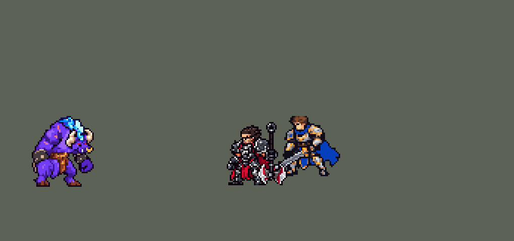

<!-- 本页上半部分由 tools/docs/gen_hero_docs.py 按仓库里现在的数据生成，手改会被覆盖；「开发记录」以下是手写的，生成时原样保留。 -->

# 阿利斯塔 Alistar


| 项目 | 内容 |
|---|---|
| id | `league_alistar` |
| 所属的包 | 主包（mod_id `league`） |
| 分路 | 辅助 |
| 分类 / 标签 | 功能型（Util） · AP / Magic / Melee / Tank / CC / Heal |
| 高清帧 | 1 倍像素（无高清帧） |
| 附加包 | 无 |



其他预览：[逐帧预览](../preview/league_alistar_frames.png)、[特效表](../preview/league_alistar_effects.png)

## 现在的技能

下面是游戏里显示的技能说明（`league/text/champion.i18n` 的简体中文，去掉了颜色和图标），冷却、距离来自 `league/champion/league_alistar.data_champion`；1 秒 = 60 tick。

### 普攻 / 被动（被动「凯旋怒吼」）

*攻击间隔 1.33 秒 · 攻击距离 25000*

用双拳重击。被动凯旋怒吼：控制命中敌方英雄3次后怒吼，回复自己40 + 20% 法强、周围友方英雄50 + 30% 法强生命。

### 技能1 · 大地粉碎

*冷却 10 秒 · 施放距离 24000 · 施放：无目标 · 敌人（不含防御塔）*

践踏接大地粉碎：先践踏3秒（每脚12 + 9% 法强），再砸地，周围敌人受到80 + 80% 法强魔法伤害并击飞1秒。踩中英雄5次后，下次普攻眩晕1秒。

### 技能2 · 野蛮冲撞

*冷却 12 秒 · 施放距离 55000 · 施放：指定目标 · 敌方英雄*

野蛮冲撞接大地粉碎：冲向敌方英雄，撞退并造成100 + 110% 法强魔法伤害，随即砸地击飞周围敌人，同时开始践踏。（和大地粉碎共用：6秒内只砸一次）

### 大招 · 坚定意志

*冷却 60 秒 · 施放距离 70000 · 施放：无目标 · 敌方英雄*

交战时怒吼：免疫控制1秒，7秒内受到的伤害降低50%。

### 数值

攻击力 80（每级 +6）、法强 25（每级 +15）、生命 1100（每级 +120）、护甲 38（每级 +8）、魔抗 28（每级 +4）、移速 1000（每级 +10）。

## 相关脚本和素材

- [`tools/kit/build_alistar.py`](../../tools/kit/build_alistar.py)
- [`tools/kit/setup_alistar.py`](../../tools/kit/setup_alistar.py)
- [`tools/lol/extract_alistar.py`](../../tools/lol/extract_alistar.py)
- [`tools/art/preview_alistar.py`](../../tools/art/preview_alistar.py)
- [`tools/art/import_alistar.py`](../../tools/art/import_alistar.py)
- [`tools/art/design_alistar.py`](../../tools/art/design_alistar.py)
- [`assets/source/alistar/`](../../assets/source/alistar)

## 开发记录

> 下面是原来 README 里「英雄：阿利斯塔」一节，原样搬过来（只改了相对链接）。

| 部分 | 内容 |
|---|---|
| 定位 | 辅助（分类 Util；本包没有坦克分类，标签 Tank），用户 10 月 2 日排的第十二组的辅助（同组：瑟提、伊芙琳、丽桑卓、韦鲁斯）。牛头：Q 砸地群体击飞，W 冲撞接 Q（W→Q 二连），E 践踏并进 Q 和 W，满五次的下一拳眩晕，R 免控减伤 |
| 普攻 / 被动 | 普攻是双拳重击，100% 攻击力的物理伤害，射程 25000，攻击间隔 80 tick（第 12 tick 打中）。被动「凯旋怒吼」：他的控制（Q、W→Q 的击飞，W 的撞退，E 的眩晕）每命中一个敌方英雄记一次，满 3 次（冷却 5 秒）就怒吼：自己回复 40 + 20% 法强，40000 内的友方英雄回复 50 + 30% 法强。英雄联盟里附近小兵死亡也会叠层，这里没做 |
| 技能1 | Q「大地粉碎」+ E「践踏」（用户选的 E → Q 二连）：冷却 600 tick（10 秒），也对小兵和野怪放，射程 24000。施放时如果践踏没在冷却，先开始践踏（出手时踩第一脚）：3 秒内每 30 tick 踩一脚，24000 内的敌人受到 12 + 9% 法强魔法伤害；第 14 tick 砸地，28000 内的敌人受到 80 + 80% 法强魔法伤害并击飞 1 秒，每击飞一个英雄也算踩中一次。践踏累计踩中敌方英雄 5 次后，下一次普攻英雄眩晕 1 秒，额外 50 + 50% 法强魔法伤害。践踏冷却 1080 tick（18 秒） |
| 技能2 | W「野蛮冲撞」接大地粉碎（W → Q，用户选的）：冷却 720 tick（12 秒），只对英雄放，射程 55000。冲向目标（每 tick 3500），一头撞上造成 100 + 110% 法强魔法伤害并把面前的英雄撞退（8 tick，每 tick 2500）；落地 6 tick 后在原地砸地，周围敌人受到 30 + 30% 法强魔法伤害并击飞 1 秒——砸在被撞飞的英雄落下的位置。同样会开始践踏。Q 的砸地和 W 落地的砸地共用一个 6 秒的「大地粉碎」冷却（2026-10-13，用户：「牛头EQ后 还能释放一次Q」「改」）：英雄联盟里 W→Q 用的就是 Q，这里两次砸地原来各算各的，EQ 完马上 W 又击飞一次；现在 6 秒内只砸一次，计时中放 Q 只践踏、放 W 只冲撞。只加这条他就从 +0.84 掉到 −1.61（击飞少了一半），数值补成 Q 80 + 80%、W 冲撞 100 + 110%、践踏 12 + 9% 后两批模拟 +0.18 / +0.17（[`tools/fix/alistar_pulverize.py`](../../tools/fix/alistar_pulverize.py)，游戏里的数据带着红方处理，直接改）|
| 大招 | R「坚定意志」：冷却 60 秒，只对英雄放，和布里茨的 R 一样先「上膛」：70000 内有敌方英雄时上膛 10 秒，之后 32000 内有敌方英雄、或他自己被控制时立刻触发：免疫控制 1 秒（英雄联盟的解控），7 秒内受到的伤害降低 50%，怒吼一声、身后亮起怒气光环。上膛期间没用上就返还冷却 |
| 数值 | 攻击 80（+6）、生命 1100（+120）、护甲 38（+8）、魔抗 28（+4）、移速 1000（+10），和本包的蕾欧娜同一档。数值是自己设计的，用 SDK 对战模拟调：辅助位，对 5 个原版辅助（`priest`、`bard`、`enchanter`、`monk`、`taoist`），3 套阵容、两边各打，10 分钟。初稿 +6.08（伤害 9254，蕾欧娜 3705：Q 和 W→Q 几秒一次，每次都是 1 秒的群体击飞）；砍到 Q 50 + 50%、冷却 6 → 10 秒，W→Q 的砸地单算 30 + 30%，W 40 + 50%、冷却 8 → 12 秒，践踏每脚 8 + 6%、冷却 10 → 18 秒，怒吼的回复下调，R 减伤 60% → 50% 后，种子 1–24 +1.65、25–48 +1.47（蕾欧娜 +0.78 / +1.23）。击飞保留英雄联盟的 1 秒（0.75 秒那版 +0.85，不如保留原版手感） |
| 亚索联动 | Q、W→Q 的击飞和 E 的眩晕都是亚索大招要的控制：牛头辅助、亚索同队时，亚索每局 R 到被控英雄 2.23 次（同一批蕾欧娜 2.19、原版 `priest` 0.50），和蕾欧娜一样，亚索不用调 |
| 精灵图 | 10 个动作 55 帧：待机 6、移动 9（9 × 111 ms，一秒一个循环）、普攻 6、Q（`skill`）6、W 冲撞（`skill2`）6、W 撞头（`butt`）2、W→Q 砸地（`slam`）4、R 6、受击 2、死亡 8。造型 41 × 44 px，25 色。头像截取点 (9, −32)，选人卡片 `banpick_center` y −7 |
| 特效 | Codex 生图的 15 张（`import_alistar.py` 缩成游戏像素）：`league_alistar_fx` 普攻命中、击飞的尘土、撞头闪光和命中、践踏命中、锁链印记（满五次）、眩晕一拳的命中和头上的星星、怒吼回血；`league_alistar_big` 大地粉碎的地裂、W→Q 的地裂、冲撞的尘土、践踏的地面圈、凯旋怒吼的光圈、R 的怒吼爆发和身后的怒气光环（画在他身后） |
| 音效 | 英雄联盟的音效和配音（`tools/lol/extract_alistar.py`）：普攻命中，Q 出手和砸地，W 出手和撞上，践踏、印记满、眩晕，被动怒吼，R 怒吼；Q、W 各一句中文配音。版权属于 Riot Games，**不提交到仓库**，按下面的命令在本地生成 |
| 图标 | 官方技能图标（Q / W / R），从本地客户端提取，缩到 64×64 |

重新生成（素材来自本机的英雄联盟客户端，音频不进仓库）：

```bash
python tools/lol/extract_alistar.py --lol "D:\WeGameApps\lol" --vgmstream "<vgmstream-cli.exe 路径>"
python tools/kit/build_alistar.py        # 技能数据，数字都在脚本的参数表 P 里；--nodes 看每棵技能树的节点数
python tools/kit/setup_alistar.py --face=9,-32 --banpick -7   # 五种语言的文字、音效配置、共享文件里他的键
python tools/art/design_alistar.py       # 造型：Codex 原稿 A 按 2×2 减半到 44 行，修鼻环下的横线、左角照右角镜像
python tools/lol/native_pose.py assets/source/alistar/poses.json --out <渲染文件夹>   # 动作参考帧
python tools/art/fix_alistar_strips.py   # 动作：Codex 的动作条按格子读回，贴回造型的头，清掉杂点和缺像素
python tools/art/run_alistar.py          # 移动：换皮交付按格子读回、换成造型的颜色，修腰上的黑线
python tools/art/import_native.py --hero alistar
python tools/art/import_alistar.py       # 特效；--raw <Codex 的特效交付文件夹> 先把生图原稿缩成游戏尺寸的原尺寸条
python tools/art/preview_alistar.py
```

美术（原画的提示词见 [`assets/source/alistar/PICTURE_PROMPT.md`](../../assets/source/alistar/PICTURE_PROMPT.md)，造型的见 [`MODEL_PROMPTS.md`](../../assets/source/alistar/MODEL_PROMPTS.md)，动作的见 [`MODEL_STRIPS.md`](../../assets/source/alistar/MODEL_STRIPS.md)，特效的见 [`PROMPTS_FX.md`](../../assets/source/alistar/PROMPTS_FX.md)，移动的换皮提示词见 [`codex_run_swap/pack/PROMPT.md`](../../assets/source/alistar/codex_run_swap/pack/PROMPT.md)；Codex 的交付说明在 [`codex_picture/`](../../assets/source/alistar/codex_picture)、[`codex_model/`](../../assets/source/alistar/codex_model)、[`codex_strips/`](../../assets/source/alistar/codex_strips)、[`codex_fx/`](../../assets/source/alistar/codex_fx)、[`codex_run_swap/`](../../assets/source/alistar/codex_run_swap)）：

- 原画：Codex 画了 A（英雄联盟的待机）、B，用户选 A。
- 造型：Codex 原稿 A 先按格子读回，再 2×2 减半到 44 行（用户在几种缩法里选的）；按用户的反馈修了鼻环下面的一条横线，左边的牛角改成右角的镜像。
- 动作：Codex 的动作条每帧都贴了造型的头，贴的时候头四周带着一圈方框，改成按头的形状贴；按用户的反馈逐帧补了缺的像素（死亡时头上、W 冲撞的旧牛角）、清掉银色杂点和孤立的小块，审核动图统一画布（之前帧大小不一，看起来像多出一截身体）。
- 移动：前几版都是待机的上半身不动、只换腿，用户：「牛头走路没有交叉步」「单脚走路的」「走路和待机的体型不一样」，Codex 只画腿的一版把远侧的拳头弄丢了、腿压成了细棍，按步态重排的一版用户还是觉得「不自然」。参考隔壁 oppi 的牛头跑步（拳头和腿反向摆、后腿弯膝往后踢、身体一起一伏），用「骨架 + 皮囊」换皮让 Codex 重画了 9 帧：图 1 是那套跑步动作（只当动作参考，原图不放进仓库），图 2 是我们的造型。`run_alistar.py` 抠掉绿底、按格子读回、颜色换成造型的 25 色、按站位点摆好；GPT 在肚子和兜裆布之间画了一条黑线、护腕和兜裆布之间留了一块黑，用户：「腰部一条横线很明显」「明显腰部和腿分离了」，改成兜裆布自己的深棕色和肚子下的深紫阴影（腿不动）。
- 特效用 Codex 画的 15 张（`import_alistar.py --raw`：每张按格子等分，颜色归到包里给每张的色阶）。R 的怒气光环按宽高分别缩放、画在他身后（`z` −1），冲撞的尘土缩小到脚边。

逐帧预览：[`docs/preview/league_alistar_frames.png`](../preview/league_alistar_frames.png?v=1014g)，特效：[`docs/preview/league_alistar_effects.png`](../preview/league_alistar_effects.png?v=1014g)。
