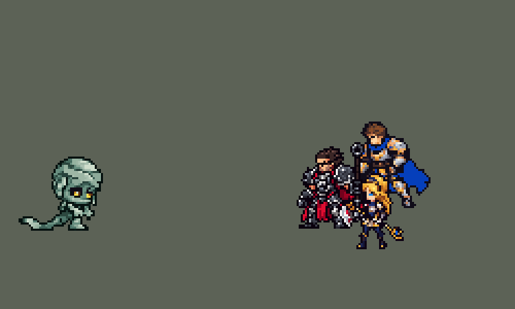

<!-- 本页上半部分由 tools/docs/gen_hero_docs.py 按仓库里现在的数据生成，手改会被覆盖；「开发记录」以下是手写的，生成时原样保留。 -->

# 阿木木 Amumu


| 项目 | 内容 |
|---|---|
| id | `league_amumu` |
| 所属的包 | 主包（mod_id `league`） |
| 分路 | 打野 |
| 分类 / 标签 | 近战（Melee） · AP / Magic / Melee / Tank / CC |
| 高清帧 | 1 倍像素（无高清帧） |
| 附加包 | 无 |



其他预览：[逐帧预览](../preview/league_amumu_frames.png)、[特效表](../preview/league_amumu_effects.png)

## 现在的技能

下面是游戏里显示的技能说明（`league/text/champion.i18n` 的简体中文，去掉了颜色和图标），冷却、距离来自 `league/champion/league_amumu.data_champion`；1 秒 = 60 tick。

### 普攻 / 被动（被动「诅咒之触、绝望光环」）

*攻击间隔 1.17 秒 · 攻击距离 25000*

普攻造成100% 攻击力的物理伤害。被动 诅咒之触、绝望光环：普攻或施放技能后哭泣4秒，每秒对周围敌人造成10 + 10% 法术强度的魔法伤害（英雄另受1% 最大生命值的真实伤害）并施加诅咒：受到伤害提高10%。

### 技能1 · 绷带牵引

*冷却 6 秒 · 施放距离 75000 · 施放：方向 · 敌方英雄*

掷出绷带，穿过小兵和野怪，粘住第一个敌方英雄，造成80 + 70% 法术强度的魔法伤害并眩晕1秒，随后阿木木把自己拉过去。

### 技能2 · 阿木木的愤怒

*冷却 4.5 秒 · 施放距离 28000 · 施放：无目标 · 敌人（不含防御塔）*

对周围敌人造成60 + 50% 法术强度的魔法伤害。被动：受到的普攻伤害降低10%。

### 大招 · 木乃伊之咒

*冷却 60 秒 · 施放距离 30000 · 施放：无目标 · 敌方英雄*

用绷带缠住周围所有敌人，造成150 + 80% 法术强度的魔法伤害，眩晕1.5秒并施加诅咒3秒。

### 数值

攻击力 70（每级 +6）、法强 30（每级 +15）、生命 1100（每级 +120）、护甲 38（每级 +9）、魔抗 30（每级 +5）、移速 1000（每级 +10）。

## 相关脚本和素材

- [`tools/lol/extract_amumu.py`](../../tools/lol/extract_amumu.py)
- [`tools/art/preview_amumu.py`](../../tools/art/preview_amumu.py)
- [`tools/art/import_amumu.py`](../../tools/art/import_amumu.py)
- [`assets/source/amumu/`](../../assets/source/amumu)

## 开发记录

> 下面是原来 README 里「英雄：阿木木」一节，原样搬过来（只改了相对链接）。

| 部分 | 内容 |
|---|---|
| 定位 | 打野（Melee / Tank），第二组第二个 |
| 普攻 | 跳起来往下砸，100% 攻击力。被动「诅咒之触」+「绝望光环」：普攻或放任何技能后哭 4 秒，每秒对周围 25000 内的敌人造成 10 + 10% 法术强度的魔法伤害（敌方英雄另受 1% 最大生命值的真实伤害），并施加诅咒：受到的伤害提高 10%。英雄联盟里 W 是开关，按最大生命值算的部分是魔法伤害；数据里没有开关，魔法伤害也没有按目标生命值算的字段，所以改成打起来自动开的光环，百分比部分做成真实伤害，只打英雄（免得秒大型野怪）。诅咒每秒重新给 1 秒，不会叠加 |
| 技能1 | Q「绷带牵引」：朝敌方英雄扔绷带（施放距离 75000，绷带飞 85000），穿过小兵和野怪，粘住第一个敌方英雄：80 + 70% 法术强度的魔法伤害，眩晕 1 秒，然后阿木木飞过去。玩家反映「Q 从来没触发过眩晕，贴脸 Q 也没有」：模拟器里绷带 6 局命中 38%、命中后对方原地 1 秒，正式版的情况在这里复现不了，于是把两处只有它这样写的地方改成稳的：绷带半径 5000 → 7000、每 tick 5000 → 6500（本包最细最慢的技能，莫甘娜 Q 的宽度、本体梦魇技能的速度），命中时伤害和眩晕立刻生效，冲过去和飞行姿势 2 tick 后再放（李青 Q2 在游戏里验证过的写法）；模拟 6 局命中 38% → 60%。玩家试过后说「的确有点难 Q 中人」，要宽一点、远一点：半径 7000 → 12000，施放距离 62000 → 75000、飞行 70000 → 85000，模拟 18 局命中 56% → 73%（半径 10000 时 67%），打野对原版打野 720 局击杀差 −0.52 → +0.01。只有 1 层充能（英雄联盟是 2 层，AI 会立刻连扔两次） |
| 技能2 | E「阿木木的愤怒」：跺脚，周围 28000 内的敌人受到 60 + 50% 法术强度的魔法伤害，冷却 4.5 秒。被动：受到的普攻伤害降低 10%。英雄联盟里被攻击时冷却缩短，数据里没有"受到攻击时"的触发 |
| 大招 | R「木乃伊之咒」：周围 42000 内的所有敌人受到 150 + 80% 法术强度的魔法伤害，眩晕 1.5 秒，诅咒 3 秒。冷却 60 秒 |
| 连招 | 用户要求：「有连招要做连招」「都要帮我补」。英雄联盟里阿木木 Q 粘住人飞过去，落地就接 E 或 R。**Q→E / Q→R**：绷带粘住敌方英雄时（和冲刺一起，命中后 2 tick）阿木木身上开一个 90 tick（1.5 秒）的连招窗口；窗口里放 E，跺脚立刻生效（平时第 20 tick）；放 R，木乃伊之咒立刻炸开（平时第 18 tick），都趁 Q 的 1 秒眩晕还在。窗口放过技能也不关，Q→E→R 可以在窗口里连着放完。伤害、眩晕、冷却都不变，绝望光环照旧在原来的时间开始；绷带打死目标时不开窗口。数据由 [`tools/fix/combo_amumu.py`](../../tools/fix/combo_amumu.py) 改 |
| 精灵图 | 9 个动作 57 帧：待机、跑步、普攻、Q 扔绷带、Q 飞过去、E 发脾气、R 蜷起后炸开、受击、死亡。头顶到脚底 34 px，10 色，动作全部取自英雄联盟原版动画 |
| 特效 | 普攻命中、飞出的绷带、Q 粘住、诅咒标记、绝望光环（脚下）、E 冲击环、R 绷带炸开、R 缠住 |
| 图标 | 官方技能图标（Q / E / R），64×64 |
| 音频 | 从本地客户端提取的 9 条技能音效和 2 条中文语音（Q 的语音；大招借用一句普攻台词）。不提交到仓库，按下面的命令在本地生成 |

```bash
python tools/lol/extract_amumu.py --lol "D:\WeGameApps\lol" --vgmstream "<vgmstream-cli.exe 路径>"
python tools/lol/native_pose.py assets/source/amumu/poses.json --out <渲染文件夹> --alpha --parts
python tools/art/restyle_native.py assets/source/amumu/poses.json --renders <渲染文件夹>   # 角色图
python tools/art/import_native.py --hero amumu
python tools/art/import_amumu.py      # 特效；--raw <Codex 的 generated 文件夹> 先把原始图转成原尺寸条
python tools/art/preview_amumu.py
```

美术（提示词见 [`assets/source/amumu/PROMPTS.md`](../../assets/source/amumu/PROMPTS.md)）：
- 比例和镜头：阿木木在英雄联盟里本来就是大头，原版比例时头已经占身高 63%，前几个英雄用的"头 2.0、腿 0.8"会让头占 91%，所以用原版比例。待机时他的头往右垂，yaw 55 下只看得到一只眼睛，改用 yaw 40；镜像让身后拖在地上的绷带露出来。原版的 `Spell2` 是被绷带拉过去时身体放平的飞行姿势，用作 `q_pull`。
- 造型图：Codex 的生图对不准网格（1254 px 画布，方块约 13.45 px，只有 29 格高），但画风是对的。Claude 照英雄联盟 34 格的轮廓和姿势逐格画：头上三种深浅的横向绷带条，深紫黑眼窝里一双琥珀色大眼睛（用户在四个选项里选了"大眼睛、不画嘴"），躯干、下巴下的小爪子、两只大圆脚和拖地的绷带各自描边，10 色。
- 动作图：Codex 交回的 9 张也是生图原始输出，头每帧都是重画的，眼睛只是小点，转成原尺寸后站着的身高在 32 到 47 格之间跳。用户看了并排对比，选了用英雄联盟动画重新上色：`restyle_native.py` 把每个 8×8 块投票成造型图的 10 色（全身按亮度分五个绿），头换成造型图的头，只有倒地的几帧把头转 90°（`restyle` 新加的按动作设置的 `turn`）。
- 特效用 Codex 画的：`import_amumu.py --raw` 把原始图（半透明、格子比例不对）转成 8×8 方块的原尺寸条，再按技能范围定大小：E 冲击环约 58 px（半径 28000），R 约 84 px（42000），绝望光环约 56 px（25000）。
- 出手时刻和动画对齐：普攻第 15 tick 砸中，Q 第 16 tick 出手，E 第 20 tick 跺地，R 第 18 tick 炸开。
- 结果：10 色，和右边像素同色的比例 62%（绷带是大块平涂；原版英雄 18%–46%）。头像截取点 (5, −26)：`tfm2_ase.py face` 按头顶建议 −34，但阿木木的眼睛在头顶往下十几格，往下移 8 格，让卡片露出眼睛。

逐帧预览：[`docs/preview/league_amumu_frames.png`](../preview/league_amumu_frames.png?v=1014g)，特效：[`docs/preview/league_amumu_effects.png`](../preview/league_amumu_effects.png?v=1014g)。
