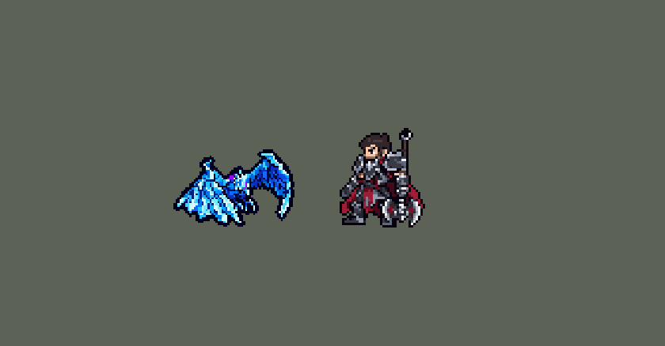

<!-- 本页上半部分由 tools/docs/gen_hero_docs.py 按仓库里现在的数据生成，手改会被覆盖；「开发记录」以下是手写的，生成时原样保留。 -->

# 艾尼维亚 Anivia


| 项目 | 内容 |
|---|---|
| id | `league_anivia` |
| 所属的包 | 主包（mod_id `league`） |
| 分路 | 中单 |
| 分类 / 标签 | 法师（Magician） · AP / Magic / CC |
| 高清帧 | PPU 1.2 |
| 附加包 | [艾尼维亚附加包](#附加包)（`league_anivia`） |



其他预览：[rebirth](../preview/league_anivia_rebirth.gif)、[逐帧预览](../preview/league_anivia_frames.png)、[特效表](../preview/league_anivia_effects.png)

## 现在的技能

下面是游戏里显示的技能说明（`league/text/champion.i18n` 的简体中文，去掉了颜色和图标），冷却、距离来自 `league/champion/league_anivia.data_champion`；1 秒 = 60 tick。

### 普攻 / 被动

*攻击间隔 1.5 秒 · 攻击距离 55000*

冰弹。寒霜涅槃（需安装扩展包）：受到致命伤害时变成冰蛋6秒，蛋没被打碎就复活；冷却240秒。

### 技能1 · 寒冰闪耀

*冷却 7 秒 · 施放距离 95000 · 施放：地点 · 敌人（不含防御塔）*

射出冰球，穿过的敌人受到55 + 32% 法强并减速30%；碰到英雄或到达落点时引爆：95 + 65% 法强魔法伤害并眩晕1.1秒。寒冰屏障：晕到英雄时在原地竖起冰墙5秒，敌人过不去。

### 技能2 · 霜寒刺骨

*冷却 5 秒 · 施放距离 65000 · 施放：指定目标 · 敌人（不含防御塔）*

冰锥造成75 + 65% 法强魔法伤害；目标被控制时，或冰川风暴成形后，伤害翻倍。

### 大招 · 冰川风暴

*冷却 40 秒 · 施放距离 75000 · 施放：指定目标 · 敌方英雄*

在敌方英雄处召唤暴风雪6秒，逐渐变大；每0.5秒造成32 + 13% 法强魔法伤害并减速，成形后伤害×3。有被控制的敌方英雄或2名敌方英雄在身边时才放。

### 数值

攻击力 76（每级 +6）、法强 40（每级 +20）、生命 900（每级 +95）、护甲 18（每级 +7）、魔抗 22（每级 +4）、移速 880（每级 +9）。

## 附加包

附加包是可选的原生代码 mod（都在附加包合集 `league_addons` 里），**不装主包里的英雄也是完整的**。

### 艾尼维亚附加包

[艾尼维亚附加包](../../addons/league_anivia/README.md)：`league_anivia` v0.1.4

|  | 主包（不装附加包） | 装了附加包 |
|---|---|---|
| 寒霜涅槃 | **没有**（数据读不到当前生命，也没有「受到致命伤害」的时机；模拟里按危险程度变蛋的近似，会在 20%–100% 生命时触发，所以不做） | 受到致命伤害时不倒下，变成冰蛋 `egg_t` tick（6 秒）：生命回满当作蛋的生命，禁普攻、禁技能，双抗降低；**蛋被打碎才阵亡**（击杀算打碎蛋的人），撑过去就带着蛋剩下的生命孵化。每 `egg_cd` tick（240 秒）一次，**阵亡不重置** |
| 寒冰屏障（Q 晕到英雄时立墙） | 竖着的冰墙 5 秒：立墙时站在墙上的敌人被拖到她那一侧；碰到墙的敌人被减速 99%，卡在墙边 | **真的墙**：5 秒里任何单位（两边的英雄、小兵、野怪，她自己也算）的中心一进墙就放回上一 tick 的位置；立墙时站在墙上的被推到她那一侧（墙在被晕的人身后，和主包一样） |
| 霜寒刺骨翻倍 | 目标正被控制（Q 的眩晕最常见），或她的风暴已成形时翻倍（看她自己身上的标记，近似） | 目标身上有**冰冻标记**（被寒冰闪耀穿过或引爆、被成形的风暴打中后 3 秒，数据挂在每个目标身上，头顶一枚雪花）就翻倍，按每个目标判断 |

## 相关脚本和素材

- [`tools/kit/build_anivia.py`](../../tools/kit/build_anivia.py)
- [`tools/kit/setup_anivia.py`](../../tools/kit/setup_anivia.py)
- [`tools/lol/extract_anivia.py`](../../tools/lol/extract_anivia.py)
- [`tools/art/preview_anivia.py`](../../tools/art/preview_anivia.py)
- [`tools/art/rig_anivia.py`](../../tools/art/rig_anivia.py)
- [`assets/source/anivia/`](../../assets/source/anivia)

## 开发记录

> 下面是原来 README 里「英雄：艾尼维亚」一节，原样搬过来（只改了相对链接）。

| 部分 | 内容 |
|---|---|
| 定位 | 中单（Magician，标签 AP / Magic / CC），第 123 位英雄。冰晶凤凰 艾尼维亚：弗雷尔卓德的冰之守护灵，张着冰晶羽翼的蓝色凤凰。用户的选择：「全按推荐做：主包近似蛋、W 折进 Q、做扩展包三项、PPU 1.2、加高手连招」，又改成「冰墙我要的是真的墙 可以卡住人的那种」「主包不做蛋，寒霜涅槃只放在扩展包里，说明写清楚」。技能 1 = Q 寒冰闪耀，技能 2 = E 霜寒刺骨，大招 = R 冰川风暴；W 寒冰屏障没有自己的格子，Q 晕到英雄时立墙；被动寒霜涅槃只在附加包里。技能名照英雄联盟 16.20 的官方中文 |
| 普攻 / 被动 | 冰弹（追踪弹，第 10 tick 出手），攻击间隔 90 tick，射程 55000。**寒霜涅槃**主包没有：数据读不到当前生命，也没有「受到致命伤害」的时机，模拟里按危险程度变蛋的近似会在 20%–100% 生命时触发，所以只放进附加包，主包的说明写着「需安装扩展包」 |
| 技能1 | **Q 寒冰闪耀**（对 95000 内的敌人放，小兵、野怪也打）：落点是目标出手时站的位置（英雄联盟的技能弹道，走开就躲得掉）。冰球穿过的敌人受到 55 + 32% 法术强度魔法伤害、减速 30% 3 秒；碰到第一个敌方英雄或到达落点时炸开（英雄联盟的二段引爆：看准时机）：半径 14000 内 95 + 65% 法术强度魔法伤害并眩晕 1.1 秒。冷却 7 秒 |
| W | **寒冰屏障**（Q 炸开、炸点里有敌方英雄时当场立起，15 秒一次）：炸点竖起一道冰墙 5 秒，宽 8000、长 50000 的竖直长方形（`Rect` 不跟着转，团战左右打，墙总是竖着），画面是一排冰柱。立墙时站在墙上的敌人被拖向她、直到拖出墙（0.4 秒的拖拽区，每 tick 2500：被晕的英雄落在她这一侧，墙在他身后；英雄联盟把人推开），之后每 2 tick 碰到墙的敌人减速 99%（是减速，不算控制）：从哪边走过来都卡在墙边，直到冰墙融化。模拟里换过只有 2000 宽的墙（会慢慢挪过去）和定身（定身算控制，会让 E 翻倍、让 R 落下），定稿 8000 宽 + 减速 99% 一次都没穿过去。第一版立墙时用 1 tick 的拉拽（`Pull`），可投射物里的拉拽是朝墙心拉、穿过去，被晕的英雄被甩到墙心另一边、还在墙里，99% 减速困满 5 秒（六局模拟里 37 人次有 25 次），所以改成拖拽区（`Grab` 总是朝她）。附加包的墙是真的墙：谁都过不去（自己人也一样） |
| 连招 | 用户的「加高手连招」：Q 晕住 → 身后立墙 → 炸开后第 10 tick 自动补一发霜寒刺骨（自己的 5 秒冷却，不占 E），晕住的英雄身上翻倍 → R 的守望优先把冰川风暴落在被控制的英雄身上 |
| 技能2 | **E 霜寒刺骨**（对 65000 内的敌人放）：冰锥 75 + 65% 法术强度魔法伤害。英雄联盟里对冰冻（被寒冰闪耀或成形的冰川风暴打中后 3 秒）的目标翻倍；数据读不到目标身上的状态，所以主包在目标正被控制（Q 的眩晕最常见）或她的风暴已成形、1 秒内打中过英雄时翻倍（看她自己身上的标记，近似），附加包按每个目标身上的冰冻标记翻倍。冰冻在两个包里都看得见（头顶一枚雪花）。冷却 5 秒 |
| 大招 | **R 冰川风暴**，**看场面才放**（用户的规则：看好时机）：按 R 只是待命 10 秒，守望每 12 tick 看一次，75000 内有被控制的敌方英雄就落在他身上，否则身边 45000 内有两个敌方英雄时落在最近打过的那个身上；10 秒没等到就退还冷却（只留 1 秒）。风暴在那个英雄当时的位置站 6 秒：半径 12000 → 18000 → 24000（各 0.5 秒）长到 32000 成形，每 0.5 秒 32 + 13% 法术强度魔法伤害、减速 25%；成形后伤害 ×3、减速 45%、打中的英雄冰冻。冷却 40 秒 |
| 附加包 | 可选的附加包 [`addons/league_anivia`](../../addons/league_anivia/README.md)（在附加包合集里，原生代码，主包不装它也完整）：**寒霜涅槃**（受到致命伤害时变成冰蛋 6 秒：生命回满当作蛋的生命，双抗 −20，蛋被打碎才阵亡，撑过去就孵化；240 秒一次，阵亡不重置；游戏 0.6.4 上站着、挨打都是蛋的样子）、**真冰墙**（5 秒里任何单位的中心一进墙就放回上一 tick 的位置，立墙时站在墙上的被推到她那一侧；0.1.2 修了找墙心：0.1.0 只认上一 tick 那里没有投射物的位置，可炸点上一 tick 就有 Q 挂的 2 tick 延时，游戏日志里约六成的墙没立起来（`WALL?` 约 950 次、`WALL` 约 550 次），现在按每处投射物多出来的个数找，被晕的英雄贴着她也算；0.1.2 的日志里还有约三分之一找不到（`WALL` 约 200 次、`WALL?` 约 100 次），0.1.3 在 `w_cd` 出现后 3 tick 里都找，只认两个区域叠在一处的位置；0.1.3 的日志里 `WALL` 40 次、`WALL?` 32 次，`WALL?` 前后她的投射物一样多：墙的区域根本没放出来——数据原来在炸开 2 tick 后从冰球 `end_effects` 里的延时立墙，冰球那时已经没了，游戏只加了 `w_cd`、没放区域；主包 0.220.1 / 附加包 0.1.4 起在冰球自己的 `end_effects` 里当场立墙，和炸裂区域同一处）、**霜寒刺骨按每个目标的冰冻标记翻倍**。日志 `league_anivia.log`（SPAWN、EGG、HATCH、BROKEN、WALL、HOLD、PUSH、ICED） |
| 数值 | 攻击 76（+6）、法术强度 40（+20）、生命 900（+95）、护甲 18（+7）、魔抗 22（+4）、移速 880（+9）、射程 55000 |
| 平衡 | 中单对五个基础中单（pyromancer / ice_mage / lightning_mage / wind_mage / white_mage），三套阵容、两边各打、8 个种子，10 分钟经典引擎模拟：草案（Q 70 + 50%、E 55 + 55%、R 25 + 10%，生命 880）−0.40 / −0.67；伤害 +25% +0.70；+40% 且 Q 7 秒一次 +1.61 / +2.03（太强）；折中（Q 95 + 65%、穿过 55 + 32%、E 75 + 65%、R 32 + 13%、生命 900）Q 7 秒一次 +1.93，7.5 秒一次 +1.45（同批辛德拉 +1.22）；这些都带着第一版冰墙把人困在墙里 5 秒，改成拖拽区后 Q 7.5 秒一次只剩 +1.08 / +0.81（种子 9–16 / 17–24），7 秒一次 +1.70 / +0.88，平均 +1.29（定稿，英雄联盟满级也是 7 秒） |
| 精灵图（高清帧 PPU 1.2） | Codex 第 0 步画了凤凰（A）和冰蛋（B）两张原画（[`tools/art/pack_anivia_picture.py`](../../tools/art/pack_anivia_picture.py)），[`tools/art/review_anivia_size.py`](../../tools/art/review_anivia_size.py) 和中单们按游戏大小并排，用户：「A 高 44，冰蛋是她身高的一半，头保持原样」。第 1 步 Codex 在游戏格子上重画（[`tools/art/pack_anivia_model.py`](../../tools/art/pack_anivia_model.py)），[`tools/art/design_anivia_cut.py`](../../tools/art/design_anivia_cut.py) 读回、整行整列删到游戏大小（脸的行列保留），取 A-2 和 B-1。动作不找 Codex（用户：「动作帧的话你参考塔姆怎么做的 做到完美后喊我review 你也要自己review」）：[`tools/art/rig_anivia.py`](../../tools/art/rig_anivia.py) 照英雄联盟的动作在定稿上摆——近侧、远侧的翅膀各是一整块，绕翅根整块镜像、转动（扬起、压下），身体上下起伏，爪子跟着身体；冰蛋从定稿 B 切出蛋壳上下两半，孵化时上半掀开。第一版用户：「模型有点大 翅膀有点变形」（翅膀做过切变摆动），改成高 38、翅膀只做整块的移动和镜像，用户：「高 38、翅膀这样可以」。进游戏后用户：「凤凰的局内模型太大」，同样整行整列删格缩到高 31（49 × 31，冰蛋 15.5），用户从 38 / 35 / 33 / 31 里选了 31（「改到49 31」）。动作：待机、走路（扇翅）、普攻、Q、E、R、挨打、阵亡，附加包的变蛋、蛋、蛋的待机 / 挨打、孵化 |
| 特效 | 第 3 步 15 张特效（[`tools/art/pack_anivia_fx.py`](../../tools/art/pack_anivia_fx.py)，颜色照英雄联盟：冰蓝、雪白、深蓝三种色阶），Codex 画并读回成游戏大小（`assets/source/anivia/codex_fx`）。三张飞行的画面（冰弹、冰球、冰锥）朝右画、上下对称，游戏按飞行方向转；其余全部左右对称（游戏不镜像特效图）。[`tools/art/import_anivia_fx.py`](../../tools/art/import_anivia_fx.py)：打中的在身上，眩晕的冰壳在脚下撑满 1.1 秒，冰冻的雪花在头顶，冰墙的中间行在炸点的地面上（3–6 帧循环撑满 5 秒），冰川风暴在落点地上（长大 1.5 秒，成形后 3–6 帧循环），变蛋、孵化盖在她身上。写成 `league_anivia_fx` 和 `league_anivia_big`。眩晕冰壳和 R 施法风雪两组 Codex 读回时被抠成几根线，由 [`tools/art/readback_anivia_fx.py`](../../tools/art/readback_anivia_fx.py) 从它的生图原稿按原比例重新读回。冰墙画在人物下面（被拖到墙边的英雄站在冰柱前），冰川风暴画在冰墙下面。用户：「特效通过」 |
| 音效 | 英雄联盟的音效和配音（[`tools/lol/extract_anivia.py`](../../tools/lol/extract_anivia.py)，19 段）：普攻出手 / 打中、寒冰闪耀出手 / 穿过 / 炸开 / 打中、寒冰屏障、霜寒刺骨出手 / 打中、冰川风暴出手 / 风暴 / 打中、变蛋、孵化，配音是她的 Q / W / E / R 和涅槃台词（中文） |
| 图标 | 官方技能图标（寒冰闪耀、霜寒刺骨、冰川风暴，另有寒冰屏障），从本地客户端取 |

重新生成（素材来自本机的英雄联盟客户端，音频不进仓库）：

```bash
python tools/lol/extract_anivia.py --lol "D:\WeGameApps\lol" --vgmstream <vgmstream-cli.exe>
python tools/kit/build_anivia.py                     # 技能数据，数字都在脚本的参数表 P 里
python tools/kit/setup_anivia.py --face 2,-20 --banpick -12  # 五种语言的文字、音效配置、共享文件里她的键
python tools/art/design_anivia_cut.py                # Codex 第 1 步的造型读回（A-2、B-1）
python tools/art/rig_anivia.py                       # 1 倍帧和 1.2 的原帧（翅膀整块摆，高 31）
python tools/art/ppu_restyle.py --hero anivia        # 描边（不要加 --preview）
python tools/art/ppu_hd.py --hero anivia             # hd_ / lo_ 帧
python tools/art/readback_anivia_fx.py --raw <Codex 的 raw/>   # 眩晕冰壳、R 施法风雪从原稿重新读回
python tools/art/import_anivia_fx.py                 # 特效
python tools/art/preview_anivia.py                   # 预览、演示 GIF 和附加包的寒霜涅槃 GIF
python addons/league_anivia/make_override.py         # 附加包的副本（主包的艾尼维亚改了就重跑）
```

美术提示词见 [`assets/source/anivia/`](../../assets/source/anivia) 里的 `PICTURE_PROMPT.md`、`MODEL_PROMPTS.md`、`PROMPTS_FX.md`；Codex 的交付在 `codex_picture/`、`codex_model/`、`codex_fx/`。

逐帧预览：[`docs/preview/league_anivia_frames.png`](../preview/league_anivia_frames.png?v=1018b)，特效：[`docs/preview/league_anivia_effects.png`](../preview/league_anivia_effects.png?v=1018b)，附加包的寒霜涅槃：[`docs/preview/league_anivia_rebirth.gif`](../preview/league_anivia_rebirth.gif?v=1018dg)。
