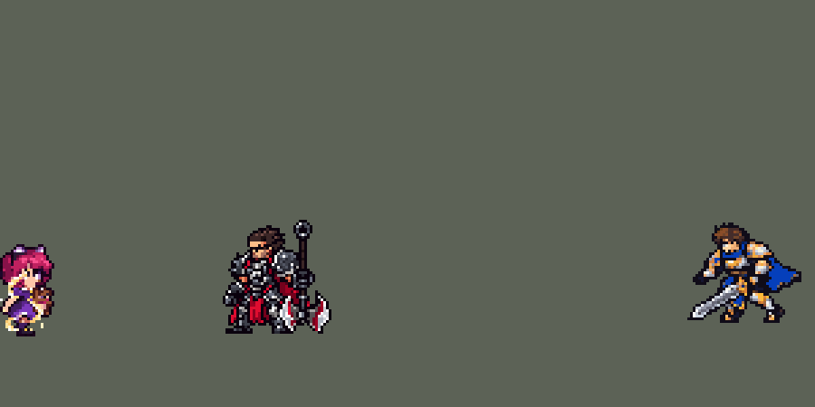

<!-- 本页上半部分由 tools/docs/gen_hero_docs.py 按仓库里现在的数据生成，手改会被覆盖；「开发记录」以下是手写的，生成时原样保留。 -->

# 安妮 Annie


| 项目 | 内容 |
|---|---|
| id | `league_annie` |
| 所属的包 | 主包（mod_id `league`） |
| 分路 | 中单 |
| 分类 / 标签 | 法师（Magician） · AP / Magic / CC / Shield |
| 高清帧 | PPU 2.2 |
| 附加包 | [安妮附加包：Q 返还、提伯斯换目标](#附加包)（`league_annie_q`） |



其他预览：[逐帧预览](../preview/league_annie_frames.png)、[特效表](../preview/league_annie_effects.png)

## 现在的技能

下面是游戏里显示的技能说明（`league/text/champion.i18n` 的简体中文，去掉了颜色和图标），冷却、距离来自 `league/champion/league_annie.data_champion`；1 秒 = 60 tick。

### 普攻 / 被动（被动「嗜火」）

*攻击间隔 1.5 秒 · 攻击距离 60000*

普攻扔出小火球，造成100% 攻击力的物理伤害。被动 嗜火：每施放4次技能（焚烧、熔岩护盾各算一次）后，下一个伤害技能眩晕命中的英雄0.75秒，小兵和野怪不会消耗它。出生和复活时自带眩晕。

### 技能1 · 碎裂之火

*冷却 4 秒 · 施放距离 62500 · 施放：指定目标 · 敌人（不含防御塔）*

扔出火球，造成70 + 65% 法术强度的魔法伤害。

### 技能2 · 焚烧

*冷却 7 秒 · 施放距离 50000 · 施放：指定目标 · 敌人（不含防御塔）*

向前方喷出扇形火焰，造成60 + 65% 法术强度的魔法伤害。同时施放 熔岩护盾：获得60 + 40% 法术强度的护盾，持续3秒，护盾存在时反弹20%所受伤害，并移动速度提高30%，持续1.5秒。

### 大招 · 提伯斯之怒

*冷却 60 秒 · 施放距离 62500 · 施放：指定目标 · 敌方英雄*

召唤提伯斯砸向敌方英雄，对周围敌人造成130 + 70% 法术强度的魔法伤害。提伯斯紧跟该英雄6秒，每秒灼烧其周围敌人，造成14 + 8% 法术强度的魔法伤害；该英雄阵亡时提伯斯随之离场。

### 数值

攻击力 80（每级 +6）、法强 40（每级 +20）、生命 900（每级 +100）、护甲 20（每级 +7）、魔抗 20（每级 +3）、移速 900（每级 +9）。

## 附加包

附加包是可选的原生代码 mod（都在附加包合集 `league_addons` 里），**不装主包里的英雄也是完整的**。

### 安妮附加包：Q 返还、提伯斯换目标

[安妮附加包：Q 返还、提伯斯换目标](../../addons/league_annie_q/README.md)：`league_annie_q` v0.2.0

|  | 主包（纯数据） | 装了附加包 |
|---|---|---|
| Q 击杀 | 不返还 | 返还一半冷却（120 tick；小兵、野怪、英雄都算） |
| 法力 | 没有 | 没有 |
| 提伯斯（v0.2.0） | 紧跟目标 6 秒，目标阵亡就化烟离场 | 目标阵亡（或不能选中）就转向 50000 内最近的敌方英雄，6 秒满或附近没人才离场；挥爪、火圈、每秒 14 + 8% 法强的灼烧照主包 |

## 相关脚本和素材

- [`tools/lol/extract_annie.py`](../../tools/lol/extract_annie.py)
- [`tools/art/preview_annie.py`](../../tools/art/preview_annie.py)
- [`tools/art/import_annie.py`](../../tools/art/import_annie.py)
- [`assets/source/annie/`](../../assets/source/annie)

## 开发记录

> 下面是原来 README 里「英雄：安妮」一节，原样搬过来（只改了相对链接）。

| 部分 | 内容 |
|---|---|
| 定位 | 法师（Magician），第三组的中单，本包第三个法师（拉克丝、提莫之后） |
| 普攻 | 扔出小火球，100% 攻击力的物理伤害 |
| 被动 | 「嗜火」：每施放 4 次技能，下一个伤害技能眩晕命中的英雄 0.75 秒（0.15.0 之前 1 秒），然后重新计数。Q、R 各算一次，技能2 是 W 加 E，算两次。攒满时身上绕着一圈白金色火光。用隐藏 buff 计数（和德莱厄斯的出血计数一样）。带不带眩晕在施法瞬间决定，所以第 4 次施法本身不眩晕，第 5 次才眩晕，和英雄联盟一样。眩晕由一个只对英雄生效的隐形"孪生"投射物或范围施加：AI 会拿 Q 清兵，打到小兵、野怪只造成普通伤害，眩晕留给英雄。出生和复活时自带眩晕：模拟器里看到死亡会清空 mod 加的 buff，每次出手先检查一个永久标记，没有就补上眩晕 |
| 技能1 | Q「碎裂之火」：指向火球，70 + 65% 法术强度的魔法伤害（0.15.0 之前 80 + 75%），射程 62500，冷却 4 秒，也对小兵和野怪放。英雄联盟里击杀返还法力和一半冷却；这里没有法力，引擎也没有重置冷却的效果，所以不做 |
| 技能2 | W「焚烧」：朝目标喷出 50° 扇形火焰（`Forward` + `DirDot`，和德莱厄斯 E 一样的锥形判定），半径 56000，60 + 65% 法术强度的魔法伤害（0.15.0 之前 80 + 85%），冷却 7 秒。合并 E「熔岩护盾」：给自己 60 + 40% 法术强度的护盾 3 秒，护盾存在时反弹 20% 所受伤害（普攻和技能都算，`WithShield` buff 随护盾破碎消失），移速 +30% 1.5 秒。英雄联盟里 E 可以给队友；这里只给自己 |
| 大招 | R「提伯斯之怒」：召唤提伯斯砸向一名敌方英雄（射程 62500），0.1 秒后落在他身边，以他为中心半径 30000 内 130 + 70% 法术强度的魔法伤害；嗜火攒满时眩晕范围内的英雄。之后提伯斯紧跟这名英雄 6 秒，每秒灼烧他周围的敌人 14 + 8% 法术强度，然后化成烟消失；这名英雄阵亡时提伯斯在下一秒化烟离场。冷却 60 秒。数据里的召唤物不能走路和普攻，提伯斯是挂在目标身上的一串特效和伤害：目标身上的持续效果（燃烧，目标显示燃烧图标）每秒播一段站立挥爪和脚下火圈（跟随目标），并用一帧抛物线投射物在目标脚下生成灼烧范围；目标死亡会清掉这个效果，提伯斯随之停下。安妮阵亡后提伯斯照样跟着目标，但死掉的施法者放不出投射物，这时只灼烧目标本人。画在单位下层、目标身后 9 px：熊比英雄高，从目标身后露出头和双臂，目标始终在他前面。0.13.0 的提伯斯落地后原地不动，目标走出火圈就烧不到 |
| 附加包 | 可选的附加包 [`addons/league_annie_q`](../../addons/league_annie_q/README.md)（在附加包合集里，原生代码，主包不装它也完整）：Q 照英雄联盟击杀目标（小兵、野怪、英雄都算）时返还一半冷却（这里没有法力，只返还冷却）；v0.2.0 起提伯斯的目标阵亡后转向 50000 内最近的敌方英雄（主包随之离场） |
| 连招 | 用户要求：「有连招要做连招」「都要帮我补」。英雄联盟里安妮攒好晕先开 R（提伯斯落地晕一片），再接 W、Q。原来眩晕给最先命中的伤害技能，多半是 4 秒一次的 Q，大招很少带晕。**晕留给 R**：R 放出时记下自己的冷却（`league_annie_r_cd`，60 秒）和一个多 10 秒的标记（`league_annie_r_open`）；大招好了（有 r_open、没有 r_cd）的这段时间里，攒满的 Q / W 照常造成伤害，但不放眩晕（只对英雄的眩晕孪生投射物 / 扇形不出），嗜火火光一直亮着，AI 一有英雄进 62500 就开 R，提伯斯落地晕住范围内所有英雄，之后再接 W、Q。R 放了，或者大招好了 10 秒还没放（被打断、没人可放），眩晕就照常交给下一个 Q / W；阵亡会清掉标记，每条命的第一次 R 照旧。伤害、眩晕时长、冷却都不变，不锁技能栏。数据由 [`tools/fix/combo_annie.py`](../../tools/fix/combo_annie.py) 改 |
| 数值 | 攻击 80（+6）、法术强度 40（+20）、生命 900（+100）、护甲 20（+7）、魔抗 20（+3）、移速 900（+9），射程 60000，攻击间隔 1.5 秒，都是原版法师的标准。LoL Reborn 里没有安妮，数值是自己设计的，用 SDK 对战模拟调：打中路，对 5 个原版中单（`pyromancer`、`ice_mage`、`lightning_mage`、`wind_mage`、`white_mage`），两边、三套队友阵容各 24 局，团队击杀差 +1.49（0.13.0 原地不动的提伯斯）；0.13.1 提伯斯改为跟随目标，目标走不出火圈，灼烧保持英雄联盟 1 级光环的 20 + 12% 时是 +2.32；降到 14 + 8% 后两批各 720 局（1–24、25–48 号种子）是 +1.57 / +1.78，旧版同样两批是 +1.49 / +2.22（同一套技能换一批种子差 0.7，单批噪声约 ±0.35），平均输出新版高 2.6%；原版中单里最强的 `lightning_mage` 是 +1.19，拉克丝 +2.23。初版（眩晕 1.25 秒、Q 80%、反伤 30%、R 150 + 75%、灼烧 30 + 15%）是 +2.65。以上都是 0.15.0 之前的数字：那时熔岩护盾也给了被喷的敌人，修正后按下面"修正（0.15.0）"一行重新调过 |
| 修正（0.15.0） | W 的熔岩护盾写在 `WithSelf` 里（见迦娜一节后的说明）：W 是对敌方英雄施放的，护盾（连同 20% 反伤）也给了被喷的那个敌方英雄。改成只给自己后安妮明显变强：SDK 对战模拟（打中路，对 5 个原版中单，两边、三套队友阵容各 24 局）团队击杀差 +1.57 → +3.74（同一批种子）。只降 W 的伤害（60 + 65%）是 +3.47，Q、W 一起降是 +2.69，再把嗜火的眩晕从 1 秒缩到 0.75 秒是 +1.65 / +1.36（两批种子，修正前两批 +1.57 / +1.78），就用这一版；降护盾和反伤几乎没有影响（+3.74） |
| 亚索联动 | 眩晕算亚索大招要的控制。亚索打上路、安妮中路时，他每局放 R 2.19 次（队友换成带眩晕的 `lightning_mage` 2.73 次，`pyromancer` 0.67 次，拉克丝 1.04 次），在以往控制型队友的范围内，亚索不用调。0.13.1 提伯斯跟随目标后重测：新旧安妮同一批 48 局分别是 2.50 和 2.48 次，没有变化。0.15.0 嗜火眩晕缩到 0.75 秒后（亚索也换成 0.15.0 的数值）是 1.92 次，同一批里 1 秒眩晕的安妮 2.60 次，仍在控制型队友的范围内 |
| 精灵图（旧版 1 倍） | 8 个动作 47 帧：待机、跑步、普攻、Q、W、R、受击、死亡。猫耳尖到脚底 32 px（腿缩短 2 行之前 34 px），30 色，动作全部取自英雄联盟原版动画 |
| 高清帧（PPU 2.2） | 2026-10-24 用 PPU 重做（用户：「继续重做下一个英雄 安妮」）。设计图：Codex 照英雄联盟的模型画了两张（[`tools/art/pack_annie_ppu.py`](../../tools/art/pack_annie_ppu.py)），用户选了 A（英雄联盟的待机：近侧的手拎着提伯斯，远侧的手空着），按原图自己的格子读回、缩到 PPU 2.2 的 44 × 75 格，脸逐格手修（[`tools/art/design_annie_hd.py`](../../tools/art/design_annie_hd.py)）；衣服照英雄联盟：粉色猫耳发箍、蓝色菱格纹背心、兔子背包、紫色条纹长袜。动作：Codex 照旧版同一帧整帧重画（[`tools/art/pack_annie_actions.py`](../../tools/art/pack_annie_actions.py)，22 张 41 帧），放火都用远侧那只空手，提伯斯一直拎在近侧手里，R 第 3 帧扔出去、之后两手空，死亡时提伯斯脱手摔在她旁边；[`tools/art/casts_annie_hd.py`](../../tools/art/casts_annie_hd.py) 修到设计图上（每张按站直时眼睛到脚底定比例，贴回设计图的头，抠掉腿和熊之间的白缝，脚踩地面线），待机和选人卡轮播从动作里剪。普攻火球、Q 从新手的高度出手（`y_offset` 1200 → −1800 / −1000，手在站位点上方 6–7 px，追踪火球不歪）。头像截取点 (−2, −28)，选人卡不用设偏移（头顶在中心点上方 22.7 px） |
| 特效 | 普攻火球和命中、碎裂之火大火球和爆炸、焚烧扇形火、灼烧、熔岩护盾、嗜火火光、火焰眩晕星、提伯斯落地、站立挥爪、消失、脚下火圈 |
| 图标 | 官方技能图标（Q / W / R），64×64 |
| 音频 | 从本地客户端提取的 12 条技能音效和 2 条中文语音（Q、R；W、E 没有语音）。不提交到仓库，按下面的命令在本地生成 |

```bash
python tools/lol/extract_annie.py --lol "D:\WeGameApps\lol" --vgmstream "<vgmstream-cli.exe 路径>"
python tools/lol/native_pose.py assets/source/annie/poses.json --out <渲染文件夹> --alpha --parts
python tools/art/restyle_native.py assets/source/annie/poses.json --renders <渲染文件夹>   # 角色图
python tools/art/shorten_legs.py --hero annie       # 腿缩短 2 行（从 legs_long/ 里的原图开始）
python tools/art/import_native.py --hero annie
python tools/art/import_annie.py      # 特效；--raw <Codex 的交付文件夹> 先把原始图转成原尺寸条
python tools/art/preview_annie.py      # 逐帧预览（高清帧）、特效预览、演示 GIF
# PPU 2.2 重做（2026-10-24）：
python tools/art/pack_annie_ppu.py --out <文件夹>       # 给 Codex 的设计图包（A / B 两种姿势）
python tools/art/design_annie_hd.py --take A          # 原图按自己的格子读回成 44 × 75 格，脸逐格手修 -> hd/design.png
python tools/art/pack_annie_actions.py --out <文件夹>   # 给 Codex 的动作包（照旧版同一帧整帧重画）
python tools/art/rig_annie_hd.py                      # Codex 的交付（hd/casts）修到设计图上 -> 原始条和 1 倍图（--review <文件夹> 只看）
python tools/art/ppu_restyle.py --hero annie && python tools/art/ppu_hd.py --hero annie && python tools/art/hero_reels.py --hero annie
```

美术（提示词见 [`assets/source/annie/PROMPTS.md`](../../assets/source/annie/PROMPTS.md)）：
- 分工：角色图由 Claude 画，Codex 只画特效。
- 模型：一张网格、一张贴图，皮肤里没有隐藏的子网格。小熊提伯斯是一根独立的根骨骼，渲染时当作"武器"部件（`"weapon": "^R_Teddy$"`），按亮度单独投成棕色并描边，不和她的衣服混在一起。
- 比例和镜头：镜头 yaw 35、pitch 25，镜像（看得到脸、背带裙和近手拎着的小熊）。按英雄联盟原比例头只占身高 29%；用户从 1.0 / 1.3 / 1.5 三个比例里选了 1.3（35%，原版英雄约 36%）。
- 造型图：头部逐格画：粉色猫耳发箍（两只尖耳朵）、洋红短发和刘海、绿眼睛按原版英雄的画法（睫毛 / 高光 + 瞳孔 / 眼白 + 虹膜，远眼一格宽）。三个脸部方案里用户选了 B：一格暗红小嘴。身体按英雄联盟动画投色。
- 动作图：头部贴在每一帧英雄联盟头部关节的位置。普攻和 Q 扔火球时英雄联盟会转身露出背包，这几帧朝镜头转 40–60°。R 举起小熊的第 4 帧起小熊消失（英雄联盟里小熊变成了提伯斯），死亡时把小熊甩出去；飞出格子的小熊或挡在脸上的小熊在小尺寸下都像杂物，用 `native_pose.py` 的新选项（逐帧 `hide`）去掉。死亡跳过英雄联盟里 1.5 秒背对镜头站着的部分，甩出小熊后直接倒下，头部用 `forward` 转 90°。待机 6 帧都用第 1 帧，第 3–5 帧小腿以上下移 1 格呼吸；跑步是 60% 英雄联盟的蹦跳跑加 40% 待机姿势，`flat` 让脚落回地面。
- 特效用 Codex 画的 13 张（生图原稿）：`import_annie.py --raw` 按交付的 manifest 切帧，按技能范围定大小：普攻火球 12 px、碎裂之火 20 px、爆炸 28 px、焚烧的扇形压成技能的 56 × 50 矩形（尖端在施法者身上）、熔岩护盾 42 px 高、火圈 60 px 宽（半径 30000）。提伯斯三张图里 Codex 画的熊大小不一（原稿里 235、218、约 270 px），各自缩放到耳朵到脚底 42 px，三张共用一套 20 色的色板，熊的颜色一致。提伯斯的参考图是他自己的模型：`pose_ref.py` 新增 `--wad`，召唤物放在英雄的 WAD 里（`--champ AnnieTibbers --wad Annie`）。
- 出手时刻和动画对齐：普攻、Q 第 12 tick 扔出，W 第 8 tick 喷火、第 12 tick 结算，R 第 12 tick 召唤、落地画面第 2 帧（再过 6 tick）结算。
- 结果：30 色，和右边像素同色的比例 37%（原版英雄 18%–46%）。头像截取点 (0, −26)（腿缩短前 (0, −28)）：猫耳尖下 6 格，卡片上能看到眼睛。
- 腿（2026-10-01）：用户：“安妮的腿也可以缩短一点 安妮的定位是小女孩”。`shorten_legs.py` 在每帧最低处往上 2–7 行（裙摆以下的腿）里删 2 整行（她腿上的颜色描边和裙子也用，找不到裙摆，按待机腿长从脚往上数），上半身下移、脚不动；死亡被抛起和落下的两帧整帧下移 2 行，躺下的三帧不动。待机呼吸的接缝还是站位点下第 6 行（上下两行只差 5 格）。原图留在 [`legs_long/`](../../assets/source/annie/legs_long)。

逐帧预览：[`docs/preview/league_annie_frames.png`](../preview/league_annie_frames.png?v=1024an)，特效：[`docs/preview/league_annie_effects.png`](../preview/league_annie_effects.png?v=1024an)。
