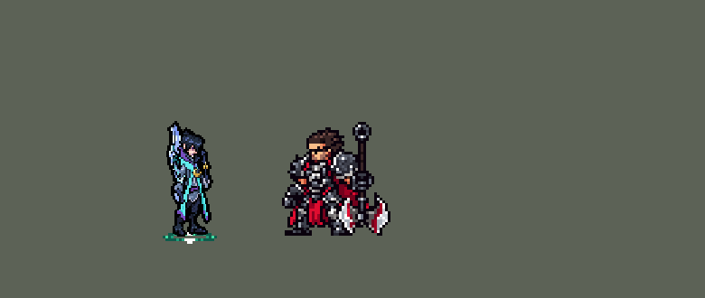

<!-- 本页上半部分由 tools/docs/gen_hero_docs.py 按仓库里现在的数据生成，手改会被覆盖；「开发记录」以下是手写的，生成时原样保留。 -->

# 厄斐琉斯 Aphelios


| 项目 | 内容 |
|---|---|
| id | `league_aphelios` |
| 所属的包 | 主包（mod_id `league`） |
| 分路 | ADC |
| 分类 / 标签 | 射手（Range） · AD / Range / CC |
| 高清帧 | PPU 1.5（画成 90%） |
| 附加包 | [厄斐琉斯附加包](#附加包)（`league_aphelios`）、[游戏 AI 不按的技能替它按](#附加包)（`league_ult_press`） |



其他预览：[逐帧预览](../preview/league_aphelios_frames.png)、[特效表](../preview/league_aphelios_effects.png)

## 现在的技能

下面是游戏里显示的技能说明（`league/text/champion.i18n` 的简体中文，去掉了颜色和图标），冷却、距离来自 `league/champion/league_aphelios.data_champion`；1 秒 = 60 tick。

### 普攻 / 被动

*攻击间隔 0.97 秒 · 攻击距离 55000*

用主手武器开火，每把20发，打空换下一把：通碧射程更远，断魄吸血10%、攻速+20%，坠明减速25%，荧焰溅射，折镜每次命中攻击+5%（4秒，可叠加）。传知者与真知者：随等级额外成长。

### 技能1 · 武器技能

*冷却 1 秒 · 施放距离 55000 · 施放：指定目标 · 敌人（不含防御塔）*

主手武器的技能，各自冷却：通碧狙击造成110 + 100% 攻击力物理伤害并追射；断魄加速连射回血；坠明定身被它减速的敌人1秒；荧焰扇形波后副手追击；折镜放下哨塔5秒。

### 技能2 · 月相轮转

*冷却 1.5 秒 · 施放距离 55000 · 施放：指定目标 · 敌方英雄*

交换主手和副手武器：主手技能在冷却、副手技能已就绪且附近有敌方英雄时才交换。

### 大招 · 清辉夜凝

*冷却 25 秒 · 施放距离 90000 · 施放：无目标 · 敌方英雄*

爆点附近有2个以上敌方英雄或目标被控制时，射出月光，在第一个英雄处爆炸，造成160 + 120% 攻击力物理伤害，再按主手：通碧追射、断魄回血、坠明减速90%、荧焰加伤、折镜叠3层。

### 数值

攻击力 107（每级 +22）、生命 1020（每级 +88）、护甲 24（每级 +7）、魔抗 15（每级 +3）、移速 900（每级 +9）。

## 附加包

附加包是可选的原生代码 mod（都在附加包合集 `league_addons` 里），**不装主包里的英雄也是完整的**。

### 厄斐琉斯附加包

[厄斐琉斯附加包](../../addons/league_aphelios/README.md)：`league_aphelios` v0.2.1

|  | 主包（纯数据） | 装了附加包 |
|---|---|---|
| 武器在手里 | 出手时手里是主手武器；站着、跑着、挨打时都是通碧背在身后的样子 | **整身换武器**：主手是断魄 / 坠明 / 荧焰 / 折镜时，站着、跑着、挨打、出手的第一刻都画成那把武器在手里（只在游戏 0.6.4 上） |
| 打空换枪 | 按固定循环通碧 → 断魄 → 坠明 → 荧焰 → 折镜，换上副手以外的下一把 | **先进先出的队列**（英雄联盟）：打空的那把排到队尾，换上队列最前面的那把；W 换过手以后和固定循环不一样 |
| 残血 | W 只在主手 Q 冷却、副手 Q 好了、身边有敌方英雄时才换手 | 另外**生命低于 35%、副手是断魄、60000 内有看得见的敌方英雄时直接换上断魄**（吸血），每 6 秒最多一次 |

### 游戏 AI 不按的技能替它按

[游戏 AI 不按的技能替它按](../../addons/league_ult_press/README.md)：`league_ult_press` v0.5.7（通用附加包，下面只列和厄斐琉斯有关的部分）

|  | 装了附加包，什么时候按 |
|---|---|
| 厄斐琉斯 R（备好式，v0.4.0） | 90000 内有敌方英雄就按：主包待命 6 秒，正被我方打的敌方英雄身边还有别人、或被控住才放，没用上缩短冷却 |

## 相关脚本和素材

- [`tools/kit/build_aphelios.py`](../../tools/kit/build_aphelios.py)
- [`tools/kit/setup_aphelios.py`](../../tools/kit/setup_aphelios.py)
- [`tools/lol/extract_aphelios.py`](../../tools/lol/extract_aphelios.py)
- [`tools/art/preview_aphelios.py`](../../tools/art/preview_aphelios.py)
- [`tools/art/rig_aphelios.py`](../../tools/art/rig_aphelios.py)
- [`assets/source/aphelios/`](../../assets/source/aphelios)

## 开发记录

> 下面是原来 README 里「英雄：厄斐琉斯」一节，原样搬过来（只改了相对链接）。

| 部分 | 内容 |
|---|---|
| 定位 | ADC（Range，标签 AD / Range / CC），第 114 位英雄。残月之肃 厄斐琉斯：五把月石武器轮换的射手。用户的选择：「方案可以，全按推荐做（下路 ADC，做附加包，PPU 1.5）」——普攻 = 主手武器开火，技能 1 = 主手武器的 Q，技能 2 = W 月相轮转，大招 = R 清辉夜凝；高清 PPU 1.5、画成 90% |
| 普攻 / 被动 | 主手、副手各一把，另外三把按固定循环等着：通碧 → 断魄 → 坠明 → 荧焰 → 折镜。主手是一个永久的施法者 buff（`league_aphelios_mw_<武器>`，带着武器自己的属性），副手 `_ow_<武器>`；每次出生（死亡会清掉数据 buff）第一次普攻时拿上通碧 / 断魄、装满弹匣。**每把 20 发**（5 位计数器，英雄联盟 50），每次普攻用 1 发、放 Q 多用 4 发；打空主手换循环里副手以外的下一把（英雄联盟是先进先出的队列，W 换过手后不一样，附加包按真队列）。全在普攻里算（引擎不会每 tick 复制普攻的树）。**通碧**射程 +10000；**断魄**吸血 10%、攻速 +20%；**坠明**减速 25% 1 秒并留印记（每 50 tick 最多一个）；**荧焰**目标 85% 攻击力、14000 内其他敌人 25%（英雄联盟的扇形溅射）；**折镜**每次命中叠一层（攻击 +5%，4 秒，各自计时可叠加）。被动传知者与真知者：成长在属性里 |
| 技能1 | 主手武器的 Q，各自冷却（`qcd_<武器>`），对 55000 内的敌人放（小兵、野怪也打）：**通碧·狙杀**（冷却 540）先锁定 10 tick（躲得开），朝那一点的直线打第一个敌人 110 + 100% 攻击力，6 tick 后从远处追射引爆月痕（40 + 60%）；**断魄·恒月强袭**（540）移速 +20% 1.75 秒，朝 50000 内的敌人连射 8 发，每发 15 + 45% 攻击力、回 6 + 3% 攻击力，每第二发是副手武器的；**坠明·引力枷锁**（600，只在有坠明印记时）每个带印记的定身 1 秒、50 + 50% 攻击力；**荧焰·余晖波**（480）面前扇形 45000：50 + 100% 攻击力，再给每个打中的一发副手武器（70% + 副手的效果）；**折镜·驻灵哨卫**（540）在目标那里放下哨塔 5 秒，每 30 tick 用副手武器打 35000 内每个敌人 20 + 40% 攻击力 + 副手的效果 |
| 技能2 | W「月相轮转」：主手和副手交换——只在主手 Q 冷却中、副手 Q 已就绪、90 tick 一次、55000 内有敌方英雄时换（AI 接着放新主手的 Q：英雄联盟的 W → Q） |
| 大招 | R「清辉夜凝」：冷却 1500，**看时机**：放出后待命 6 秒，每 15 tick 找一个正在被他队伍打的敌方英雄（90000 内），身边 22000 内还有别的敌方英雄才放，或者目标正被控制；锁定那一点射出月光，碰到第一个英雄炸开：22000 内 160 + 120% 攻击力，再按主手：通碧每个再追射一发（60%）、断魄回 60 + 30% 攻击力、坠明减速 90% 1.5 秒并留印记、荧焰多 50% 攻击力、折镜叠 3 层。没用上就缩短冷却 |
| 附加包 | 可选的附加包 [`addons/league_aphelios`](../../addons/league_aphelios/README.md)（在附加包合集里，原生代码，主包不装它也完整）：**整身换武器**（主手是断魄 / 坠明 / 荧焰 / 折镜时站着、跑着、挨打、出手第一刻，以及 W、R、倒地都画成那把武器在手里，游戏 0.6.4；倒地用倒下前那把，0.1.2）；**先进先出的武器队列**；**残血换断魄**（生命低于 35%、副手是断魄、身边有看得见的敌方英雄时，每 6 秒最多一次）。状态在被动实例里，同一局的几份预模拟互不影响。日志 `league_aphelios.log`（QUEUE、LOW、FORM） |
| 附加包（替 AI 按） | 可选的附加包 [`addons/league_ult_press`](../../addons/league_ult_press/README.md)（在附加包合集里，原生代码，主包不装它也完整）：游戏 0.6.4 的 AI 很少按他「备好」的 R（只读观察包：每 10 分钟 3.2 次，148 局，冷却只有 25 秒）。附加包按局面替 AI 按（用户：「大招这种可能也是」）：90000 内有敌方英雄就按；什么时候射出月光由主包判断，没用上缩短冷却 |
| 数值 | 攻击 107（+22）、生命 1020（+88）、护甲 24（+7）、魔抗 15（+3）、移速 900（+9）、射程 55000，攻击间隔 58 tick |
| 平衡 | 下路对五个基础射手（archer / gunner / boomerang_hunter / poison_dart_hunter / bomber），三套阵容、两边各打，15 分钟模拟：草案 −1.27（种子 1–12；霞 +2.20、金克丝 +5.44）；不放技能 −0.48，说明技能弱：Q / R 约 ×1.6、施法距离 = 攻击距离、攻击 104 → +0.37；Q / R 的施法动作缩短（站着放太久少打普攻）、生命 980、护甲 24 → +1.57 / +0.68（种子 1–12 / 13–24；霞 +2.20 / +1.79）；攻击 107、生命 1020 定稿 +1.44（种子 1–24；只加攻击到 108 是 +1.45 但打 gunner −1.02，Q / R 再 +20% 是 +0.99），种子 25–36 复测 +1.50（霞 +2.13）。亚索 R：厄斐琉斯在下路同队时每局 0.29 次（基础射手 0.62、金克丝 1.00），亚索不改 |
| 精灵图（高清帧 PPU 1.5） | Codex 第 0 步按英雄联盟的模型画了两张原画（A 通碧待机、B 开枪），[`tools/art/design_aphelios_hd.py`](../../tools/art/design_aphelios_hd.py) 按它自己的格子读回，用户：「选 A，40 行，第 1 步按游戏格子重画，头放大到约四分之一」。第 1 步 Codex 在格子上重画造型（[`tools/art/pack_aphelios_model.py`](../../tools/art/pack_aphelios_model.py)），[`tools/art/design_aphelios_cut.py`](../../tools/art/design_aphelios_cut.py) 按整行整列删到 PPU 1.5（25×69 格），五把武器一把一把从 Codex 的武器图上切下、颜色贴回造型的色板。用户：「动作帧的话可以学习塔姆那种方法做 不依赖codex 但是要做完美」——[`tools/art/rig_aphelios.py`](../../tools/art/rig_aphelios.py) 只做无损摆姿（平移、四分之一转、整行平移、叠放）：按颜色分出头、身体、两臂、腿、背上的通碧，五把武器各有握法；跑步是两段腿（大腿、小腿整行平移）照英雄联盟 A_Run1 的关节（`poses.json`）×0.6、8 帧 133 ms；普攻每把武器一条（`a_cal` … `a_cre`，`CasterAnimation` 按主手放；游戏在普攻第一刻自己播 `attack`，所以 `attack` 是一帧站姿，不会闪出别的武器），五个 Q、W 换手、R、受击、死亡；附加包用的 `<武器>_idle` / `_run` / `_hit` / `_attack`（通碧从背上拿下、那把武器在抬起的手里，荧焰低握在身侧）。用户：「后背有点变形啊 切武器的时候 看着有点怪」：第一版把背上的通碧按一列框切，带走了外套的边和共用的描边，改成按通碧自己的颜色块切、共用描边留一格。用户：「背部可以了，动作美术通过」。之后「厄斐琉斯模型是不是在游戏里太大了？」（47 px，射手 36–45）→「缩到 90%」：`hd.rs` SIZES 0.90，restyle 下移 2 格，头像点 (−2, −38)、卡片 −10。2026-10-19 补帧（对照英雄联盟 A–E_Spell2 等）：W、R、死亡原来只画了通碧，拿别的武器放会闪回通碧——新增 `<武器>_skill2` / `_ult` / `_dead`（荧焰倒地时脱手落在脚边）；断魄 / 坠明 / 荧焰 / 折镜普攻和荧焰、折镜 Q 的最后一帧原来是通碧站姿（主手空着），改成那把武器的站姿；死亡 8 帧；R 改成英雄联盟的跃起（6 帧，每把武器的 `_ult` 同样）。2026-10-22 补全动作（用户：「厄斐琉斯也少动作帧 你也帮我补全吧」，选「身体共用一套，武器跟着换」）：普攻 4 帧、Q 4–5 帧、W 3 帧、R 6 帧几乎看不出动。第一版（#454）把腿按英雄联盟的角度重新画成裤腿、上半身逐行切斜做前倾、手臂转任意角度——用户：「腿部做的有点奇怪啊」「怎么都变形了啊」「我之前那个腿挺好的 你乱改什么」「模型上半身也在变形」，全部改回无损：腿是造型自己的腿按原来的办法整行平移（跑步、待机、受击、死亡和各武器形态的跑步、受击、站姿、死亡和改动前逐像素一样），身体只整体平移、不切斜、不往腿里压，大衣下摆整块平移，手臂只用造型的角度和四分之一转（`QUARTER`），跳跃是整个人抬起、转身是整帧镜像。保留的是节奏和帧数：每把武器的普攻 8 帧（开枪仍是第 80 ms、三帧各 20 ms 带枪口火光）、Q 各照英雄联盟的时刻（通碧 167 ms 开枪、坠明 133 ms 定身、荧焰 167 ms 出波、折镜 167 ms 放炮台，断魄转身两帧镜像）、W 6 帧（把主手武器抛过头顶再接住；通碧单独出现时用武器图上完整的那把，造型上的被手臂挡掉一截）、R 7 帧（跃起、空中开火、落地），站姿是双脚分开的几种（`LEGS`）。待机 / BP 卡片（`tools/art/hero_reels.json`）：新动作放不进待机，加了只给待机用的 `flourish` / `<武器>_flourish`（抬起的手提一两格、举着的武器在手里转一圈、荧焰往前送两下），游戏本身不播；BP 卡片的普攻改成通碧开枪。对照动图：[`tools/art/review_aphelios_actions.py`](../../tools/art/review_aphelios_actions.py) |
| 特效 | 第 3 步 28 个特效（[`tools/art/pack_aphelios_fx.py`](../../tools/art/pack_aphelios_fx.py)，五把武器各用英雄联盟的颜色：通碧月绿、断魄血红、坠明紫、荧焰天蓝、折镜银白，换武器和大招是淡蓝白的月光）。10 张是用户用 Gemini 画的、其余由 Codex 画，Codex 读回成游戏大小（`assets/source/aphelios/codex_fx`；Codex 生图额度用完时备了 Gemini 提示词 [`tools/art/pack_aphelios_fx_gemini.py`](../../tools/art/pack_aphelios_fx_gemini.py) 和读回脚本 [`tools/art/read_aphelios_gemini.py`](../../tools/art/read_aphelios_gemini.py)）。[`tools/art/import_aphelios_fx.py`](../../tools/art/import_aphelios_fx.py)：脚下武器光环画一张、按五把武器换色；子弹飞过枪口才显示（开头几 tick 空帧，视图不循环、最后一帧停一秒），断魄 Q 的连射和荧焰的溅射另有自己的标签（它们更快、或者从目标身上出发）。游戏从不镜像特效图（只镜像英雄自己的帧，`is_follow` 也不管用）：**枪口火光画进他自己的开枪帧**（[`tools/art/rig_aphelios.py`](../../tools/art/rig_aphelios.py)：Codex 那一张按五把武器换色，开枪那帧拆成 3 帧各 20 ms、各一帧火光，根部在武器画出来的最前端，高清帧放在 `orig/aphelios_a_<武器>.over.png`，restyle 描边之后再盖上去，光没有描边），只亮那一帧（烬的教训）；**荧焰的余晖波挂在只带画面的直线投射物上**（往目标慢慢推 18 tick，抬到枪的高度；投射物的画面会跟着方向转，图上下对称）；**折镜的哨塔是落点上不跟随的特效**（落点的画面不会被转；区域自己的画面朝左放会转半圈），循环 5 秒；其余左右对称。写成 `league_aphelios_fx` 和 `league_aphelios_big` |
| 音效 | 英雄联盟的音效和配音（[`tools/lol/extract_aphelios.py`](../../tools/lol/extract_aphelios.py)，34 段）：五把武器各自的开枪 / 打中、五个 Q、换武器、R 施放 / 射出 / 打中，配音是 Alune 的 Q / W / R 台词（厄斐琉斯不说话） |
| 图标 | 官方技能图标（Q / W 月相轮转 / R 清辉夜凝，另有五把武器的 Q 和被动），从本地客户端取 |
| 高手的用法（附加包 0.2.0） | 用户：「厄斐琉斯能做的像英雄联盟里面高手一样的逻辑吗」，选了全做：Q 看武器和局面放（通碧只打英雄、坠明等有标记的英雄、荧焰等扇形里两个英雄、断魄在打起来时、折镜英雄近身时，不合适的 Q 改成普攻）；被动看局面直接换手（换手接 Q、被贴脸换近身武器）；开大前先把礼物更好的武器换到主手；通碧的 Q 射出去就换上副手，副本里标记被引爆时带当时主手的命中效果（副手坠明 → 标记 → 坠明 Q 定身）。主包数据不变；附加包副本的 Q 多 25 个节点（220 → 245）。经典模拟器跑不了附加包，要在游戏里看日志（[`addons/league_aphelios`](../../addons/league_aphelios)） |

重新生成（素材来自本机的英雄联盟客户端，音频不进仓库）：

```bash
python tools/lol/extract_aphelios.py --lol "D:\WeGameApps\lol" --vgmstream <vgmstream-cli.exe>
python tools/kit/build_aphelios.py                 # 技能数据，数字都在脚本的参数表 P 里
python tools/kit/setup_aphelios.py                 # 五种语言的文字、音效配置、共享文件里他的键（头像点、卡片位置在 VIEW）
python tools/art/design_aphelios_hd.py             # Codex 的原画读回
python tools/art/design_aphelios_cut.py            # 第 1 步的造型删到 PPU 1.5
python tools/art/rig_aphelios.py                   # 1 倍帧和 1.5 的原帧（无损摆姿、武器形态）
python tools/art/ppu_restyle.py --hero aphelios    # 描边、下移 2 格（不要加 --preview）
python tools/art/ppu_hd.py --hero aphelios         # hd_ / lo_ 帧
python tools/art/read_aphelios_gemini.py           # 用户 Gemini 画的特效读回成游戏大小
python tools/art/import_aphelios_fx.py             # 特效（每格先去噪点、加对比：用户「厄斐琉斯的特效 调的清晰点」）
python tools/art/preview_aphelios.py               # 预览和演示 GIF
python addons/league_aphelios/make_override.py     # 附加包的副本（主包的厄斐琉斯改了就重跑）
```

美术提示词见 [`assets/source/aphelios/`](../../assets/source/aphelios) 里的 `PICTURE_PROMPT.md`、`MODEL_PROMPTS.md`、`PROMPTS_FX.md`；Codex 的交付在 `codex_picture/`、`codex_model/`、`codex_fx/`，用户的 Gemini 特效在 `gemini_fx/`。

逐帧预览：[`docs/preview/league_aphelios_frames.png`](../preview/league_aphelios_frames.png?v=1016a)，特效：[`docs/preview/league_aphelios_effects.png`](../preview/league_aphelios_effects.png?v=1016a)。
