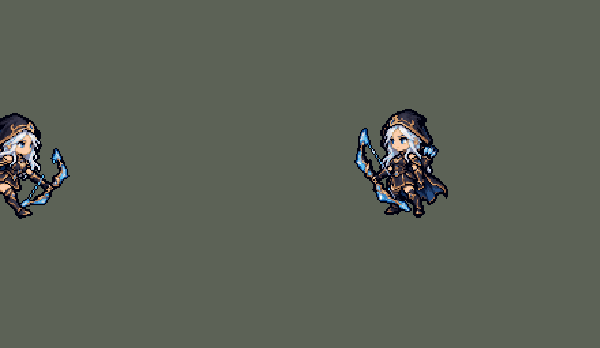

<!-- 本页上半部分由 tools/docs/gen_hero_docs.py 按仓库里现在的数据生成，手改会被覆盖；「开发记录」以下是手写的，生成时原样保留。 -->

# 艾希 Ashe


| 项目 | 内容 |
|---|---|
| id | `league_ashe` |
| 所属的包 | 主包（mod_id `league`） |
| 分路 | ADC |
| 分类 / 标签 | 射手（Range） · AD / Range / CC |
| 高清帧 | PPU 2.2 |
| 附加包 | 无 |



其他预览：[逐帧预览](../preview/league_ashe_frames.png)、[特效表](../preview/league_ashe_effects.png)

## 现在的技能

下面是游戏里显示的技能说明（`league/text/champion.i18n` 的简体中文，去掉了颜色和图标），冷却、距离来自 `league/champion/league_ashe.data_champion`；1 秒 = 60 tick。

### 普攻 / 被动（被动「冰霜射击」）

*攻击间隔 1 秒 · 攻击距离 60000*

普攻射出冰霜箭，造成100% 攻击力的物理伤害。被动 冰霜射击：普攻使目标减速20%，持续1秒。

### 技能1 · 射手的专注

*冷却 7 秒 · 施放距离 60000 · 施放：无目标 · 敌人（不含防御塔）*

艾希获得30% 攻击速度，持续4秒。期间普攻变为连射，造成130% 攻击力的物理伤害，并使目标减速30%。

### 技能2 · 万箭齐发

*冷却 8 秒 · 施放距离 70000 · 施放：方向 · 敌人（不含防御塔）*

向前方扇形射出13支冰霜箭，对扇形内每个敌人造成40 + 100% 攻击力的物理伤害（每个敌人只会被命中一次），并使其减速25%，持续1.5秒。

### 大招 · 魔法水晶箭

*冷却 50 秒 · 施放距离 100000 · 施放：方向 · 敌方英雄*

向目标方向射出一支飞得很远的水晶箭，命中第一个敌方英雄，造成150 + 100% 攻击力的物理伤害并眩晕1.75秒。水晶箭在命中处炸开，对周围敌人造成60 + 50% 攻击力的物理伤害并减速50%，持续2秒。

### 数值

攻击力 100（每级 +18）、生命 900（每级 +90）、护甲 20（每级 +7）、魔抗 15（每级 +3）、移速 900（每级 +9）。

## 相关脚本和素材

- [`tools/lol/extract_ashe.py`](../../tools/lol/extract_ashe.py)
- [`tools/art/preview_ashe.py`](../../tools/art/preview_ashe.py)
- [`tools/art/import_ashe.py`](../../tools/art/import_ashe.py)
- [`assets/source/ashe/`](../../assets/source/ashe)

## 开发记录

> 下面是原来 README 里「英雄：艾希」一节，原样搬过来（只改了相对链接）。

| 部分 | 内容 |
|---|---|
| 普攻 | 冰霜箭。被动「冰霜射击」：普攻减速 |
| 技能1 | Q「射手的专注」：4 秒内攻速提高；期间普攻换成英雄联盟里 Q 的连射姿势，伤害更高、减速更强 |
| 技能2 | W「万箭齐发」：向目标方向扇形射出 13 支冰霜箭（英雄联盟是 9 支），范围内每个敌人受到一次伤害并减速。数据里没有扇形判定，用的是线形范围技能（`LineRangeProjectile`，长 80、宽 45），画面上是扇形箭雨。SDK 模拟实测：宽度是离中线的距离，两头是圆的，单位中心离「艾希 → 前方 80 像素」这段线 60 像素以内都会被打中（45 + 约 15），身旁、身后也算 |
| 大招 | R「魔法水晶箭」：远距离直线飞行，眩晕第一个命中的敌方英雄，并在命中处炸开，减速周围敌人。2026-10-21 用户：「寒冰的大招是不是有点问题 没打中过人」——箭每 tick 飞 4200、对 150000 以内的英雄放，按下到命中最多 58 tick，人早走开了：经典 SDK 模拟 24 局 116 箭只中 30 箭（26%）。箭速翻倍（8400）、只对 100000 以内的英雄放，同样 24 局中 85 / 109（78%），她的击杀 / 死亡和对面基本不变（`tools/fix/fix_ashe_r.py`） |
| 修正（0.10.0） | W 之前在箭雨出现 2 tick 后就结算，箭还没飞出去；现在在箭雨飞到位的第 13 tick 结算，280 ms 的箭雨画面也不再在第 13 tick 被截断。SDK 对战模拟（对原版射手，两边各 36 局）团队击杀差 +2.45 → +1.43 |
| 修正（W 加宽） | 玩家觉得 W 窄。箭雨从 9 支、±28° 改成 13 支、±42°（间隔还是 7°），最后一帧箭尖从左右 35 像素展开到 50 像素，和实际打中的范围（中线左右 60 像素）对得上。判定和伤害都没改，击杀差不变。也试了加宽判定（SDK 模拟，对原版射手 gunner、soldier、archer、gambler）：宽 45000 / 55000 / 60000 / 70000 时，每次 W 命中英雄 0.68 / 0.76 / 0.84 / 0.92 个（每档 72 局），艾希伤害 11307 / 11576 / 11694 / 11951，团队击杀差 +2.40 / +2.58 / +2.26 / +2.03（每档 576 局；同一套数据两批种子差 0.9，都在噪声里）。判定本来就比画面宽，所以没加 |
| 去掉 | E「鹰击长空」：侦察视野，团战经理2 没有战争迷雾 |
| 精灵图 | 9 个动作 56 帧：待机、跑步、普攻、Q 连射、Q 发动、W、R、受击、死亡。身高 34 px（含兜帽），和原版一样是 Q 版大头，兜帽不遮脸，蓝眼睛在游戏里看得见。全部正面 3/4 朝右，同一套造型；除受击外，每个动作都按英雄联盟原版动画的时间点渲染姿势参考后生成，首尾帧是原版「待机 ↔ 动作」的过渡姿势。之后按游戏原尺寸重画了一次（18 色，见[下文](../dev-notes.md#按游戏原尺寸重画拉克丝艾希)） |
| 高清帧（PPU 5.4571，2026-10-13 画风统一后 PPU 2.2（见开头）） | Codex 照高清造型逐帧重画全部动作（用户：「接下来使用PPU修复吸血鬼和卡尔玛和艾希 做到所有动作帧一致 待机一致」，交付后「艾希codex不是做完了吗？」「你选一个吧 最合适的」），`import_ppu_strips.py` 读回。每帧用 Codex 自己画的头：把造型的头贴进去，拉弓的帧不对（Codex 把这些帧的头和身体画小了，贴上去头太大、盖住拉弦的手，Q 第 2 帧方向反了）。这批交付的格子停在鞋底上方 2 行，每帧整体下移，落到待机的鞋底上（`--sole-fix`）。弓帧里分开的蓝色短线是弓弦。Codex 画小了 3%～16% 的 11 帧另有补画包（`ashe_fix`），交付后换上 |
| 特效 | 冰霜箭、W 扇形箭雨（用冰霜箭按 13 个角度拼成，±42°；最初是 9 个角度、±28°，玩家觉得窄；GPT 画的扇形只有 8 支箭、箭长不一，没采用）、Q 连射、命中冰花、Q 专注光环、R 水晶箭、R 命中冰冻 |
| 图标 | 官方技能图标（Q / W / R），从本地客户端提取，缩到 64×64 |
| 音频 | 从本地客户端提取的 9 条技能音效和 2 条中文语音（Q、W；国服语音包里 R 没有语音）。不提交到仓库，按下面的命令在本地生成 |

```bash
python tools/lol/extract_ashe.py --lol "D:\WeGameApps\lol" --vgmstream "<vgmstream-cli.exe 路径>"
python tools/art/import_ashe.py           # 特效：原图在 assets/source/ashe/，提示词见 ashe/PROMPTS.md
python tools/art/import_native.py --hero ashe   # 角色图：按游戏原尺寸重画的版本，在 assets/source/native/
python tools/art/import_ppu_strips.py --hero ashe --delivery <Codex 交付的 ashe-ppu-strips> --sole-fix   # 高清帧
python tools/art/ppu_hd.py --hero ashe
python tools/art/preview_ashe.py
```

第一轮的角色图（提示词见 [`CHIBI_REDRAW.md`](../../assets/source/CHIBI_REDRAW.md)）细节很多：细长的冰晶弓、黑兜帽上的白发。按面积平均缩小会糊成一片土黄色，所以当时每个游戏像素只从共享调色板里选一个颜色：覆盖面积最大的那个，冰蓝、白发、肤色、金色的权重加大（`strips.render_vote`）。即便这样，游戏里还是碎成杂色点，后来按游戏原尺寸重画了（见下文）。`import_ashe.py --body` 仍能写出第一轮的角色图。

待机的呼吸（0.27.0 修正）：Codex 重画的造型披风垂到站位点下 8 行，靴子只剩最下面 4 行。呼吸的接缝原来在站位点下 6 行，正好切在披风最后一行和大腿的连接处，下沉时那一行被盖掉，靴子像和身体分开了（用户：腿像分开了一样）。接缝挪到站位点下 9 行的靴筒里：第 3–5 帧除鞋底那一行外整个人（披风、大腿、靴子上半截）一起下沉一格，轮廓不变，只有 6 格颜色不同。

逐帧预览：[`docs/preview/league_ashe_frames.png`](../preview/league_ashe_frames.png?v=1014g)，特效：[`docs/preview/league_ashe_effects.png`](../preview/league_ashe_effects.png?v=1014g)。
