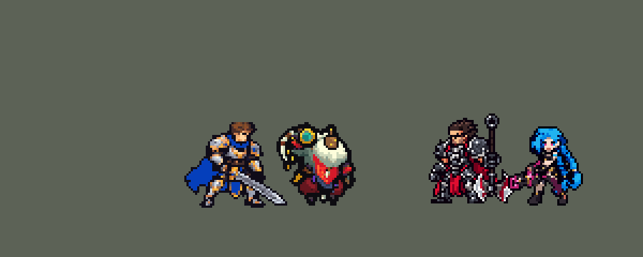

<!-- 本页上半部分由 tools/docs/gen_hero_docs.py 按仓库里现在的数据生成，手改会被覆盖；「开发记录」以下是手写的，生成时原样保留。 -->

# 巴德 Bard


| 项目 | 内容 |
|---|---|
| id | `league_bard` |
| 所属的包 | 主包（mod_id `league`） |
| 分路 | 辅助 |
| 分类 / 标签 | 功能型（Util） · AP / Magic / Range / CC / Heal |
| 高清帧 | 1 倍像素（无高清帧） |
| 附加包 | [巴德「神奇旅程」穿墙门附加包](#附加包)（`league_bard`） |



其他预览：[逐帧预览](../preview/league_bard_frames.png)、[特效表](../preview/league_bard_effects.png)

## 现在的技能

下面是游戏里显示的技能说明（`league/text/champion.i18n` 的简体中文，去掉了颜色和图标），冷却、距离来自 `league/champion/league_bard.data_champion`；1 秒 = 60 tick。

### 普攻 / 被动（被动「旅者的召唤」）

*攻击间隔 1.5 秒 · 攻击距离 52000*

射出星光。被动旅者的召唤：每3秒一只米普随攻击飞出，对目标周围的敌人造成45 + 50% 法强魔法伤害并减速25%（1秒）。

### 技能1 · 星界束缚

*冷却 7 秒 · 施放距离 65000 · 施放：指定目标 · 敌人（不含防御塔）*

射出星界能量，命中的第一个敌人受到100 + 75% 法强魔法伤害并减速60%；若其身后还有敌人，两者都受到伤害并眩晕1.5秒。

### 技能2 · 游神圣坛 / 神奇旅程

*冷却 7 秒 · 施放距离 90000 · 施放：指定目标 · 敌方英雄*

游神圣坛：向交战中的友方英雄（或自己）投出圣坛，治疗140 + 60% 法强，移速+30%。神奇旅程：被敌人近身时开门，带身边的友方英雄远离，移速+40%（16秒一次）。

### 大招 · 调和命运

*冷却 60 秒 · 施放距离 90000 · 施放：无目标 · 敌方英雄*

向聚在一起的敌方英雄（或被控制的友方英雄）投出金色法球，范围内所有单位（含友军、自己和防御塔）时停2.5秒：无法行动、无法被选中、不受伤害。

### 数值

攻击力 75（每级 +6）、法强 30（每级 +15）、生命 960（每级 +90）、护甲 22（每级 +7）、魔抗 24（每级 +4）、移速 1000（每级 +10）。

## 附加包

附加包是可选的原生代码 mod（都在附加包合集 `league_addons` 里），**不装主包里的英雄也是完整的**。

### 巴德「神奇旅程」穿墙门附加包

[巴德「神奇旅程」穿墙门附加包](../../addons/league_bard/README.md)：`league_bard` v0.6.1

|  | 主包（纯数据） | 装了附加包 |
|---|---|---|
| 什么时候开门 | 技能 2 出手时，身边 30000 内 2 名或 15000 内 1 名敌方英雄 | 冷却（16 秒）一好就每 3 tick 看一次：**撤**——生命低于 45% 而 30000 内有敌方英雄、15000 内有敌方英雄、或 30000 内敌方英雄 2 名以上且比身边友方多；**追**——墙后 45000~100000 外有生命不高于 60% 的敌方英雄、他自己生命不低于 40%；**支援**——没危险、没人可追时，60000~220000 外身边有敌方英雄的友方英雄（敌人最多的先），他自己生命不低于 50%、身边没有敌方英雄 |
| 往哪走 | 背向最近的敌方英雄 60000，可能穿石头 | **只在墙上开门、穿到墙的另一边**（英雄联盟的神奇旅程）：撤——背向身边敌人中心左右 75° 内、60000 内有墙的方向（20000 时他在线上只有 15% 的时间附近有墙，一局开不了几次：「巴德不放门啊」；60000 时 63%），落地后离敌人远 10000 以上，挑离敌人最远、朝己方最近的塔走得多的；追——只追墙后的敌方英雄，朝他左右 35° 内找墙，落点近 20000 以上、离他不近于 15000、旁边除目标最多一名敌方英雄；支援——朝队友左右 35° 内找墙，落点离队友近 30000 以上、旁边敌方英雄不多于 2 名。他先走到墙前（入口离墙 6000），门在墙前打开，他在门口站 24 tick 才穿进去，落点离起点不超过 130000、不在墙里，每 tick 飞 6000，出口门前再站 24 tick；附近没墙就不开 |
| 队友 | 被拉到他身边（可能穿石头） | 门边 25000 内的友方英雄一起穿过去（同样的位移；落点在墙里就落在他出口旁，再不行就不带） |
| 争大小龙（命运之轮） | 只在打团时对敌方英雄放（数据分不出龙和野怪、小兵） | 用户：「给巴德加上争大小龙时主动对龙放大招拖时间」。大龙、小龙在大招射程 80000 内、生命低于 95%（已经有人在打）、35000 内有敌方英雄、命运之轮的圈（36000）里没有友方英雄（巴德自己也不在）时，AI 钩子 `league_bard:drake` 让他放大招：金球飞向龙（龙身上 `r_mark` 的圈），落地后圈里的龙和打龙的敌人（小兵、野怪也算，塔除外）一起定住 150 tick（2.5 秒），和主包的命运之轮一样。大龙先于小龙。v0.6.1：大招解锁（5 级）且冷却好了才按——引擎的「输入合法」两样都不看，5 级前按下去也照放，游戏自带的 AI 判断他时读到空值崩溃（`battle.rs:447` / `act_gates.rs:111`），那一局打不完、过日卡死（2026-10-18，3、4 级时放过） |

装上附加包后游戏里显示的说明（和主包不同的部分）：

- **技能2 · 游神圣坛 / 神奇旅程**：【穿墙门】游神圣坛：向交战中的友方英雄（或自己）投出圣坛，治疗140 + 60% 法强，移速+30%。神奇旅程：在附近的墙上开门穿到另一边：被近身或残血时往己方撤，墙后有残血敌人就追，或去支援交战的队友，带上身边的友方英雄，移速+40%（16秒一次）。

## 相关脚本和素材

- [`tools/kit/build_bard.py`](../../tools/kit/build_bard.py)
- [`tools/kit/setup_bard.py`](../../tools/kit/setup_bard.py)
- [`tools/lol/extract_bard.py`](../../tools/lol/extract_bard.py)
- [`tools/art/preview_bard.py`](../../tools/art/preview_bard.py)
- [`tools/art/rig_bard.py`](../../tools/art/rig_bard.py)
- [`assets/source/bard/`](../../assets/source/bard)

## 开发记录

> 下面是原来 README 里「英雄：巴德」一节，原样搬过来（只改了相对链接）。

| 部分 | 内容 |
|---|---|
| 定位 | 辅助（Util，标签 AP / Magic / Range / CC / Heal），第 100 位英雄。星界游神 巴德（客户端里名字和称号是反着的，按官方）：远程 AP 辅助，普攻带 Meep，Q 把两个人捆在一起才眩晕，W 圣坛给队友回血加速，E 神奇旅程开门带队友穿墙，R 调和命运把一片区域里所有人（敌我、自己、防御塔）冻住 2.5 秒。用户的选择：远程 AP 功能型辅助；Meep 做进普攻（钟声不做进数据）；Q 照厄运小姐 Q 的连带，后面有第二个敌人才眩晕两个人；技能 2 是 W 圣坛 + E 逃生门；R 冻住区域里的所有人；美术 Codex 四步、3/4 正面；穿墙门另做附加包 |
| 普攻 / 被动 | 星光弹（攻击距离 52000，攻击间隔 90 tick，第 9 tick 出手，追踪，100% 攻击物理）。「旅者的召唤」：每 180 tick 下一次普攻同时放出一个 Meep，追着目标飞，在他身上炸开：周围 14000 内每个敌人 45 + 50% 法强魔法、减速 25% 60 tick（英雄联盟：35 + 40% 法强，锥形，钟声越多 Meep 越多）。钟声不做：地图上生不出东西，阵亡又会清掉 mod 的 buff |
| 技能1 | Q「星界束缚」：冷却 420 tick，对 65000 内的敌人放（小兵野怪也算），第 13 tick 朝目标射出一颗星（弹速 6000，碰到第一个单位就停）：100 + 75% 法强魔法、减速 60% 72 tick；同时一颗宽的隐形弹在 9 tick 里找他身后的下一个敌人：找到了，后面那个也吃伤害、**两人都眩晕 90 tick**（第一个人身上的 `Delayed` 读第二下留下的标记）；没有第二个人只减速（TFM2 没有能撞的墙，英雄联盟撞墙也眩晕） |
| 技能2 | 对 90000 内的敌方英雄放（只在打架时放，迦娜 E 的做法），E 和 W 共用这一格：**E「神奇旅程」**有自己的冷却（960 tick），被近身时开门——30000 内 2 名或 15000 内 1 名敌方英雄：背向最近的敌方英雄（先找 10000 内，再 20000、30000）飞出去，门边 25000 内的友方英雄被拉到他身边，都加速 40% 120 tick。强制位移不管地图上的石头（SDK 模拟里约四成穿过或停在石头里），数据又读不到墙，所以真正的「只在墙上开门」交给附加包。E 不开时放 **W「游神圣坛」**：圣坛扔给被控住的友方英雄，没有就扔给 50000 内随机一个，再没有扔在自己脚下：回复 140 + 60% 法强、加速 30% 90 tick |
| 大招 | R「调和命运」：冷却 3600 tick，照璐璐 R「上弦」：对 90000 内的敌方英雄放出 3 tick 的施法，900 tick 内每次普攻、Q、W/E 都检查一次：80000 内有被控住的友方英雄、而他身边 36000 内有敌方英雄——冻住他们（救人）；否则随机找 80000 内一个敌方英雄，他身边 36000 内有 2 名以上敌方英雄、没有友方（巴德自己也不算）——金球抛过去（24 tick），落点 36000 内的**所有单位**（敌人、队友、巴德自己、防御塔，英雄联盟原文就有防御塔）被放逐 150 tick（2.5 秒：选不中、不能动、什么也打不到它，身上是金色的雕像）。用户：「大招能定住防御塔吗 如果不能就要改」——SDK 里防御塔挨了放逐、眩晕照样开火，所以范围里的塔另挂 150 tick 的 `r_tower`（攻速 −99%、攻击 −99%），真的停火。没放出去就退还冷却。半径照英雄联盟的 350 放大到 36000（用户：「R的特效做大点」「特效和范围一起变大到英雄联盟大小」） |
| 附加包 | 可选的附加包 [`addons/league_bard`](../../addons/league_bard/README.md)（在附加包合集里，原生代码，主包不装它也完整）：**神奇旅程只在墙上开门**（用户：「巴德的传送别乱放啊」「门的逻辑不对吧 只能在墙上放吧」「巴德不放门啊」「加上吧 开门去支援」）：读地图的墙（卡蜜尔钩墙附加包的那份 5v5 地图），冷却 16 秒一好就每 3 tick 看一次——**撤**（残血或被近身，背向敌人找 60000 内的墙）、**追**（墙后 100000 内生命不高于 60% 的敌方英雄）、**支援**（墙那边 60000~220000 外打架的友方英雄）；他先走到墙前，门（2.5 倍大）在墙前打开，他在门口站 24 tick，然后带着门边 25000 内的友方英雄穿墙飞过去（每 tick 6000，最远 130000，落点不在墙里），出口门再站 24 tick，都加速。门的画面挂成 buff（原生代码在地上播的画面游戏里不显示：「巴德传送门的特效看不到啊」「你这个特效应该放在墙前面 LOL不就这样吗」「为什么还是没特效？」）。附加包里的巴德是 `make_override.py` 从主包生成的副本，技能 2 的说明以「【穿墙门】」开头。日志 `league_bard.log`（`DOOR` 行），游戏里看过：一局开 8 次左右。**争大小龙**（用户：「给巴德加上争大小龙时主动对龙放大招拖时间」）：数据分不出龙和野怪、小兵，主包的命运之轮只在打团时对敌方英雄放（打到圈里的龙和野怪也会被定住，模拟里大龙、小龙、四种野怪定住期间都没有出手）；附加包看到大龙或小龙在射程内、已经被打掉一些血、旁边有敌方英雄、圈里没有自己人时，让他对龙放大招，龙和打龙的敌人一起定住 2.5 秒（日志 `STALL` 行）。附加包 0.6.0 |
| 数值 | 攻击 75（+6）、法术强度 30（+15）、生命 960（+90）、护甲 22（+7）、魔抗 24（+4）、移速 1000（+10），和本包的远程辅助（璐璐、迦娜）一档。SDK 对战模拟：辅助位，对 5 个原版辅助（`priest`、`monk`、`bard`、`pythoness`、`spirit_caller`），两边、三套队友阵容各 24 局。初稿 d1 −1.82（Q 80 + 65%、眩晕 1.2 秒、Meep 35 + 40% 每 4 秒、圣坛 110 + 50%、生命 900；不放 R 是 −1.51，R 本身不亏）；Q 100 + 75%、眩晕 1.5 秒、Meep 45 + 50% 每 3 秒、圣坛 140 + 60%、生命 960 后种子 1–24 −0.28、25–48 +0.18（同批璐璐 −0.06 / −0.33、娜美 +0.04 / −0.02、迦娜 −1.14 / −0.94）；按动作帧对好出手时间后 −0.05 / −0.19；R 冻住防御塔、半径 36000 后 −0.30 / −0.34，都在本包辅助中间 |
| 精灵图（1 倍） | Codex 画了两张原画，用户选 A（乐器挂在近侧肩上），「A 模型太大了 缩小一点」——Codex 在同一套格子上重画到 85%。造型（第 1 步）Codex 交的成品糊，用户：「你帮忙修复吧 修复到完美了再喊我review」：[`tools/art/design_bard_hd.py`](../../tools/art/design_bard_hd.py) 从 Codex 干净的细稿自己按格读回（30 色聚类、多数投票、外描边、面具和号角贴回）。侧面用户不要了（「其实不用侧面啊 四分之三就行了吧」），所有动作都用 3/4 正面。动作是 Codex 画的 38 张细稿（[`tools/art/import_bard_strips.py`](../../tools/art/import_bard_strips.py)：按头部比对定每条动作一个缩放，切到造型的颜色，脚踩在同一行，面具贴回）；跑步从待机自己摆（Codex 的跑步没有左右腿的顺序）。先做成高清帧（PPU 1.5），游戏里用户：「巴德在游戏里像素太高」——从一张真实比例的样张选了 1.0（和原版英雄一样粗）：[`tools/art/rig_bard.py`](../../tools/art/rig_bard.py) 只出 1 倍帧，不在 league.dll 的高清名单里。头像截取点 (5, −34) |
| 特效 | Codex 第 3 步的 18 个特效（`assets/source/bard/codex_fx/bard-fx`），[`tools/art/import_bard_fx.py`](../../tools/art/import_bard_fx.py) 用它的 1 倍成品；用户：「是不是codex的特效你没完全用啊 好怪啊」——Codex 自己缩小时把 Q 束缚环的中间、门的通道清空了，这几个（Q 束缚、门、带队友的光、R 的金球 / 落点 / 穹顶 / 雕像 / 解冻）改从它的原稿重新读回（按清单上的大小，亮色优先投票、左右镜像），R 的放大 1.4 / 1.25 倍，门放大 2.5 倍当穿墙门（入口、出口两段）。`league_bard_fx`：普攻 / Meep / Q 的弹和打中、Q 束缚、圣坛和落地、带队友的光、各种减速和加速；`league_bard_big`：门、R 的金球、落点、穹顶（2.5 秒）、雕像、解冻 |
| 音效 | 英雄联盟的音效（`tools/lol/extract_bard.py`）：普攻 / 打中、Meep / 打中、Q 出手 / 打中 / 眩晕、圣坛 / 回血、开门 / 出口、R 出手 / 落地 / 冻住；巴德没有台词，他的「配音」是技能的旋律（Q 的钟声、圣坛的曲子，片段名 `league_bard_sfx_vo_*`，和声音名不同）。版权属于 Riot Games，**不提交到仓库**，按下面的命令在本地生成 |
| 图标 | 官方技能图标（Q 星界束缚 / W 游神圣坛 / R 调和命运，另有 E 神奇旅程、被动），从本地客户端提取，缩到 64×64 |

重新生成（素材来自本机的英雄联盟客户端，音频不进仓库）：

```bash
python tools/lol/extract_bard.py --lol "D:\WeGameApps\lol" --vgmstream "<vgmstream-cli.exe 路径>"
python tools/kit/build_bard.py               # 技能数据，数字都在脚本的参数表 P 里；--nodes 看每棵技能树的节点数
python tools/kit/setup_bard.py               # 五种语言的文字、音效配置、共享文件里他的键
python tools/art/design_bard_hd.py           # Codex 的细稿读回成 3/4 正面造型
python tools/art/import_bard_strips.py       # Codex 的动作细稿读回，跑步从待机摆
python tools/art/rig_bard.py                 # 1 倍帧
python tools/art/import_bard_fx.py           # 特效：Codex 的 1 倍成品，几张从原稿重新读回
python tools/art/preview_bard.py             # 预览和演示 GIF
python addons/league_bard/make_override.py   # 附加包的副本（主包的巴德改了就重跑）
```

美术（提示词见 [`assets/source/bard/`](../../assets/source/bard) 里的 `PICTURE_PROMPT.md`、`MODEL_PROMPTS.md`、`SIDE_PROMPT.md`、`MODEL_STRIPS.md`、`PROMPTS_FX.md`）：

- 原图：Codex 画的 A / B（`codex_picture/`），用户选 A。
- 造型：Codex 的第 1 步（`codex_model/`），我们自己从细稿读回，定稿在 `hd/front.png`；侧面（`SIDE_PROMPT.md`）画了但没用。
- 动作：Codex 的 38 张细稿（`codex_strips/`），读回后在 `frames/`。
- 特效：Codex 的 18 个特效（`codex_fx/bard-fx`）。

逐帧预览：[`docs/preview/league_bard_frames.png`](../preview/league_bard_frames.png?v=1014g)，特效：[`docs/preview/league_bard_effects.png`](../preview/league_bard_effects.png?v=1014g)。
