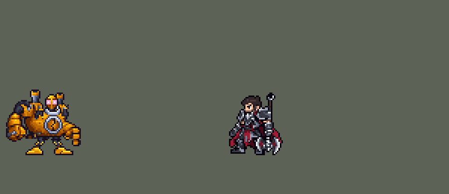

<!-- 本页上半部分由 tools/docs/gen_hero_docs.py 按仓库里现在的数据生成，手改会被覆盖；「开发记录」以下是手写的，生成时原样保留。 -->

# 布里茨 Blitzcrank


| 项目 | 内容 |
|---|---|
| id | `league_blitzcrank` |
| 所属的包 | 主包（mod_id `league`） |
| 分路 | 辅助 |
| 分类 / 标签 | 功能型（Util） · AP / Magic / Melee / Tank / CC / Shield |
| 高清帧 | 1 倍像素（无高清帧） |
| 附加包 | [低血量附加包：布里茨、乐芙兰、丽桑卓](#附加包)（`league_lowhp`） |



其他预览：[逐帧预览](../preview/league_blitzcrank_frames.png)、[特效表](../preview/league_blitzcrank_effects.png)

## 现在的技能

下面是游戏里显示的技能说明（`league/text/champion.i18n` 的简体中文，去掉了颜色和图标），冷却、距离来自 `league/champion/league_blitzcrank.data_champion`；1 秒 = 60 tick。

### 普攻 / 被动（被动「法力屏障」）

*攻击间隔 1.33 秒 · 攻击距离 25000*

普攻造成100% 攻击力的物理伤害；大招没在冷却时，1秒后再落一道闪电，造成20 + 15% 法术强度的魔法伤害。被动 法力屏障：被围攻或被控制时获得120 + 80% 法术强度的护盾（冷却60秒）。

### 技能1 · 机械飞爪

*冷却 10 秒 · 施放距离 70000 · 施放：方向 · 敌方英雄*

射出机械手，抓住直线上第一个敌方英雄（穿过小兵），造成70 + 50% 法术强度的魔法伤害，眩晕并把它拉到身前。

### 技能2 · 能量铁拳

*冷却 7 秒 · 施放距离 25000 · 施放：指定目标 · 敌人（不含防御塔）*

一记上勾拳，造成20 + 100% 攻击力的物理伤害并击飞1秒。过载运转（每15秒）：敌方英雄靠近时自动开启，4秒内移速+40%（逐渐降低）、攻速+25%，结束后减速25%1.5秒。

### 大招 · 静电力场

*冷却 50 秒 · 施放距离 60000 · 施放：无目标 · 敌方英雄*

释放静电，对身边敌人造成150 + 80% 法术强度的魔法伤害，并沉默敌方英雄1秒。打起来才放；放出后普攻的闪电停用，直到大招冷却结束。

### 数值

攻击力 80（每级 +6）、法强 30（每级 +15）、生命 1050（每级 +115）、护甲 36（每级 +9）、魔抗 28（每级 +4）、移速 1000（每级 +10）。

## 附加包

附加包是可选的原生代码 mod（都在附加包合集 `league_addons` 里），**不装主包里的英雄也是完整的**。

### 低血量附加包：布里茨、乐芙兰、丽桑卓

[低血量附加包：布里茨、乐芙兰、丽桑卓](../../addons/league_lowhp/README.md)：`league_lowhp` v0.2.2

| 英雄 | 主包（纯数据） | 装了附加包（英雄联盟） |
|---|---|---|
| 布里茨 法力屏障 | 被围攻或队友被控 | 生命不高于 30% |

## 相关脚本和素材

- [`tools/lol/extract_blitzcrank.py`](../../tools/lol/extract_blitzcrank.py)
- [`tools/art/preview_blitzcrank.py`](../../tools/art/preview_blitzcrank.py)
- [`tools/art/import_blitzcrank.py`](../../tools/art/import_blitzcrank.py)
- [`tools/art/design_blitzcrank.py`](../../tools/art/design_blitzcrank.py)
- [`assets/source/blitzcrank/`](../../assets/source/blitzcrank)

## 开发记录

> 下面是原来 README 里「英雄：布里茨」一节，原样搬过来（只改了相对链接）。

| 部分 | 内容 |
|---|---|
| 定位 | 辅助（近战，分类 Util），第八组的辅助；本包第八个辅助（索拉卡、蕾欧娜、迦娜、锤石、莫甘娜、娜美、塔里克之后）。开团：Q 把敌方英雄钩过来，E 打上天，R 一圈沉默 |
| 普攻 | 铁拳，100% 攻击力的物理伤害，射程 25000，攻击间隔 80 tick（1.33 秒），第 8 tick 命中（动作第 3 帧）。大招不在冷却时带静电力场的被动（见大招） |
| 被动 | 「法力屏障」（用户选的「被围或被控时」）：这个游戏读不到当前生命，用"危险"代替"低血量"：35000 内有两个以上敌方英雄，或者他自己被控制时，获得 120 + 80% 法术强度的护盾，持续 10 秒，冷却 60 秒，金色的能量罩跟着护盾（护盾打破就消失）。每次行动都检查，行动后 4 秒内每 0.5 秒再查一次（被眩晕时他不行动，这串检查照样跑），模拟每局约 3–4 次 |
| 技能1 | Q「机械飞爪」（用户选的「只钩英雄、穿过小兵」）：朝 70000 内的敌方英雄的方向施放，冷却 10 秒。第 11 tick 掷出：张开的机械爪带着钢链从举起的手臂飞出（起点在他支点上方 16.5 px，斜着往下飞，到射程尽头回到地面高度，用户：「从上面勾 别从下面勾」「要的是和联盟一样 从手臂飞出去的爪子勾人」），每 tick 6000，射程 78000，半径 6000，穿过小兵和野怪，碰到第一个敌方英雄：70 + 50% 法术强度的魔法伤害，眩晕 0.67 秒，以每 tick 1500 拉到他身前。钩中时和英雄联盟一样：合拢的爪子抓着那个英雄沿原路收回（每 tick 1500），钢链缩回腕口，爪子装回手臂时他正好落在布里茨身前（约 33 px，E 够得着）；没钩中或被黑暗之盾挡掉（眩晕和拉拽都没生效，靠一枚只打被控英雄的隐形分身判断），张开的爪子带着钢链沿原路快速收回。一局模拟里 18 钩中 10 |
| 技能2 | E「能量铁拳」，合并 W「过载运转」（用户选的「E 当技能2，W 自动开」）：对 25000 内的敌人施放（小兵和野怪也算，清线、打野也用），冷却 7 秒。第 12 tick（动作第 4 帧）上勾拳：先打身边的敌方英雄，没有就打施放目标，20 + 100% 攻击力的物理伤害，击飞 1 秒。W 有自己的 15 秒冷却：好了的时候，他任何一次行动发现 60000 内有敌方英雄就自动开启：移速 +20%（前 2 秒再 +20%，英雄联盟的递减）、攻速 +25%，持续 4 秒，两根烟囱每秒冒一次蒸汽，结束后自己减速 25%（1.5 秒） |
| 大招 | R「静电力场」（用户选的「按原版规则，沉默 1 秒」）。被动：大招不在冷却时，普攻打中的目标（不打防御塔）身上挂一团静电，1 秒后头顶劈下闪电，20 + 15% 法术强度的魔法伤害。主动照塔里克、锐雯的蓄势大招做：放了之后保持 10 秒，30000 内一出现敌方英雄就发动（每次行动和每 15 tick 各检查一次）：浑身冒电，第 23 tick（动作第 6 帧）脚下炸开电场，半径 40000 内的敌人受到 150 + 80% 法术强度的魔法伤害，敌方英雄沉默 1 秒。发动后被动在大招冷却的 50 秒里关掉，和英雄联盟一样；10 秒没用上就返还冷却 |
| 附加包 | 可选的附加包 [`addons/league_lowhp`](../../addons/league_lowhp/README.md)（在附加包合集里，原生代码，主包不装它也完整）：法力屏障照英雄联盟在生命不高于 30% 时触发（主包是被围攻或队友被控） |
| 连招 | 用户要求：「有连招要做连招」「都要帮我补」。英雄联盟里布里茨钩中人拉到脚下，马上一拳打上天。原来 Q、E 只靠距离衔接：拉完后 AI 的 E 还要抬手 12 tick，钩子的 40 tick 眩晕已经过了。**Q→E**：机械飞爪抓住敌方英雄时（只认被控英雄的孪生投射物，和拉人同时），布里茨身上开一个 90 tick（1.5 秒）的连招窗口；窗口里放 E，能量铁拳立刻打出（平时第 12 tick），趁眩晕还在把人打上天，窗口随之用掉。法力屏障的检查和存着的大招照旧在第 12 tick。伤害、击飞、冷却都不变；钩空或钩到小兵不开窗口。数据由 [`tools/fix/combo_blitzcrank.py`](../../tools/fix/combo_blitzcrank.py) 改 |
| 数值 | 攻击 80（+6）、法术强度 30（+15）、生命 1050（+115）、护甲 36（+9）、魔抗 28（+4）、移速 1000（+10），攻击间隔 1.33 秒。数值是自己设计的，用 SDK 对战模拟调：辅助位，对 5 个原版辅助（`priest`、`bard`、`enchanter`、`monk`、`taoist`），三套队友阵容、两边各 12 局，一批 360 局。第一版（Q 90 + 80%、眩晕 1 秒、冷却 8 秒，E 30 + 150%，被动 40 + 30%，R 200 + 100%，W 攻速 +40%）+2.98（同一批锤石 −0.32、蕾欧娜 +0.93）；E、被动、Q、R 的伤害各降一档、W 改成攻速 +25%、移速 +20% / +20% 后 +1.87；Q 冷却 8 秒改 10 秒后 +1.21；Q 眩晕 1 秒改 0.67 秒后两批 **+0.77 / +1.66**（同两批锤石 −0.32 / +0.24、蕾欧娜 +0.93 / +0.64，塔里克 +2.47 / +2.43），定下这版。钩子抬到手臂高度后两批 +1.27 / +1.01；飞爪按英雄联盟改成沿原路收回、人落在他身前后 −0.14 / +1.27（同两批锤石 −0.32 / +0.24、蕾欧娜 +0.93 / +0.64），都在这一档。每局放 Q 约 18 次、E 约 24 次（对英雄约 8 次）、R 约 2.8 次 |
| 亚索联动 | Q 的眩晕和 E 的击飞是亚索大招要的控制：布里茨打辅助、亚索打上路同队时，亚索每局 R 到被控英雄 1.98 次（同一批蕾欧娜 1.88、锤石 1.35、原版牧师 0.65），和带硬控的辅助同一档，亚索不用调 |
| 精灵图 | 10 个动作 57 帧：待机、移动、普攻、Q、Q 拉拽、Q 爪子装回、E、R、受击、死亡。造型按用户在 Codex 里挑的原画（A：两拳垂在身侧），由 Codex 直接按游戏尺寸画：金色的圆身体、粉色的眼睛、胸口的银色仪表圈、两根钢烟囱、垂到地面的两只方块大拳、深色活塞腿和金色大脚。烟囱顶到脚底 44 px，46 px 宽，16 色 |
| 特效 | 普攻命中的金色冲击（16 px），静电标记（18 px，1 秒）和从头顶劈下的闪电（20 × 44 px），Q 的金色机械爪（张开和合拢各 2 帧，16 × 14，Codex 重画）和钢链（一节 8 × 3，逐帧拼出），钩中英雄的金色电光圈（22 px），E 上勾拳的冲击和往上冲的火星（24 × 40 px），W 两根烟囱冒的蒸汽（48 × 56 px），R 浑身窜的电弧（60 × 56 px）、地上炸开的电场（132 × 72 px，半径 40000）、电到每个敌人的电光（18 px）、头顶的紫色沉默环（22 × 12 px），被动的金色能量罩（60 × 56 px） |
| 图标 | 官方技能图标（Q / E / R），64×64 |
| 音频 | 从本地客户端提取的 11 条技能音效和 2 条语音（基础皮肤没有技能台词：W 用移动语音、R 用攻击语音），合成 11 个游戏音效。不提交到仓库，按下面的命令在本地生成 |

```bash
python tools/lol/extract_blitzcrank.py --lol "D:\WeGameApps\lol" --vgmstream "<vgmstream-cli.exe 路径>"
python tools/lol/native_pose.py assets/source/blitzcrank/poses.json --out <渲染文件夹>   # 动作参考帧
python tools/art/design_blitzcrank.py        # 造型：Codex 的 B2，头和脚换成身体的金色、按原画重画两根烟囱
python tools/art/fix_blitzcrank_strips.py    # 动作：清理 Codex 的动作条（烟囱、移动的拳头残块、胸口的第二个圆环、死亡的位置）
python tools/art/import_native.py --hero blitzcrank
python tools/art/import_blitzcrank.py        # 特效和飞爪；--native <Codex 的特效交付文件夹> 先把它的 1 倍成品转成原尺寸条
python tools/art/preview_blitzcrank.py
```

美术（原画的提示词见 [`assets/source/blitzcrank/PICTURE_PROMPT.md`](../../assets/source/blitzcrank/PICTURE_PROMPT.md)，造型的见 [`MODEL_PROMPTS.md`](../../assets/source/blitzcrank/MODEL_PROMPTS.md)、返修的见 [`MODEL_REDO.md`](../../assets/source/blitzcrank/MODEL_REDO.md)，9 条动作的见 [`MODEL_STRIPS.md`](../../assets/source/blitzcrank/MODEL_STRIPS.md)，特效的见 [`PROMPTS_FX.md`](../../assets/source/blitzcrank/PROMPTS_FX.md)；Codex 的交接说明在 [`codex_model/`](../../assets/source/blitzcrank/codex_model)、[`codex_strips/`](../../assets/source/blitzcrank/codex_strips)、[`codex_fx/`](../../assets/source/blitzcrank/codex_fx)）：
- 分工：模型和特效都由 Codex 画，Claude 写提示词包、整理和导入，按"原画 → 造型 → 动作 → 特效"分四步。
- 原画和造型：原画包里 Codex 画了 A、B 两张，用户选 A（英雄联盟的待机，两拳垂在身侧）。造型包让 Codex 直接按游戏尺寸画（44 行，身宽手长），第一轮的 A、B 只差在头上，用户选 B 并让 Codex 返修（`MODEL_REDO.md`：烟囱改成钢身、炉门缩小、手臂分出肩、前臂和拳头）；返修的 B2 头和脚还是第一轮的柠檬黄，烟囱一根是笔直的柱子、一根挂在穹顶上。用户：「你可以修一修吧 不一定要依赖codex」，Claude 把头和脚按色阶一一换成身体的新金色（像素不动），按原画重画两根烟囱（金色帽、深色烟囱口、往下变细的钢身，远侧那根接到肩上），16 色；用户：「就用这版」（`design_blitzcrank.py`）。装进游戏后用户：「头部可以往右侧面调一调？现在太靠左贴到铠甲了」：B2 的头在第 64 列，比下面领圈的中轴偏左 2–3 格、脸贴着近侧肩甲；头整体右移 2 格，下巴落进领圈，左边和肩甲之间留出空隙，右侧烟囱的里边两列挡到头后面。
- 动作参考（`poses.json`）：镜头 yaw 20、pitch 20，不镜像（看得见两只拳头、胸口炉门和眼睛）；头 1.5 倍，腿原比例；高度 44，128 × 112 的格子，出拳的动作转 15–25° 让拳头朝右。待机 `blitzcrank_idle1`（6 帧 × 160 ms），移动 `blitzcrank_run`（8 帧 × 83 ms，平地，头保持待机的样子），普攻 `blitzcrank_attack1`（6 帧），Q `blitzcrank_spell1`（8 帧，第 4 帧手飞出去，之后手臂末端是空的六角形腕口），Q 拉拽取 `blitzcrank_spell1` 的 435 / 523 / 610 ms 三帧循环，E `blitzcrank_i_Spell3`（7 帧），R `blitzcrank_spell2`（7 帧），受击取 `blitzcrank_death` 开头和待机混合（2 帧），死亡 `blitzcrank_death`（8 帧）。
- 动作：Codex 按参考帧画了 8 条 49 帧，待机 6 帧用定稿。导入前逐帧检查（网格、色板、头部、连通块、脚底线、两腿交替），`fix_blitzcrank_strips.py` 处理了几处（用户：「codex奇怪的地方请你善后 比如模型哪里少了之类的」）：烟囱（Codex 补回定稿烟囱时少了两侧描边，旁边留着它第一版烟囱的竖条、穹顶上一道棕色横条，都按定稿逐格放回）；移动（Codex 把定稿的两条腿按行切片挪出步幅，每片都带着垂地拳头内侧那一列，两腿外侧各留下一条虚线似的"梯子"：逐行找出每条腿切片的位移，把拳头那几格清掉；两腿交叉的 3 帧里 Codex 让远侧的脚压住了近侧的脚，近侧的腿重新画回前面；胯边剩下的腕部残块和一个孤立小点清掉）；胸口的第二个圆环（普攻 1–5、Q 拉拽 3、E 1–4、死亡 3–4 在真圆环左边 5–8 格又画了一道圆弧，看起来像两个圆环，用周围机身的颜色补平）；死亡最后两帧躺下的身体低出脚底线 2 行，整体上移；每帧贴的头和定稿一起右移 2 格（空出来的格子留空，描边在导入时补齐；E 第 5–6 帧为了举起的手臂没清头顶，这里把 Codex 留下的一小块旧烟囱和一截棕色横条清掉）。之后 Codex 又整条重画了移动（`codex_strips/HANDOFF_RUN_REGEN.md`），新的一版同一条腿一直在前、后腿成了没有脚的棕色块，没有换步，所以没用。Q 的出手和拉拽后来按用户「要的是和联盟一样 从手臂飞出去的爪子勾人」请 Codex 重画（[`Q_REDO.md`](../../assets/source/blitzcrank/Q_REDO.md)，交付在 [`codex_q_redo/`](../../assets/source/blitzcrank/codex_q_redo)）：出手的手臂顺着钩子的飞行线伸出，空腕口在 (24, −11)（它还画了朝飞回支点的方向伸手的三帧拉拽，后来爪子改成沿原路收回，手臂方向对不上，没有用）。用户：「有问题的地方还是你来调整」：Codex 换手臂时连带挖掉了 Q 第 4–5 帧头的右半边和胸口仪表（第 6 帧也缺几条），按原帧补回；第 3、7 帧装在手上的爪子它画成细叉子，换成它自己画的张开机械爪（去掉火箭蒸汽：还没发射，16 色不变）。拉拽用 Q 第 5–6 帧（手臂顺着钩子的线伸直、空腕口，5 6 5 循环）；新加的「爪子装回」（`q_hold`，2 帧）是同两帧装上它画的合拢机械爪。
- 导入：待机 6 帧用定稿，第 3–5 帧从脚上（站位点下第 9 行，上下两行轮廓一样）往上下沉一格呼吸（`BOB`；再往上每一行都会切到垂地的拳头和活塞腿）；按粉色的眼睛定头的位置（`EYES`）；描边补齐（`COMPLETE`）。头像截取点 (0, −39)（头右移后跟着右移）。待机最高点（烟囱顶）−32，高过 −28，按选人卡片的规则设 `banpick_center` (0, −7)。
- 特效用 Codex 画的 12 张（63 帧；同一包里的飞拳和钢缆后来换成重画的机械爪，见下）：直接交了按游戏尺寸整理好的成品，`import_blitzcrank.py --native` 按交付清单的格子逐像素搬进来。锚点按画面定：雷击的落点 (9, 32)、上勾拳的闪光 (11, 30)（包里写的是 (10, 31)、(12, 26)），挂在胸口（站位点上 6 格）；蒸汽格按包里的站位点 (24, 47)，烟正好从两根烟囱口冒出；蓄电和能量罩 Codex 画成站在格子第 47 行，那一行对到他的脚底；沉默环在头顶上方（站位点上 30 格）。时长按技能：普攻命中 5 帧 × 60 ms，静电标记 6 × 167 ms（1 秒，到雷击），雷击 6 × 70 ms，抓取 5 × 70 ms，上勾拳 6 × 70 ms，蒸汽 6 × 167 ms（过载的 4 秒里每秒一次），蓄电 5 × 80 ms（第 23 tick 电场炸开），电场 7 × 80 ms，R 命中 5 × 70 ms，沉默 6 × 167 ms（1 秒），能量罩 6 × 167 ms 循环。
- 飞爪：Q 的手臂按英雄联盟举到肩高（腕口在支点上方约 16 px）。第一版飞拳沿锤石的高度飞（`y_offset` 2000），像从肚子前面飞出去，用户：「爪子应该从飞出去的那个手臂出去」「从上面勾 别从下面勾」。游戏会把投射物的画面转到它飞的方向，画面里加不了高度（往上画的部分向左扔时会翻到下面），所以把钩子本身抬到手臂高度：`y_offset` −11500，从他支点上方 16.5 px 出发，斜着往下飞到射程尽头的地面高度（约 12°），落在对方胸口一带；模拟 8 局抬高后钩中 76/144，原来 68/125，近处的英雄没有因此漏钩。之后用户：「要的是和联盟一样 从手臂飞出去的爪子勾人」，Codex 重画了出手的手臂和爪子（见上「动作」）。第一版拼法让收回的爪子飞向他的支点、画在单位下层：被抓的人挡住了爪子，链子和爪子钻进肚子、没回到手上，用户：「你装在手上拉回不是用手？」「lol里面机器人什么样你就什么样」。现在照英雄联盟：手带着钢链飞出去，抓到的人由手沿原路带回来，手装回手臂。钩子从掷出那一 tick 起每 tick 走 6 px，停在出发点外 6 (h + 1) px（h：停下时离掷出几 tick）。飞出每 tick 一帧：张开的爪子在钩子上（画在单位上层，走到 36 px、第 3 帧装在手臂上的位置前面才出现），钢链在同行的隐形分身上（画在单位下层，一直连回出发点）。收回不用飞回支点的投射物（`BackToCasterLinearProjectile` 不管 `y_offset` 都飞向支点），改用钩子 `end_effects` 里放出的直线投射物：模拟日志里它们和钩子从同一点出发、朝钩子停下的地方飞，正好在钩子的线上；两枚每 tick 1500 的投射物带着那个 h 的收回画面（`q_hc<h>`：合拢的爪子，上层；`q_hn<h>`：钢链，下层），爪子抓着人每 tick 退 1.5 px，钢链跟着缩短。掷出时设的 13 个标记（`q_f0`–`q_f12`）给出 h（4 局日志里每一钩都对上）；隐形分身按 h 把人拖 (6 (h + 1) + 12 − 33) / 1.5 tick（`Grab` 带 `tick`；钩子停在离人中心 12 px 处），人停在他身前约 33 px（E 够得着），同时爪子正好退回 32 px（第 3 帧装着它的位置），从人的前沿滑到人身上；那一刻身体换成「爪子装回」（`q_hold`，8 tick），然后回到待机。先试过把人停在手臂尽头（约 43 px）、装回 12 tick：他得先走一步才能接 E，两批 −0.23 / −0.15，低了约一分。他的身体只有朝左、朝右，钩子却多半斜着扔（模拟 4 局 80 钩，水平 ±15° 内只有 15 钩，60 钩向上 30–90°）：钢链画在单位下层、连回出发点，水平扔时被伸直的手臂挡住、正好从腕口伸出，斜着扔时从他头肩后面伸出，飞出和收回都在同一条线上。没钩中（或被黑暗之盾挡掉）时，张开的爪子带着钢链每 tick 9 px 沿原路收回，退到 32 px 消失，第 7 帧爪子回到手臂上。Q 动作条的时长跟着改：第 3 帧（爪子装在手上）留到第 16 tick 爪子飞到前面，第 4–6 帧的空腕口留到落空的爪子收回（第 32 tick），60 60 147 66 84 116 67 67 ms（原来 60 60 70 80 120 120 80 80，总长还是 40 tick），Q 音效里发射那一段也挪到第 16 tick（延迟 0.2 → 0.08 秒）。
- 出手时刻和动画对齐：普攻第 3 帧（第 8 tick），Q 第 11 tick 掷出，第 3 帧爪子留在手上到第 16 tick（第 4 帧换成空腕口），钩中后播 Q 拉拽，爪子装回手臂时换「爪子装回」8 tick，E 第 4 帧（第 12 tick），R 第 6 帧电场炸开（第 23 tick）。

逐帧预览：[`docs/preview/league_blitzcrank_frames.png`](../preview/league_blitzcrank_frames.png?v=1014g)，特效：[`docs/preview/league_blitzcrank_effects.png`](../preview/league_blitzcrank_effects.png?v=1014g)。
