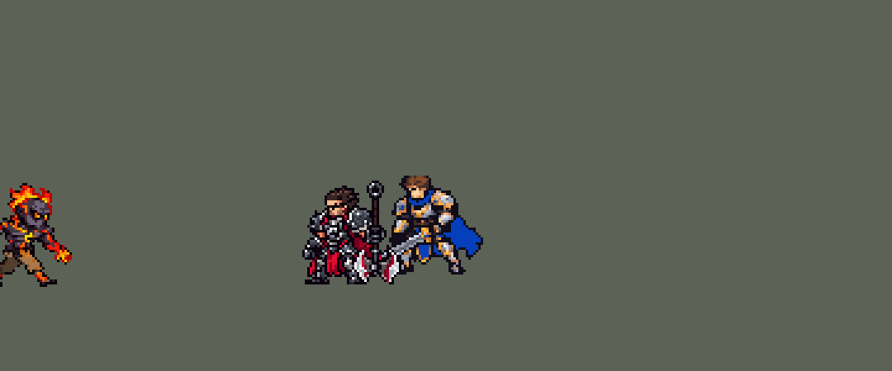

<!-- 本页上半部分由 tools/docs/gen_hero_docs.py 按仓库里现在的数据生成，手改会被覆盖；「开发记录」以下是手写的，生成时原样保留。 -->

# 布兰德 Brand


| 项目 | 内容 |
|---|---|
| id | `league_brand` |
| 所属的包 | 主包（mod_id `league`） |
| 分路 | 中单 |
| 分类 / 标签 | 法师（Magician） · AP / Magic / CC |
| 高清帧 | 1 倍像素（无高清帧） |
| 附加包 | [布兰德被动层数附加包](#附加包)（`league_brand`） |



其他预览：[逐帧预览](../preview/league_brand_frames.png)、[特效表](../preview/league_brand_effects.png)

## 现在的技能

下面是游戏里显示的技能说明（`league/text/champion.i18n` 的简体中文，去掉了颜色和图标），冷却、距离来自 `league/champion/league_brand.data_champion`；1 秒 = 60 tick。

### 普攻 / 被动（被动「炽热之焰」）

*攻击间隔 1.5 秒 · 攻击距离 52000*

被动炽热之焰：技能命中使敌人烈焰焚身4秒，每秒受到6 + 4% 法强魔法伤害。技能命中英雄叠层，第3层时该英雄2秒后爆炸，对周围造成50 + 30% 法强+4%最大生命值伤害。

### 技能1 · 烈焰之柱

*冷却 8 秒 · 施放距离 85000 · 施放：指定目标 · 敌人（不含防御塔）*

短暂延迟后在目标处升起烈焰之柱，对范围内敌人造成70 + 55% 法强魔法伤害并点燃；有英雄在燃烧时伤害提高25%。

### 技能2 · 烈火燃烧

*冷却 11 秒 · 施放距离 60000 · 施放：指定目标 · 敌方英雄*

点燃敌方英雄并蔓延到周围，造成45 + 35% 法强。随后火焰烙印：火球命中首个敌人造成60 + 45% 法强魔法伤害并晕眩0.83秒。命中英雄且烈焰之柱就绪时，再对他施放烈焰之柱。

### 大招 · 烈焰风暴

*冷却 45 秒 · 施放距离 65000 · 施放：指定目标 · 敌方英雄*

火种在敌人间弹射5次，优先英雄，每次造成60 + 20% 法强魔法伤害、点燃并减速35%。目标附近没有其他敌人时不施放。

### 数值

攻击力 78（每级 +6）、法强 42（每级 +21）、生命 820（每级 +95）、护甲 18（每级 +7）、魔抗 20（每级 +4）、移速 900（每级 +9）。

## 附加包

附加包是可选的原生代码 mod（都在附加包合集 `league_addons` 里），**不装主包里的英雄也是完整的**。

### 布兰德被动层数附加包

[布兰德被动层数附加包](../../addons/league_brand/README.md)：`league_brand` v0.1.1

主包 `league` 保持纯数据。数据只读得到施法者自己身上的 buff，所以主包布兰德的被动「炽热之焰」把层数记在**布兰德身上**：
技能连中不同的英雄也会叠到第 3 层，第 3 下打中的那个英雄爆炸。这个附加包用原生代码做成英雄联盟的样子：

- **层数记在每个敌人身上**：原生效果 `league_brand:blaze` 代替主包里的叠层。技能（W、E 的蔓延、Q、R 的每次弹跳）打中敌方英雄时，
  在**他**身上叠一层（每层 4 秒，再中一下全部刷新），每个英雄各算各的；头顶照旧亮 1 / 2 / 3 个小火苗。
- **第 3 层**：层数清掉，他亮起倒计时火圈，2 秒后在他所在的位置爆炸（等爆炸的这 2 秒里不再叠层；爆炸前死了就不炸）：半径 26000 内的
  敌人（不含防御塔）受到 50 + 30% 法强 + 4% 最大生命值的**魔法伤害**（主包里最大生命值部分只能是真实伤害），并被点燃 4 秒
  （每秒 6 + 4% 法强的魔法伤害）。
- W 的加成伤害和 E 的大范围蔓延照旧看「布兰德最近 4 秒有没有叠过层」（每叠一层刷新他身上的 `league_brand_b_1`）。
- 数字写在 `src/lib.rs` 的常数里，`make_override.py` 生成副本时核对它们和 `tools/kit/build_brand.py` 参数表 `P` 的同名项一致。

装上附加包后游戏里显示的说明（和主包不同的部分）：

- **普攻 / 被动（被动「炽热之焰」）**：【层数测试版】被动炽热之焰：技能命中使敌人烈焰焚身4秒，每秒受到6 + 4% 法强魔法伤害。技能命中的英雄各自叠层，第3层时他2秒后爆炸，对周围造成50 + 30% 法强+4%最大生命值魔法伤害。

## 相关脚本和素材

- [`tools/kit/build_brand.py`](../../tools/kit/build_brand.py)
- [`tools/kit/setup_brand.py`](../../tools/kit/setup_brand.py)
- [`tools/lol/extract_brand.py`](../../tools/lol/extract_brand.py)
- [`tools/art/preview_brand.py`](../../tools/art/preview_brand.py)
- [`tools/art/rig_brand.py`](../../tools/art/rig_brand.py)
- [`tools/art/import_brand.py`](../../tools/art/import_brand.py)
- [`tools/art/design_brand.py`](../../tools/art/design_brand.py)
- [`assets/source/brand/`](../../assets/source/brand)

## 开发记录

> 下面是原来 README 里「英雄：布兰德」一节，原样搬过来（只改了相对链接）。

| 部分 | 内容 |
|---|---|
| 定位 | 中单（法师，分类 Magician），用户排的第十四组的中单（原来排在第十三组，后来和泽拉斯对调），第 68 位英雄。复仇焰魂 布兰德：技能把敌人点燃（烈焰焚身），技能连中同一个英雄三次时那个英雄会爆炸。技能位用户选的「W / E→Q / R」：技能1 是 W 烈焰之柱（清线打团都用），技能2 是英雄联盟里最常见的 E→Q 连招（点燃再火球，必晕）；R 选「5 次弹跳，团战才放」；被动选「主包近似 + 扩展包」（数据里读不到每个敌人身上的层数，主包把层数记在布兰德身上，主包自己完整可玩；每个敌人各自计层在原生附加包 `league_brand` 里）；用户又要「加入高手的连招」 |
| 普攻 / 被动 | 远程，射程 52000，攻击间隔 90 tick，第 11 tick 扔出火球（100% 攻击力）。被动「炽热之焰」：技能命中的每个单位都被点燃（烈焰焚身）4 秒，每秒 6 + 4% 法强的魔法伤害（每次命中各算一层灼烧）。技能打中敌方英雄叠层（层数记在布兰德身上，4 秒内不再命中就清空；同一个技能一次只算一层），第 3 层打中的英雄先亮起倒计时火圈，2 秒后在他身上爆炸：周围半径 26000 内的敌人受到 50 + 30% 法强的魔法伤害和 4% 最大生命值的真实伤害（数据里读不到最大生命值的魔法伤害），然后层数清零。头顶的 1 / 2 / 3 个小火苗显示层数。0.71.1：说明里去掉了「并损失最大生命值」（数值 c4 起灼烧的最大生命值部分是 0），数据里那段 0 伤害的灼烧也去掉了，玩法不变 |
| 技能1 | W「烈焰之柱」：冷却 480 tick（8 秒），射程 85000，也对小兵和野怪放。第 11 tick 在目标脚下亮起火纹，36 tick（0.6 秒）后火柱冲起（能躲）：半径 23000 内 70 + 55% 法强的魔法伤害并点燃；有英雄在燃烧时（布兰德身上有层数）伤害提高 25% |
| 技能2 | E「烈火燃烧」→ Q「火焰烙印」：冷却 660 tick（11 秒），只对敌方英雄放（射程 60000，清线交给 W）。第 6 tick 点燃目标并蔓延到周围（半径 24000，身上有层数时 40000）：45 + 35% 法强的魔法伤害；第 17 tick 朝目标扔出火球（每 tick 8000，打中第一个敌人）：60 + 45% 法强的魔法伤害并晕眩 50 tick（目标刚被 E 点燃，英雄联盟里点燃的目标必晕） |
| 大招 | R「烈焰风暴」：冷却 2700 tick（45 秒），只对敌方英雄放（射程 65000）。施放时先数目标周围 55000 内的敌方单位：只有他一个就不放，大招冷却缩到 1 秒以内（塔里克大招的退冷却办法），免得 AI 把大招浪费在孤身的英雄上。放出去的火种打中目标后在附近弹跳，一共命中 5 次（隔 16 tick），优先英雄：上一跳打的是英雄、附近只有他一个英雄时弹给附近的任意单位（可能是小兵，也可能弹回他），和英雄联盟一样；每次 60 + 20% 法强的魔法伤害、点燃、减速 35% 0.5 秒，打中英雄也叠被动层数。游戏里的弹道都从施法者出发，所以弹跳画成火种从上面砸到下一个目标身上（娜美 W 的做法） |
| 被动附加包 | 附加包 [`addons/league_brand`](../../addons/league_brand/README.md)（在附加包合集里）用原生代码：层数记在**每个被打中的敌方英雄身上**，各算各的（英雄联盟的做法；主包只能记在布兰德身上，连中不同的英雄也会叠到第 3 层）。第 3 层的英雄 2 秒后爆炸（等爆炸时不再叠层，爆炸前死了就不炸），周围半径 26000 内的敌人受到 50 + 30% 法强 + 4% 最大生命值的**魔法伤害**（主包里最大生命值部分是真实伤害）并被点燃；W 的加成和 E 的大范围蔓延照旧看布兰德最近有没有叠过层。主包不装附加包也完整可玩。游戏里确认过（2026-10-07，第一次 30 分钟的对局日志）：叠层 13107 次、第 3 层引爆 2179 次，Q 和 R 弹跳的叠层也拿得到被打中的英雄（没有一次 `BLAZE skipped`） |
| 连招 | 用户：「加入高手的连招」。**E→Q→W**：E→Q 的火球晕住英雄、W 又没在冷却时，接着在被晕的英雄身上放 W（落在晕住的人身上必中），E、Q、W 三下正好叠满三层，被动引爆；W 的冷却和技能1 共用（这次放过了技能1 就要等冷却）。**R 先打被点燃的**：R 只在目标身边有别的敌人时放，弹跳优先英雄 |
| 数值 | 攻击 78（+6）、法强 42（+21）、生命 820（+95）、护甲 18（+7）、魔抗 20（+4）、移速 900（+9）。数值是自己设计的，用 SDK 对战模拟调：中单，对 5 个原版中单法师（`pyromancer`、`ice_mage`、`lightning_mage`、`wind_mage`、`white_mage`），3 套阵容、两边各打，10 分钟。初稿击杀差 +5.62（伤害 16530，同一批泽拉斯 +1.51、丽桑卓 +1.23）：去掉灼烧的最大生命值真实伤害、引爆 6% → 4%、各技能伤害下调、晕眩 75 → 50 tick、生命 860 → 820（+2.34），再把 E→Q 冷却 9 → 11 秒、W 冷却 7 → 8 秒：+1.56 / +1.24（两批 24 个种子），伤害约 12000 |
| 亚索联动 | Q 有晕眩：和布兰德同队时亚索的大招每局放 1.73 次（同一批原版雷法师 3.40、火法师 0.58、泽拉斯 1.17），不用调 |
| 精灵图 | 8 个动作：待机（呼吸：小腿以上在第 3–5 帧沉一行）、移动（6 帧，一圈 1 秒；待机和移动时头顶的火焰和火焰手三帧一轮跳动：原样、火舌窜高一格、火亮一档——「火男移动时起码身上火焰要有点效果吧」）、普攻、W（`skill`）、E→Q（`skill2`）、R（`ult`）、受击、死亡。造型 37 × 43 px（连头顶的火焰），22 色。头像截取点 (4, −26)（光头和眼睛，不算头顶的火焰），选人卡片 `banpick_center` −8 |
| 特效 | Codex 生图的 20 张（`import_brand.py` 缩成游戏像素）：`league_brand_fx` 普攻小火球、Q 火球、R 火种（飞行），普攻 / Q / W / R / 引爆的命中，E 点燃时窜起的火，R 弹跳时砸下来的火种，R 起跳时身边卷起的火，身上的灼烧、倒计时火圈、晕眩火星、减速余烬，头顶 1 / 2 / 3 个火苗；`league_brand_big` W 的火纹和火柱、E 的蔓延火环、被动的大爆炸；画进他自己动作帧里的：出手时火焰手上爆开的火光（普攻、E 张臂、Q 推掌、W 砸地） |
| 音效 | 英雄联盟的音效和配音（`tools/lol/extract_brand.py`）：普攻扔火球、打中，W 火纹、火柱，E 点燃、蔓延，Q 火球、打中，R 起手、弹跳、打中，被动引爆；Q、W、E、R 的中文配音。版权属于 Riot Games，**不提交到仓库**，按下面的命令在本地生成 |
| 图标 | 官方技能图标（W / E / R），从本地客户端提取，缩到 64×64 |

重新生成（素材来自本机的英雄联盟客户端，音频不进仓库）：

```bash
python tools/lol/extract_brand.py --lol "D:\WeGameApps\lol" --vgmstream "<vgmstream-cli.exe 路径>"
python tools/kit/build_brand.py          # 技能数据，数字都在脚本的参数表 P 里；--nodes 看每棵技能树的节点数
python addons/league_brand/make_override.py   # 附加包的英雄数据和文字（主包的布兰德改了以后重跑）
python tools/kit/setup_brand.py --face 4,-26 --banpick -8   # 五种语言的文字、音效配置、共享文件里他的键
python tools/art/design_brand.py         # 造型：Codex 原稿 A 按格子读回，整行整列删到 37 行
python tools/art/rig_brand.py            # 动作：每帧都是造型本身，手臂连火焰手整块转；--review <文件夹> 先看
python tools/art/import_brand.py         # 特效；--raw <Codex 的 brand-fx 文件夹> 先把生图原稿缩成游戏尺寸的原尺寸条
python tools/art/import_native.py --hero brand   # 动作条 + 画进帧里的火光（assets/source/native/brand_bake.json）
python tools/art/preview_brand.py
```

美术（原画的提示词见 [`assets/source/brand/PICTURE_PROMPT.md`](../../assets/source/brand/PICTURE_PROMPT.md)，造型的见 [`MODEL_PROMPTS.md`](../../assets/source/brand/MODEL_PROMPTS.md)，动作的见 [`MODEL_STRIPS.md`](../../assets/source/brand/MODEL_STRIPS.md)，跑步换腿的见 [`RUN_SWAP.md`](../../assets/source/brand/RUN_SWAP.md)，特效的见 [`PROMPTS_FX.md`](../../assets/source/brand/PROMPTS_FX.md)；Codex 的交付在 [`codex_picture/`](../../assets/source/brand/codex_picture)、[`codex_model/`](../../assets/source/brand/codex_model)、[`codex_strips/`](../../assets/source/brand/codex_strips)、[`codex_run/`](../../assets/source/brand/codex_run)；附图包由 `tools/art/pack_brand_*.py` 在本地生成，英雄联盟的渲染和 oppi 的图不进仓库）：

- 原画：Codex 画了 A（英雄联盟的待机：微微弓身、两只火焰手张开）和 B（举手施法），用户选 A。
- 造型：Codex 自己按 37 行抽格缩出来的两版碎成了斑点；按它的生图原稿自己的格子读回（74 × 57 格），火焰、头骨、眼睛那几行和身体分段整行整列删到 37 行（脸和眼睛那几行几列不删），只出现 1–3 次的杂色并掉、身体里孤立的黑点换成旁边的颜色。用户在 A / B 各 37 / 40 / 44 行里选「A 37」。头照 oppi 的布兰德重画过一版，用户说「算了别改了」，保持原样。下巴底下的熔岩裂纹看着像流血的嘴（「嘴上这是什么 怎么看的这么怪」），那几格换成脖子的灰紫。
- 动作：Codex 的动作条用造型的部件拼，但手臂按任意角度转（边缘发碎）、跑步两腿并成一根、W 和 R 腿摊开、死亡斜着脚朝天；用户：「有问题的地方你帮忙修复就行了」。`rig_brand.py` 全部用造型自己的像素：两条手臂连火焰手各自整块按 90° 转（举起、往前、张开），身体和腿逐格不变，W 砸地整个人蹲低 3 行，R 起跳整个人离地 2–4 行；死亡照希维尔：受击、后退、整个人倒到 45°、平躺 90°（手臂贴着身体、腿伸直）。跑步试了几种用造型自己的腿拼都不行（转角度裤子膝盖变形、平移成螃蟹步、没有交叉步），按用户的选择交给 Codex 换腿（`pack_brand_run.py`：oppi 包里布兰德的跑步当骨架、我们的上半身当皮）：交叉步、远侧腿暗一档；裤子主色换回待机的棕褐；腿原来从腰带下面直接开始、偏右又窄，身体和腿像分开的（「移动时身体和腿完全分离」），腰带下面补回待机自己的两行裤腰、腿挪到正中，腰到腿的右边缘对成一条直线（腰带和裤腰原来往外凸两格：「上半身和腿部之间还是不对 一股违和感」）；两只手臂往前摆时整条原样抬高一格（整块平移或转角度时手臂和肩膀断开、前臂发碎：「右手臂有点变形」「修这里啊」）。
- 特效用 Codex 画的 20 张（生图原稿，`import_brand.py --raw`：每张按格子等分，每个游戏像素取覆盖的原稿像素里最多的颜色，颜色归到包里给每张的色阶——火、熔岩、焦油烟；火外圈最暗的一档去掉，层数火苗保留描边）。R 身边的火和 W 的火柱按高度缩（按宽度缩出来太高），R 身边的火中间掏空不挡人；W 火柱打中的火花借用 Q 命中的图。
- 红色方：游戏只会按朝向镜像英雄自己的动作帧、不镜像特效图，所以出手时火焰手上的火光画进他的动作帧（`brand_bake.json`）；三种飞行道具做成严格上下对称；R 身边的火（施放后才播放、不跟随）、身上的状态、地上的火纹、火柱、火环、爆炸做成严格左右对称。演示 GIF 后半段他转身朝左放大招，就是红色方的样子。

逐帧预览：[`docs/preview/league_brand_frames.png`](../preview/league_brand_frames.png?v=1014g)，特效：[`docs/preview/league_brand_effects.png`](../preview/league_brand_effects.png?v=1014g)。
