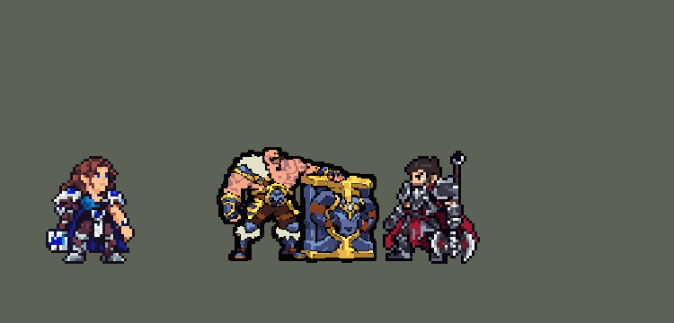

<!-- 本页上半部分由 tools/docs/gen_hero_docs.py 按仓库里现在的数据生成，手改会被覆盖；「开发记录」以下是手写的，生成时原样保留。 -->

# 布隆 Braum


| 项目 | 内容 |
|---|---|
| id | `league_braum` |
| 所属的包 | 主包（mod_id `league`） |
| 分路 | 辅助 |
| 分类 / 标签 | 功能型（Util） · AP / Magic / Melee / Tank / CC / Shield |
| 高清帧 | PPU 1.98（画成 95%） |
| 附加包 | [布隆附加包](#附加包)（`league_braum`） |



其他预览：[逐帧预览](../preview/league_braum_frames.png)、[特效表](../preview/league_braum_effects.png)

## 现在的技能

下面是游戏里显示的技能说明（`league/text/champion.i18n` 的简体中文，去掉了颜色和图标），冷却、距离来自 `league/champion/league_braum.data_champion`；1 秒 = 60 tick。

### 普攻 / 被动

*攻击间隔 1.33 秒 · 攻击距离 25000*

震荡猛击：普攻和寒冬之咬命中英雄叠一层，第4层眩晕1.25秒并造成85 + 60% 法强魔法伤害；之后8秒不再叠层，普攻额外造成12 + 10% 法强魔法伤害。

### 技能1 · 寒冬之咬

*冷却 8 秒 · 施放距离 70000 · 施放：指定目标 · 敌人（不含防御塔）*

从盾中甩出寒冰，造成105 + 60% 法强+最大生命2%魔法伤害，减速70%，2秒内渐弱到35%。

### 技能2 · 坚不可摧

*冷却 1 秒 · 施放距离 45000 · 施放：无目标 · 敌方英雄*

举盾3.5秒：受到伤害降低50%，获得60 + 40% 法强护盾，身边友方英雄伤害降低20%。挺身而出：冲到友方英雄身边，两人护甲和魔抗+30，持续3秒。

### 大招 · 冰川裂隙

*冷却 60 秒 · 施放距离 75000 · 施放：指定目标 · 敌方英雄*

猛砸地面，冰川裂隙冲向目标，造成180 + 70% 法强魔法伤害并击飞0.6秒（第一个英雄1.25秒），留下4秒的裂隙，减速40%。

### 数值

攻击力 78（每级 +6）、法强 25（每级 +15）、生命 1300（每级 +120）、护甲 44（每级 +8）、魔抗 28（每级 +4）、移速 1000（每级 +10）。

## 附加包

附加包是可选的原生代码 mod（都在附加包合集 `league_addons` 里），**不装主包里的英雄也是完整的**。

### 布隆附加包

布隆附加包：`league_braum` v0.1.1

（这个附加包没有 README，下面是它 `mod.mod_info` 里的英文说明）

> Test build of Braum as in League (needs League of Legends Heroes): replaces the main pack's Braum so Concussive Blows stacks on each champion and his allies' attacks add stacks to a champion he marked, Unbreakable stops damage only from the side his shield faces and covers the allies behind him, and Glacial Fissure is aimed along the line with the most enemy champions. Other champions are untouched. Writes a log for testing.

## 相关脚本和素材

- [`tools/kit/build_braum.py`](../../tools/kit/build_braum.py)
- [`tools/kit/setup_braum.py`](../../tools/kit/setup_braum.py)
- [`tools/lol/extract_braum.py`](../../tools/lol/extract_braum.py)
- [`tools/art/preview_braum.py`](../../tools/art/preview_braum.py)
- [`tools/art/rig_braum.py`](../../tools/art/rig_braum.py)
- [`tools/art/import_braum.py`](../../tools/art/import_braum.py)
- [`assets/source/braum/`](../../assets/source/braum)

## 开发记录

> 下面是原来 README 里「英雄：布隆」一节，原样搬过来（只改了相对链接）。

| 部分 | 内容 |
|---|---|
| 定位 | 辅助（Util，标签 AP / Magic / Melee / Tank / CC / Shield），第 95 位英雄。弗雷尔卓德之心 布隆：拿门板一样巨盾的近战坦克辅助，技能是魔法伤害。用户的选择：辅助、近战坦克；技能1 = Q，技能2 = E 坚不可摧接 W 挺身而出，大招 = R；被动做在主包里，再加附加包；加入高手连招；高清帧（PPU），所有动作 3/4 正面 |
| 普攻 / 被动 | 盾击（攻击距离 25000，第 13 tick 打中，攻击间隔 80 tick）。「震荡猛击」：普攻和 Q 打中英雄叠一层（每层 240 tick，叠一层全部刷新），第 4 层眩晕 75 tick 并造成 85 + 60% 法强魔法伤害；之后 480 tick 不再叠层，他的普攻额外 12 + 10% 法强魔法伤害。数据读不到目标身上的层数，所以主包按「他自己打中英雄的次数」数（德莱厄斯出血的做法），打不同的英雄也算在一起；英雄联盟里「队友普攻也叠层」主包做不到，附加包做 |
| 技能1 | Q「寒冬之咬」：冷却 480 tick，对 70000 内的敌人放（小兵野怪也算），第 13 tick 从盾里甩出一块冰（每 tick 3600），105 + 60% 法强 + 自身最大生命 2% 的魔法伤害，减速 70% 40 tick、再 35% 80 tick（英雄联盟是 70% 渐弱到 30%），叠一层被动。**高手连招**：R 击飞英雄后 90 tick 内放 Q 没有前摇 |
| 技能2 | E「坚不可摧」和 W「挺身而出」共用技能位（技能位本身冷却 60 tick，E、W 各有自己的冷却标记：E 840、W 600）。身边有敌方英雄时放：有友方英雄被控制且 W 好了，先 W 跳到他身边（每 tick 4500），两人护甲和魔抗 +30 持续 180 tick，落地时 E 好了就立刻举盾（**高手连招** W→E）；否则 E 好了就举盾 210 tick：受到的伤害降低 50%、一层 60 + 40% 法强护盾（英雄联盟的「第一下全挡」），身边 25000 内的友方英雄伤害降低 20%；E 在冷却时 W 跳到附近的友方英雄身边。英雄联盟的 E 只挡盾那一面、能挡投射物，主包做不到方向，附加包做 |
| 大招 | R「冰川裂隙」：冷却 3600 tick，对 75000 内的敌方英雄放，第 19 tick 盾砸地，一道冰浪朝目标冲出 80000（每 tick 9000，半宽 9000）：经过的敌人受到 180 + 70% 法强魔法伤害并击飞 36 tick，第一个英雄击飞 75 tick；沿线每 20000 留一段裂隙（半径 10000，240 tick），里面减速 40%。附加包让 AI 朝线上敌方英雄最多的方向砸 |
| 附加包 | 可选的附加包 [`addons/league_braum`](../../addons/league_braum/src/lib.rs)（在附加包合集里，原生代码，主包不装它也完整）：层数挂在每个敌方英雄身上（`league_braum_p_mark`，各算各的），友方英雄每次普攻（读普攻冷却跳高）给离他最近、已经被布隆打上标记的英雄叠一层；E 举盾期间盾朝最近的敌方英雄，从盾那一面来的伤害第一下全部还回去、之后还回 50%，背后来的不减，站在他身后 25000 内的友方英雄减伤 20%；AI 要放 R 时换成线上敌方英雄最多的目标。附加包里的布隆是 `make_override.py` 从主包生成的副本，普攻、技能 2、大招的说明以「【附加包】」开头。日志 `league_braum.log`。还没在游戏里看过日志 |
| 数值 | 攻击 78（+6）、法术强度 25（+15）、生命 1300（+120）、护甲 44（+8）、魔抗 28（+4）、移速 1000（+10），和包里的坦克辅助（阿利斯塔、蕾欧娜）一档。SDK 对战模拟：辅助位，对 5 个原版辅助（`priest`、`monk`、`bard`、`pythoness`、`spirit_caller`），两边、三套队友阵容各 24 局，一批 720 局。团队击杀差：现在的数值（0.103.1，生命 1300、护甲 44、Q 105、被动 85、R 180）种子 1–24 +0.28、25–48 +0.26（同两批阿利斯塔 +0.84 / +0.42、塔里克 +1.27 / +1.24，蕾欧娜 −0.17）。按动作帧对好出手时间后的 0.103.0 是 −0.34 / −0.33（用户：「布隆加不加强不是你说了算吗 不是有平衡测试吗」）；只加生命 1260、Q 100 是 −0.30 / −0.41，再加被动 85 是 +0.03 / +0.00。比阿利斯塔、塔里克低一些：游戏里附加包让队友普攻也叠被动，模拟里没有。第一版（d0）−0.67 |
| 精灵图（高清帧 PPU 2.881，2026-10-13 画风统一后 PPU 1.98（见开头）） | 用户选的原画 A（盾立在身前画面右边，远侧手按着盾顶）按 Codex 原稿自己的格子读回当造型（[`tools/art/design_braum_hd.py`](../../tools/art/design_braum_hd.py)，134×121 格、48 色；用户：「这个可以用」「不用太高清」）；121 格 = 42 个像素；用户：「布隆做的也有点大 得缩小一点」——加上身边的盾显得比别人大一圈，先缩到 85%（约 37 个像素，和盖伦一样高），用户又说「稍微调大点」，现在战场上按 90% 画（[`hd.rs`](../../addons/league_main/src/hd.rs) SIZES，约 39 个像素；高清帧都下移 4 格，缩小后脚还踩在地上）；画风统一（矮一成、宽两成）以后和牛头站一起显小（「布隆也有这个看起来小的问题」），按大小对比图改成 105%（约 43 个像素，每个游戏像素 1.89 格；帧整体上移 4 格让脚底留在地上，像素一格不变：[`ppu_restyle.py`](../../tools/art/ppu_restyle.py) RESTYLE lift）；装进游戏后「铁男和布隆游戏里偏大了」，按大小对比图改成 95%（约 39 个像素、连盾宽 55；帧下移 2 格，RESTYLE lift_sq）。用户：「参考英雄联盟里的动作帧吧」——动作由 Codex 照英雄联盟的动作逐帧画（[`tools/art/pack_braum_strips.py`](../../tools/art/pack_braum_strips.py)：每帧一张，英雄联盟模型按造型大小摆好当骨架；盾永远在他远侧手臂上、画面右边），全部 3/4 正面：普攻盾击 5、Q 5、E 举盾 3、W 起跳 5、R 举盾砸地 6、死亡 6。[`tools/art/import_braum_strips.py`](../../tools/art/import_braum_strips.py) 读回：R 整套画小了约五分之一，放大 1.2 倍；每个站着的帧都贴上造型的头（同一张脸；死亡躺倒的保留 Codex 的头）。[`tools/art/rig_braum.py`](../../tools/art/rig_braum.py)：外描边加粗 2 格（约 1 个游戏像素），待机呼吸（上半身连两只手臂抬 1–2 格，腿和盾不动），受击是造型后退加闪白；移动 8 帧是诺提勒斯认可过的走法：待机的两条腿在胯下切开、轮流抬起前移，身体、头和盾都是待机的（Codex 画的跑步每帧都是同一条腿在前，用户：「怎么感觉腿不换位？」）。1 倍帧（没有 league.dll 时用）是高清帧按格子取多数色，比较糊 |
| 头像 | 截取点 (6, −38)，画风统一后 (7, −35)：他的额头；选人卡片不用 `banpick_center` |
| 特效 | Codex 生图的 18 张（用户贴来的两张总览图，`import_braum.py` 按卡萨丁的做法切格：每个特效一个缩放、颜色贴回冰蓝 / 霜白 / 金色三套配色；红色方的对称逐格检查：Q 的冰和 R 的冰浪上下对称，其余左右对称）：`league_braum_fx` 盾击打中、层数标记、眩晕雪花、冰壳碎开、追加伤害、Q 的冰 / 打中 / 脚下结冰、举盾寒气、盾后队友的盾牌徽记、W 起跳雪雾 / 落地冰环 / 护甲冰环、R 击飞；`league_braum_big` 举盾冰壳、R 砸地冲击波、冰浪、裂隙。W 的护甲加成两人共用一张，R 裂隙里的减速借 Q 的脚下结冰 |
| 音效 | 英雄联盟的音效和配音（`tools/lol/extract_braum.py`）：盾击 / 打中、被动眩晕、Q 甩出 / 打中、E 举盾、W 起跳 / 落地、R 砸地 / 击飞；Q、W、E、R 各用他自己的技能台词（片段名 `league_braum_sfx_vo_*`，和声音名不同）。版权属于 Riot Games，**不提交到仓库**，按下面的命令在本地生成 |
| 图标 | 官方技能图标（Q 寒冬之咬 / E 坚不可摧 / R 冰川裂隙，另有 W 挺身而出、被动），从本地客户端提取，缩到 64×64 |

重新生成（素材来自本机的英雄联盟客户端，音频不进仓库）：

```bash
python tools/lol/extract_braum.py --lol "D:\WeGameApps\lol" --vgmstream "<vgmstream-cli.exe 路径>"
python tools/kit/build_braum.py            # 技能数据，数字都在脚本的参数表 P 里；--nodes 看每棵技能树的节点数
python tools/kit/setup_braum.py            # 五种语言的文字、音效配置、共享文件里他的键
python tools/art/import_braum_strips.py    # Codex 的动作帧读回、贴同一张脸、R 放大
python tools/art/rig_braum.py              # 高清帧 + 1 倍帧（league_braum 和 assets/source/ppu/braum_*.png）
python tools/art/ppu_hd.py --hero braum
python tools/art/import_braum.py           # 特效：两张总览图切格，拼成特效表
python tools/art/preview_braum.py          # 预览和演示 GIF
python addons/league_braum/make_override.py    # 附加包的副本（主包的布隆改了就重跑）
```

美术（提示词见 [`assets/source/braum/`](../../assets/source/braum) 里的 `PICTURE_PROMPT.md`、`MODEL_STRIPS.md`、`PROMPTS_FX.md`）：

- 原图：Codex 画了 A（盾立在地上）和 B（盾挂在手臂上），用户选 A。
- 造型：A 的原稿按它自己的格子读回（`hd/front.png`），没有再让 Codex 重画。
- 动作：38 帧 Codex 照英雄联盟的动作画（`codex_strips/`），读回后贴同一张脸、R 放大。
- 特效：18 张来自 Codex 的两张总览图（`codex_fx/`）。

逐帧预览：[`docs/preview/league_braum_frames.png`](../preview/league_braum_frames.png?v=1014g)（游戏里用的 hd_ 高清帧），特效：[`docs/preview/league_braum_effects.png`](../preview/league_braum_effects.png?v=1014g)。
