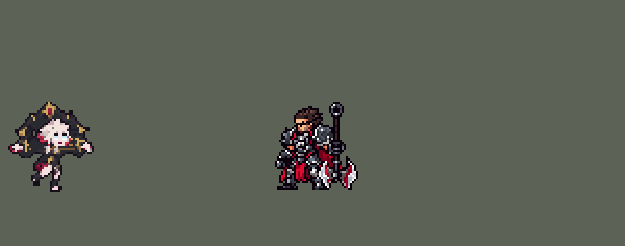

<!-- 本页上半部分由 tools/docs/gen_hero_docs.py 按仓库里现在的数据生成，手改会被覆盖；「开发记录」以下是手写的，生成时原样保留。 -->

# 贝蕾亚 Briar


| 项目 | 内容 |
|---|---|
| id | `league_briar` |
| 所属的包 | 主包（mod_id `league`） |
| 分路 | 打野 |
| 分类 / 标签 | 刺客（Assassin） · AD / Melee / CC / Heal / Dot |
| 高清帧 | PPU 2.94 |
| 附加包 | [贝蕾亚附加包](#附加包)（`league_briar_frenzy`） |



其他预览：[逐帧预览](../preview/league_briar_frames.png)、[特效表](../preview/league_briar_effects.png)

## 现在的技能

下面是游戏里显示的技能说明（`league/text/champion.i18n` 的简体中文，去掉了颜色和图标），冷却、距离来自 `league/champion/league_briar.data_champion`；1 秒 = 60 tick。

### 普攻 / 被动（被动「猩红诅咒」）

*攻击间隔 1 秒 · 攻击距离 24000*

普攻造成100% 攻击力的物理伤害。被动 猩红诅咒：普攻和技能命中施加流血，5秒内造成12 + 18% 攻击力的物理伤害并为贝蕾亚回复6 + 6% 攻击力的生命值（普攻每秒至多叠1层）。

### 技能1 · 冲头

*冷却 10 秒 · 施放距离 47500 · 施放：指定目标 · 敌人（不含防御塔）*

扑向目标（优先英雄），造成40 + 60% 攻击力的物理伤害，眩晕0.5秒，护甲魔抗降低10%。落地进入血莽5秒：40% 攻速、20% 移速，普攻溅射。2秒后的下一击为噬击：额外造成目标4%最大生命值的伤害并回复20 + 20% 攻击力的生命值。

### 技能2 · 惊吼

*冷却 9 秒 · 施放距离 40000 · 施放：指定目标 · 敌人（不含防御塔）*

蓄力1秒，期间受到的伤害降低15%并回复24 + 16% 攻击力的生命值；然后向前尖啸，造成60 + 90% 攻击力的物理伤害，减速80%并击退，被击退的英雄眩晕1秒。

### 大招 · 毙除

*冷却 50 秒 · 施放距离 120000 · 施放：方向 · 敌方英雄*

踢出血石，标记命中的第一个英雄（穿过小兵）并飞向它，落地对周围敌人造成150 + 60% 攻击力的物理伤害，恐惧猎物以外的敌人1.5秒。随后6秒进入彻底血狂：获得血莽的效果、20 护甲和魔抗、10% 吸血、额外25% 移速。

### 数值

攻击力 94（每级 +19）、生命 924（每级 +100）、护甲 28（每级 +8）、魔抗 18（每级 +4）、移速 1100（每级 +12）。

## 附加包

附加包是可选的原生代码 mod（都在附加包合集 `league_addons` 里），**不装主包里的英雄也是完整的**。

### 贝蕾亚附加包

[贝蕾亚附加包](../../addons/league_briar_frenzy/README.md)：`league_briar_frenzy` v0.1.0

|  | 主包（纯数据） | 装了附加包 |
|---|---|---|
| E 惊吼的眩晕 | 被击退的英雄都在击退结束时眩晕 1 秒 | 只眩晕撞上东西的：16 tick 的击退结束时被推出去不到 40000 的 65%（墙、地图边、别的单位挡住了） |
| 血莽 / 彻底血狂 | AI 照常挑目标，也会回城 | 普攻、走路、回城都改成普攻：彻底血狂时打猎物，否则打 50000 内最近的敌方英雄，没有就打 30000 内最近的敌人；放技能不拦 |
| 彻底血狂 | 6 秒 | 猎物活着就一直续（最多 15 秒），数值照主包 |

## 相关脚本和素材

- [`tools/lol/extract_briar.py`](../../tools/lol/extract_briar.py)
- [`tools/art/preview_briar.py`](../../tools/art/preview_briar.py)
- [`tools/art/import_briar.py`](../../tools/art/import_briar.py)
- [`assets/source/briar/`](../../assets/source/briar)

## 开发记录

> 下面是原来 README 里「英雄：贝蕾亚」一节，原样搬过来（只改了相对链接）。

| 部分 | 内容 |
|---|---|
| 定位 | 打野（Assassin），第六组的打野（顶替原计划的夜曲），本包第六个打野（李青、阿木木、易、艾克、费德提克之后） |
| 普攻 | 带着枷锁扑咬，100% 攻击力的物理伤害，射程 24000，攻击间隔 1 秒 |
| 被动 | 「猩红诅咒」：普攻和技能命中时叠一层流血，5 秒内每秒造成 2 + 3% 攻击力的物理伤害（共 12 + 18%），每一跳给贝蕾亚回复 1 + 1% 攻击力的生命（共 6 + 6%）。流血是 `AddCasted`（每层单独计时），回血写在流血的每一跳里（`Heal` 的 `heal_type: Caster`，模拟里实测会回给施法者）。普攻每秒最多叠一层（施法者身上 1 秒的锁），所以同一目标身上最多约 5 层，和英雄联盟的上限一样。英雄联盟里"血越少回得越多"和每个技能消耗 5% 当前生命都要读当前血量，团战经理2 做不到，去掉 |
| 技能1 | Q「冲头」，合并 W「血莽」（用户选的 A）：扑向 47500 内的敌人（射程内有敌方英雄时扑英雄，没有就扑小兵或野怪，打野时也会用），落地造成 40 + 60% 攻击力的物理伤害，眩晕 0.5 秒，护甲和魔抗降低 10% 持续 5 秒，叠一层流血。落地进入「血莽」5 秒：攻速 +40%、移速 +20%，普攻先打目标 60% 攻击力，再对她身前 18000 处半径 16000 内的敌人（含目标）打 40%，目标仍是 100%，挨着的敌人受 40% 溅射。进入血莽 2 秒后的下一次普攻是「噬击」：30 + 130% 攻击力加目标 4% 最大生命的物理伤害，回复 20 + 20% 攻击力的生命，每次血莽一次（英雄联盟里是再按一次 W；这里扑小兵、野怪时固定在 2 秒后，扑到英雄时落地后的第一下普攻就是噬击，见连招一栏）。冷却 10 秒 |
| 技能2 | E「惊吼」（用户选的 A）：40000 内有敌人时放，冷却 9 秒。先蓄力 1 秒：受到的伤害降低 15%，分 4 次共回复 24 + 16% 攻击力的生命；再过 4 tick 朝前方尖啸，半径 50000、约 ±37° 扇形内的敌人受到 60 + 90% 攻击力的物理伤害，减速 80% 持续 0.5 秒，被击退 40000（每 tick 2500，16 tick），叠一层流血；被击退的英雄在击退结束时眩晕 1 秒。英雄联盟里要撞到墙才眩晕，团战经理2 没有墙，当作都撞上了 |
| 大招 | R「毙除」（用户选的 A）：120000 内有敌方英雄时施放，冷却 50 秒。第 8 tick 踢出血石（速度 9000、最远 130000、半径 9000），穿过小兵和野怪，停在第一个敌方英雄身上，把他标记为猎物；贝蕾亚免疫控制 1 秒、飞向猎物（每 tick 5000），落地对半径 35000 内的敌人造成 150 + 60% 攻击力的物理伤害并叠流血，半径 40000 内猎物以外的敌人恐惧 1.5 秒（落地前先给猎物挂 2 tick 的免控，恐惧就跳过他），然后进入「彻底血狂」6 秒：血莽的效果加强到攻速 +70%、移速 +45%，另加 20 护甲、20 魔抗、10% 生命偷取，2 秒后的普攻同样是噬击。英雄联盟里是全图射程、血狂持续到她或猎物倒下；这里按用户选的，射程比一屏稍大，血狂固定 6 秒 |
| 附加包 | 可选的附加包 [`addons/league_briar_frenzy`](../../addons/league_briar_frenzy/README.md)（在附加包合集里，原生代码，主包不装它也完整）：E 照英雄联盟只眩晕撞上东西的英雄（被推出去不到 65%：墙、地图边、别的单位）；血莽、彻底血狂期间只扑最近的敌人（彻底血狂扑猎物），不回城；彻底血狂持续到猎物倒下（最多 15 秒；主包固定 6 秒） |
| 连招 | 用户要求：「有连招要做连招」「都要帮我补」。英雄联盟里噬击是自己选时机再按一次 W，常见的爆发是冲头晕住人马上接噬击。**Q→噬击**：冲头扑到敌方英雄身上时（射程内有英雄就扑英雄的那一支），等噬击的标记从 120 tick 改成 6 tick，落地后的第一下普攻就是噬击，正好打在 0.5 秒的眩晕里；扑小兵、野怪时照旧 2 秒后（清野时最后咬一口回血），彻底血狂的噬击不变。伤害、回血、冷却都不变，每次血莽仍只有一次噬击。数据由 [`tools/fix/combo_briar.py`](../../tools/fix/combo_briar.py) 改 |
| 数值 | 攻击 90（+18）、生命 880（+95）、护甲 28（+8）、魔抗 18（+4）、移速 1100（+12），攻击间隔 1 秒。数值是自己设计的，用 SDK 对战模拟调：打野，对 5 个原版打野（`demon`、`circus_blade`、`hunter`、`inquisitor`、`ninja`），两边、三套队友阵容各 24 局，一批 720 局。初稿（攻击 100、生命 950，Q 50 + 80%、眩晕 0.85 秒、减双抗 15%，血莽攻速 +70%、移速 +30%，蓄力减伤 35%，血狂 +30 双抗、15% 吸血）+5.15；逐项去掉，冲头的眩晕和减抗最强（去掉后 +2.23）；Q 改成 40 + 60%、眩晕 0.5 秒、减抗 10%，血莽 +40% / +20%，噬击 6% → 4% 最大生命、回血 30 + 30% → 20 + 20%，蓄力减伤 15%、回血减半，血狂 +20 双抗、10% 吸血，攻击 90、生命 900 后 +1.39（360 局）；按动作帧定下出手时机（普攻第 8 tick 命中，冲头第 3 tick 起跳，尖啸在蓄力 1 秒后再过 4 tick，第 8 tick 踢出血石，落地动画 26 tick）后 +2.25；六套削弱各 360 局：恐惧 1 秒 + 血狂 5 秒 +1.47，惊吼眩晕 0.75 秒 +1.27，溅射降低 +1.46，回血降低 +1.66，前三项一起 +1.31，攻击成长 22 → 18 且生命 900 → 880 +0.88；最后两套各跑两批不同种子：只降成长和生命 +0.76 / +1.20，再加惊吼眩晕 0.75 秒 +0.73 / +0.76。用前一套，保留用户选的 1 秒眩晕，在本包打野之间（费德提克那两批：易 +1.39 / +0.68、艾克 +0.88 / +0.44、费德提克 +0.33 / +0.65、李青 −0.96 / −0.58、阿木木 −1.15 / −1.11）。贝蕾亚每局放 Q 约 34 次（扑英雄约 7 次）、E 约 30 次（对英雄约 8 次）、R 约 5.5 次 |
| 亚索联动 | 冲头和惊吼的眩晕、毙除的恐惧都算亚索大招要的控制。亚索打上路、贝蕾亚打野时，亚索每局 R 到被控英雄 2.27 次；同一批里费德提克 2.81、李青 1.71、阿木木 1.69、艾克 0.90，原版 `ninja` 0.65（永恩那次中路原版 `lightning_mage` 3.19）。没超过包里已有的打野，亚索不用调 |
| 精灵图 | 11 个动作 61 帧：待机、移动、普攻、冲头、惊吼蓄力、尖啸、踢血石、飞行、落地、受击、死亡。造型按用户给的图由 Codex 重画（方案 B、嘴 3）：白色乱发、发梢玫红，乳白的眼睛没有瞳孔，黑色皮革束衣和短裙配金扣带，腰间撕破的深红衬层，光腿上戴着镣铐环；背后一副巨大的黑铁枷锁（两道金边拱、六根金刺，顶上一颗红色菱形宝石），两端的铁箍锁着手腕。宝石顶到脚底 46 px、38 px 宽，23 色。每帧的时机和站位照英雄联盟原版动画渲染的参考帧 |
| 特效 | 普攻爪痕、噬击的獠牙大嘴和回血光点、冲头的撞击和头顶双星、血莽和彻底血狂的血焰（绕着她）、惊吼蓄力的护壳、尖啸声波和命中、眩晕星、血石（金边、拖尾）、猎物标记（头顶的菱形）、落地爆炸和命中、恐惧骷髅（头顶） |
| 图标 | 官方技能图标（Q / E / R），64×64 |
| 音频 | 从本地客户端提取的 11 条技能音效和 4 条中文语音（Q、W、R、R 落地）。不提交到仓库，按下面的命令在本地生成 |
| 高清帧（PPU 2.94） | 2026-10-30 用 PPU 重做（用户：「下一个英雄重做贝蕾亚」「用2.13就行」「算了用2.94吧」「动作通过」）。设计图：Codex 照她的旧精灵描密的原图（两版，用 A 版：画满画布的那张）；原图的描边和刑枷约 12 像素一格，眼睛、铆钉、手指画得更细，所以按约 8.5 像素一格读回（110 × 135 格；刑枷顶到脚底 135 行 / 2.94 = 原来的 46 像素；调色板 64 色，`design_briar_hd.py`，`--raw` / `--pitch` 是另外几种读法，pass2 按 10 像素一格是 2.13）。英雄联盟 3D 模型的眼睛是粉色的，提示词写明照精灵画浅蓝色。动作：Codex 照旧版同一帧用设计图整帧重画（`pack_briar_actions.py`，十一个动作 56 帧；吸血啃咬 `attack_fx1` 是技能在她身上播放的身体动画，也重画；旧版里和待机一模一样的帧直接用设计图）。读回（`casts_briar_hd.py`）：她的头发、脸和腿是同一种浅色，所以每张的缩放按整个人的面积量，再乘只有她才有的两样东西的大小：头发里的粉色发丝和刑枷的金色部分，每帧都在设计图的 ±8% 以内；对齐点按设计图和旧待机剪影重叠最多的那列（第 71 列）。Codex 在普攻里也画了嘴边的血滴，去掉了，只在吸血啃咬里留嘴边的血。待机不上下起伏（待机和选人卡是从动作里剪的随机片段）（`rig_briar_hd.py`）。高 46 像素和原来一样，没有 SIZES 行；头像点不变；选人卡片 −8 改成 −3（新帧更高，−8 会切掉刑枷顶上的红宝石） |

```bash
python tools/lol/extract_briar.py --lol "D:\WeGameApps\lol" --vgmstream "<vgmstream-cli.exe 路径>"
python tools/lol/native_pose.py assets/source/briar/poses.json --out <渲染文件夹> --alpha --parts   # 动作参考帧
python tools/art/tidy_briar.py <Codex 的动作交付文件夹>   # 角色图：补上贴头切出的方框、只留一圈描边，写进 assets/source/native/
python tools/art/import_native.py --hero briar
python tools/art/import_briar.py      # 特效；--raw <Codex 的特效交付文件夹> 先把整理图转成原尺寸条
python tools/art/preview_briar.py
# PPU 2.94 重做（2026-10-30）：
python tools/art/pack_briar_ppu.py --out <文件夹>          # 给 Codex 的设计图包（照她的旧精灵描密）
python tools/art/design_briar_hd.py                      # Codex 的原图（hd/raw/briar-A.png）按约 8.5 像素一格读回 -> hd/design.png
python tools/art/pack_briar_actions.py --out <文件夹>      # 给 Codex 的动作包（照旧版同一帧整帧重画）
python tools/art/casts_briar_hd.py --area                # 每张按面积的缩放；--heads 每帧粉色发丝和刑枷金色的大小（定 ZOOM）
python tools/art/rig_briar_hd.py                         # 读回 -> 原始条和 1 倍图
python tools/art/ppu_restyle.py --hero briar && python tools/art/ppu_hd.py --hero briar
python tools/art/ppu_one.py --hero briar && python tools/art/rig_briar_hd.py --one-ground && python tools/art/hero_reels.py --hero briar
python tools/art/preview_briar.py
python tools/art/review_briar_actions.py --out <文件夹>    # 旧版 / 新版对照动图
```

美术（造型的提示词见 [`assets/source/briar/MODEL_PROMPTS.md`](../../assets/source/briar/MODEL_PROMPTS.md)，10 条动作的见 [`MODEL_STRIPS.md`](../../assets/source/briar/MODEL_STRIPS.md)，特效的见 [`PROMPTS.md`](../../assets/source/briar/PROMPTS.md)）：
- 分工：模型和特效都由 Codex 画（从卢锡安起的分工），Claude 写提示词包、整理和导入，按"造型 → 动作 → 特效"分三步。
- 造型：用户给的是 Codex 先前生成的一张图（约 7 像素一格、59×71 格）。直接按行列删减缩到游戏尺寸会切碎头发、眼睛和金边，Codex 自己面积平均缩的 46 格版脸也糊了，所以先让 Codex 在约 76 格高重画（游戏尺寸的约 1.7 倍）两版：A 照原图比例，B 头约占身高的三分之一、腿稍长。Claude 按行列删减缩到 46 行（宝石顶到脚底，不做平均），只留一圈描边，清掉头发里的零散灰点，补一行睫毛，两只眼睛都是 2×2、同一行，冰白眼色 `#F0FCFF`（高光 `#C5E6F5`）只用在眼睛上；嘴在缩小时被删掉了，按脸的中线重画三种。用户选了 B、嘴 3（两格深红）："B嘴3"。定稿是 [`briar_native.png`](../../assets/source/native/briar_native.png)，38×46 px、23 色。
- 动作参考（`poses.json`）：镜头 yaw 45、pitch 25，不镜像，头 2.3、腿 0.8、头发 0.6，高度 35，96×96 的格子，脚底在站位点下 11 行。待机 `Idle1_sway`；移动照英雄联盟的 `Run1`（8 帧 × 125 ms，一圈 1 秒），头保持待机时的朝向；普攻 `Attack1`，冲头 `Spell1_Enter` / `Spell1_Exit`，惊吼蓄力 `Spell3_Windup`、尖啸 `Spell3_Scream`，踢血石 `Spell4_Cast_In`、飞行 `Spell4_Dash_Enter`、落地 `Spell4_Dash_Exit`。每帧的站位点和帧时长在 `native/briar_cells.json`。
- 整理（`tidy_briar.py`）：Codex 按定稿画了 10 条动作（55 帧），8×8 方块、定稿的 23 色，并把定稿的头逐格贴进每一帧站着的画面。问题是它贴的是头的整块 16×15 矩形：矩形里头以外的像素，外加左、右、上各一圈，全被清成透明，几乎每帧的头都像嵌在一个方窗里，枷锁和身体在头边断开。交付里附了生图原稿（贴头之前），能还原的帧（原稿按交付的外框取中心色、吸到定稿色板后，窗外至少 92% 的格子在 3 格偏移内对得上）就用原稿重建、再盖上头，没有接缝；只补窗里那一块会留接缝，试过不用。对不上的帧（移动 8 帧，Codex 在那里还缩短了小腿；踢血石和落地各一帧；倒地）按旁边枷锁和身体的颜色补窗：每行从窗边补到头，下巴下面从窗下一行往上补，封闭的空洞按邻居补，只保留枷锁拱形本来的开口，新露出的边加描边。普攻、冲头、尖啸、踢血石、落地、受击的最后一帧本来就是定稿站姿，直接换回定稿。然后按阿狸那一轮的做法只留一圈描边（`tidy_codex18.py` 的 `one_outline`，加上阿狸会话补描边的一步）：Codex 每帧的轮廓边只有 49%–86% 画成深色（定稿 99%），所以轮廓上不是近黑的格子都改成描边色（在轮廓以内改，画面不变胖），去掉描边的毛刺，描边里面那一格近黑换成材质自己的暗色（不再是第二圈黑），孤立的杂色格换成所在区域的颜色；眼睛和周围的脸不动。整理后每帧轮廓 96%–99% 是描边，描边里面还是黑的只占 2%–4%。最后检查方块、透明度、只用定稿的颜色、每帧站着时两只眼睛都在、脚底线以下没有像素（倒地可以低 2 行）。
- 导入：待机 6 帧用定稿，第 3–5 帧从小腿（膝盖金环下面）往上下沉一格呼吸（`BOB`）；枷锁的宝石是每帧的最高处，所以按眼睛定头的位置（`EYES`，眼白只用在眼睛上），移动时头稳在同一列。头像截取点 (−3, −34)，在头顶；枷锁的宝石更高，`tfm2_ase.py face` 建议的 (−4, −41) 落在宝石上，不用。
- 特效用 Codex 画的 15 张（70 帧，整理成 8×8 方块、硬透明，每张 16 色以内）：`import_briar.py --raw` 按交付清单切帧，按技能范围定大小：普攻爪痕 16 px，噬击大嘴 24 px、回血光点 30 px 高（绕着她），冲头撞击 24 px、双星 18 px，血莽 44 px、彻底血狂 48 px 高（她连枷锁 46 px），蓄力护壳 40 px，尖啸声波 50 px 长（扇形半径 50000），命中 16 px，眩晕星 18 px，血石 20 px，猎物标记 14 px，落地爆炸的环 70 px（半径 35000），命中 18 px，恐惧骷髅 16 px 高。锚点量在图上：命中和爆开量白色亮核，血焰量最低一行（放在脚底线上），星、标记、骷髅量自己的中心、放在头顶，声波放在格子中间（尖端在左），爆炸量椭圆中心。血莽的原稿在脚下画了一条地面光线，缩到 44 px 只剩一条 15×2 的实心横条，看着像第二根血条，导入时去掉（`cut`）。血石上下镜像成严格对称（游戏按飞行方向转）。冲头的双星循环 0.5 秒（眩晕时长），尖啸的星 1 秒，恐惧骷髅 1.5 秒，血焰和标记是 buff 的循环画面。
- 出手时刻和动画对齐：普攻第 3 帧咬中（第 8 tick），冲头第 2 帧起跳（第 3 tick），惊吼蓄力 1 秒后播尖啸（`CasterAnimation`），再过 4 tick 张嘴出声、判定，踢血石第 3 帧（第 8 tick），飞行由 `CasterAnimation` 播 `ult_fly`，落地播 26 tick 的 `ult_land`。
- 结果：23 色，和右边像素同色的比例 35%（原版英雄 18%–46%）。待机每帧 928–938 个不透明像素，约是原版剑士（472）的两倍，和卢锡安（983）、莫甘娜（1066）相近，多出来的主要是枷锁。

逐帧预览：[`docs/preview/league_briar_frames.png`](../preview/league_briar_frames.png?v=1030hd)，特效：[`docs/preview/league_briar_effects.png`](../preview/league_briar_effects.png?v=1014g)。
