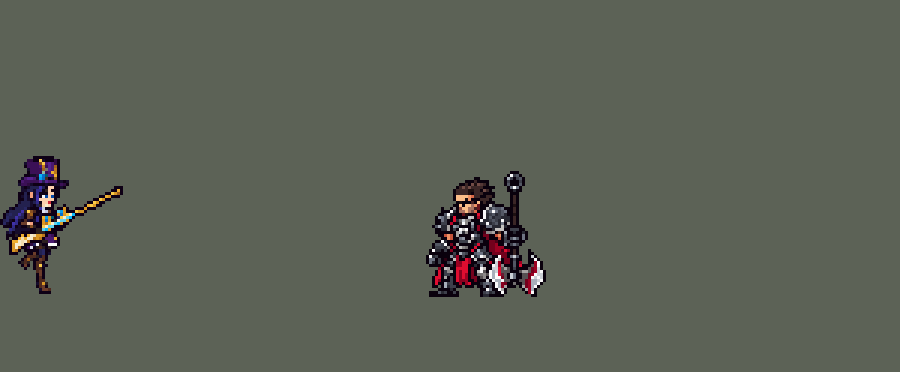

<!-- 本页上半部分由 tools/docs/gen_hero_docs.py 按仓库里现在的数据生成，手改会被覆盖；「开发记录」以下是手写的，生成时原样保留。 -->

# 凯特琳 Caitlyn


| 项目 | 内容 |
|---|---|
| id | `league_caitlyn` |
| 所属的包 | 主包（mod_id `league`） |
| 分路 | ADC |
| 分类 / 标签 | 射手（Range） · AD / Range / CC |
| 高清帧 | PPU 1.45（画成 90%） |
| 附加包 | [凯特琳附加包](#附加包)（`league_caitlyn`） |



其他预览：[逐帧预览](../preview/league_caitlyn_frames.png)、[特效表](../preview/league_caitlyn_effects.png)

## 现在的技能

下面是游戏里显示的技能说明（`league/text/champion.i18n` 的简体中文，去掉了颜色和图标），冷却、距离来自 `league/champion/league_caitlyn.data_champion`；1 秒 = 60 tick。

### 普攻 / 被动（被动「爆头」）

*攻击间隔 1 秒 · 攻击距离 65000*

普攻造成100% 攻击力的物理伤害。被动 爆头：每第6枪造成180% 攻击力；被夹住的英雄在1.5倍射程内优先爆头，再加40 + 40% 攻击力。90口径绳网：英雄贴身时改射网，造成60 + 60% 攻击力并减速50%，向后跳开，下一枪爆头（冷却12秒）。

### 技能1 · 和平使者

*冷却 8 秒 · 施放距离 120000 · 施放：方向 · 敌人（不含防御塔）*

瞄准后朝锁定的位置射出穿透子弹（优先瞄敌方英雄，开枪前走开可躲），对第一个命中的敌人造成60 + 110% 攻击力的物理伤害，之后的敌人受到60%。

### 技能2 · 约德尔诱捕器

*冷却 36 秒 · 可存 3 次 · 施放距离 80000 · 施放：方向 · 敌方英雄*

朝敌方英雄扔出夹子（3层充能，每层12秒），第一个落在他脚下，其余错开放在两人之间，存在8秒；第一个踩中的敌方英雄被禁锢1.5秒，凯特琳会对他爆头。

### 大招 · 让子弹飞

*冷却 50 秒 · 施放距离 200000 · 施放：指定目标 · 敌方英雄*

瞄准一名敌方英雄1秒（被控制会中断），然后开枪，对路上第一个敌方英雄造成250 + 150% 攻击力的物理伤害。

### 数值

攻击力 100（每级 +20）、生命 900（每级 +90）、护甲 20（每级 +7）、魔抗 15（每级 +3）、移速 900（每级 +9）。

## 附加包

附加包是可选的原生代码 mod（都在附加包合集 `league_addons` 里），**不装主包里的英雄也是完整的**。

### 凯特琳附加包

[凯特琳附加包](../../addons/league_caitlyn/README.md)：`league_caitlyn` v0.1.0

经典引擎模拟（下路对 4 个原版射手、3 套阵容、两边、8 个种子）：她前 5 分钟击杀差 +0.38（金克丝 +1.29、艾希 +0.95、
厄运小姐 +0.90），10 分钟 +1.65，前期伤害只有别的射手的六七成。加攻击、加 Q 伤害、加爆头、出手加快、Q 只能对英雄放等
9 个数值方案，前期最多 +0.6 左右，能拉高前期的也让后期太强。跟踪一局看：游戏的 AI 一好 Q 就拿去清兵（前 5 分钟 15 个 Q
有 11 个打在小兵上），打小兵时对面英雄在射程边上也不打。

## 相关脚本和素材

- [`tools/lol/extract_caitlyn.py`](../../tools/lol/extract_caitlyn.py)
- [`tools/art/preview_caitlyn.py`](../../tools/art/preview_caitlyn.py)
- [`tools/art/rig_caitlyn.py`](../../tools/art/rig_caitlyn.py)
- [`tools/art/import_caitlyn.py`](../../tools/art/import_caitlyn.py)
- [`tools/art/design_caitlyn.py`](../../tools/art/design_caitlyn.py)
- [`assets/source/caitlyn/`](../../assets/source/caitlyn)

## 开发记录

> 下面是原来 README 里「英雄：凯特琳」一节，原样搬过来（只改了相对链接）。

| 部分 | 内容 |
|---|---|
| 定位 | 下路 ADC（远程，分类 Range），第八组的 ADC；本包第八个 ADC（艾希、金克丝、厄运小姐、伊泽瑞尔、卢锡安、薇恩、崔丝塔娜之后）。手最长的射手：每 6 枪一发爆头，夹子和网让下一枪必爆头，网也是她的位移，大招在很远处点杀 |
| 普攻 | 步枪射击，100% 攻击力的物理伤害，射程 65000（英雄联盟 650 对一般射手的 550；本包薇恩、卢锡安、伊泽瑞尔 55000），攻击间隔 60 tick（1 秒），第 8 tick 出手（动作第 3 帧），子弹每 tick 7000。每次普攻在第 1 tick 决定这一枪是什么（金克丝的做法）：网、打被夹住英雄的爆头、网后的爆头、数到第 6 枪的爆头，或者普通一枪 |
| 被动 | 「爆头」（用户选：每 6 枪一次，夹子和网必爆头）：普通射击数到第 6 枪换成爆头（另一条 22 tick 的动作，第 10 tick 出手，子弹每 tick 9000），180% 攻击力的物理伤害；死了重数（英雄联盟一样）。夹子夹住英雄期间（和定身一样长），她的下一枪改打 1.5 倍射程（77500）内被控制的敌方英雄，爆头再加 40 + 40% 攻击力（英雄联盟里被夹住的英雄在两倍射程内就能被爆头）；这个游戏分不出控制是谁给的，这段时间里队友控住的英雄也算。网中英雄后 1.8 秒内下一枪必爆头。模拟 10 分钟约 29 次数出来的爆头、8 次打被夹住的英雄 |
| 技能1 | Q「和平使者」：朝 120000 内的敌人施放（小兵和野怪也算，清线、打野也用），冷却 8 秒。第 1 tick 响起上膛声，第 24 tick 射出（动作第 7 帧）。瞄准在开枪前 8 tick 锁定：那时 100000 内有敌方英雄，就朝他那一刻的位置射（一个隐形的抛物线飞行物落在那里，落地时从她身上朝落点开枪，子弹飞到落点为止），没有就按施放方向；锁定后走开就能躲（用户：「Q是可以躲得 现在百发百命中」：原来开枪那一刻才瞄准，几乎必中）。锁在前摇一开始时，瞄英雄的子弹只中 16%（AI 的英雄一直在走动），锁在开枪前 12 tick 中 28%、8 tick 中约 4 成，取 8。穿透，每 tick 10000、半径 6000，第一个打中的单位受到 60 + 110% 攻击力的物理伤害，后面的受 60%。射出写在第 1 tick 开始的延迟里，动作被打断也照样射出 |
| 技能2 | W「约德尔诱捕器」（用户选：W 单独一格）：3 层充能，每 12 秒回一层，朝 80000 内的敌方英雄扔（方向型施法），落地 30 tick 后布好，存在 8 秒；第一个踩上的敌方英雄被定身 1.5 秒，她接下来的一枪爆头打他（见被动）。同时最多 3 个夹子（提莫 R 的三个槽位），各放一处，不叠在一起（用户：「会在一个位置无限放夹子 应该错开来放吧」：原来每个都扔在他脚下，AI 一口气用掉 3 层充能就叠成一堆，4 局里同时在场的夹子 52 对有 19 对叠着）：第一个夹子碰到路上第一个敌方英雄就停、落在他脚下；它还在时，第二、三个落在瞄准线上离她 35000、58000 处（飞行物在方向型施法里飞到 施法者 + 方向 × 射程 为止，结束效果在停下的点上运行）。现在 99 对里 11 对挨着。夹子的范围咬人时先拿掉自己的标记，所以一个夹子只咬一个英雄。从投掷物落点生成的范围在她死后照样运行，她的状态又被冻结、标记拿不掉，会每 tick 咬一次（模拟 16 局在她死后咬了 285 次）；所以咬之前先找她自己（`RandomTarget {AllyOnlySelf, range: 1}` 找不到死人），找到才定身（16 局死后 0 次）。定身仍直接写在范围里，AI 照常放 W；把定身挪进延迟一 tick 的飞行物（main 上金克丝 E 的修法）也一样安全，但 AI 每局只扔 13 个、夹中 6 次。夹子咬住英雄后，定身期间和之后 1 秒内 W 的效果是空的（`w_hold`）：AI 按当时的状态给技能打分，看到空分支就不放，充能留着（用户：「W敌人踩上去后会连放 这个要改一改 其他时候没问题」：被定住的英雄站着不动，AI 会把剩下的充能接连扔到他身上，每局 4.6 次在夹中后 2.25 秒内又扔，松开后又被夹；现在 0 次）。中间试过改成 1 层、冷却 8 秒，连放也没了，但每局少 0.46 个击杀，没用。模拟每局扔约 15 次、夹中约 8.6 次（之前 19 次、11 次；AI 的英雄攻击时站着不动） |
| E（并入普攻） | E「90 口径绳网」（用户选：E 并入普攻，当逃生用）：普攻第 1 tick，E 好了（冷却 12 秒）而且 25000 内（中心距约 45000）有敌方英雄时，这一枪换成绳网：另一条 34 tick 的动作，第 6 tick 射出网（每 tick 6000），打中造成 60 + 60% 攻击力的物理伤害、减速 50%（1 秒），下一枪必爆头；第 7 tick 起每 tick 5000、共 6 tick 往后跳开 30000，正对着那个英雄的反方向（伊泽瑞尔 E 的做法）。模拟每局约 2.5 次 |
| 大招 | R「让子弹飞」（用户选：直线快弹，可被英雄挡下）：对 200000 内的敌方英雄施放，冷却 50 秒。瞄准 1 秒（他身上出现准星；用户：「女警大招释放时候没有线 补一个特效吧 不然中没中 打谁的都不知道」，所以从端平枪的第 12 tick 起，她和他之间有一条红色瞄准线；用户又说「凯特琳这个大招特效线是歪的？做直了啊」「连接线特效是歪的 你不修吗」，所以线和子弹从枪口出发，直直连到他的站位点，准星也挪到那里，线正好扎进准星中心，开枪时子弹沿着这条线飞过去），期间她被控制就取消（厄运小姐 R 的检查，每 10 tick 一次）；第 61 tick 射出一发不穿透的子弹（每 tick 20000，半径 8000），只对敌方英雄生效：路上第一个敌方英雄受到 250 + 150% 攻击力的物理伤害（小兵不挡）。模拟每局放约 6 次，九成打中英雄 |
| 连招 | 用户要求：「有连招要做连招」「都要帮我补」。英雄联盟里凯特琳夹住或网中人，接着 Q 打这个人：被定身 / 减速的人躲不开。原来 Q 锁定时随便挑 100000 内的一个英雄，常打到旁边的人。**W→Q / E→Q**：Q 在开枪前 8 tick 锁定时依次找：夹子咬住英雄期间（`hs_trap`，和定身一样 1.5 秒）先找 100000 内被控制的英雄；网中英雄后 108 tick（1.8 秒，新标记 `league_caitlyn_q_net`，爆头用掉 `hs_net` 也不影响它）找 65000（她的射程）内刚被己方打过的英雄，就是被网住、她跳开的那个；都没有才照旧随便挑一个英雄，再没有就按施法方向射。AI 的 Q 一好就放，所以夹中、网中后的 Q 都打向被抓住的人。伤害、出手时间、冷却都不变，锁定后照样能走开躲。数据由 [`tools/fix/combo_caitlyn.py`](../../tools/fix/combo_caitlyn.py) 改 |
| 数值 | 攻击 100（+20）、生命 900（+90）、护甲 20（+7）、魔抗 15（+3）、移速 900（+9），攻击间隔 1 秒，射程 65000。数值是自己设计的，用 SDK 对战模拟调：下路，对 4 个原版射手（`gunner`、`soldier`、`archer`、`gambler`），三套队友阵容、两边各 12 局，一批 288 局。第一版 +2.60（同一批薇恩 +2.15、卢锡安 +2.28、崔丝塔娜 +1.82）；Q 改成从第 1 tick 开始的延迟里射出后 +3.24，偏强；夹子定身 1.5 秒改 1.25 秒、Q 加成 130% 改 110%、爆头 180% 改 170% 后两批 +2.16 / +2.30（同一批薇恩 +2.08 / +2.16、卢锡安 +2.45 / +2.25、崔丝塔娜 +2.30 / +2.62），定下这版。子弹改从放低的枪口出发后（`y_offset` 见下）两批 +2.24 / +1.83（同样的种子，改前 +2.16 / +2.30），在一批的波动内，不用调。Q 改成能躲、W 错开放之后两批 +1.80 / +2.01（Q 打中英雄少了，伤害约少 5%）；W 不再接连扔到被夹住的人身上之后两批 +1.42 / +1.27，连夹原来贡献了不少击杀，定身改回 1.5 秒、爆头改回 180% 后两批 +1.59 / +1.78（爆头 180% 加 Q 130% 是 +1.33 / +1.11，没用），定下这版，比本包其他 ADC 略弱。每局放 Q 约 47 次、W 约 19 次、R 约 5.7 次 |
| 亚索联动 | W 的定身是亚索大招要的控制：凯特琳打下路、亚索打上路同队时，亚索每局 R 到被控英雄 0.75 次（同一批原版弓箭手 0.65、薇恩 1.92、崔丝塔娜 1.08），亚索不用调 |
| 对线 AI 附加包 | 用户 2026-10-22：「女警前期压制力太低」「再想想AI那边的办法」「做附加包之类的也行」。模拟里她前 5 分钟击杀差 +0.38（金克丝 +1.29、艾希 +0.95、厄运小姐 +0.90），前期伤害只有别的射手的六七成，9 个数值方案前期最多 +0.6；原因是游戏的 AI 一好 Q 就拿去清兵、打小兵时对面英雄在射程边上也不打。附加包 [`addons/league_caitlyn`](../../addons/league_caitlyn/README.md)（在附加包合集里，主包数据不变）加一个 AI 钩子：前 10 分钟里 AI 的 Q 改打 10 万内的对面英雄，打小兵（不是补刀）时改打射程里或往前 2 万就到的对面英雄；敌方塔下、血量低于 35%、人数吃亏时不改。经典引擎模拟（钩子挂进引擎自己的 AI）：前 5 分钟 +0.38 → +0.74，10 分钟 +1.65 → +2.14 |
| 精灵图 | 10 个动作 67 帧：待机、移动、普攻、爆头、Q、W、E、R、受击、死亡。第二版造型（2026-10-03，玩家说第一版「腿太短 太胖」）：Codex 照 oppi 的比例重画的细身体配第一版的头（缩小），手里是那版的整支金色长步枪：紫色大礼帽（金色饰纹、青色宝石）、深蓝长发、蓝眼睛、奶油色领子、紫色胸衣、金边紫裙和奶油色衬裙、藏青长袜（金色袜带、棕色护膝）、棕色长靴。礼帽顶到脚底 45 px，35 色；每个动作都用这个造型自己的部件摆出来 |
| 高清帧（PPU 1.45） | 2026-10-22/23 用 PPU 重做（用户：「我们下一个英雄使用PPU重做凯特琳吧」「设计通过，用 PPU 1.45（和现在一样高）」「做到完美版了再喊我review」）。Codex 先画一张设计图（[`tools/art/pack_caitlyn_ppu.py`](../../tools/art/pack_caitlyn_ppu.py) / [`PICTURE_PROMPT_PPU.md`](../../assets/source/caitlyn/PICTURE_PROMPT_PPU.md)），第二张原图按它自己 18.8 × 17.7 px 的格子读回成 54 × 65（[`tools/art/design_caitlyn_hd.py`](../../tools/art/design_caitlyn_hd.py)），待机就是这张设计图。其余动作（跑步、普攻、爆头、Q、W、E、R、受击、死亡，61 帧）照锐雯第二轮的做法让 Codex 逐帧重画整个人和步枪（[`tools/art/pack_caitlyn_actions.py`](../../tools/art/pack_caitlyn_actions.py) / [`ACTIONS_PROMPT_PPU.md`](../../assets/source/caitlyn/ACTIONS_PROMPT_PPU.md)：英雄联盟这一帧的骨骼按她的身材缩放、两只手和枪的位置），从原图读回（[`tools/art/actions_caitlyn_hd.py`](../../tools/art/actions_caitlyn_hd.py)：每帧按脸的面积、头高、帽子面积三者的中位数统一大小，踩地的帧按英雄联盟的脚、腾空的按躯干站位）。用户：「还有枪别做歪」「不让codex补画了 你想办法修好」「枪还能做反的？」——每一帧的枪都换成逐格画的直枪（[`tools/art/rifle_caitlyn.py`](../../tools/art/rifle_caitlyn.py)：水平、1:2、1:1 这几种台阶整齐的斜度，加上直角转和镜像共 16 个方向，长 59 格），按 Codex 那把枪的握点和英雄联盟的枪口方向摆，旧枪和它留下的碎块去掉，下巴以上的脸、头发、帽子画在枪上面（不挡脸）。用户：「放大招时枪要平着的吧？」——R 从跪下起全程平端（第 2–6 帧用第 8 帧的跪姿平端，第 7 帧开枪）；普攻和 E 的网从腰间平端开枪（W 最后一帧的姿势，枪口在站位点上方 6.8 px：追踪弹飞向目标的站位点，枪口太高子弹会斜），开完再放低枪 / 被弹开。[`tools/art/rig_caitlyn_hd.py`](../../tools/art/rig_caitlyn_hd.py) 按站位点放帧、照旧烘焙特效（`caitlyn_bake.json`），火光挪到每一帧新枪的枪口上；`import_caitlyn.py` 的枪口表和数据的 `y_offset` 按新枪口改（普攻、网 −1800，爆头 −4500，Q −9400，R 和激光 −4000），子弹开头空的 tick 跟着枪长重算；塞拉斯偷的 R 副本跟着更新（league_sylas 0.2.3）。待机和选人卡的小动作改成站着的帧（W 举枪、普攻端枪、R 竖枪，`hero_reels.json`），佛耶戈的灵魂表加上她的 hd_ / lo_ 标签。头像点 (0, −40)，选人卡 −5（`bp_card_audit.py` 的规则）。league.dll 0.7.125，主包 0.196.0 |
| 特效 | 普攻的子弹（12 px，上下对称，游戏会转到飞的方向）、枪口火光和烟（10 px）、命中的金色火花（10 px）；爆头的长弹（18 px）、枪口火光加青色光环（16 px）、命中的十字闪光（20 px）；Q 的青色能量弹（32 px）、枪口的青光（24 px）和命中（22 px）；E 飞出时展开的绳网（16 px）、枪口火光和烟（12 px）、罩在英雄身上的网（22 px，网孔透明）和脚边的碎网（减速）；W 翻滚着飞出的夹子（8 px）、落地、趴着等人（两帧一节 15 tick）、到期消失和咬合（18 px）；R 敌人身上的红色准星（24 px）、从枪口连进准星的红色瞄准线（我画的，2 px 粗、准星的红色；引导时每 tick 向他发一小段 8 px 的线段，每 tick 6 px，前后略有重叠，转了角度也不会一截一截地错开，止于他身上；画在单位下层）、枪口的大火光（26 px）、长弹（32 px）和命中的大爆闪（28 px） |
| 图标 | 官方技能图标（Q / W / R），64×64 |
| 音频 | 从本地客户端提取的 15 条技能音效和 6 条中文语音（Q、W、E、R 的喊声，夹中和 R 命中的台词），合成 15 个游戏音效。爆头也有台词，每 6 枪说一次太吵，没用。不提交到仓库，按下面的命令在本地生成 |

```bash
python tools/lol/extract_caitlyn.py --lol "D:\WeGameApps\lol" --vgmstream "<vgmstream-cli.exe 路径>"
python tools/lol/native_pose.py assets/source/caitlyn/poses.json --out <渲染文件夹>   # 动作参考帧
python tools/art/design_caitlyn.py      # 第一版造型（第二版的头从这里取）
python tools/art/design_caitlyn_v2.py   # 第二版造型：Codex 的细身体 A + 第一版的头（缩小）+ A 的整支枪，45 行
python tools/art/rig_caitlyn.py --cells assets/source/native/caitlyn_cells.json --out assets/source/native   # 动作：每帧用造型的部件摆姿势
python tools/art/fix_caitlyn_run_v2.py --cells assets/source/native/caitlyn_cells.json --out assets/source/native/caitlyn_run.png   # 移动：交叉步
python tools/art/import_native.py --hero caitlyn
python tools/art/import_caitlyn.py   # 特效；--native <Codex 的特效交付文件夹> 先把它的 1 倍成品搬成原尺寸条
python tools/art/pack_caitlyn_ppu.py --out <文件夹>   # 高清造型（PPU 1.45）：给 Codex 的设计图包
python tools/art/design_caitlyn_hd.py --gen 2   # 设计图按自己的格子读回（54 × 65）
python tools/lol/league_joints.py assets/source/caitlyn/poses.json --out <关节文件夹>   # 英雄联盟每帧的关节位置
python tools/art/pack_caitlyn_actions.py --out <文件夹>   # 逐帧重画：给 Codex 的包
python tools/art/actions_caitlyn_hd.py   # 重画帧从原图读回、换成直枪（assets/source/caitlyn/hd/actions/）
python tools/art/idle_rifle_caitlyn.py   # 待机（设计图）也换成同一把直枪：从 hd/design_codex_rifle.png 写 hd/design.png
python tools/art/rig_caitlyn_hd.py   # 高清帧，写 assets/source/ppu/orig/；--review <文件夹> 先看
python tools/art/ppu_restyle.py --hero caitlyn
python tools/art/ppu_hd.py --hero caitlyn
python tools/art/hero_reels.py --hero caitlyn   # 待机和选人卡片的小动作
python tools/art/preview_caitlyn.py
```

美术（原画的提示词见 [`assets/source/caitlyn/PICTURE_PROMPT.md`](../../assets/source/caitlyn/PICTURE_PROMPT.md)，造型的见 [`MODEL_PROMPTS.md`](../../assets/source/caitlyn/MODEL_PROMPTS.md)，9 条动作的见 [`MODEL_STRIPS.md`](../../assets/source/caitlyn/MODEL_STRIPS.md)，特效的见 [`PROMPTS.md`](../../assets/source/caitlyn/PROMPTS.md)；Codex 的交接说明在 [`codex_model/`](../../assets/source/caitlyn/codex_model)、[`codex_strips/`](../../assets/source/caitlyn/codex_strips)、[`codex_fx/`](../../assets/source/caitlyn/codex_fx)）：
- 分工：模型和特效都由 Codex 画，Claude 写提示词包、整理和导入，按"原画 → 造型 → 动作 → 特效"分四步。
- 原画和造型：原画包里 Codex 画了两张，用户选 A（步枪斜握在身前，枪托在身后的胯边）。造型包让 Codex 直接按游戏尺寸画 42 行，交回的是 1254 px 的生图原稿：A 是原画的长比例（读回 124 格高），B 是 Q 版（58 格高）。用户选 B 裁到 42 行（「B42」），又指出「B42的枪是歪的」，选了 1 格粗的直枪管。`design_caitlyn.py`：`regrid.py` 给每个画出来的方格取一个像素；901 种颜色按 Lab 距离乘覆盖像素数的平方根，一对一对合并到 24 色（眼睛的蓝色留得住）；按区域定额删行（礼帽 14 → 10、脸 10 行不动、身体 21 → 13、腿 13 → 8；整体一起删时先删掉礼帽整齐的帽筒，帽子被压扁），再删列 49 → 38，脸的列保留，一层描边，最后 41 行；近手右边的奶油色枪管改成金色（英雄联盟的步枪是金色的，Codex 的交接也说"B 的枪管过浅"）；删行后枪管在近手外翘成 45°，而枪托和枪身是 1/3 的斜度：清掉旧枪管，沿枪身的斜度画一条 1 格粗的金线，上下描边，末端是 2 × 2 的枪口（金、青）。放到 128 × 128 的画布上，脚底在第 99 行、两脚中间在第 64 列。
- 动作参考（`poses.json`）：镜头 yaw 20、pitch 20，镜像，Q 版比例（头 2.8 倍、腿 0.75），步枪绑到右手，高度 41，96 × 96 的格子。待机 `idle1`（6 帧 × 200 ms），移动 `run`（8 帧 × 117 ms，平地），普攻 `attack1`（6 帧共 400 ms），爆头 `passive`（6 帧共 367 ms），Q `spell1`（8 帧共 667 ms），W `spell2`（6 帧共 400 ms），E `spell3`（8 帧共 567 ms），R `spell4`（9 帧共 1.4 秒），受击用待机姿势（2 帧 × 120 ms），死亡 `death`（8 帧）；动作里的头都保持待机的样子（她举枪时大礼帽会挡住脸）。
- 动作（第一版）：Codex 按参考帧画了 9 条（61 帧），每帧贴定稿的头、用定稿的 24 色；待机 6 帧用定稿。逐帧检查后手修了几处（`caitlyn_retouch.json`）：普攻第 4–5 帧头顶上残留的 Codex 自己画的帽筒去掉；Q 第 3 帧浮在枪上方一行的后瞄准镜圈接回枪身；W 第 3 帧竖着的步枪在 −8 行断开、上半截飘在身边，补 3 格接回手里的枪托。
- 移动（第一版）：Codex 这版把枪平端在身前往前戳、两腿劈成大弓步（用户：「这个走路姿势有点问题吧」「有点不自然」，让 Claude 自己改、不再找 Codex）。英雄联盟里她跑步时枪像待机一样斜握在身前，腿是收在身体下面的小碎步。`fix_caitlyn_run.py`：上半身用待机帧（裙子衬里以上：头、礼帽、头发、斜握的枪和裙子整块），按英雄联盟骨盆的起伏逐帧下移 0、1、2、1、0、1、2、1 行；两条腿逐帧手画，3 格宽、待机腿的材质（藏青裤袜、深棕长靴、浅色后沿、金色靴口和鞋尖），位置照英雄联盟移动的关节投影（`tools/lol/pose_joints.py`：和 `native_pose.py` 同样的模型、镜头和比例，算出两腿的胯、膝、踝、脚尖）：第 1–3 帧前腿撑地、后腿往后踢起再从前面摆过，第 5–7 帧换过来，第 4、8 帧落地；原版在这个尺寸下脚只前后动 3 格，两腿会互相挡住，摆幅放大到约 1.6 倍。每条腿一圈描边，前腿的描边压在后腿上。用户：「挺不错的」。
- 裙子（第一版）：定稿的裙摆到站位点下 2 格、金边下面直接接靴子；Codex 画的动作条裙子短 1–2 格，裙下有一条深色衬里，再露出 2–3 格藏青裤袜到靴口。走路照待机重画后，走路和平A、放技能时裙子一长一短（用户：「裙子长短不一样 你是只修了一个部分」，选「统一成短裙」）。`fix_caitlyn_skirt.py` 从定稿重新生成待机 6 帧：金边下摆上收一格，下面一行深色衬里，再下面露出裤袜，靴子和左边的枪托不动；走路的上半身取这一版，衬里那行的裤袜改成衬里色，腿从衬里下面出来。
- 第二版（2026-10-03）：玩家说「腿太短 太胖」，用户：「参考oppi的女警调整一波」。按行拉长腿、削头发的做法被否（「你这凯特琳做的是个啥啊这么抽象对吗」），改由 Codex 照 oppi 的比例重画（`assets/source/caitlyn/MODEL_V2.md`，交付在 `codex_model_v2/`）。用户选 A，脸用第一版的（「能把这个脸移植过去吗」），头适当缩小、只删帽子和头发的行列不动脸，枪用 A 的整支（「枪还是太短」）：`design_caitlyn_v2.py` 把 A 按它自己的大方格读回、腿拉直，接上缩小的旧头，45 行，用户：「OK完美」。动作先交给 Codex（`MODEL_STRIPS_V2.md`），两次都不行：第一次是旧动作换色再贴新头，第二次身体是重画了，但用户：「头和脖子失去模型 头发失去模型 死亡是动作特别奇怪」「各种模型丢失 模型异常问题」「你来修复吧 codex太笨了」。于是 `rig_caitlyn.py` 每一帧都用造型自己的部件拼：头（礼帽、脸、脸旁的头发）和背后的长发原样；上身和裙子原样，只把斜握的枪和两只手挡住的格子补成胸衣和裙子的颜色（`TORSO`、`SKIRT`）；步枪照 oppi 的凯特琳逐格描成水平的一支、长度按 A 的枪（用户先说「枪的细节太差了」，又说「枪的元素太少 实在改不好的话就抄oppi的拿回来手描」）：圆头金枪托带白色高光、握手处深色木枪身、金色机匣带白色高光和蓝色宝石、扳机，枪管根部上方金色瞄准镜（蓝色镜片、下面白边），深棕木枪管箍着金环带淡黄高光，金色枪口，33 格；别的角度整支用 RotSprite 转过去（朝后时先翻面）；待机、移动和各动作回到持枪的帧也拿这一支，照造型的握法（枪托在近侧胯边、枪管斜向远侧肩外），用户在「待机保留定稿的枪 / 也换新枪」里选了换（「B」），所以每个动作都是同一把枪。手臂从肩到肘到手（藏青袖子带棕色皮革、金色袖箍、奶油色袖口、棕色手套），沿骨骼线取色，不够长时手停在够得着的地方，绝不拉成长棍；腿：站着、瞄准和每个技能都直接用待机（定稿）的那双腿，逐像素一样，E 后跳把这双腿整体抬离地面（先后试过照 oppi 斜成 A 字、往外叉开、脚尖朝外，用户：「除了移动的时候 其他时候腿部完全不对 各种变形」「这里腿各种脱节」「怎么释放技能全外八字啊」「这姿势不怪吗 你还不明白吗」）；Q、R 和死亡的跪姿逐格手画（近腿膝盖着地、小腿往后平贴地面，远腿小腿竖直踩地）。姿势照第一版用户认可的动作条：普攻在胸前瞄准、放低、从腰间开枪（第 3–4 帧，枪口离站位点 7 px，子弹几乎平着飞向目标），爆头蹲下、从腰间开枪（第 4–5 帧，8 px）；Q 把枪甩到头后、转到身前，单膝跪地平射（第 7 帧开枪，8 px）；W 把枪立在身边当拐杖，弯腰用另一只手把夹子扔出去；E 瞄准、开网（第 3 帧）、向后跳（两腿并拢离地）、落地；R 举枪、单膝跪地平射（第 7 帧，8 px）；受击后仰；死亡是被打中、拄着枪单膝跪下、跪着往下瘫（枪倒在身后）、照 oppi 趴在地上（头竖着、下巴贴地，身体、裙子、两条腿平铺在左边，枪压在身下、枪管伸到脸前；先前把上半身整个转 90°，脸横着，用户：「还是看了怪」）。移动 `fix_caitlyn_run_v2.py`：上半身用待机的（裙子衬里以上，拿新枪）跟着英雄联盟骨盆起伏（落脚时沉一格、两腿交错时抬回），腿留在地上、裙子盖过大腿；腿逐帧手画（`LEG`：一条腿的 8 个相位，造型腿的颜色和长度），近腿第 k 帧用相位 k，远腿用相位 k + 4、往右 2 格（两步一样长）：撑地的腿在身下往后滑、蹬地，另一条脚跟往后抬起（到另一条腿小腿一半高）、从前面摆过、伸到前面落地，半个周期换一次腿（两只鞋前后位置每周期交换两次），远腿先画、近腿连描边压在上面。用户：「女警走路时候有点不自然」——原来身体落脚时最高、两腿交错时最低（反了），远腿错开 3 格让一步大一步小，脚跟踢到膝盖高；在对比里选了 C（起伏改对、后踢放低、错开 2 格）。
- 导入：待机第 3–5 帧从第 7 行（靴筒）往下沉一格呼吸（`BOB`）；按眼睛的蓝色定头的位置（`EYES`）；描边补齐（`COMPLETE`）。第二版的动作条按播放顺序画，第一版的帧重排（`ORDER`）和手修表（`caitlyn_retouch.json`）去掉了。头像截取点 (−1, −35)。待机最高点 −33（礼帽），选人卡片按规则设 `banpick_center` −6。
- 特效用 Codex 画的 22 张（107 帧），交的是按游戏尺寸整理好的成品（1 倍的逻辑像素图，颜色按包里的色阶，透明度只有 0 / 255）：`import_caitlyn.py --native` 按格子逐像素搬进来。枪口火光挂在各出手帧枪管最后一格的外面，只在枪口不动的那段时间里烧（普攻 67 ms、爆头 130 ms、E 67 ms、Q 100 ms、R 150 ms），之后的烟留在原处。子弹、网、Q 的能量弹和 R 的长弹从枪口的高度出发：`y_offset` = 5000 − 1000 × 枪口离站位点的高度（第二版：普攻、爆头、Q、R −2500，网 −6500；第一版是 −1500、−3000、−2500、−4000、−6500）。追踪弹飞向目标的站位点：Codex 的普攻出手帧枪口往上跳到 16.5 px 高，子弹一路往下斜 12°，游戏又按方向把图转过去（用户：「平A出去的子弹看起来是歪的」）。原版是把枪放低开枪的，所以普攻改成在放低的第 4 帧开枪并停一格（`ORDER` 1、2、4、4、5、6，去掉上跳的第 3 帧，手修表跟着对位），枪口 6.5 px 高；爆头同样用放低的第 5 帧（1、2、3、5、5、6），8 px 高；出手的 tick 不变，斜度降到约 5°。Q 的子弹曾照原版的 Q_FlameHead / Q_Trail 贴图重画成蓝色飞镖（用户：「Q的技能特效和LOL不一样」），细长的深蓝色在游戏里不显眼，用户：「Q用原本codex的特效吧 现在改了不明显」，换回 Codex 的青色能量弹；用户又让 Codex 把 Q 的三张（子弹、枪口光、命中）放大约三成重画（`caitlyn_fx_pack_q_larger_v2`），整包重新导入——第一次导入时有几张（网罩、爆头枪口、R 的命中和枪口、夹子趴着和消失、飞行的网、减速）是 Codex 还在改写中拿的，这次一起换成了定稿。它们仍从她站位点的正上方出发，所以画面开头空几 tick，到了枪口才出现（第二版：普攻 4、爆头 3、网 4、Q 3、R 2 tick），之后循环，最后停在一帧（`repeat: false`）。命中挂在上半身，准星在胸口；罩在身上的网、咬合的夹子、碎网和地上的夹子，最下一行都在脚底那一行（站位点下 11 px）。时长按 Codex 建议的 tick，网 60 tick、咬合 75 tick 和减速、定身一样长；落地的夹子停在最后一帧，到第一张趴着的画面（落地后 30 tick）为止，趴着和到期消失的夹子各是一节 15 tick。
- 出手时刻和动画对齐：普攻第 8 tick（第 3–4 帧从腰间开枪），爆头第 10 tick（第 4–5 帧），E 第 6 tick（第 3 帧），W 第 10 tick 扔出（第 4 帧），Q 第 24 tick（第 7 帧），R 第 61 tick（第 7 帧）。

逐帧预览：[`docs/preview/league_caitlyn_frames.png`](../preview/league_caitlyn_frames.png?v=1023ct)，特效：[`docs/preview/league_caitlyn_effects.png`](../preview/league_caitlyn_effects.png?v=1023ct)。
