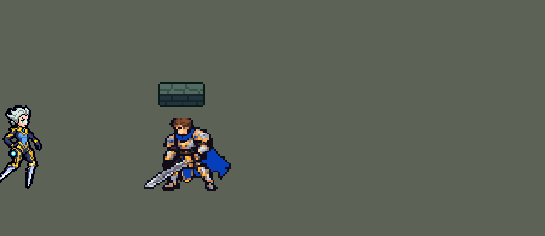

<!-- 本页上半部分由 tools/docs/gen_hero_docs.py 按仓库里现在的数据生成，手改会被覆盖；「开发记录」以下是手写的，生成时原样保留。 -->

# 卡蜜尔 Camille


| 项目 | 内容 |
|---|---|
| id | `league_camille` |
| 所属的包 | 主包（mod_id `league`） |
| 分路 | 上单 |
| 分类 / 标签 | 近战（Melee） · AD / Melee / CC / Shield |
| 高清帧 | PPU 1.5 |
| 附加包 | [青钢影钩墙附加包](#附加包)（`league_camille_wall`）、[游戏 AI 不按的技能替它按](#附加包)（`league_ult_press`） |



其他预览：[逐帧预览](../preview/league_camille_frames.png)、[特效表](../preview/league_camille_effects.png)

## 现在的技能

下面是游戏里显示的技能说明（`league/text/champion.i18n` 的简体中文，去掉了颜色和图标），冷却、距离来自 `league/champion/league_camille.data_champion`；1 秒 = 60 tick。

### 普攻 / 被动（被动「适应性防御」）

*攻击间隔 1.07 秒 · 攻击距离 25000*

踢击造成100% 攻击力的物理伤害。被动 适应性防御：每10秒，踢中敌方英雄时获得80 + 80% 攻击力的护盾，持续2秒。精准礼仪（每7秒）：下一踢额外造成10 + 30% 攻击力并加速；蓄力1.5秒后的再一踢额外伤害翻倍，50%转为真实伤害。

### 技能1 · 战术横扫

*冷却 10 秒 · 施放距离 42000 · 施放：指定目标 · 敌人（不含防御塔）*

蓄力后向目标扇形横扫，造成50 + 60% 攻击力的物理伤害。外沿的敌人额外受到5%最大生命值的伤害并被减速80%（2秒内衰减）；外沿每命中一名敌方英雄，回复20 + 20% 攻击力生命值。

### 技能2 · 钩索

*冷却 4 秒 · 施放距离 60000 · 施放：指定目标 · 敌方英雄*

钩住敌方英雄附近的小兵、野怪或防御塔并被拉过去（不钩英雄），随后冲向附近的敌方英雄，对周围敌人造成60 + 70% 攻击力的物理伤害，被撞的英雄眩晕0.75秒，并获得攻速+50%，持续5秒。被以多打少时改钩远离敌人的目标，拉过去后反向冲开。

### 大招 · 海克斯最后通牒

*冷却 50 秒 · 施放距离 35000 · 施放：指定目标 · 敌方英雄*

跳向一名敌方英雄（空中免疫伤害和控制），落地震开周围其他敌人，在落点展开固定的力场4秒：目标无法使用位移技能、走不出力场；她自己可以离开，离开后力场消失。期间她踢中英雄额外造成10 + 3%最大生命值的真实伤害。

### 数值

攻击力 95（每级 +19）、生命 1000（每级 +100）、护甲 32（每级 +8）、魔抗 26（每级 +4）、移速 1040（每级 +10）。

## 附加包

附加包是可选的原生代码 mod（都在附加包合集 `league_addons` 里），**不装主包里的英雄也是完整的**。

### 青钢影钩墙附加包

[青钢影钩墙附加包](../../addons/league_camille_wall/README.md)：`league_camille_wall` v0.4.5

主包 `league` 保持纯数据、全平台可用；钩墙要读地图的墙，只能用原生代码，所以放在这个单独的附加包里。
装上后，青钢影的 E「钩索」**钩墙、地图四边和防御塔**，不再钩小兵、野怪；英雄、树林、草丛也不钩（墙就在树林里）。

### 游戏 AI 不按的技能替它按

[游戏 AI 不按的技能替它按](../../addons/league_ult_press/README.md)：`league_ult_press` v0.5.5（通用附加包，下面只列和卡蜜尔有关的部分）

|  | 装了附加包，什么时候按 |
|---|---|
| 卡蜜尔 E | E 好了、**60000 内有敌方英雄**就按，目标是最近的那个（钩墙附加包的 E 射程是 85000，取小的）。钩索、钩墙、冲向敌人照旧由主包 / 钩墙附加包决定 |

## 相关脚本和素材

- [`tools/lol/extract_camille.py`](../../tools/lol/extract_camille.py)
- [`tools/art/preview_camille.py`](../../tools/art/preview_camille.py)
- [`tools/art/import_camille.py`](../../tools/art/import_camille.py)
- [`tools/art/design_camille.py`](../../tools/art/design_camille.py)
- [`assets/source/camille/`](../../assets/source/camille)

## 开发记录

> 下面是原来 README 里「英雄：卡蜜尔」一节，原样搬过来（只改了相对链接）。

| 部分 | 内容 |
|---|---|
| 定位 | 上单（近战，分类 Melee），第九组的上单（用户 10 月 2 日排的顺序，同组有魔腾、乐芙兰、卡莎、娑娜），提前做了；本包第九个上单（盖伦、德莱厄斯、提莫、墨菲特、凯尔、锐雯、贾克斯、菲奥娜之后）。青钢影用腿上的刀刃踢人：Q 两段踢、W 外沿横扫、E 钩索突进眩晕、R 力场把目标锁在身边 |
| 普攻 | 刀刃踢，100% 攻击力的物理伤害，射程 25000，攻击间隔 64 tick（1.07 秒），第 8 tick 命中（动作第 3 帧） |
| 被动 | 「适应性防御」（用户选的「每 10 秒」）：踢中敌方英雄时，冷却好了（10 秒）就获得 80 + 80% 攻击力的护盾，持续 2 秒，护盾在时身上罩着青色的六边形格子。英雄联盟里是最大生命值 20%、只挡一种伤害类型的护盾；护盾读不到最大生命值，也不分伤害类型 |
| 普攻里的 Q | Q「精准礼仪」并进普攻（用户选的「W 技能1 + E 技能2，Q 折进普攻」）：自己的冷却 7 秒，好了的时候下一踢是第一踢：额外 10 + 30% 攻击力，加速 30%（1 秒），并打开 4 秒的窗口；窗口里蓄力 1.5 秒后的第一踢是第二踢：额外伤害翻倍，整下的 50% 转为真实伤害，再加速一次；蓄力中的踢是普通踢（英雄联盟「等 1.5 秒再 Q」的打法）。第一踢第 8 tick、第二踢第 9 tick 命中。蓄满到踢出第二踢之间，她的两把腿刃泛起青光（用户要的英雄联盟蓄满提示：蓄满时先亮一下、循环发光、踢出时收光），踢出或 4 秒窗口结束就消失 |
| 技能1 | W「战术横扫」：对 42000 内的敌人施放（小兵和野怪也算），冷却 10 秒。蓄力到第 22 tick（动作第 5 帧）向目标扇形横扫（半径 46000，张角约 ±45°），造成 50 + 60% 攻击力的物理伤害；外沿（扇形边缘：前方 36000 处半径 4000 的圆）的敌人再受到 5% 最大生命值的伤害，减速 80%（1 秒 50% 加 2 秒 30%，2 秒内衰减），外沿每打中一个敌方英雄她回复 20 + 20% 攻击力的生命 |
| 技能2 | E「钩索」（用户：英雄联盟要钩墙或防御塔才能位移、原地勾会空；这里没有墙，「英雄不能拉太假 小兵 野怪 防御塔 可以拉 拉英雄直接设置落空」「你可以加连招逻辑啊 这样就不会无脑E英雄了」「逃跑时也可以放吧」）：技能键是一个 3 tick 的准备动作，AI 在 60000 内有敌方英雄时按下，之后 4 秒内每 0.1 秒看一次，找到能钩的东西才真正出手，冷却 12 秒；找不到就不出手、不进冷却。能钩的是双方的小兵、野怪和防御塔，英雄永远不钩。开团：在一名敌方英雄身边 35000 内、离她 60000 内找一个能钩的，投掷动作第 3 帧丢出钩爪（每 tick 6000），把她拉过去（每 tick 3500），再接第二段冲向 40000 内的敌方英雄（每 tick 4500），到了对半径 25000 内的敌人造成 60 + 70% 攻击力的物理伤害，眩晕那个英雄 0.75 秒，她获得 50% 攻速 5 秒。逃跑：被以多打少（45000 内两名敌方英雄而 40000 内没有队友，或三打二）、又不在大招里时，改钩离她 25000 到 60000、周围 40000 内没有敌方英雄的目标，拉过去后第二段背向最近的敌方英雄冲开（每 tick 4500，8 tick）。游戏读不到当前血量，所以"逃跑"按以多打少判断。模拟 12 局：每局开团出手约 10.4 次、钩中被拉过去约 10.2 次、二段眩晕约 8.2 次，没有一次钩英雄或空放；逃跑每局约 0.1～0.4 次（被以多打少的地方常常没有小兵或塔）。 装上钩墙附加包 [`addons/league_camille_wall`](../../addons/league_camille_wall/README.md)（原生代码，单独一个 mod）后，E 改成钩墙、地图四边的石墙和石堆、防御塔，拉过去再扑人（演示 GIF 里就是这样）。 |
| 附加包（E） | 可选的附加包 [`addons/league_ult_press`](../../addons/league_ult_press/README.md)（在附加包合集里，原生代码，主包不装它也完整）：她的 E 也是只「备好」的格子，游戏 0.6.4 的 AI 几乎不按（E 好了、身边有敌方英雄的时间每分钟约 10 秒，每分钟只放 0.5 次），贴不上人（用户：「卡密尔看起来也不平A」：平 A 每分钟 9.2 次，贾克斯 14.7、艾瑞莉娅 15.6；身边 50000 内有敌方英雄时站着不动 22%，盖伦 2.5%）。附加包替 AI 按：E 好了、60000 内有敌方英雄就按，目标是最近的那个；钩索、钩墙、冲向敌人照旧由主包 / 钩墙附加包决定。对线时游戏 0.6.4 的 AI 常把她停在对面英雄 26–32k 外（近战射程 25k）、下令「走到自己脚下」站着不打（只读观察包：她身边 50000 内有敌方英雄时站着不动 22–32%，盖伦 2.7%、贾克斯 3.9%；这些站桩 93% 在 10 分钟前、对面只有 1 人）。附加包替 AI 上去平 A（用户：「卡密尔、瑟提、奥拉夫对线被 AI 停住时，附加包替她们上去平 A（血量够、不在对面塔下、不被以少打多）」）：原地站了 15 tick、普攻好了、AI 还让她原地站时，35000 内最近的敌方英雄——她生命不低于一半、目标离敌方塔 75000 以外、目标身边 60000 内的敌方英雄不多于她身边的我方英雄（含她）——就普攻他，打出一下或 1.5 秒后重新算 |
| 大招 | R「海克斯最后通牒」（用户：「固定区域放了后不能移动的」「卡密尔的大招是无法离场的」「青钢影的大招时没法躲避的」「敌人也不能走出那个圈」，10 月 3 日：「卡密尔大招要改成自己能出去啊」「敌人不能出去但是自己可以出去」）：对 35000 内的敌方英雄施放，冷却 50 秒。第 5 tick 跳起（每 tick 5000，空中 14 tick 免疫伤害和控制），一直追到目标身上；从施放到落地她的 E 不会出手、不会把她拉走（原来 E 偶尔在这时出手，把跳到半空的她拉去别处，大招落空）；落地后力场里 E 只用来逃跑，不去钩别人（钩出去力场就没了，正在打的目标会跑掉）。落地把周围 30000 内的其他敌人击退（目标不动），在落点立起六边形力场，3 秒不动。判定就是画出来的六边形地面：矩形（宽 29000、高 0，引擎再加上单位自身约 16000 的碰撞半径，站位点在左右约 30、上下约 16 像素内），每 tick 检查：目标不能位移，走到边上就被拉回她身边（身上闪紫色电光，0.5 秒最多闪一次）。她自己可以出去（英雄联盟：卡密尔离开力场或阵亡，1 秒内力场消失）：离落点超过 30000（加上她自身的碰撞半径约 46000，贴着边踢目标不算出去）力场就结束，目标恢复自由（不再被拉回、可以位移）。原来她走出去会被拉回力场中心；目标是拉回她身边的，所以她离开时力场必须结束，否则会把目标拖出去。模拟 24 局 103 次大招：她自己走开结束 30 次（多半是去追别人或撤退），目标死后她离开 32 次，她阵亡 2 次，其余满 3 秒。引擎的判定只能看出"有没有敌方英雄在场内"，目标的队友站进来时会失灵，所以另有一道保险：目标离她比整个力场还宽（约 62 像素）时也拉回——两人都在场内时不可能隔这么远，所以场内不会误拉。原来是半径 36000 的圆、每 0.1 秒查一次，加上碰撞半径后目标中心离落点 51 像素以内都算在场内，而地面只画了 66 × 30 像素，目标上下能走出画面二十多像素：模拟 12 局里大招期间目标有 58% 的时间站在画出来的地面外，现在约 2%，而且多半就贴在墙边。期间她每踢中英雄额外造成 10 + 3% 最大生命值的真实伤害（英雄联盟是当前生命值的魔法伤害，这里读不到当前生命值）。力场的画面：落地处升起（0.5 秒），之后每 0.5 秒接一段站着的画面，力场结束就不再接，所以最多再留半秒；目标脚下的紫色六边形也是每 0.5 秒一段。画面没了就不再拉人（用户 10 月 21 日：「青钢影大招的框消失后酒桶还被拉在原地动不了」）：每一段画面在场时每 tick 给她挂一个 3 tick 的标记，拉回和禁止位移都要有这个标记，最后一段画面结束、或者某一段没生成出来，3 tick 内目标就能走（`tools/fix/fix_camille_r_hold.py`）。每一段都由落地那一刻放出的「计时」投射物到点生成（原地不动，到时间就结束）：直接用延时生成的区域，画面朝向会随她站在哪边变，一半的段上下颠倒。强度不变：上单对 6 个原版上单两批（种子 1–24 / 25–48，各 864 局）改前 +1.16 / +1.02，改后 +1.40 / +1.04，每局阵亡 1.7 → 1.5–1.6（打不过时能走开）。 |
| 数值 | 攻击 95（+19）、生命 1000（+100）、护甲 32（+8）、魔抗 26（+4）、移速 1040（+10），攻击间隔 1.07 秒。数值是自己设计的，用 SDK 对战模拟调：上单，对 6 个原版上单（`fighter`、`executioner`、`lancer`、`pole_warrior`、`knight`、`berserker`），三套队友阵容、两边各 24 局，一批 864 局。团队击杀差：初版 +4.99 / +4.68（两批种子），太强；逐项去掉看贡献，E 的眩晕和攻速是大头（去掉后 +1.14），Q 约 1.5、被动约 1、R 的额外伤害约 0.5。E 的眩晕改成只晕被钩中的英雄，再削护盾（60 + 60%）、W（冷却 10 秒、回血 20 + 20%）、E（冷却 12 秒、攻速 30% 3 秒）、R（3%）、Q（25%）：+1.81 / +1.53；眩晕从 0.75 秒缩到 0.5 秒：+1.12 / +1.38；按动作条对好出手时间（普攻、W 提前，R 第 5 tick 起跳、更快，空中不再隐身）后变强到 +1.89 / +1.86；再把 R 的真伤从 3% 降到 2%、Q 第二踢的真伤比例从 50% 降到 40%（英雄联盟 1 级的比例）：+0.95 / +1.27，就用这一版（同时测的眩晕 0.4 秒 +1.65 / +1.45，攻击成长 17 加 Q 20% +1.41 / +0.90）。其他上单约 +1.0～1.3。E、R 按英雄联盟重做（R 固定力场；E 只钩小兵、野怪、防御塔，准备键加脉冲找钩点，被以多打少时逃跑）后掉到 −1.73 / −1.56；E 瘦身后逐步加强：E 二段眩晕回到英雄联盟的 0.75 秒、攻击 95（+19）、护盾 80 + 80%、Q 30%、Q 第二踢真伤 50%、R 3%、E 二段攻速 50% 持续 5 秒（英雄联盟 40%～80%、5 秒）：三批种子 +1.22 / +0.31 / +1.22，平均 +0.92；再把力场做成真正走不出去（判定对齐画出来的地面、每 tick 检查）、大招不再被自己的 E 打断以后：+1.16 / +1.02，就用这一版（其他上单约 +1.0～1.3） |
| 亚索联动 | E 第二段的眩晕是亚索大招要的控制：卡蜜尔上单、亚索中单同队时，亚索（#66 的连招版）每局 R 到被控英雄 2.17 次（旧版亚索时测的萨科 2.42、阿木木 1.69、李青 1.52），和其他带控制的英雄同一档，亚索不用调 |
| 精灵图 | 11 个动作 67 帧：待机、移动、普攻、Q 第一踢、Q 第二踢、W、E 射钩、E 冲刺落地、R、受击、死亡。造型取自 Codex 生成的一张 65 格的青钢影，头一格不动、身体按行删到 46 行：银白偏薄荷的尖角短发和后脑发髻、青蓝眼睛、深蓝高立领和深蓝宝石、天蓝胸甲、黑手套和金腕带、宽胯和金色电路纹、近侧胯上的浅青核心、金色膝关节、两把长长的银蓝刀刃小腿。头顶到刀尖 46 px，23 px 宽，49 色 |
| 高清帧（PPU 1.5） | 2026-10-18 用 PPU 重做（用户：「接下来继续重做青钢影吧 按照之前的要求整理提示词给codex」），按赵信、卡莎的做法：Codex 只画一张设计图（[`tools/art/pack_camille_ppu.py`](../../tools/art/pack_camille_ppu.py) / [`assets/source/camille/PICTURE_PROMPT_PPU.md`](../../assets/source/camille/PICTURE_PROMPT_PPU.md)，交付在 `assets/source/camille/hd/`）：第二张生成图按它自己 12.9 px 的格子读回成 35 × 76，眼睛逐格改成两只 2 × 2、补上远侧脸边的描边，再每段均匀删一行删到 69 行（32 × 69，脸和头发顶、刀尖不删；76 行在游戏里有 51 像素高，用户之前说过「50太大了 用46」），[`tools/art/design_camille_hd.py`](../../tools/art/design_camille_hd.py)，用户：「确认」。上身和手臂照英雄联盟每帧的骨骼摆（[`tools/art/rig_camille_hd.py`](../../tools/art/rig_camille_hd.py)，45° 侧身的 `poses_hd.json`）：叉腰的近侧手臂和举起的远侧手臂只做无损的原样 / 镜像 / 直角转，上身最多偏离髋部 1 格。她的普攻、Q、W、E、R 和移动都是全身的踢、翻、跃，硬的刀腿摆不出来，所以这 8 个动作的腿交给 Codex 照引导线画（[`tools/art/pack_camille_legs.py`](../../tools/art/pack_camille_legs.py) / [`LEGS_PROMPT_PPU.md`](../../assets/source/camille/LEGS_PROMPT_PPU.md)：模板是摆好的上身，腿是英雄联盟每帧髋、膝、刀尖方向的红蓝引导线，长度按设计的腿），[`tools/art/import_camille_legs.py`](../../tools/art/import_camille_legs.py) 按模板的格子读回，只取身体以外、引导线附近的格子，颜色归到设计腿上的颜色，上身用设计原样；Q 第一踢第 3 帧 Codex 把人挪回格子并整帧重画成站直高踢，这一帧用它画的整个人（`hd/legs_shift.json`）。待机、受击、死亡是骨骼摆的。头像点 (−2, −46) 在头发顶（`tfm2_ase.py face`），选人卡 −4（`bp_card_audit.py` 的规则）。league.dll 0.7.42，主包 0.149.0 |
| 特效 | 普攻的银蓝斜划光（14 px），Q 第一踢的青色四芒星（20 px），第二踢的真伤爆点（八芒星和光环，31 px），W 的月牙刀光（扇形长 41 px，游戏会转到施法方向）和内圈、外沿命中（14、20 px，外沿带电弧），E 的金色钩爪和逐帧变长的光绳（71 px），落地的冲击环和尘土（63 px 宽），E 命中（16 px），头顶转着的眩晕（23 px，0.75 秒），被动的蜂窝护盾（25 × 53 px），R 的力场（落地处升起 0.5 秒、站着循环到 3 秒，91 px 宽；它是区域效果自己的画面，引擎按区域的朝向 (−1, 0) 把它转半圈，所以图里存的是转好半圈的），目标脚下的紫色六边形（31 px），撞墙的紫色电光（20 px），R 额外真伤的小火花（14 px），Q 蓄满的腿刃辉光（我照英雄联盟的蓄满光画的：青色泛光是半透明的，星芒是硬像素；左右对称，因为增益画面不随转身翻转；蓄满亮闪 4 帧、循环 6 帧、收光 3 帧） |
| 图标 | 官方技能图标（W / E / R），64×64 |
| 音频 | 从本地客户端提取的 16 条技能音效和 2 条中文语音（E、R），合成 16 个游戏音效。不提交到仓库，按下面的命令在本地生成 |

```bash
python tools/lol/extract_camille.py --lol "D:\WeGameApps\lol" --vgmstream "<vgmstream-cli.exe 路径>"
python tools/lol/native_pose.py assets/source/camille/poses.json --out <渲染文件夹>   # 动作参考帧
python tools/art/design_camille.py     # 造型：Codex 的 65 格图删到 46 行（--check 只核对）
python tools/art/import_native.py --hero camille
python tools/art/import_camille.py     # 特效；--raw <Codex 的特效交付文件夹> 先转成原尺寸条
python tools/art/pack_camille_ppu.py --out <文件夹>   # 高清造型（PPU 1.5）：给 Codex 的重画包
python tools/art/design_camille_hd.py   # Codex 的原图按 12.9 px 的格子读回、眼睛逐格改、均匀删到 69 行；--review <文件夹> 出大小对比
python tools/lol/league_joints.py assets/source/camille/poses_hd.json --out <关节文件夹>   # 英雄联盟每帧的关节位置（45° 侧身）
python tools/art/pack_camille_legs.py --joints <关节文件夹>/camille_joints.json --out <文件夹>   # 8 个动作的腿：给 Codex 的画腿包
python tools/art/import_camille_legs.py   # Codex 画的腿读回成 assets/source/camille/hd/legs_<动作>.png
python tools/art/rig_camille_hd.py --joints assets/source/camille/hd/camille_joints.json   # 高清帧，写 assets/source/ppu/orig/；--review <文件夹> 先看
python tools/art/ppu_restyle.py --hero camille
python tools/art/ppu_hd.py --hero camille
python tools/art/preview_camille.py
```

美术（动作的提示词见 [`assets/source/camille/MODEL_STRIPS.md`](../../assets/source/camille/MODEL_STRIPS.md)，特效的见 [`PROMPTS_FX.md`](../../assets/source/camille/PROMPTS_FX.md)；Codex 的交接说明在 [`codex_strips/`](../../assets/source/camille/codex_strips)、[`codex_fx/`](../../assets/source/camille/codex_fx)）：
- 分工：模型和特效都由 Codex 画，Claude 写提示词包、整理和导入，按"原画 → 造型 → 动作 → 特效"分四步。中途 GPT 到期，造型试过交给 Gemini，用户：「还是用codex吧」。
- 原画和造型：原画包里用户选 A（一手叉腰、远手比剑指）。用户选了 Codex 画的一张大图（「精灵图就用这个」），读回来是 93 行；照萨科的办法按整行缩小，缩到 60 行以下手臂和胸甲就碎成散线。Codex 后来生成的一张 65 格的图干净得多（`assets/source/camille/camille_source_65.png`，按 10 px 一格读回）：`design_camille.py` 头部 12 行一格不动，身体分胸、胯、刀刃三段删行，每次删最便宜的行、相邻两行不同时删、会把人分成两块的行加代价，近似色先合并（RGB 距离 22）。先做了 50 行，用户：「不行还是得用46 帮我换吧 50太大了」「可以牺牲点腿部元素 来做上半身 比如手和脸做好点」，三个 46 行方案里选了 C1（胸部少删：权重胸 0.5、胯 1.0、刀刃 1.3）：46 × 21，49 色。远侧眼睛原来和胯上的核心同一种青色，改成近侧眼睛的 `#029FD9`，这种青色只在眼睛上。手（用户：「卡密尔的手部能改精致一点吗？现在太怪了」）：删掉的 7 列正好穿过两条手臂，远侧举起的前臂和手只剩外侧一列描边（一根黑钩），近侧手肘没了描边；再做一次保护两条手臂所在列的缩小，把它的远侧前臂、金袖口和举起的手套移到 C1 上（往右 2 格正好接上肩膀），近侧手肘补上描边，身体一格不动：46 × 23。待机和各动作最后一帧直接用定稿，跟着换了；其余 55 个动作帧的手臂（黑线和黑爪）交给 Codex 照定稿重画（[`HANDS_FIX.md`](../../assets/source/camille/HANDS_FIX.md)）。
- 动作参考（`poses.json`）：镜头 yaw 30、pitch 25，镜像；头 2.3 倍、腿 0.72 倍、头发 0.8 倍；高度 46，128 × 112 的格子。待机 `Camille_Idle_loop`（6 帧 × 200 ms，都是定稿），移动 `Camille_Run_Base`（8 帧 × 125 ms，平地，头保持待机时的样子），普攻 `Camille_Attack1`，Q 第一踢 `Camille_spell1`，第二踢 `Camille_Spell1_2`，W `Camille_Spell2_0`，E 射钩 `Camille_Spell3_0`，E 冲刺落地 `Camille_Spell3_Dash2` + `Camille_Spell3_Hit`，R `Camille_spell4`，受击取 `Camille_death` 开头和待机混合，死亡 `Camille_death`。
- 动作：Codex 照定稿和英雄联盟的动作逐条画了 10 条 61 帧，每个站立帧都贴回定稿的头（头部像素 100% 一致）、高立领每帧都在，颜色全是定稿的 49 色，脚底线以下只有躺倒的死亡最后两帧多 2 格。导入前逐帧检查（网格、色板、头部、连通块、脚底线、两腿交替）后修了这些地方，改好的动作条放在 `assets/source/native/`：头部右侧生成图头发留下的白点（普攻 1、3、4、5，Q 第一踢 3，E 射钩 2，E 冲刺 1、2），1～2 格的散点，跑步第 7 帧摆动的手、R 第 3 帧举起的手臂只斜角相连（各补 1 格接上，R 那只手散开的三个"手指"点去掉成拳头），E 射钩第 5 帧后腿外多出的一道描边，死亡第 7 帧头下的残块，死亡第 2 帧下巴下面那条用了头发的灰绿色（改成袖子的深蓝），受击第 2 帧胯边的金边画成了暗棕色（改回定稿的黑描边和金色）。
- 导入：待机 6 帧用定稿，第 3–5 帧从刀刃中段（站位点下第 5 行，上下两行轮廓一样）往上下沉一格呼吸（`BOB`）；按青色的眼睛定头的位置（`EYES`）；描边补齐（`COMPLETE`）。头像截取点 (0, −44)；待机最高点 −34，高过 −28，按选人卡片的规则设 `banpick_center` (0, −5)。
- 特效用 Codex 画的 16 张（95 帧），交的是严格 8 倍方块、只用指定色阶，但格子比图大：`import_camille.py --raw` 一格读一个像素，画得和游戏尺寸差不到两成的照原样用（Q 第二踢的爆点、W 的月牙、E 的钩爪和光绳、眩晕、R 的火花、E 的落地环、R 的力场——升起和站着的两张要同一个比例，循环才接得上落地），其余按技能定的大小缩小（普攻、Q 第一踢、W 内圈和外沿、E 命中、护盾、R 标记、撞墙），任何一个源像素有颜色就保留，一格的火花不会丢。光和电弧边上最深的一圈去掉；钩索的光绳本身就是深色的芯，不去。Codex 交的护盾每帧往左滑 7 格、后三帧又高 3 格，导入时每帧按自己的图形居中。
- 出手时刻和动画对齐：普攻和 Q 第一踢第 3 帧（第 8 tick），Q 第二踢第 3 帧（第 9 tick），W 第 5 帧（第 22 tick），E 第 3 帧射出钩爪（第 9 tick），E 冲刺落地的动作完整播放（26 tick）；R 第 2 帧起跳（第 5 tick），每 tick 5000：AI 从中心距约 52000 起跳，第 14 tick （落地帧）前后落地，力场在落地那一刻立在落点。之前用静态图时 R 空中隐身（让她"跳走"），有了跳跃动作就去掉了，空中照样免疫伤害和控制。

逐帧预览：[`docs/preview/league_camille_frames.png`](../preview/league_camille_frames.png?v=1018cm)，特效：[`docs/preview/league_camille_effects.png`](../preview/league_camille_effects.png?v=1018cm)。
