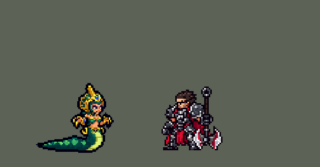

<!-- 本页上半部分由 tools/docs/gen_hero_docs.py 按仓库里现在的数据生成，手改会被覆盖；「开发记录」以下是手写的，生成时原样保留。 -->

# 卡西奥佩娅 Cassiopeia


| 项目 | 内容 |
|---|---|
| id | `league_cassiopeia` |
| 所属的包 | 主包（mod_id `league`） |
| 分路 | 中单 |
| 分类 / 标签 | 法师（Magician） · AP / Magic / Range |
| 高清帧 | PPU 1.2 |
| 附加包 | [卡西奥佩娅附加包](#附加包)（`league_cassiopeia`） |



其他预览：[逐帧预览](../preview/league_cassiopeia_frames.png)、[特效表](../preview/league_cassiopeia_effects.png)

## 现在的技能

下面是游戏里显示的技能说明（`league/text/champion.i18n` 的简体中文，去掉了颜色和图标），冷却、距离来自 `league/champion/league_cassiopeia.data_champion`；1 秒 = 60 tick。

### 普攻 / 被动

*攻击间隔 0.75 秒 · 攻击距离 60000*

双生毒牙：甩出毒牙，造成18 + 14% 法强魔法伤害；Q、W毒到敌人后3秒内，多造成14 + 24% 法强并回复10% 法强生命。优雅蛇行：移速成长更高。

### 技能1 · 瘟毒爆炸

*冷却 4 秒 · 施放距离 80000 · 施放：地点 · 敌人（不含防御塔）*

0.4秒后在目标处炸开，敌人中毒3秒，共受75 + 60% 法强魔法伤害；毒到英雄时她移速+45%，3秒内渐退。

### 技能2 · 剧毒迷雾

*冷却 15 秒 · 施放距离 65000 · 施放：地点 · 敌方英雄*

放出持续5秒的毒雾：每秒24 + 12% 法强魔法伤害，减速50%、禁锢（不能用位移技能）。

### 大招 · 石化凝视

*冷却 50 秒 · 施放距离 72000 · 施放：指定目标 · 敌方英雄*

朝面前扇形石化凝视，造成160 + 70% 法强魔法伤害：近处交战的敌人石化2秒，远处的减速40%。前方有2个以上敌方英雄或被突进时才放。

### 数值

攻击力 60（每级 +4）、法强 40（每级 +20）、生命 850（每级 +95）、护甲 18（每级 +7）、魔抗 22（每级 +4）、移速 900（每级 +16）。

## 附加包

附加包是可选的原生代码 mod（都在附加包合集 `league_addons` 里），**不装主包里的英雄也是完整的**。

### 卡西奥佩娅附加包

[卡西奥佩娅附加包](../../addons/league_cassiopeia/README.md)：`league_cassiopeia` v0.1.0

|  | 主包（纯数据） | 附加包 |
|---|---|---|
| 双生毒牙的加伤和回血 | 她的 Q、W 毒到任何敌人后 3 秒内，毒牙都加伤、回血（数据读不到目标身上的毒） | 只有**这个目标本人中毒**时才加伤、回血（英雄联盟） |
| 石化凝视 | 扇形里近处（交战中）的英雄石化，远处的减速（数据看不到朝向） | **面朝她的石化，背对她的减速**（英雄联盟） |

装上附加包后游戏里显示的说明（和主包不同的部分）：

- **普攻 / 被动**：【扩展包】双生毒牙：甩出毒牙，造成18 + 14% 法强魔法伤害；目标中毒时多造成14 + 24% 法强并回复10% 法强生命。优雅蛇行：移速成长更高。
- **大招 · 石化凝视**：【扩展包】朝面前扇形石化凝视，造成160 + 70% 法强魔法伤害：面朝她的敌人石化2秒，背对她的减速40%。前方有2个以上敌方英雄或被突进时才放。

## 相关脚本和素材

- [`tools/kit/build_cassiopeia.py`](../../tools/kit/build_cassiopeia.py)
- [`tools/kit/setup_cassiopeia.py`](../../tools/kit/setup_cassiopeia.py)
- [`tools/lol/extract_cassiopeia.py`](../../tools/lol/extract_cassiopeia.py)
- [`tools/art/preview_cassiopeia.py`](../../tools/art/preview_cassiopeia.py)
- [`tools/art/rig_cassiopeia.py`](../../tools/art/rig_cassiopeia.py)
- [`assets/source/cassiopeia/`](../../assets/source/cassiopeia)

## 开发记录

> 下面是原来 README 里「英雄：卡西奥佩娅」一节，原样搬过来（只改了相对链接）。

| 部分 | 内容 |
|---|---|
| 定位 | 中单（Mid，标签 AP / Magic / Range），第 128 位英雄。魔蛇之拥 卡西奥佩娅：上半身是人、下半身是蛇尾的诺克萨斯贵族（10-17 的分组计划 B 组的中单）。用户的选择：「技能方案按 A 做（带扩展包 league_cassiopeia）」。英雄联盟里她靠 0.75 秒一次的 E 双生毒牙输出，团战经理的技能位最快 1 秒一次，所以**双生毒牙就是她的普攻**；技能 1 = Q 瘟毒爆炸，技能 2 = W 剧毒迷雾，大招 = R 石化凝视，被动优雅蛇行在普攻里。技能名照英雄联盟 16.20 的官方中文 |
| 普攻 / 被动 | **E 双生毒牙**：射程 60000（英雄联盟 700，比一般中单 55000 远一点），每 45 tick 一发追踪的毒牙，18 + 14% 法强魔法伤害（对小兵、野怪、防御塔都打）。**中毒加成**：她的 Q、W 毒到敌人后 3 秒内，毒牙多造成 14 + 24% 法强 并回复 10% 法强的生命（数据读不到目标身上的毒，主包只能看她自己有没有刚毒到人；打小兵野怪只回 3%）。**优雅蛇行**：团战经理没有鞋子，“不能买鞋”用不上；她的移速成长 16（法师一般 9），Q 的加速也比英雄联盟大 |
| 技能1 | **Q 瘟毒爆炸**（对小兵、野怪也放，射程 80000）：往目标脚下放，出手时就定好落点（走开能躲），**0.4 秒**后在半径 22000 内炸开，敌人中毒 3 秒共受 75 + 60% 法强 魔法伤害；毒到英雄时她移速 +45%，3 秒内分三档退掉。落下前地上一圈绿色预警圈。冷却 4 秒 |
| 技能2 | **W 剧毒迷雾**，**只在有敌方英雄时放**（射程 65000）：甩出毒液弹，落地后留下 5 秒的毒雾（半径 30000）：每秒 24 + 12% 法强 魔法伤害、减速 50%、**禁锢**（不能用位移技能，`BlockMoveSkill`），站在里面的也算中毒（毒牙加成）。冷却 15 秒 |
| 大招 | **R 石化凝视**，**看时机才放**：按 R 只是待命 10 秒（AI 常在接近时就按大招），之后她每次甩毒牙前先看面前的扇形（72000 长、左右各 40 度，英雄联盟 80 度）：两个以上敌方英雄、有敌方英雄贴脸（25000 内）、或者待命 4 秒后有一个敌方英雄就放，朝毒牙的目标凝视。扇形里的敌方英雄受到 160 + 70% 法强 魔法伤害：**近处（45000 内，正在交战）的石化（眩晕）2 秒**、身上长出石壳，远处的减速 40% 2 秒（主包看不到朝向）；凝视波是一个往前飞的弹道画面，红色方也朝对方向。没放出去，待命结束时冷却压到 1 秒，下次接近再按。冷却 50 秒 |
| 附加包 | 可选的附加包 [`addons/league_cassiopeia`](../../addons/league_cassiopeia/README.md)（在附加包合集里，原生代码，主包不装它也完整）：**毒牙只对本人中毒的目标加伤、回血**（Q、W 毒到的单位身上挂标记，原生效果读毒牙的目标），**石化凝视看真实朝向**：面朝她的石化，背对她的减速（被动按每个敌方英雄的走向、站着时按离他最近的对手记朝向）。日志 `league_cassiopeia.log`（FANG、GAZE） |
| 数值 | 攻击 60（+4）、法强 40（+20）、生命 850（+95）、护甲 18（+7）、魔抗 22（+4）、移速 900（+16）、射程 60000 |
| 平衡 | 10 分钟经典引擎模拟，中路对原版五个法师（火法、冰法、雷法、风法、白魔），三套阵容两边各打，每档两批种子（1–8、9–16）取平均：初稿 +2.45（只跑了 1–8）；毒牙 -20% +1.51；-15% +1.55；石化缩到 1.5 秒 +1.47；毒牙 -20% 再把生命降到 850：1–16 号一起跑 **+1.03**（同时试的再把 Q 降到 65 + 50%：+0.93）。同批辛德拉 +1.20。英雄联盟的 2 秒石化保留，削的是毒牙和生命。游戏 AI 读得到她普攻和技能的伤害（不会像普朗克初稿那样读成 0、作战计划除以零） |
| 精灵图（高清帧 PPU 1.3） | Codex 第 0 步画了待机（A：蛇尾平铺在身后）和盘尾（B：蛇尾在身下盘成一圈）两张原画（[`tools/art/pack_cassiopeia_picture.py`](../../tools/art/pack_cassiopeia_picture.py)），[`tools/art/review_cassiopeia_size.py`](../../tools/art/review_cassiopeia_size.py) 按游戏大小和 PPU 1.2 / 1.3 / 1.5 并排，用户：「44 ppu1.3 A」。第 1 步 Codex 在游戏格子上重画（[`tools/art/pack_cassiopeia_model.py`](../../tools/art/pack_cassiopeia_model.py)），[`tools/art/design_cassiopeia_cut.py`](../../tools/art/design_cassiopeia_cut.py) 读回 A-2（15 px 一格，78×69，英雄联盟那种大菱纹）、整行整列删到尖冠到地面 57 行（脸的行列不删），读回丢掉的两颗毒牙按原稿补上。动作照塔姆的做法自己摆（用户：「动作帧就参照塔姆那种方法做吧 做好后自己review 真正没问题了完美了喊我review」）：[`tools/art/rig_cassiopeia.py`](../../tools/art/rig_cassiopeia.py) 把定稿切成上身（连腰带和两根金弯钩）、两只手臂、蛇身（蛇颈 + 平铺的尾巴），只整格平移、整行整列复制或删掉：蛇颈抬起 = 重复蛇颈的一行，沉下 = 删掉上面的行，前倾 = 每行整行右移、越往上越多；尾巴整列抬起（待机尾尖翘、跑步的波浪）；手往外伸 = 重复前臂那一列（爪子始终连在前臂上）。动作：待机（蛇颈一起一伏、尾尖翘）、跑（前倾、尾巴的波浪往后传）、普攻毒牙（后仰再把前爪甩出去）、Q（直起身、甩手）、W（抬高、两手张开）、R（后仰再低低地扑出去）、挨打、阵亡（沉进蛇身、向前扑倒趴在地上）。2026-10-18 降到 PPU 1.2（用户：「……蛇女像素太高需要降低」） 2026-10-19 补帧：死亡 8 帧（落地回弹）；R 的前探试过加到 5–7 列，脖子的浅色腹部被拉斜变细，保持 4 列 |
| 特效 | 第 3 步 14 张特效（[`tools/art/pack_cassiopeia_fx.py`](../../tools/art/pack_cassiopeia_fx.py)，颜色照英雄联盟：毒牙和瘟毒爆炸是亮毒绿，剧毒迷雾是深绿毒雾，石化凝视是金绿色的光，被石化是灰色石壳）。三张弹道（毒牙、毒液弹、凝视波）画成朝右、上下对称，跟着飞行方向转；其余全部左右对称（游戏不镜像特效图）。[`tools/art/import_cassiopeia_fx.py`](../../tools/art/import_cassiopeia_fx.py)：预警圈和毒爆在落点，毒雾在落点每 15 tick 续一张，眼睛的光在她头上，石壳和减速光环跟着敌人。写成 `league_cassiopeia_fx` 和 `league_cassiopeia_big` |
| 音效 | 英雄联盟的音效和配音（[`tools/lol/extract_cassiopeia.py`](../../tools/lol/extract_cassiopeia.py)，12 段）：毒牙出手 / 打中、Q 出手 / 爆炸 / 毒到英雄、W 出手 / 落地、R 出手 / 石化，配音是她的 Q / W / R 台词（中文） |
| 图标 | 官方技能图标（瘟毒爆炸、剧毒迷雾、石化凝视，另有双生毒牙和被动），从本地客户端取 |

重新生成（素材来自本机的英雄联盟客户端，音频不进仓库）：

```bash
python tools/lol/extract_cassiopeia.py --lol "D:\WeGameApps\lol" --vgmstream <vgmstream-cli.exe>
python tools/kit/build_cassiopeia.py                # 技能数据，数字都在脚本的参数表 P 里
python tools/kit/setup_cassiopeia.py                # 五种语言的文字、音效配置、共享文件里她的键
python tools/art/design_cassiopeia_cut.py           # Codex 第 1 步的造型读回（PPU 1.3，A-2）
python tools/art/rig_cassiopeia.py                  # 1 倍帧和 1.3 的原帧（整块摆）
python tools/art/ppu_restyle.py --hero cassiopeia   # 外描边（不要加 --preview）
python tools/art/ppu_hd.py --hero cassiopeia        # hd_ / lo_ 帧
python tools/art/import_cassiopeia_fx.py            # 特效
python tools/art/preview_cassiopeia.py              # 预览和演示 GIF
python addons/league_cassiopeia/make_override.py    # 附加包的副本（主包的卡西奥佩娅改了就重跑）
```

美术提示词见 [`assets/source/cassiopeia/`](../../assets/source/cassiopeia) 里的 `PICTURE_PROMPT.md`、`MODEL_PROMPTS.md`、`PROMPTS_FX.md`；Codex 的交付在 `codex_picture/`、`codex_model/`、`codex_fx/`。

逐帧预览：[`docs/preview/league_cassiopeia_frames.png`](../preview/league_cassiopeia_frames.png?v=1018a)，特效：[`docs/preview/league_cassiopeia_effects.png`](../preview/league_cassiopeia_effects.png?v=1018a)。
