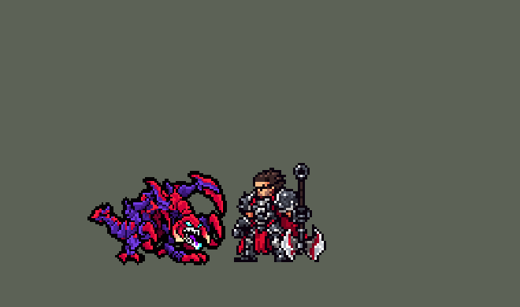

<!-- 本页上半部分由 tools/docs/gen_hero_docs.py 按仓库里现在的数据生成，手改会被覆盖；「开发记录」以下是手写的，生成时原样保留。 -->

# 科加斯 Cho'Gath


| 项目 | 内容 |
|---|---|
| id | `league_chogath` |
| 所属的包 | 主包（mod_id `league`） |
| 分路 | 上单 |
| 分类 / 标签 | 近战（Melee） · AP / Magic / Melee / Tank / CC |
| 高清帧 | PPU 1.2 |
| 附加包 | [科加斯附加包](#附加包)（`league_chogath`） |



其他预览：[逐帧预览](../preview/league_chogath_frames.png)、[特效表](../preview/league_chogath_effects.png)

## 现在的技能

下面是游戏里显示的技能说明（`league/text/champion.i18n` 的简体中文，去掉了颜色和图标），冷却、距离来自 `league/champion/league_chogath.data_champion`；1 秒 = 60 tick。

### 普攻 / 被动

*攻击间隔 1.27 秒 · 攻击距离 26000*

肉食者：攻击击杀单位时回复35 + 15% 法强生命。恐惧之刺：每6秒接下来3次攻击射出一排尖刺，直线上的敌人受20 + 20% 法强魔法伤害并减速35%，英雄另受2%最大生命真实伤害。

### 技能1 · 破裂

*冷却 9 秒 · 施放距离 90000 · 施放：地点 · 敌人（不含防御塔）*

地面破裂，0.6秒后尖刺冲出，造成50 + 60% 法强魔法伤害，击飞0.75秒并减速60%。

### 技能2 · 野性尖叫

*冷却 11 秒 · 施放距离 45000 · 施放：指定目标 · 敌方英雄*

向前方锥形区域尖叫，造成60 + 50% 法强魔法伤害并沉默1.8秒。

### 大招 · 盛宴

*冷却 60 秒 · 施放距离 30000 · 施放：指定目标 · 刚交过手的敌方英雄*

吞噬受伤的敌方英雄，造成300 + 自身5%最大生命的真实伤害和50% 法强无视魔抗的魔法伤害；吃掉则叠一层：最大生命+70、移速-3%、体型变大（不封顶，死亡清空）。

### 数值

攻击力 80（每级 +6）、法强 30（每级 +15）、生命 1150（每级 +115）、护甲 38（每级 +9）、魔抗 30（每级 +4）、移速 980（每级 +10）。

## 附加包

附加包是可选的原生代码 mod（都在附加包合集 `league_addons` 里），**不装主包里的英雄也是完整的**。

### 科加斯附加包

[科加斯附加包](../../addons/league_chogath/README.md)：`league_chogath` v0.1.3

|  | 主包（纯数据） | 附加包 |
|---|---|---|
| 盛宴的层数 | 每吃死一个英雄叠一层（最大生命 +70、移速 −3%、league.dll 把身体画大 30%，不封顶），**死亡清空**（引擎死亡时清掉全部 buff） | **死后原样补回**，层数一局里只增不减 |
| 什么时候放盛宴 | AI 对「队伍刚打过的敌方英雄」放出，读不到当前生命，常常咬不死 | 读射程内敌方英雄的生命、护盾、免死和受到伤害的增减，**一口吃得死才放**（几个时吃生命 + 护盾最少的，AI 没想放也放）；吃不死时 AI 想放就改成普攻那个人 |

装上附加包后游戏里显示的说明（和主包不同的部分）：

- **大招 · 盛宴**：【扩展包】只在一口吃得死时吞噬敌方英雄：300 + 自身5%最大生命的真实伤害和50% 法强无视魔抗的魔法伤害；吃掉则叠一层：最大生命+70、移速-3%、体型变大（不封顶，死后保留）。

## 相关脚本和素材

- [`tools/kit/build_chogath.py`](../../tools/kit/build_chogath.py)
- [`tools/kit/setup_chogath.py`](../../tools/kit/setup_chogath.py)
- [`tools/lol/extract_chogath.py`](../../tools/lol/extract_chogath.py)
- [`tools/art/preview_chogath.py`](../../tools/art/preview_chogath.py)
- [`tools/art/rig_chogath.py`](../../tools/art/rig_chogath.py)
- [`assets/source/chogath/`](../../assets/source/chogath)

## 开发记录

> 下面是原来 README 里「英雄：科加斯」一节，原样搬过来（只改了相对链接）。

| 部分 | 内容 |
|---|---|
| 定位 | 上单（Melee，标签 AP / Magic / Melee / Tank / CC），第 136 位英雄。虚空恐惧 科加斯：四脚着地的虚空巨兽，深紫甲壳、酒红甲片，背上两条镰刀臂，大嘴里两排白牙、青色眼睛（10-17 的分组计划 D 组的上单）。用户的选择：「技能方案 A（Q / W / R，E 进普攻）」「上单」「做附加包」，盛宴的层数「变大可以无限 加生命」。团战经理只有三个主动技能位：技能 1 = Q 破裂，技能 2 = W 野性尖叫，大招 = R 盛宴；被动肉食者和 E 恐惧之刺在普攻里（英雄联盟的 E 就是接下来 3 次攻击变强）。技能名照英雄联盟 16.20 的 Data Dragon（五种语言） |
| 普攻 / 被动 | 直立起来再整个扑下来砸（射程 26000，100% 攻击）。**肉食者**：他的攻击打死任何单位（小兵、野怪、英雄），回复 35 + 15% 法强 生命 |
| E（在普攻里） | **恐惧之刺**：每 6 秒背上的刺充能一次，接下来 6 秒内的 3 次攻击换成 `attack_e`，同时朝目标射出一排尖刺（长 50000、宽 17000，穿过所有单位）：20 + 20% 法强 魔法伤害、减速 35% 1.5 秒，英雄另受 2% 最大生命的真实伤害 |
| 技能1 | **Q 破裂**（对小兵、野怪也放，射程 90000）：目标点的地面先裂开，0.6 秒后冲出地刺（半径 25000）：50 + 60% 法强 魔法伤害、**击飞 0.75 秒**、减速 60% 1.5 秒。冷却 9 秒 |
| 技能2 | **W 野性尖叫**（对敌方英雄，射程 45000）：直立朝前尖叫，前方 60° 扇形（长 55000）内 60 + 50% 法强 魔法伤害、**沉默 1.8 秒**。冷却 11 秒 |
| 大招 | **R 盛宴**（射程 30000，只对刚打过的敌方英雄，满血的不浪费）：一口咬下：300 + 他最大生命 5% 的真实伤害，另加 50% 法强的魔法伤害（同时挂 100% 魔抗穿透，等于真实伤害）。**一口吃死就叠一层**：最大生命 +70（立刻回满这 70），移速 −3%（2026-10-31 用户：「大虫子变大后要降移速啊」；英雄联盟的盛宴其实不降移速，只加生命、体型和攻击距离），身体变大 30%（见下面「体型变大」），**层数不封顶**（用户的选择）。冷却 60 秒。主包里层数是常驻 buff，死亡时被引擎清掉 |
| 连招 | 用户：「有连招要做连招」「都要帮我补」。英雄联盟的 **Q→W（→R）**：Q 的地刺击飞敌方英雄时（只认英雄的同位置孪生范围）给他挂 60 tick 的连招窗口（击飞 45 tick 再多一点），窗口内放 W 不再等直立，第 2 tick 就尖叫（平时第 8 tick），趁对方还在空中沉默，窗口随之用掉。W 仍是自己的技能位和冷却（好了 AI 才放），伤害不变。R 不另开窗口：Q、W 打中后对方就是「刚打过的敌方英雄」，正是盛宴的目标（装附加包时只在一口吃得死时咬） |
| 体型变大 | 引擎的单位缩放（+0x1b4）由 `league.dll` 管，附加包写进去会被再除一次，所以变大做在 `league.dll` 里：[`addons/league_main/src/hd.rs`](../../addons/league_main/src/hd.rs) 的 `GROWTH` 表（科加斯、层数 buff `league_chogath_r_stack`、每层 30%、不封顶（2026-10-23 前每层 5%，吃一层只大 2 个像素，看不出来；10-23 起 15%；10-26 起 30%、最多 2 倍：「大虫子体型不变大？」；10-31 去掉上限：「大虫子体型应该可以无限变大吧」，吃 4 个 2.2 倍、10 个 4 倍）），[`view.rs`](../../addons/league_main/src/view.rs) 每帧从他的显示实体读 buff 列表（+0xb8）数层数，只把他自己的身体图层（不含特效、血条）按脚底放大 `1 + 30% × 层数`。`league.log` 里层数变化时写一行（`n x league_chogath_r_stack - body drawn ...x about the soles`） |
| 附加包 | 可选的附加包 [`addons/league_chogath`](../../addons/league_chogath/README.md)（在附加包合集里，原生代码，主包不装它也完整），照英雄联盟：**盛宴的层数死后原样补回**（一局里只增不减）；**一口吃得死才放盛宴**（读射程内敌方英雄的生命、护盾、免死和增减伤，几个时吃生命 + 护盾最少的；吃不死时 AI 想放也改成普攻那个人）。日志 `league_chogath.log`（STACK、DEAD / ALIVE / KEEP、FEAST、FEAST HELD） |
| 数值 | 攻击 80（+6）、法强 30（+15）、生命 1150（+115）、护甲 38（+9）、魔抗 30（+4）、移速 980（+10）、射程 26000，攻击间隔 76 tick |
| 平衡 | 10 分钟经典引擎模拟，上单位对原版六个上单（斗士、处刑人、枪骑兵、长柄战士、骑士、狂战士），三套阵容两边各打，两批种子（1–8、9–16）：初稿（Q 90 + 100% 冷却 7 秒击飞 1 秒、E 30 + 30% + 3%、W 80 + 70%）+5.20（同批骑士 +0.39）；Q 50 + 60% 冷却 9 秒击飞 0.75 秒、E 20 + 20% + 2%、W 60 + 50% +1.72 / +1.83；按动作条的时间（普攻和带刺普攻第 4 帧砸下、Q 第 2 帧跺地、W 第 3 帧尖叫、R 第 2 帧扑咬）**+1.81 / +2.02**（平均 +1.92；同期沃利贝尔 +1.39、普朗克 +1.67、拉莫斯 +2.2），不再调 |
| 精灵图（高清帧 PPU 1.2） | Codex 第 0 步画了英雄联盟的待机（A：镰刀臂举起）和收起镰刀（B）两张原画（[`tools/art/pack_chogath_picture.py`](../../tools/art/pack_chogath_picture.py)，读回 [`design_chogath_hd.py`](../../tools/art/design_chogath_hd.py)，大小对比 [`review_chogath_size.py`](../../tools/art/review_chogath_size.py)），用户：「A，游戏里 38 像素高，PPU 1.2」。第 1 步 Codex 在游戏格子上画 3/4 正面和侧面（[`pack_chogath_model.py`](../../tools/art/pack_chogath_model.py) / [`design_chogath_model.py`](../../tools/art/design_chogath_model.py)），用户选正面 A-1（69 × 46）；侧面缩到 46 行就糊了，改由 Codex 在格子上重画侧面（[`pack_chogath_side.py`](../../tools/art/pack_chogath_side.py) / [`design_chogath_side.py`](../../tools/art/design_chogath_side.py)），用户选 side-1（71 × 45）。英雄联盟里他的普攻、Q、W、R 都是先用后腿直立再整个扑下来，死亡是直立后侧身倒下，所以 Codex 照侧面的骨架画了 7 个姿势（蹲伏、起身、直立、扑砸、前扑、倒下、躺地，[`pack_chogath_poses.py`](../../tools/art/pack_chogath_poses.py) / [`design_chogath_poses.py`](../../tools/art/design_chogath_poses.py)，每个姿势都换上待机的同一张脸）。第 2 轮的身子太胖（「这大虫子怎么这么胖啊」），用户：「参考隔壁oppi的」「看起来不是太胖也不是太瘦」——起身和直立整个按最少损失删列，躯干约 1.25 个头宽（和 oppi 的科加斯一样），腿换回第 1 轮的长腿（「腿看起来有点短啊」）。动作帧 [`rig_chogath.py`](../../tools/art/rig_chogath.py)：待机呼吸、走路是四条腿对角交替（腿从造型里整块切出，头的格子留在身子上：「走路头和脚会重叠在一起」）、挨打第 1 帧白闪后退、死亡 8 帧，每个动作都对照英雄联盟的动画（[`review_chogath_actions.py`](../../tools/art/review_chogath_actions.py) 一张 GIF 左右对比）。站位点（帧中心）在身体中间：原来对着四只脚的中点，他的长尾巴让身体整个偏在站位点后面 3 格，身上的特效都往前歪（用户：「特效对对齐啊」），改成往后 4 格（`PIVOT_BACK`）。头像点 `face` (11, -5) 在眼睛上（`tfm2_ase.py face` 按最高处建议在镰刀尖上，lint 的 WARN 是这个），不设 `banpick_center`（待机顶部只高出帧中心 27 格） |
| 特效 | 第 3 步 15 张特效（[`tools/art/pack_chogath_fx.py`](../../tools/art/pack_chogath_fx.py)，颜色照英雄联盟：虚空的紫色和品红（破裂的地刺、恐惧之刺、盛宴的漩涡），破裂掀起土黄色碎石，野性尖叫是蓝紫色声波，盛宴是一圈红牙，被动回血是绿色），用户让 Gemini 画（15 张 JPG，背景有黑、白、灰、画出来的棋盘格）。[`tools/art/process_chogath_fx.py`](../../tools/art/process_chogath_fx.py)（爆爆那次的做法）按背景抠图、切成等宽的格、按多数颜色缩到游戏大小、从画得满的一半镜像成对称；Gemini 把三张画得比要的方（尖刺挤在方框里、破裂的裂缝是圆的、声波又高又窄），宽高分开缩到要的大小，盖住技能实际打到的范围（尖刺的线 50 格、破裂直径 50 格、声波 55 格）；被动回血的烟雾和 Q 顶飞的光晕缩下来是一坨暗紫色，去掉暗的那几档；盛宴那圈光的黑描边去掉；Q 减速的细裂缝在 24 格宽时按亮色优先取色。E 的一排尖刺和 W 的扇形声波挂在只画图的直线上（直线存在的时间 = 画面的时长：15 和 24 tick），朝右画、上下对称，跟着方向转；其余全部左右对称（游戏不镜像特效图）。身上的三张在他四脚着地、身体居中的时候放：E 背刺的弧在带刺普攻收尾的蹲伏（第 25 tick），盛宴那圈光在直立吞下之后落回来（吃掉后 25 tick），画在他身下（z -1），后半圈被身体挡住、不压脸。[`tools/art/import_chogath_fx.py`](../../tools/art/import_chogath_fx.py) 按清单的帧大小切开、照技能播放的位置摆好（再查一遍对称和时长），得到 `league_chogath_fx` 和 `league_chogath_big`（破裂的裂缝 / 地刺、尖叫的声波、盛宴的咬合 / 吃下后的虚空能量） |
| 音效 | 英雄联盟的音效和配音（[`tools/lol/extract_chogath.py`](../../tools/lol/extract_chogath.py)，19 段）：普攻出手 / 打中、被动回血、尖刺射出 / 打中、Q 起手 / 裂地 / 地刺冲出 / 打中、W 尖叫 / 打中、R 起手 / 咬下 / 打中 / 变大，配音是他的吼叫和大笑（客户端里没有技能台词） |
| 图标 | 官方技能图标（破裂、野性尖叫、盛宴，另有恐惧之刺和肉食者），从本地客户端取 |

重新生成（素材来自本机的英雄联盟客户端，音频不进仓库）：

```bash
python tools/lol/extract_chogath.py --lol "D:\WeGameApps\lol" --vgmstream <vgmstream-cli.exe>
python tools/kit/build_chogath.py                   # 技能数据，数字都在脚本的参数表 P 里
python tools/kit/setup_chogath.py                   # 五种语言的文字、音效配置、共享文件里他的键
python tools/art/design_chogath_model.py            # Codex 第 1 步的造型读回（正面 A-1）
python tools/art/design_chogath_side.py             # Codex 重画的侧面（side-1）
python tools/art/design_chogath_poses.py            # Codex 画的 7 个姿势（瘦身、换腿、换头）
python tools/art/rig_chogath.py                     # 1.2 的原帧和 1 倍帧
python tools/art/ppu_restyle.py --hero chogath      # 外描边（不要加 --preview）
python tools/art/ppu_hd.py --hero chogath           # hd_ / lo_ 帧
python tools/art/process_chogath_fx.py              # Gemini 画的特效读回到游戏格子（JPG 在本机 C:/t/cg_work/gemini_fx，不进仓库）
python tools/art/import_chogath_fx.py               # 特效
python tools/art/preview_chogath.py                 # 预览和演示 GIF
python addons/league_chogath/make_override.py       # 附加包的副本（主包的科加斯改了就重跑）
```

美术提示词见 [`assets/source/chogath/`](../../assets/source/chogath) 里的 `PICTURE_PROMPT.md`、`MODEL_PROMPTS.md`、`SIDE_PROMPTS.md`、`POSE_PROMPTS.md`、`POSE_PROMPTS_2.md`、`PROMPTS_FX.md`；Codex 的交付在 `codex_picture/`、`codex_model/`、`codex_side/`、`codex_poses/`、`codex_poses2/`；Gemini 的特效读回后在 `codex_fx/chogath_fx/`。

逐帧预览：[`docs/preview/league_chogath_frames.png`](../preview/league_chogath_frames.png?v=1019a)，特效：[`docs/preview/league_chogath_effects.png`](../preview/league_chogath_effects.png?v=1019a)。
