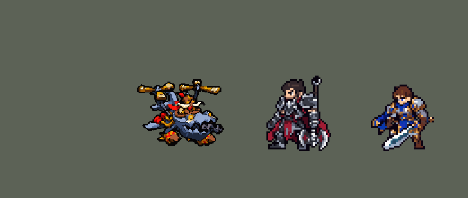

<!-- 本页上半部分由 tools/docs/gen_hero_docs.py 按仓库里现在的数据生成，手改会被覆盖；「开发记录」以下是手写的，生成时原样保留。 -->

# 库奇 Corki


| 项目 | 内容 |
|---|---|
| id | `league_corki` |
| 所属的包 | 主包（mod_id `league`） |
| 分路 | 中单 |
| 分类 / 标签 | 射手（Range） · AD / AP / Range / Magic |
| 高清帧 | PPU 2.2（画成 90%） |
| 附加包 | [库奇智能火箭 + 脱身方向附加包](#附加包)（`league_corki`） |



其他预览：[逐帧预览](../preview/league_corki_frames.png)、[特效表](../preview/league_corki_effects.png)

## 现在的技能

下面是游戏里显示的技能说明（`league/text/champion.i18n` 的简体中文，去掉了颜色和图标），冷却、距离来自 `league/champion/league_corki.data_champion`；1 秒 = 60 tick。

### 普攻 / 被动

*攻击间隔 1.03 秒 · 攻击距离 55000*

海克斯科技军备：普攻20%伤害转为真实伤害。特别快递：开局、复活后及每45秒，下次瓦尔基里俯冲变成弹药包：起飞时击退附近英雄并造成40 + 30% 法强魔法伤害，飞得更远、火焰更宽更久，加速30%。

### 技能1 · 磷光炸弹

*冷却 7.5 秒 · 施放距离 58000 · 施放：地点 · 敌人（不含防御塔）*

向目标位置扔出磷光炸弹，范围内敌人受到95 + 70% 法强魔法伤害和55% 攻击力物理伤害。

### 技能2 · 格林机枪

*冷却 2 秒 · 施放距离 45000 · 施放：指定目标 · 敌人（不含防御塔）*

4秒内向前方锥形扫射，每次造成9 + 16% 攻击力物理和9% 法强魔法伤害，叠加降低护甲和魔抗。冷却中被英雄贴近时改为瓦尔基里俯冲：向后俯冲，沿途留下火焰，每0.5秒造成15 + 12% 法强魔法伤害。

### 大招 · 火箭轰击

*冷却 40 秒 · 可存 4 次 · 施放距离 84000 · 施放：指定目标 · 敌方英雄*

储存4发火箭（每10秒补一发），命中第一个敌人后爆炸，范围内造成75 + 42% 法强魔法伤害和52% 攻击力物理伤害；每第3发是大火箭：范围更大，伤害200%。

### 数值

攻击力 88（每级 +15）、法强 25（每级 +10）、生命 900（每级 +92）、护甲 20（每级 +7）、魔抗 18（每级 +4）、移速 920（每级 +10）。

## 附加包

附加包是可选的原生代码 mod（都在附加包合集 `league_addons` 里），**不装主包里的英雄也是完整的**。

### 库奇智能火箭 + 脱身方向附加包

[库奇智能火箭 + 脱身方向附加包](../../addons/league_corki/README.md)：`league_corki` v0.1.1

主包 `league` 保持纯数据、全平台可用；数据读不到敌人站在哪、血量多少，主包的火箭朝 AI 选的英雄直线飞（Q 炸到人时改打「刚被打过的
英雄」），瓦尔基里俯冲只能「背对身边那个英雄往后跳」，不看墙、塔和队友。英雄联盟里高手把火箭打向能炸到最多人的地方、大火箭留给残血，
俯冲往安全的地方飞——要读每个单位的位置和血量，只能用原生代码，所以放在这个附加包里（合集 `league_addons` 也带着它）。

## 相关脚本和素材

- [`tools/kit/build_corki.py`](../../tools/kit/build_corki.py)
- [`tools/kit/setup_corki.py`](../../tools/kit/setup_corki.py)
- [`tools/lol/extract_corki.py`](../../tools/lol/extract_corki.py)
- [`tools/art/preview_corki.py`](../../tools/art/preview_corki.py)
- [`tools/art/import_corki.py`](../../tools/art/import_corki.py)
- [`assets/source/corki/`](../../assets/source/corki)

## 开发记录

> 下面是原来 README 里「英雄：库奇」一节，原样搬过来（只改了相对链接）。

| 部分 | 内容 |
|---|---|
| 定位 | 中单（Range，标签 AD / AP / Range / Magic），第 94 位英雄。英勇投弹手 库奇：坐在陀螺机里悬停的约德尔飞行员，物理普攻带真实伤害，技能是魔法伤害加物理伤害。用户的选择：中路、远程混伤；技能1 = Q，技能2 = E 接 W，大招 = R（存弹药）；被动和弹药包做在主包里；加入高手连招；智能火箭和脱身方向做成附加包；高清帧（PPU） |
| 普攻 | 「海克斯科技军备」：格林机枪打一发子弹（每 tick 6000，从机头枪口出），攻击距离 55000，第 8 tick 出手（动作第 3 帧），攻击间隔 62 tick；80% 攻击力物理伤害 + 20% 攻击力真实伤害（英雄联盟是普攻 20% 转真实伤害） |
| 被动 | 「特别快递」：开局、每次复活后、以及每 2700 tick（45 秒），下一次瓦尔基里俯冲变成弹药包——起飞时 20000 内的敌方英雄受到 40 + 30% 法强魔法伤害并被击退，飞得更远（每 tick 5000、13 tick），沿途的火更宽（13000）、烧 4 秒，自己加速 30% 3 秒。英雄联盟里弹药包在泉水刷新、要回城去拿；数据里复活后的单位身上没有任何 buff，所以「没有冷却标记」= 有弹药包 |
| 技能1 | Q「磷光炸弹」：冷却 450 tick（7.5 秒），对 58000 内的敌人放（小兵野怪也算），第 6 tick 抛出，炸弹飞 18 tick 落到那个位置爆炸：半径 17000 内的敌人受到 95 + 70% 法强魔法伤害和 55% 攻击力物理伤害。英雄联盟的「显形」TFM2 没有，不做 |
| 技能2 | E「格林机枪」接 W「瓦尔基里俯冲」：技能位本身冷却很短（120 tick），E、W 各有自己的冷却标记（E 720 tick、W 1080 tick）。E：第 6 tick 起 4 秒内每 15 tick 向前方扫射一次（锥形，半径 48000，约 ±32°；优先对着射程内的英雄，没有就对着最近的单位），每次 9 + 16% 攻击力物理伤害和 9% 法强魔法伤害，并让护甲、魔抗各降 3 点 1 秒——每 0.25 秒一次所以最多叠 4 层（英雄联盟的 4 层破甲）；扫射时他照样走、照样普攻。E 在冷却、身边 30000 内有敌方英雄时改放 W：背对那个英雄往后俯冲（每 tick 4500、9 tick），每 3 tick 在脚下留一团火（半径 9000、烧 2.5 秒，每 0.5 秒 15 + 12% 法强魔法伤害）。英雄联盟里 W 是单独的技能，这里没有第四个技能位，就接在 E 后面 |
| 大招 | R「火箭轰击」：存 4 发（`cooltime_use_count` 4，冷却 2400 tick，约 10 秒补 1 发，英雄联盟的弹药），对 84000 内的敌方英雄放，第 6 tick 发射，火箭（每 tick 6000）停在路上第一个敌人身上爆炸：半径 13000 内的敌人受到 75 + 42% 法强魔法伤害和 52% 攻击力物理伤害；每第 3 发是大火箭：半径 20000、伤害 200%。**高手连招**：Q 炸到英雄后 2.5 秒内，火箭改打「刚被我方打过的英雄」（就是被炸的那个）；大火箭总是先找刚被打过的英雄（机枪破甲的目标也是）；W 脱身落地后只要有英雄在射程里，AI 会接着发火箭（数据不能强制施法） |
| 智能火箭附加包 | 可选的附加包 [`addons/league_corki`](../../addons/league_corki/README.md)（在附加包合集里，原生代码，主包不装它也完整）：火箭出手时读所有敌人的位置和血量，对射程内每个敌方英雄试一条线，火箭停在线上第一个敌人那里，按那里爆炸炸得到的人打分（英雄 10 分 + 残血分，大火箭残血分更高；小兵野怪 0.5 分），挑分最高的线；W 和弹药包在 24 个方向里挑路上没墙、离敌方英雄最远、朝队友、不落进敌方塔范围的落点，用强制位移飞过去。附加包里的库奇是 `make_override.py` 从主包生成的副本，大招和技能 2 的说明以「【智能】」开头。还没在游戏里看过日志 |
| 数值 | 攻击 88（+15）、法术强度 25（+10）、生命 900（+92）、护甲 20（+7）、魔抗 18（+4）、移速 920（+10），攻击间隔 62 tick，介于原版射手和法师之间（英雄联盟里他是射手 / 法师）。SDK 对战模拟：中单，对 5 个原版中单（`pyromancer`、`ice_mage`、`lightning_mage`、`wind_mage`、`white_mage`），两边、三套队友阵容各 24 局，一批 720 局。团队击杀差：种子 1–24 +1.18、25–48 +2.08（同两批泽拉斯 +1.51 / +1.04、维克托 +1.27 / +1.68、辛德拉 +1.62 / +1.53）。第一版（d0）−0.43，Q、E、R 伤害和生命、攻击各加了一些 |
| 精灵图（高清帧 PPU 5，2026-10-13 画风统一后 PPU 2.2（见开头），画成 90%） | 2026-10-14 用户：「飞机在游戏里是不是偏大了？」——画风统一时放大了 1.2 倍，游戏里 48 × 37 个像素，和盖伦一样宽；从一张真实比例的样张先选了 80%（「到80%吧」），又「太小了库奇 调到90%吧」：league.dll 0.6.70 的 `SIZES` 里画成 90%（他飞在空中，帧不往下挪）。用户：「直接用PPU做吧」——不画游戏尺寸的小图，**用户选的原画第 2 张直接当高清造型**：按 Codex 侧面原稿的格子密度读回（195×150 格，[`tools/art/rig_corki_hd.py`](../../tools/art/rig_corki_hd.py)），和 Codex 的几张图合用 56 色；游戏里每 5 格 = 1 个像素（约 39×30 格，炸弹底离地 3 格悬停）。Codex 还画了侧面、低头、抬头、坠落、坠毁和螺旋桨 / 机枪的转动状态（`assets/source/corki/codex_ppu/raw`）；用户先选侧面原稿，又改成「模型应该用A」——**全部动作都用正面造型**（和古拉加斯一样 3/4 正面）。飞机是一整块刚性的东西，每一帧都是整张图平移出来的（不旋转、不拉伸、不重画）：待机 8 帧上下浮动，移动 8 帧换个节奏浮，普攻 5（第 3 帧往后坐）、Q 5（往上一抬）、E 5（抖）、W 5、R 5（第 3 帧往后坐）、受击 3、死亡 5（坠落两张、坠毁）；螺旋桨每片桨叶沿自己的方向缩短再伸长，看起来在转。1 倍帧（没有 league.dll 时用）是高清帧每 5×5 一块取多数色。Codex 自己整理过的侧面版把飞机重画走样了（没了牙、螺旋桨成了细杆），没用 |
| 头像 | 截取点 (6, −16)，画风统一后 (7, −22)：飞行员的头盔（他坐在机舱里，头在机身中间偏上，比站着的英雄低；lint 按螺旋桨顶当头顶，会提示一句，正常）；选人卡片不用 `banpick_center`（顶端在中心上方 21.5 格） |
| 特效 | Codex 生图的 17 张（游戏尺寸版逐格切，`import_corki.py`；红色方的对称逐格检查：子弹、炸弹、两种火箭上下对称，其余左右对称；偶数宽的图正中补一列）：`league_corki_fx` 子弹和打中、Q 抛出的炸弹 / 炸中、E 机枪打中 / 头顶的裂盾（破甲）、W 地上的火 / 烧到的人、弹药包撞中、R 火箭 / 爆炸 / 炸中；`league_corki_big` Q 的磷光爆炸、弹药包的大火、起飞冲击、大火箭和大爆炸。颜色照英雄联盟：海克斯金色子弹、白黄磷光、橙色火和灰烟，大火箭身上是他炸弹的黄红格子 |
| 音效 | 英雄联盟的音效和配音（`tools/lol/extract_corki.py`）：开枪 / 打中、Q 抛出 / 爆炸、E 机枪转起来、W 引擎 / 落火、弹药包起飞 / 撞中、R 火箭 / 爆炸、大火箭 / 大爆炸；Q、E、R 用他的普攻台词，弹药包用他的弹药包台词（片段名 `league_corki_sfx_vo_*`，和声音名不同）。版权属于 Riot Games，**不提交到仓库**，按下面的命令在本地生成 |
| 图标 | 官方技能图标（Q 磷光炸弹 / E 格林机枪 / R 火箭轰击，另有 W 瓦尔基里、被动），从本地客户端提取，缩到 64×64 |

重新生成（素材来自本机的英雄联盟客户端，音频不进仓库）：

```bash
python tools/lol/extract_corki.py --lol "D:\WeGameApps\lol" --vgmstream "<vgmstream-cli.exe 路径>"
python tools/kit/build_corki.py            # 技能数据，数字都在脚本的参数表 P 里；--nodes 看每棵技能树的节点数
python tools/kit/setup_corki.py --face 6,-16   # 五种语言的文字、音效配置、共享文件里他的键
python tools/art/rig_corki_hd.py           # 高清帧 + 1 倍帧（league_corki 和 assets/source/ppu/corki_*.png）
python tools/art/ppu_hd.py --hero corki --check
python tools/art/import_corki.py           # 特效：游戏尺寸版逐格切，拼成特效表
python tools/art/preview_corki.py          # 预览和演示 GIF
python addons/league_corki/make_override.py    # 智能火箭附加包的副本（主包的库奇改了就重跑）
```

美术（提示词见 [`assets/source/corki/`](../../assets/source/corki) 里的 `PICTURE_PROMPT.md`、`MODEL_PROMPTS.md`（作废）、`PPU_PROMPTS.md`、`PROMPTS_FX.md`）：

- 原图：用户给了两张（`user_picture/`），选第 2 张（3/4 正面悬停，左下机翼带锯齿）。
- 造型：本来要按 26 px 格子画游戏尺寸（`MODEL_PROMPTS.md`），用户改成「直接用PPU做吧」，原画直接读回当高清造型（`design_corki_hd.py` 是第一次按原画自己的格子读的 146×125 版，`rig_corki_hd.py` 按侧面原稿的密度重读成 195×150）。
- 动作：Codex 画了侧面、倾斜、坠毁和转动部件（`PPU_PROMPTS.md`，`codex_ppu/`）；用到的是坠落、坠毁两张；全部动作按用户「模型应该用A」用正面造型平移拼出。
- 特效：17 张用 Codex 的游戏尺寸版逐格切。

逐帧预览：[`docs/preview/league_corki_frames.png`](../preview/league_corki_frames.png?v=1014g)（游戏里用的 hd_ 高密度帧），特效：[`docs/preview/league_corki_effects.png`](../preview/league_corki_effects.png?v=1014g)。
