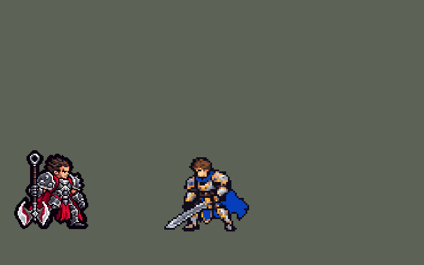

<!-- 本页上半部分由 tools/docs/gen_hero_docs.py 按仓库里现在的数据生成，手改会被覆盖；「开发记录」以下是手写的，生成时原样保留。 -->

# 德莱厄斯 Darius


| 项目 | 内容 |
|---|---|
| id | `league_darius` |
| 所属的包 | 主包（mod_id `league`） |
| 分路 | 上单 |
| 分类 / 标签 | 近战（Melee） · AD / Melee / Tank / CC / Dot |
| 高清帧 | PPU 1.45 |
| 附加包 | [诺手大招读血附加包](#附加包)（`league_darius_ult`） |



其他预览：[run_fix](../preview/league_darius_run_fix.gif)、[逐帧预览](../preview/league_darius_frames.png)、[特效表](../preview/league_darius_effects.png)

## 现在的技能

下面是游戏里显示的技能说明（`league/text/champion.i18n` 的简体中文，去掉了颜色和图标），冷却、距离来自 `league/champion/league_darius.data_champion`；1 秒 = 60 tick。

### 普攻 / 被动（被动「出血」）

*攻击间隔 1.1 秒 · 攻击距离 25000*

普攻挥斧劈砍，造成100% 攻击力的物理伤害。被动 出血：普攻和大杀四方命中的敌人流血5秒，共受到15 + 20% 攻击力的物理伤害，可叠加。德莱厄斯5秒内命中敌方英雄5次后获得诺克萨斯之力：攻击力提高40%，持续5秒。

### 技能1 · 大杀四方

*冷却 6 秒 · 施放距离 30000 · 施放：无目标 · 敌人（不含防御塔）*

德莱厄斯举斧蓄力后挥舞一圈，对周围敌人造成60 + 110% 攻击力的物理伤害并施加出血。每命中一名敌方英雄，回复25 + 30% 攻击力的生命值。

### 技能2 · 无情铁手

*冷却 8 秒 · 施放距离 46000 · 施放：指定目标 · 敌方英雄*

德莱厄斯用斧钩扫过前方扇形区域，把其中的敌人全部拉到身边并减速40%，持续1秒。之后4秒内的下一次普攻变为致残打击：造成20 + 150% 攻击力的物理伤害并减速90%，持续1秒。

### 大招 · 诺克萨斯断头台

*冷却 50 秒 · 施放距离 46000 · 施放：指定目标 · 刚交过手的敌方英雄*

德莱厄斯跃向一名敌方英雄猛力劈下，造成100 + 100% 攻击力的真实伤害。5秒内每命中敌方英雄一次，伤害提高20%；处于诺克萨斯之力时伤害翻倍。击杀该英雄后大招立即刷新，可以再次释放。

### 数值

攻击力 90（每级 +18）、生命 1080（每级 +105）、护甲 34（每级 +8）、魔抗 26（每级 +4）、移速 1000（每级 +11）。

## 附加包

附加包是可选的原生代码 mod（都在附加包合集 `league_addons` 里），**不装主包里的英雄也是完整的**。

### 诺手大招读血附加包

[诺手大招读血附加包](../../addons/league_darius_ult/README.md)：`league_darius_ult` v0.1.2

|  | 主包 | 附加包 |
|---|---|---|
| 什么时候放 R | AI 看到队伍刚打过的敌方英雄在射程内就放 | 一刀砍得死射程内的英雄（诺克萨斯之力只让这一刀伤害翻倍，不单独放行） |
| 砍谁 | AI 选的那个 | AI 选的人砍得死就砍他，否则砍得死的人里生命 + 护盾最少的 |
| 不该放的时候 | — | 改成普攻 AI 想砍的那个人（打不到就走过去），继续叠出血 |
| 跃起后、落刀前目标被自己打死（多半是出血流死） | 这一刀不落、不刷新 | 人头是诺手的：刷新 R（被动 `league_darius_ult:own_kill`）；人头是队友的照旧不刷新 |
| 伤害、击杀刷新、画面、声音 | 主包 | 主包（副本改了 R 的说明，加了被动和 R 出手时给目标挂的标记） |

## 相关脚本和素材

- [`tools/lol/extract_darius.py`](../../tools/lol/extract_darius.py)
- [`tools/art/preview_darius.py`](../../tools/art/preview_darius.py)
- [`tools/art/import_darius.py`](../../tools/art/import_darius.py)
- [`assets/source/darius/`](../../assets/source/darius)

## 开发记录

> 下面是原来 README 里「英雄：德莱厄斯」一节，原样搬过来（只改了相对链接）。

| 部分 | 内容 |
|---|---|
| 定位 | 上单（Melee），第二组第一个 |
| 普攻 | 斧头下劈，100% 攻击力。被动「出血」：普攻和 Q 命中让目标流血 5 秒，每秒 3 + 4% 攻击力的物理伤害，每次命中单独叠一层 |
| 被动 | 5 秒内命中 5 次进入「诺克萨斯之力」：攻击力 +40%，持续 5 秒，身后燃起暗红火焰。英雄联盟里按目标身上的出血层数算；数据读不到别人身上的层数，改成德莱厄斯自己的命中计数 |
| 技能1 | Q「大杀四方」：蓄力后抡斧转一圈，半径 32000 内的敌人受到 60 + 110% 攻击力的物理伤害并流血；每命中一名敌方英雄回复 25 + 30% 攻击力的生命 |
| 技能2 | E「无情铁手」：斧钩扫过前方约 106° 的扇形（46000），把敌人拉到身边。合并 W「致残打击」：之后 4 秒内的下一次普攻换成贴地横扫，20 + 150% 攻击力，减速 90% 持续 1 秒 |
| 大招 | R「诺克萨斯断头台」：跳到目标身上砸下，100 + 100% 攻击力的真实伤害；命中计数每层 +20%，诺克萨斯之力时翻倍（200 + 200%）。只对己方刚打过的敌方英雄放（`EnemyChampionRecentlyAttacked`，2026-10-04，用户：「现在AI会满血释放大招」：AI 的大招一有英雄进射程就放，常常在开团时砸满血的人；12 局模拟里放大时目标 ≥75% 血从 53 次里 10 次降到 52 次里 3 次，≤30% 血从 11 次升到 20 次，每局放的次数不变，击杀差 +2.59 → +2.42 在波动内）。击杀刷新（2026-10-09，用户：「诺手的大招刷新 做扩展包可以做的吧」）：用纯数据做在主包里，不装扩展包也有。落刀斩杀敌方英雄后，大招冷却清零、身上亮起诺克萨斯之力并播台词，可以马上再放一次；做法同派克的大招刷新（落刀时加 `league_darius_r_kill` 标记，目标活着下一 tick 清掉，4 tick 后检查，用 `ult_cooldown_mult` 清冷却），脚本 `tools/fix/darius_r_reset.py`。11 局模拟：放了 60 次大招，落刀斩杀 20 次全部刷新，没杀死人的一次都没误刷新；上单线击杀差 +0.83 → +1.61（6 个种子）。 |
| 大招读血附加包 | 用户：「诺手总是在叠满血怒或敌人残血之前就放大招，这种情况可以用"插件"（或脚本）来调整吗？」「诺手需要调整」。数据读不到当前生命，主包的 R 只能按「队伍刚打过」放，常常层数没叠、对方血还厚就砍了。附加包 [`addons/league_darius_ult`](../../addons/league_darius_ult/README.md)（在附加包合集里）用原生代码读生命、护盾、免死、减伤和诺手身上的层数，照主包的六档伤害算这一刀落下时的真实伤害（引擎里真实伤害也吃减伤）：一刀砍得死射程内的英雄（砍生命 + 护盾最少的）才放（v0.1.1 及以前诺克萨斯之力期间也放），AI 想在别的时候放就改成普攻那个人、继续叠层。经典 SDK 模拟（同一份判断挂进引擎自己的 AI 钩子；上单对 6 个基础上单 × 3 套阵容 × 两边，24 个种子，各 864 局）：每局 R 4.6 → 5.3 次，落刀砍死人 1.2 → 3.7 次（25% → 70%，都刷新），砍不死又不在诺克萨斯之力的 3.0 → 0.3 次，落刀前目标已被队友打死（这一刀落空）0.4 → 0.9 次；诺手 K/D/A 3.1/1.5/3.5 → 4.8/1.5/2.5，全队击杀差 +1.73 → +2.19。主包不装附加包也完整可玩；放 R 的时机要在游戏里看日志确认。附加包 v0.1.1（2026-10-12，用户：「别人反馈人头是诺手的」「改」）：诺手跃起后、落刀前大招目标就死了，主包这一刀不落、不刷新；人头算诺手自己的（多半是出血在半空里把残血流死）就由附加包的被动 `league_darius_ult:own_kill` 把 R 还给他，人头是队友的照旧不刷新（用户：「这个不改 太违反常识」）。附加包 v0.1.2（2026-10-22，用户：「诺手又开始大招起手了」→「改成只在能斩杀时放大，血怒不再单独放行」）：诺克萨斯之力期间不再谁都砍（游戏日志里这种刀 67 次只砍死 2 个，不少是对着八九成血的人起手），只让这一刀伤害更高；同一批 864 局模拟：放出时目标 ≥75% 血每局 0.26 → 0.01 次，砍死率 87% → 94%，全队击杀差 +2.62 → +2.63 |
| 精灵图 | 9 个动作 59 帧：待机、跑步、普攻、Q 蓄力抡圈、W 贴地横扫、E 甩钩回拉、R 跳斩、受击、死亡。发尖到靴底 34 px，18 色，动作全部取自英雄联盟原版动画 |
| 高清帧（PPU 1.45） | 2026-10-18 用 PPU 重做（用户：「下一个英雄我们重做诺手吧」），按剑姬的做法：Codex 只画一张设计图（[`tools/art/pack_darius_ppu.py`](../../tools/art/pack_darius_ppu.py) / [`assets/source/darius/PICTURE_PROMPT_PPU.md`](../../assets/source/darius/PICTURE_PROMPT_PPU.md)，交付在 `assets/source/darius/hd/`）：第二张生成图按整张图拟合出的格距（17.2 × 16.45 px）读回成 56 × 61，从斧柄顶的圆环到脚底正好 61 行，一行没删，脸照原样（[`tools/art/design_darius_hd.py`](../../tools/art/design_darius_hd.py)；第一张格子细，要删掉近一半的行，没用）。PPU 1.45，和原来一样 42 格高（用户：「用 PPU 1.45，和现在一样高」）。动作照英雄联盟每帧的骨骼摆（[`tools/art/rig_darius_hd.py`](../../tools/art/rig_darius_hd.py)）：握斧的拳套和斧头只做无损的原样 / 镜像 / 直角转，上身最多偏离髋部 1 格；腿用设计稿原样，跑步时两条腿整条按英雄联盟脚的前后位置挪、抬（缩成 ±5 格、抬起最多 4 行，抬起的部分藏到甲裙下面，不切也不转）。头像点 (0, −34) 改成头顶 (−1, −39)（`tfm2_ase.py face`），选人卡 −9 改成 −8（`bp_card_audit.py` 的规则）。league.dll 0.7.48，主包 0.155.0 |
| 加粗描边 | 2026-11-01（用户：「诺手现在应该也要加点」，避免过度高清）：外描边 1 格加到 2 格。|
| 特效 | 普攻命中、出血、Q 旋风、Q 回血、诺克萨斯之力、W 就绪（脚下）、W 命中、E 扇形斧钩、E 钩中、R 巨斧砸地 |
| 图标 | 官方技能图标（Q / E / R），64×64 |
| 音频 | 从本地客户端提取的 11 条技能音效和 4 条中文语音（Q、E、R、诺克萨斯之力）。不提交到仓库，按下面的命令在本地生成 |

```bash
python tools/lol/extract_darius.py --lol "D:\WeGameApps\lol" --vgmstream "<vgmstream-cli.exe 路径>"
python tools/lol/native_pose.py assets/source/darius/poses.json --out <渲染文件夹> --alpha --parts
python tools/art/restyle_native.py assets/source/darius/poses.json --renders <渲染文件夹>   # 角色图
python tools/art/import_native.py --hero darius
python tools/art/import_darius.py      # 特效
python tools/art/pack_darius_ppu.py --out <文件夹>   # 高清造型（PPU 1.45）：给 Codex 的重画包
python tools/art/design_darius_hd.py   # Codex 的第二张原图按拟合的格距读回（56 × 61，不删行）；--review <文件夹> 出大小对比
python tools/lol/league_joints.py assets/source/darius/poses.json --out <关节文件夹>   # 英雄联盟每帧的关节位置
python tools/art/rig_darius_hd.py --joints assets/source/darius/hd/darius_joints.json   # 高清帧，写 assets/source/ppu/orig/；--review <文件夹> 先看
python tools/art/ppu_restyle.py --hero darius
python tools/art/ppu_hd.py --hero darius
python tools/art/preview_darius.py
python addons/league_darius_ult/make_override.py   # 大招读血附加包的副本（主包的诺手改了就重跑）
```

美术（提示词见 [`assets/source/darius/PROMPTS.md`](../../assets/source/darius/PROMPTS.md)）：
- 造型图：Codex 第一轮把大图缩小成 34 px，眼睛和斧头都糊了；第二轮直接在原尺寸格子上逐格改，眼睛、描边、盔甲通过。之后加宽了深红前摆，两腿后面露出披风，把心形斧刃照模型改成双月牙巨斧，按用户选择加一格暗红小嘴。
- 脸：后来用户觉得不像英雄联盟里的诺手。照模型同角度的脸出了几个方案，用户选的是三格粗眉、眉心一道皱纹、下巴一圈胡茬，保留原版游戏画法的两行眼（白眼 + 灰蓝瞳），嘴还在两眼之间的正下方。前一版把嘴往后挪了一格、眉毛没压在眼睛上，用户觉得嘴歪、眼睛怪。造型图改了 6 格，动作图重新生成，每帧只差脸上这几格。
- 动作图：Codex 交回的 9 张是在格子上用色块拼的，身体忽大忽小，披风是一块红色方块，动起来很怪。所以改成直接用英雄联盟的动画：`native_pose.py` 在游戏尺寸下渲染每一帧（透明背景，另出一张头 / 斧 / 身体的部位图），`restyle_native.py` 把每个 8×8 块投票成造型图的 18 色（斧头按亮度，身体按色相分成深红、古铜和钢甲），描边画在轮廓外，头换成造型图的头（仰面倒地时转 90°）。肩甲放大 1.4 倍，和造型图一样大。动作、前冲和跳跃都是原版的，每帧是同一个模型，身材不会跳。
- 修了一个工具 bug：`native_pose.py` 原来把整张图的最低点放在地面线上。德莱厄斯的斧尖比靴底低 5 格，所以参考图和照着画的图都浮空 5 格。现在锚点按靴底算，参考图不变。
- 特效用 Codex 画的，围着人画的放大 2 倍。Q 旋风放大后半径约 29 px，所以 Q 的范围定为 32000。
- 结果：18 色，和右边像素同色的比例 37%（原版英雄 18%–46%）；头像截取点 (0, −34)。`tfm2_ase.py face` 把斧尖当成了脚，建议值是 −37。

逐帧预览：[`docs/preview/league_darius_frames.png`](../preview/league_darius_frames.png?v=1101hd)，特效：[`docs/preview/league_darius_effects.png`](../preview/league_darius_effects.png?v=1018da)。
