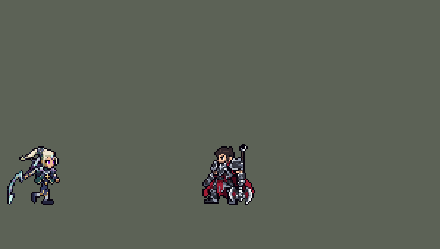

<!-- 本页上半部分由 tools/docs/gen_hero_docs.py 按仓库里现在的数据生成，手改会被覆盖；「开发记录」以下是手写的，生成时原样保留。 -->

# 黛安娜 Diana


| 项目 | 内容 |
|---|---|
| id | `league_diana` |
| 所属的包 | 主包（mod_id `league`） |
| 分路 | 打野 |
| 分类 / 标签 | 刺客（Assassin） · AP / Magic / Melee / CC / Shield |
| 高清帧 | 1 倍像素（无高清帧） |
| 附加包 | [目标标记附加包](#附加包)（`league_marks`） |



其他预览：[逐帧预览](../preview/league_diana_frames.png)、[特效表](../preview/league_diana_effects.png)

## 现在的技能

下面是游戏里显示的技能说明（`league/text/champion.i18n` 的简体中文，去掉了颜色和图标），冷却、距离来自 `league/champion/league_diana.data_champion`；1 秒 = 60 tick。

### 普攻 / 被动（被动「月银之刃」）

*攻击间隔 0.83 秒 · 攻击距离 24000*

普攻造成100% 攻击力的物理伤害。被动 月银之刃：每第3次普攻顺劈目标周围的敌人，额外造成80 + 80% 法术强度的魔法伤害；每次施放技能后3秒内攻速提高40%。

### 技能1 · 新月打击

*冷却 6 秒 · 施放距离 55000 · 施放：方向 · 敌人（不含防御塔）*

射出一道新月（优先射向附近的敌方英雄），对路径上所有敌人造成100 + 90% 法术强度的魔法伤害并施加月光，持续3秒。

### 技能2 · 月神冲刺

*冷却 8 秒 · 施放距离 45000 · 施放：指定目标 · 敌人（不含防御塔）*

冲向目标，造成80 + 70% 法术强度的魔法伤害；有月光时立刻再冲一次（优先英雄）。苍白之瀑（10秒一次）：冲到时获得70 + 50% 法术强度的护盾，三颗法球依次撞向身边的敌人，各造成35 + 30% 法术强度的魔法伤害，三颗炸完护盾再加一层。

### 大招 · 月之降临

*冷却 50 秒 · 施放距离 25000 · 施放：指定目标 · 敌方英雄*

把身边的敌方英雄拉到身前并减速40%，持续2秒；1秒后月光砸落，对周围敌人造成200 + 90% 法术强度的魔法伤害，每多拉到一名英雄伤害提高35%（至多70%）。

### 数值

攻击力 80（每级 +10）、法强 50（每级 +20）、生命 950（每级 +95）、护甲 28（每级 +8）、魔抗 20（每级 +4）、移速 1100（每级 +12）。

## 附加包

附加包是可选的原生代码 mod（都在附加包合集 `league_addons` 里），**不装主包里的英雄也是完整的**。

### 目标标记附加包

[目标标记附加包](../../addons/league_marks/README.md)：`league_marks` v0.1.0

| 英雄 | 主包（纯数据） | 装了附加包（英雄联盟） |
|---|---|---|
| 黛安娜 E 月光冲击 | Q 打中过任何东西，下一次 E 就能再冲一次 | E 冲向的目标身上带月光时才再冲一次；冲到后所有敌人身上的月光都消耗掉 |

## 相关脚本和素材

- [`tools/lol/extract_diana.py`](../../tools/lol/extract_diana.py)
- [`tools/art/preview_diana.py`](../../tools/art/preview_diana.py)
- [`tools/art/import_diana.py`](../../tools/art/import_diana.py)
- [`tools/art/design_diana.py`](../../tools/art/design_diana.py)
- [`assets/source/diana/`](../../assets/source/diana)

## 开发记录

> 下面是原来 README 里「英雄：黛安娜」一节，原样搬过来（只改了相对链接）。

| 部分 | 内容 |
|---|---|
| 定位 | 打野（Assassin），本包第七个打野（李青、阿木木、易、艾克、费德提克、贝蕾亚之后）。计划里是第九组的打野，用户提前做了。和艾克一样是法术伤害的刺客，靠冲刺进场、大招把人拉到身边 |
| 普攻 | 月刃近战，100% 攻击力的物理伤害，射程 24000，攻击间隔 0.83 秒 |
| 被动 | 「月银之刃」：每第 3 次普攻顺劈，目标和它身边的敌人（她身前 18000 处半径 18000 的圆）受到 80 + 80% 法术强度的魔法伤害，4 秒内不再攻击就重新数（英雄联盟一样是第三下）；每放一个技能，3 秒内攻速 +40%（只有一层，再放技能刷新时间）。英雄联盟里是之后三次普攻加攻速；团战经理2 数不了"接下来几次普攻"，改成固定 3 秒 |
| 月光 | Q 打中的单位带 3 秒「月光」（头上一弯新月）。英雄联盟里 E 冲向带月光的敌人时不进冷却；团战经理2 读不到目标身上的 buff，也不能只重置一个技能的冷却（`skill_cooldown_mult` 两个技能一起算，Q 也会回来），所以月光记在她自己身上：3 秒内 Q 打中过任何单位，下一次 E 用掉它，在同一次施放里立刻再冲一次 |
| 技能1 | Q「新月打击」（用户选的 A）：55000 内有敌人时放（射程内有敌方英雄时朝英雄射，没有就朝小兵或野怪射，打野、清线也会放），冷却 6 秒。第 11 tick 射出一道半径 12000 的新月（速度 6000、飞 65000），穿过路径上所有敌人：100 + 90% 法术强度的魔法伤害，挂上月光。英雄联盟的新月沿弧线飞出、在终点炸开；团战经理2 没有弧线的投射物，按用户选的做成直线穿透 |
| 技能2 | E「月神冲刺」，合并 W「苍白之瀑」（用户选的 A）：45000 内有敌人时放（打野、清线也会放），冷却 8 秒。第 2 tick 冲向目标（每 tick 4000），冲到时 80 + 70% 法术强度的魔法伤害。带着月光时，落地 8 tick 后再冲一次：先找她 45000 内的敌方英雄，没有就冲向小兵或野怪，打中同样的伤害（播英雄联盟的重置音效）。苍白之瀑有自己的 10 秒冷却，第一次冲到时触发：70 + 50% 法术强度的护盾（5 秒），三颗月球绕着她转；从第 6 tick 起每 15 tick 飞出一颗，打 20000 内随机一名敌人 35 + 30% 法术强度的魔法伤害；第三颗炸完再给一层同样的护盾（剩下的时间）。英雄联盟里月球碰到敌人才炸，这里身边有敌人时 0.6 秒内三颗炸完，没人就留着转 |
| 大招 | R「月之降临」（用户选的 A，英雄联盟现在的版本）：25000 内有敌方英雄时放，冷却 50 秒。第 16 tick 把半径 50000 内的敌方英雄拉到身边（每 tick 2500，拉到她身上为止），减速 40% 持续 2 秒；1 秒后满月砸在她身上，半径 40000 内的敌人受到 200 + 90% 法术强度的魔法伤害，每多拉到一名英雄伤害 +35%（最多三名算，+70%）。一个英雄都没拉到时不砸。AI 按射程加两人的身体开始施放（盖伦 E、李青 R 也是）：射程 30000、拉人半径 32000（英雄联盟的比例）时它常在中心相距 45000 以外开大，37% 的 R 一个人都没拉到，只剩地上的光环；改成射程 25000、拉人半径 40000 后 84% 的 R 拉到英雄（射程收到 20000 也有 92%，但 AI 放得少，那一批 +0.01）。之后用户觉得「可以做的宽一些」：拉人半径 40000 → 50000、砸地半径 32000 → 40000（都 +25%，射程不变）。同样的两批 1440 局里，一个英雄都没拉到的 R 从 9% 降到 4%，每次 R 拉到的英雄 1.10 → 1.21 名（拉到两名以上的 15% → 19%），满月砸中的英雄 0.74 → 0.86 名，每次砸地顺带砸中的小兵野怪 0.64 → 0.76 个。砸中的英雄比拉到的少，主要是被拉的英雄在满月落下前已经被打死（约四成），还活着的九成都在砸地范围里，所以砸地半径只跟着加 25% |
| 附加包 | 可选的附加包 [`addons/league_marks`](../../addons/league_marks/README.md)（在附加包合集里，原生代码，主包不装它也完整）：E 照英雄联盟只在冲向的目标带月光时再冲一次，冲到后消耗所有敌人身上的月光（主包是 Q 打中过任何东西就能再冲） |
| 连招 | 用户要求：「有连招要做连招」「都要帮我补」。英雄联盟里黛安娜 Q 标记、E 冲进去（月光重置再冲一次），一落地就开 R。原来 Q→E 已有（见月光一栏），R 各放各的：E 的 26 tick 动作完了再放 R，还要等 16 tick 才拉人，人已经走开。**E→R**：E 每次落地（第一冲和冲向英雄的第二冲）时，她身边 25000（R 的施放距离）内有敌方英雄，就开一个 90 tick（1.5 秒）的连招窗口；窗口里放 R，第 1 tick 就把人拉过来（平时第 16 tick），满月也早 15 tick 砸下，窗口随之用掉。落地时身边没有英雄不开窗口。伤害、拉人、减速、冷却都不变。数据由 [`tools/fix/combo_diana.py`](../../tools/fix/combo_diana.py) 改 |
| 数值 | 攻击 80（+10）、法术强度 50（+20）、生命 950（+95）、护甲 28（+8）、魔抗 20（+4）、移速 1100（+12）。数值是自己设计的，用 SDK 对战模拟调：打野，对 5 个原版打野（`demon`、`circus_blade`、`hunter`、`inquisitor`、`ninja`），两边、三套队友阵容各 24 局，一批 720 局。初稿（顺劈 40 + 50%，Q 70 + 60%，E 50 + 40%，月球 25 + 20%，护盾 50 + 40%，R 150 + 70%；出手时机是估的）−1.00；伤害加 15%–20% 后 −0.27；Q 90 + 80%、E 70 + 60%、顺劈 70 + 70%、月球 35 + 30%、护盾 70 + 50%、R 200 + 90%，攻击成长 10 → 14、生命成长 95 → 100 后 +2.01（同一批艾克 −0.25）；伤害和成长各退一半 +0.59，只留伤害、成长改回 10 / 95 +0.85。按动作帧定下出手时机（普攻第 11 tick，第三下第 14 tick，Q 第 11 tick，E 第 2 tick，R 第 16 tick，都比估的晚）后 −0.25 / +0.22；四套加强各 360 局：技能后攻速 +60% +0.30，Q、E 各加 10 +0.44，攻击间隔 0.92 → 0.83 秒且顺劈 80 + 80% +0.34，苍白之瀑的动作缩短一半 −0.89；中间两套一起跑两批 +0.44 / +0.55，再加技能后攻速 +60% 的一批 +0.12，没有更好；R 改成射程 25000、拉人半径 40000（见大招一栏）后两批 +1.04 / +1.03，在本包打野之间（费德提克那两批：易 +1.39 / +0.68、艾克 +0.88 / +0.44、费德提克 +0.33 / +0.65、李青 −0.96 / −0.58、阿木木 −1.15 / −1.11；贝蕾亚 +0.76 / +1.20）。对原版 `demon` 最吃亏（−1.13 / −0.82）。R 加宽（拉人 50000、砸地 40000，见大招一栏）后同样两批 **+1.25 / +1.16**（同种子逐局配对比加宽前 +0.17，标准误 0.11，伤害 +2%），用这套，对 `demon` −0.56 / −0.08。黛安娜每局放 Q 约 47 次（新月打中英雄约 14 次）、E 约 31 次（冲英雄约 8 次；带月光再冲约 21 次，其中冲向英雄约 6 次）、苍白之瀑约 23 次（每次飞出约 2.9 颗月球）、R 约 2.4 次（加宽后 96% 拉到英雄） |
| 亚索联动 | R 的拉人算亚索大招要的控制（和德莱厄斯的 E 一样）。亚索打上路、黛安娜打野时，亚索每局 R 到被控英雄 1.23 次（R 加宽后 1.19，没变）；同一批里贝蕾亚 2.27、李青 1.52，原版 `ninja` 0.65。没超过包里已有的打野，亚索不用调 |
| 精灵图 | 10 个动作 65 帧：待机、移动、普攻、第三下顺劈、Q、E 冲刺、E 冲到时放出月球（苍白之瀑）、R、受击、死亡。造型按用户选的 A，由 Codex 照英雄联盟的黛安娜按游戏尺寸画：银白长发披在身后、额前一枚月亮额饰，紫色眼睛，深蓝盔甲、胸前金色月徽、银色护肩，青绿色的披风，金色护膝、银色护胫，身后高举一把淡青色的弯月刃。头顶到脚底 40 px，连高举的月刃 43 px、27 px 宽，26 色。每帧的时机和站位照英雄联盟原版动画渲染的参考帧；腰下后来换成原版那样的短尖角裙甲，露出大腿（原来是到膝盖的长外袍，见下面「短裙甲」） |
| 特效 | 普攻斩痕、第三下顺劈的月牙弧光和命中、Q 新月（飞行）和命中、月光标记（头上）、E 落地的月光、苍白之瀑的聚光、三 / 二 / 一颗绕身的月球、飞出的月球和炸开、护盾、R 拉人的地面光环、落下砸地的满月、砸中的月光 |
| 图标 | 官方技能图标（Q / E / R），64×64 |
| 音频 | 从本地客户端提取的 11 条技能音效和 4 条中文语音（Q、W、E、R）。不提交到仓库，按下面的命令在本地生成 |

```bash
python tools/lol/extract_diana.py --lol "D:\WeGameApps\lol" --vgmstream "<vgmstream-cli.exe 路径>"
python tools/lol/native_pose.py assets/source/diana/poses.json --out <渲染文件夹>   # 动作参考帧
python tools/art/design_diana.py     # 造型：Codex 的游戏尺寸原稿按它的格子取回、缩到 40 行，写 assets/source/native/diana_native.png
python tools/art/diana_run_legs.py     # 跑步的腿：待机的腿摆成原版每帧的姿势，写 assets/source/diana/run_legs/
python tools/art/diana_action_legs.py  # 其他动作的腰以下：待机的裙甲和腿摆成每帧的姿势，写 assets/source/diana/action_legs/
python tools/art/tidy_diana.py assets/source/diana/codex_strips --run assets/source/diana/run_legs --legs assets/source/diana/action_legs
python tools/art/import_native.py --hero diana
python tools/art/import_diana.py     # 特效；--raw <Codex 的特效交付文件夹> 先转成原尺寸条
python tools/art/preview_diana.py
```

美术（造型的提示词见 [`assets/source/diana/PICTURE_PROMPT.md`](../../assets/source/diana/PICTURE_PROMPT.md) 和 [`MODEL_PROMPTS.md`](../../assets/source/diana/MODEL_PROMPTS.md)，9 条动作的见 [`MODEL_STRIPS.md`](../../assets/source/diana/MODEL_STRIPS.md)，跑步返修的见 [`RUN_REDO.md`](../../assets/source/diana/RUN_REDO.md)、[`RUN_REDO2.md`](../../assets/source/diana/RUN_REDO2.md)、[`RUN_REDO3.md`](../../assets/source/diana/RUN_REDO3.md) 和 [`RUN_REDO4.md`](../../assets/source/diana/RUN_REDO4.md)，特效的见 [`PROMPTS.md`](../../assets/source/diana/PROMPTS.md)；Codex 的交接说明在 [`codex_model/`](../../assets/source/diana/codex_model)、[`codex_strips/`](../../assets/source/diana/codex_strips)、[`codex_run/`](../../assets/source/diana/codex_run)、[`codex_fx/`](../../assets/source/diana/codex_fx)）：
- 分工：模型和特效都由 Codex 画，Claude 写提示词包、整理和导入，按"造型 → 动作 → 特效"分三步。
- 造型：这次用户没有先给图，让 Claude 写原图的提示词（「你要写提示词啊 精灵图的」，[`PICTURE_PROMPT.md`](../../assets/source/diana/PICTURE_PROMPT.md)），Codex 出图后再按游戏尺寸画了 A、B 两版（A 身材修长，B 头更大），都照原图高举月刃，都比要求的大（A 头顶到脚底 52 格、B 56 格）。`design_diana.py` 用 skill 的 `regrid.py` 按 Codex 自己的格子逐格取回，按色相加权的 Lab 聚类收成 26 色（普通 Lab 聚类把头发变成橄榄色、盔甲变成蓝色），紫色眼睛单独保留；再按行列删减（`design_riven.keep_axis`，整行整列删，不穿过脸）缩到 40 行，只留一圈描边。用户选了 A。定稿是 [`diana_native.png`](../../assets/source/native/diana_native.png)，27×43 px、26 色（月刃按下面「月刃和头发」一条往身后挪了 2 格）。
- 动作参考（`poses.json`）：镜头镜像、yaw 40、pitch 25，头 2.3、腿 0.8、头发 0.6，高度 40，96×96 的格子；月刃（`Weapon`）粘在右手上。移动照英雄联盟的 `diana_run`（8 帧 × 125 ms），普攻 `attack1`，第三下 `attack3`，Q `spell1`，E 冲刺 `spell4`、R `spell3`（动画名沿用重做前的技能位：以前 E 是拉人、R 是冲刺），苍白之瀑 `spell2`，死亡 `diana_death`。
- 整理（`tidy_diana.py`）：Codex 按定稿画了 9 条动作（59 帧），8×8 方块、定稿的 26 色，每帧整个人一起画（没有贴头）。它守不住的是脸：眼睛每帧大小、位置都不一样（有的只剩一只眼，有的一道粗眉）。每帧把定稿的脸（月亮额饰、睫毛、两只眼睛、脸颊，6×7 格）贴到 Codex 的脸上：在交付清单的眼睛标记周围 3 格内找眼睛对眼睛、皮肤对皮肤最多的位置，只贴在不透明的格子上（轮廓不变大）；脸之外剩下的眼睛颜色换成皮肤色。死亡躺倒、背过脸的帧保留 Codex 的。Codex 按眼睛标记对位，跑步整体浮空 2–4 行：该站着的帧往下移到脚底线。定稿的脚在参考站位点左边 9 格（身后的月刃把 Codex 的站位拉了过去，和薇恩一样），所有站位点左移 9 格，游戏里单位站在她两脚中间。
- 跑步返修：第一版跑步 8 帧的腿一模一样（近腿一直踩地、远腿一直往后踢，像单脚往前蹦），Codex 自己的修正版也一样。返修包把英雄联盟的跑步腿按近腿橙、远腿蓝画成参考图，要求胯以上照旧、只重画腿；交回的第 1–4 帧近腿踩地、第 5–8 帧远腿踩地，第 4、8 帧两腿交叉，眼睛和脚底的行都和待机一样。游戏里用户又看到「戴安娜走路的时候出现上下身体分割」「有一半腿露在身体外面」：和英雄联盟逐帧比，第 4、8 帧两脚劈开 23–25 格（原版最多 13 格），往后踢的腿没有大腿、只剩半截小腿横在身后，腰上一排金色、皮肤色的格子把身体切成上下两段。第二次返修包（`RUN_REDO2.md`）附上英雄联盟的跑步按游戏尺寸渲染的 8 帧和按部件上色的一套（青、品红各是一条腿），只重画第 62 行以下：交回的两脚最多相距 10 格，腿从裙甲下面直接长出来、看得见大腿，腰上的浅色带没了，胯以上逐格不变。第 8 帧近腿的小腿用了月刃的浅青色，整理时换成待机护腿的银色（`RUN_GREAVE`，8 格），不然每跑一步闪一下白。但这一版的腿是先生成大图再缩小约 15 倍贴上的，小腿只剩 2–3 格宽（含描边），护膝、护胫碎成零星的点，用户在游戏里看了说「戴安娜的腿太细」。第三次返修（`RUN_REDO3.md`）只加粗：腿的姿势、步幅、换脚都不变，宽度照待机（含两边描边：大腿、膝盖 5–6 格，小腿 4–5 格，靴子 5–6 格），材质照待机，直接在 1 倍图上逐格画、不许缩小。Codex 沿着上一版每帧腿的中线逐格加宽到 5 格，深蓝裤腿、金色护膝、银色护胫、深色靴子，胯以上和脚底的行都没动。用户看了加粗前后两版都说「腿和身体分离」：三次返修都要求第 0–61 行逐格不动，上半身停在 3–4 格宽的细腰，腿从第 62 行接上，腿顶自带一条 4–8 格长的横黑描边，不管腿粗细，腰和腿之间总有这道缝（待机是裙甲盖住大腿上端，没有横线）。第四次返修（`RUN_REDO4.md`）放开胯（第 54–67 行、第 30–55 列）：Codex 逐格改了第 59–65 行，每帧约 50 格——青绿前裙甲带金边盖住近腿上端，后片盖住远腿，腰胯连成一片，腿顶的横黑线没了；黄框外和第 68 行以下逐格不变。之后 Codex 又交了一版（align5，用户直接让它改的）：胯和腿整体往后挪 3 格（第 8 帧 2 格），让腿落在躯干正下方，第 59–60 行的腰接到新的胯位，第 0–58 行不动。用户再看：「你能好好做吗 待机的腿和跑步的腿都不一样」「要用待机的腿啊 跑步的腿在魔改吗？」「还有走路姿势和英雄联盟一样吗」——所以腰以下不再用 Codex 画的，由 `tools/art/diana_run_legs.py` 生成。第一版（待机配色的腿 + 原版姿势）用户说「腰部和腿部还是很怪」；两轮独立的看图审查（三个角度：玩家看动画、对照原版姿势、像素细节）找出原因：待机穿的是长裙甲（腰带第 59–60 行，深蓝前襟带金边加青绿侧片，下摆到第 68 行，下面只露出护膝、护胫和靴子），跑步却是一截短裙加两根长长的细腿，腰像被掐断；第二版又一瘸一拐（一条腿撑 5 帧、另一条 3 帧，第 5 帧跳高 3 行）。现在的做法：上身是 Codex 的（第 57 行以上、手和月刃，先清掉手下的黑棍、黑点、金护腕和左手下的深色细线），整体下移 2 行到待机的高度；胯部直接用待机的裙甲像素（补描边，切口处的紫色、橄榄色改成深蓝），每帧同一列，往后蹬时后摆往后飘一格、往前抬膝时前摆抬一行；腿用待机的零件（斜金边的护膝、两格宽的银护胫、约 5 格长 2 行高带跟带尖的靴子），髋在裙甲里；第 1–4 帧远腿撑地、第 5–8 帧近腿撑地，两步对称——撑地的靴子平踩、鞋底描边在第 79 行、每帧往后挪一格，膝盖按腿长反推；摆动的腿照英雄联盟原版（[`lol_run_leg_segments.json`](../../assets/source/diana/lol_run_leg_segments.json)：在原版游戏尺寸渲染上分别给大腿、小腿、脚上色量出的髋、膝、踝、脚尖，原版前后两半取平均），往后踢的脚跟藏到裙甲后面，抬起的脚离地至少一行；身体在每步中间沉一行。之后又让 Codex 照这些要求整个重画了一版（redo5），用户看了说「GPT 做的太差就按你这版弄吧」，所以用的是这一版。
- 其他动作的腿（用户：「你既然改了 释放技能的时候腿部也要弄成一样的吧 我怎么看到有不一样的部分了」）：Codex 画的动作帧穿的是短青绿裙加两条长腿，Q、W 的腿只有 1–2 格宽。`tools/art/diana_action_legs.py` 用跑步那套零件重做腰以下：每帧在 [`action_legs.json`](../../assets/source/diana/action_legs.json) 里写腰带的位置、两条腿的膝盖和脚踝（照 Codex 那帧自己的站姿，它的上身是照这个站姿画的；Q 的细腿照英雄联盟原版：一条腿撑地、一条往后抬），盖上待机的裙甲（蹲下的帧从中间去掉几行变短，侧身的 Q 去掉三列变窄），原画只清掉新裙甲下面旧腿那一块，其余（手、刀柄、月刃的深色边、马尾末梢、裙甲旁的披风）都放回去，挡在裙甲前面的手和前臂按框保留；第一版是从腰带那行整行清掉，审查发现月刃、手被切断浮在空中，改成现在这样。两条腿相贴处只留一道缝。受击两帧原来踩在月刃尖上、脚离地 3 行，整帧下移 3 行。E 横冲的 3 帧、R 落地深蹲的 4 帧、死亡倒地的 7 帧看不到腿，保留 Codex 的。之后用户：「清理一下黑边也别忘了 弄干净一点」：所有动作帧（含跑步）最后一步把外面多出来的第二层黑线和 1–2 格的碎点去掉（`tidy_diana.clean`），裙甲贴片边缘上待机自带的深色线先换成里面一格的颜色，再整圈描一道边（下摆原来是两行黑，之后又断成虚线）。
- 短裙甲（用户：「戴安娜的腿部被包裹的感觉还是好奇怪」）：定稿穿的是到膝盖的长外袍，一动起来下半身像套在筒里，腿只从膝盖往下露出一截；英雄联盟原版是紧身衣加腰间一圈短的尖角裙甲片，两条腿在深色紧身裤里整条露出来。做了样稿（腰带照旧，下面后片青绿、前中片深蓝带金尖、侧片青绿，到大腿上部），用户：「按样稿换成短裙甲」。裙甲片是 `diana_run_legs.py` 的 `TASSET`（12×7 格），跑步、动作帧都用它；待机和定稿由 `idle_lower` 换掉长外袍：清掉外袍和旧腿，画上站着的腿（护膝、护胫、靴子在原来的位置），盖上裙甲片，左边的披风、月刃和右手照旧（`tidy_diana.py` 的待机、`design_diana.py` 的第 6 步）。往后蹬的腿让后片往后飘一格，往前抬的膝盖顶起侧片的尖；侧身的 Q 去掉三列变窄。
- 导入：待机 6 帧用定稿，第 3–5 帧从小腿往上下沉一格呼吸（`BOB`）；按紫色的眼睛定头的位置（`EYES`），移动时头稳在同一列。`COMPLETE` 用 `strips.complete_outline` 补齐每帧缺的描边（共补 1840 格），`metrics` 的描边检查 100%。头像截取点 (−3, −40)；待机最高点是举着的月刃（−31），选人卡片设 `banpick_center` (0, −8)（见「选人卡片位置」一节的规则）。
- 特效用 Codex 画的 17 张（110 帧）：`import_diana.py --raw` 从生图原稿按交付清单的外框取样：每个游戏像素取它覆盖的原稿像素的多数色，三分之一以上不透明才算不透明，按技能范围定大小、只用 Codex 的 11 色：普攻斩痕 12 px，顺劈 44 px 宽（半径 18000 的圆），命中 16 px，Q 新月 22 px 高（半径 12000 加身体），命中 22 px，月光标记 10 px，E 落地 26 px，聚光 40 px，飞出的月球 8 px，炸开 16 px，护盾 36 px（她 40 px 高），R 拉人的光环 116 px 宽（半径 50000 加两边身体；拉人半径 40000 时是 96 px），砸中 20 px。三条绕身月球和满月用 Codex 的 1 倍图原样：月球是它排在同一条 8 步轨道上的（两颗、一颗是三颗的子集），满月是要求的 70×120 格子（生图原稿把 12 帧挤扁了）。满月是按砸地半径 32000 画的，砸地半径加到 40000 后整张按 1.25 倍放大（87×150 的格子，以落点为中心逐格取最近的像素，零星的点不丢也不并）。新月和飞出的月球上下镜像成严格对称（游戏按飞行方向转）。锚点量在图上：投射物在白色亮核上，命中、标记、聚光量最满一帧的中心，地面光环量中心、放在脚底线上，满月的格子量 85% 高处的落点。满月在砸下前 20 tick 开始播，第 6 帧砸地。
- 出手时刻和动画对齐：普攻第 11 tick 砍中（第 4 帧），第三下第 14 tick，Q 第 11 tick 甩出新月（第 4 帧），E 第 2 tick 起冲，苍白之瀑的动作 24 tick，R 第 16 tick 拉人（第 5 帧）。
- 月刃和头发（用户：「皎月的武器和头发重叠了」）：月刃在身后左侧、紧贴披下来的长发，两块都是浅色，1 倍和选人卡片上连成一片。做了三种改法给用户挑（月刃挪 1 格、挪 2 格、只加黑线），用户选「待机 A2 + 其他 B」：待机（站着、选人卡片、收藏界面都用它，6 帧都由定稿这一帧生成）把整把月刃连同它自己的描边往身后挪 2 格，和头发之间露出一道空隙；其他动作每帧月刃位置不同，整把挪会把月刃切断，只把碰到月刃的头发格改成描边色（`tidy_diana.py` 的 `move_blade` / `line_between`，19 帧共 69 格，R 举刀穿过头发的几帧最多）。定稿同样挪了月刃，和待机帧逐格一致。
- 结果：26 色，和右边像素同色的比例 25%（原版英雄 18%–46%）。待机每帧 726–735 个不透明像素，和阿卡丽（787）、薇恩（835）相近。

逐帧预览：[`docs/preview/league_diana_frames.png`](../preview/league_diana_frames.png?v=1014g)，特效：[`docs/preview/league_diana_effects.png`](../preview/league_diana_effects.png?v=1014g)。
