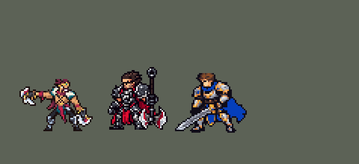

<!-- 本页上半部分由 tools/docs/gen_hero_docs.py 按仓库里现在的数据生成，手改会被覆盖；「开发记录」以下是手写的，生成时原样保留。 -->

# 德莱文 Draven


| 项目 | 内容 |
|---|---|
| id | `league_draven` |
| 所属的包 | 主包（mod_id `league`） |
| 分路 | ADC |
| 分类 / 标签 | 射手（Range） · AD / Range |
| 高清帧 | PPU 2.2 |
| 附加包 | 无 |



其他预览：[逐帧预览](../preview/league_draven_frames.png)、[特效表](../preview/league_draven_effects.png)

## 现在的技能

下面是游戏里显示的技能说明（`league/text/champion.i18n` 的简体中文，去掉了颜色和图标），冷却、距离来自 `league/champion/league_draven.data_champion`；1 秒 = 60 tick。

### 普攻 / 被动

*攻击间隔 1 秒 · 攻击距离 55000*

德莱文联盟：每接住一把斧头+1层崇拜（最多6层，每层攻击+4），用斧头击杀英雄时兑现：每层回复25生命，攻速+30%4秒。血性冲刺（自动，12秒）：对英雄出手时移速+40%、攻速+35%，接住斧头即刷新。

### 技能1 · 旋转飞斧

*冷却 9 秒 · 施放距离 55000 · 施放：无目标 · 敌人（不含防御塔）*

手中转起一把飞斧（最多2把），下次攻击额外造成40 + 55% 攻击力伤害。斧头弹回空中，0.4秒后落在他身边随机一处，他会跑进落点圈接住，继续旋转。

### 技能2 · 开道利斧

*冷却 15 秒 · 施放距离 95000 · 施放：方向 · 敌人（不含防御塔）*

掷出一对贯穿的斧刃，造成70 + 50% 攻击力伤害，击退敌人并减速30%2秒。

### 大招 · 冷血追命

*冷却 45 秒 · 施放距离 250000 · 施放：方向 · 刚交过手的敌方英雄*

向远处交战中的英雄掷出两把宽大的巨斧，飞得很远，贯穿路上的敌人造成110 + 80% 攻击力伤害；碰到第一个英雄（或飞到尽头）后折返，回程再造成一次伤害。

### 数值

攻击力 104（每级 +19）、生命 930（每级 +90）、护甲 22（每级 +7）、魔抗 15（每级 +3）、移速 900（每级 +9）。

## 相关脚本和素材

- [`tools/kit/build_draven.py`](../../tools/kit/build_draven.py)
- [`tools/kit/setup_draven.py`](../../tools/kit/setup_draven.py)
- [`tools/lol/extract_draven.py`](../../tools/lol/extract_draven.py)
- [`tools/art/preview_draven.py`](../../tools/art/preview_draven.py)
- [`tools/art/import_draven.py`](../../tools/art/import_draven.py)
- [`tools/art/design_draven.py`](../../tools/art/design_draven.py)
- [`assets/source/draven/`](../../assets/source/draven)

## 开发记录

> 下面是原来 README 里「英雄：德莱文」一节，原样搬过来（只改了相对链接）。

| 部分 | 内容 |
|---|---|
| 定位 | ADC（射手，分类 Range），第 84 位英雄。荣耀行刑官 德莱文：转着飞斧打人，斧头弹回来要接住才能接着转，越接越强，击杀时兑现。用户选 ADC、完整还原 + 高手连招 |
| 普攻 | 扔出一把旋转飞斧（追踪，100% 攻击力），射程 55000，攻击间隔 60 tick，第 11 tick 出手（动作帧第 4 帧，照英雄联盟 attack1 的 5 个姿势：准备、引臂、举过头顶、出手、收势） |
| 技能1 | Q「旋转飞斧」：冷却 540 tick（9 秒），有敌人在射程内就转起一把斧（最多两把，每把 348 tick），头顶出现一把 / 两把旋转斧标记。下一次普攻扔出带火焰的旋转斧：额外 40 + 55% 攻击力（共 155%）。斧头砸中后弹上天，**落在他身边随机一处**（用户：「捡斧头不是随机掉落位置吗 然后AI可以熟练的捡斧头」）：朝他普攻射程（55000）内随机一个敌方单位的方向 8000（身边没有单位就落在他脚下；2026-10-23 前是 18000，每隔一次朝友方 24000，他在战场上跑来跑去几乎不普攻——用户：「德莱文不A人」「一直跑来跑去 几乎不打」）。落点圈和落下来的斧头马上出现在落点，他立刻跑过去（跑步动作，9 tick 跑到，之后站在圈里照常普攻），0.4 秒（24 tick）后斧头落地时他正站在圈中间：接住，斧头回到手里继续转、血性冲刺冷却清零、崇拜 +1 层；路上被眩晕、击飞耽误就掉在地上消失。做法：两条隐藏的直线飞行物从他脚下朝那个单位飞，一条当 tick 就飞到落点，落点上放落点圈、落下的斧头，再用 `MoveTo` 让他跑过去（直线的 `end_effects` 里的 `MoveTo` 会冲到那个点，实测）；另一条 24 tick 才到，到时问他在不在落点 4000 内。模拟里 100 次接住 100 次，站的位置离落点中位数 0（原来斧头落在他被砸中时站的地方，AI 不去接，约八成，接住时常常已经走出圈外） |
| W（自动） | 「血性冲刺」没有技能位（英雄联盟的 W 没有施法动作）：冷却 720 tick（12 秒），攻击时 70000 内有敌方英雄就开：移速 +40% 1.5 秒、攻速 +35% 3 秒；接住斧头立刻刷新 |
| 技能2 | E「开道利斧」：冷却 900 tick（15 秒），射程 95000，朝目标方向（`Direction`）并排扔出两把斧，贯穿一条直线：70 + 50% 攻击力、击退、减速 30% 2 秒；也对小兵和野怪放 |
| 大招 | R「冷血追命」：冷却 2700 tick（45 秒），只对正在交战的敌方英雄放（`EnemyChampionRecentlyAttacked`，250000 内）。第 16 tick 两把巨斧沿直线飞出（速度 7000，斧刃半径 16000，照英雄联盟 160 的宽度，和巨斧的图一样宽），穿过路上所有敌人（110 + 80% 攻击力），碰到第一个英雄（或飞满 400000）就折返（`BackToCasterLinearProjectile` 从停下的点飞回他身边，速度 7000），回程再砍一次。用户：「德莱文的大招范围应该挺广的」——原来只对 150000 内放、飞 200000、半径 9000。英雄联盟是全图，但这个引擎把直线的终点（起点 + 方向 × 射程）按 x、y 各自截进地图，终点出了地图直线就拐弯：飞 1000000 时偏了 9–13°，打不中目标；400000 时测到的几次最多偏 4° |
| 被动 | 「德莱文联盟」：每接住一把斧 +1 层崇拜（最多 6 层，每层攻击 +4），整条命都在；用斧头（普攻或大招）击杀英雄时兑现：每层回复 25 生命、攻速 +30% 4 秒，层数清零（击杀判定用金克丝「兴奋」的做法） |
| 高手连招 | 用户：「完整还原 + 高手连招」。**接斧连击**：接住斧头刷新血性冲刺，下一下普攻又冲刺又转斧；**E 接 R**：开道利斧打中英雄后 150 tick 内放大招，巨斧飞得更快（9000）；**R 收割兑现**：大招击杀也算兑现崇拜。连招只用自己那个技能的冷却 |
| 数值 | 攻击 104（+19）、生命 930（+90）、护甲 22（+7）、魔抗 15（+3）、移速 900（+9）。数值是自己设计的，用 SDK 对战模拟调：ADC，对 5 个原版射手，3 套阵容、两边各打，10 分钟。初稿种子 1–12 +2.18（同一批金克丝 +4.46、图奇 +1.79、克格莫 +1.67）、25–36 +1.70（图奇 +1.18、克格莫 +1.69）；按动作帧对齐出手时间后 +2.79 / +1.88；改成随机落点、跑过去接（每把都接住）和大招加宽加远后 +3.04 / +3.17（10 分钟伤害 12900 / 13300，原来 11500），仍低于金克丝，在已合并射手的范围里，没改数值 |
| 精灵图 | 8 个动作 34 帧：待机 1（不做呼吸：呼吸要在小腿处删行，近手垂在腿旁的斧头被切得变形，用户：「上下摆动武器变形」）、移动 8、普攻 5、Q（`skill`）4、E（`skill2`）5、R（`ult`）6、受击 1、死亡 4。鸡冠头到脚底 36 行（用户：「模型可以适当缩小点」，对比图里选了 90%，原来 40 行、连举起的斧头 54 高），待机 36 × 48，23 色。头像截取点 (4, −35)；选人卡片用默认位置（头顶在站位点上方 24 格，不到 28 格不用设） |
| 高清帧（PPU 2.2） | 2026-10-26 用 PPU 重做（用户：「下一个英雄重做德莱文」）。设计图是用户自己给的图（「就用这个就行」，按 PPU 2.2、11 像素一格画的），`design_draven_hd.py` 逐格读回 114 × 76 格（34.5 游戏像素高，和原来的 35 一样，不加 SIZES 行）。动作：用户「你照着旧动作做啊 又没什么新动作」，`pack_draven_actions.py` 把旧版每一帧做成浅色人影模板，Codex 整帧重画成新造型（31 张模板 32 帧，Q 第 4 帧就是待机）；`casts_draven_hd.py` 按每格自己的 7 像素格子原样读回，逐帧查过：头和设计图一样大（设计图的头轮廓按头箍宝石叠到每帧上，发顶到下巴差不到 1 格——莎弥拉「头一大一小」的教训），斧子和旧版同一帧在同一只手（普攻第 4–5 帧远手空，E 第 4–5 帧、R 第 5–6 帧双手空），每帧一整块；跑步照旧版的脚步（10-10 用户认可的那版）。`rig_draven_hd.py` 摆到画布上（待机就是设计图），没有画进帧里的特效。头像点 (0,-33)，选人卡不用设（头顶 -24.7）。俄洛伊的灵魂、佛耶戈附身用的帧表跟着更新 |
| 特效 | Codex 生图的 19 张（游戏尺寸原稿直接读，`import_draven.py`）：`league_draven_fx` 普攻飞斧（用定稿手里那把斧整格旋转，Codex 那张太碎）、命中火花、火焰旋转斧和弹起、接斧落点圈和落下的斧头（放在落点上，0.38 秒）、接住闪光、没接住、头顶一把 / 两把旋转斧、血性冲刺光和脚下红光、开道利斧、命中、减速、大招命中、金币兑现、满层星光；`league_draven_big` 大招的两把火焰巨斧（飞出去和飞回来共用）。颜色照英雄联盟：血红到橙黄的火焰、斧头本身的钢色，兑现用金色 |
| 音效 | 英雄联盟的音效和配音（`tools/lol/extract_draven.py`）：扔斧和命中、Q 转斧 / 火焰斧出手 / 命中 / 接住 / 掉落、W、E 出手 / 飞出 / 命中、R 出手 / 飞出 / 命中 / 折返、被动兑现；Q、W、E、R 的配音。版权属于 Riot Games，**不提交到仓库**，按下面的命令在本地生成 |
| 图标 | 官方技能图标（Q 旋转飞斧 / E 开道利斧 / R 冷血追命），从本地客户端提取，缩到 64×64；W 自动，没有技能位 |

重新生成（素材来自本机的英雄联盟客户端，音频不进仓库）：

```bash
python tools/lol/extract_draven.py --lol "D:\WeGameApps\lol" --vgmstream "<vgmstream-cli.exe 路径>"
python tools/kit/build_draven.py        # 技能数据，数字都在脚本的参数表 P 里；--nodes 看每棵技能树的节点数
python tools/kit/setup_draven.py                         # 五种语言的文字、音效配置、共享文件里他的键（头像点 0,-33）
python tools/art/design_draven.py --final     # 造型：Codex 原稿按格读回、删到 40 行（1_40h）
python tools/art/fix_draven_strips.py   # 动作：Codex 逐帧重画的动作帧 + 修正（见下）
python tools/art/import_native.py --hero draven
python tools/art/import_draven.py       # 特效
python tools/art/preview_draven.py      # 逐帧预览（高清帧）、特效预览、演示 GIF
# PPU 2.2 重做（2026-10-26）：
python tools/art/pack_draven_ppu.py --out <文件夹>       # 给 Codex 的设计图包（最后用的是用户自己的图）
python tools/art/design_draven_hd.py                   # 用户的图（hd/raw/draven-user.png）逐格读回 -> hd/design.png
python tools/art/pack_draven_actions.py --out <文件夹>   # 给 Codex 的动作包（照旧版同一帧整帧重画）
python tools/art/rig_draven_hd.py                      # Codex 的交付（hd/casts）读回到设计图上 -> 原始条和 1 倍图（PPU 2.2）
python tools/art/ppu_restyle.py --hero draven && python tools/art/ppu_hd.py --hero draven && python tools/art/hero_reels.py --hero draven
```

美术（造型、动作、跑步、特效的提示词见 [`assets/source/draven/`](../../assets/source/draven) 里的 `MODEL_STRIPS.md`、`RUN_REDO.md`、`PROMPTS_FX.md`；Codex 的交付在 `codex_model/`、`codex_strips/`、`codex_run/`、`codex_fx/`）：

- 原画：Codex 画了待机（A，两手各一把斧）和投斧（B）两版，用户选 A。
- 造型：Codex 第 1 步的原稿按自己的格子（约 19.6 px 一格）读回 67 × 61，鸡冠头到脚底 49 行、头约 15 行，远手的斧头举在头顶。整行整列删到几档（脸的行列不动），用户选 1_40h：头发和胡子也各删两行，头小一些，接近 oppi 的比例。
- 动作：Codex 每帧单独生成一张。用户：「Codex做的东西有点奇怪 请你帮忙修复」——Q 四帧每帧换一个身体（一帧大了一圈），改成定稿本身、只有举起的斧头在拳头里转（整格 90° 旋转）；普攻举的是远手、扔的是近手，改成「两斧放低 → 近手举斧 → 近手甩出」三帧；E、R 最后一帧一个左右镜像、一个画成了另一个人，去掉；死亡倒地后三帧三种样子，停在一张。
- 跑步：第一版按「循环的身体和定稿逐像素一样」只让 Codex 补腿，远手的斧头一直举着（用户：「我记得德莱文在联盟里的走路姿势不是这样的」）；腿被它挪动、拉伸去对位置框后又细又碎，原稿的腿不交叉，我照英雄联盟骨架画的腿又细又短（「我要的是交叉步啊」「走路时候下半身还严重变形」「模型还严重变形」）。最后用户选 Codex 照英雄联盟跑步逐帧把整个人重画：两斧低握在身侧、交叉步、腿照定稿的粗细；读原稿，不经过它的拉伸；每帧把定稿的头原样贴回它画的头的位置、整帧左右对齐到同一列，第 8 帧糊掉的远手斧头换成第 4 帧的。
- 特效：Codex 第 3 步的 19 张都按要求的格子画好，直接读 1 倍图；普攻飞斧换成定稿自己的斧；接住闪光和血性冲刺光叠上自己的左右翻转（红色方不反）。
- 缩小和换姿势：用户「模型可以适当缩小点」（选 90%）、「另外待机姿势能改成和英雄联盟一样吗 攻击姿势也是」（英雄联盟的待机两把斧都放低，原来的待机把远手的斧头举过头顶）。Codex 照英雄联盟的待机（远手的斧头横着伸在身后、近手的斧头垂在腿旁）和普攻 5 帧按 36 行重画（提示词 `POSE_REDO.md`，交付在 `codex_pose/`），每帧把定稿的头贴回它画的头上、清掉多出来的头发；收势那帧它说鞋底低了 2 行、高 38 行，整帧上移再删 2 行。Q 改成远手的斧头在拳头里转（整格 90° 旋转，画在身体后面）；受击是新待机往后退 2 格。跑步、E、R、死亡用整行整列删除缩到 90%（不重采样；每帧删自己高宽的一成，挑和相邻行最像的行列，头、鞋底两行、站位行列不删），每帧的头和原来逐像素一样。

逐帧预览：[`docs/preview/league_draven_frames.png`](../preview/league_draven_frames.png?v=1026hd)，特效：[`docs/preview/league_draven_effects.png`](../preview/league_draven_effects.png?v=1014g)。
