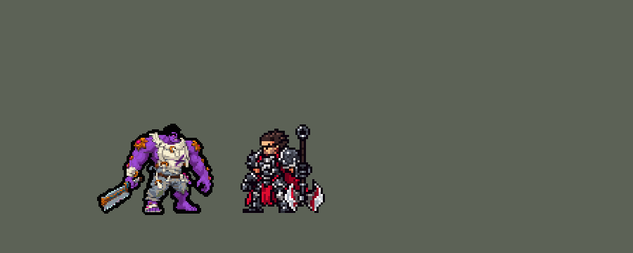

<!-- 本页上半部分由 tools/docs/gen_hero_docs.py 按仓库里现在的数据生成，手改会被覆盖；「开发记录」以下是手写的，生成时原样保留。 -->

# 蒙多医生 Dr. Mundo


| 项目 | 内容 |
|---|---|
| id | `league_drmundo` |
| 所属的包 | 主包（mod_id `league`） |
| 分路 | 上单 |
| 分类 / 标签 | 近战（Melee） · AD / Melee / Tank / Heal |
| 高清帧 | PPU 1.5 |
| 附加包 | [蒙多附加包](#附加包)（`league_drmundo`） |



其他预览：[逐帧预览](../preview/league_drmundo_frames.png)、[特效表](../preview/league_drmundo_effects.png)

## 现在的技能

下面是游戏里显示的技能说明（`league/text/champion.i18n` 的简体中文，去掉了颜色和图标），冷却、距离来自 `league/champion/league_drmundo.data_champion`；1 秒 = 60 tick。

### 普攻 / 被动

*攻击间隔 1.13 秒 · 攻击距离 25000*

想去哪就去哪：首次被控后免控1.5秒并丢下药罐，捡起回复60 + 60% 攻击力。大力行医：每7秒一次普攻额外造成80 + 8% 最大生命伤害，打死的单位被打飞，撞伤身后的敌人。

### 技能1 · 病毒屠刀

*冷却 4.33 秒 · 施放距离 70000 · 施放：指定目标 · 敌人（不含防御塔）*

扔出骨锯，命中第一个单位造成140魔法伤害，减速40%2秒并回复20生命；命中英雄额外造成其最大生命9%真实伤害、多回复40。

### 技能2 · 电击疗法

*冷却 15 秒 · 施放距离 22000 · 施放：指定目标 · 敌人（不含防御塔）*

电击身边的敌人4秒（每0.33秒10 + 1% 最大生命），挨打时积攒灰色生命；结束时电击造成90 + 4% 最大生命，命中英雄回复全部灰色生命，只命中小兵回复一半。

### 大招 · 极限剂量

*冷却 80 秒 · 施放距离 50000 · 施放：指定目标 · 敌方英雄*

被围攻时给自己注射：立即回复200 + 100% 攻击力生命，10秒内最大生命+200、每秒回复40生命、移速+25%。

### 数值

攻击力 96（每级 +20）、生命 1350（每级 +125）、护甲 38（每级 +8）、魔抗 28（每级 +4）、移速 1000（每级 +10）、生命回复 6（每级 +1）。

## 附加包

附加包是可选的原生代码 mod（都在附加包合集 `league_addons` 里），**不装主包里的英雄也是完整的**。

### 蒙多附加包

[蒙多附加包](../../addons/league_drmundo/README.md)：`league_drmundo` v0.1.6

|  | 主包（纯数据） | 装了附加包 |
|---|---|---|
| 想去哪就去哪 | 第一个控制照样吃，被控后马上 1.5 秒免控、丢下药罐（数据只能在控制落下后反应，清不掉已经在身上的控制） | **控制落下的那个 tick 就清掉**（只认硬控：击飞、眩晕、定身、嘲讽、恐惧、魅惑、强制位移），扣**当前生命**的 7%，丢药罐；生命不满 85%、身边没有敌方英雄时**走回去捡药罐**（该放大招时先放大招） |
| 病毒屠刀打英雄 | 加目标最大生命的固定 % 真实伤害 | 按目标**当前生命**的 20% 算魔法伤害（至少是 Q 的基础伤害） |
| 大力行医 | 固定的额外伤害 | 按他的**已损生命**最多再翻一倍；攻击力随**额外生命**（装备给的）涨 2.5% |
| 电击疗法的灰色生命 | 每次检查时挨了打就记一份固定的灰色生命 | 存**真实受到伤害**的 75%（最多最大生命的一半），结束时电到英雄全回、只电到小兵野怪回一半 |
| 极限剂量的时机 | 伤害传感：几秒内连续吃下 3 × 150 伤害、身边有敌方英雄才放 | 按**真实生命**：低于 60%，或 1 秒内掉了 15% 以上，且身边有敌方英雄才放（0.1.3，用户：「蒙多开大次数也挺少的」；原来 40% / 25%，多数比赛一次都没放）；放出时回复**已损生命**的 25% |

## 相关脚本和素材

- [`tools/kit/build_drmundo.py`](../../tools/kit/build_drmundo.py)
- [`tools/kit/setup_drmundo.py`](../../tools/kit/setup_drmundo.py)
- [`tools/lol/extract_drmundo.py`](../../tools/lol/extract_drmundo.py)
- [`tools/art/preview_drmundo.py`](../../tools/art/preview_drmundo.py)
- [`tools/art/rig_drmundo.py`](../../tools/art/rig_drmundo.py)
- [`assets/source/drmundo/`](../../assets/source/drmundo)

## 开发记录

> 下面是原来 README 里「英雄：蒙多医生」一节，原样搬过来（只改了相对链接）。

| 部分 | 内容 |
|---|---|
| 定位 | 上单（Melee，标签 AD / Melee / Tank / Heal），第 111 位英雄。祖安狂人 蒙多医生（客户端里名字和称号是反着的，按官方）：扔锯、电击、给自己打针的坦克战士。用户的选择：「方案可以，全按推荐做（上单，做附加包）」——按现在的英雄联盟排技能，技能 1 = Q 病毒屠刀，技能 2 = W 电击疗法，大招 = R 极限剂量，E 大力行医并进普攻，被动想去哪就去哪；高清 PPU 1.5、42 行 |
| 普攻 / 被动 | 骨锯劈砍（近战，攻击距离 25000，攻击间隔 68 tick，第 11 tick 打中）。**想去哪就去哪**：一直回复生命（6 + 每级 1 每秒）；被动好了（冷却 40 秒）时，每 3 tick 查一次自己有没有被控（数据只能在控制落下之后反应，清不掉已经在身上的控制：模拟里试过免控 buff 和 1 tick 的自我眩晕，都不行），被控就获得 1.5 秒免控，在脚下丢下药罐：1 秒后能捡，他走过去就回 60 + 60% 攻击力的生命、被动冷却缩到 60%，敌方英雄踩到就碎。药罐是一串 2 秒的区域，只在药罐还在时续下一段（区域收不回来，一整段 10 秒的区域在他捡起后还会画着；0.121.1 起每一段都在药罐落地时用 Delayed 排好——0.120.0 把下一段挂在区域的 end_effects 上，这种区域从来不执行它，药罐 2 秒就没了），画面是每段播一次的地面特效（区域自己的画面会跟着方向转，红色方会倒过来）。**大力行医**（E）：每 7 秒一次普攻换成抡药箱，多 80 + 60% 攻击力；打死的小兵、野怪被打飞，从他那边往后飞 70000，沿路的敌人受 40 + 60% 攻击力 |
| 技能1 | Q「病毒屠刀」：冷却 260 tick，对 70000 内的敌人放（小兵、野怪也打）。第 11 tick 扔向目标 8 tick 前站的地方（能躲），打中第一个单位：140 魔法伤害，减速 40%（2 秒），他回 20 生命；打中英雄再加目标 9% 最大生命的真实伤害（英雄联盟是当前生命的 20%，数据读不到当前生命）、多回 40 |
| 技能2 | W「电击疗法」：冷却 900 tick，身边 22000 内有敌人时开。4 秒里每 20 tick 电一下身边的敌人（18 魔法 + 6% 攻击力）；每 30 tick 查一次他身上 1 点的「受击传感」护盾（瑟提的做法），这段时间挨过打就记一份 30 的灰色生命；结束时电一圈（90 魔法 + 30% 攻击力）：电到英雄全部回、只电到小兵野怪回一半、没电到人不回 |
| 大招 | R「极限剂量」：冷却 4800 tick，**看时机**（用户的规则「看好时机」）。原来按"最近挨打的次数"放，模拟里很多次是满血放的；改成「伤害传感」：一个 150 点的护盾，被打破就说明他吃了 150 伤害，下次出手时把这 150 补扣回去（护盾不白送血），连破 3 次（每次间隔不超过 5 秒）并且 40000 内有敌方英雄才放——6 局里每局 2 次左右，放的时候平均剩六成血。立即回复 200 + 100% 攻击力，10 秒内最大生命 +200、每秒回 40、移速 +25%；上膛 15 秒没用上就把冷却截到 1 秒 |
| 附加包（站桩） | 可选的附加包 [`addons/league_ult_press`](../../addons/league_ult_press/README.md)（在附加包合集里，原生代码，主包不装它也完整）：游戏 0.6.4 的 AI 常让这位英雄在敌方英雄跟前站着不打——只读观察包里身边 50000 内有敌方英雄时站着不动 21.8%，其中 9.1% 是 AI 下令「走到自己脚下」（盖伦 2.7% / 0.7%）。照卡蜜尔、瑟提、奥拉夫的办法（用户：「站桩的按照之前卡密尔那样改 然后合并」）：原地站了 15 tick、普攻好了、AI 还让他原地站时，35000 内最近的敌方英雄——他生命不低于一半、目标离敌方塔 75000 以外、目标身边 60000 内的敌方英雄不多于他身边的我方英雄（含他）——就普攻他，打出一下或 1.5 秒后重新算 |
| 附加包 | 可选的附加包 [`addons/league_drmundo`](../../addons/league_drmundo/README.md)（在附加包合集里，原生代码，主包不装它也完整）：**被动真的挡下第一个硬控**（控制落下的那个 tick 就清掉，扣当前生命的 7%，不满 85% 血、身边没敌人时走回去捡药罐）；**Q 按目标当前生命的 20%**（至少 140）；**E 按已损生命最多翻一倍**、攻击力随额外生命涨 2.5%；**W 存真实受到伤害的 75%** 当灰色生命；**R 按真实生命放**（低于 60%，或 1 秒内掉了 15%，且身边有敌方英雄；原来 40% / 25%，用户：「蒙多开大次数也挺少的」），回已损生命的 25%。按模拟编号分开记（同一局的几份模拟实体编号一样）。日志 `league_drmundo.log`：游戏里看过（10-16，几局下来挡控 41 次、Q 41、E 43、W 放电 84 段、R 放 6 次，都对；同一局的预模拟和画面里那份算出来一样）。走回去捡药罐那次一次都没触发：0.1.0 在挣脱控制时记下药罐，可数据的药罐要飞 20 tick 才落地、挂上 `can`，下一个 tick 看到身上没有 `can` 就把它忘了；R 留着不放时药罐判断也排在后面被挡住；日志里 TANK 和 R HELD 还共用一个计数。0.1.1 改成药罐落地那一刻记位置、`can` 没了才忘，先看 R 再看药罐，日志分开数（模拟器里接上同样的 AI 钩子，12 种子 × 两批对六个基础上单：0.1.0 每局走 0 次、−0.90 / −0.92；0.1.1 每局走 3.6 次、走过去捡到 2.2 个，−0.81 / −0.97）。0.1.2（用户：「塔姆和蒙多互打时模型会卡住」，蒙多站着不动）：主包的药罐 2 秒就没了、身上的 `can` 还挂 10 秒，0.1.1 让他走到空地上干等，主包 0.121.1 修好；已经站在药罐上就不再「走过去」；选不中、看不见的敌人（潜进地下的塔姆、隐身的）也算「身边有敌人」；R 的目标选不中了改打最近的敌方英雄，不再站着；日志多一行 `STUCK` 诊断。15 分钟模拟：0.1.0 + 0.120.0 −1.08 / −1.40，0.1.2 + 0.121.1 −0.80 / −0.98，每局捡到 4.3 → 5.8 个；对塔姆 6 局站着干等 0 |
| 数值 | 攻击 96（+20）、生命 1350（+125）、护甲 38（+8）、魔抗 28（+4）、移速 1000（+10）、生命回复 6（+1） |
| 平衡 | 上单对六个基础上单（fighter / executioner / lancer / pole_warrior / knight / berserker），三套阵容、两边各打，15 分钟经典引擎模拟 12 个种子：定稿 −0.75 / −0.69（种子 1–12 / 25–36；同批盖伦 −1.15 / −2.10，塞恩 +0.78）。草案 −2.94（伤害只有盖伦的一半），加伤害到 −0.21，R 改成看时机掉到 −0.73、加生命护甲回到 −0.22；药罐改成一段段续的区域又掉了约 0.4（−0.32 → −0.7，W 带不带被动设置都一样），在盖伦和塞恩之间，留着。0.121.1 把续段修好（0.120.0 的药罐其实 2 秒就没了）：−0.91 / −0.26（同批 0.120.0 −0.75 / −0.69） |
| 修正（伤害按生命值，2026-10-22） | 用户：「蒙多加成怎么是攻击力不是生命值」。英雄联盟里蒙多按生命值算，当初以为数据读不到生命值，用攻击力代替；其实伤害效果的 `hp_ratio` 就是自己最大生命的百分比（墨菲特、加里奥的做法）。改成：大力行医 80 + 60% 攻击 → 80 + **8% 最大生命**，打飞的单位 40 + 60% 攻击 → 40 + 6%，心脏电击器每下 18 + 6% 攻击 → 10 + 1%，最后一下 90 + 30% 攻击 → 90 + 4%（附加包按已损生命多加的那部分也跟着按生命算）。捡药罐、大招的回血还按攻击力：回血效果没有生命值的比例。上路模拟（8 个种子）：改前 -0.12、改后 +0.37（都在误差内），造成伤害 9450 → 9637。主包 0.195.6，附加包 0.1.5 |
| 精灵图（高清帧 PPU 1.5） | Codex 第 0 步画了两张原画（A 待机拎锯、B 举锯），[`tools/art/design_drmundo_hd.py`](../../tools/art/design_drmundo_hd.py) 按它自己的格子读回（A 10.5 px 一格、B 9.7），用户选「A，42 行，PPU 1.5」。第 2 步 Codex 照英雄联盟的骨架画了 43 帧（E 抡的是药箱），HANDOFF 自己列了问题：头每帧重画、大小和站位跳、跑步不换腿、死亡没贴地。用户：「有问题的地方你帮忙修复 然后你自己review 完美了再喊我review」——[`tools/art/import_drmundo_strips.py`](../../tools/art/import_drmundo_strips.py)：偏大的帧按整行整列删回定稿大小，每帧按两只脚的中点对齐；Codex 的头和定稿的头一样大、一样的五官，贴定稿的头反而会贴到肩上、胸口（两个头），所以保留；跑步用定稿自己的两条腿从胯部摆（每行整体平移，切口处不断），身体落地时下沉；死亡躺下的帧贴地。整个英雄以躯干为中心站在站位点上（站位点在两脚之间时身体偏右 8 px，他身上的特效红蓝两边对不上）。[`tools/art/rig_drmundo.py`](../../tools/art/rig_drmundo.py) 降到 PPU 1.5、加待机呼吸（锯跟着手）和受击。用户审过：「动作美术通过」。2026-10-19 补帧：跑步在两步之间整个人多跳 0-1-2-1 格（腿没改），死亡 8 帧（第一张躺地的帧先离地再落下、回弹一下）；R 加上针筒（第 1 帧举针、第 4 帧扎针） |
| 特效 | Codex 第 3 步的 20 个特效（用户贴在对话里，`assets/source/drmundo/codex_fx`）。[`tools/art/import_drmundo_fx.py`](../../tools/art/import_drmundo_fx.py)：去底（黑底；W 开启那张画在灰色人形上、回血那张有白色格线）、按游戏大小缩、归到提示词的色阶、左右镜像给红方用；飞出去的骨锯和被打飞的尸体在转，不镜像；药罐是地面特效，不镜像。写成 `league_drmundo_fx` 和 `league_drmundo_big`（W 光环、开启、放电、R 注射）。用户：「特效可以了」 |
| 音效 | 英雄联盟的音效和配音（[`tools/lol/extract_drmundo.py`](../../tools/lol/extract_drmundo.py)，20 段）：劈砍出手 / 打中、药箱抡出 / 砸中、尸体撞击、Q 出手 / 打中 / 回血、W 开启 / 放电、R、药罐扔出 / 落地 / 捡起 / 碎，配音 Q / W / E / R 和被动的笑声 |
| 图标 | 官方技能图标（Q 病毒屠刀 / W 电击疗法 / R 极限剂量，另有 E 大力行医、被动想去哪就去哪），从本地客户端取 |

重新生成（素材来自本机的英雄联盟客户端，音频不进仓库）：

```bash
python tools/lol/extract_drmundo.py --lol "D:\WeGameApps\lol" --vgmstream <vgmstream-cli.exe>
python tools/kit/build_drmundo.py                  # 技能数据，数字都在脚本的参数表 P 里
python tools/kit/setup_drmundo.py --face -1,-38 --banpick -8   # 五种语言的文字、音效配置、共享文件里他的键
python tools/art/design_drmundo_hd.py              # Codex 的原画读回成两张造型
python tools/art/import_drmundo_strips.py          # Codex 的动作修好：大小、站位、跑步、死亡
python tools/art/rig_drmundo.py                    # 1 倍帧和 1.5 的高清帧，待机、受击
python tools/art/ppu_restyle.py --hero drmundo     # 描边
python tools/art/ppu_hd.py --hero drmundo          # hd_ / lo_ 帧
python tools/art/import_drmundo_fx.py              # 特效
python tools/art/preview_drmundo.py                # 预览和演示 GIF
python addons/league_drmundo/make_override.py      # 附加包的副本（主包的蒙多改了就重跑）
```

美术提示词见 [`assets/source/drmundo/`](../../assets/source/drmundo) 里的 `PICTURE_PROMPT.md`、`MODEL_STRIPS.md`、`PROMPTS_FX.md`；Codex 的交付在 `codex_picture/`、`codex_strips/`、`codex_fx/`。

逐帧预览：[`docs/preview/league_drmundo_frames.png`](../preview/league_drmundo_frames.png?v=1016a)，特效：[`docs/preview/league_drmundo_effects.png`](../preview/league_drmundo_effects.png?v=1016a)。
