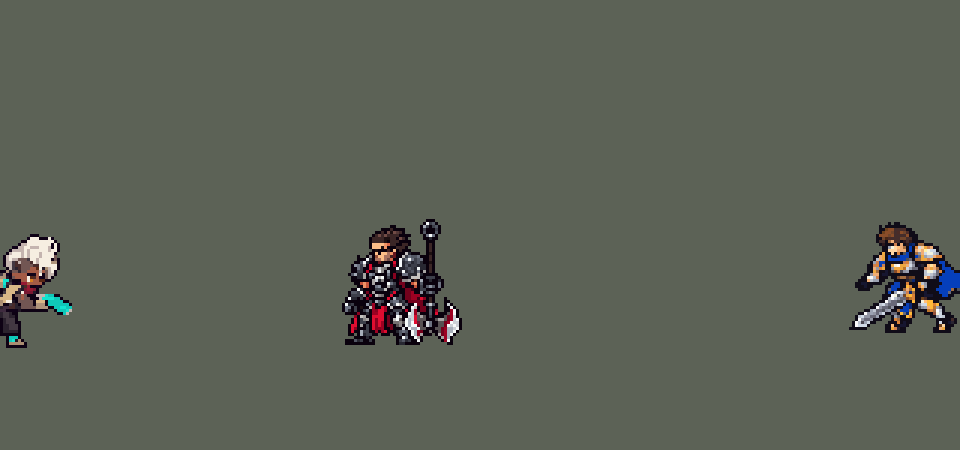

<!-- 本页上半部分由 tools/docs/gen_hero_docs.py 按仓库里现在的数据生成，手改会被覆盖；「开发记录」以下是手写的，生成时原样保留。 -->

# 艾克 Ekko


| 项目 | 内容 |
|---|---|
| id | `league_ekko` |
| 所属的包 | 主包（mod_id `league`） |
| 分路 | 打野 |
| 分类 / 标签 | 刺客（Assassin） · AP / Magic / Melee / CC / Shield |
| 高清帧 | 1 倍像素（无高清帧） |
| 附加包 | [艾克时间倒转附加包](#附加包)（`league_ekko_rewind`） |



其他预览：[逐帧预览](../preview/league_ekko_frames.png)、[特效表](../preview/league_ekko_effects.png)

## 现在的技能

下面是游戏里显示的技能说明（`league/text/champion.i18n` 的简体中文，去掉了颜色和图标），冷却、距离来自 `league/champion/league_ekko.data_champion`；1 秒 = 60 tick。

### 普攻 / 被动（被动「Z型驱动共振」）

*攻击间隔 0.92 秒 · 攻击距离 24000*

普攻造成100% 攻击力的物理伤害。被动 Z型驱动共振：普攻、Q 每一程、E 和 R 命中各记一层，第3层额外造成100 + 80% 法术强度的魔法伤害并减速40%，持续1.5秒，之后3秒不再记层；附近有敌方英雄时艾克移动速度提高40%，持续2秒。

### 技能1 · 时间卷曲器

*冷却 6 秒 · 施放距离 55000 · 施放：方向 · 敌人（不含防御塔）*

掷出装置，对路径上的敌人造成70 + 50% 法术强度的魔法伤害；装置在尽头展开力场，减速40%其中的敌人0.75秒，随后飞回艾克，沿途再造成50 + 60% 法术强度的魔法伤害。

### 技能2 · 相位俯冲

*冷却 7 秒 · 施放距离 45000 · 施放：指定目标 · 敌人（不含防御塔）*

冲向目标并闪击，造成60 + 60% 法术强度的魔法伤害。时光交错（冷却14秒）：在附近一名敌方英雄脚下投出时间球，1.5秒后成形，持续1.5秒并减速40%；艾克在球内时引爆，眩晕球内敌人1秒，艾克获得80 + 80% 法术强度的护盾，持续2秒。

### 大招 · 时空断裂

*冷却 60 秒 · 施放距离 30000 · 施放：指定目标 · 敌方英雄*

在脚下留下时间锚点，4秒后回到锚点，短暂无敌并回复150 + 80% 法术强度的生命值，同时对落点周围的敌人造成150 + 100% 法术强度的魔法伤害。期间阵亡则不会回溯。

### 数值

攻击力 80（每级 +10）、法强 50（每级 +20）、生命 920（每级 +90）、护甲 28（每级 +7）、魔抗 20（每级 +4）、移速 1100（每级 +12）。

## 附加包

附加包是可选的原生代码 mod（都在附加包合集 `league_addons` 里），**不装主包里的英雄也是完整的**。

### 艾克时间倒转附加包

[艾克时间倒转附加包](../../addons/league_ekko_rewind/README.md)：`league_ekko_rewind` v0.1.0

|  | 主包（纯数据） | 装了附加包 |
|---|---|---|
| 回到哪里 | 施放时留锚点，4 秒后回到锚点 | 施放时立刻回到 4 秒前的位置（刚复活不到 4 秒就回到复活后最早的位置） |
| 治疗 | 150 + 80% 法强 | 150 + 80% 法强，这 4 秒每损失 1% 最大生命 +4%，最多 +200%（损失 50% 时加满） |
| 落地 | 短暂无敌，周围 35000 内 150 + 100% 法强魔法伤害 | 一样 |
| 什么时候放 | 30000 内有敌方英雄就放 | 生命不高于 35%、这 4 秒掉了 30% 以上、回去的地方 35000 内有 2 个以上敌方英雄、或那里有人吃得下落地这一下时才放 |

## 相关脚本和素材

- [`tools/lol/extract_ekko.py`](../../tools/lol/extract_ekko.py)
- [`tools/art/preview_ekko.py`](../../tools/art/preview_ekko.py)
- [`tools/art/import_ekko.py`](../../tools/art/import_ekko.py)
- [`assets/source/ekko/`](../../assets/source/ekko)

## 开发记录

> 下面是原来 README 里「英雄：艾克」一节，原样搬过来（只改了相对链接）。

| 部分 | 内容 |
|---|---|
| 定位 | 刺客（Assassin），第四组的打野，本包第三个刺客（李青、易之后），第一个吃法术强度的刺客 |
| 普攻 | 挥棒，100% 攻击力的物理伤害，射程 24000，攻击间隔 0.92 秒 |
| 被动 | 「Z型驱动共振」：普攻、Q 的去程和回程、E 的闪击各记一层，4 秒内的第 3 层额外造成 60 + 80% 法术强度的魔法伤害，减速 40% 持续 1.5 秒；这时附近 40000 内有敌方英雄，艾克移速 +40% 持续 2 秒。英雄联盟里要连续打中同一个目标 3 次，同一目标 5 秒内只触发一次。引擎分不出这一下和上一下是不是同一个目标（见厄运小姐一节），所以数的是他自己的命中：两个 4 秒的隐藏 buff 计数，第 3 下打在谁身上就在谁身上触发。Q 每一程只有第一个打中的单位计数（30 tick 的锁，和索拉卡"每次施放只一次"的写法一样） |
| 技能1 | Q「时间卷曲器」：朝目标方向掷出装置（半径 9000），穿过的敌人受到 70 + 50% 法术强度的魔法伤害；飞满 65000 后在尽头展开力场（半径 22000），力场里的敌人减速 40%，0.75 秒后装置飞回艾克身边（他走到哪里就飞到哪里），沿途再造成 50 + 60% 法术强度的魔法伤害。英雄联盟里装置碰到第一个英雄就停下展开力场；这里总是飞满全程。射程 55000，冷却 6 秒，也对小兵和野怪放 |
| 技能2 | E「相位俯冲」：冲到目标身边（射程 45000）闪击，60 + 60% 法术强度的魔法伤害。英雄联盟是先短距离位移、下一次普攻再闪到目标身上；这里合成一个动作：`MoveTo` 冲到目标所在的位置（引擎不按 `range` 截断冲刺距离），冲刺结束时闪击。冷却 7 秒，也对小兵和野怪放。合并 W「时光交错」（单独冷却 14 秒）：60000 内有敌方英雄时，在他脚下投出时间球，投出时地上出现成形中的光环，1.5 秒后成形，再持续 1.5 秒，球里（半径 40000）的敌人减速 40%；艾克在球里时时间球破裂，眩晕球内所有敌人 1 秒，艾克获得 80 + 80% 法术强度的护盾 2 秒。英雄联盟里 W 投向一个地点；这里投到敌方英雄脚下，只打野怪时不投，冷却留给英雄。刚用 E 冲到目标身边，模拟里 73% 的时间球会破裂，多数在成形的那一刻。W 的被动（对低血量目标的额外伤害）引擎读不到目标的血量，不做 |
| 大招 | R「时空断裂」：附近 30000 内有敌方英雄时放，冷却 60 秒。施放时在原地留下时间锚点和他的全息残影，4 秒后回到锚点：短暂无敌（20 tick 内受到伤害降低 100%、免疫控制），回复 150 + 80% 法术强度的生命值，并对落点周围半径 35000 的敌人造成 150 + 100% 法术强度的魔法伤害。英雄联盟是随时回到 4 秒前的位置，并按这 4 秒里受到的伤害加成治疗；引擎不记单位过去的位置，也读不到受到的伤害，所以改成施放时留锚点、4 秒后自动回来，治疗固定。锚点是一个射程 1 的直线投射物，它的结束效果记住施放位置，`Delayed` 239 tick 后 `Teleport` 回到那里（`y_offset` 5000 抵消直线投射物起点的偏移，永恩那边测出来的）。4 秒内阵亡就不回溯：阵亡会清空 buff，回溯前先检查一个 250 tick 的 buff |
| 附加包 | 可选的附加包 [`addons/league_ekko_rewind`](../../addons/league_ekko_rewind/README.md)（在附加包合集里，原生代码，主包不装它也完整）：R 照英雄联盟施放时立刻回到 4 秒前的位置，治疗按这 4 秒损失的生命最多 +200%；AI 只在残血、刚被打掉一大截、或回去能打到人时放（主包留锚点 4 秒后回来、治疗固定） |
| 数值 | 攻击 80（+10）、法术强度 50（+20）、生命 920（+90）、护甲 28（+7）、魔抗 20（+4）、移速 1100（+12）。数值是自己设计的，用 SDK 对战模拟调：打野位，对 5 个原版刺客打野（`demon`、`circus_blade`、`hunter`、`inquisitor`、`ninja`），两边、三套队友阵容各 24 局，一批 720 局。团队击杀差：初版 +0.33；时光交错的半径从 30000 放大到 40000（每局眩晕的英雄从 1.4 个到 2.3 个）是 +0.76；按美术定下的出手帧重跑（普攻第 10 tick、Q 第 11 tick、E 第 2 tick 起跳、R 加上落地动作）掉到 +0.05 / −0.12（两批种子）；共振从 40 + 70% 提到 60 + 80% 是 +0.50；再把 Q 去程从 60 + 40% 提到 70 + 50%、回程从 40 + 60% 提到 50 + 60%、E 闪击从 50 + 50% 提到 60 + 60%，两批是 +0.88 / +0.44，就用这一版。同一批（1–24 号种子）里易 +1.39、原版 `hunter` −0.35、李青 −0.96、阿木木 −1.15。大招的爆炸平均每次只打中约 0.3 个英雄（改射程、半径、延时都差不多），它的价值在治疗和脱身 |
| 亚索联动 | 时光交错的眩晕算亚索大招要的控制。亚索打上路、艾克打野时，亚索每局放 R 1.12 次；同一批 48 局里打野换成原版 `ninja` 是 0.65 次，李青 1.50 次，阿木木 1.69 次。艾克在它们之间，亚索不用调 |
| 精灵图 | 9 个动作 51 帧：待机、跑步、普攻、Q、E、R 起手、R 回溯落地、受击、死亡。发冠顶到脚底 34 px（头骨到脚底 28 px），40 色，动作全部取自英雄联盟原版动画 |
| 特效 | 普攻命中（Q 命中共用）、Z型驱动共振的时间环、Q 装置和尽头的力场、E 冲刺残影和闪击、时光交错成形中的光环、时间球、破裂、眩晕、护盾、R 的全息残影、消散、回溯落地的冲击环和命中 |
| 图标 | 官方技能图标（Q / E / R），64×64 |
| 音频 | 从本地客户端提取的 13 条技能音效和 3 条中文语音（Q、W、R）。不提交到仓库，按下面的命令在本地生成 |

```bash
python tools/lol/extract_ekko.py --lol "D:\WeGameApps\lol" --vgmstream "<vgmstream-cli.exe 路径>"
python tools/lol/native_pose.py assets/source/ekko/poses.json --out <渲染文件夹> --alpha --parts
python tools/art/restyle_native.py assets/source/ekko/poses.json --renders <渲染文件夹>   # 角色图
python tools/art/import_native.py --hero ekko
python tools/art/import_ekko.py      # 特效；--raw <Codex 的交付文件夹> 先把原始图转成原尺寸条
python tools/art/preview_ekko.py
```

美术（提示词见 [`assets/source/ekko/PROMPTS.md`](../../assets/source/ekko/PROMPTS.md)）：
- 分工：角色图由 Claude 画，Codex 只画特效。
- 比例和镜头：镜头 yaw 45、pitch 25，不镜像，头 2.0、腿 0.8。莫西干发挂在 `F_Mohawk1` / `B_Mohawk1` 骨骼上，头发的规则（`hair|braid|ponytail`）找不到，单独缩到 0.6（`"chibi": {"scale": ...}`），身高从头骨量起（`"crown": 181`）。英雄联盟里艾克待机时深蹲、球棒指向前方；四种姿势（深蹲、深蹲 90%、半直立、直立）里用户选了 B（深蹲 90%）：头骨到脚底 28 px，加上发冠 34 px。
- 肤色：带光照的渲染把他的深棕色皮肤照成了紫粉色；英雄联盟贴图里是 `#63383C`，投色的色阶改取贴图的颜色。
- 头部：第一轮三张从零画的脸（圆头、扁脸、像灰绿色头盔的帽子上立着白发冠、脸上的油彩被看成第三只眼）用户都不认可，觉得奇怪、质量低；按英雄联盟的头在游戏尺寸投色也糊成一团（高发冠下脸只有 9 px 宽）。最后照原版剑士的头部结构逐格画：3/4 朝右的白色尖发（12 格宽）、两色发丝、三行眼睛，发际线压到眉毛（脸五行），发冠像英雄联盟一样前倾，两侧剃短的头发用中间色加两道剃痕。三个脸里用户选了 B：一格暗红小嘴（英雄联盟脸上的白色油彩没画）。
- 动作图：头贴在每一帧英雄联盟头部关节的位置，每帧保持竖直（`"turn": 180`：死亡时他还站着就把头往后甩了 60° 以上）。背后的 Z型驱动装置是单独的部件（`^Weapon_Back`，蓝色和钢色）。跑步用英雄联盟原版的跑步动作 `PunkGenius_Run1`（动画图里 `Run` 在基础移速下播的 `run_base`，`flat`），按英雄联盟自己的节奏：8 帧 × 133 ms，一圈 1.07 秒。最初往待机的蹲姿混合 60%、一圈 1.06 秒，用户在游戏里看到像滑行、像僵尸步：那一版着地的脚几乎不动，身体是被平移过去的；之后不再混合，为了少打滑加快到 8 帧 × 80 ms（一圈 0.64 秒）；用户后来发现节奏和英雄联盟不一样，改回英雄联盟的一圈 1.07 秒（`python tools/lol/anim_graph.py Ekko --grep run` 读出来的）。待机 6 帧都用第 1 帧，第 3–5 帧小腿以上下移 1 格呼吸，靴子不动。E 用 `Spell3` 起跳接 `Spell3_Attack` 挥击，R 起手用 `Spell4`，回溯落地用 `Spell4_end` 的后半段（升起四成）；死亡从第 2 帧起隐藏球棒。
- 特效用 Codex 画的 14 张（生图原稿）：`import_ekko.py --raw` 按交付清单切帧，按技能范围定大小：普攻命中 14 px、共振 24 px、Q 装置 16 px、Q 力场 44 px 宽（半径 22000）、E 残影和闪击 28 px、时光交错的光环和时间球 80 px 宽（半径 40000）、破裂 90 px、眩晕 16 px、护盾 44 px、R 消散 32 px 高（和他的身体一样高）、回溯落地 70 px 宽（半径 35000）、R 命中 22 px。地面上的圆环按各帧最宽一行的中位数对齐地面，逐帧不抖。时间锚点的全息残影不是 Codex 画的：`import_ekko.py` 把他的待机图换成薄荷色（英雄联盟回溯时的颜色），隔行扫描线，第 3、6 帧错位闪烁，8 帧 × 500 ms 正好 4 秒。
- 出手时刻和动画对齐：普攻第 10 tick 命中（挥棒那一帧），Q 第 11 tick 掷出，E 第 2 tick 起跳并投出时间球、冲到目标身边时闪击，R 第 4 tick 留下锚点，239 tick 后回溯，落地动作 24 tick。
- 结果：40 色，和右边像素同色的比例 38%（原版英雄 18%–46%）。头像截取点 (10, −32)：他往前蹲，头在枢轴前方。

- 跑步重画（2026-09-30）：用户说"没有交叉步"——第二轮 Codex 重画的跑步 8 帧两条腿一直是同一个大跨步。Codex 照英雄联盟 `PunkGenius_Run1` 同样的 8 帧只重画腿和摆臂（头和上身逐格保留）：第 1–4 帧和第 5–8 帧交换支撑腿，第 3、7 帧是相反的两个大步，第 4、8 帧两腿收拢交叉，节奏仍是 8 × 133 ms；每帧照 `tidy_codex18.py` 的办法只留一圈描边（19–38 格），脚底线以下 0 格。

逐帧预览：[`docs/preview/league_ekko_frames.png`](../preview/league_ekko_frames.png?v=1014g)，特效：[`docs/preview/league_ekko_effects.png`](../preview/league_ekko_effects.png?v=1014g)。
