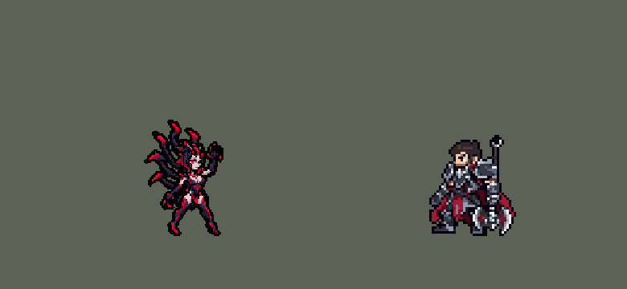

<!-- 本页上半部分由 tools/docs/gen_hero_docs.py 按仓库里现在的数据生成，手改会被覆盖；「开发记录」以下是手写的，生成时原样保留。 -->

# 伊莉丝 Elise

| 项目 | 内容 |
|---|---|
| id | `league_elise` |
| 所属的包 | 主包（mod_id `league`） |
| 分路 | 打野 |
| 分类 / 标签 | 刺客（Assassin） · AP / Magic / Range / Melee / CC |
| 高清帧 | PPU 1.8 |
| 附加包 | [伊莉丝附加包](#附加包)（`league_elise`） |

其他预览：[逐帧预览](../preview/league_elise_frames.png)、[特效表](../preview/league_elise_effects.png)

## 现在的技能

下面是游戏里显示的技能说明（`league/text/champion.i18n` 的简体中文，去掉了颜色和图标），冷却、距离来自 `league/champion/league_elise.data_champion`；1 秒 = 60 tick。

### 普攻 / 被动

*攻击间隔 0.87 秒 · 攻击距离 23000*

蜘蛛女皇：人形技能命中积攒小蜘蛛（最多3只）。出手前按战况切换人形（远程）和蜘蛛（近战），冷却4秒。蜘蛛普攻额外造成20+25% 法强魔法伤害并回血，每只小蜘蛛撕咬12+10% 法强。

### 技能1 · 神经毒素 / 剧毒之蜇

*冷却 1 秒 · 施放距离 55000 · 施放：指定目标 · 敌人（不含防御塔）*

人形：射出毒液造成70+60% 法强魔法伤害和3%最大生命真实伤害。剧毒之蜇：扑向敌人造成80+70% 法强魔法伤害和5%最大生命真实伤害。

### 技能2 · 结茧 / 盘丝

*冷却 1 秒 · 施放距离 75000 · 施放：无目标 · 敌人（不含防御塔）*

人形：吐茧造成60+50% 法强魔法伤害并晕眩1.67秒；冷却时放自爆蜘蛛，70+70% 法强魔法伤害。盘丝：升空不可选中，落到英雄身上；冷却时掠行狂暴，攻速+60%。

### 大招 · 蜘蛛形态

*冷却 20 秒 · 施放距离 75000 · 施放：无目标 · 刚交过手的敌方英雄*

向英雄吐茧，立即化身蜘蛛并重置蜘蛛技能，盘丝落到其身上造成120+70% 法强魔法伤害，再施放剧毒之蜇。

### 数值

攻击力 108（每级 +24）、法强 50（每级 +20）、生命 990（每级 +100）、护甲 28（每级 +7）、魔抗 24（每级 +4）、移速 1080（每级 +12）。

## 附加包

附加包是可选的原生代码 mod（都在附加包合集 `league_addons` 里），**不装主包里的英雄也是完整的**。

### 伊莉丝附加包

[伊莉丝附加包](../../addons/league_elise/README.md)：`league_elise` v0.1.1

|  | 主包（纯数据） | 装了附加包 |
|---|---|---|
| 蜘蛛形态的样子 | 只有出招（普攻、剧毒之蜇、盘丝、变身）是蜘蛛的动作，待机、跑步、受击、阵亡还是人形（游戏按名字自动播这几个，数据换不了） | **整个身体**都是蜘蛛：待机、跑步、受击、阵亡播 `c_idle` / `c_run` / `c_hit` / `c_dead`（只在游戏 0.6.4 上，别的版本退回左边那样）；复活是人形 |
| 结茧打谁 | 射程内随机一个敌方英雄（茧碰到第一个单位就停，常常打在小兵上） | 线上**没有小兵、野怪、别的英雄挡着**的英雄：被控住的先（必中），再挑最近的；都被挡着才挑最近的英雄 |
| 盘丝落到谁身上 | 射程内随机一个敌方英雄 | **生命比例最低**的英雄（一样低就近的） |
| 茧缚猎杀打谁 | 被控住的英雄先，没有就在最近被己方打过的英雄里随机挑 | **被控住的**英雄先（其中生命比例最低的），没有就挑生命比例最低的 |

## 相关脚本和素材

- [`tools/kit/build_elise.py`](../../tools/kit/build_elise.py)
- [`tools/kit/setup_elise.py`](../../tools/kit/setup_elise.py)
- [`tools/lol/extract_elise.py`](../../tools/lol/extract_elise.py)
- [`tools/art/preview_elise.py`](../../tools/art/preview_elise.py)
- [`tools/art/rig_elise.py`](../../tools/art/rig_elise.py)
- [`assets/source/elise/`](../../assets/source/elise)

## 开发记录

> 下面是原来 README 里「英雄：伊莉丝」一节，原样搬过来（只改了相对链接）。

| 部分 | 内容 |
|---|---|
| 定位 | 打野（Assassin，标签 AP / Magic / Range / Melee / CC），第 107 位英雄。蜘蛛女皇 伊莉丝：人形远程施法、蜘蛛近战撕咬的 AP 刺客。用户的选择（全按推荐）：打野 AP 刺客；形态从 1 级起在普攻槽里切换（奈德丽的做法）；技能 1 = 人形 Q 神经毒素 / 蜘蛛 Q 剧毒之蜇，技能 2 = 人形 E 结茧（冷却时放 W 自爆蜘蛛）/ 蜘蛛 E 盘丝（冷却时开 W 掠行狂暴），大招 =「茧缚猎杀」（E→R→E→Q）；被动的小蜘蛛主包画面 + 伤害；附加包要；高清 PPU 1.8（先定 1.5，用户嫌脸糊改 1.8）；职业连招开 |
| 普攻 / 形态 | 人形吐毒液（攻击距离 50000：蜘蛛的近战 23000 再加 27000 射程的永久 buff `league_elise_hu`，攻击间隔 52 tick，第 10 tick 吐出、追踪）；蜘蛛撕咬（永久 buff `league_elise_sp`，移速 +10%，第 9 tick 咬中）。变形（英雄联盟的 R，内部冷却 240 tick）在每次普攻的第一刻按规则判断：人形时 32000 内有被控住的敌方英雄（自己的茧或队友的控制），或身边有敌人而神经毒素（3 级起还有结茧）都在冷却，就变蜘蛛扑上去；蜘蛛时剧毒之蜇（3 级起还有盘丝）用掉、而神经毒素（或结茧）好了，就变回人形。每条命开局是人形 |
| 被动 | 「蜘蛛女皇」：人形技能（神经毒素、自爆蜘蛛、结茧）打中敌人就多一只小蜘蛛（最多 3 只，阵亡清掉）。蜘蛛形态的普攻另加 20 + 25% 法强魔法伤害、回 6 + 10% 法强生命；每只小蜘蛛跟着咬一口 12 + 10% 法强魔法（掠行狂暴期间 ×1.5），小蜘蛛画在目标身上（安妮提伯斯的做法：数据做不出单独的小单位） |
| 技能1 | 人形 Q「神经毒素」：冷却 360 tick，55000 内，第 10 tick 射出追踪的毒液弹，70 + 60% 法强魔法，另加目标 3% 最大生命的真实伤害（英雄联盟是当前生命：数据读不到当前生命）。蜘蛛 Q「剧毒之蜇」：冷却 360 tick，扑向 35000 内的敌人，80 + 70% 法强魔法，另加 5% 最大生命真实伤害（英雄联盟是已损生命）。小兵、野怪也会打 |
| 技能2 | 人形 E「结茧」：冷却 660 tick，75000 内有敌方英雄时放：瞄准施法前 8 tick 他站的位置（凯特琳 Q 的锁定，走位能躲），茧沿直线飞、碰到第一个单位就停，60 + 50% 法强魔法并晕眩 100 tick；结茧冷却时放 W「自爆蜘蛛」：冷却 720 tick，小蜘蛛沿直线爬向目标，碰到第一个单位炸开，半径 10000 内 70 + 70% 法强魔法。蜘蛛 E「盘丝」：冷却 900 tick，50000 内有敌方英雄时，顺着蛛丝升空（第 13 tick 起放逐 45 tick：谁都选不中她），再落到那个英雄身上，半径 12000 内 40 + 30% 法强魔法；盘丝冷却时，身边 25000 内有敌人就开 W「掠行狂暴」：冷却 600 tick，攻速 +60% 180 tick，小蜘蛛咬得更狠 |
| 大招 | 「茧缚猎杀」（5 级，职业选手的 E→R→E→Q）：冷却 1200 tick，75000 内对一个敌方英雄（被控住的先，没有就挑最近被己方打过的）：人形时先向他吐茧，第 16 tick 立刻化身蜘蛛（不播变身动作）、蜘蛛技能冷却全部重置，盘丝升空 30 tick 落到他身上，120 + 70% 法强魔法，落地再咬一口（剧毒之蜇的伤害）。蜘蛛形态时只有盘丝和撕咬 |
| 附加包 | 可选的附加包 [`addons/league_elise`](../../addons/league_elise/README.md)（在附加包合集里，原生代码，主包不装它也完整）：**整身变蜘蛛**——蜘蛛形态时待机、跑步、受击、阵亡也是蜘蛛的样子（奈德丽变豹的做法，普攻第一帧也换成蜘蛛）；**结茧挑目标**——线上没有小兵、野怪、别的英雄挡着的英雄，被控住的先、再挑最近的；**盘丝落到生命比例最低的英雄身上**；**茧缚猎杀**被控住的先（其中血最少的），没有就挑生命比例最低的。副本把技能2、大招改成对 AI 选的目标施放；副本的数据部分在经典引擎里跑过（对英雄的施法每局 32.5 → 84.7 次）。日志 `league_elise.log` |
| 数值 | 攻击 108（+24）、法强 50（+20）、生命 990（+100）、护甲 28（+7）、魔抗 24（+4）、移速 1080（+12） |
| 平衡 | 打野对五个基础英雄（恶魔、马戏团刀手、猎人、审判官、忍者），三种阵容、两边各打，10 分钟经典引擎模拟两批 24 个种子：按动作重排时间后 +1.18 / +1.38（同样的种子上主包的打野：奈德丽 +1.56 / +0.97、伊芙琳 +1.38 / +1.30），数字没再改（先用占位时间那版 +1.85 / +1.44） |
| 精灵图（高清帧 PPU 1.8） | Codex 第 0 步画了人形、蜘蛛各两张原画，用户选人形 B、蜘蛛 A；[`tools/art/design_elise_hd.py`](../../tools/art/design_elise_hd.py) 按 12 px 的格子读回成两张造型（人形 83×124、蜘蛛 114×72，一套 40 色）。Codex 照英雄联盟的骨架画了 65 帧动作（人形 32、蜘蛛 33），[`tools/art/import_elise_strips.py`](../../tools/art/import_elise_strips.py) 读回：Codex 的人形头小身长，每帧以脖子为界按造型的比例拉回（只动头和身子的比例，不切不转），再把造型的**整颗头**（连头发和头冠）贴上去、清掉 Codex 那份（用户：「动作帧里面有两个头」）；蜘蛛和造型一致直接用。[`tools/art/rig_elise.py`](../../tools/art/rig_elise.py) 降到 PPU 1.8，每帧贴一张保住红眼的脸（用户：「脸部这么糊？」），待机呼吸、受击闪白。人形跑步：Codex 第一版 8 帧都是同一条腿在前（用户：「交叉步都没 腿不换步的？」），我用造型的腿斜切拼的一版被否（「腿变形你问我可以吗？」），最后照杰斯的办法让 Codex 照每帧的腿线只重画腿（[`tools/art/pack_elise_run.py`](../../tools/art/pack_elise_run.py)、[`tools/art/import_elise_run.py`](../../tools/art/import_elise_run.py)），两条腿轮流在前、第 3 和第 7 帧交叉 |
| 特效 | Codex 第 3 步的特效总览图（用户转来的四张），[`tools/art/import_elise_fx.py`](../../tools/art/import_elise_fx.py) 逐个裁出 22 个特效（`league_elise_fx` 小的、`league_elise_big` 大的）：自爆蜘蛛画成了正面，读回时上下翻成侧着爬；掠行狂暴左右不对称，补成对称；小蜘蛛撕咬画成了一道道月牙爪痕 |
| 音效 | 英雄联盟的音效和配音（`tools/lol/extract_elise.py`，29 段） |
| 图标 | 官方技能图标（神经毒素 / 结茧 / 蜘蛛形态，另有剧毒之蜇、自爆蜘蛛、盘丝、掠行狂暴和被动），从本地客户端取 |
