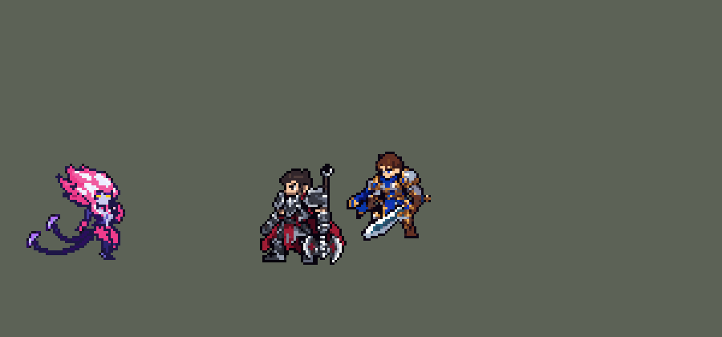

<!-- 本页上半部分由 tools/docs/gen_hero_docs.py 按仓库里现在的数据生成，手改会被覆盖；「开发记录」以下是手写的，生成时原样保留。 -->

# 伊芙琳 Evelynn


| 项目 | 内容 |
|---|---|
| id | `league_evelynn` |
| 所属的包 | 主包（mod_id `league`） |
| 分路 | 打野 |
| 分类 / 标签 | 刺客（Assassin） · AP / Magic / CC |
| 高清帧 | 1 倍像素（无高清帧） |
| 附加包 | [斩杀附加包：伊芙琳、阿卡丽、锐雯](#附加包)（`league_executes`）、[游戏 AI 不按的技能替它按](#附加包)（`league_ult_press`） |



其他预览：[逐帧预览](../preview/league_evelynn_frames.png)、[特效表](../preview/league_evelynn_effects.png)

## 现在的技能

下面是游戏里显示的技能说明（`league/text/champion.i18n` 的简体中文，去掉了颜色和图标），冷却、距离来自 `league/champion/league_evelynn.data_champion`；1 秒 = 60 tick。

### 普攻 / 被动

*攻击间隔 0.92 秒 · 攻击距离 24000*

鞭子攻击。恶魔魅影：4秒不出手（引诱除外）进入魅影：回血，5级起隐身。鞭笞：每8秒普攻变鞭打，额外40+40% 法强和3%最大生命伤害并加速；出魅影后的第一鞭冲向目标、打穿沿途。

### 技能1 · 憎恨之刺

*冷却 5 秒 · 施放距离 55000 · 施放：方向 · 敌人（不含防御塔）*

鞭子打中第一个敌人，造成45+35% 法强魔法伤害，她接下来3次普攻各多15+20% 法强。随后自动射出3根尖刺（优先英雄），各对一条线上的敌人造成30+25% 法强。

### 技能2 · 引诱

*冷却 12 秒 · 施放距离 90000 · 施放：指定目标 · 敌人（不含防御塔）*

给一名敌人（优先英雄）挂印记，施放不会现形。2.5秒后她下一次打中就魅惑：英雄1.25秒并削减35%魔抗，野怪3秒并受到150+60% 法强。

### 大招 · 最终抚慰

*冷却 50 秒 · 施放距离 60000 · 施放：无目标 · 敌方英雄*

就绪后等她连续打中英雄或被围时释放：前方扇形150+75% 法强魔法伤害，最近每打中英雄一次+35%（最多×2.4），期间不可选中并向后闪，随后很快重回魅影。

### 数值

攻击力 75（每级 +10）、法强 50（每级 +20）、生命 880（每级 +85）、护甲 26（每级 +8）、魔抗 20（每级 +4）、移速 1100（每级 +12）。

## 附加包

附加包是可选的原生代码 mod（都在附加包合集 `league_addons` 里），**不装主包里的英雄也是完整的**。

### 斩杀附加包：伊芙琳、阿卡丽、锐雯

[斩杀附加包：伊芙琳、阿卡丽、锐雯](../../addons/league_executes/README.md)：`league_executes` v0.2.0

| 英雄 | 主包（纯数据） | 装了附加包 |
|---|---|---|
| 伊芙琳 R | 150 + 75% 法强，最近每打中英雄一次 +35%（最多 ×2.4） | 150 + 75% 法强，对生命不高于 30% 的目标 ×2.4 |

### 游戏 AI 不按的技能替它按

[游戏 AI 不按的技能替它按](../../addons/league_ult_press/README.md)：`league_ult_press` v0.5.5（通用附加包，下面只列和伊芙琳有关的部分）

|  | 装了附加包，什么时候按 |
|---|---|
| 凯尔、卡尔玛、伊芙琳、奥莉安娜的 R（备好式） | 身边有敌方英雄就按（凯尔 50000、卡尔玛 70000、伊芙琳 45000、奥莉安娜 60000）：这几个 R 格只是「备好」，主包在之后几秒里自己判断时机放出，没用上退还冷却，按下去不会白费 |

## 相关脚本和素材

- [`tools/lol/extract_evelynn.py`](../../tools/lol/extract_evelynn.py)
- [`tools/art/preview_evelynn.py`](../../tools/art/preview_evelynn.py)
- [`tools/art/import_evelynn.py`](../../tools/art/import_evelynn.py)
- [`tools/art/design_evelynn.py`](../../tools/art/design_evelynn.py)
- [`assets/source/evelynn/`](../../assets/source/evelynn)

## 开发记录

> 下面是原来 README 里「英雄：伊芙琳」一节，原样搬过来（只改了相对链接）。

| 部分 | 内容 |
|---|---|
| 定位 | 打野（近战刺客，分类 Assassin），用户 10 月 2 日排的第十二组的打野。痛苦之拥：在恶魔魅影里潜行接近，鞭笞打出百分比伤害，引诱成熟后魅惑，最终抚慰斩杀残血后闪回 |
| 普攻 / 被动 | 普攻是鞭子抓击，100% 攻击力的物理伤害，射程 24000，攻击间隔 55 tick。E「鞭笞」并入普攻（用户选的：Q、W 占技能位，E 并进普攻）：每 8 秒普攻变成鞭打，额外造成 40 + 40% 法术强度的魔法伤害和目标最大生命 3% 的真实伤害，移速 +30% 持续 2 秒；刚出魅影时这一鞭变成冲刺：攻击距离多 20000，扑到目标身上，沿途打穿一条线，60 + 60% 法术强度 + 最大生命 4%。被动「恶魔魅影」：4 秒不出手（W 除外）进入魅影：回复生命（数据读不到当前血量，所以任何血量都回，比英雄联盟低血才回的量小），鞭笞重置并强化；5 级起隐身（英雄联盟是 6 级，对应大招解锁；用凯尔的等级探测，连测两次才算，避免野怪的伤害误判）。出手就现形，引诱不算出手 |
| 技能1 | Q「憎恨之刺」：射程 55000，冷却 5 秒，也对小兵和野怪放（出手前锁定方向，可以躲）。鞭子打中第一个敌人，造成 45 + 35% 法术强度的魔法伤害并挂上荆棘标记：她接下来 3 次普攻各多 15 + 20% 法术强度。之后 0.37、0.67、0.97 秒自动射出 3 根尖刺（英雄联盟是再按 Q，团战经理的 AI 不会连按，做成自动），先找 50000 内的敌方英雄，没有就打任意敌人，各对一条线上的敌人造成 30 + 25% 法术强度 |
| 技能2 | W「引诱」：射程 90000，冷却 12 秒，范围内有敌方英雄时先挂英雄，否则挂施放目标（清野时挂野怪）。诅咒飞过去挂上心形印记，施放不会现形；2.5 秒后印记成熟（心被填满），她下一次打中这个目标时魅惑：英雄 1.25 秒并削减 35% 魔抗 4 秒，其他单位 3 秒并受到 150 + 60% 法术强度。魅惑期间目标头顶三颗小心转圈，脚下是削魔抗的裂纹光环 |
| 大招 | R「最终抚慰」：冷却 50 秒。大招位只负责"就绪"（AI 遇到英雄就会放大招位，用来等时机），就绪 10 秒内她的普攻在合适时出手：最近 4 秒内打中英雄满 3 次，或打中 2 次且身边有两个敌方英雄。前方扇形（半径 45000、140°）150 + 75% 法术强度的魔法伤害，最近每打中英雄一次 +35%，最多 ×2.4（英雄联盟是对 30% 血以下 ×2.4，读不到目标血量，改成按她自己的连击算）；出手时不可选中，向后闪 45000，1.25 秒后重回魅影。就绪没用上就返还冷却 |
| 附加包 | 可选的附加包 [`addons/league_executes`](../../addons/league_executes/README.md)（在附加包合集里，原生代码，主包不装它也完整）：R 照英雄联盟对生命不高于 30% 的目标 ×2.4（主包按她最近打中英雄的次数分档） |
| 附加包（站桩） | 可选的附加包 [`addons/league_ult_press`](../../addons/league_ult_press/README.md)（在附加包合集里，原生代码，主包不装它也完整）：游戏 0.6.4 的 AI 常让这位英雄在敌方英雄跟前站着不打——只读观察包里身边 50000 内有敌方英雄时站着不动 36.1%，其中 11.9% 是 AI 下令「走到自己脚下」（盖伦 2.7% / 0.7%）。照卡蜜尔、瑟提、奥拉夫的办法（用户：「站桩的按照之前卡密尔那样改 然后合并」）：原地站了 15 tick、普攻好了、AI 还让他原地站时，35000 内最近的敌方英雄——他生命不低于一半、目标离敌方塔 75000 以外、目标身边 60000 内的敌方英雄不多于他身边的我方英雄（含他）——就普攻他，打出一下或 1.5 秒后重新算 |
| 附加包（替 AI 按） | 可选的附加包 [`addons/league_ult_press`](../../addons/league_ult_press/README.md)（在附加包合集里，原生代码，主包不装它也完整）：游戏 0.6.4 的 AI 很少按她「备好」的 R（只读观察包：每 10 分钟 1.5 次，180 局）。附加包按局面替 AI 按（用户：「有问题的英雄全部改成rust」）：45000 内有敌方英雄就按；什么时候出手由主包按她的连击判断，没用上退还冷却 |
| 数值 | 攻击 75（+10）、法术强度 50（+20）、生命 880（+85）、护甲 26（+8）、魔抗 20（+4）、移速 1100（+12）。数值是自己设计的，用 SDK 对战模拟调：打野，对 5 个原版打野（`demon`、`circus_blade`、`hunter`、`inquisitor`、`ninja`），每批两边各 24 局。初稿（魅影回血 25、生命 920、攻击 80）+2.42；只降回血到 12，换种子在 +1.04 到 +2.63 之间；回血 12、生命 880、攻击 75 两批 +1.38 / +1.30，和包里的打野持平（凯隐 +1.70 / +0.88），定下这版；改削 Q、尖刺和鞭笞的伤害是 +1.31 / +1.22 |
| 亚索联动 | 引诱的魅惑是亚索大招要的控制：伊芙琳打野、亚索同队时，亚索每局 R 到被控英雄 1.81 次（同一批凯隐 1.00、原版忍者 0.50），亚索不用调 |
| 精灵图 | 10 个动作 57 帧：待机、移动、普攻、鞭笞、强化鞭笞（冲刺）、Q、W、R、受击、死亡。造型按用户在 Codex 里挑的原画 A（英雄联盟的待机：近手的爪子抬在下巴边，两条鞭子卷在身后），Codex 的生图草稿按自己的格子读回、减半到 41 行（`design_evelynn.py`，用户：「3 原稿A减半 40行」「小修版」），36 × 41 px，18 色；动作是 Codex 照英雄联盟的动作画的，奇怪的地方 Claude 修（`fix_evelynn_strips.py`，用户：「有奇怪的地方你直接修复 codex太笨了」）。待机 6 帧同一张（不呼吸）；待机最高点 −28，不设 `banpick_center`；头像截取点 (−10, −39) |
| 音效 | 英雄联盟的音效和配音（`tools/lol/extract_evelynn.py`）：普攻出手和命中，鞭笞出手，强化鞭笞冲出和命中，Q 出手、鞭子飞出和命中，尖刺射出和命中，W 出手和命中、印记成熟、魅惑炸开，R 出手和命中，进入魅影；强化鞭笞、W、R 各一句配音 |

重新生成（素材来自本机的英雄联盟客户端，音频不进仓库）：

```bash
python tools/lol/extract_evelynn.py --lol "D:\WeGameApps\lol" --vgmstream "<vgmstream-cli.exe 路径>"
python tools/lol/native_pose.py assets/source/evelynn/poses.json --out <渲染文件夹>   # 动作参考帧
python tools/art/design_evelynn.py         # 造型：Codex 的生图草稿按自己的格子读回，减半到 41 行
python tools/art/fix_evelynn_strips.py     # 动作：Codex 的动作条加上修复，帧时长对上技能
python tools/art/import_native.py --hero evelynn
python tools/art/import_evelynn.py         # 特效；--raw <Codex 的特效交付文件夹> 先把生图原稿缩成游戏尺寸的原尺寸条
python tools/art/preview_evelynn.py
```

美术（造型的提示词见 [`assets/source/evelynn/MODEL_PROMPTS.md`](../../assets/source/evelynn/MODEL_PROMPTS.md)，动作的见 [`MODEL_STRIPS.md`](../../assets/source/evelynn/MODEL_STRIPS.md)，特效的见 [`PROMPTS_FX.md`](../../assets/source/evelynn/PROMPTS_FX.md)；Codex 的提示词和交接说明在 [`codex_picture/`](../../assets/source/evelynn/codex_picture)、[`codex_model/`](../../assets/source/evelynn/codex_model)、[`codex_strips/`](../../assets/source/evelynn/codex_strips)、[`codex_fx/`](../../assets/source/evelynn/codex_fx)）：

- 原画和造型：Codex 画了 A（英雄联盟的待机）、B 两张原画，用户选 A。英雄联盟的皮肤里藏着一张带角的钢面具（`Eve_Mask_MAT`），游戏里她是素脸，渲染参考时藏掉（`pose_ref.py` 的 `--hide-submeshes`；她的颜色贴图的透明通道是发光遮罩，加了 `--opaque`；贴图在关联的皮肤 bin 里，`pose_ref.py` 加了找贴图的回退）。Codex 的游戏尺寸造型是脚本拼的方块，生图草稿又是要求的两倍大（87 行）；按行删到 40 行会保住脸、压扁身体，用户从几种选了「原稿 A 减半」：草稿按自己的格子读回，颜色按 CIELAB 归到 Codex 的 24 色，删成两倍目标大小的整行整列后 2 × 2 合一格；两只眼睛对齐到一行，各 2 格宽，上面一格紫色眼影（「小修版」）。
- 动作参考（`poses.json`）：镜头 yaw 60、pitch 20，镜像；头 2.4 倍、腿 0.8 倍；高度 40；藏面具、不透明贴图。待机 `evelynn_idle01`，移动 `evelynn_run`（8 帧 × 125 ms），普攻 `attack3`，鞭笞 `crit`，强化鞭笞 `spell3_empowered`，Q `spell1`，W `spell2`，R `spell4`，死亡 `death`。
- 动作的修复（`fix_evelynn_strips.py`，Codex 的交付留在 [`codex_strips/`](../../assets/source/evelynn/codex_strips)）：Codex 用造型的部件拼动作（头原样贴、躯干和腿按区域挪、手臂和鞭子在原尺寸格子上画），大多照得出英雄联盟的动作，这几处不对：
  - 移动：两只手往外张开像稻草人，两条腿糊成一团，两条鞭子是贴地的粗直条。重做：上身是造型本身，两脚同时着地时下沉一行；腿用新写的两节腿骨架（`evelynn_legs.py`）：造型的粉色护板其实是大腿（从腰带下开始），连膝盖、小腿、脚一起当一条腿的贴图，两条腿用同一条（一样粗），沿骨头取造型的填色再描一圈边，脚平放；步态照英雄联盟游戏尺寸的跑步量（每只脚在自己胯下前后摆，抬脚 1–2.5 格，不交叉成 X）。我第一版自己画的细腿交叉成 X（用户：「走路时腿有点怪吧？」）。两条鞭子照英雄联盟拖在身后、一高一低，末端是待机后鞭的弯刃，跟着身体晚一帧起伏。
  - 放技能的腿：普攻 3–5、鞭笞 4–5、强化鞭笞 1–5、Q 第 2 帧、R 第 1、3–5 帧的弓步和下蹲，Codex 把造型的小腿逐行错开拼成细长的斜棍，没有大腿，后脚劈叉（用户：「放技能时腿也有点怪吧？」）。这些帧去掉 Codex 的腿和它自己的胯，上身、手臂、手爪（带浅粉爪尖的粉色块）和鞭子（靠 Codex 记录的鞭子路径识别）保留，整体抬回站立高度，站在骨架摆出的待机站姿上，接在 Codex 腰带的实际位置下面；弓步往前的位移保留成整个人往前一步。只按头的位置接腿时，Codex 挪开的胯块从新腿旁边凸了出来（用户圈出大招第 4 帧：「这里凸出来的是什么」），现在胯以下 Codex 的旧胯、旧大腿都去掉。
  - 死亡：Codex 第 1–4 帧踉跄、跪下（英雄联盟的死亡就是瘫软跪坐，不躺平，游戏把她淡出），第 5–8 帧把跪姿整体转 35°/65°/90°，成了头朝下、一条鞭子竖在空中。改成第 4 帧的跪伏姿势再往下沉 1–2 行定住；第 2 帧的斜棍腿换掉，延续第 1 帧的踉跄。整个人转着倒地试过：她的大头发竖成一块，鞭子像螃蟹腿，不用。
  - 受击、W 第 1 帧、死亡第 1 帧：后面那条弯鞭被 Codex 画成了带黑边的直棍，换回造型的弯鞭，别的不动。
  - 每帧补齐描边后，单像素的透底小洞填成周围最多的颜色（强化鞭笞第 2、5 帧胸口有 9–14 个，造型本身 3 个）。
  - 帧时长对上技能：Q 第 3 帧在鞭子飞出的第 10 tick，W 第 2 帧在第 6 tick，R 第 3 帧在斩击的第 13 tick，强化鞭笞第 4 帧在冲到目标的第 5 tick 左右；普攻和鞭笞本来就对得上。
- 特效用 Codex 画的 31 张（133 帧，生图原稿，`import_evelynn.py --raw` 同洛：每个游戏像素取覆盖的原稿像素里最多的颜色，颜色归到包里给每张的色阶——粉（心、尖刺、斩痕）、紫（鞭光、光带、光环）、烟（魅影、大招）——光效外圈最暗的一档去掉）。位置：Q 出手的闪光在甩鞭的手 (17, −12)，W 的飞吻在手 (13, −12)；头顶三层标记错开（荆棘冠 −31 贴着头顶，魅惑的小心 −36，心印记 −42），三个能同时看到；R 的 X 斩痕画在她前方 20 px（扇形的中段），残影留在原地、她闪回后脚下炸开落地烟；魅影的进入、循环、离开三张共用一帧，按同一个比例、同一个脚下锚点导入；冲刺拖尾从她起跳的胯部向前铺开。飞出去的鞭子、尖刺、诅咒第一帧前空 2–3 tick（飞过手之前不画）。

逐帧预览：[`docs/preview/league_evelynn_frames.png`](../preview/league_evelynn_frames.png?v=1014g)，特效：[`docs/preview/league_evelynn_effects.png`](../preview/league_evelynn_effects.png?v=1014g)。
