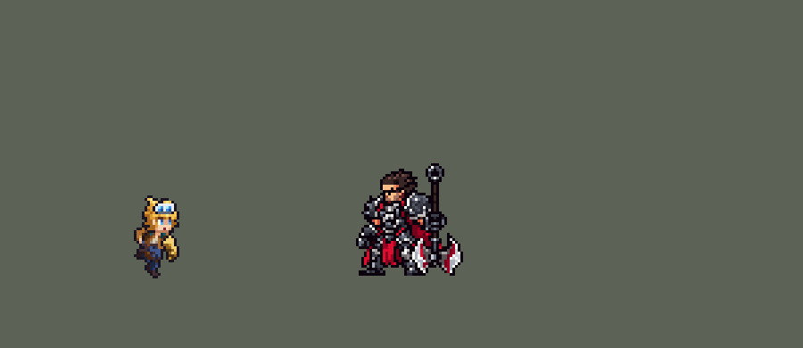

<!-- 本页上半部分由 tools/docs/gen_hero_docs.py 按仓库里现在的数据生成，手改会被覆盖；「开发记录」以下是手写的，生成时原样保留。 -->

# 伊泽瑞尔 Ezreal


| 项目 | 内容 |
|---|---|
| id | `league_ezreal` |
| 所属的包 | 主包（mod_id `league`） |
| 分路 | ADC |
| 分类 / 标签 | 射手（Range） · AD / Range |
| 高清帧 | 1 倍像素（无高清帧） |
| 附加包 | 无 |



其他预览：[逐帧预览](../preview/league_ezreal_frames.png)、[特效表](../preview/league_ezreal_effects.png)

## 现在的技能

下面是游戏里显示的技能说明（`league/text/champion.i18n` 的简体中文，去掉了颜色和图标），冷却、距离来自 `league/champion/league_ezreal.data_champion`；1 秒 = 60 tick。

### 普攻 / 被动（被动「咒能高涨」）

*攻击间隔 1 秒 · 攻击距离 55000*

普攻造成100% 攻击力的物理伤害。被动咒能高涨：技能每打中一个目标，攻击速度提高12%，持续6秒，最多叠加5层，再次打中时刷新。

### 技能1 · 秘术射击

*冷却 5 秒 · 施放距离 100000 · 施放：方向 · 敌人（不含防御塔）*

能量箭对命中的第一个敌人造成40 + 140% 攻击力的物理伤害（视为普攻，可暴击），命中后各技能冷却最多剩2/3。精华跃动（冷却6秒）：先向附近敌方英雄射出精华，粘住4秒，下次普攻或技能命中英雄时引爆，造成90 + 90% 攻击力的物理伤害。

### 技能2 · 奥术跃迁

*冷却 14 秒 · 施放距离 90000 · 施放：指定目标 · 刚交过手的敌方英雄*

交战中：有敌方英雄贴近时朝远离他的方向闪现，目标在普攻射程外时朝他闪现，然后射出追踪魔法箭，造成50 + 50% 攻击力的物理伤害，也会引爆精华跃动。

### 大招 · 精准弹幕

*冷却 60 秒 · 施放距离 120000 · 施放：方向 · 敌方英雄*

蓄力1秒后射出飞得很远的能量波，对路径上的敌方英雄造成250 + 130% 攻击力的物理伤害，对小兵和野怪伤害减半。

### 数值

攻击力 100（每级 +20）、生命 900（每级 +90）、护甲 20（每级 +7）、魔抗 15（每级 +3）、移速 900（每级 +9）。

## 相关脚本和素材

- [`tools/lol/extract_ezreal.py`](../../tools/lol/extract_ezreal.py)
- [`tools/art/preview_ezreal.py`](../../tools/art/preview_ezreal.py)
- [`tools/art/import_ezreal.py`](../../tools/art/import_ezreal.py)
- [`assets/source/ezreal/`](../../assets/source/ezreal)

## 开发记录

> 下面是原来 README 里「英雄：伊泽瑞尔」一节，原样搬过来（只改了相对链接）。

| 部分 | 内容 |
|---|---|
| 定位 | ADC（Range），第四组的下路，本包第四个射手（艾希、金克丝、厄运小姐之后） |
| 普攻 | 手甲射出追踪光弹，100% 攻击力的物理伤害，射程 55000，攻击间隔 1 秒 |
| 被动 | 「咒能高涨」：技能每打中一个目标（Q、W 粘住、E；R 每次施放一层），攻速 +12%，6 秒，最多 5 层，再次打中时刷新。引擎的 buff 不能叠层也不能刷新时间，所以做成 5 个等级 buff：每次打中把当前等级换成下一级（重新加上就重新计时），满 5 层时身上出现光环 |
| 技能1 | Q「秘术射击」：向前射出能量箭（速度 8000，半径 6000，射程 120000），打中的第一个敌人受到 40 + 140% 攻击力的物理伤害，动作类型是普攻（能暴击）。命中后各技能的剩余冷却最多剩 2/3（英雄联盟是各技能减 1.5 秒）：给自己 2 tick 的 `skill_cooldown_mult` +50。做他时实测，这个属性不是加快冷却，而是每 tick 把剩余冷却压到 冷却时间 × 100 ÷ (100 + 值)，1 tick 的 buff 不生效，2 tick 才行（skill 文档已更正）。射程 100000，冷却 5 秒，也对小兵和野怪放。合并 W「精华跃动」（单独冷却 6 秒）：W 好了且 110000 内有敌方英雄时，这次 Q 先向随机一名敌方英雄扔出精华（穿过小兵和野怪），粘住第一个英雄 4 秒，紧跟的 Q 也只找英雄。精华粘住期间，他下一次打中敌方英雄（普攻、Q、E、R）就引爆，造成 90 + 90% 攻击力的物理伤害。引擎不能在目标身上挂隐藏标记，印记记在伊泽瑞尔身上，所以引爆打的是他接下来打中的那个英雄，通常就是被粘住的人。Q 的引爆靠一发只打英雄、看不见的“影子箭”：真正的 Q 打中英雄的那个 tick 在自己身上留 1 tick 的标记，影子箭同一 tick 打到同一人时才引爆，Q 被小兵挡住就不会隔着小兵引爆（实测：两发谁先生成都一样） |
| 技能2 | E「奥术跃迁」：交战中放（对我方刚打过的敌方英雄，90000 内），按情况闪现后向目标射出追踪魔法箭，造成 50 + 50% 攻击力的物理伤害，也会引爆精华：有敌方英雄贴近（40000 内）时朝远离他的方向后撤 40000，箭射向他；目标在普攻射程内时原地射箭；目标在普攻射程外（在逃）时朝他闪现，停在离他约 48000 处（普攻够得着），再射箭。英雄联盟的 E 是闪到玩家指定的点，可前可后；引擎里对着英雄往前的效果（`MoveTo`、`MoveToTarget`）都会一直冲到他身上，所以往前闪是朝目标射一发看不见、半径 45000 的投射物，它碰到第一个英雄前就停下，伊泽瑞尔传送到停下的地方。投射物飞出第一 tick 后才检查碰撞，太快会冲过头，所以速度只有 6000。冷却 14 秒。第一版只会往后撤（敌方英雄靠近时），用户问起追击时为什么不往前闪，改成现在这样 |
| 大招 | R「精准弹幕」：120000 内有敌方英雄时，蓄力约 1 秒后射出能量波，飞 300000（速度 3500，半径 18000，穿透）。两道同路的波：一道打所有敌方单位 125 + 65% 攻击力，另一道只打英雄再 125 + 65%，所以英雄受到 250 + 130%，小兵和野怪减半（英雄联盟也是对小兵和非史诗野怪 50%）。打中英雄叠一层被动、引爆精华。冷却 60 秒。英雄联盟的施放距离是全图；这里第一版也是，AI 常对着很远的英雄放、打空（6 次只中 2 个英雄），改成 120000。能量波原来横贯全图（飞 1000000），但引擎把直线的终点按 x、y 各自截进地图，终点出了地图整道波就拐弯：模拟 240 局 1280 发，偏转中位数 8.9°，一成超过 27°，最多 56°，打到英雄 24%（瞄准的 11%）。0.86.12 改成飞 300000，七发里六发不拐，打到瞄准的英雄 13%；打到英雄的总数没变（23%），因为直着飞过去的波会被躲：波发出后被瞄准的英雄横移 23400（中位数），原来歪掉的波只有 11400。击杀差（同上）：修改前 +3.10，修改后 +3.29（伤害 14500 → 14600） |
| 数值 | 攻击 100（+20）、生命 900（+90）、护甲 20（+7）、魔抗 15（+3）、移速 900（+9），攻击间隔 1 秒，和原版射手一样。数值是自己设计的，用 SDK 对战模拟调：打下路，对 4 个原版射手（`gunner`、`soldier`、`archer`、`gambler`），两边、三套队友阵容各 24 局。第一版约 +1，本包射手在 +2.4～+3.0：R 施放距离从全图改到 120000，E 触发距离 40000，W 之后的 Q 穿过小兵只找英雄，再把各技能数值提高约 25%，两批种子 +2.50 / +2.34。按美术定下的出手帧（普攻第 7 tick、Q 第 1 + 7 tick、W+Q 连招 W 第 1 + 10、Q 第 1 + 21 tick、E 第 3 tick 后撤、第 3 + 11 tick 射箭、R 第 2 + 56 tick 放出）重跑，+2.12 / +2.91；同批的厄运小姐 +2.77 / +3.09、金克丝 +2.99 / +2.92、艾希 +2.40 / +1.58，用了这一版。之后 E 加上追击时往前闪，E 每局从约 3.5 次增加到约 9 次，两批 +3.45 / +2.76，高于同包射手；冷却改成 16、18、20 秒几乎没有差别（E 次数只从 9 次降到 8 次，受限于交战时机而不是冷却），所以把 E 箭从 60 + 60% 降到 50 + 50%：两批 +2.96 / +2.47，就用这一版（45 + 45% 是 +1.91 / +3.29，同一套数值两批差 1.4，是单批的噪声） |
| 亚索联动 | 他没有控制，亚索不用调 |
| 精灵图 | 9 个动作 62 帧：待机、跑步、普攻、Q、W+Q 连招、E、R、受击、死亡。护目镜顶到脚底 34 px，40 色，动作全部取自英雄联盟原版动画 |
| 特效 | 普攻光弹和命中、Q 能量箭和命中、W 精华球、粘住、印记、引爆、E 闪走和落地的光柱、追踪箭和命中、R 蓄力、能量波和命中、咒能高涨满层的光环 |
| 图标 | 官方技能图标（Q / E / R），64×64 |
| 音频 | 从本地客户端提取的 13 条技能音效和 3 条中文语音（W、E、R）。普攻命中的声音不在任何音频包里，用 Q 的命中声降 10 dB、截 0.4 秒代替。不提交到仓库，按下面的命令在本地生成 |

```bash
python tools/lol/extract_ezreal.py --lol "D:\WeGameApps\lol" --vgmstream "<vgmstream-cli.exe 路径>"
python tools/lol/native_pose.py assets/source/ezreal/poses.json --out <渲染文件夹> --alpha --parts
python tools/art/restyle_native.py assets/source/ezreal/poses.json --renders <渲染文件夹>   # 角色图
python tools/art/import_native.py --hero ezreal
python tools/art/import_ezreal.py      # 特效；--raw <Codex 的交付文件夹> 先把原始图转成原尺寸条
python tools/art/preview_ezreal.py
```

美术（提示词见 [`assets/source/ezreal/PROMPTS.md`](../../assets/source/ezreal/PROMPTS.md)）：
- 分工：角色图由 Claude 画，Codex 只画特效。
- 比例和镜头：镜头 yaw 40、pitch 25，镜像，头 2.3、腿 0.75、头发 0.45，高度 34。左臂的手甲是武器部件（`^L_(Gauntlet|Elbow)$`），宝石按色相单独投色。
- 头部：三个方案里用户选了 C：额头上白框蓝镜片的护目镜、金色刘海、蓝眼睛，贴在每一帧英雄联盟头部关节的位置。
- 动作图：`restyle_native.py` 按造型图的颜色（围巾、皮肤、衬衫、牛仔裤、夹克、深色）给英雄联盟动画逐帧投色。待机 6 帧都用第 1 帧，第 3–5 帧小腿以上下移 1 格呼吸。普攻用 `Attack2`（手甲射击），Q 用 `spell1`；W+Q 连招是一段动作 `skill_w`：`spell2` 扔出精华，接 `spell1` 射出能量箭，由 `CasterAnimation` 在这次施放里播放；E 用 `Spell3` 闪现接 `spell1` 射箭；R 用 `spell4`，升起四成；死亡保留三成位移。
- 跑步：英雄联盟的 `Run` 在正常移速下播 `ezreal_run`（一圈 1 秒）。按原版节奏 8 帧 × 125 ms，头保持待机时的朝向（`head_like`），和本包的金克丝、厄运小姐、易一样。
- 特效用 Codex 画的 15 张（生图原稿，透明底，共 77 帧）：`import_ezreal.py --raw` 按交付清单切帧，每张 16 色以内、硬透明，按技能范围定大小：普攻光弹 12 px 长、命中 14 px，Q 能量箭 22 px 长、命中 22 px，W 精华球 16 px 高（半径 8000）、粘住 22 px、印记 18 px、引爆 40 px，追踪箭 16 px 长、命中 20 px，R 蓄力 26 px、能量波 36 px 高（半径 18000）、命中 26 px，E 闪光和被动光环按地上的光圈定大小（26 px、22 px）。飞行的画面上下镜像成严格对称（游戏按飞行方向转动，往左飞时整张翻过来），箭头固定在投射物位置；E 的闪光在起点正着播、在落点倒着播；R 的蓄力放在手甲前方（施法者身上的特效会跟着朝向镜像）；W 的印记每 15 tick 播一次 0.25 秒的循环，直到引爆。
- 结果：40 色，和右边像素同色的比例 28%（原版英雄 18%–46%）。头像截取点 (3, −35)。

逐帧预览：[`docs/preview/league_ezreal_frames.png`](../preview/league_ezreal_frames.png?v=1014g)，特效：[`docs/preview/league_ezreal_effects.png`](../preview/league_ezreal_effects.png?v=1014g)。
