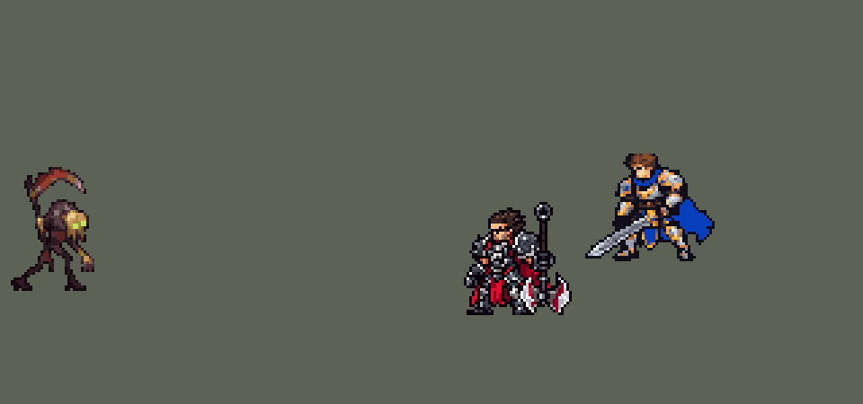

<!-- 本页上半部分由 tools/docs/gen_hero_docs.py 按仓库里现在的数据生成，手改会被覆盖；「开发记录」以下是手写的，生成时原样保留。 -->

# 费德提克 Fiddlesticks


| 项目 | 内容 |
|---|---|
| id | `league_fiddlesticks` |
| 所属的包 | 主包（mod_id `league`） |
| 分路 | 打野 |
| 分类 / 标签 | 法师（Magician） · AP / Magic / CC / Heal |
| 高清帧 | 1 倍像素（无高清帧） |
| 附加包 | [游戏 AI 不按的技能替它按](#附加包)（`league_ult_press`） |



其他预览：[逐帧预览](../preview/league_fiddlesticks_frames.png)、[特效表](../preview/league_fiddlesticks_effects.png)

## 现在的技能

下面是游戏里显示的技能说明（`league/text/champion.i18n` 的简体中文，去掉了颜色和图标），冷却、距离来自 `league/champion/league_fiddlesticks.data_champion`；1 秒 = 60 tick。

### 普攻 / 被动（被动「巫骇草人」）

*攻击间隔 1.5 秒 · 攻击距离 50000*

普攻造成100% 攻击力的物理伤害。被动 巫骇草人：3秒未行动时伪装成草人，之后第一次普攻或夜割使命中的英雄恐惧1秒。

### 技能1 · 恐惧

*冷却 7 秒 · 施放距离 57500 · 施放：指定目标 · 敌人（不含防御塔）*

放出乌鸦恐吓目标，造成80 + 60% 法术强度的魔法伤害并使其恐惧1.25秒；目标英雄正处于控制中时伤害翻倍。

### 技能2 · 五骨丰登

*冷却 8 秒 · 施放距离 40000 · 施放：地点 · 敌人（不含防御塔）*

先挥出夜割，造成70 + 50% 法术强度的魔法伤害并减速40%1.25秒，中心的英雄同时被沉默。随后引导2秒吸取周围敌人，共造成178 + 136% 法术强度的魔法伤害；每吸取一名英雄回复80 + 64% 法强生命值，小兵和野怪16 + 16% 法强。

### 大招 · 群鸦风暴

*冷却 60 秒 · 施放距离 80000 · 施放：地点 · 敌方英雄*

引导1秒后传送到目标位置，鸦群环绕自身5秒，每0.5秒对周围敌人造成25 + 20% 法术强度的魔法伤害，落地时使周围英雄恐惧1秒。引导时受到控制会被打断。

### 数值

攻击力 80（每级 +6）、法强 40（每级 +20）、生命 950（每级 +100）、护甲 22（每级 +7）、魔抗 20（每级 +3）、移速 1000（每级 +10）。

## 附加包

附加包是可选的原生代码 mod（都在附加包合集 `league_addons` 里），**不装主包里的英雄也是完整的**。

### 游戏 AI 不按的技能替它按

[游戏 AI 不按的技能替它按](../../addons/league_ult_press/README.md)：`league_ult_press` v0.5.6（通用附加包，下面只列和费德提克有关的部分）

|  | 装了附加包，什么时候按 |
|---|---|
| 费德提克 R | 他生命 ≥ 40%；80000 内的敌方英雄脚下 45000 内**有两个以上**（挑人最多的一处，一样多挑残血），或只有一个但生命不到 40%；那里不在敌方塔下；那里 60000 内的敌方英雄最多比那里的我方英雄（加上传过去的他）多一个。对那一点放（`Position`） |

## 相关脚本和素材

- [`tools/lol/extract_fiddlesticks.py`](../../tools/lol/extract_fiddlesticks.py)
- [`tools/art/preview_fiddlesticks.py`](../../tools/art/preview_fiddlesticks.py)
- [`tools/art/import_fiddlesticks.py`](../../tools/art/import_fiddlesticks.py)
- [`assets/source/fiddlesticks/`](../../assets/source/fiddlesticks)

## 开发记录

> 下面是原来 README 里「英雄：费德提克」一节，原样搬过来（只改了相对链接）。

| 部分 | 内容 |
|---|---|
| 定位 | 打野（Magician），第五组的打野，本包第五个打野（李青、阿木木、易、艾克之后），第一个法师打野 |
| 普攻 | 甩出一道焦油色的小弯刃，100% 攻击力的物理伤害，射程 50000，攻击间隔 1.5 秒 |
| 被动 | 「巫骇草人」：3 秒没有行动（普攻或放技能）后，第一次普攻或夜割使命中的英雄恐惧 1 秒。英雄联盟里是放下一个假人草人；团战经理2 里放不出会行动的单位，改成站着不动的草人突然出手：每次行动在自己身上挂 3 秒的交战标记，行动时身上没有这个标记，这一下就带恐惧（普攻里另有一发只打英雄的影子弯刃负责恐惧）。模拟里他多半先放射程更远的 Q，被动触发得不多 |
| 技能1 | Q「恐惧」：放出乌鸦扑向目标（速度 9000），造成 80 + 60% 法术强度的魔法伤害并使其恐惧 1.25 秒；目标英雄正处于控制中时伤害翻倍。英雄联盟是对已被恐惧的目标翻倍，这里是任何控制（眩晕、击飞、定身、恐惧……）：乌鸦旁边同时飞一发只打受控英雄的影子乌鸦（`EnemyChampionInCC`，命中那一刻才判断），带第二份伤害；乌鸦自己的恐惧晚 1 tick 生效，免得影子把这次的恐惧也算进去（探针实测：打 5 个被眩晕的英雄都翻倍，5 个没被控的都只打一份）。射程 57500，冷却 7 秒，也对小兵和野怪放 |
| 技能2 | W「五骨丰登」，合并 E「夜割」：先在目标处挥出夜割（半径 30000，出现 5 tick 后命中），造成 70 + 50% 法术强度的魔法伤害并减速 40% 1.25 秒，正中心（半径 14000）的英雄沉默 1.25 秒，被动也能由它触发。0.2 秒后原地引导 2 秒：每 0.25 秒吸取 40000 内所有敌人一次，造成 16 + 12% 法术强度的魔法伤害（共 8 次，最后一次另加 50 + 40%，一共 178 + 136%），每次吸到一个英雄回复 10 + 8% 法术强度的生命，小兵和野怪 2 + 2%。英雄联盟里吸取是连在每个敌人身上的线，走远就断；这里按范围吸，被控制时中断（每次吸取前检查）。每次吸取从每个被吸的敌人身上飞回一段魂链（暗红触须挂着一缕白魂，24 格一段、0.25 秒一段首尾相接，画在单位上面），看起来是一条条连着他的链（玩家反馈原来看不到链条，2026-09-30 加的）。射程 40000，冷却 8 秒，也对小兵和野怪放 |
| 大招 | R「群鸦风暴」：80000 内有敌方英雄时对他的位置施放，冷却 60 秒。引导 1 秒（目标处的地上出现鸦群印记；期间被控制会打断，每 0.25 秒检查一次），然后化成一群乌鸦飞走，传送到目标位置，鸦群绕着他转 5 秒，每 0.5 秒对 45000 内的敌人造成 25 + 20% 法术强度的魔法伤害（共 10 次），落地那一下使周围的英雄恐惧 1 秒。他死了风暴就停 |
| 连招 | 用户要求：「有连招要做连招」「都要帮我补」。英雄联盟的 **R → E → W**：群鸦风暴落进人群，接夜割沉默，再吸取。技能2 里本来就是 E 接 W（先夜割再五骨丰登），但它冷却 8 秒，常常在大招前花在兵线和野怪上，落地时正在冷却。现在技能2 出手时给他记一个 480 tick 的冷却标记（`league_fiddlesticks_e_cd`，比格子的真冷却最多晚 13 tick 结束，没有标记就说明好了）；R 落地那一下恐惧到敌方英雄、技能2 还在冷却，就去掉标记、给他一个 2 tick 的 `skill_cooldown_mult` 10000（`ult_cooldown_mult` −10000 抵掉，R 自己的 60 秒不动）：技能2 剩下的冷却压到 4 tick（Q 也一起压，这个字段分不开两个技能），落地动作一结束 AI 就在风暴里放技能2：夜割沉默，接着吸取。技能2 本来就好了就什么都不返还；引导被打断（没传送、没风暴）也不返还；一次落地只返还一次。每次落进英雄堆的 R（冷却 60 秒）最多多出一次技能2 和一次 Q。数据由 [`tools/fix/combo_fiddlesticks.py`](../../tools/fix/combo_fiddlesticks.py) 改 |
| 附加包（替 AI 按） | 可选的附加包 [`addons/league_ult_press`](../../addons/league_ult_press/README.md)（在附加包合集里，原生代码，主包不装它也完整）：游戏 0.6.4 的 AI 很少按他的 R（只读观察包：每 10 分钟 1.6 次，179 局）。附加包按局面替 AI 按（用户：「有问题的英雄全部改成rust」）：他生命不低于 40% 时，80000 内的敌方英雄脚下 45000 内有两个以上（或只有一个但生命不到 40%）、不在敌方塔下、那里的敌方英雄最多比那里的我方英雄（加上传过去的他）多一个，朝那里放（人最多的一处） |
| 数值 | 攻击 80（+6）、法术强度 40（+20）、生命 950（+100）、护甲 22（+7）、魔抗 20（+3）、移速 1000（+10）。数值是自己设计的，用 SDK 对战模拟调：打野，对 5 个原版打野（`demon`、`circus_blade`、`hunter`、`inquisitor`、`ninja`），两边、三套队友阵容各 24 局，一批 720 局。团队击杀差：出手时刻还是估的时候 +1.15 / +0.56（两批种子）；按美术定下的出手帧（普攻第 8 tick，Q 第 13 tick，夜割第 13 tick 出现、第 18 tick 命中，第 25 tick 起吸，R 引导 1 秒后传送）重跑 +0.33 / +0.65，在本包打野的中间，就用这一版。同样两批里：易 +1.39 / +0.68、艾克 +0.88 / +0.44、李青 −0.96 / −0.58、阿木木 −1.15 / −1.11。费德提克每局放 Q 约 51 次（对英雄 12 次）、技能2 约 30 次、R 4 次。玩家反馈对线强度低（2026-09-30）：只看前 3 分钟的模拟（打野位，对同样 5 个原版打野，一批 360 局）他的击杀差 −0.02、打出 518 伤害，本包打野里只比阿木木（−0.33、372）好（易 +0.33 / 975、李青 +0.20 / 802、艾克 +0.19 / 673、贝蕾亚 +0.18 / 854、黛安娜 +0.08 / 1242）。只提高基础伤害（Q 60 → 80、夜割 50 → 70、每跳吸取 12 → 16、最后一下 40 → 50，法强加成都不变：前期占比大、后期影响小）后前 3 分钟 +0.16、伤害 734；再把攻击间隔缩到 1.3 秒 +0.28，改成基础法强 55 +0.08。整局同一批（360 局）：现版 −0.13，只提高基础伤害 +0.84，加攻速 +0.95，加法强 +1.42（太强）；用只提高基础伤害这一套，在本包打野的中上（黛安娜 +1.04 / +1.03、贝蕾亚 +0.76 / +1.20） |
| 亚索联动 | Q、被动和 R 的恐惧都算亚索大招要的控制。亚索打上路、费德提克打野时，亚索每局放 R 2.81 次（打野换成原版 `ninja` 是 0.65；之前测过：李青 1.50、阿木木 1.69、艾克 1.12，永恩那次中路原版 `lightning_mage` 3.19）。没超过原版英雄带来的次数，亚索不用调 |
| 精灵图 | 10 个动作 65 帧：待机、移动、普攻、Q、技能2（夜割）、W 引导、R 引导、R 落地、受击、死亡。Codex 按方案 B 重画：麻袋头约占身高 1/3，镰刀竖着举在身后，刀刃弧在头顶上方；头上的枝角到脚底约 35 px，连举起的镰刀 47 px，15 色。每帧的时机和站位照英雄联盟原版动画渲染的参考帧 |
| 特效 | 普攻弯刃和命中、Q 乌鸦和尖叫的幽灵稻草人、恐惧之眼（头顶）、沉默缝嘴（头顶）、夜割新月、吸魂引导（绕着他）、被吸出的魂、飞回他身上的魂链、最后的收割、R 落点印记、化鸦飞走、鸦群风暴 |
| 图标 | 官方技能图标（Q / W / R），64×64 |
| 音频 | 从本地客户端提取的 11 条技能音效和 2 条中文语音（夜割、R）。不提交到仓库，按下面的命令在本地生成 |

```bash
python tools/lol/extract_fiddlesticks.py --lol "D:\WeGameApps\lol" --vgmstream "<vgmstream-cli.exe 路径>"
python tools/lol/native_pose.py assets/source/fiddlesticks/poses.json --out <渲染文件夹> --alpha --parts   # 动作参考帧
python tools/art/tidy_fiddlesticks.py <Codex 的模型交付文件夹>   # 角色图：整理 Codex 的动作条，写进 assets/source/native/
python tools/art/import_native.py --hero fiddlesticks
python tools/art/import_fiddlesticks.py      # 特效；--raw <Codex 的交付文件夹> 先把原始图转成原尺寸条
python tools/art/preview_fiddlesticks.py
```

美术（模型重画的提示词见 [`assets/source/fiddlesticks/MODEL_PROMPTS.md`](../../assets/source/fiddlesticks/MODEL_PROMPTS.md)，特效的见 [`PROMPTS.md`](../../assets/source/fiddlesticks/PROMPTS.md)）：
- 分工：第一版角色图由 Claude 画（英雄联盟原版动画投色，贴上逐格手画的麻袋头）。用户在游戏里看到镰刀的刀刃挂在脚下、被血条盖住，整体也嫌丑，改由 Codex 重画；从卢锡安起，模型和特效都交给 Codex。
- 第一版：三种镜头里用户选了 B（yaw 30、pitch 25、不镜像，镰刀拖在身后）、麻袋头 H4。镰刀是单独根骨骼上的道具，往待机混合的帧里会离开手臂（用户看到"手臂少了一块"），`native_pose.py` 为此加了 `"glue"`。这套渲染现在是给 Codex 的动作参考（`poses.json`；`native/fiddlesticks_cells.json` 记着每帧的站位点和帧时长）。
- 重画：`MODEL_PROMPTS.md` 先要三个造型：A 原版比例、B Q 版、C 镰刀扛在肩上。用户让 Claude 代选，选了 B：头约占身高 1/3，竖拿的大弯镰在头顶上方，三张里脸和镰刀最好认，也完全在血条上方。然后 Codex 照参考的格子、帧数和出手时机画了 10 条动作，脚底线以下什么都不画（游戏在脚下画血条）。给 Codex 的参考包：现在的动作 8 倍、英雄联盟同一帧的渲染、标好站位点和脚底线的对位图、原版英雄风格对照（渲染和对照图只在本地）。Codex 的交接说明在 [`codex_model/`](../../assets/source/fiddlesticks/codex_model)。
- 整理（`tidy_fiddlesticks.py`）：交回的动作条是严格的 8×8 方块、15 色，有三处看着不对，都在游戏像素上改：几帧里两只眼睛连成一条黄绿横杠，改成待机那样一高一低的两只眼；夜割最后一帧的镰刀柄上有眼睛的黄绿色，换成柄的颜色；普攻第 2–5 帧伸出的爪子接在麻袋正面眼睛那一行，像舌头，整只手臂往下挪 5 行，从麻袋下面的胸口伸出去，前臂接到身体，麻袋补上描边。
- 导入：移动那 8 帧里头相对站位点左右差了 12 像素，跑起来会晃。镰刀举在头顶，原来"用待机最上面几行当头"会找到镰刀，所以 `import_native.py` 新增 `EYES`：按只有眼睛用的颜色定头的位置，移动的每帧挪到眼睛对齐（最多 6 像素）；移动的节奏照英雄联盟里他平时移动的 `Fiddlesticks_Run`（8 帧、一圈 0.867 秒）。待机 6 帧用同一张，第 3–5 帧小腿以上下沉一格呼吸。
- 头像点：`tfm2_ase.py face` 和 lint 也把举起的镰刀当成了头顶。改了从脸找头的办法：锈红的刀刃（饱和度 0.63）不再算皮肤（上限 0.65 改为 0.6），头顶只从额头往上找到连着的部分为止。其他 20 个英雄的检查结果不变。头像截取点仍是 (9, −30)，在麻袋头顶。
- 特效用 Codex 画的 13 张（生图原稿，真透明，69 帧）：`import_fiddlesticks.py --raw` 按交付清单的 `frame_regions` 切帧，每帧取大部分落在自己格子里的连通图形（化鸦飞走里两只乌鸦跨进了邻格，按格子切会切出半只），每张 16 色、硬透明，按技能范围定大小：普攻弯刃连烟 14 px、命中 16 px，Q 乌鸦翼展 22 px、幽灵稻草人 30 px 高，恐惧之眼连绕飞的乌鸦 16 px，缝嘴 17 px（三针各 3 px），被吸出的魂 26 px 高、收割 32 px，夜割新月 48 px 高（半径 30000 的圈直径 60 px；做成比英雄高一截、穿过圈里敌人的斩击），吸魂引导 44 px 宽，落点印记 90 px 宽（半径 45000，压成 2:1），化鸦的烟柱 44 px（比他的身高多一点），鸦群 84 px 宽、压到 0.8 高（原稿的格子是方的而不是 3:2，不压的话乌鸦飞到 90 px 高）。弯刃、乌鸦和新月上下镜像成严格对称（游戏按方向转，朝左时整张转 180°），新月的中心就放在施法点上，不上下偏。
- 魂链（后来补的第 14 张，玩家反馈吸取时看不到链条）：Codex 直接按游戏尺寸画（`codex_fx_chain/`，24×8 一段，4 帧循环，上下对称，左端平切），原样用。技能里每次吸取对每个被吸的单位先射一个看不见的瞬间投射物，命中时在它脚下放一个 1 tick 的隐形抛物线，落地发出飞回费德提克的魂链：引擎里「飞回施法者」的投射物只能从投射物的终点出发（娜美 W 的回程、艾克 Q 也是这样），直接放在命中效果里一段都不出现。每 tick 1600、0.25 秒一段，正好首尾相接；每段飞「距离 ÷ 1600」tick 到他身上消失。画在单位上面：画在下面时贴身的敌人几乎把整条链挡住。
- 出手时刻和动画对齐：普攻第 8 tick（弯刃甩出的那一帧）、Q 第 13 tick（乌鸦出手）、技能2 第 13 tick 挥出夜割、5 tick 后（新月画满）命中，第 25 tick 起吸魂（`Spell2_channel`），R 引导 1 秒后传送。
- 结果：15 色，和右边像素同色的比例 25%（原版英雄 18%–46%）。

逐帧预览：[`docs/preview/league_fiddlesticks_frames.png`](../preview/league_fiddlesticks_frames.png?v=1014g)，特效：[`docs/preview/league_fiddlesticks_effects.png`](../preview/league_fiddlesticks_effects.png?v=1014g)。
