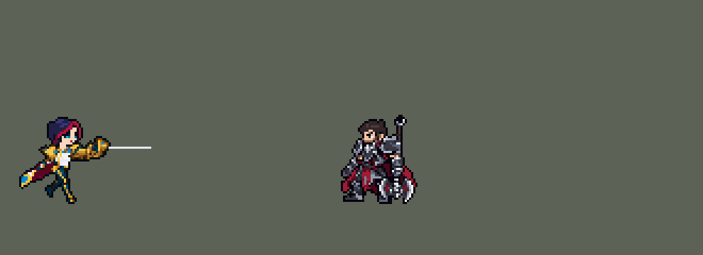

<!-- 本页上半部分由 tools/docs/gen_hero_docs.py 按仓库里现在的数据生成，手改会被覆盖；「开发记录」以下是手写的，生成时原样保留。 -->

# 菲奥娜 Fiora


| 项目 | 内容 |
|---|---|
| id | `league_fiora` |
| 所属的包 | 主包（mod_id `league`） |
| 分路 | 上单 |
| 分类 / 标签 | 近战（Melee） · AD / Melee / CC / Heal |
| 高清帧 | PPU 1.5 |
| 附加包 | [剑姬破绽附加包](#附加包)（`league_fiora_duel`） |



其他预览：[逐帧预览](../preview/league_fiora_frames.png)、[特效表](../preview/league_fiora_effects.png)

## 现在的技能

下面是游戏里显示的技能说明（`league/text/champion.i18n` 的简体中文，去掉了颜色和图标），冷却、距离来自 `league/champion/league_fiora.data_champion`；1 秒 = 60 tick。

### 普攻 / 被动（被动「决斗之舞」）

*攻击间隔 1.03 秒 · 攻击距离 25000*

普攻造成100% 攻击力的物理伤害。被动 决斗之舞：每3秒，命中敌方英雄会亮出一处破绽，再命中英雄即刺中：20 + 10% 攻击力 + 4%最大生命值的真实伤害，回复30 + 15% 攻击力生命值，移速+60%（渐弱）。

### 技能1 · 破空斩

*冷却 5.5 秒 · 施放距离 42000 · 施放：指定目标 · 敌人（不含防御塔）*

冲向敌人（优先英雄）刺出一剑，造成40 + 100% 攻击力的物理伤害。夺命连刺（每8秒一次）：之后两次普攻攻速+50%，第一下减速30%，第二下造成160% 攻击力的暴击伤害。

### 技能2 · 劳伦特心眼刀

*冷却 10 秒 · 施放距离 45000 · 施放：指定目标 · 敌人（不含防御塔）*

招架0.75秒，期间每次受到的伤害只有1点且免疫控制，随后向前刺出，对直线上的敌人造成60 + 90% 攻击力的物理伤害，第一个敌方英雄减速50%；招架时挡下过伤害则改为眩晕1秒。

### 大招 · 无双挑战

*冷却 50 秒 · 施放距离 45000 · 施放：无目标 · 敌方英雄*

在一名敌方英雄身上亮出4处破绽，持续8秒，期间移速+20%，并立即发动夺命连刺。每次命中英雄刺中一处，Q、W冷却减半。刺满4处或目标被刺后死亡，留下胜利之地：3秒内每秒为其中的友方英雄回复40 + 24% 攻击力生命值。

### 数值

攻击力 91（每级 +19）、生命 1009（每级 +103）、护甲 30（每级 +8）、魔抗 28（每级 +4）、移速 1050（每级 +10）。

## 附加包

附加包是可选的原生代码 mod（都在附加包合集 `league_addons` 里），**不装主包里的英雄也是完整的**。

### 剑姬破绽附加包

[剑姬破绽附加包](../../addons/league_fiora_duel/README.md)：`league_fiora_duel` v0.2.2

主包 `league` 保持纯数据。数据分不清一次攻击打中的是谁，所以主包里剑姬大招「无双挑战」的 4 处破绽记在剑姬自己身上：
大招期间她打中**任何一个**敌方英雄都会刺掉一处（模拟里 42 次有 16 次刺在别人身上）。主包只保证胜利之地落在被挑战的人脚下
（`tools/fix/fix_fiora_r_zone.py`；他刺中破绽后死了就落在他死的地方，`tools/fix/fix_fiora_r_deathzone.py`，本包 0.2.1 的副本也一样）。这个附加包用原生代码做成英雄联盟的样子：

- 开大时给被挑战的英雄挂上 `league_fiora_r_mark`（8 秒）；
- 每次破绽判定（普攻、Q 的两下、W 的两道）先调用原生效果 `league_fiora_duel:vital`：剑姬在大招中、而且打中的人身上有标记，
  才给她加 3 tick 的 `league_fiora_r_tgt`，数据读到它就刺大招的破绽（伤害、回血、Q/W 冷却减半、计数）；
- 打别的英雄只出**普通的被动破绽**；
- 数据同一 tick 读一次 `r_tgt`，读不到在下一 tick 再读一次（原生加的 buff 什么时候能被数据读到，游戏里还没证实过）；
- v0.2.0 把她拉回被挑战的人（用户：「大招不打破绽 有bug」）：AI 选目标不认挑战，2026-10-11 游戏里一局大招期间打中英雄 21 次，
  12 次打在别人身上，破绽一直留着。现在大招期间打中别的英雄时，被挑战的人还活着、她看得见、在 80000 内，就给她挂 70 tick
  （约一下普攻）指向他的嘲讽，下一下普攻打他。嘲讽期间 AI 很少放技能（SDK：被嘲讽时约十下普攻一个技能，平时约十下六个），
  所以只在打错人之后挂，不一直锁着。

## 相关脚本和素材

- [`tools/lol/extract_fiora.py`](../../tools/lol/extract_fiora.py)
- [`tools/art/preview_fiora.py`](../../tools/art/preview_fiora.py)
- [`tools/art/import_fiora.py`](../../tools/art/import_fiora.py)
- [`tools/art/design_fiora.py`](../../tools/art/design_fiora.py)
- [`assets/source/fiora/`](../../assets/source/fiora)

## 开发记录

> 下面是原来 README 里「英雄：菲奥娜」一节，原样搬过来（只改了相对链接）。

| 部分 | 内容 |
|---|---|
| 定位 | 上单（Melee），第八组的上单（用户把她排在原定凯南的位置，凯南延后）；本包第八个上单（盖伦、德莱厄斯、提莫、墨菲特、凯尔、锐雯、贾克斯之后）。决斗型：一直找对手的破绽 |
| 普攻 | 细剑直刺，100% 攻击力的物理伤害，射程 25000，攻击间隔 62 tick（1.03 秒），第 9 tick 命中（动作第 3 帧） |
| 被动 | 「决斗之舞」（用户选的 A：计时亮破绽）：上一处破绽刺中 3 秒后（开局就有），她下一次命中敌方英雄时在他身上亮出一处破绽（持续 3 秒），再命中这个英雄就刺中：20 + 10% 攻击力 + 4% 最大生命值的真实伤害，回复 30 + 15% 攻击力的生命值，移速 +60%，1.5 秒内分两段降回（+30% 1.5 秒、+30% 0.75 秒两个 buff）。英雄联盟的破绽在目标的四个方向之一、要从那一边打，这个游戏读不到方向，也不能在目标身上记住状态，由剑姬身上的标记决定：亮着的时候，下一次命中英雄就刺中。每次命中都经一枚只打英雄的分身投射物（和伤害同速，同一 tick 到）进被动 |
| 技能1 | Q「破空斩」，合并 E「夺命连刺」（用户选的 A：E 并进 Q，W 单独）：对 42000 内的敌人施放（小兵和野怪也算，清线、打野也用），射程内有敌方英雄时冲英雄，冷却 5.5 秒。每 tick 4000 冲到目标身上刺一剑，造成 40 + 100% 攻击力的物理伤害。E 有自己的 8 秒冷却，好了的时候这一刺顺带发动：之后 4 秒内两次普攻攻速 +50%，第一下减速 30%（1 秒），第二下是 160% 攻击力的暴击（播暴击动作） |
| 技能2 | W「劳伦特心眼刀」（用户选的 A：挡下伤害才眩晕）：对 45000 内的敌人施放（小兵和野怪也算），冷却 10 秒。招架 0.75 秒：每次受到的伤害只有 1 点，免疫控制；同时套一个 1 点的护盾，护盾被打破就说明挡下过伤害（`WithShield` 标记）。第 47 tick 朝 55000 内的敌方英雄（没有就朝施放目标；招架时目标死了也照刺）刺出 55000 长、16000 宽的剑气：直线上的敌人受到 60 + 90% 攻击力的物理伤害，第一个敌方英雄减速 50%（1.5 秒），招架时挡下过伤害就改为眩晕 1 秒。英雄联盟看的是挡下的控制，这个游戏读不到控制，改看伤害 |
| 大招 | R「无双挑战」（用户选的 A：目标处留治疗区）：冷却 50 秒。AI 走向敌方英雄的路上就会放大招（凯尔、锐雯都遇到过，离目标还有 65000–235000），所以放出时只是"上膛" 10 秒：35000 内有敌方英雄就立刻开始，否则等她下一次普攻命中的英雄；10 秒没用上就返还冷却。开始时举剑致意（18 tick），目标身上亮出 4 处破绽，持续 8 秒，期间她移速 +20%，并立即发动夺命连刺（之后两下普攻攻速 +50%，不占 E 自己的冷却）；每次命中这个英雄刺中一处（伤害、回血、加速和被动一样），每刺中一处，Q、W 剩下的冷却最多只留一半（3 tick 的 `skill_cooldown_mult` 100）。破阵的快慢跟着战况走（用户：「破阵速度 你要时快时慢啊」「根据战场情况」，选了"破阵连击"）：贴着目标打时，两下快攻加上回来的 Q 一秒多刺中三处；目标跑开、她被控制或被拉开时就慢下来，要等冷却减半的 Q、W 追上去。4 处全部刺中，或刺中过一处后目标死亡（谁杀的都算），留下「胜利之地」：3 秒内每秒为半径 35000 内的友方英雄回复 40 + 24% 攻击力的生命值。第四处刺中时治疗区落在目标脚下；刺中过破绽以后目标死亡（包括被这一下刺死），治疗区落在**他死的地方**（用户：「修剑姬的治疗区落点，落在被挑战的人死的地方」）：附在他身上的检查每 2 tick 跑一次，每 4 tick 往他脚下扔一个看不见的落点；他一死检查就停了，最后一个落点落地时发现他已经不在，就在那里放出治疗区（死后 2–7 tick，离死的地方多在 5000 以内）。检查比大招多跑 20 tick，大招自然结束不会被当成死亡。原来数据读不到死人的位置，治疗区放在剑姬脚下（经典模拟 6 局 18 个治疗区里10 个离他死的地方 2–8 万、最晚 6 秒才出现），被第四处刺死时一个都没有（`tools/fix/fix_fiora_r_deathzone.py`） |
| 胜利之地的位置（0.71.0） | 玩家反映大招打出阵法后，胜利之地刷在了别的英雄脚下。数据分不清一次攻击打中的是谁，4 处破绽记在剑姬身上，大招期间打中任何一个敌方英雄都会刺掉一处（模拟里 42 次有 16 次刺在别人身上），第 4 处刺在谁身上，阵法就落在谁脚下。现在第 4 处只立一个标记，被挑战的英雄身上挂着的检测（崔丝塔娜 E 的做法）看到它，把阵法和画面放在他自己脚下（`tools/fix/fix_fiora_r_zone.py`）。破绽会被别的英雄触发这一点主包改不了，在下面的附加包里 |
| 破绽附加包 | 附加包 [`addons/league_fiora_duel`](../../addons/league_fiora_duel/README.md)（在附加包合集里）用原生代码：开大时给被挑战的英雄挂标记，每次破绽判定先看打中的人身上有没有标记，有才刺大招的破绽，打别的英雄只出普通的被动破绽（英雄联盟的样子）。v0.2.0（用户：「大招不打破绽 有bug」）：AI 选目标不认挑战，一局大招期间 21 次英雄命中有 12 次打在别人身上；现在大招期间打中别的英雄，被挑战的人在 80000 内、看得见，就把她嘲讽回他 70 tick（约一下普攻）。主包不装附加包也完整可玩；附加包只做了单元测试，要在游戏里看日志确认 |
| 数值 | 攻击 88（+18）、生命 980（+100）、护甲 30（+8）、魔抗 28（+4）、移速 1050（+10），攻击间隔 1.03 秒。数值是自己设计的，用 SDK 对战模拟调：上路，对 6 个原版上单（`fighter`、`executioner`、`lancer`、`pole_warrior`、`knight`、`berserker`），两边、三套队友阵容各 24 局，一批 864 局。前两版四批在 +0.37 到 +0.72 之间，比锐雯（+0.95 / +0.80）、贾克斯（+0.97 / +0.84）弱；破绽间隔 4 秒改 3 秒、致意 30 tick 改 18 tick 后 +0.58；再把破绽的伤害从 3% 改成 4% 最大生命值（英雄联盟是 3%，每 100 额外攻击力再 +4%）后两批 +1.37 / +1.22，和德莱厄斯（+1.33 / +1.30）同一档（另一个方向，攻击 92、生命 1000，+1.27，选了更像英雄联盟的破绽伤害）。大招改成破阵连击后两批 +1.56 / +1.63，偏强；试了大招冷却 60 秒（+1.81）、攻击 85（+1.66）、大招的破绽改 3%（+1.47 / +1.70），单批的波动约 ±0.3，都没压下来；把暴击 180% 改 160%、Q 的基础伤害 50 改 40 后两批 +1.22 / +1.23，定下这版（生命 940、攻击 85 那版 +1.50 / +1.12，波动太大）。每局放 Q 约 45 次（冲英雄约 13 次）、W 约 29 次、R 约 4.4 次 |
| 亚索联动 | W 的眩晕（挡下伤害才有）是亚索大招要的硬控：剑姬打上路时，亚索（中单）每局 R 到被控英雄 1.23 次（同一批原版战士 1.94、锐雯 2.42），亚索不用调 |
| 精灵图 | 9 个动作 54 帧：待机、移动、普攻、暴击（夺命连刺第二下）、Q、W、R、受击、死亡。造型按用户在 Codex 里挑的原画（A：细剑平举的决斗架势），由 Codex 直接按游戏尺寸画 A、B 两版，用户先选 A40，又改选 B40（"等等 A40不如B40"）：深紫蓝短发、一缕红发，青色眼睛，白色高领，青金两色的胸甲和护肩，酒红披风，深青紧身裤带金色条纹，青色高跟靴、金色靴尖，金色护手的细剑。头顶到脚底 40 px，连平举的细剑 62 px 宽，25 色 |
| 高清帧（PPU 1.5） | 2026-10-18 用 PPU 重做（用户：「继续重做剑姬吧」），按卡莎、青钢影的做法：Codex 只画一张设计图（[`tools/art/pack_fiora_ppu.py`](../../tools/art/pack_fiora_ppu.py) / [`assets/source/fiora/PICTURE_PROMPT_PPU.md`](../../assets/source/fiora/PICTURE_PROMPT_PPU.md)，细剑长，画布 1536 × 1024，交付在 `assets/source/fiora/hd/`）。Codex 画在黑底上、带一圈光晕，[`tools/art/design_fiora_hd.py`](../../tools/art/design_fiora_hd.py) 先沿描边把人围出来、去掉光晕，再按整张图拟合出的一个格距（10.7 × 10.31 px）读回成 71 × 75（按颜色边缘逐格找格子会抖，脸碎掉，用户：「这种做不了？」），整个头一格不删，只在身体、披风、手臂上均匀删行删列到 60 行（87 × 60，用户：「用这个吧」），剑身最后按 2 格粗、31 格长重画成直线。动作照英雄联盟每帧的骨骼摆（[`tools/art/rig_fiora_hd.py`](../../tools/art/rig_fiora_hd.py)）：持剑的手臂和护手只做无损的原样 / 镜像 / 直角转，剑身是两色直线，跟护手同一个方向重画，只有水平、竖直两种（用户：「剑别歪啊 歪的地方全部修复」），朝后时画在身后。移动、普攻、强化普攻、Q、W 的腿按英雄联盟每帧大腿、小腿的方向画：粗细固定，每格颜色取设计稿同一行的颜色，金色护膝和靴子用设计稿原样贴上，不转不缩（先试过让 Codex 照引导线画腿，用户：「腿部变形了吧？」，弃用）。Q 冲刺的两帧是整个人无损转 90° 往前扑；W 的第 5 帧（英雄联盟里两腿贴地劈开）沿用第 4 帧。头像点 (1, −39) 不变（`tfm2_ase.py face` 检查通过），选人卡 −11 改成 −10（`bp_card_audit.py` 的规则）。league.dll 0.7.46，主包 0.153.0 |
| 特效 | 普攻的银白斜刺光，夺命连刺第一下的蓝色刺光和冰晶、第二下的金白 X 形暴击，破空斩的星形刺击和出发点的尘土风痕，破绽的蓝色菱形纹章和刺中时的蓝色玫瑰碎裂，刺中后脚下的速度线，劳伦特心眼刀身前的月牙剑光（招架）、直线剑气、命中、减速寒气和头顶的眩晕星，无双挑战的金环和剩下的破绽（4、3、2、1 枚）、金色玫瑰碎裂和胜利之地（金色光圈，冒着绿色和金色的光点），夺命连刺好了时绕身的蓝白光线 |
| 图标 | 官方技能图标（Q / W / R），64×64 |
| 音频 | 从本地客户端提取的 17 条技能音效和 3 条中文语音（Q 刺中时的喊声，W、R 的台词），合成 16 个游戏音效。不提交到仓库，按下面的命令在本地生成 |
| 修正（0.170.2） | 用户让查附加包日志时在芸阿娜身上发现：引擎给大招冷却封顶时，把 `skill_cooldown_mult` 也算进去（技能冷却削减同时压大招）。无双挑战刺中破绽时把 Q、W 剩下的冷却压到一半，大招自己的冷却也被一起压了。同一个 buff 加上相同大小的负 `ult_cooldown_mult` 抵掉（[`tools/fix/ult_cooldown_offset.py`](../../tools/fix/ult_cooldown_offset.py) / 生成脚本），只减原本要减的技能。经典模拟（8 个种子，三套阵容两边各打） +1.03 → +1.28，每局开大 4.3 → 3.8 次 |

```bash
python tools/lol/extract_fiora.py --lol "D:\WeGameApps\lol" --vgmstream "<vgmstream-cli.exe 路径>"
python tools/lol/native_pose.py assets/source/fiora/poses.json --out <渲染文件夹>   # 动作参考帧
python tools/art/design_fiora.py      # 造型：Codex 的原稿按它自己的格子取像素，删到 40 行，细剑留一格裸线
python tools/art/import_native.py --hero fiora
python tools/art/import_fiora.py      # 特效；--raw <Codex 的特效交付文件夹> 先把生图原稿转成原尺寸条
python tools/art/pack_fiora_ppu.py --out <文件夹>   # 高清造型（PPU 1.5）：给 Codex 的重画包
python tools/art/design_fiora_hd.py --blade-row 24   # Codex 的原图去光晕、按拟合的格距读回、头不删、均匀删到 60 行；--review <文件夹> 出大小对比
python tools/lol/league_joints.py assets/source/fiora/poses.json --out <关节文件夹>   # 英雄联盟每帧的关节位置
python tools/art/rig_fiora_hd.py --joints assets/source/fiora/hd/fiora_joints.json   # 高清帧，写 assets/source/ppu/orig/；--review <文件夹> 先看
python tools/art/ppu_restyle.py --hero fiora
python tools/art/ppu_hd.py --hero fiora
python tools/art/preview_fiora.py
```

美术（原画的提示词见 [`assets/source/fiora/PICTURE_PROMPT.md`](../../assets/source/fiora/PICTURE_PROMPT.md)，造型的见 [`MODEL_PROMPTS.md`](../../assets/source/fiora/MODEL_PROMPTS.md)，9 条动作的见 [`MODEL_STRIPS.md`](../../assets/source/fiora/MODEL_STRIPS.md)，跑步返修的见 [`MODEL_RUN_REDO.md`](../../assets/source/fiora/MODEL_RUN_REDO.md)、第二次的见 [`MODEL_RUN_REDO2.md`](../../assets/source/fiora/MODEL_RUN_REDO2.md)，特效的见 [`PROMPTS_FX.md`](../../assets/source/fiora/PROMPTS_FX.md)；Codex 的交接说明在 [`codex_model/`](../../assets/source/fiora/codex_model)、[`codex_strips/`](../../assets/source/fiora/codex_strips)、[`codex_fx/`](../../assets/source/fiora/codex_fx)）：
- 分工：模型和特效都由 Codex 画，Claude 写提示词包、整理和导入，按"原画 → 造型 → 动作 → 特效"分四步。
- 原画和造型：先写原画提示词包，Codex 画了 A（细剑平举的决斗架势）、B 两张，用户选 A。再让 Codex 直接按游戏尺寸画两版造型（B 的头大一些，像原版英雄），交回的原稿格子比要求的大（A 62 行、B 51 行），用 `regrid.py` 按原稿自己的格子取回像素，各做 40、42、44 行，用户选了 B40。`design_fiora.py`：取像素、对到 24 色（眼睛的青色只留在眼睛上）、只留一圈描边、按行列删到 40 行（脸那几行、几列不删），细剑在护手右边只留一行亮银色、不描边（Codex 画成两格粗，描边又把它围了一圈）；领口三颗宝石原来吸成了眼睛的青色，改回宝石蓝；用户看到"眼睛上有白色的方块"，选了改法 2：眼睛上方两格浅灰改成睫毛黑，白色角上那格改成瞳孔色。
- 动作参考（`poses.json`）：镜头 yaw 45、pitch 25，不镜像，头 2.3、腿 0.8、头发 0.6，细剑（`Weapon`）放大 2 倍、贴在右手上，高度 40，120×112 的格子。待机 `Fiora_Idle1`，移动 `fiora_runwalk`（8 帧 × 114 ms，平地，头保持待机时的样子），普攻 `fiora_attack1`，暴击 `fiora_crit`，Q `fiora_spell1` 接 `fiora_crit`，W `fiora_spell2_in`（3 帧 × 250 ms 招架）接 `fiora_spell2`（4 帧 × 80 ms 刺出），R 用致意 `fiora_taunt`（50/50/60/70/70 ms，共 18 tick），受击取 `fiora_death` 开头和待机混合，死亡 `fiora_death`。
- 动作：Codex 按参考帧画了 9 条（每帧贴定稿的头）。移动的第一版 8 帧两条腿一直是同一条在前（用户选"给 Codex 返修走路"），返修包附一张指引图：英雄联盟的原版走路，近侧腿涂橙、远侧腿涂蓝；返修只改髋部以下（第 81–97 行）：第 1–3 帧近侧腿着地在前，第 5–7 帧远侧腿在前，第 3–4、7–8 帧两腿在身下交错。
- 跑步的头（用户在游戏里看到「剑姬也有走路的时候 头和身体不协调的问题」）：Codex 把待机的头按待机的高度贴到了跑步上，可走路是直起身的（待机的弓步矮 3 行），下巴直接压在领口和举剑的手臂上（眼睛到衬衫 5 行、第 6–8 帧 4 行，待机是 8 行），身体在头下面上下晃、头不动。先用像素把头抬 2–3 行、垫上待机的脖子和高领，用户看了「还是有点怪」，就写了第二次返修包：Codex 把头、脖子、高领、肩膀、举剑的上臂和披风顶端重画成一体（头逐格照抄定稿，眼睛到衬衫每帧 8 行；腿、披风下半、细剑不动；交接说明 `codex_strips/HANDOFF_RUN_REDO2.md`），用户：「好像挺不错」。只是这一整块在迈开的腿上方几乎不动（只在第 6–8 帧高 1 行），而英雄联盟的走路落脚时（第 4 帧，两脚分得最开）整个上身往下沉、第 5–6 帧最高，头和身体一起动约 2 px（胯 3 px）。`import_native.py` `STEP` 把每帧胯（第 −6 行）以上整块下移 1、1、0、2、0、1、2、2 行、盖在腿上（腿根藏到胯下），从胯下穿过去的披风按它的两种酒红色整条挑出来一起移（只移胯以上时披风在那一行折出 3–4 格的台阶），加上原图第 6–8 帧高的那 1 行，是第 4 帧最低、第 5–6 帧最高、上下 2 px；照胯的 3 px 做时第 4→5 帧一下跳 3 行，40 行的小人看着像在蹦。用户：「加起伏吧」。再按用户的「这个可以清理一下 走路的时候也有不干净的地方」清理（`fiora_retouch.json`，在切好的帧上改 110 格，起伏和描边之前）：GPT 在前臂底下画了一排断断续续的深棕阴影，描边给每一段下面都挂了一个黑点，这一排改成一条完整的黑边；第 5 帧的细剑（连护手顶）比头早一帧抬高了 1 行，往下挪回其他帧的高度；披风在腰边漏掉的 1 格空隙用四周的酒红补上（描边绕着空隙画的一圈黑也跟着消失）；胯和腋下边上凸出的单个深色像素改成描边，不再挂出一个黑点；肩上一个被四面围住的空格补上。起伏把披风往下移时，披风边和腿之间偶尔夹出一个四面封闭的空格，`STEP` 用周围的颜色补上。
- 动作里的脖子（用户：「剑姬放技能的时候脖子又消失 没修复吗？」「还是漏了」）：定稿的头下面是 3 格宽的短脖子和带宝石的金色高领，眼睛到白衬衫 8 行；动作条的提示词写了「下巴下面不要露出一截脖子」（别的英雄的贴头规则，套到有高领的剑姬身上是错的），Codex 就把定稿的头贴在了衬衫上：普攻、暴击、Q、W、R、受击、死亡几乎每帧眼睛到衬衫只有 4–5 行，脖子和高领都没了，修走路时也没把其他动作量一遍。`import_native.py` `NECK_UP` 在切好的帧上把贴的头（待机的头，98% 像素相同）抬回去，下面垫待机下巴下的脖子和高领那几行；每帧抬几行、垫多宽按每条动作一位评审逐帧定：肩膀正对我们时垫宽的（连肩甲顶，7 列），会压到肩膀时窄一点（5 列），举剑那一侧截短；普攻第 2、3 帧本来就差 1 行，第 3 帧下巴下的透明缺口用待机的脖子补上；受击第 1 帧是闭眼（`NECK_EYES` 给眼睛位置）。Q 冲刺的第 2、3 帧身体是横的、英雄联盟也看不到脖子，死亡第 2–4 帧头伸在身体前面，竖着垫脖子接不上，这几帧不动。修完各帧眼睛到衬衫 7–9 行。
- 导入：待机 6 帧用定稿，第 3–5 帧从第 8 行（靴口）往下沉一格呼吸（`BOB`）；按眼睛的青色定头的位置（`EYES`）。Codex 按英雄联盟的站位放各条动作，头大约在站位点上方，而定稿的待机按脚的中间站，差 9 列，待机的站位点右移 9 列（`fiora_cells.json`）。描边补齐（`COMPLETE`）时，深青的腿（亮度约 58）和酒红的披风（约 44）不算描边，默认的阈值 70 会让 Q 的几帧只有 83–89% 的边是黑的，所以剑姬的阈值设为 40（`DARK`），补齐后 98–100%（细剑那一格裸线不算）。最后按用户的「黑色描边处理一下 弄干净点」再清一遍（`CLEAN`，`strips.clean_outline`，脸部那块不动）：外圈原来一段黑、一段是她最深的青、酒红、棕，统一成黑色（2213 格）；描边内侧多贴的一层黑削掉（168 格）；身体里散落的单个黑点换成周围的颜色（400 格）；斜线台阶外侧多出的一格去掉（271 格）；斜着的细剑断成一段段两格长的短线，描边补齐给每段两头都加了黑头，看起来是黑白虚线，只挨着剑身亮色的黑头全部去掉（`BARE`，172 格），剑身成了一条干净的亮线。用户又指出斜着的剑「也应该是直线的吧」：Codex 画的斜剑台阶长短不一（3、2、3、2、4），就算是严格的直线、角度不巧也会 2、3 格混排而显得抖，`strips.straighten_lines` 把每把长剑的斜率对到最近的整齐比例（水平、1:4、1:3、1:2、2:3、1:1），从护手开始按等长台阶重画（63 格）。头像截取点 (1, −39)。待机最高点 −28，按规则不用设 `banpick_center`（锐雯、薇恩、阿卡丽也是 −28），但平举的细剑会伸出选人卡片的右边，设 (0, −11) 让卡片把它裁在画布里（剑尖少一截）。
- 特效用 Codex 画的 18 张（107 帧），交的是生图原稿（半透明边、颜色没锁色板、蓝色和金色的光外面包着一圈最深色）：`import_fiora.py --raw` 按交付清单切帧，每个游戏像素取它覆盖的原图像素的多数色、有三分之一不透明才画，颜色只吸到这张特效要的色阶（钢色、破绽蓝、金色、治疗绿、尘土），最深的蓝、金色在边上的一格去掉（旁边有两格更亮的撑住形状时）或提亮一级。按技能定大小：命中 16–20 px，暴击 26 px，破绽 14 px 高、刺中 30 px，R 刺中 32 px，招架月牙 44 px 高，W 剑气 56 px 长（直线 55000），减速寒气 20 px 宽，眩晕星 18 px，胜利之地 72 px 宽（半径 35000），夺命连刺的光线格子 36 px 宽（绕着她 40 px 的身体），速度线 26 px，尘土 32 px。W 剑气按白色的芯（第 71 行）上下镜像成严格对称（游戏会把它转到刺的方向）；招架月牙在 4 帧里左右漂了 35 个原图像素，按月牙最右边对齐；减速寒气的圈在第 4、5 帧往上跑，按圈最宽的几行对齐；R 起手的四枚破绽画得比常驻的散开，横向压到 72/84、下移 4 个原图像素，起手画完正好接上常驻的四枚（常驻的第一段因此从第 22 tick 开始）；刺中破绽的蓝色玫瑰缩到 30 px 后花瓣线比一格还细，底色从深蓝提亮一级。招架月牙原来挂在招架 buff 上，buff 的画面不随朝向镜像，她朝左出 W 时月牙跑到身后、和剑对不上（用户：「W格挡会和剑的位置不一致」），先改成 W 出手时播的施法者画面（朝左时镜像），但施法者画面只能朝左或朝右，往下出 W 时月牙立在身侧、和往下的剑气成直角（用户：「剑姬格挡还会歪？」，选了「跟着出招方向转」），最后挂在一个朝目标飞、每 tick 只爬 0.1 px 的投射物上（卢锡安 Q 的做法：从她身体中心指向目标，画面单独抬高 9 px）：月牙转到出招方向，和剑气一条线，上下镜像成对称（往左时整张图转 180°），每帧往回挪抵消投射物爬的距离，0.75 秒后是空帧；刺中破绽后脚下往后拖的速度线也一样（用户：「速度线也一样改了吧」），每次刺中播 0.75 秒（加速最强的那半段），大招里连着刺中时前后两段会叠一下。时长按技能：破绽和剩下的破绽每段 20 tick（技能每 20 tick 播一段），R 起手 22 tick，W 剑气 11 tick（直线存在的时间），眩晕星 1 秒，胜利之地 3 秒（1–2 帧展开，3–6 帧循环 6 次，7–8 帧散去）。
- 出手时刻和动画对齐：普攻第 3 帧（第 9 tick），Q 在冲到目标身上时刺中（`MoveToTarget` 到达），W 招架 45 tick 后第 47 tick 刺出，R 致意 18 tick。

逐帧预览：[`docs/preview/league_fiora_frames.png`](../preview/league_fiora_frames.png?v=1018fi)，特效：[`docs/preview/league_fiora_effects.png`](../preview/league_fiora_effects.png?v=1018fi)。
