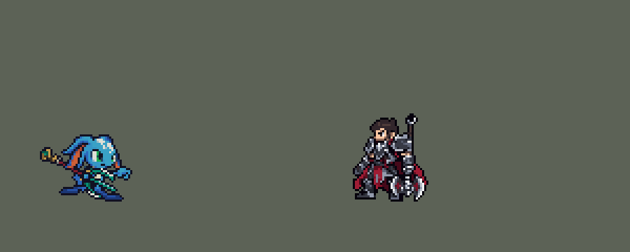

<!-- 本页上半部分由 tools/docs/gen_hero_docs.py 按仓库里现在的数据生成，手改会被覆盖；「开发记录」以下是手写的，生成时原样保留。 -->

# 菲兹 Fizz


| 项目 | 内容 |
|---|---|
| id | `league_fizz` |
| 所属的包 | 主包（mod_id `league`） |
| 分路 | 中单 |
| 分类 / 标签 | 刺客（Assassin） · AP / Magic / Melee / CC / Dot |
| 高清帧 | 1 倍像素（无高清帧） |
| 附加包 | 无 |



其他预览：[combos](../preview/league_fizz_combos.gif)、[逐帧预览](../preview/league_fizz_frames.png)、[特效表](../preview/league_fizz_effects.png)

## 现在的技能

下面是游戏里显示的技能说明（`league/text/champion.i18n` 的简体中文，去掉了颜色和图标），冷却、距离来自 `league/champion/league_fizz.data_champion`；1 秒 = 60 tick。

### 普攻 / 被动（被动「伶俐斗士」）

*攻击间隔 0.92 秒 · 攻击距离 24000*

普攻造成100% 攻击力的物理伤害，并让目标流血3秒，共18 + 18% 法术强度的魔法伤害（可叠加）。被动 伶俐斗士：受到的普攻伤害降低12%。连招 Q E / R E：淘气打击穿过英雄后1秒内，或鱼粘在英雄身上时施放古灵精怪，不等直接跳起砸下。

### 技能1 · 淘气打击

*冷却 5 秒 · 施放距离 50000 · 施放：指定目标 · 敌人（不含防御塔）*

穿过目标冲刺，造成100% 攻击力的物理伤害和40 + 65% 法术强度的魔法伤害，附带流血。海石三叉戟（每6秒）：下一次普攻或淘气打击额外造成50 + 60% 法术强度的魔法伤害，击杀目标则冷却缩短为1秒。

### 技能2 · 古灵精怪

*冷却 9 秒 · 施放距离 45000 · 施放：指定目标 · 敌人（不含防御塔）*

跳上三叉戟0.63秒（受到的伤害只有1点、免疫控制），再砸向最近的敌人，对周围造成80 + 80% 法术强度的魔法伤害并减速40%2秒。附近有敌方英雄时先蓄着，挨打就跳起躲开后面的技能（最多等1秒）。

### 大招 · 巨鲨强袭

*冷却 50 秒 · 施放距离 85000 · 施放：方向 · 敌方英雄*

扔出一条鱼粘在第一个敌方英雄身上并减速，2秒后鲨鱼从它脚下冲出，击飞周围敌人1秒并造成魔法伤害。鱼飞得越远鲨鱼越大：150/220/300 + 70/90/110% 法术强度，减速40/60/80%。落空则在落点冲出大鲨鱼。

### 数值

攻击力 80（每级 +10）、法强 50（每级 +20）、生命 920（每级 +85）、护甲 26（每级 +8）、魔抗 20（每级 +4）、移速 1100（每级 +12）。

## 相关脚本和素材

- [`tools/kit/fizz_combos.py`](../../tools/kit/fizz_combos.py)
- [`tools/lol/extract_fizz.py`](../../tools/lol/extract_fizz.py)
- [`tools/art/preview_fizz.py`](../../tools/art/preview_fizz.py)
- [`tools/art/import_fizz.py`](../../tools/art/import_fizz.py)
- [`tools/art/design_fizz.py`](../../tools/art/design_fizz.py)
- [`assets/source/fizz/`](../../assets/source/fizz)

## 开发记录

> 下面是原来 README 里「英雄：菲兹」一节，原样搬过来（只改了相对链接）。

| 部分 | 内容 |
|---|---|
| 定位 | 中单（近战，分类 Assassin），第八组的中单；本包第八个中单（拉克丝、亚索、安妮、永恩、阿狸、阿卡丽、维迦之后）。刺客：大招的鱼先粘上人，Q 穿过去带出 W 的强化，挨打时 E 跳起来躲开再砸下 |
| 普攻 | 三叉戟戳刺，100% 攻击力的物理伤害，射程 24000，攻击间隔 55 tick（0.92 秒），第 8 tick 出手、第 9 tick 命中（动作第 3 帧）；每次命中让目标流血（W 的被动，见技能1） |
| 被动 | 「伶俐斗士」：受到的普攻伤害 -12%（`base_attack_damaged_reduce`，每条命第一次出手时加上）。英雄联盟的"无视单位碰撞"这个游戏没有对应字段（和移动有关的只有穿墙），略去 |
| 技能1 | Q「淘气打击」，合并 W「海石三叉戟」（英雄联盟的 W 接 Q）：对 50000 内的敌人施放（小兵和野怪也算，清线、打野也用），冷却 5 秒。第 4 tick 起每 tick 4500 穿过目标，停在它身后 15000（`RushMoveToBack`），碰到它时造成 100% 攻击力的物理伤害和 40 + 65% 法术强度的魔法伤害，和普攻一样让它流血。W 的被动：普攻和 Q 每次命中给目标挂一层流血（3 秒，每秒 6 + 6% 法术强度的魔法伤害，每层分开算，不打防御塔）。W 的主动有自己的 6 秒冷却，好了的时候下一次普攻换成强化刺击（30 tick 的动作，第 16 tick 刺中），额外造成 50 + 60% 法术强度的魔法伤害；先放的 Q 就由 Q 的这一下带出。强化刺击打死目标（小兵也算，英雄联盟一样）时，W 的冷却改成 1 秒（金克丝的击杀判定）；模拟一局约 46 次强化，17 次打死了目标（多是小兵） |
| 技能2 | E「古灵精怪」（用户：「这个需要灵活根据战场判断 有时候E可以躲技能 有时候可以直接砸」）：对 45000 内的敌人施放（小兵和野怪也算），冷却 9 秒。50000 内没有敌方英雄（清线、打野）就立刻跳；有的话先蓄着，最多 1 秒：身上一个 1 点的护盾，第一次挨打把它打破，2–4 tick 后跳起，躲开后面跟来的伤害和控制；1 秒内没人打他，到时候再跳（这个游戏读不到"技能飞过来"，挨的第一下就是信号）。被控制时不跳。跳起：50 tick 的动作，38 tick 内隐身、每次受到的伤害只有 1 点、免疫控制（英雄联盟的不可选取；对自己用放逐会让队友也看不到他）；第 6 tick 每 tick 3000 跳到最近的敌人身上（先找 20000 内的敌方英雄，再找 45000 内的，再找任何单位），第 38 tick 每 tick 8000 再扑向最近的敌人，第 42 tick（动作砸下的那一帧）砸地：半径 30000 内的敌人受到 80 + 80% 法术强度的魔法伤害，减速 40%（2 秒）。蓄着的那 1 秒由一个跟着他的隐形范围每 3 tick 查一次（艾克的锚点做法），跳的效果只写一份（每次检查各写一份时整个英雄文件 980 KB，现在 100 KB）。模拟一局约跳 26 次，三分之一是蓄着等到挨打才跳的 |
| 大招 | R「巨鲨强袭」（用户选的：落空也在落点冲出鲨鱼）：朝 85000 内的敌方英雄扔，冷却 50 秒。第 7 tick 扔出鱼，每 tick 6000，半径 10000，只粘敌方英雄（穿过小兵）。粘上时按鱼飞了多久定鲨鱼的大小（英雄联盟按距离）：3 tick 内小鲨鱼，5 tick 内中鲨鱼，再远大鲨鱼；鱼粘在他身上 2 秒，减速 40% / 60% / 80%，脚下亮起鲨鱼齿环；2 秒后鲨鱼从他脚下冲出（他走到哪跟到哪），半径 24000 / 30000 / 36000 内的敌人受到 150 / 220 / 300 + 70% / 90% / 110% 法术强度的魔法伤害、击飞 1 秒，落地后再减速 1.5 秒。没粘上时鱼落在停下的地方，2 秒后在那里冲出大鲨鱼。鱼的速度原来是 3500：AI 在目标离鱼 0–8 tick 飞行时出手，慢的鱼一半被走开躲掉；提到 6000 后 22 发只空 1 发。三档按 AI 实际给的飞行时间定（小 22%、中 44%、大 34%） |
| 连招 | 用户要求（0.42.9）：「亚索也加点连招」「永恩也是」「小鱼人也顺便加一点连招」。和李青、阿卡丽一样，每个连招由用掉的那个技能自己打出来，不锁技能栏：**Q E**——Q 穿过敌方英雄后 1 秒内放 E；**R E**——R 的鱼粘在敌方英雄身上时（到鲨鱼冲出为止）放 E。这两种时候 E 不再等 1 秒挨打再跳，直接跳起扑到最近的英雄（Q 刚穿过的那个）身上砸下；跳的效果本身不变。模拟 6 局：Q 后的 E 6 次、鱼粘上时的 E 14 次，其中 19 次直接跳起。强度（中路对 5 个原版法师，720 局）：连招版 +2.06，同一批种子旧版是 +1.75（README 原来的记录），在误差范围内。 |
| 数值 | 攻击 80（+10）、法术强度 50（+20）、生命 920（+85）、护甲 26（+8）、魔抗 20（+4）、移速 1100（+12），攻击间隔 0.92 秒。数值是自己设计的，用 SDK 对战模拟调：中路，对 5 个原版中单（`pyromancer`、`ice_mage`、`lightning_mage`、`wind_mage`、`white_mage`），三套队友阵容、两边各 24 局，一批 720 局。第一版 -0.30（同一批阿卡丽 +1.22、亚索 +2.03）；Q 冷却 6 秒改 5 秒、E 冷却 10 秒改 9 秒后 +1.33；生命 950、护甲 28、被动 10% 改 12% 后 +1.63；按动作条对齐出手时刻（强化刺击第 16 tick、R 第 7 tick 扔出、E 第 38 tick 落下）后两批 +1.64 / +2.12，偏强；大招伤害降一成（140 / 200 / 270）两批 +1.96 / +2.34，单批的波动约 ±0.3，没压下来，改回；生命 920、护甲 26 后两批 +1.75 / +1.54，定下这版。每局放 Q 约 35 次（打英雄约 8 次）、E 约 27 次、R 约 5.4 次 |
| 亚索联动 | R 的击飞是亚索大招要的控制：菲兹打中路、亚索打上路同队时，亚索每局 R 到被控英雄 1.06 次（同一批原版雷法 3.19、火法 0.65、维迦 2.44），亚索不用调 |
| 精灵图 | 9 个动作 59 帧：待机、移动、普攻、强化刺击（W）、Q、E、R、受击、死亡。造型按用户在 Codex 里挑的原画（A：横握三叉戟、叉头朝右），由 Codex 直接按游戏尺寸画：蓝色鱼人、头顶白斑、带橙色鳍边的大耳鳍、绿眼睛、奶黄色的喉咙和肚皮、深海军蓝的小腿和蹼足，三叉戟是深红的杆、玉绿的叉头（钢色刃边、蓝宝石）、尾端金环。头顶到脚底 32 px，连横握的三叉戟 55 px 宽，23 色 |
| 特效 | 普攻命中的小水花（14 px），W 强化刺击的青白三叉戟爆光（22 px），Q 穿过时的水花（20 px）和出发点的水痕（32 px），E 起跳的水花（24 px）、砸地的水冠（64 px 宽，半径 30000）和减速的水滴（18 px），R 飞行的小丑鱼（14 px，上下对称，游戏会转到飞的方向）、粘在英雄胸口右侧的鱼、脚下的鲨鱼齿环（48 / 60 / 72 px，跟着三档鲨鱼）、落空时在地上蹦的鱼、三档鲨鱼冲出水面（水圈 48 / 60 / 72 px，鲨鱼约 36 / 46 / 56 px 高） |
| 图标 | 官方技能图标（Q / E / R），64×64 |
| 音频 | 从本地客户端提取的 13 条技能音效和 3 条中文语音（Q、E、R 的喊声），合成 12 个游戏音效。不提交到仓库，按下面的命令在本地生成 |

```bash
python tools/lol/extract_fizz.py --lol "D:\WeGameApps\lol" --vgmstream "<vgmstream-cli.exe 路径>"
python tools/lol/native_pose.py assets/source/fizz/poses.json --out <渲染文件夹>   # 动作参考帧
python tools/art/design_fizz.py      # 造型：Codex 的原稿 A 按它自己的格子取像素，32 行、23 色
python tools/art/import_native.py --hero fizz
python tools/art/import_fizz.py      # 特效；--native <Codex 的特效交付文件夹> 先把它的 1 倍成品转成原尺寸条（生图原稿用 --raw）
python tools/kit/fizz_combos.py   # 连招写进技能数据（只跑一次，--check 查）
python tools/art/preview_fizz.py
```

美术（原画的提示词见 [`assets/source/fizz/PICTURE_PROMPT.md`](../../assets/source/fizz/PICTURE_PROMPT.md)，造型的见 [`MODEL_PROMPTS.md`](../../assets/source/fizz/MODEL_PROMPTS.md)，9 条动作的见 [`MODEL_STRIPS.md`](../../assets/source/fizz/MODEL_STRIPS.md)，移动返修的见 [`MODEL_RUN_REDO.md`](../../assets/source/fizz/MODEL_RUN_REDO.md)、三叉戟修正的见 [`MODEL_RUN_TRIDENT.md`](../../assets/source/fizz/MODEL_RUN_TRIDENT.md)，特效的见 [`PROMPTS_FX.md`](../../assets/source/fizz/PROMPTS_FX.md)；Codex 的交接说明在 [`codex_model/`](../../assets/source/fizz/codex_model)、[`codex_strips/`](../../assets/source/fizz/codex_strips)、[`codex_fx/`](../../assets/source/fizz/codex_fx)）：
- 分工：模型和特效都由 Codex 画，Claude 写提示词包、整理和导入，按"原画 → 造型 → 动作 → 特效"分四步。
- 原画和造型：原画包里 Codex 画了两张，用户选 A（横握三叉戟，叉头朝右）。造型包让 Codex 直接按游戏尺寸画（34 行，同崔丝塔娜），交回 A、B 两版草稿，又按格子逐格重画了一版 34 行的（转成正面、眼睛变小、叉头成了 C 形）；用户选了草稿 A 按它自己的格子读回来的那版（「左：原稿读回的 A」）。`design_fizz.py`：`regrid.py` 给每个画出来的方格取一个像素，32 × 55；生图的 770 多种柔和颜色按 Lab 距离乘覆盖像素数的平方根，一对一对合并到 24 色（眼睛的绿色只有 7 个像素也留得住，k-means 会把它并进皮肤）；两种近黑合成一种描边，23 色；放到 128 × 128 的画布上，脚底在第 99 行、两脚中间在第 64 列；三叉戟尾端宝石里那一格眼睛绿改成三叉戟的青色（动作包规定绿色只用在眼睛上）。
- 动作参考（`poses.json`）：镜头 yaw 30、pitch 20，镜像，头、腿、头发都按原版比例，高度 32，112 × 112 的格子。待机 `fizz_idle1`（6 帧 × 200 ms），移动 `fizz_run`（8 帧 × 107 ms，平地，头保持待机时的样子；按动画图实测一圈 0.857 秒），普攻 `fizz_attack1`（前冲取一半），强化刺击 `fizz_crit`，Q `fizz_spell1`（翻滚穿过），E `fizz_spell3a` 起跳、`fizz_spell3a_idle` 倒立在插地的三叉戟上、`fizz_spell3b` 砸下（8 帧共 50 tick，第 7 帧落地，和砸地的第 42 tick 对齐），R `fizz_spell4`，受击用待机姿势（2 帧 × 120 ms），死亡 `fizz_death`。
- 动作：Codex 按参考帧画了 9 条，每帧逐格贴定稿的头（E 倒立在三叉戟上时头上下翻转，Q 翻滚时头按 90° 转），喉咙从眼睛最下一行往下第 4 行开始。移动的第一版把身体压扁在头下面、两腿贴地摊开、三叉戟横在胸口，像蹲着往前爬（用户：「小鱼人移动时候有点奇怪啊 姿势」，选了「照原版重画」）。返修包附英雄联盟的移动，近腿涂橙、远腿涂蓝、三叉戟涂绿：返修版身体立了起来、两腿交替（第 1–4 帧一步、第 5–8 帧另一步），但三叉戟用了 55 格全长、整根放在身后，叉头在后脚边像拖着，杆尾往后伸出 30 多格。用户选「只再修三叉戟」：身体和腿不动，三叉戟缩到 40 格（只缩杆子，叉头和金环不变），叉头第 1–3、8 帧摆到前脚边，第 4–7 帧摆回身体下面（英雄联盟的钟摆），金环在头的左后方；定稿的头比原版的大，原版 37–70° 的角度会让杆子整根藏到头后面，所以放平到 26–55°，修正包附逐帧的目标（中间齿尖、金环末端、握点）和在 Codex 自己的拼图脚本上摆好的示意（`MODEL_RUN_TRIDENT.md`）。Codex 把叉头按每个角度重画成三根分开的玉绿色齿（不用整块旋转出来的碎点），近腿膝盖以下压在叉头上。做的时候用户又指出往前伸的空手「有点违和感」（3 格粗的直手臂加一只耙子似的大手），Codex 把前臂缩短、肘部轻弯、手收成小蹼手，用户：「这个OK了」。交接说明`codex_strips/HANDOFF_RUN_REDO.md`、`HANDOFF_RUN_TRIDENT.md`。
- 导入：待机 6 帧用定稿，第 3–5 帧从第 8 行（脚踝）往下沉一格呼吸（`BOB`）；按眼睛的绿色定头的位置（`EYES`）；描边补齐（`COMPLETE`）。头像截取点 (0, −31)。待机最高点 −20，不用设 `banpick_center`，横握的三叉戟左右各伸出 26–28 px，在选人卡片的画布里放得下。
- 特效用 Codex 画的 12 张（79 帧）。这次 Codex 直接交了按游戏尺寸整理好的成品（每张有 1 倍的逻辑像素图，颜色按包里的色阶，透明度只有 0 / 255，水花外面不再包一圈最深色）：`import_fizz.py --native` 按交付清单的窗口逐像素搬进来，不再缩放取样；三档鲨鱼按整格切（三行的窗口不一样大，但地面基线一致）。预警圈 Codex 只画了 48 px 一档，中、大鲨鱼要 60、72 px：按比例最近邻放大会让 1 格的圈边变成 1–2 格、牙齿变形，改成沿椭圆半径重映射（每个像素取原图同一角度、离外圈同样距离的像素），圈边和牙齿保持原来的像素宽度，只是间距变大。粘在身上的鱼按 Codex 的建议挂在胸口右侧（它把鱼画成贴在身侧、人物的位置留空）。时长按技能：普攻和 Q 命中 5 帧 × 50 ms，强化刺击 6 × 55 ms，Q 水痕 5 × 70 ms，E 起跳 5 × 60 ms、砸地 7 × 70 ms、减速 6 × 80 ms，飞行的鱼 4 帧循环 60 ms，粘住的鱼和鲨鱼齿环 4 帧循环 100 ms（2 秒），落地的鱼 4 帧循环 5 次（2 秒，到鲨鱼冲出），鲨鱼 8 帧 × 70 ms。演示 GIF 里菲兹画在德莱厄斯前面：Q 停在他身后 15000，正好在他的身体里。
- 出手时刻和动画对齐：普攻第 3 帧（第 9 tick），强化刺击第 16 tick（动作的刺出帧），Q 碰到目标时命中，E 第 42 tick 砸下（动作第 7 帧），R 第 7 tick 扔出（动作第 3 帧）。

逐帧预览：[`docs/preview/league_fizz_frames.png`](../preview/league_fizz_frames.png?v=1014g)，特效：[`docs/preview/league_fizz_effects.png`](../preview/league_fizz_effects.png?v=1014g)。
