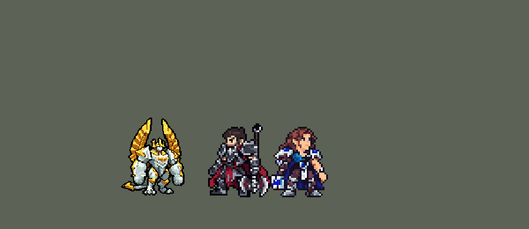

<!-- 本页上半部分由 tools/docs/gen_hero_docs.py 按仓库里现在的数据生成，手改会被覆盖；「开发记录」以下是手写的，生成时原样保留。 -->

# 加里奥 Galio


| 项目 | 内容 |
|---|---|
| id | `league_galio` |
| 所属的包 | 主包（mod_id `league`） |
| 分路 | 中单 |
| 分类 / 标签 | 近战（Melee） · AP / Magic / Melee / Tank / CC / Shield |
| 高清帧 | PPU 1.65（画成 110%） |
| 附加包 | [加里奥附加包](#附加包)（`league_galio`） |



其他预览：[逐帧预览](../preview/league_galio_frames.png)、[特效表](../preview/league_galio_effects.png)

## 现在的技能

下面是游戏里显示的技能说明（`league/text/champion.i18n` 的简体中文，去掉了颜色和图标），冷却、距离来自 `league/champion/league_galio.data_champion`；1 秒 = 60 tick。

### 普攻 / 被动

*攻击间隔 1.2 秒 · 攻击距离 25000*

巨像重击：每4秒下一次普攻对周围敌人造成80 + 70% 法强魔法伤害。杜朗护盾被动：普攻时获得90 + 30% 法强护盾，每12秒一次。

### 技能1 · 战争罡风

*冷却 7 秒 · 施放距离 55000 · 施放：地点 · 敌人（不含防御塔）*

射出两道风刃，落点造成120 + 80% 法强魔法伤害，并留下2秒龙卷风，每0.5秒造成30 + 18% 法强魔法伤害。

### 技能2 · 正义冲拳

*冷却 1 秒 · 施放距离 43000 · 施放：指定目标 · 敌方英雄*

冲向敌方英雄，撞到第一个英雄造成130 + 90% 法强魔法伤害并击飞0.75秒。杜朗护盾：蓄力0.83秒，伤害降低40%，随后嘲讽1.17秒周围敌人，造成90 + 70% 法强魔法伤害。

### 大招 · 英雄登场

*冷却 70 秒 · 施放距离 960000 · 施放：无目标 · 敌方英雄*

给陷入苦战的友方英雄150 + 50% 法强护盾，引导2秒后飞到其身边，落地造成220 + 90% 法强魔法伤害并击飞0.75秒，周围友方英雄也获得护盾。

### 数值

攻击力 78（每级 +6）、法强 45（每级 +18）、生命 1150（每级 +115）、护甲 34（每级 +7）、魔抗 36（每级 +6）、移速 1000（每级 +10）。

## 附加包

附加包是可选的原生代码 mod（都在附加包合集 `league_addons` 里），**不装主包里的英雄也是完整的**。

### 加里奥附加包

[加里奥附加包](../../addons/league_galio/README.md)：`league_galio` v0.1.4

主包 `league` 保持纯数据。用户选了「主包数据 + 附加包」。这个附加包用原生代码做主包数据做不到的三件事：

- **杜朗护盾的被动护盾按「多久没挨打」给**：主包里加里奥普攻时给护盾（每 12 秒最多一次），因为数据读不到「多久没受伤」。
  附加包的被动 `league_galio:colossus` 记下他最后一次受伤的 tick，**12 秒没受伤**就给 90 + 30% 法强的护盾（5 秒），护盾还在不重给。
  英雄联盟里这个护盾只挡魔法伤害；被动的受伤钩子不带伤害类型，所以这里**挡所有伤害**。
- **W 的嘲讽按身边英雄数**：英雄联盟里蓄力越久嘲讽越久（0.5–1.5 秒），人多时会蓄满。附加包的 `league_galio:taunt` 在 W 放开时
  数他身边（W 的半径以内）的敌方英雄：1 个 0.75 秒、2 个 1.17 秒（主包的数）、3 个及以上 1.5 秒。
- **英雄登场选人**：主包读不到血量，只能挑「被控的」或「身边连续两次有敌人的」友军。附加包的 `league_galio:entrance` 在每次轮询时
  看所有友方英雄：离他够远、身边有敌方英雄、确实在苦战（被控 / 血量 80% 以下 / 身边两个以上敌人）的里面，**被控的优先，再挑血量比例最低的**，
  落点周围敌方英雄多的优先（每多一个当作血量少 10%）。选中谁，数据就给谁护盾、引导、飞过去。
- **引导只被硬控打断**（0.1.2）：主包每 15 tick 用 `AllyChampionInCC` 查他自己有没有被控，被控就打断引导。游戏 0.7.0 起玩家说加里奥
  不开大；游戏的控制列表里也有他自己正在播的施法动作，那个查法可能把引导动作本身当成被控、每次都打断。副本去掉数据的这个查法，
  改由附加包每 tick 看他有没有被硬控（击飞、眩晕、定身、嘲讽、恐惧、魅惑、强制位移），有才打断；自己被硬控时也不选人。

## 相关脚本和素材

- [`tools/kit/build_galio.py`](../../tools/kit/build_galio.py)
- [`tools/kit/setup_galio.py`](../../tools/kit/setup_galio.py)
- [`tools/lol/extract_galio.py`](../../tools/lol/extract_galio.py)
- [`tools/art/preview_galio.py`](../../tools/art/preview_galio.py)
- [`tools/art/rig_galio.py`](../../tools/art/rig_galio.py)
- [`tools/art/import_galio.py`](../../tools/art/import_galio.py)
- [`assets/source/galio/`](../../assets/source/galio)

## 开发记录

> 下面是原来 README 里「英雄：加里奥」一节，原样搬过来（只改了相对链接）。

| 部分 | 内容 |
|---|---|
| 定位 | 中单（Melee，标签 AP / Magic / Melee / Tank / CC / Shield），第 98 位英雄。正义巨像 加里奥：有一对金色翅膀的禁魔石巨像，近战普攻，技能全是魔法伤害，坦度高、控制多。用户的选择（全部推荐方案）：中路、近战 AP 坦克法师；技能1 = Q，技能2 = E 正义冲拳接 W 杜朗护盾，大招 = R 英雄登场；被动做在主包里，再加附加包；加入高手连招；高清帧（PPU），比布隆略大 |
| 普攻 / 被动 | 石拳（攻击距离 25000，第 9 tick 打中，攻击间隔 72 tick）。「巨像重击」：每 240 tick 下一次普攻变成跳起双拳砸地（第 12 tick 砸中）：目标吃普攻，他身边 16000 内的敌人受到 80 + 70% 法强魔法伤害（英雄联盟：每 5 秒，范围魔法伤害；技能打中还会缩短冷却——数据里的冷却标记不能缩短，这里固定 4 秒）。杜朗护盾的被动：英雄联盟里 12 秒没受伤就得到挡魔法的护盾，数据读不到「多久没受伤」，主包里改成普攻时得到 90 + 30% 法强的护盾（300 tick），每 720 tick 一次 |
| 技能1 | Q「战争罡风」：冷却 420 tick，对 55000 内的敌人放（小兵野怪也算），第 9 tick 扇出两道风，抛到敌人站的地方（飞 24 tick，躲得开）：落点 15000 内 120 + 80% 法强魔法，留下一个 13000 的龙卷风 120 tick，每 30 tick 30 + 18% 法强。**高手连招**：冲拳击飞或嘲讽到英雄后 120 tick 内放 Q，风几乎立刻落地 |
| 技能2 | E「正义冲拳」和 W「杜朗护盾」共用技能位（技能位本身冷却 60 tick，E、W 各有自己的冷却标记：E 600、W 900），对 43000 内的敌方英雄放：E 准备好就冲拳——后撤一步，第 8 tick 冲出去（`RushTime`），撞到第一个敌方英雄停下：130 + 90% 法强魔法、击飞 45 tick；E 在冷却、身边 24000 内有敌方英雄而 W 准备好时举盾蓄力 50 tick（受到伤害 −40%，蓄力后再留 60 tick；自身减速 15%），然后放开：26000 内的敌人 90 + 70% 法强魔法、嘲讽 70 tick |
| 大招 | R「英雄登场」：英雄联盟里飞到全图任意友军身边。数据读不到血量，所以照慎的大招做成「上弦」：放出后 900 tick 内每 10 tick 找一个离他至少 60000 的友方英雄——被控住的，或者身边 25000 内连续两次有敌方英雄的——给他 150 + 50% 法强的护盾（300 tick），引导 120 tick（被控就打断），飞到他身边落地：22000 内的敌人 220 + 90% 法强魔法、击飞 45 tick（中心 10000 内 70 tick），落点的友方英雄也得到护盾。没找到就把冷却压短，下次靠近再上弦。**高手连招**：落地时 W 准备好就接着举盾嘲讽 |
| 附加包 | 可选的附加包 [`addons/league_galio`](../../addons/league_galio/README.md)（在附加包合集里，原生代码，主包不装它也完整）：**杜朗护盾的被动按「12 秒没受伤」给**（被动的受伤钩子不带伤害类型，所以挡所有伤害，不只魔法）；**W 嘲讽按身边英雄数**（1 个 0.75 秒、2 个 1.17 秒、3 个以上 1.5 秒）；**大招挑队友**：离得够远、身边有敌方英雄、确实在苦战的里面，被控的优先，再挑血量比例最低的（落点敌方英雄多的优先）。附加包里的加里奥是 `make_override.py` 从主包生成的副本，普攻、技能 2、大招的说明以「【附加包】」开头。日志 `league_galio.log`。还没在游戏里看过日志 |
| 数值 | 攻击 78（+6）、法术强度 45（+18）、生命 1150（+115）、护甲 34（+7）、魔抗 36（+6）、移速 1000（+10）。SDK 对战模拟：中路，对 5 个原版法师（`pyromancer`、`ice_mage`、`lightning_mage`、`wind_mage`、`white_mage`），三套阵容、两边各打，每批 24 个种子：按动作帧重新计时后 +1.45 / +1.67，同位置的泽拉斯 +1.51 / +1.04、维克托 +1.27 / +1.68、卡萨丁 +1.22 / +1.55。初稿 −0.16 / +0.05（伤害低、Q 和被动冷却长），加强过一轮 |
| 精灵图（高清帧 PPU 1.65，画成 110%） | Codex 画了原画 A（翅膀高高竖起）和 B（翅膀半收），中途用户定下所有高清英雄统一成泽丽的画风，按新画风重画后用户选 A、每个游戏像素 2.0 格。原画 A 按自己的格子读回就是造型；拳头 Codex 画成了螺旋，用户：「改成握紧的石拳」，Codex 又画成了黑圈石球，用户选「我按英雄联盟的拳头逐格手画」，第一版方块拳「有点诡异」，按 oppi 的加里奥画法重画（比小臂窄、圆、和手臂连着、一点高光）、两只一样大（「大小对称点啊」）（[`tools/art/design_galio_hd.py`](../../tools/art/design_galio_hd.py)）。侧身也画过，用户：「侧面还是跟怪啊」，改成所有动作 3/4 正面。造型最后照泽丽统一的平涂（45 色 → 22 色，蓝眼睛保留）。动作由 Codex 照英雄联盟的动作逐帧画（[`tools/art/pack_galio_strips.py`](../../tools/art/pack_galio_strips.py)，52 帧），[`tools/art/rig_galio.py`](../../tools/art/rig_galio.py) 读回：颜色按造型平涂时的对应关系换成 22 色、普攻出拳的两帧螺旋拳抹成圆石拳、Codex 没闭合的外描边补完整再加粗（用户：「有像素缺失的部分吧」）、头冠尖角之间的缝保持透明（后面挡着翅膀就补翅膀的颜色）；待机呼吸、受击后退。用户：「这做的也太大了吧 缩小点模型」，从真实比例的对比图里选了 85%（hd.rs SIZES）。装进游戏后用户：「加里奥在局内看起来太小了」「而且在局内还是太高清了加里奥」，从真实比例图里改回 100%（52 像素，身子和墨菲特一样壮），再从 2.0 / 1.5 / 1.2 / 1 格的对比图里选，1 格试过（「1太糊了 用1.5」），定成每个游戏像素 1.5 格。装上后用户：「在局内还是偏小啊」——52 像素里 14 像素是翼尖，身子（头冠到脚）只有 38 像素，比德莱厄斯 42 还矮，从按身高标注的对比图里选了 110%（身子 42）：hd.rs SIZES 1.10、PPU 1.65（1.65 ÷ 1.1 还是 1.5 格），高清帧往上挪 2 行让脚底贴地。动作仍按 2.0 格画，`rig_galio.py` 的 `dense` 用 `pixel_down.pixelate` 降到 1.65 格给战场，`down` 另做 1 倍帧（2×2 一格，眼睛周围一格亮色就保留，脸和头冠才看得出）；选人界面照旧是 1.5 格的 `lo_` 帧。跑步：Codex 画的 8 帧浅色腿一直在前、深色腿一直在后（用户：「走路没有交叉步」）。按骨骼画腿、贴造型的护膝和爪子脚、把造型的腿错位倾斜、整条前后挪，四版都被指出变形（「腿部变形？」「还是变形啊 你不自己review的吗」「不还是变形？你不做到完美不要喊我review」「看不到这里变形吗」）；Codex 只重画腿（[`tools/art/pack_galio_run.py`](../../tools/art/pack_galio_run.py)，提示词 `RUN_PROMPT.md`，第 1 轮交回在 [`assets/source/galio/codex_run/`](../../assets/source/galio/codex_run)），按用户「Codex的腿你不会拿来用？然后一帧一帧描了修复？」逐帧描过来，装进游戏后用户：「这也不对啊 看起来完全脱节」——Codex 第一版那条永远在前的大腿留在切口上面，描来的腿挂在它下面。用户定下：「你不要向前冲刺交叉腿 你按照泰坦布隆那种走路方式这种腿就不会变形」「你向前那样冲刺模型永远会变形」。所以跑步是诺提勒斯 / 布隆被认可的走法（`rig_galio.py` 的 `walk_frame`，同 `rig_braum.walk_frame`）：待机原样，造型自己的两条腿从肚子下面切开（近侧腿、远侧腿各一块），每帧一条腿去掉顶上几行（大腿朝向镜头，护膝挂在肚子下面）、往前挪一点，两腿轮流，整个人微微上浮；没有任何部分旋转、错切或拉伸。步子是诺提勒斯 1 倍图的步长乘 2：抬 4 / 6 / 2 / 0 格、前移 0 / 2 / 2 / 2 格、上浮 2 / 4 / 2 / 0 格，每帧 115 毫秒。迈步露出的缝（待机盖住、腿挪开后露出的，或新围起来的空隙）横向或纵向不超过 3 格宽的填成描边，抬起的脚下面空出的地和待机本来透空的窗（尾尖和拳头之间、胯下）保持透空。又按用户「尾巴怎么长在地上了？」「拳头缩小点不就好了吗 然后尾巴不能放地上啊」：两只拳头各去掉最省的两行两列（一样大、连着小臂、描边和指节不动），尾巴整条往上提 6 格到近侧拳头下面，待机呼吸时尾巴不动（`design()`，hd/front.png 仍是原定稿）；这只用在待机、走路、受击上，其他动作是 Codex 的帧，颜色对照仍按原定稿，一格没变。每帧固定 121 × 125 格（1 倍）、高清 200 × 206，所有帧中心的奇偶一致，待机不再在 140 / 143 行之间抖半格。照尼拉的做法，每一版先给独立审查逐格查（变形、接缝、黑块、杂点、透空的缝），审查说可以给用户看了才给用户看。头像截取点 (1, −27)（头冠顶） |
| 特效 | Codex 生图的 17 张（用户贴来的一张总览图，[`tools/art/import_galio.py`](../../tools/art/import_galio.py) 按卡萨丁 / 布隆的做法切格：去掉深色底、每个特效一个缩放、颜色贴回风 / 蓝色魔法 / 金色 / 尘土 / 碎石五套配色；w_ps 里 Codex 画的人形剪影去掉；风刃的细线先加粗再缩；只画了一两帧的按生长、循环、淡出补齐，龙卷风按颜色在轮廓里往上滚表现旋转）。红色方的对称逐格检查：风刃上下对称、沿飞行方向转，其余全部左右对称。龙卷风和大招引导各铺满 2 秒。大招落地一开始只闪 60 毫秒、GIF 里看不出（用户：「大招落地的效果没有？怎么gif图里看不出」），改成停 650 毫秒、画在单位上面；用户又说「这个R的特效做大点啊」「加里奥的R特效这么小？」，落地冲击环从 46 宽放到 84（正好盖住 22000 的落地范围），引导的金光 50 → 64 高，打中 24 → 32 |
| 音效 | 英雄联盟的音效和配音（`tools/lol/extract_galio.py`）：石拳 / 打中、被动蓄力 / 砸中、Q 扇风 / 龙卷风、E 冲出 / 打中、W 举盾 / 放开、R 起飞 / 给队友的护盾 / 落地；Q、W、E、R 各用他自己的台词（片段名 `league_galio_sfx_vo_*`，和声音名不同）。版权属于 Riot Games，**不提交到仓库**，按下面的命令在本地生成 |
| 图标 | 官方技能图标（Q 战争罡风 / E 正义冲拳 / R 英雄登场，另有 W 杜朗护盾、被动），从本地客户端提取，缩到 64×64 |

重新生成（素材来自本机的英雄联盟客户端，音频不进仓库）：

```bash
python tools/lol/extract_galio.py --lol "D:\WeGameApps\lol" --vgmstream "<vgmstream-cli.exe 路径>"
python tools/kit/build_galio.py              # 技能数据，数字都在脚本的参数表 P 里；--nodes 看每棵技能树的节点数
python tools/kit/setup_galio.py              # 五种语言的文字、音效配置、共享文件里他的键
python tools/art/design_galio_hd.py          # 原画读回成造型、拳头、平涂（注意：pixel_down 改过，重跑会差几格，定稿以仓库里的 hd/front.png 为准）
python tools/art/rig_galio.py                # Codex 的动作条读回 + 1 倍帧 + 高清帧（assets/source/ppu/galio_*）
python tools/art/ppu_hd.py --hero galio
python tools/art/import_galio.py             # 特效：总览图切格，拼成特效表
python tools/art/preview_galio.py            # 预览和演示 GIF
python addons/league_galio/make_override.py  # 附加包的副本（主包的加里奥改了就重跑）
```

美术（提示词见 [`assets/source/galio/`](../../assets/source/galio) 里的 `PICTURE_PROMPT.md`、`MODEL_PROMPTS.md`、`MODEL_STRIPS.md`、`PROMPTS_FX.md`）：

- 原图：Codex 画的 A / B（`codex_picture/`），用户选 A；画风参考是统一画风后的莫德凯撒、布隆、泽丽（`style_ref/`）。
- 造型：Codex 的第 1 步（`codex_model/`：正面改拳头、侧身 A / B，侧身最后没用），定稿在 `hd/front.png`。
- 动作：Codex 的 52 帧（`codex_strips/`）；跑步的腿重画包见 `RUN_PROMPT.md`。
- 特效：17 张来自 Codex 的总览图（`codex_fx/galio_fx_overview.jpg`）。

逐帧预览：[`docs/preview/league_galio_frames.png`](../preview/league_galio_frames.png?v=1014g)（游戏里用的 hd_ 高清帧），特效：[`docs/preview/league_galio_effects.png`](../preview/league_galio_effects.png?v=1014g)。
