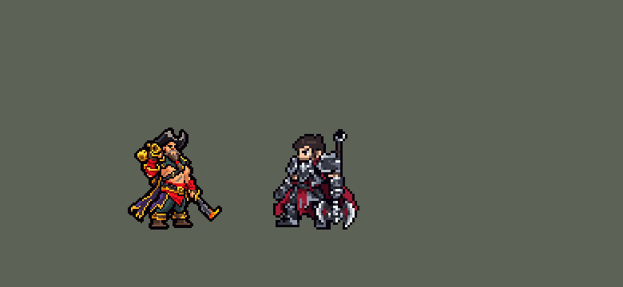

<!-- 本页上半部分由 tools/docs/gen_hero_docs.py 按仓库里现在的数据生成，手改会被覆盖；「开发记录」以下是手写的，生成时原样保留。 -->

# 普朗克 Gangplank


| 项目 | 内容 |
|---|---|
| id | `league_gangplank` |
| 所属的包 | 主包（mod_id `league`） |
| 分路 | 上单 |
| 分类 / 标签 | 近战（Melee） · AD / Melee |
| 高清帧 | PPU 1.5 |
| 附加包 | [普朗克附加包](#附加包)（`league_gangplank`） |



其他预览：[逐帧预览](../preview/league_gangplank_frames.png)、[特效表](../preview/league_gangplank_effects.png)

## 现在的技能

下面是游戏里显示的技能说明（`league/text/champion.i18n` 的简体中文，去掉了颜色和图标），冷却、距离来自 `league/champion/league_gangplank.data_champion`；1 秒 = 60 tick。

### 普攻 / 被动

*攻击间隔 1 秒 · 攻击距离 26000*

弯刀砍击。烈火审讯：每12秒下次攻击或枪火谈判点燃目标，2.5秒内造成60 + 60% 攻击力真实伤害，自己加速20%；火药桶爆炸时刷新。坏血病疗法：3级起被控制或被围攻时吃橘子，回复80 + 60% 攻击力生命，免控1秒。

### 技能1 · 枪火谈判

*冷却 4.5 秒 · 施放距离 62500 · 施放：指定目标 · 敌人（不含防御塔）*

开枪射击：造成20 + 80% 攻击力物理伤害，可暴击，会触发烈火审讯。打中后1秒内，引线已点燃、桶边有敌人的火药桶都会被引爆。

### 技能2 · 火药桶

*冷却 8 秒 · 施放距离 70000 · 施放：指定目标 · 敌方英雄*

向敌方英雄扔火药桶（最多2个，留8秒），1秒后引线点燃。被枪火谈判、贴身攻击或另一个桶的爆炸引爆：范围内敌人受到40 + 100% 攻击力物理伤害（英雄再加60），无视40%护甲，减速40%2秒。

### 大招 · 加农炮幕

*冷却 60 秒 · 施放距离 400000 · 施放：指定目标 · 敌方英雄*

朝天打出信号：1秒后炮弹砸向敌方英雄所在区域，共12波，每0.5秒一波，每波造成60 + 50% 攻击力物理伤害并减速30%。全图可放，优先打向被控制的敌方英雄。

### 数值

攻击力 82（每级 +16）、生命 1000（每级 +95）、护甲 30（每级 +8）、魔抗 25（每级 +4）、移速 1000（每级 +11）。

## 附加包

附加包是可选的原生代码 mod（都在附加包合集 `league_addons` 里），**不装主包里的英雄也是完整的**。

### 普朗克附加包

[普朗克附加包](../../addons/league_gangplank/README.md)：`league_gangplank` v0.1.0

|  | 主包（不装附加包） | 装了附加包 |
|---|---|---|
| 坏血病疗法（W） | 3 级起被控制或被围攻时自动吃橘子：回血、免控 1 秒；已经在身上的控制要等它自己结束 | 同上，另外吃下去的那个 tick **清掉他身上的硬控**（英雄联盟：W 解除控制）；**生命低于 40%** 也会吃 |
| 火药桶连锁（E） | 一个桶炸开，另一个点燃的桶边有敌人就跟着炸（不管两个桶多远）；桶边没人就不炸 | 两个桶相距不超过 `e_chain`（70000）才连锁；桶边有敌人照样由数据炸，**桶边没人也空炸**（画面、声音、刷新烈火审讯和加速都有） |

## 相关脚本和素材

- [`tools/kit/build_gangplank.py`](../../tools/kit/build_gangplank.py)
- [`tools/kit/setup_gangplank.py`](../../tools/kit/setup_gangplank.py)
- [`tools/lol/extract_gangplank.py`](../../tools/lol/extract_gangplank.py)
- [`tools/art/preview_gangplank.py`](../../tools/art/preview_gangplank.py)
- [`tools/art/rig_gangplank.py`](../../tools/art/rig_gangplank.py)
- [`assets/source/gangplank/`](../../assets/source/gangplank)

## 开发记录

> 下面是原来 README 里「英雄：普朗克」一节，原样搬过来（只改了相对链接）。

| 部分 | 内容 |
|---|---|
| 定位 | 上单（Melee，标签 AD / Melee），第 126 位英雄。海洋之灾 普朗克：比尔吉沃特的海盗船长（10-17 的分组计划 B 组的上单）。用户的选择：「技能方案按 A 做」（带扩展包 `league_gangplank`）、原画 A（手炮扛在肩上，「用 A（扛炮），游戏里 42 像素高」）、PPU 1.5。技能 1 = Q 枪火谈判，技能 2 = E 火药桶，大招 = R 加农炮幕；W 坏血病疗法没有技能位，由守望自动吃 |
| 普攻 / 被动 | 弯刀砍击（第 9 tick 打中，防御塔也打），攻击间隔 60 tick，射程 26000。**烈火审讯**：每 12 秒下一次普攻或枪火谈判点燃目标，2.5 秒内造成 60 + 60% 攻击力的真实伤害，自己加速 20% 2 秒；火药桶炸开时刷新 |
| 技能1 | **Q 枪火谈判**（对 62500 内的敌人放，小兵、野怪也打）：第 10 tick 开枪，20 + 80% 攻击力的物理伤害，**可暴击**（`BaseAttack`），带烈火审讯。打中后 1 秒内，点燃了的、桶边有敌人的火药桶都会被引爆（英雄联盟是打桶；没有东西能瞄准区域，所以子弹打人、人身边的桶炸）。冷却 4.5 秒 |
| 技能2 | **E 火药桶**（对 70000 内的敌方英雄放）：守望把桶扔到那名英雄出手时站的位置，最多 2 个、各留 8 秒，落地 1 秒后引线点燃；点燃的桶被枪火谈判、他在桶边的普攻或另一个桶的爆炸引爆：30000 内的敌人受到 40 + 100% 攻击力的物理伤害（英雄再加 60），无视 40% 护甲，减速 40% 2 秒。冷却 8 秒 |
| W | **坏血病疗法**（守望自动吃，3 级起）：被控制或被两个敌方英雄围住时咬一口橘子，回复 80 + 60% 攻击力的生命、免控 1 秒。冷却 15 秒 |
| 大招 | **R 加农炮幕**，**看场面才放**：按 R 只是待命 10 秒，守望每 12 tick 看一次：全图哪个敌方英雄被控制了就打他，5 秒后改打队友刚打过的敌方英雄（英雄联盟的全图支援）；10 秒没等到就退还冷却。朝天打信号弹，1 秒后那片地方（半径 58000，用户：「R大招做大点」，英雄联盟 580）每 0.5 秒落一波炮弹，共 12 波：每波 60 + 50% 攻击力的物理伤害（2026-10-25 起翻倍：原来每波约 50，用户「看起来好像没伤害」；Q 和成长生命调低保持强度，模拟 +1.99 → +2.15）、减速 30%。冷却 60 秒 |
| 附加包 | 可选的附加包 [`addons/league_gangplank`](../../addons/league_gangplank/README.md)（在附加包合集里，原生代码，主包不装它也完整）：**吃橘子时清掉身上的硬控**（英雄联盟：W 解除控制）；**生命低于 40% 也吃**；**火药桶按距离连锁**（相距 70000 以内），桶边没人也空炸。日志 `league_gangplank.log`（CLEANSE、LOW、KEG、CHAIN） |
| 数值 | 攻击 82（+16）、生命 1000（+95）、护甲 30（+8）、魔抗 25（+4）、移速 1000（+11）、射程 26000 |
| 平衡 | 10 分钟经典引擎模拟，上单位对原版六个上单（斗士、处刑人、枪骑兵、长柄战士、骑士、狂战士），三套阵容两边各打 8 局：**+1.67**（R 放大前 +1.89；德莱厄斯 +1.99、内瑟斯 +1.55 同一批种子）；每 10 分钟约落 20 个桶、炸 11 个，吃 9 次橘子，放 5 次大招。初稿的普攻命中全放在「活着才打」的检查里，游戏的 AI 把他的普攻读成 0 伤害、作战计划里除以 0 崩溃（模拟器 11 局崩 9 局），普攻和 Q 加了 AI 读得到的伤害后 28 局全跑完（技能数据文档里记了这条） |
| 精灵图（高清帧 PPU 1.5） | Codex 第 0 步画了扛炮（A）和端枪（B）两张原画（[`tools/art/pack_gangplank_picture.py`](../../tools/art/pack_gangplank_picture.py)），用户选 A、42 像素高。第 1 步 Codex 在游戏格子上重画两轮（[`tools/art/pack_gangplank_model.py`](../../tools/art/pack_gangplank_model.py)、[`tools/art/pack_gangplank_model2.py`](../../tools/art/pack_gangplank_model2.py)），用户：「普朗克不是大肚子」；[`tools/art/design_gangplank_hd.py`](../../tools/art/design_gangplank_hd.py) 读回 A-2（57×62，不删行：删到 50 行时手炮和腿变形），[`tools/art/fix_gangplank_feet.py`](../../tools/art/fix_gangplank_feet.py) 修好两只靴子。动作照塔姆的做法（用户：「动作帧参考塔姆那种做法 不用依赖codex 然后做完了你自己review 完美了再喊我review」）：[`tools/art/rig_gangplank.py`](../../tools/art/rig_gangplank.py) 只整格移动、镜像、旋转 90°；拿枪那只手怎么拼都怪（「左手攻击导致身体看起来非常非常奇怪」），Q 端枪和 R 举枪朝天由 Codex 在定稿上只重画那条胳膊（[`tools/art/pack_gangplank_poses.py`](../../tools/art/pack_gangplank_poses.py)、[`tools/art/design_gangplank_poses.py`](../../tools/art/design_gangplank_poses.py)），其余全是定稿自己的格子。第六版用户：「第六版可以，PPU 用 1.5」。动作：待机、走路、普攻（弯刀）、Q 端枪开火（帧里有枪口火光）、E 扔桶、W 吃橘子（帧里有橘子）、R 举枪打信号弹（帧里有信号弹）、挨打、阵亡（倒地躺平）。2026-10-18 缩小到 90%（用户：「船长猴子局内太大」「船长保留1.5 但是要缩小体型」）：PPU 不变，帽顶到脚底约 39 个游戏像素（原来约 43），`ppu_restyle.py` 的 `grow=0.9`，头像点 (2, −29)，选人卡 −12 2026-10-19 补帧：烤进帧里的 Q 枪口火光、W 橙子、R 信号弹一直没进游戏图集（ppu_restyle 他那一行少了 `fx=True`），已补；Q 开枪后举枪后坐（Codex 的 R 姿势），E 放桶后举刀（普攻的前两个姿势），R 先下蹲再举枪；死亡 8 帧 |
| 特效 | 第 3 步 20 张特效（[`tools/art/pack_gangplank_fx.py`](../../tools/art/pack_gangplank_fx.py)，颜色照英雄联盟：被动和刀上烧红的火，枪火和金币的金色，棕色木桶加黑铁箍、橙黄的火加黑灰火药烟，橘子的柑橘橙，大招焦橙红的预警和黑铁炮弹），Codex 画并读回成游戏大小（`assets/source/gangplank/codex_fx`）。[`tools/art/import_gangplank_fx.py`](../../tools/art/import_gangplank_fx.py)：飞行的子弹和火药桶上下对称，其余左右对称；桶每 10 tick 重贴一次（2 帧），预警铺满信号弹飞的 1 秒，每波炮弹 0.5 秒；大招放大后预警圈按新半径重画（线不变粗），每波中间三团炮弹、两边各一团晚一帧的；枪口火光、橘子、信号弹按 `assets/source/native/gangplank_bake.json` 画进他自己的帧（会跟着他翻面）。写成 `league_gangplank_fx` 和 `league_gangplank_big` |
| 音效 | 英雄联盟的音效和配音（[`tools/lol/extract_gangplank.py`](../../tools/lol/extract_gangplank.py)，18 段）：普攻出手 / 打中、被动点燃、Q 开枪 / 打中、E 出手 / 落地 / 爆炸 / 打中、W 出手 / 咬橘子、R 出手 / 叫船 / 炮弹，配音是他的 Q / E / W / R 台词（中文）；桶自己的爆炸在客户端里解析不到，用大招炮弹的爆炸声代替 |
| 图标 | 官方技能图标（枪火谈判、火药桶、加农炮幕，另有坏血病疗法和烈火审讯），从本地客户端取 |
| 修正（走路的脚，2026-10-22） | 用户：「船长的走路脚好像变形的」（脚已经第六次了）。之前的走路是 Codex 的 8 帧（上身和设计图一格不差，只有腿是 Codex 画的），3/4 视角里两只脚交叉：第 2、3、5 帧两只盖上去的靴子叠成一块变形的形状，上面的裤腿也是一块一块的。现在照皇子、贾克斯的跑步做法，腿按英雄联盟的 gangplank_run 画（[`tools/lol/pose_joints.py`](../../tools/lol/pose_joints.py) 读成 `assets/source/gangplank/run_joints.json`，近侧是英雄联盟的左腿）：每条裤腿从胯开始，大腿、小腿按英雄联盟的角度（站地的脚落在地上、膝盖解出来，`rigkit.leg_chain`），设计图的两种青色、左亮右暗、一圈描边，脚踝上是设计图自己的绑腿和靴子；远侧的腿用设计图里暗一档的颜色（交叉时近侧的靴子在前面，不会叠成一块）；两胯相距 5 列（站姿是 8 列，交叉时两只靴子整只叠在一起）；腿画在身体下面，大衣、腰带和红腰布照原样盖住裤腿上端。上身是设计图，随英雄联盟的胯部上下起伏 0–2 行；他的腿短（胯到脚踝 11 格），骨长 7 格、站着膝盖微弯，脚的行程和 Codex 的差不多（[`rig_gangplank.py`](../../tools/art/rig_gangplank.py) `league_walk`）。其他动作的帧一个字节都没变。主包 0.189.19、`league.dll` 0.7.106 |

重新生成（素材来自本机的英雄联盟客户端，音频不进仓库）：

```bash
python tools/lol/extract_gangplank.py --lol "D:\WeGameApps\lol" --vgmstream <vgmstream-cli.exe>
python tools/kit/build_gangplank.py                 # 技能数据，数字都在脚本的参数表 P 里
python tools/kit/setup_gangplank.py --banpick -8    # 五种语言的文字、音效配置、共享文件里他的键
python tools/art/design_gangplank_hd.py             # Codex 第 1 步的造型读回（A-2，不删行）
python tools/art/fix_gangplank_feet.py              # 修靴子
python tools/art/design_gangplank_poses.py          # Q / R 拿枪胳膊的姿势（Codex 只重画那条胳膊）
python tools/art/import_gangplank_fx.py             # 特效（先于下一步：枪口火光、橘子、信号弹要画进帧）
python tools/lol/pose_joints.py assets/source/gangplank/poses.json --tag run --joints Pelvis,L_Hip,L_KneeLower,L_Foot,L_Toe,R_Hip,R_KneeLower,R_Foot,R_Toe --json assets/source/gangplank/run_joints.json   # 走路：英雄联盟 gangplank_run 的腿部关节
python tools/art/rig_gangplank.py                   # 1 倍帧和 1.5 的原帧（整格摆；走路的腿按上面的关节画）
python tools/art/ppu_restyle.py --hero gangplank    # 描边（不要加 --preview）
python tools/art/ppu_hd.py --hero gangplank         # hd_ / lo_ 帧
python tools/art/preview_gangplank.py               # 预览和演示 GIF
python addons/league_gangplank/make_override.py     # 附加包的副本（主包的普朗克改了就重跑）
```

美术提示词见 [`assets/source/gangplank/`](../../assets/source/gangplank) 里的 `PICTURE_PROMPT.md`、`MODEL_PROMPTS.md`、`MODEL_PROMPTS_V2.md`、`POSE_PROMPTS.md`、`PROMPTS_FX.md`；Codex 的交付在 `codex_picture/`、`codex_model/`、`codex_model2/`、`codex_poses/`、`codex_fx/`。

逐帧预览：[`docs/preview/league_gangplank_frames.png`](../preview/league_gangplank_frames.png?v=1022g)，特效：[`docs/preview/league_gangplank_effects.png`](../preview/league_gangplank_effects.png?v=1018a)。
