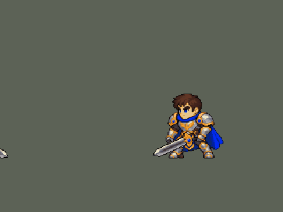

<!-- 本页上半部分由 tools/docs/gen_hero_docs.py 按仓库里现在的数据生成，手改会被覆盖；「开发记录」以下是手写的，生成时原样保留。 -->

# 盖伦 Garen


| 项目 | 内容 |
|---|---|
| id | `league_garen` |
| 所属的包 | 主包（mod_id `league`） |
| 分路 | 上单 |
| 分类 / 标签 | 近战（Melee） · AD / Melee / Tank / CC |
| 高清帧 | PPU 1.9 |
| 附加包 | [盖伦大招斩杀附加包](#附加包)（`league_garen_ult`） |



其他预览：[before_after](../preview/league_garen_before_after.gif)、[逐帧预览](../preview/league_garen_frames.png)、[特效表](../preview/league_garen_effects.png)

## 现在的技能

下面是游戏里显示的技能说明（`league/text/champion.i18n` 的简体中文，去掉了颜色和图标），冷却、距离来自 `league/champion/league_garen.data_champion`；1 秒 = 60 tick。

### 普攻 / 被动

*攻击间隔 1.03 秒 · 攻击距离 25000*

普攻造成100% 攻击力的物理伤害。

### 技能1 · 致命打击

*冷却 8 秒 · 施放距离 40000 · 施放：无目标 · 敌人（不含防御塔）*

盖伦获得35% 移动速度，持续1.5秒。4.5秒内的下一次普攻变为跃起重击，造成40 + 150% 攻击力的物理伤害并沉默目标1.5秒。同时获得勇气：2秒内受到的伤害降低30%、韧性提高60%，并获得60 + 50% 攻击力的护盾。

### 技能2 · 审判

*冷却 9 秒 · 施放距离 28000 · 施放：指定目标 · 敌人（不含防御塔）*

盖伦挥剑旋转3秒，边转边走向身边的敌人（贴身的英雄优先，不会远距离扑人），共转7圈，每圈对周围敌人造成25 + 55% 攻击力的物理伤害，他走向的那个敌人每圈多受25%。第7圈命中的敌人护甲降低25%，持续6秒。被动 坚韧：盖伦拥有很高的生命回复。

### 大招 · 德玛西亚正义

*冷却 50 秒 · 施放距离 45000 · 施放：指定目标 · 敌方英雄*

召唤巨剑从天而降，对目标敌方英雄造成150 + 120% 攻击力 + 12% 目标最大生命值的真实伤害。

### 数值

攻击力 88（每级 +17）、生命 1100（每级 +110）、护甲 34（每级 +8）、魔抗 28（每级 +4）、移速 1000（每级 +12）、生命回复 8（每级 +3）。

## 附加包

附加包是可选的原生代码 mod（都在附加包合集 `league_addons` 里），**不装主包里的英雄也是完整的**。

### 盖伦大招斩杀附加包

[盖伦大招斩杀附加包](../../addons/league_garen_ult/README.md)：`league_garen_ult` v0.1.0

|  | 主包（纯数据） | 装了附加包 |
|---|---|---|
| 伤害 | 150 + 120% 攻击力 + 12% 目标最大生命（真实） | 150 + 120% 攻击力 + 30% 目标已损失生命（真实；英雄联盟 25/30/35%） |
| 什么时候放 | AI 看到射程内有敌方英雄就放 | 这一剑砍得死射程内的英雄才放；砍得死的人里砍生命 + 护盾最少的 |
| 不该放时 | — | AI 想放但砍不死：改成普攻那个人（打不到就走过去） |

## 相关脚本和素材

- [`tools/lol/extract_garen.py`](../../tools/lol/extract_garen.py)
- [`tools/art/preview_garen.py`](../../tools/art/preview_garen.py)
- [`tools/art/import_garen.py`](../../tools/art/import_garen.py)
- [`assets/source/garen/`](../../assets/source/garen)

## 开发记录

> 下面是原来 README 里「英雄：盖伦」一节，原样搬过来（只改了相对链接）。

技能按创意工坊 *League of Legends Reborn* 的做法处理。团战经理2 只有「技能1、技能2、大招」三个技能位，所以大招放 R，两个技能位放最有代表性的两个小技能，剩下的小技能和被动合并进去。

| 部分 | 内容 |
|---|---|
| 技能1 | Q「致命打击」：加速；下一次普攻变成跃起重击并沉默目标。合并 W「勇气」：减伤、韧性、60 + 50% 攻击力的护盾（原来写的"最大生命值加成"字段游戏不读，护盾一直只有 60） |
| 技能2 | E「审判」：旋转 3 秒，边转边走向身边的敌人（贴身的英雄优先），共 7 次伤害，每次对半径 40000 内的敌人造成 25 + 55% 攻击力，追着的目标每次多受 25%（6 + 14% 攻击力），最后一次降低护甲 25%，6 秒。被动「坚韧」：高生命回复。每次伤害原来只有 12 + 32% 攻击力（英雄联盟每圈的数值），一次 E 的伤害还不如同样时间里平 A，玩家以为 E 不造成伤害。改成 25 + 55% 后玩家仍觉得 E 鸡肋：模拟里 E 占盖伦约 70% 的伤害，但他打上路对原版上单时，队伍每 10 分钟少约 3 个击杀。原因是旋转半径只有 30000：AI 在目标离他约 45 px 时就开始放 E（施法距离按两边的边缘算），站在边上的敌人扫不到，而英雄联盟里 E 的半径约是普攻距离的 1.9 倍。半径改成 40000，加上英雄联盟的「最近的敌人多受 25%」和 6 秒破甲后，和原版上单打平（击杀差 −3.0 → 0.0，各 240 局），剑风特效跟着放大到约 80 px 宽。转圈时怎么移动（玩家万华，2026-10-03：「自动吸附敌方英雄有点容易送了，而且清兵的时候不会动，也很呆」）：原来每一圈都以比走路快的速度冲向 60000 内随机的一个敌方英雄（常常是前排后面的、塔下的），附近没有英雄就原地转。现在每一圈按圈层找：贴身（25000 内）的英雄 → 30000 内的任何敌人（小兵、野怪、英雄）→ 45000 内的任何敌人，用他自己的移速（1000）走过去，+25% 打在他走向的那个敌人身上（`tools/kit/garen_spin.py`）。模拟 432 局（上路对原版 fighter / knight / executioner）：清兵、打野时原地不动的 E 73% → 6%，转完身边 40000 内没有队友 44% → 40%，每局死亡 4.29 → 4.25，击杀差 −0.98 → −1.47（误差约 0.35）；完全不优先英雄的版本转完落单只有 34%，但打不中正在打的英雄，击杀差 −2.08，没用 |
| 大招 | R「德玛西亚正义」：巨剑从天而降，造成真实伤害 |
| 附加包 | 可选的附加包 [`addons/league_garen_ult`](../../addons/league_garen_ult/README.md)（在附加包合集里，原生代码，主包不装它也完整）：R 照英雄联盟做成斩杀——150 + 120% 攻击力 + 30% 目标**已损失**生命的真实伤害（主包是 12% 最大生命），AI 只在这一剑砍得死射程内的英雄时放 |
| 连招 | 用户要求：「有连招要做连招」「都要帮我补」。英雄联盟里盖伦 Q 冲上去一刀沉默，紧接着 E 转起来。原来 Q 只是给下一次普攻上膛（4.5 秒），AI 常常先放了 E：转圈的 3 秒里出不了那一刀，沉默要等转完才打出来，甚至过期。**Q→E**：致命打击还上着膛时放 E，旋转一开始就对 25000 内（普攻距离）的一个敌方英雄打出致命打击——同样的 40 + 150% 攻击力和 1.5 秒沉默，打击用掉——然后照常转 3 秒，转的时候他放不了技能。身边没有敌方英雄就不打，留给下一次普攻。伤害、沉默、冷却都不变，一次 Q 仍只有一刀。没做 R：返还冷却分不开技能（`skill_cooldown_mult` 同时压 Q 和 E，E 好了 Q 也好了，会 Q-E-Q-E 连着转），R 的巨剑是按 10 tick 落下画的，提前砸要重画；R 本来就砸在被沉默的人身上。数据由 [`tools/fix/combo_garen.py`](../../tools/fix/combo_garen.py) 改 |
| 精灵图 | 9 个动作 56 帧：待机、走路、普攻、Q 跃斩、战吼、E 旋转、R 施放、受击、死亡。身高约 36 px（原版人类英雄约 31 px），和原版一样是 Q 版大头（头约占身高 1/3），脸和眼睛在游戏里看得清。全部是正面 3/4 朝右，同一套造型和大小；除战吼和受击外，都按英雄联盟原版动作重画 |
| 高清帧（PPU 3，2026-10-13 画风统一后 PPU 1.9、放大 12%（「盖伦在游戏里还是他说 太小 像素太高」，见开头）） | 新造型（用户：「盖伦游戏里还是老模型 然后技能压根没缩小」，先按原稿读回的那版被否：「模型都变形了 还有模型尺寸太大 头这么大？」，选了「照亚索：新造型 + Codex 重画」，又「盖伦的造型可以换」「用PPU 啊」）：Codex 先按亚索的比例重新设计（头约占身高 27%），再照它画成真正的 PPU 3（头顶到靴底 111 格，游戏里 37 格高，`assets/source/ppu/garen_codex.png`，26 色），用户「就这样」。动作是 Codex 照造型逐帧重画的 50 帧（`pack_ppu_strips.py` 打包，每格 6 px）：它最后往每帧贴造型头的那一步留下旧头残影、透明洞和第二张脸，所以按它的 manifest 从生图原稿重新逐格读回、不贴头（每帧是 Codex 自己画的同一张脸），别的格子混进来的碎块去掉，再由 `import_ppu_strips.py` 读回。E 旋转用 Codex 画了又因为包里写着「不画背影」自己放弃的两张背身原稿（第 3–6 帧：转到背面、看到披风再转回来；用户：「盖伦放E的时候模型不会旋转了？」），8 帧脚底都挪到待机的站位点上（`--settle spin`），原地转不再左右晃。待机就是造型（静止）。技能特效还是 1 倍（高清特效在战场上会按真实像素画大 2.5 倍）。头像截取点 (1, −32)。1 倍帧保留原来的，只在没有 DLL 时用 |
| 特效 | 命中火花、Q 重击与沉默、Q 强化光环、W 护盾、E 剑风、R 天降巨剑 |
| 图标 | 官方技能图标（Q / E / R），从本地客户端提取，缩到 64×64 |
| 音频 | 从本地客户端提取的 9 条技能音效和 4 条中文语音。版权属于 Riot Games，**不提交到仓库**，按下面的命令在本地生成 |

### 从本地英雄联盟提取音频和图标

```bash
python tools/lol/extract_garen.py --lol "D:\WeGameApps\lol" --vgmstream "<vgmstream-cli.exe 路径>"
```

- 需要 Python 3.14（自带 zstd 解压），以及 `pip install pillow numpy`。
- `.wem` 音频要用 [vgmstream](https://github.com/vgmstream/vgmstream) 解码。
- 中文语音来自国服（WeGame）客户端的 `Garen.zh_CN.wad.client`。
- 只读取游戏文件，不修改。

`tools/lol/pose_ref.py` 从客户端读取英雄的模型、骨骼和动画，渲染真实动作的关键帧（3/4 视角朝右），作为 GPT 生图时的姿势参考。渲染图是 Riot 的模型，只在本地用，不入库。

`tools/lol/riot.py` 负责：
- 读取 WAD 包。
- 解析 Wwise 音频包。
- 把 `Play_sfx_Garen_...` 这类事件名对应到具体的音频文件。

以后做别的英雄也能直接用。

### 美术：GPT 生成，再导入成像素图

原图在 [`assets/source/garen/`](../../assets/source/garen)。角色图是和艾希同一批的 Q 版重画，提示词见 [`CHIBI_REDRAW.md`](../../assets/source/CHIBI_REDRAW.md)，生成记录在 [`assets/source/chibi/`](../../assets/source/chibi)；特效图和之前几轮的提示词见 [`PROMPTS.md`](../../assets/source/garen/PROMPTS.md)。

```bash
pip install pillow numpy
python tools/art/import_garen.py          # 写出 league/champions 和 league/effects 里的精灵图
python tools/art/preview_garen.py         # 写出 docs/preview 里的预览图和演示动图
```

导入脚本做这些事：
- 切帧：按空白列切开，连在一起的剑、光效整块归到同一帧。
- 缩放：每张图单独缩放，保证头一样大（GPT 每张图的头身比略有出入，按身高对齐会让头忽大忽小）。
- 对齐：脚底统一放在帧中心下方 11.5 px（和原版一致）。待机、战吼、受击按腿部和待机第一帧对齐；照英雄联盟动作画的走路、普攻、Q、R、死亡，按原版骨骼里头部的位置摆放（`pose_ref.py --track`）；普攻、Q、R 的前冲保留约 70%，免得收招时弹回待机太明显；E 旋转按两脚中点固定。
- 像素化：硬边、共享 64 色调色板、1 px 黑描边。
- 头像截取点（`champion_view` 的 `face`）用 `tfm2_ase.py face` 按原版英雄的规律定在头顶，`lint_mod.py` 会检查。

通用部分在 skill 的 `scripts/strips.py`，以后做别的英雄可以直接用。

逐帧预览（高清帧）：[`docs/preview/league_garen_frames.png`](../preview/league_garen_frames.png?v=1014g)，特效：[`docs/preview/league_garen_effects.png`](../preview/league_garen_effects.png?v=1014g)。改成 PPU 3 新造型之前和之后（游戏里的大小，旁边是德莱厄斯）：[`docs/preview/league_garen_before_after.gif`](../preview/league_garen_before_after.gif?v=1014g)。
