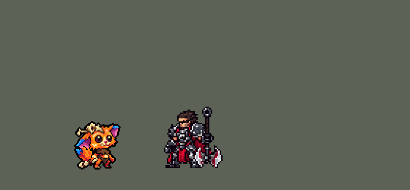

<!-- 本页上半部分由 tools/docs/gen_hero_docs.py 按仓库里现在的数据生成，手改会被覆盖；「开发记录」以下是手写的，生成时原样保留。 -->

# 纳尔 Gnar


| 项目 | 内容 |
|---|---|
| id | `league_gnar` |
| 所属的包 | 主包（mod_id `league`） |
| 分路 | 上单 |
| 分类 / 标签 | 近战（Melee） · AD / Melee / Range / Tank / CC |
| 高清帧 | PPU 1.5 |
| 附加包 | [纳尔附加包](#附加包)（`league_gnar`） |



其他预览：[逐帧预览](../preview/league_gnar_frames.png)、[特效表](../preview/league_gnar_effects.png)

## 现在的技能

下面是游戏里显示的技能说明（`league/text/champion.i18n` 的简体中文，去掉了颜色和图标），冷却、距离来自 `league/champion/league_gnar.data_champion`；1 秒 = 60 tick。

### 普攻 / 被动

*攻击间隔 0.97 秒 · 攻击距离 25000*

狂怒基因：迷你纳尔命中攒怒气，满后下个动作变巨型纳尔15秒（近战，生命+40%、双抗+40%）。亢奋：每第3次攻击额外造成20+英雄最大生命5%的伤害，移速+25%。

### 技能1 · 投掷回力标/投掷顽石

*冷却 1 秒 · 施放距离 70000 · 施放：指定目标 · 敌人（不含防御塔）*

迷你：回力标飞出再飞回，往返各造成30+70% 攻击力物理伤害并减速25%，接住后冷却变为4秒。巨型：顽石砸中首个敌人，周围受到60+120% 攻击力物理伤害并减速40%，捡回石头冷却变为2秒。

### 技能2 · 轻跳/猛踏

*冷却 1 秒 · 施放距离 45000 · 施放：指定目标 · 敌人（不含防御塔）*

迷你：跳到敌人头上再弹远，造成40+自身最大生命4%的伤害并减速。巨型：猛踏落地造成60+最大生命6%的伤害；痛殴重击前方，造成40+100% 攻击力物理伤害并眩晕1.2秒。

### 大招 · 呐啊！

*冷却 45 秒 · 施放距离 26000 · 施放：指定目标 · 敌方英雄*

只有巨型纳尔能放（迷你纳尔怒气满时先变身）：把身边的敌人全部掀飞，造成170+60% 攻击力物理伤害，眩晕1.17秒并减速50%。

### 数值

攻击力 90（每级 +17）、生命 1000（每级 +98）、护甲 26（每级 +8）、魔抗 22（每级 +4）、移速 1050（每级 +12）。

## 附加包

附加包是可选的原生代码 mod（都在附加包合集 `league_addons` 里），**不装主包里的英雄也是完整的**。

### 纳尔附加包

[纳尔附加包](../../addons/league_gnar/README.md)：`league_gnar` v0.1.3

|  | 主包（纯数据） | 附加包 |
|---|---|---|
| 巨型纳尔的样子 | 只有出招的动作是巨型（`CasterAnimation`），站着、跑着、挨打、阵亡还是迷你 | **整身变巨型**：巨型期间（和巨型刚结束、还没播变回动作时）站、跑、挨打、阵亡都换成 `m_*` |
| 呐啊！ | 从他身边击退，人人眩晕（数据看不到墙） | 所有人往**同一个方向**掀飞（挑能把最多人砸上墙的方向，敌方英雄顶十个小兵；哪边都没墙就从他身边掀开）；**撞到墙上**的再受一半伤害并眩晕，没撞墙的不晕 |

装上附加包后游戏里显示的说明（和主包不同的部分）：

- **大招 · 呐啊！**：【附加包】只有巨型纳尔能放（迷你纳尔怒气满时先变身）：把身边的敌人往同一个方向掀飞，造成170+60% 攻击力物理伤害并减速50%；撞到墙上的再受一半伤害并眩晕1.17秒。

## 相关脚本和素材

- [`tools/kit/build_gnar.py`](../../tools/kit/build_gnar.py)
- [`tools/kit/setup_gnar.py`](../../tools/kit/setup_gnar.py)
- [`tools/lol/extract_gnar.py`](../../tools/lol/extract_gnar.py)
- [`tools/art/preview_gnar.py`](../../tools/art/preview_gnar.py)
- [`tools/art/rig_gnar.py`](../../tools/art/rig_gnar.py)
- [`assets/source/gnar/`](../../assets/source/gnar)

## 开发记录

> 下面是原来 README 里「英雄：纳尔」一节，原样搬过来（只改了相对链接）。

| 部分 | 内容 |
|---|---|
| 定位 | 上单（Melee，标签 AD / Melee / Range / Tank / CC），第 141 位英雄。迷失之牙 纳尔：迷你纳尔是橙色毛茸茸的小约德尔，大耳朵、骨头头盔，手里一把缠着皮条的骨头回力标；巨型纳尔是弓着背的深红色巨兽，背上一排电光蓝的毛刺，两根大獠牙、比头还大的拳头（10-17 之后分组的 E 组的上单）。用户的选择：「技能方案 A（W 放在 E 里）」「上单」「附加包要」「有连招要做连招」。团战经理只有三个主动技能位：技能 1 = Q 投掷回力标 / 投掷顽石，技能 2 = E 轻跳 / 猛踏（巨型的 W 痛殴接在里面），大招 = R 呐啊！；被动狂怒基因和迷你的 W 亢奋在普攻里。技能名照英雄联盟 16.20.1 的 Data Dragon（五种语言） |
| 两种形态 / 被动 | **狂怒基因**：每条命都从迷你纳尔开始（远程，射程 42000）。迷你时普攻打中、回力标打中、轻跳落地各攒一格怒气，四格满了身上冒怒火，下一个动作就变身：普攻放变身动作，技能直接变身并放巨型版（英雄联盟的 *_trans）。**巨型纳尔**持续 15 秒：近战，生命 +40%、护甲 / 魔抗 +40%、攻击 +30%；结束后下一个动作变回迷你，4 秒内不攒怒气。没打架时怒气一格格掉光 |
| 普攻 / W 亢奋 | 迷你：扔出小回力标（100% 攻击）；每第 3 下**亢奋**多 20 伤害、对英雄再加目标最大生命 5%，并移速 +25% 1.5 秒。巨型：一拳砸下（100% 攻击） |
| 技能1 | 一个冷却 9 秒，两种形态共用。**投掷回力标**（迷你，射程 70000）：飞出去再飞回来，来回各打一次 30 + 70% 攻击的物理伤害并减速 25%；飞回来接住时冷却只剩 4 秒（英雄联盟 -40%）。**投掷顽石**（巨型）：大石头砸中第一个敌人、周围 16000 内 60 + 120% 攻击并减速 40%；石头落在地上 3 秒，走过去捡起来冷却只剩 2 秒（英雄联盟 -70%） |
| 技能2 | **轻跳**（迷你，冷却 11 秒）：跳到目标头上再弹出去，40 + 自身最大生命 4% 的伤害、减速 60%。**猛踏**（巨型，同一个冷却）：跳过去砸地，周围 18000 内 60 + 自身最大生命 6% 并减速；**痛殴**（巨型，冷却 7 秒）：直立起来双拳砸地，40 + 100% 攻击并眩晕 1.2 秒——猛踏落地时痛殴好了就立刻接上 |
| 大招 | **呐啊！**（5 级，只对敌方英雄，冷却 45 秒）：照英雄联盟只有巨型纳尔能放（用户：「放大招是攒满怒气吗 要和英雄联盟一样」）——迷你怒气满时先变身再放；怒气不满就不放，大招 10 秒后再试，期间一变身就立刻能放。把身边 30000 内的敌人全部掀飞：170 + 60% 攻击的物理伤害、眩晕 1.2 秒、减速 50%；然后痛殴好了接痛殴、顽石好了接顽石 |
| 连招 | 用户要求：「有连招要做连招」。主包数据里：**E → W**（猛踏接痛殴）、**R → W → Q**（大招接痛殴接顽石）、**接回力标**和**捡石头**减冷却、**满怒放技能直接变身放巨型技能** |
| 附加包 | 可选的附加包 [`addons/league_gnar`](../../addons/league_gnar/README.md)（在附加包合集里，原生代码，主包不装它也完整），照英雄联盟：**整身变巨型**（站、跑、挨打、阵亡也是巨型，主包只有出招是巨型）；**呐啊！往同一个方向掀、撞墙才晕**：16 个方向里挑能把最多人撞上墙的（敌方英雄顶十个小兵），撞墙的再受一半伤害并眩晕，没撞墙的不晕（主包：从他身边击退、人人眩晕）。日志 `league_gnar.log`（THROW、WALL） |
| 数值 | 攻击 90（+17）、生命 1000（+98）、护甲 26（+8）、魔抗 22（+4）、移速 1050（+12）、射程 25000（迷你 +17000） |
| 平衡 | 10 分钟经典引擎模拟，上路对六个原版上单（fighter / executioner / lancer / pole_warrior / knight / berserker），三套阵容两边各打，两批种子（1–8、9–16）：初稿 +1.19 / +1.62；按帧对时机 +1.22 / +0.11；巨型攻击 +22% +0.88 / +1.24；大招改成只有巨型能放（照英雄联盟）-0.22 / -0.09；空放等 10 秒、变身即可放，怒气锁 4 秒，巨型攻击 +30%、生命 +40%：+0.24 / +0.22；基础攻击 90、生命 1000 +0.77 / +0.90；怒气改成 10 下（rage_n 4 → 10）后 +0.11 / +0.27，但 288 局里分别有 49 / 41 局引擎崩溃：怒气满时普攻只剩变身，游戏 AI 读到这一下的伤害是 0，再用它去除敌人的血量（game_core `battle.rs:1938` 除以零，真实游戏里那局打不完）。变身那一支加上 AI 读得到、施放时跳过的诱饵伤害（普朗克的做法，`build_gnar.py` 的 `decoy`，玩法不变）后（定稿）**+0.01 / +0.59**，0 局崩溃。附加包（原生代码）经典引擎跑不了，原生效果换成空的跑同一批：-0.19，0 局崩溃；另有单元测试 |
| 精灵图（高清帧 PPU 1.5） | Codex 第 0 步画了迷你和巨型（3/4 和侧面）；用户：「只用做四分之三的侧面就行了」（迷你）、「大纳尔可以做完全侧面的」，大小「迷你 32」「巨型 44」（游戏像素）。第 1 步造型：迷你 A-2 裁到 48 行、巨型 3/4 M-1、巨型侧面 SM-2 裁到 66 行。动作我按英雄联盟的动画自己摆（用户：「你自己做不了吗动作帧？」），后来用户觉得「少了点动作帧」，让 Codex 按骨架补画了 11 个关键姿势（巨型的蓄力、举拳、直立双拳举过头、双拳砸地、前扑、跳在半空、举石头，迷你的蓄力、扔出、跳起、落地蹲下），按定稿的头量出每张的真实比例读回、巨型身体缩到定稿的体量、换上定稿的头，接进普攻、Q、E、巨型普攻 / 扔石头 / 猛踏 / 痛殴 / 大招。巨型待机是 3/4，动作是侧面 |
| 特效 | 24 张特效（[`tools/art/pack_gnar_fx.py`](../../tools/art/pack_gnar_fx.py) 的提示词，参考是英雄联盟里纳尔自己的贴图），用户用 Gemini 画的 24 张 JPG（「纳尔的所有特效都在这里面」），[`tools/art/process_gnar_fx.py`](../../tools/art/process_gnar_fx.py) 从每帧自己的边缘往里抠背景（黑底、棋盘格、灰底、白底、沙地都行）、清掉圆环里的底色、按实际位置切宽窄不一的帧、居中镜像；痛殴砸地的地裂 `w_quake` 是新加的 |
| 音效 | 英雄联盟的音效和配音（[`tools/lol/extract_gnar.py`](../../tools/lol/extract_gnar.py)）：回力标、接住、亢奋、变身 / 变回、拳头、顽石、轻跳、猛踏、痛殴、呐啊！，迷你和巨型各自的台词 |
| 图标 | 官方技能图标（投掷回力标、轻跳、呐啊！），从本地客户端取 |

重新生成（素材来自本机的英雄联盟客户端，音频不进仓库）：

```bash
python tools/lol/extract_gnar.py --lol "D:\WeGameApps\lol" --vgmstream <vgmstream-cli.exe>
python tools/kit/build_gnar.py                      # 技能数据，数字都在脚本的参数表 P 里
python tools/kit/setup_gnar.py                      # 五种语言的文字、音效配置、共享文件里他的键（脸 0,-19）
python tools/art/design_gnar_model.py               # Codex 第 1 步的造型读回（A-2 / M-1 / SM-2）
python tools/art/read_gnar_poses.py --src <gnar_poses_done.zip 解开的 gnar-poses 文件夹>   # Codex 的 11 个姿势读回
python tools/art/rig_gnar.py                        # 1 倍帧和 1.5 的原帧
python tools/art/ppu_restyle.py --hero gnar         # 外描边、脸的位置
python tools/art/ppu_hd.py --hero gnar              # hd_ / lo_ 帧
python tools/art/process_gnar_fx.py --src <24 张 JPG 按顺序命名 01.jpg–24.jpg 的文件夹>   # Gemini 的特效 -> codex_fx/
python tools/art/import_gnar_fx.py                  # 特效
python tools/art/preview_gnar.py                    # 预览和演示 GIF
python addons/league_gnar/make_override.py          # 附加包的副本（主包的纳尔改了就重跑）
```

美术提示词见 [`assets/source/gnar/`](../../assets/source/gnar) 里的 `PICTURE_PROMPT.md`、`MODEL_PROMPTS.md`、`POSE_PROMPTS.md`、`PROMPTS_FX.md`。

逐帧预览：[`docs/preview/league_gnar_frames.png`](../preview/league_gnar_frames.png?v=1020a)，特效：[`docs/preview/league_gnar_effects.png`](../preview/league_gnar_effects.png?v=1020a)
