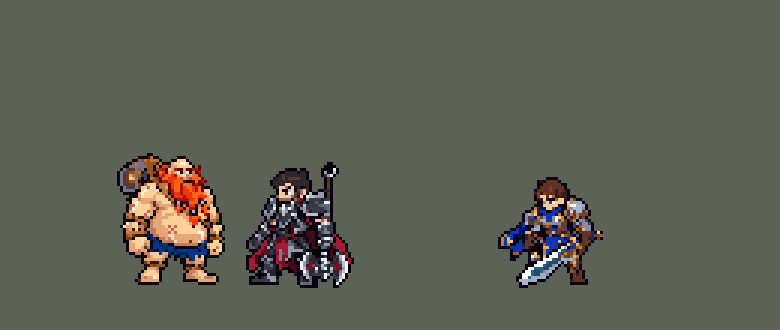

<!-- 本页上半部分由 tools/docs/gen_hero_docs.py 按仓库里现在的数据生成，手改会被覆盖；「开发记录」以下是手写的，生成时原样保留。 -->

# 古拉加斯 Gragas


| 项目 | 内容 |
|---|---|
| id | `league_gragas` |
| 所属的包 | 主包（mod_id `league`） |
| 分路 | 打野 |
| 分类 / 标签 | 近战（Melee） · AP / Magic / Melee / Tank / CC / Heal |
| 高清帧 | PPU 1.45（画成 90%） |
| 附加包 | [古拉加斯大招智能落点附加包](#附加包)（`league_gragas`） |



其他预览：[逐帧预览](../preview/league_gragas_frames.png)、[特效表](../preview/league_gragas_effects.png)

## 现在的技能

下面是游戏里显示的技能说明（`league/text/champion.i18n` 的简体中文，去掉了颜色和图标），冷却、距离来自 `league/champion/league_gragas.data_champion`；1 秒 = 60 tick。

### 普攻 / 被动

*攻击间隔 1.17 秒 · 攻击距离 25000*

欢乐时光：每次施放技能先喝一口，回复55/85 + 20% 法强生命（3级起用后者），之后12秒内不再触发。

### 技能1 · 滚动酒桶

*冷却 7 秒 · 施放距离 58000 · 施放：地点 · 敌人（不含防御塔）*

扔出酒桶，落地0.75秒后爆炸，周围敌人受到90 + 70% 法强魔法伤害并减速40%2秒。

### 技能2 · 肉弹冲击

*冷却 10 秒 · 施放距离 42000 · 施放：指定目标 · 敌人（不含防御塔）*

冲向敌人，撞到第一个敌人停下：周围敌人受到80 + 60% 法强魔法伤害并眩晕1秒，撞中返还部分冷却。醉酒狂暴：随后喝酒，2.5秒内受到伤害降低20%，下次普攻对周围敌人造成55 + 50% 法强魔法伤害，英雄另受6%最大生命真实伤害。

### 大招 · 爆破酒桶

*冷却 50 秒 · 施放距离 70000 · 施放：指定目标 · 敌方英雄*

向一名敌方英雄扔出爆破酒桶：周围敌人受到240 + 80% 法强魔法伤害，并被炸飞到古拉加斯这边。

### 数值

攻击力 72（每级 +6）、法强 30（每级 +15）、生命 1200（每级 +120）、护甲 40（每级 +9）、魔抗 30（每级 +5）、移速 1000（每级 +10）。

## 附加包

附加包是可选的原生代码 mod（都在附加包合集 `league_addons` 里），**不装主包里的英雄也是完整的**。

### 古拉加斯大招智能落点附加包

[古拉加斯大招智能落点附加包](../../addons/league_gragas/README.md)：`league_gragas` v0.1.1

主包 `league` 保持纯数据、全平台可用；数据找不到「目标身后的一点」，主包的爆破酒桶落在目标脚下，爆炸把周围的敌人拽向古拉加斯。
英雄联盟里高手把酒桶扔到敌人身后、把人炸进自己的队伍——要读每个敌人的位置，只能用原生代码，所以放在这个附加包里（合集
`league_addons` 也带着它）。

## 相关脚本和素材

- [`tools/kit/build_gragas.py`](../../tools/kit/build_gragas.py)
- [`tools/kit/setup_gragas.py`](../../tools/kit/setup_gragas.py)
- [`tools/lol/extract_gragas.py`](../../tools/lol/extract_gragas.py)
- [`tools/art/preview_gragas.py`](../../tools/art/preview_gragas.py)
- [`tools/art/import_gragas.py`](../../tools/art/import_gragas.py)
- [`tools/art/design_gragas.py`](../../tools/art/design_gragas.py)
- [`assets/source/gragas/`](../../assets/source/gragas)

## 开发记录

> 下面是原来 README 里「英雄：古拉加斯」一节，原样搬过来（只改了相对链接）。

| 部分 | 内容 |
|---|---|
| 定位 | 打野（Melee，标签 AP / Magic / Melee / Tank / CC / Heal），第 92 位英雄。酒桶 古拉加斯：AP 坦克打野，扔酒桶减速、肚子撞人眩晕、喝酒强化下一拳，大招把人炸到他这边。用户的选择：打野、Melee AP 坦克；技能1 = Q，技能2 = E 接 W；Q 落地 0.75 秒后爆；E 撞到第一个敌人就停（小兵也算）；大招落在目标身后炸向我方；被动做在主包里；加入高手连招；大招智能落点做成附加包 |
| 普攻 | 一记重拳，攻击距离 25000，第 8 tick 打中（动作第 3 帧），攻击间隔 70 tick |
| 被动 | 「欢乐时光」：每放一个技能先喝一口，回复 55（3 级起 85）+ 20% 法强的生命，之后 720 tick（12 秒）内不再触发。英雄联盟是回 5.5% 最大生命；数据里的治疗读不到最大生命，所以是固定值、3 级加一档 |
| 技能1 | Q「滚动酒桶」：冷却 420 tick（7 秒），对 58000 内的敌人放（小兵野怪也算），第 9 tick 扔出，酒桶飞 22 tick 落到那个位置，在地上冒泡 45 tick（0.75 秒，能躲）后爆炸：半径 19000 内的敌人受到 90 + 70% 法强魔法伤害，减速 40% 持续 2 秒。**高手连招 E 接 Q**：E 撞晕英雄后 2 秒内扔的 Q 落地就炸 |
| 技能2 | E「肉弹冲击」接 W「醉酒狂暴」：冷却 600 tick（10 秒），对 42000 内的敌人放（小兵野怪也算）。第 4 tick 朝目标冲（每 tick 3200，最多 12 tick），撞到第一个敌人就停：身边 20000 内的敌人受到 80 + 60% 法强魔法伤害并眩晕 60 tick（1 秒），撞中返还部分冷却（Q 也一起）。随后第 17 tick 扛桶喝酒：150 tick（2.5 秒）内受到的伤害降低 20%，下一次普攻对身边 17000 内的敌人造成 55 + 50% 法强魔法伤害，英雄另受 6% 最大生命的真实伤害（数据里的魔法伤害读不到最大生命）。英雄联盟里 W 是单独的技能，这里没有第三个技能位，就接在 E 后面 |
| 大招 | R「爆破酒桶」：冷却 3000 tick（50 秒），对 70000 内的敌方英雄放，第 10 tick 扔出大酒桶，飞 16 tick 落到目标脚下爆炸：半径 26000 内的敌人受到 200 + 80% 法强魔法伤害，被拽向他（每 tick 3000，12 tick）——目标和它身后的人一起被炸到他这边，和英雄联盟里落在身后把人炸过来的结果一样。用户选的是「落在目标身后」，但数据找不到「一个单位身后的一点」（从另一个投射物终点再发的直线和抛物线仍从施法者出发，模拟里量过），所以主包落在目标脚下；真正的身后落点在附加包里。**高手连招 R 接 E**：被炸过来的英雄到了 E 的距离，AI 下一招就撞上去 |
| 智能落点附加包 | 可选的附加包 [`addons/league_gragas`](../../addons/league_gragas/README.md)（在附加包合集里，原生代码，主包不装它也完整）：大招出手时读所有敌人的位置，在射程内每个敌方英雄身后 0 / 9000 / 16000 处各试一个落点，按炸得到的敌人打分（英雄 10 分、离他越远越多——后排优先；小兵野怪 0.5 分），酒桶飞到分最高的点爆炸，把人拽向他。附加包里的古拉加斯是 `make_override.py` 从主包生成的副本，大招说明以「【智能落点】」开头。还没在游戏里看过日志 |
| 数值 | 攻击 72（+6）、法术强度 30（+15）、生命 1150（+120）、护甲 40（+9）、魔抗 30（+5）、移速 1000（+10），攻击间隔 70 tick，和本包的阿木木、墨菲特同类（AP 坦克）。SDK 对战模拟：打野，对 5 个原版打野（`demon`、`circus_blade`、`hunter`、`inquisitor`、`ninja`），两边、三套队友阵容各 12 局，一批 360 局。团队击杀差：种子 1–12 −0.05、13–24 +0.42（同两批阿木木 +0.20 / +0.33）。按动作帧重新对时之前（出手慢）是 −0.03，对时以后到了 +0.83 / +0.58，于是 Q、E 伤害各降 5 |
| 精灵图 | 全部动作 3/4 正面（用户：「全部 3/4 正面」，和本包其他英雄的侧身动作不同）：待机 8（就是定稿，静止）、移动 8、普攻 5（第 3 帧出拳）、Q 5（第 3 帧扔出）、E+W 8（第 3 帧撞上、第 5–7 帧扛桶喝酒）、R 5（第 3 帧掷出）、受击 2、死亡 8（仰面倒地，酒桶滚到一边）。头顶到脚底 42 行，背上的酒桶和头一样高，36 格宽。头像截取点 (3, −31)。**整体缩到 80%**（用户：「酒桶模型缩小一点 太大了」「要改全改啊」，85% 时「怎么看起来还是比诺手高这么多」，对比图里选 80%）：不删像素，主包 DLL 画高清帧时按 PPU ÷ 0.8 缩小——战场、选人卡、图鉴、头像都一样（`league_main` 的 `hd.rs` SIZES），高清帧整体下移 6 个高清像素，缩小后脚底仍在原处；只有主包 DLL 不生效（不是游戏 0.6.4）时是原大小 |
| 高清帧（PPU 2，2026-10-13 画风统一后 PPU 1.76（见开头）） | 第二个用 PPU 的英雄（用户：「用PPU的方法完成酒桶」，选「整套都用 PPU 原稿放大」）：图里多一套 `hd_<动作>`，每帧是 1 倍帧的 2 倍大小（[`tools/art/ppu_gragas.py`](../../tools/art/ppu_gragas.py) 写成 `assets/source/ppu/gragas_<动作>.png`，`ppu_hd.py` 当画好的高清帧读）。待机就是 Codex 的原稿：定稿本来就是从原稿 2:1 逐格描的，每格换回原稿里它下面的 2×2 格（胡子辫子、银环、绳纹、桶盖都细一倍）；手改过的格子（脸、桶盖、X 疤）和轮廓仍按 1 倍放大，不多不少一格。其他动作是 1 倍帧放大 2 倍，凡是和定稿一样的地方（对齐头的位置找，连成 4 格以上的块）换成原稿的格子；头转了、躺下的帧（死亡、喝酒、普攻出拳）就是 1 倍放大。以后可以一个个换成画好的高清帧 |
| 特效 | Codex 生图的 16 张（游戏尺寸版逐格切，`import_gragas.py`；红色方的对称逐格检查：两只飞出去的酒桶上下对称，其余左右对称；偶数宽的图在正中间补一列，绕站位点也对称）：`league_gragas_fx` 拳头打中、Q 飞出的小酒桶 / 落地冒泡 / 炸中 / 脚下的酒滩（减速）、E 起步的尘土 / 撞中 / 头顶的金星（眩晕）、W 喝酒冒的酒泡 / 狂暴的红橙热气、被动喝一口的绿金光点、R 炸中；`league_gragas_big` W 强化拳炸开的酒浪、Q 的酒桶爆炸、R 飞出的大酒桶和大爆炸。颜色照英雄联盟：金黄的酒和白沫、木头和铁箍、R 的火光 |
| 音效 | 英雄联盟的音效和配音（`tools/lol/extract_gragas.py`）：出拳 / 打中、被动喝一口、Q 扔出 / 爆炸、W 喝酒 / 强化拳打中、E 冲出 / 撞上、R 扔出 / 爆炸；Q、W、E、R 的配音（片段名 `league_gragas_sfx_vo_*`，和声音名不同）。版权属于 Riot Games，**不提交到仓库**，按下面的命令在本地生成 |
| 图标 | 官方技能图标（Q 滚动酒桶 / E 肉弹冲击 / R 爆破酒桶），从本地客户端提取，缩到 64×64 |
| 修正（0.170.2） | 用户让查附加包日志时在芸阿娜身上发现：引擎给大招冷却封顶时，把 `skill_cooldown_mult` 也算进去（技能冷却削减同时压大招）。肉弹冲击打中英雄返还冷却时（Q 也跟着，原本就写明），大招冷却也被压了。同一个 buff 加上相同大小的负 `ult_cooldown_mult` 抵掉（[`tools/fix/ult_cooldown_offset.py`](../../tools/fix/ult_cooldown_offset.py) / 生成脚本），只减原本要减的技能。经典模拟（8 个种子，三套阵容两边各打） +0.42 → −0.01，每局开大 6.1 → 5.7 次 |
| 加强（0.170.4） | 冷却修正（0.170.2）后 E 打中不再连带压大招冷却，他降到 −0.01 / −0.18（种子 1–8 / 9–16）。用户：「古加拉斯偏弱你得顺应的加强吧」。四个方案里（大招冷却 45 秒 +0.13，Q 105 + E 95 +0.25，大招冷却 45 秒 + Q 100 +0.16，生命 1200 + 大招 240 +1.00 / +0.28）取最后一个：生命 1150 → 1200，爆破酒桶 200 → 240，16 个种子平均 +0.64（修正前 +0.42） |

重新生成（素材来自本机的英雄联盟客户端，音频不进仓库）：

```bash
python tools/lol/extract_gragas.py --lol "D:\WeGameApps\lol" --vgmstream "<vgmstream-cli.exe 路径>"
python tools/kit/build_gragas.py           # 技能数据，数字都在脚本的参数表 P 里；--nodes 看每棵技能树的节点数
python tools/kit/setup_gragas.py --face 3,-42 --banpick -7   # 五种语言的文字、音效配置、共享文件里他的键
python tools/art/trace_gragas.py --auto    # 造型：Codex 原稿 2:1 读成表（design/front_auto.txt）
python tools/art/patch_gragas_front.py     # 手修的脸、桶盖、疤（design/front.txt）
python tools/art/trace_gragas.py --write   # 写成 gragas_native.png
python tools/art/ppu_gragas.py             # 高清帧（assets/source/ppu/gragas_*.png）
python tools/art/import_native.py --hero gragas   # 动作 + hd_ 标签
python tools/art/import_gragas.py          # 特效：游戏尺寸版逐格切，拼成特效表
python tools/art/preview_gragas.py         # 预览和演示 GIF
python addons/league_gragas/make_override.py   # 智能落点附加包的副本（主包的古拉加斯改了就重跑）
```

美术（提示词见 [`assets/source/gragas/`](../../assets/source/gragas) 里的 `PICTURE_PROMPT.md`、`MODEL_PROMPTS.md`、`MODEL_STRIPS.md`、`PROMPTS_FX.md`）：

- 原图：Codex 画的两张（`codex_picture/`），用户选 A（酒桶背在背上）。
- 造型：Codex 第 1 步按 26 px 格子画了正面 / 侧面各两稿（`codex_model/`），它自己缩到 36 行的版本是糊的，原稿（71×86 格）很清楚；整行整列删到游戏尺寸还是糊（`design_gragas.py`），用户选「我照原稿逐格描」、「不需要侧面吧」：`trace_gragas.py` 把原稿每 2×2 格合成 1 格（错开一格使平票最少，描边仍是一格），`patch_gragas_front.py` 手修脸（浓眉、一格眼白一格瞳孔、大鼻子、嘴）、桶盖（铁环、木纹、方木塞）、肚子上的 X 疤和胡子的杂点，36×44（用户：「没问题 可以下一步」）。
- 动作：Codex 第一版用定稿的部件拼（手臂盖住胡子、轮廓断开，没用）；第二版是生图画出来的姿势（`codex_strips2/`），每格取多数色、只用定稿的颜色，原样导入。
- 特效：16 张用 Codex 的游戏尺寸版逐格切。

逐帧预览：[`docs/preview/league_gragas_frames.png`](../preview/league_gragas_frames.png?v=1014g)，特效：[`docs/preview/league_gragas_effects.png`](../preview/league_gragas_effects.png?v=1014g)。
