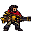
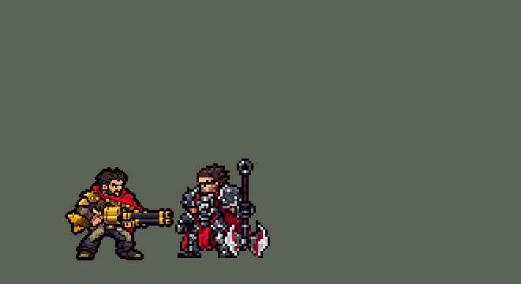

<!-- 本页上半部分由 tools/docs/gen_hero_docs.py 按仓库里现在的数据生成，手改会被覆盖；「开发记录」以下是手写的，生成时原样保留。 -->

# 格雷福斯 Graves



| 项目 | 内容 |
|---|---|
| id | `league_graves` |
| 所属的包 | 主包（mod_id `league`） |
| 分路 | 打野 |
| 分类 / 标签 | 射手（Range） · AD / Range |
| 高清帧 | PPU 1.5 |
| 附加包 | [格雷福斯附加包](#附加包)（`league_graves`） |



其他预览：[逐帧预览](../preview/league_graves_frames.png)、[特效表](../preview/league_graves_effects.png)

## 现在的技能

下面是游戏里显示的技能说明（`league/text/champion.i18n` 的简体中文，去掉了颜色和图标），冷却、距离来自 `league/champion/league_graves.data_champion`；1 秒 = 60 tick。

### 普攻 / 被动

*攻击间隔 0.9 秒 · 攻击距离 46000*

霰弹枪每次朝前方一扇开火：目标110% 攻击力，扇形里的其他敌人35%攻击；两发后装弹1.33秒。烟幕弹：每12秒朝英雄扔一颗，60魔法伤害、减速50%、致盲0.5秒。

### 技能1 · 穷途末路

*冷却 9 秒 · 施放距离 75000 · 施放：方向 · 敌人（不含防御塔）*

射出榴弹，穿过的敌人受到45 + 60% 攻击力物理伤害；榴弹落地1秒后爆炸，再造成60 + 80% 攻击力物理伤害。

### 技能2 · 快速拔枪

*冷却 10 秒 · 施放距离 60000 · 施放：指定目标 · 敌人（不含防御塔）*

冲刺一段（身边有敌方英雄时往后翻滚），得到一层纯爷们（附近有敌方英雄时两层，最多4层）：每层护甲+7、魔抗+5，4秒，普攻打中刷新。

### 大招 · 终极爆弹

*冷却 50 秒 · 施放距离 100000 · 施放：方向 · 敌方英雄*

后坐力把自己往后推，射出爆弹，对第一个敌方英雄造成120 + 90% 攻击力物理伤害并爆炸，周围敌人受到80 + 60% 攻击力物理伤害。

### 数值

攻击力 92（每级 +19）、生命 980（每级 +98）、护甲 26（每级 +7）、魔抗 18（每级 +3）、移速 1000（每级 +11）。

## 附加包

附加包是可选的原生代码 mod（都在附加包合集 `league_addons` 里），**不装主包里的英雄也是完整的**。

### 格雷福斯附加包

[格雷福斯附加包](../../addons/league_graves/README.md)：`league_graves` v0.2.1

主包 `league` 保持纯数据。用户选了「做附加包」。这个附加包用原生代码做主包数据做不到的三件事，外加连招（0.2.0）：

- **快速拔枪的冷却**：英雄联盟里格雷福斯的普攻每有一颗弹丸打中，E 的冷却少 0.5 秒。数据不能减冷却。副本里霰弹枪正面那颗
  弹丸和扇形每打中一个单位就调一次 `league_graves:hit`，本包把 E（技能 2）的冷却减 `e_cut` tick（30 = 0.5 秒），一次普攻
  最多 `e_cuts` 下（4，英雄联盟的四颗弹丸）。
- **击退小兵和野怪**：英雄联盟里被几颗弹丸同时打中的非英雄单位会被击退。一次普攻里同一个单位挨了两下（正面那颗弹丸和扇形，
  也就是普攻的目标）而且不是英雄、不是塔，就往外推 `kb_speed` × `kb_t`（1500 × 4）。
- **终极爆弹的锥形爆炸**：英雄联盟里爆弹打中第一个英雄后在他身后炸开一个锥形。主包只能在那名英雄身边炸一圈；副本去掉那一圈，
  爆弹打中英雄时调 `league_graves:cone`：按格雷福斯到那名英雄的方向，那名英雄身后 `r_len`（55000）内、偏离不到 30 度
  （`r_dot` 866 = cos 30° × 1000）的敌方单位（塔除外）受到 `r2_dmg` + `r2_ratio`% 攻击力（80 + 60%）的物理伤害，各播一次
  打中的画面。

## 相关脚本和素材

- [`tools/kit/build_graves.py`](../../tools/kit/build_graves.py)
- [`tools/kit/setup_graves.py`](../../tools/kit/setup_graves.py)
- [`tools/lol/extract_graves.py`](../../tools/lol/extract_graves.py)
- [`tools/art/preview_graves.py`](../../tools/art/preview_graves.py)
- [`tools/art/rig_graves.py`](../../tools/art/rig_graves.py)
- [`assets/source/graves/`](../../assets/source/graves)

## 开发记录

> 下面是原来 README 里「英雄：格雷福斯」一节，原样搬过来（只改了相对链接）。

| 部分 | 内容 |
|---|---|
| 定位 | 打野（Range，标签 AD / Range），第 139 位英雄。法外狂徒 格雷福斯：络腮胡、红围巾、金色肩甲，扛着金色的大霰弹枪（10-17 的分组计划 D 组的 ADC）。用户的选择：「技能方案 A（Q / E / R，W 进普攻）」「打野」（不按计划做 ADC）「做附加包」。团战经理只有三个主动技能位：技能 1 = Q 穷途末路，技能 2 = E 快速拔枪，大招 = R 终极爆弹；被动新命运和 W 烟幕弹在普攻里（用户问「W烟雾弹不能做吗」，选了保持现在的做法）。技能名照英雄联盟 16.20.1 的 Data Dragon（五种语言） |
| 普攻 / 被动 | **新命运**：霰弹枪装两发。每发打出一片：正面一颗追着目标的弹丸（75% 攻击）加一个扇形（半径 56000、两边约 26 度，35% 攻击，目标也在里面，所以正面的人挨得最多——英雄联盟里前面的单位吃下大部分弹丸）；第二发播 `attack2`（开枪、掰开枪管换弹），之后 80 tick 不能普攻（能走能放技能）。普攻打中刷新坚定意志。射程 46000 |
| W | **烟幕弹**（没有自己的格子）：每 12 秒对敌方英雄的普攻顺手把烟幕弹扔到他脚下：60 魔法伤害、减速 50% 0.5 秒，英雄联盟的「视野受限」做成 0.5 秒不能普攻；烟雾留 4 秒，站在里面的人减速 15% |
| 技能1 | **Q 穷途末路**（对小兵、野怪也放，射程 75000）：炮弹直线飞 70000、穿过所有人（45 + 60% 攻击），停在尽头，1 秒后爆炸（半径 24000：60 + 80% 攻击）。冷却 9 秒 |
| 技能2 | **E 快速拔枪**（对小兵、野怪也放，射程 60000）：装回一发子弹（换弹开始前用）；22000 内有敌方英雄就往后翻滚拉开，否则朝目标冲 26000。**坚定意志**：一层（60000 内有敌方英雄时两层），最多四层，每层护甲 +7、魔抗 +5，持续 4 秒，普攻打中全部刷新。冷却 10 秒 |
| 大招 | **R 终极爆弹**（只对敌方英雄，射程 100000）：后坐力把他往后弹开；炮弹飞 110000，停在第一个敌方英雄身上（120 + 90% 攻击），在他身边炸开（半径 32000：80 + 60% 攻击）。冷却 50 秒 |
| 附加包 | 可选的附加包 [`addons/league_graves`](../../addons/league_graves/README.md)（在附加包合集里，原生代码，主包不装它也完整），照英雄联盟：普攻每打中一下**快速拔枪冷却 −0.5 秒**（一次普攻最多 4 下）；被两颗弹丸打中的小兵、野怪**被击退**；终极爆弹在打中的英雄**身后炸开锥形**；**Q 撞到墙就停下、0.25 秒后爆炸，炸完炮弹沿原路飞回**、沿途再打一次（用户：「Q技能碰到墙会马上弹回来吗 和英雄联盟一样」）；**连招**（用户：「有连招的话一起做了」）：AI 钩子把 E 留到第一发打出去之后再按（一轮换弹打三枪：普攻 → E → 普攻 → 普攻），R 只在打得死路上第一个英雄、或身后锥形里还有英雄、或自己残血时放。日志 `league_graves.log`（CUT、KNOCK、CONE、Q / Q BOOM / Q BACK、E PRESS / E VETO、R PRESS / R VETO） |
| 数值 | 攻击 92（+19）、生命 980（+98）、护甲 26（+7）、魔抗 18（+3）、移速 1000（+11）、射程 46000 |
| 平衡 | 10 分钟经典引擎模拟，打野对五个原版打野（demon / circus_blade / hunter / inquisitor / ninja），三套阵容两边各打：初稿 +1.42（千珏同批 +0.73）；E 装弹 +1.03 / +0.76；扇形 35% 定稿 +1.49 / +1.18；按动作条的时间重排 **+0.77 / +1.47**（种子 1–8 / 9–16，打野同行 +1.0～1.6）。附加包（原生代码）经典引擎跑不了，只有单元测试 |
| 精灵图（高清帧 PPU 1.5） | Codex 第 0 步画了英雄联盟那样的长枪（A）和短枪（B）的 3/4 正面和正侧面（[`tools/art/pack_graves_picture.py`](../../tools/art/pack_graves_picture.py)，读回 [`design_graves_hd.py`](../../tools/art/design_graves_hd.py)），用户：「A 长枪」「38 像素」「PPU 1.5」。第 1 步 Codex 在游戏格子上画 3/4 正面和侧面（[`pack_graves_model.py`](../../tools/art/pack_graves_model.py) / [`design_graves_model.py`](../../tools/art/design_graves_model.py)），用户选了 A-1（待机）和 side-2（侧面，换上待机的头，所有动作的底子）。不能从造型上摆出来的姿势（举枪后坐、前冲、扛枪、跳开、踉跄、跪地、倒地）交给 Codex 按骨骼画（[`pack_graves_poses.py`](../../tools/art/pack_graves_poses.py) / [`design_graves_poses.py`](../../tools/art/design_graves_poses.py)，统一换上待机的头）。[`rig_graves.py`](../../tools/art/rig_graves.py) 照英雄联盟的动画摆：待机（3/4 正面呼吸）、普攻（开枪、后坐、枪口上扬、端平）、第二发（同样开枪、举枪换弹）、Q（前冲开炮）、E（压低冲刺）、R（扛枪开炮、被后坐力弹起）、挨打、阵亡（踉跄、跪下、扑倒）。**跑步**：用户先说「男枪应该是跑步吧？而且要确保跑步时腿部不变形」，Codex 重画的腿后腿膝盖反折、膝盖上沾了靴子的棕色、两腿粘成一块（「膝盖那里 你看不出吗」「你自己利用工具修吧」「这里没露出空档啊」），改成自己画（[`graves_legs.py`](../../tools/art/graves_legs.py)）：一条腿的八个相位（落地、承重、后滑、蹬地、离地、后踢、抬膝、前伸），另一条腿晚四个相位；大腿、小腿照造型的卡其和深灰两段，膝盖一律朝前弯，脚是造型自己的靴子（前伸、在身下时用侧面长靴，向后蹬、后踢时用远侧的短靴），远侧大腿暗一档，两腿之间留出空档；身体在承重时下沉一行、腾空时整体上浮一行，用户：「OK了动作」。对照英雄联盟的动画（[`review_graves_actions.py`](../../tools/art/review_graves_actions.py) 一张 GIF 左右对比） |
| 特效 | 16 张特效（[`tools/art/pack_graves_fx.py`](../../tools/art/pack_graves_fx.py) 的提示词，用户用 Gemini 画好给了 16 张 JPG）：[`process_graves_fx.py`](../../tools/art/process_graves_fx.py) 抠掉黑底 / 白底 / 渐变底、切成等宽的格、去掉 Gemini 在枪口火焰左边画上的枪管、缩到游戏大小；[`import_graves_fx.py`](../../tools/art/import_graves_fx.py) 照技能播放的位置摆好，写成 `league_graves_fx` 和 `league_graves_big`（Q 的炸弹前五帧铺满 1 秒引信、红灯一闪一闪，第六帧起爆炸；附加包撞墙的炸弹 `q_blast_w` 只亮一下红灯就炸；烟雾 3–7 帧循环到 4 秒）。三种枪口火焰（普攻、Q、R）画进他自己的射击帧（游戏不镜像特效图），弹道图（弹丸、Q / R 的炮弹、烟幕弹罐）朝右画、上下对称，其余左右对称 |
| 音效 | 英雄联盟的音效和配音（[`tools/lol/extract_graves.py`](../../tools/lol/extract_graves.py)，18 段）：开枪（加上泵动）、打中、换弹，烟幕弹扔出 / 爆开 / 打中，Q 出手 / 打中 / 引信 / 爆炸 / 爆炸打中，E 出手，R 出手 / 开炮 / 打中 / 爆炸；Q、E、R 的配音（片段名 `league_graves_sfx_*`，和声音名不同） |
| 图标 | 官方技能图标（穷途末路、快速拔枪、终极爆弹，另有烟幕弹和新命运），从本地客户端取 |

重新生成（素材来自本机的英雄联盟客户端，音频不进仓库）：

```bash
python tools/lol/extract_graves.py --lol "D:\WeGameApps\lol" --vgmstream <vgmstream-cli.exe>
python tools/kit/build_graves.py                    # 技能数据，数字都在脚本的参数表 P 里
python tools/kit/setup_graves.py                    # 五种语言的文字、音效配置、共享文件里他的键
python tools/art/design_graves_model.py             # Codex 第 1 步的造型读回（待机 A-1、侧面 side-2）
python tools/art/design_graves_poses.py             # Codex 的七个骨骼姿势读回
python tools/art/process_graves_fx.py --src <16 张 JPG 的文件夹>   # Gemini 的特效 -> codex_fx/
python tools/art/import_graves_fx.py                # 特效
python tools/art/rig_graves.py                      # 1 倍帧和 1.5 的原帧（跑步的腿 graves_legs.py，枪口火焰画进射击帧）
python tools/art/ppu_restyle.py --hero graves       # 外描边（不要加 --preview）
python tools/art/ppu_hd.py --hero graves            # hd_ / lo_ 帧
python tools/art/preview_graves.py                  # 预览和演示 GIF
python addons/league_graves/make_override.py        # 附加包的副本（主包的格雷福斯改了就重跑）
```

美术提示词见 [`assets/source/graves/`](../../assets/source/graves) 里的 `PICTURE_PROMPT.md`、`MODEL_PROMPTS.md`、`POSE_PROMPTS.md`、`PROMPTS_FX.md`；Codex 的交付在 `codex_picture/`、`codex_model/`、`codex_poses/`，Gemini 的特效读回在 `codex_fx/`。

逐帧预览：[`docs/preview/league_graves_frames.png`](../preview/league_graves_frames.png?v=1020a)，特效：[`docs/preview/league_graves_effects.png`](../preview/league_graves_effects.png?v=1020a)。
