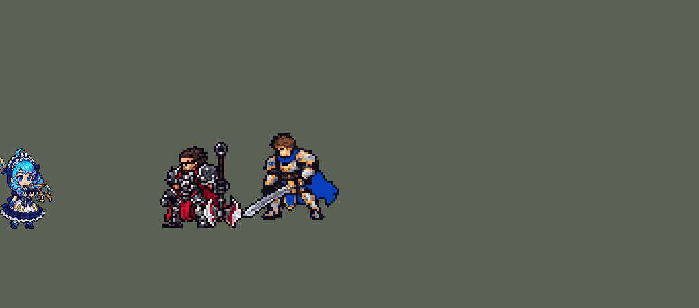

<!-- 本页上半部分由 tools/docs/gen_hero_docs.py 按仓库里现在的数据生成，手改会被覆盖；「开发记录」以下是手写的，生成时原样保留。 -->

# 格温 Gwen


| 项目 | 内容 |
|---|---|
| id | `league_gwen` |
| 所属的包 | 主包（mod_id `league`） |
| 分路 | 上单 |
| 分类 / 标签 | 刺客（Assassin） · AP / Magic / Melee / Heal |
| 高清帧 | PPU 2.84 |
| 附加包 | [格温被动附加包](#附加包)（`league_gwen`）、[游戏 AI 不按的技能替它按](#附加包)（`league_ult_press`） |



其他预览：[逐帧预览](../preview/league_gwen_frames.png)、[特效表](../preview/league_gwen_effects.png)

## 现在的技能

下面是游戏里显示的技能说明（`league/text/champion.i18n` 的简体中文，去掉了颜色和图标），冷却、距离来自 `league/champion/league_gwen.data_champion`；1 秒 = 60 tick。

### 普攻 / 被动（被动「千穿百孔」）

*攻击间隔 0.93 秒 · 攻击距离 24000*

被动千穿百孔：攻击和技能命中附加10 + 8% 法强魔法伤害，对英雄再造成1%最大生命值真实伤害并回复10 + 6% 法强生命。每次攻击叠一层剪刀层数，最多4层。

### 技能1 · 快刀剪乱

*冷却 5.5 秒 · 施放距离 30000 · 施放：指定目标 · 敌人（不含防御塔）*

在身前剪1+层数下，每下12 + 8% 法强，最后一剪60 + 40% 法强魔法伤害，正中央的敌人额外受到25真实伤害。每下都带被动。断续疾走落地后2秒内施放，正中央对准目标。

### 技能2 · 断续疾走

*冷却 15 秒 · 施放距离 45000 · 施放：指定目标 · 敌方英雄*

冲向敌方英雄，落地立刻剪他一下，4秒内攻速+25%、攻击距离增加、攻击附加15 + 20% 法强。落地放出丝缕缠流：圣霭4秒，她在雾中时隐身（远处敌人选不中她），护甲和魔抗+22。

### 大招 · 引针簇射

*冷却 40 秒 · 施放距离 70000 · 施放：方向 · 敌方英雄*

朝敌方英雄连掷三轮针：1根、3根、5根，各造成50/60/75 + 25% 法强魔法伤害并减速40%1.5秒，带被动。三轮之间可以穿插普攻。

### 数值

攻击力 74（每级 +10）、法强 50（每级 +20）、生命 880（每级 +98）、护甲 30（每级 +8）、魔抗 24（每级 +4）、移速 1080（每级 +11）。

## 附加包

附加包是可选的原生代码 mod（都在附加包合集 `league_addons` 里），**不装主包里的英雄也是完整的**。

### 格温被动附加包

[格温被动附加包](../../addons/league_gwen/README.md)：`league_gwen` v0.1.2

主包 `league` 保持纯数据。数据里能读目标最大生命值的只有真实伤害，读不到法强，所以主包格温的被动「千穿百孔」对英雄造成
1% 最大生命值的**真实伤害**（用户：「这个可以改rust」）。这个附加包用原生代码做成英雄联盟的样子：

- **百分比最大生命值魔法伤害**：原生效果 `league_gwen:cuts` 代替主包里那段真实伤害。被动每次打到敌方英雄（普攻、E 落地那一剪、
  Q 的每一剪、R 的每根针），读他的最大生命值和格温的法强，造成 1% + 每 100 法强 0.3% 最大生命值的**魔法伤害**，会被魔抗减免（英雄联盟是每 100 法强 0.6%：游戏里后期 500 法强时
  一剪 4%、一套 Q 打掉二成多生命，减半）。例：对 2000 生命的英雄，0 法强时 20 点，230 法强时 33 点（减免前）。
- 回血和每次附加的固定魔法伤害照旧由数据做；其他英雄不变。
- 数字写在 `src/lib.rs` 的常数 `P_HP`、`P_HP_AP` 里，`make_override.py` 生成副本时核对它们和 `tools/kit/build_gwen.py` 参数表 `P`
  的 `p_hp`、`p_hp_ap` 一致。

装上附加包后游戏里显示的说明（和主包不同的部分）：

- **普攻 / 被动（被动「千穿百孔」）**：【魔法伤害测试版】被动千穿百孔：攻击和技能命中附加10 + 8% 法强魔法伤害，对英雄再造成1%（每100法强+0.3%）最大生命值魔法伤害并回复10 + 6% 法强生命。每次攻击叠一层剪刀层数，最多4层。

### 游戏 AI 不按的技能替它按

[游戏 AI 不按的技能替它按](../../addons/league_ult_press/README.md)：`league_ult_press` v0.5.8（通用附加包，下面只列和格温有关的部分）

|  | 装了附加包，什么时候按 |
|---|---|
| 劫 W、格温 E、佛耶戈 E、卡特琳娜 W（冲上去的） | 他生命 **≥ 40%**；射程内（劫 55000、格温 45000、佛耶戈 46000、卡特琳娜 55000，引擎只接最近被我方打过的）的敌方英雄，**不在敌方塔下**（75000 内；生命 25% 以下的除外）、**目标身边 60000 内的敌方英雄不比他身边的我方英雄（含他）多**，挑**生命比例最低**的。劫还要 **Q 好着**（主包标记 `league_zed_q_cd` 不在，W-E-Q 一起出手，主包最初的设计）。AI 正往远处撤（走路目的地比现在离目标远 10000 以上）时不按 |

## 相关脚本和素材

- [`tools/kit/build_gwen.py`](../../tools/kit/build_gwen.py)
- [`tools/kit/setup_gwen.py`](../../tools/kit/setup_gwen.py)
- [`tools/lol/extract_gwen.py`](../../tools/lol/extract_gwen.py)
- [`tools/art/preview_gwen.py`](../../tools/art/preview_gwen.py)
- [`tools/art/rig_gwen.py`](../../tools/art/rig_gwen.py)
- [`tools/art/import_gwen.py`](../../tools/art/import_gwen.py)
- [`tools/art/design_gwen.py`](../../tools/art/design_gwen.py)
- [`assets/source/gwen/`](../../assets/source/gwen)

## 开发记录

> 下面是原来 README 里「英雄：格温」一节，原样搬过来（只改了相对链接）。

| 部分 | 内容 |
|---|---|
| 定位 | 上单（刺客，分类 Assassin），用户排的第十四组的上单，第 66 位英雄。灵罗娃娃 格温：拿大剪刀近身剪，普攻叠层数让 Q 多剪几下，E 跳上去接 W 的圣霭（站在雾里远处的敌人看不到她），R 连扔三波针。技能位用户选的「Q / E→W 连招」，W 选「雾里隐身 + 双抗」，R 选「一次施放连投三段」；被动的百分比魔法伤害用户说「这个可以改rust」（主包里是最大生命值的真实伤害，主包自己完整可玩；真正的百分比魔法伤害在原生附加包 `league_gwen` 里） |
| 普攻 / 被动 | 近战，射程 24000，攻击间隔 56 tick，第 11 tick 剪中（动作第 4 帧往前刺）。每次剪中敌人叠一层 Q（最多 4 层，6 秒）。被动「千穿百孔」：普攻、Q 的每一剪、R 的每根针附加 10 + 8% 法强的魔法伤害；对英雄再造成 1% 最大生命值的真实伤害（数据读不到最大生命值的魔法伤害，`FixedAttack target_hp_ratio`）并回复 10 + 6% 法强的生命 |
| 技能1 | Q「快刀剪乱」：冷却 330 tick，射程 30000，也对小兵和野怪放。在身前扇形里剪 1 + 层数下（每下 12 + 8% 法强，3 tick 一下），第 22 tick 最后一大剪 60 + 40% 法强；正中央（前方 16000、半径 6000）的敌人再受到 25 真实伤害（英雄联盟中心的伤害是真实伤害）。层数清空 |
| 技能2 | E「断续疾走」→ W「丝缕缠流」：冷却 900 tick（15 秒），只对敌方英雄放（射程 45000）。跳到目标身边（每 tick 6000），之后 4 秒攻速 +25%、攻击距离 +7500、普攻附加 15 + 20% 法强；落脚处升起圣霭 4 秒（半径 37000）：她站在雾里时每 0.1 秒刷新一次隐身（远处的敌人选不中她，走近的还能打，英雄联盟是雾外的敌人选不中她）和护甲、魔抗 +22，走出雾 0.1 秒内失效（阿卡丽第一层烟雾的做法：艾克的锚点 → 区域 → 只对自己） |
| 大招 | R「引针簇射」：冷却 2400 tick，只对敌方英雄放（射程 70000），朝施法方向连扔三波（隔 36 tick）：1 根、3 根、5 根针（一条 80000 长、宽 5000 / 15000 / 25000 的直线，能躲），每波 50 / 60 / 75 + 25% 法强的魔法伤害，带被动，减速 40% 1.5 秒 |
| 附加包（替 AI 按） | 可选的附加包 [`addons/league_ult_press`](../../addons/league_ult_press/README.md)（在附加包合集里，原生代码，主包不装它也完整）：游戏 0.6.4 的 AI 从来不按她的 E（只读观察包：320 局 0 次）。附加包按局面替 AI 按（用户：「有问题的英雄全部改成rust」）：她生命不低于 40% 时，45000 内不在敌方塔下（生命 25% 以下的除外）、身边的敌方英雄不比她身边的我方英雄多的敌方英雄里，挑生命比例最低的冲过去；AI 正往远处撤时不按 |
| 被动附加包 | 附加包 [`addons/league_gwen`](../../addons/league_gwen/README.md)（在附加包合集里）用原生代码：被动打到敌方英雄时读他的最大生命值和格温的法强，造成 1%（每 100 法强 +0.3%，英雄联盟是 0.6%，后期太疼减半）最大生命值**魔法伤害**（会被魔抗减免），代替主包的 1% 最大生命值真实伤害；回血和固定的魔法伤害照旧。主包不装附加包也完整可玩；附加包只做了单元测试，要在游戏里看日志确认 |
| 连招 | 用户：「另外加一点格温高手的连招逻辑进去」。**E→A**：E 落地立刻剪目标一下（英雄联盟 E 重置普攻；60% 攻击力 + 被动，也叠一层 Q）；**E→Q**：E 落地后 2 秒内放 Q，最后一剪的真实伤害直接打在 Q 的目标身上（高手用 E 调位置让中心对准，AI 对不准，这里替它对准）；**R 穿插普攻**：R 只在扔第一波时让她停下，后两波从她当时的位置照原方向飞，中间她照常普攻（英雄联盟 R 分三次放、中间穿插普攻） |
| 数值 | 攻击 74（+10）、法强 50（+20）、生命 880（+98）、护甲 30（+8）、魔抗 24（+4）、移速 1080（+11）。数值是自己设计的，用 SDK 对战模拟调：上单，对 6 个原版上单（`fighter`、`executioner`、`lancer`、`pole_warrior`、`knight`、`berserker`），3 套阵容、两边各打，10 分钟。初稿 +1.55 / +2.00；生命 980 → 950、Q 90 + 50% → 70 + 40%、E 攻速 40% → 30%、W 25 → 22 后 +1.41 / +1.24（同包菲奥娜 +1.22 / +1.47、蛮王 +1.29 / +1.02）。加了连招后 +3.39，再调回：E 落地那一剪 60% 攻击力不带 E 的附加伤害、中心真伤 40 → 25、生命 950 → 880、攻击 80 → 74、Q 70 → 60（小剪 15 → 12）、E 攻速 30% → 25%、R 60/70/90 → 50/60/75，+1.33 / +1.30 |
| 亚索联动 | 她的技能只有减速，没有击飞和晕眩，不用调 |
| 精灵图（旧版 1 倍） | 8 个动作 52 帧（含画进帧里的特效）：待机（呼吸：上半身和剪刀在第 3、4 帧沉一行）、移动、普攻、Q（`skill`）、E→W（`skill2`）、R（`ult`）、受击、死亡。造型 50 × 42 px（连身后的长剪刀；原来 53 × 46，用户觉得体型大，缩到 42 行），25 色。头像截取点 (2, −38)，选人卡片 `banpick_center` −9 |
| 高清帧（PPU 2.84） | 2026-10-25 用 PPU 重做（用户：「接下来可以优化格温 格温感觉只要利用PPU调高像素 还有眼睛那里改一下就可以了」）。设计图：用户把自己的 Gemini 图交给 Codex 画成新造型——深蓝白分层蓬蓬裙、白色荷叶边头饰、蓝绿螺旋卷带粉色发梢、英雄联盟的大圆眼、合拢的金框裁缝大剪刀（一大一小两个圆环，孔是透明的），用户：「用这个」；按原图自己的格子读回，「用 2.84，按原图密度」：93 × 116 格，头顶到脚底还是 38 像素（[`tools/art/design_gwen_hd.py`](../../tools/art/design_gwen_hd.py)）。动作：Codex 照旧版同一帧整帧重画（[`tools/art/pack_gwen_actions.py`](../../tools/art/pack_gwen_actions.py)，31 张 39 帧，重复的姿势只画一次），读回后修到设计图上（[`tools/art/casts_gwen_hd.py`](../../tools/art/casts_gwen_hd.py)）：整把露出来的剪刀 Codex 只画了 45–75% 长（用户：「有的部分剪刀有点小」「你可以参考之前那个格温 做的时候剪刀就挺长的」），这 23 帧换成同一把模板剪刀、刀刃拉长 1.5 倍（环尾到刀尖 108 格 = 38 像素，和旧版平A刺出去一样长；[`tools/art/scissors_gwen_hd.py`](../../tools/art/scissors_gwen_hd.py)）；平A起手和收回、Q 收回、E 冲刺、R 甩针那 9 帧 Codex 把剪刀换到了左手（用户：「怎么一会儿左手拿剪刀 一会儿右手 不应该都是右手拿吗」），这几帧换成设计图的上半身（右手扛剪刀，和待机一样），裙子和腿保留 Codex 画的；手和剪刀柄之间 1–3 格的小缝补上。导出 [`tools/art/rig_gwen_hd.py`](../../tools/art/rig_gwen_hd.py)：待机底帧就是设计图，画进帧里的剪光跟着新刀尖挪（`gwen_bake.json`：普攻刀尖离站立点 42 → 56 像素，Q 的小剪 39 → 44.4、最后一剪 40 → 46.5），待机和选人卡轮播由 `hero_reels.py` 从动作里切。选人卡位置 −8 → −9（呆毛尖到 −30，待机里举起的剪刀尖被裁掉），头像点 (2, −38) 不变。跑步：Codex 画的 8 帧是同一个姿势（同一只脚一直往后踢、身体不起伏，用户：「没有格温跳动的感觉 左右腿也不明显的交换」），改成设计图自己的小跳步：裙子下的两条腿整块移动，每半圈换一只脚抬起（近侧的往上、远侧的往后），腾空时整个人上弹约 3 像素、落地时身体下沉（`rig_gwen_hd.py` 的 `SKIP`） |
| 双马尾（0.237.1） | 2026-10-27 用户：「格温双马尾你做成三马尾了 想办法修复一下吧」。用户给 Codex 的原图（`hd/raw/gwen-v2.png`）本来就有三束卷发：脑后蝴蝶结下垂的一束（画面左边）、近侧脸颊前一束、远侧一束，设计图和每个动作都照着画了。给了两个方案（去掉脑后那束：后面只有地面，不用补画；去掉脸颊前那束：要补脖子和袖子），用户选了去掉最左边那束（「去掉最左边吧」）。[`tools/art/gwen_twin_tails.py`](../../tools/art/gwen_twin_tails.py)：设计图删掉第 38 行以下、第 30 列以左（和第 34–37 行第 22 列以左的顶端），蝴蝶结留着，新边补描边；上半身贴设计图的 11 帧（普攻 1/8、Q 14、E 1–5/9、R 4/5）跟着设计图变；Codex 画的 37 帧（25 张不同的画）逐帧手工圈出那束（`CUTS`），圈里连着头的蝴蝶结深蓝色留下，切下来残留的小块一起去掉；躺下的死亡帧去掉贴地最外侧的一束。各帧位置不变。俄洛伊的灵魂跟着重画；league.dll 0.7.175（她的动画表编在 hd.rs 里） |
| 特效 | Codex 生图的 16 张（`import_gwen.py` 缩成游戏像素）：`league_gwen_fx` 普攻、Q 小剪、R 针的命中，Q 中心真伤的白光，头顶的 Q 层数记号（4 个位置），E 加速时的丝线、雾里的护罩、减速时脚踝的丝线；`league_gwen_big` 地上的圣霭、R 的三波针；画进她自己动作帧里的：普攻剪尖的 X、Q 的小剪和最后一大剪、E 跳跃的丝线拖尾 |
| 音效 | 英雄联盟的音效和配音（`tools/lol/extract_gwen.py`）：普攻挥剪、剪中，Q 开剪、小剪、最后一剪、剪中、真伤，E 冲刺，W 圣霭，R 起手、扔针、针中；Q、E、W、R 的中文配音。版权属于 Riot Games，**不提交到仓库**，按下面的命令在本地生成 |
| 图标 | 官方技能图标（Q / E / R），从本地客户端提取，缩到 64×64 |

重新生成（素材来自本机的英雄联盟客户端，音频不进仓库）：

```bash
python tools/lol/extract_gwen.py --lol "D:\WeGameApps\lol" --vgmstream "<vgmstream-cli.exe 路径>"
python tools/kit/build_gwen.py          # 技能数据，数字都在脚本的参数表 P 里；--nodes 看每棵技能树的节点数
python addons/league_gwen/make_override.py   # 附加包的英雄数据和文字（主包的格温改了以后重跑）
python tools/kit/setup_gwen.py          # 五种语言的文字、音效配置、共享文件里她的键（头像点在脚本的 VIEW 里）
python tools/art/design_gwen.py         # 造型：Codex 草稿 bd82 按格子读回到 44 行，脸、剪刀、躯干逐格画，再整行删到 42 行、剪刀重画
python tools/art/rig_gwen.py            # 动作：每帧都是造型本身，手臂和剪刀整块摆；--review <文件夹> 先看
python tools/art/import_gwen.py         # 特效；--raw assets/source/gwen/codex_fx 先把生图原稿缩成游戏尺寸的原尺寸条
python tools/art/import_native.py --hero gwen   # 动作条 + 画进帧里的特效（assets/source/native/gwen_bake.json）
python tools/art/preview_gwen.py       # 逐帧预览（高清帧）、特效预览、演示 GIF
# PPU 2.84 重做（2026-10-25）：
python tools/art/pack_gwen_ppu.py --out <文件夹>        # 给 Codex 的设计图包（照她现在的精灵 + 英雄联盟的大圆眼）
python tools/art/design_gwen_hd.py                    # Codex 的 v2 原图（hd/raw/gwen-v2.png）按自己的格子读回成 93 × 116 格 -> hd/design.png
python tools/art/pack_gwen_actions.py --out <文件夹>    # 给 Codex 的动作包（照旧版同一帧整帧重画）
python tools/art/rig_gwen_hd.py                       # Codex 的交付（hd/casts）修到设计图上 -> 原始条和 1 倍图（--review <文件夹> 只看）
python tools/art/ppu_restyle.py --hero gwen && python tools/art/ppu_hd.py --hero gwen && python tools/art/hero_reels.py --hero gwen
```

美术（原画的提示词见 [`assets/source/gwen/PICTURE_PROMPT.md`](../../assets/source/gwen/PICTURE_PROMPT.md)，造型的见 [`MODEL_PROMPTS.md`](../../assets/source/gwen/MODEL_PROMPTS.md)，动作的见 [`MODEL_STRIPS.md`](../../assets/source/gwen/MODEL_STRIPS.md)，特效的见 [`PROMPTS_FX.md`](../../assets/source/gwen/PROMPTS_FX.md)；Codex 的交付在 [`codex_picture/`](../../assets/source/gwen/codex_picture)、[`codex_model/`](../../assets/source/gwen/codex_model)、[`codex_strips/`](../../assets/source/gwen/codex_strips)、[`codex_fx/`](../../assets/source/gwen/codex_fx)；附图包由 `tools/art/pack_gwen_*.py` 在本地生成，英雄联盟的渲染和 oppi 的图不进仓库）：

- 原画：Codex 画了 A（大剪刀拖在身后）和 B，用户选 A。
- 造型：用户给了一张草稿（「你那些都不合格 用这个」），按草稿自己的格子读回到 44 行，每个游戏像素按投票取色（描边和头发的暗线单独算）。脸照 oppi 的画法重画（「眼睛嘴巴不还是奇怪吗？改不好就学隔壁oppi美术的技巧」），后来按用户给的参考图改成上深下浅、左上白色高光、睫毛带眼尾的眼睛（「能不能把这个五官拿过来用 你慢慢手绘」）。剪刀用英雄联盟原版的样子（「我记得格温是大剪刀把？」「你看原版英雄啊」）：一把长长的合拢剪刀从腰后斜到脚边，两个带尖刺的环在身侧，环的孔是爱心（「剪刀孔请用可爱的形状」）。脖子和胸衣照草稿重画（「只剩脖子和身体那里有点怪了」），胸衣改成平涂（「手臂这里颜色都对对齐看了好怪」），身体里不连成线的孤立黑点清掉（「清理一下没用的黑色素」）。头两侧两块比头发暗得多的深紫色后发改成头发的深蓝和蓝（「头像这里一大块是什么？」「像素缺失？」）。试过把头发改成双螺旋马尾，用户要原样（「这发型你还原吧」）。之后「格温的体型能缩小点吗」：用户在 42 / 40 行里选了「A 缩到 42」，剪刀「变 但是武器的孔请两边都一样」。`design_gwen.py` 第 15 步先把剪刀拿下来，身体只删整行（头发 1 行、裙子白边下面的暗色 2 行、袜子 1 行；脸、手臂、头顶的翘发不删），46 → 42 行；剪刀按原来的画法重画，刀刃和连杆按 42/46 缩短，两个环最后画（原来尖刺压掉了下面那个心形孔的一角），两个心形孔一模一样。`rig_gwen.py` 的行号都经 `design_gwen.old_to_new()` 换算，手里的剪刀 30 → 27 格、环也最后画；画进动作帧的剪击、E 拖尾、头顶层数记号的位置重新量过。
- 发型和眼睛（10 月 9 日，用户：「格温的眼睛」「发型和眼睛能一起改吗 现在好怪」「眼睛形状改一改吧 这形状不像格温」，从方案图里选了 B）：`design_gwen.py` 第 16 步重画头部，`rig_gwen.py` 照着摆所有动作。
  - 头发：原来两团螺旋卷在眼睛高度，像耳罩，头宽到 25 格。现在照英雄联盟改成圆头顶（左上受光），蝴蝶结藏到头后只露两翼，两条斜纹螺旋卷从耳后垂到肩下；刘海和脸不变。
  - 眼睛：改成英雄联盟的杏仁眼。近处的眼睛 3 格宽：外眼角一格眼白，往里是青色瞳孔，靠她前方一格瞳仁；远处的眼睛 2 格宽。上眼线都往外多延一格，下眼睑粉色。瞳孔用青色，不再用头发的蓝。
  - rig：字母表固定成造型脚本的 PAL（按亮度自动排的字母会被新加的青色挤乱）。卷发算头发层：手臂抬起时，原来垂着的手臂那几格不清空、不补色，近侧手臂画在卷发前，远侧手臂从卷发上方经过（后来改到卷发后面，见下面「剪刀和卷发」）。跑步时摆动的后侧卷发换成新的左卷发。
  - 选人卡片：头顶从 −30 变成 −29，`banpick_center` 改成 −10；脸部定位点 (2, −39)。和 main 比，没有一帧多出透明小洞。
- 再缩小（10 月 9 日，用户：「格温好像也偏大」，两个方案里选了「A 38 行」）：`design_gwen.py` 第 17 步，`rig_gwen.py` 照着重新生成所有动作。
  - 身体再删 3 整行（裙子、袜子、小腿各一行，都和上下行几乎一样），41 → 38 行；头、卷发、手臂不动。
  - 剪刀先拿下来，按 38/41 缩短后重画，握柄跟着胯部下移，两个心形孔照旧一样大；剪刀尖离脚底线至少两行（待机呼吸时剪刀会跟着往下沉一行）。手里拿的剪刀 27 → 25 格。
  - `old_to_new()` 现在把第 14 步的坐标经第 15、17 步一起换算，动作脚本靠它定位；卷发的格子跟着第 17 步下移。
  - 烤进动作帧的普攻 X 和 Q 的剪痕原来按站立点放在剪刀尖上，格温变矮后会比刀尖高 3 行、远 2 格：`gwen_bake.json` 给这几项加了 `dx: -2, dy: 3`（`import_native.py` 的烤特效新增偏移参数），E 的拖尾不动。
  - 选人卡片：头顶到站立点 −26，不再超过 −28，去掉 `banpick_center`；头像点 (2, −36)。和 main 逐帧比，没有一帧多出碎块、透明小洞、孤立描边或低过脚底的像素。
- 剪刀和卷发（10 月 9 日，用户：「攻击或者放技能的时候 剪刀和头发互卡了？」，两个方案里选了「A 卷发在前」）：`rig_gwen.py` 把伸出去的远侧手臂、手套和手里的剪刀画在头发上层，可右边那根卷发在待机里挂在肩膀前面，手又正好停在卷发发梢上，手臂的肤色和握环一半压在卷发上、头发从缝里露出来。现在两根卷发永远画在它们上面，和待机一样：普攻第 2–7 帧、Q 第 1–13 帧、W 第 6–8 帧变了，握环的心形在这些帧里大多藏在卷发后面，刀身从卷发后面伸出来；其他动作一帧没动。
- 重画（10 月 9 日，用户：「格温和萨勒芬妮的脸部立绘可以修好看一点」「剪刀收着的时候模型不太像剪刀」「格温剪刀可以改成官方那种扛在肩膀上啊」）：先请 Codex 画了一张扛剪刀、小傲娇的原图，用户很喜欢（「非常不错 你能还原吗」）。我手描缩到游戏尺寸几轮都不行——原图的头是歪的，在正的头上硬放五官就不一致（「你现在头是做正的 所以强行画五官就不一致」）。于是让 Codex 把它**直接画在游戏格子上**（26 px 固定格、头顶到鞋底 38 格、大头比例，交付 [`codex_grid/`](../../assets/source/gwen/codex_grid)，1x 文件每格一像素）。`design_gwen2.py` 从字母格 [`design/gwen_design2.txt`](../../assets/source/gwen/design/gwen_design2.txt) 生成造型：1x 放到画布上（鞋底第 99 行、脚中点第 64 列），采样碎掉的剪刀把手照 Codex 原稿手工重画（脸右侧圆形剪刀轴、紫手套握柄、叉柄接两个空心爱心指环 + 尖刺），右侧卷发和腰部整理，补 5 个小孔；用户再提「眼睛起码一样大 嘴上那个点太大了 脖子也看不到」「你可以做可爱点」「上面两条黑的也可以调一下」：两眼都改成 3 × 2（左上白高光、深青瞳、右下浅青，远侧按歪头高一行，睫毛只盖眼睛 + 外眼角一格，「眉毛不要」：眉毛去掉），去掉嘴角的痣、嘴角用肤色阴影上翘，第 76 行画出脖子。爱心孔用品红标记色（`Z`）：动作脚本和导入的描边都当它是颜色，最后 `clean_gwen.py`（导入的 TIDY 步）把它变透明，孔不会被描边补死。`rig_gwen2.py` 用这版造型重摆所有动作：待机呼吸（上身连剪刀下沉一行）；普攻 / Q / W 把剪刀从肩上拿下来（握在两个指环中间，朝前时整把画在身前）；R 用叉腰的左手甩针；跑步改成英雄联盟的蹦跳步（每半圈蹲一下、一只脚往后踢起，左右轮流，「左右脚来回切换单脚蹦跶着走」）；死亡照旧（剪刀落地）。普攻和 Q 的剪痕偏移不变，X 仍落在刀尖。头像点 (2, −38)，选人卡片按规则 `banpick_center` −9（头顶呆毛 −30，肩上的刀尖 −38 被卡片裁掉）。模组版本 0.83.2。
- 动作：Codex 的动作条把手臂硬转 85–90°（变形）、R 和受击就是待机，用户：「有奇怪的地方你帮我修复 灵活运用工具」。`rig_gwen.py` 全部用造型自己的像素摆：手臂是直的、两格粗（肤色上亮下暗、紫手套两格），和造型垂着的手臂一样长；远侧手臂从肩角出来、画在身体下面但压在背后的卷发上，近侧画在身体上面。手里的剪刀每一帧都按造型的画法重画（同样的环、尖刺和刀身，角度不同，不旋转像素），张开时是两片刀刃。普攻、Q、W 手在腰的高度（在肩膀高度时环陷进卷发里），刀身不往地上戳；E 用跑步的腿跳一下；R 左手举起一把三根针、甩过胸口；受击整个人后退；死亡每一帧都绕脚转，倒下时剪刀先还在手里，倒地后躺在脚前面。跑步：腿用造型自己腿的每一行沿胯—膝—脚踝摆，两胯收到身下，交叉步，远侧腿暗一档，落地时身体沉一行；空着的左手和腿反着摆，后面卷发的下半段往后飘一格（「走路时太过于僵硬 没有那种灵性」；整束卷发一起动时头发变形：「头发上 有点变形」）。剪刀的描边在每一帧都保留原样（被清理改掉时剪刀一帧一个样：「上下摆动剪刀变形啊」）。
- 特效用 Codex 画的 16 张（生图原稿，`import_gwen.py --raw`：每张按格子等分，每个游戏像素取覆盖的原稿像素里最多的颜色，颜色归到包里给每张的色阶——剪刀和针的白青圣光、针的银白、圣霭的淡白蓝；光外圈最暗的一档去掉，Q 层数记号保留描边）。三波针的原稿每帧位置不齐、最后几帧被切掉，改成取最完整的一帧、由脚本沿直线匀速往前移；雾里的护罩和 E 的丝线把她盖白了，中间掏空；地上的圣霭底色太实，隔一格透出地面。
- 红色方：游戏只会按朝向镜像英雄自己的动作帧、不镜像特效图，所以有朝向的特效全部画进她的动作帧（`gwen_bake.json`）：普攻剪尖的 X、Q 的小剪和最后一大剪、E 的拖尾——技能数据里不再单独播放 E 的拖尾。三波针做成严格上下对称；挂在她身上、地上、敌人脚下的画面做成严格左右对称。演示 GIF 后半段她转身朝左打，就是红色方的样子。后来查红色方（「红色蓝色方没有技能特效颠倒的问题吧」）：Q 的命中是一道「/」斜切、R 的命中是针从左上方飞来的拖尾，红色方她在右边时方向是反的；用户选「只改 R 和 Q」：这两个和自己的镜像叠起来（`tools/fix/mirror_union_fx.py`，表 `league_gwen_sym`，Q 成 X、R 成从两边来的 V），`build_gwen.py` 生成时就指向它，附加包的副本也一样；普攻的 X 和 Q 真伤的星光不动。

逐帧预览：[`docs/preview/league_gwen_frames.png`](../preview/league_gwen_frames.png?v=1027tt)，特效：[`docs/preview/league_gwen_effects.png`](../preview/league_gwen_effects.png?v=1025gw)。
