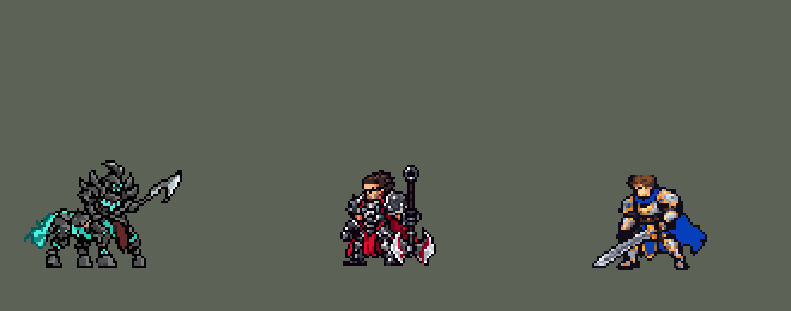

<!-- 本页上半部分由 tools/docs/gen_hero_docs.py 按仓库里现在的数据生成，手改会被覆盖；「开发记录」以下是手写的，生成时原样保留。 -->

# 赫卡里姆 Hecarim


| 项目 | 内容 |
|---|---|
| id | `league_hecarim` |
| 所属的包 | 主包（mod_id `league`） |
| 分路 | 打野 |
| 分类 / 标签 | 近战（Melee） · AD / Melee / CC |
| 高清帧 | 1 倍像素（无高清帧） |
| 附加包 | 无 |



其他预览：[逐帧预览](../preview/league_hecarim_frames.png)、[特效表](../preview/league_hecarim_effects.png)

## 现在的技能

下面是游戏里显示的技能说明（`league/text/champion.i18n` 的简体中文，去掉了颜色和图标），冷却、距离来自 `league/champion/league_hecarim.data_champion`；1 秒 = 60 tick。

### 普攻 / 被动

*攻击间隔 1.03 秒 · 攻击距离 25000*

挥戟攻击。征战之路：冲锋时攻击力提升。恐惧之灵（自动，14秒）：放Q、E、R时身边有敌方英雄就开启，4秒内双抗+20，每秒对周围敌人造成14魔法伤害，每命中一个回复12生命。

### 技能1 · 暴走

*冷却 4 秒 · 施放距离 26000 · 施放：指定目标 · 敌人（不含防御塔）*

回旋横扫，周围敌人受到45 + 85% 攻击力伤害。命中后获得一层暴走（最多2层，8秒），每层伤害+20%。刷野叠的层数可以带进团战。

### 技能2 · 毁灭冲锋

*冷却 10 秒 · 施放距离 60000 · 施放：指定目标 · 敌人（不含防御塔）*

冲向目标，冲得越久伤害越高（最多200%），造成30 + 60% 攻击力伤害并击退，之后移速+25%。

### 大招 · 暗影冲击

*冷却 50 秒 · 施放距离 70000 · 施放：指定目标 · 敌方英雄*

带幽灵骑兵冲向敌方英雄，沿途敌人受到70 + 100% 攻击力伤害；落地使周围敌人恐惧0.75秒（冲得远1.33秒），顺势暴走一圈并开启恐惧之灵。

### 数值

攻击力 95（每级 +17）、生命 1050（每级 +100）、护甲 32（每级 +8）、魔抗 22（每级 +4）、移速 1080（每级 +12）。

## 相关脚本和素材

- [`tools/kit/build_hecarim.py`](../../tools/kit/build_hecarim.py)
- [`tools/kit/setup_hecarim.py`](../../tools/kit/setup_hecarim.py)
- [`tools/lol/extract_hecarim.py`](../../tools/lol/extract_hecarim.py)
- [`tools/art/preview_hecarim.py`](../../tools/art/preview_hecarim.py)
- [`tools/art/import_hecarim.py`](../../tools/art/import_hecarim.py)
- [`tools/art/design_hecarim.py`](../../tools/art/design_hecarim.py)
- [`assets/source/hecarim/`](../../assets/source/hecarim)

## 开发记录

> 下面是原来 README 里「英雄：赫卡里姆」一节，原样搬过来（只改了相对链接）。

| 部分 | 内容 |
|---|---|
| 定位 | 打野（战士，分类 Melee），第 82 位英雄。战争之影 赫卡里姆：冲锋撞人、带幽灵骑兵开团恐惧。用户选打野、完整还原 + 高手连招 |
| 普攻 / 被动 | 挥戟砍，射程 25000，攻击间隔 62 tick，第 11 tick 砍中。被动「征战之路」：英雄联盟里额外移速转成攻击力；数据读不到移速，所以他的每段加速都带攻击：冲锋每段 +8%、冲锋后 +8%、大招落地后 +20% 3 秒 |
| 恐惧之灵（自动） | W 没有技能位，冷却 840 tick（14 秒）：Q 扫中、E 落地或 R 落地时 30000 内有敌方英雄就开启 4 秒：护甲、魔抗 +20，每秒对周围敌人造成 14 魔法伤害、每命中一个回复 12 生命（英雄联盟按造成的伤害回血；数据读不到伤害，按命中个数） |
| 技能1 | Q「暴走」：冷却 240 tick（4 秒），对周围 26000 内的敌人（也对小兵和野怪放）造成 45 + 85% 攻击力物理伤害；命中后叠一层暴走（最多 2 层，8 秒，再命中刷新），每层伤害 +20%，刷野叠的层数可以带进团战 |
| 技能2 | E「毁灭冲锋」：冷却 600 tick（10 秒），射程 60000，冲向目标（速度 2500），冲得越久越疼：8 / 16 tick 后升到第二 / 三段，伤害 30 + 60% 攻击力 ×1 / ×1.5 / ×2，砍中时击退；之后移速 +25% 2 秒 |
| 大招 | R「暗影冲击」：冷却 3000 tick（50 秒），射程 70000，只对敌方英雄放：幽灵骑兵（穿透的直线，沿途 70 + 100% 攻击力）和他一起冲过去，冲锋时免控；落地时 26000 内的敌人恐惧 45 tick，冲了 12 tick 以上恐惧 80 tick（英雄联盟按冲锋距离变长） |
| 高手连招 | **冲锋接大招（E → R）**：冲锋撞上英雄时大招已解锁且就绪，直接接暗影冲击落地（恐惧 + 击退，凯南 E → R 的写法，大招位之后空放）；**落地回旋（R → Q）**：每次大招落地顺势暴走一圈（60% 伤害，叠一层，不占冷却）；**开团回血**：冲锋和大招落地都会开启恐惧之灵 |
| 数值 | 攻击 95（+17）、生命 1050（+100）、护甲 32（+8）、魔抗 22（+4）、移速 1080（+12）。数值是自己设计的，用 SDK 对战模拟调：打野，对 3 个原版打野（`ninja`、`demon`、`hunter`），种子 1–12 和 25–36 各 12 局、10 分钟。初稿 +0.91；Q 40 + 80% 后 +1.50 / +2.53；按动作条对准出手时间（普攻第 11 tick、E 落地 5 tick 后砸中、R 第 7 tick 出发）后掉到约 −0.2，Q 加到 45 + 85%：+1.69 / +1.59（同期雷恩加尔 +1.6、赵信 +1.2、蔚 +2.4） |
| 亚索联动 | E 的击退不是击飞，亚索大招不受影响，不用调 |
| 精灵图 | 9 个动作 57 帧：待机 8（呼吸）、移动 8（定稿的身体每帧不变、只颠一格，四条腿按奔跑的落蹄顺序错开，85 ms 一帧）、普攻 6、Q（`skill`）7、E 冲锋（`skill2`）7、E 砸下（`skill2_hit`）4、R（`ult`）7（扬蹄 + 冲锋）、受击 2、死亡 8。45×67 px（含长戟和尾巴），16 色。第一版造型的头盔是大头 Q 版（用户：「学别人那种画法啊 头这么大干嘛」），照 oppi 的赫卡里姆改成小头盔（头盔约 8 行）。头像截取点 (9, −36)，选人卡片 −6（角尖在 −33） |
| 特效 | Codex 生图的 17 张原稿（没有游戏尺寸版），`import_hecarim.py` 按格读回、按技能范围定大小：`league_hecarim_fx` 普攻刀光、Q 命中、暴走层数（马身两侧的幽灵火）、W 抽魂、E 起步尘土 / 冲锋蹄下幽灵火 / 砸中 / 加速、R 骑兵刀光、恐惧骷髅；`league_hecarim_big` Q 的一圈刀光、W 炸开的幽灵圈和持续的幽灵圈、R 起手的暗影、幽灵骑兵、落地冲击波。配色照英雄联盟的技能图标：幽灵青绿 + 白芯，暗影烟和尘土点缀。骑兵从上往下看画（会转到冲锋方向，上下对称），其余左右对称；R 的暗影和骑兵画在人物下面，不挡住他 |
| 音效 | 英雄联盟的音效和配音（`tools/lol/extract_hecarim.py`）：挥戟和命中、Q 出手 / 命中、W、E 出手 / 撞击、R 出手 / 落地 / 骑兵穿过；Q、W、R 的中文配音（原版 E 没有配音）。版权属于 Riot Games，**不提交到仓库**，按下面的命令在本地生成 |
| 图标 | 官方技能图标（Q / E / R），从本地客户端提取，缩到 64×64；W 自动，没有技能位 |

重新生成（素材来自本机的英雄联盟客户端，音频不进仓库）：

```bash
python tools/lol/extract_hecarim.py --lol "D:\WeGameApps\lol" --vgmstream "<vgmstream-cli.exe 路径>"
python tools/kit/build_hecarim.py         # 技能数据，数字都在脚本的参数表 P 里；--nodes 看每棵技能树的节点数
python tools/kit/setup_hecarim.py --face 9,-36 --banpick -6   # 五种语言的文字、音效配置、共享文件里他的键
python tools/art/design_hecarim.py        # 造型：Codex 原稿按格读回、删到 45 行（2_45）
python tools/art/fix_hecarim_strips.py    # 动作：Codex 照英雄联盟原版逐帧整个重画的动作条
python tools/art/import_native.py --hero hecarim
python tools/art/import_hecarim.py --raw assets/source/hecarim/codex_fx   # 特效：原稿读回成游戏尺寸，再拼成特效表
python tools/art/preview_hecarim.py       # 预览和演示 GIF
```

美术（特效的提示词见 [`PROMPTS_FX.md`](../../assets/source/hecarim/PROMPTS_FX.md)；Codex 的交付在 [`codex_model_v2/`](../../assets/source/hecarim/codex_model_v2)、[`codex_strips_v2/`](../../assets/source/hecarim/codex_strips_v2)、[`codex_fx/`](../../assets/source/hecarim/codex_fx)）：

- 原画：Codex 画了待机（A）和冲锋（B）两版，用户选 A。
- 造型：第一版脸太差、头太大（用户：「脸部质量太差了 去参考oppi怎么弄得吧」「学别人那种画法啊 头这么大干嘛」），照 oppi 的头盔比例重画，用户选 2_45（45 行，浅灰盔甲）。
- 动作：第一轮 Codex 一张图画一整条，读回来糊成色块；第二轮每帧单独一张、直接画在 8 倍游戏格上，`fix_hecarim_strips.py` 按格读回、接回读断的刀刃、两格粗的描边削成一格、跑步和冲锋按原版头的轨迹稳住骑士、受击用干净的第 2 帧、死亡停在第 6 帧。用户：「完美」。
- 跑步：照原版逐帧重画的奔跑每帧形状都不一样（用户：「人马移动有点不自然啊 参考下oppi怎么移动的」「而且移动时模型有点变形」「四个脚都要有明显错开并且自然的感觉」），Codex 另画的侧面奔跑接上来又成了另一匹马（「模型变形了啊」「武器断了啊」「这腿对吗 残疾了？」）。现在照 oppi 的思路一点都不重画：身体就是定稿（和待机逐像素相同，只颠一格，尾巴摆一下），四条腿也是定稿自己的腿，每条按大腿、小腿、马蹄三段整块移动；按奔跑的落蹄顺序（后、后、前、前）各差两帧，着地 5 帧往后滑、腾空 3 帧收蹄往前迈（抬 2 → 5 → 2 格）；中间两条腿挨着，步子小一点，蹄子不会叠成一块（`fix_hecarim_strips.py` 的 run_rig）。
- 特效：Codex 第 3 步的 17 张生图原稿，读回成游戏尺寸；暴走层数的火苗画得太大，只取每帧左半边的一团放在马身侧面，翻转补出另一边。

逐帧预览：[`docs/preview/league_hecarim_frames.png`](../preview/league_hecarim_frames.png?v=1014g)，特效：[`docs/preview/league_hecarim_effects.png`](../preview/league_hecarim_effects.png?v=1014g)。
