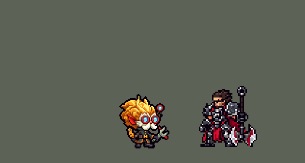

<!-- 本页上半部分由 tools/docs/gen_hero_docs.py 按仓库里现在的数据生成，手改会被覆盖；「开发记录」以下是手写的，生成时原样保留。 -->

# 黑默丁格 Heimerdinger

| 项目 | 内容 |
|---|---|
| id | `league_heimerdinger` |
| 所属的包 | 主包（mod_id `league`） |
| 分路 | 中单 |
| 分类 / 标签 | 法师（Magician） · AP / Magic / Range / CC |
| 高清帧 | PPU 1.2 |
| 附加包 | [黑默丁格附加包](#附加包)（`league_heimerdinger`） |

其他预览：[逐帧预览](../preview/league_heimerdinger_frames.png)、[特效表](../preview/league_heimerdinger_effects.png)

## 现在的技能

下面是游戏里显示的技能说明（`league/text/champion.i18n` 的简体中文，去掉了颜色和图标），冷却、距离来自 `league/champion/league_heimerdinger.data_champion`；1 秒 = 60 tick。

### 普攻 / 被动

*攻击间隔 1.47 秒 · 攻击距离 55000*

射出一道海克斯电光。海克斯科技微型导弹：每第3次普攻额外射出5枚导弹，每枚造成10 + 7% 法强魔法伤害。

### 技能1 · H-28 G 进化炮台

*冷却 4 秒 · 施放距离 60000 · 施放：方向 · 敌人（不含防御塔）*

放下一座炮台（最多3座）10秒，每0.83秒攻击一个敌人，造成6 + 4% 法强魔法伤害；对受控制的英雄发射光束，造成18 + 14% 法强。海克斯科技亲和：在炮台旁移速+20%。

### 技能2 · CH-2电子风暴手雷

*冷却 11 秒 · 施放距离 85000 · 施放：指定目标 · 敌人（不含防御塔）*

掷出手雷，造成60 + 45% 法强魔法伤害并减速35%，正中的敌人被眩晕1秒。

### 大招 · 升级！！！

*冷却 40 秒 · 施放距离 75000 · 施放：指定目标 · 敌方英雄*

升级！刷新Q、E，10秒内强化下一个对英雄的技能：Q放下巨型炮台8秒，每0.5秒造成22 + 12% 法强并减速25%；E连掷3颗手雷，每颗80 + 40% 法强并眩晕1秒；普攻射出12枚导弹。

### 数值

攻击力 58（每级 +5）、法强 40（每级 +20）、生命 860（每级 +92）、护甲 17（每级 +7）、魔抗 22（每级 +4）、移速 900（每级 +9）。

## 附加包

附加包是可选的原生代码 mod（都在附加包合集 `league_addons` 里），**不装主包里的英雄也是完整的**。

### 黑默丁格附加包

[黑默丁格附加包](../../addons/league_heimerdinger/README.md)：`league_heimerdinger` v0.2.2

|  | 主包（纯数据） | 装了附加包 |
|---|---|---|
| 炮台的样子 | 正面朝镜头（数据不知道目标在哪边） | **侧面、炮口朝目标那边**（用户：「炮台改成侧面朝敌人」）：英雄联盟模型的侧面，PPU 1.75（用户：「灵活利用PPU 炮也可以调的清晰」，PPU 3 时又「炮太高清了 降低点像素」），朝左朝右两套 |
| 炮台出手 | 炮台的区域当场打中目标，目标身上冒命中特效 | 炮弹（`t_shot`）、充能光束（`t_beam_line`）、巨型炮台的等离子弹（`x_shot`）**从侧面炮台的炮口飞向目标，飞到才扣血** |
| 打谁 | 受控英雄 → 英雄 → 其他敌人，各区域里先轮到的那个 | 同样的顺序，每档里打**最近的** |
| 海克斯科技亲和 | 自己的炮台旁 +20% 移速 | 自己的炮台旁**或己方防御塔旁** +20% 移速 |
| R 的升级给谁 | 游戏的 AI 先按哪个就是哪个 | **敌方英雄扎堆就按 E**（CH-3X 砸人堆），不然按 Q（巨型炮台），Q 没好再按 E |

装上附加包后游戏里显示的说明（和主包不同的部分）：

- **技能1 · H-28 G 进化炮台**：【扩展包】放下一座炮台（最多3座）10秒，每0.83秒射击一个敌人，造成6 + 4% 法强魔法伤害；对受控制的英雄发射光束，造成18 + 14% 法强。海克斯科技亲和：在炮台或己方防御塔旁移速+20%。

## 相关脚本和素材

- [`tools/kit/build_heimerdinger.py`](../../tools/kit/build_heimerdinger.py)
- [`tools/kit/setup_heimerdinger.py`](../../tools/kit/setup_heimerdinger.py)
- [`tools/lol/extract_heimerdinger.py`](../../tools/lol/extract_heimerdinger.py)
- [`tools/art/preview_heimerdinger.py`](../../tools/art/preview_heimerdinger.py)
- [`tools/art/rig_heimerdinger.py`](../../tools/art/rig_heimerdinger.py)
- [`assets/source/heimerdinger/`](../../assets/source/heimerdinger)

## 开发记录

> 下面是原来 README 里「英雄：黑默丁格」一节，原样搬过来（只改了相对链接）。

| 部分 | 内容 |
|---|---|
| 定位 | 中单（Magician，标签 AP / Magic / Range / CC），第 149 位英雄。大发明家 黑默丁格：约德尔老教授，一大团金黄色头发、红框青蓝镜片的护目镜、白色八字胡，墨绿灰学院长外套，左手橙色多功能工具、右手灰绿扳手，背包里藏着一条机械臂（10-20 之后分组的 F 组；计划是下路替补，用户定了中单）。团战经理只有三个主动技能位，按用户选的方案 A：技能 1 = Q H-28 G 进化炮台，技能 2 = E CH-2电子风暴手雷，大招 = R 升级！！！；W 海克斯科技微型导弹在普攻里，被动海克斯科技亲和在炮台上。技能名照英雄联盟 16.20 的 Data Dragon（五种语言） |
| 普攻 / W | 扳手射出一道海克斯电光，100% 攻击。**海克斯科技微型导弹**不占技能位：每第 3 次普攻，背包的机械臂举起火箭发射 5 枚小导弹（`attack_w` 动作，英雄联盟 W 的样子），每枚 10 + 7% 法强 |
| 技能1 | **H-28 G 进化炮台**（冷却 4 秒，对 `EnemyWithoutTower`，兵线野怪也放）：机械臂把炮台放到身前 20000 处，最多 3 座（a / b / c 三个位置，凯特琳夹子的做法），每座 10 秒，每 0.83 秒打一个敌人 6 + 4% 法强；打到**被控制的英雄**时放充能光束 18 + 14% 法强（英雄联盟的充能光束，这里接在 E / R 的眩晕之后）。炮台是区域（数据里没有召唤物，婕拉植物的做法），它的画面是高清的一整段生命：从地里升起、每一炮炮口闪光、10 秒后冒烟损坏 |
| 被动 | **海克斯科技亲和**：在自己的炮台 40000 内移速 +20%（炮台的光环只认他自己：艾克的球的 `RandomTarget AllyOnlySelf` 做法）。英雄联盟里在己方防御塔旁也加速——这一半在附加包里 |
| 技能2 | **CH-2电子风暴手雷**（冷却 11 秒，射程 85000）：机械臂把手雷甩出去，落地 23000 内 60 + 45% 法强、减速 35% 2 秒，正中 11000 内眩晕 1 秒 |
| 大招 | **升级！！！**（冷却 40 秒，射程 75000，只对敌方英雄，好让游戏的 AI 在团战里放）：背包顶上弹出圆鼓和两根弹簧天线、头顶一圈光环，**本身不放东西，刷新 Q、E 的冷却并升级他的下一个技能**（英雄联盟的做法；2026-10-24 用户：「大发明家的手雷不能升级？炮台不能升级么？」，选了「改成升级下一个技能」）：脚下亮起一圈海克斯蓝光（`r_glow`）等 10 秒，先来的、够得着敌方英雄的那个升级（够不着就照常放，升级留着）——**Q → H-28Q 巨型炮台**（朝那名英雄，不占 3 座的名额）：8 秒，每 0.5 秒 60000 内 22 + 12% 法强、减速 25%，对被控制的英雄放大光束 45 + 30% 法强；**E → CH-3X 闪电手雷**：朝那名英雄连扔 3 颗，每颗 25000 内 80 + 40% 法强、减速 40%，正中 13000 内眩晕 1 秒；**身边 70000 内有敌方英雄时的普攻 → 导弹群**：12 枚导弹打那名英雄（每枚 10 + 7% 法强）。附加包的 AI 钩子替他挑：扎堆按 E，不然按 Q |
| 连招 | 「有连招要做连招」：**E → W**（手雷晕住英雄后 1.5 秒内，下一下普攻马上发射整排导弹打那个被控制的英雄，不用等第 3 下）；**E / R → Q**（炮台对被控制的英雄换成充能光束） |
| 附加包 | [`addons/league_heimerdinger`](../../addons/league_heimerdinger/README.md)（在附加包合集里，原生代码，主包不装它也完整；用户：「需要做附加包就做」「做附加包啊」）：**炮台侧面朝敌人**（用户：「炮台改成侧面朝敌人」「灵活利用PPU 炮也可以调的清晰」：放下时目标在哪边就画朝哪边的侧面炮台，英雄联盟模型的侧面渲染、PPU 1.75（PPU 3 时用户：「炮太高清了 降低点像素」）；主包不知道方向，还是正面的）、**炮弹从炮台飞出去**（两种炮台照主包的节奏和目标顺序出手：受控英雄挨充能光束 `t_beam_line`，否则最近的英雄、再否则最近的小兵野怪挨炮弹 `t_shot` / 巨型炮台的等离子弹 `x_shot`，`spawn_projectile` 从炮口飞向目标，飞到才扣血；伤害、射程、节奏和主包同一组数）、**海克斯科技亲和也认己方防御塔**（塔 60000 内 +20% 移速）。**R 的升级给谁**（AI 钩子 `league_heimerdinger:combo`）：升级挂着时敌方英雄扎堆就按 E（CH-3X），不然按 Q（巨型炮台），Q 没好再按 E。副本里炮台保留画面、音效和三个槽位，区域换成原生的 `league_heimerdinger:q` / `:x`（`make_override.py` 用 `build_heimerdinger.py --native` 生成）。经典引擎模拟跑不了原生代码（副本替空原生效果后 120 局照常跑完）；炮弹要在游戏里看 |
| 数值 | 攻击 58（+5）、法强 40（+20）、生命 860（+92）、护甲 17（+7）、魔抗 22（+4）、移速 900（+9）、射程 55000 |
| 平衡 | 经典引擎 10 分钟模拟，中路对五个原版中单 × 三套阵容 × 两边：初稿 +4.03（炮台、导弹单独削没用，主要是 E 的眩晕和大招），炮台 / E / 大招一起削 +1.44；照动作帧改了出手时间后 +1.73（±0.46）。2026-10-24 R 改成升级下一个技能（12 个种子）：原来的 R +1.53（±0.36）；只升级 −1.17（不再多放一个技能；缩冷却、加强升级、只给够得着英雄的技能都在 −1.4～+0.1）；R 再刷新 Q、E +0.71；R 冷却 40 秒、CH-3X 80 + 40%、巨型炮台 22 + 12% **+1.30（±0.36）**，每局放 R 7.8 次（原来 7.7） |
| 美术 | Codex 画原图和游戏尺寸造型（用户挑 A-2，36 游戏像素、PPU 1.5、只做 3/4 面；两座炮台正面画，红蓝两边都对）。第一版动作只挪了造型自己的部件，用户：「身体背后的机械的动作帧呢？没有 还有头和身体不协调 走路也怪」「做不出来就让codex帮忙」——重做：英雄联盟的关节逐帧导出（`assets/source/heimerdinger/poses.json`，机械臂 Rocket_Base → Rocket_Holder、两根天线、两件工具的两端），**A 包**照粗稿画 15 个全身姿势（一蹦一跳的跑步、抬腿戳扳手的普攻、摆弄工具的待机、背包炸开的死亡），定稿的头一格一格贴回去；**B 包**画背包机械臂的 17 个位置和大招装置 3 张，机械臂放在他身后、根部藏在头发后面（`tools/art/design_heimerdinger_poses.py`、`design_heimerdinger_props.py`、`rig_heimerdinger.py`）。2026-10-22 用户：「大发明家的像素太高了 可以调低一点」，从 1.5、1.3、1.2、1.0 里选了 **PPU 1.2**（游戏里一样大，格子粗一些；`ppu_restyle.py` 的 heimerdinger 一行） |
| 特效 | 27 张，用户用 Gemini 画（`tools/art/pack_heimerdinger_fx.py` 的提示词，配色照英雄联盟原版自己的特效贴图：海克斯蓝白电光、炮台橙金火光、充能光束蓝色、闪电手雷红色），`process_heimerdinger_fx.py` 按格读回、补成对称，`import_heimerdinger_fx.py` 导成 `league_heimerdinger_fx` / `_big`（R 升级等着时脚下的 `r_glow` 光圈是它自己画的） 和高清的炮台表 `league_heimerdinger_turret`（hd.rs EFFECTS） |
| 声音 | 英雄联盟原版的音效和中文语音 20 段（`tools/lol/extract_heimerdinger.py`），Q / E / R 各一句语音，10 秒内最多说一句 |
