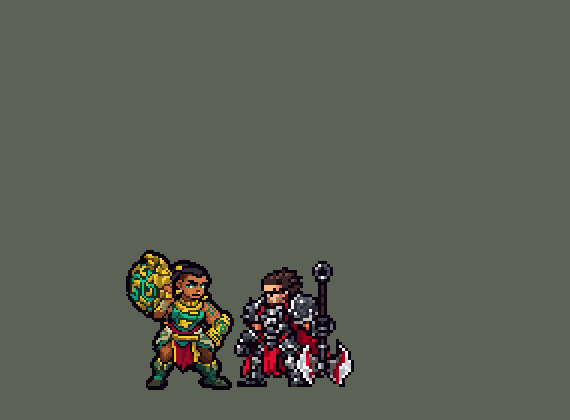

<!-- 本页上半部分由 tools/docs/gen_hero_docs.py 按仓库里现在的数据生成，手改会被覆盖；「开发记录」以下是手写的，生成时原样保留。 -->

# 俄洛伊 Illaoi


| 项目 | 内容 |
|---|---|
| id | `league_illaoi` |
| 所属的包 | 主包（mod_id `league`） |
| 分路 | 上单 |
| 分类 / 标签 | 近战（Melee） · AD / Melee / Tank / Heal / CC |
| 高清帧 | PPU 1.5 |
| 附加包 | [俄洛伊附加包](#附加包)（`league_illaoi`） |



其他预览：[逐帧预览](../preview/league_illaoi_frames.png)、[特效表](../preview/league_illaoi_effects.png)

## 现在的技能

下面是游戏里显示的技能说明（`league/text/champion.i18n` 的简体中文，去掉了颜色和图标），冷却、距离来自 `league/champion/league_illaoi.data_champion`；1 秒 = 60 tick。

### 普攻 / 被动

*攻击间隔 1.33 秒 · 攻击距离 25000*

抡神像砸下。古神先知：普攻时每6秒身前长出触手6秒，每1.5秒抽附近一个敌人10 + 35% 攻击力物理伤害，抽中英雄回复6 + 6% 攻击力生命。

### 技能1 · 严酷训诫

*冷却 1 秒 · 施放距离 45000 · 施放：指定目标 · 敌人（不含防御塔）*

跃向目标，造成30 + 50% 攻击力 + 目标2%最大生命值的物理伤害，她的每条触手都抽他一下。

### 技能2 · 灵魂试炼

*冷却 1 秒 · 施放距离 80000 · 施放：指定目标 · 敌方英雄*

扯出敌方英雄的灵魂5秒：受到的伤害+15%，减速50%；之后成为躯壳4秒，身边长出触手。

### 大招 · 过界信仰

*冷却 40 秒 · 施放距离 40000 · 施放：指定目标 · 敌方英雄*

跃起把神像砸进地里，对周围敌人造成160 + 95% 攻击力物理伤害，每命中一名英雄长出一条触手；8秒内触手每1秒抽一次，严酷训诫冷却1.67秒。

### 数值

攻击力 80（每级 +10）、生命 1150（每级 +110）、护甲 36（每级 +7）、魔抗 28（每级 +4）、移速 1000（每级 +10）。

## 附加包

附加包是可选的原生代码 mod（都在附加包合集 `league_addons` 里），**不装主包里的英雄也是完整的**。

### 俄洛伊附加包

[俄洛伊附加包](../../addons/league_illaoi/README.md)：`league_illaoi` v0.2.17

| 技能 | 主包（纯数据） | 附加包 |
|---|---|---|
| 触手长在哪 | 普攻时长在她身前 `t_place`，躯壳、大招砸中的人身上，活 `t_life` | **按被动自己的冷却长**（1 级 `p_cd_1`、18 级 `p_cd_18`，英雄联盟 20 – 10 秒，不再跟着普攻长），长在她附近最近的**墙边**（`p_reach` 内，没墙就在她身边 `t_place`），**活 `t_long`（60 秒）**、同时最多 `t_most` 条；画面冒出来、摆动（活多久摆多久）、沉下去 |
| 触手抽谁 | 每 `t_per` tick 像炮台一样抽附近的敌人 | **平时不动**（英雄联盟）：严酷训诫打中的人（够得着的每条依次抽一下）、灵魂被扯出来的英雄和躯壳（每 `t_per` tick）；Q 并进被动：她打中敌人时够得着的触手抽一下（`q_cd` 一次）；大招期间每 `r_per` tick 抽附近的敌方英雄 |
| 灵魂分担伤害 | 灵魂在身上时**谁打他**都多 `e_echo`%（`damaged_amplify`） | 只有**她打他的每一下**（普攻和技能，`on_attack`）多算 `e_echo`%，和英雄联盟打灵魂传到本体一样只算她的 |
| 灵魂拉断 | 灵魂画在他身上（被身体挡住），`e_t` tick 到了才变躯壳 | 灵魂**朝她扯出 `e_pull` 站在外面**（`e_soul`），和他之间一直连着**灵魂线**（`e_tether`）；**他走出离灵魂 `e_leash` 外**就立刻变躯壳（播灵魂碎裂、身边长触手）；没走远的到时间也变 |

装上附加包后游戏里显示的说明（和主包不同的部分）：

- **普攻 / 被动**：【附加包】抡神像砸下。古神先知：每20-10秒在她附近的墙边长出触手（没墙就在身边），活60秒、最多4条；只抽被教训的、灵魂和躯壳，她打中敌人时每8秒抽一下，10 + 35% 攻击力物理伤害；抽中英雄回复6 + 6% 攻击力生命。
- **技能2 · 灵魂试炼**：【附加包】扯出敌方英雄的灵魂5秒，灵魂站在外面连着线：她打他多造成15%伤害，减速50%；他走得离灵魂太远或灵魂到时，变成躯壳4秒，身边长出触手。

## 相关脚本和素材

- [`tools/kit/build_illaoi.py`](../../tools/kit/build_illaoi.py)
- [`tools/kit/setup_illaoi.py`](../../tools/kit/setup_illaoi.py)
- [`tools/lol/extract_illaoi.py`](../../tools/lol/extract_illaoi.py)
- [`tools/art/preview_illaoi.py`](../../tools/art/preview_illaoi.py)
- [`tools/art/rig_illaoi.py`](../../tools/art/rig_illaoi.py)
- [`assets/source/illaoi/`](../../assets/source/illaoi)

## 开发记录

> 下面是原来 README 里「英雄：俄洛伊」一节，原样搬过来（只改了相对链接）。

| 部分 | 内容 |
|---|---|
| 定位 | 上单（Melee，标签 AD / Melee / Tank / Heal / CC），第 156 位英雄（H 组第一位）。海兽祭司 俄洛伊：高大结实的女祭司，深棕皮肤、绿眼睛、浓眉、金鼻环，黑发扎成高发髻套着金环、辫子垂在背后，金色护肩和金领圈、青绿胸布、金腰带、暗红腰布、灰绿布裙、墨绿高靴，近侧手臂有青绿螺旋纹身和大金护腕，肩上扛着一尊刻着青绿螺旋眼的大金色神像。技能方案 A（用户选）：严酷训诫 / 灵魂试炼 / 过界信仰，触手猛击（Q）并进被动；附加包「就按这四项做」 |
| 普攻 / 被动 | 抡神像砸下（射程 25000，100% 攻击）。**古神先知**（触手猛击并进来）：普攻时每 6 秒在身前长出一条触手（存在 6 秒，同时最多 4 条，数据没有召唤物，触手是原地的几块区域，黑默丁格炮台的做法）；每条触手每 1.5 秒抽身边 30000 内的一个敌人（先抽英雄），10 + 35% 攻击 物理伤害，抽中英雄她回复 6 + 6% 攻击 生命（英雄联盟回复已损失生命值的 5%，数据读不到已损失生命值） |
| 技能1 | **严酷训诫**（冷却 5 秒，对 `EnemyWithoutTower`、射程 45000：兵线野怪也放）：跃到目标身上砸下，30 + 50% 攻击 + 目标 2% 最大生命值 物理伤害，她站着的每条触手隔 0.1 秒都抽他一下，目标挂 4 秒的「严酷训诫」标记 |
| 技能2 | **灵魂试炼**（冷却 14 秒，射程 80000，只对敌方英雄）：神像里伸出一条幽灵触手飞过去，把他的灵魂扯出来 5 秒：受到的伤害 +15%、减速 50% 1.5 秒；灵魂结束后他成为**躯壳** 4 秒，身边长出一条触手 |
| 大招 | **过界信仰**（冷却 40 秒，射程 40000，对敌方英雄）：跃起把神像砸进地里，周围 45000 内的敌人 90 + 60% 攻击 物理伤害，每砸中一个英雄在他身上长一条触手；之后 8 秒触手每 1 秒抽一次（不再是 1.5 秒），严酷训诫冷却变成 2 秒 |
| 连招 | 「有连招要做连招」：**E → W**：灵魂扯出来时严酷训诫剩下的冷却砍到十分之一，马上跳过去砸；**R → W**：神像砸地时同样；**W → 触手齐抽**：严酷训诫打中的人，她的每条触手都抽他 |
| 数值 | 攻击 80（+10）、生命 1150（+110）、护甲 36（+7）、魔抗 28（+4）、移速 1000（+10）、射程 25000 |
| 平衡 | 经典引擎模拟（上单，对斗士、处刑者、骑士、狂战士、枪兵、长柄武士，两边三套阵容）：草稿（触手 20 + 55%、回血 12 + 12%、W 3%、E +25%、R 120 + 80%）+6.06，太强；三档削弱 +1.39 / −0.69 / −3.01，用第一档：触手 10 + 35%、回血 6 + 6%、W 30 + 50% + 2%、E +15%、R 90 + 60%、触手 6 秒一条、活 6 秒：+1.39 / +1.08（种子 1-8 / 9-16，平均 +1.24；同一批对局奎桑提 +1.34 / +2.19）。大招期间触手只按加快的节奏抽（两套节奏不叠） |
| 附加包 | [`addons/league_illaoi`](../../addons/league_illaoi/README.md)（`league_illaoi` 0.2.1，合集里也有）：**触手贴着墙长**（读这局地图的墙格子，长在离她最近的墙边，附近没墙才长在身前）；**先抽被严酷训诫打中的和躯壳**，严酷训诫新打中谁，附近每条触手依次抽他；**灵魂只传她打的伤害**（`on_attack` 多算 15%，主包是谁打都多 15%）；**灵魂拉断**：他走得离灵魂被扯出来的地方太远就立刻变躯壳。佛耶戈、塞拉斯、凯隐、大招按键的英雄表也加上了她 |
| 精灵图（高清帧 PPU 1.5） | Codex 第 0 步画了 A（四分之三侧面）、SA 和触手 T（正面：特效图两边都不翻转），[`tools/art/design_illaoi_hd.py`](../../tools/art/design_illaoi_hd.py) 按各自的格子读回；用户选「俄洛伊发髻到脚底 42 游戏像素，PPU 1.5，触手 44，只做四分之三侧面」：发髻到脚底 63 行（神像再高 4 行）。第 1 步两稿，用户选 A-2（52 × 68，[`tools/art/design_illaoi_model.py`](../../tools/art/design_illaoi_model.py)，Codex 画得比要的细，按整行整列删到格子数，眼睛下面的绿格改回皮肤），触手 33 × 66。动作：用户「动作帧让 Codex 照骨架画姿势」，[`tools/art/pack_illaoi_poses.py`](../../tools/art/pack_illaoi_poses.py) 按英雄联盟的片段画了 15 个俄洛伊骨架（定稿的骨长：腿 22 格、两臂 19 / 17 格；神像是一个 21 格的金色圆盘，手抓在它边上；Q 版手臂举不到头顶，神像放在头旁边或胸前）和 7 个触手正面姿势；[`tools/art/design_illaoi_poses.py`](../../tools/art/design_illaoi_poses.py) 按头的大小读回、贴回定稿的头（触手按各自的格子读回）。7 张腿画长了或跑步没轮流，[`tools/art/pack_illaoi_legs.py`](../../tools/art/pack_illaoi_legs.py) 出了只重画腿的包，[`tools/art/design_illaoi_legs.py`](../../tools/art/design_illaoi_legs.py) 读回接上。灵魂试炼往回拽那张 Codex 把螺旋纹身画到了远侧手臂上，`rig_illaoi.py` 的 PIXFIX 改回皮肤色；跑步四帧头顶离地 61 / 62 / 61 / 62 行（腾空帧高一行）。[`tools/art/rig_illaoi.py`](../../tools/art/rig_illaoi.py) 照英雄联盟的动作拼：普攻（抡起神像、砸到身前的地上）、严酷训诫（蹲、跃起、落地按住）、灵魂试炼（推出神像、往回拽）、过界信仰（蹲、高高跃起、跪地砸下）、跑步四帧、死亡（神像飞出去、瘫坐）。**触手**两张自己的高清表（PPU 1.5，`league_main` hd.rs EFFECTS）：`league_illaoi_tentacle` 一条触手的一生（钻出、长高、来回摇、缩回地里，6 秒）、`league_illaoi_lash` 扬起来砸到被抽的人身上 |
| 特效 | 15 张特效（[`tools/art/pack_illaoi_fx.py`](../../tools/art/pack_illaoi_fx.py) 的提示词，参考是英雄联盟里俄洛伊自己的贴图），用户交给 Gemini 画回来，[`tools/art/process_illaoi_fx.py`](../../tools/art/process_illaoi_fx.py) 抠背景、按格读回、做对称，[`tools/art/import_illaoi_fx.py`](../../tools/art/import_illaoi_fx.py) 切成 `league_illaoi_fx` / `league_illaoi_big`：神像砸中、触手钻出的青光裂口、触手砸地的冲击和白浪花、抽中的浪花、回血的绿水泡、严酷训诫落地的金色光环、头顶的古神之眼、幽灵触手、被扯出的灵魂、躯壳脚下的印记、灵魂碎裂、减速的水雾、过界信仰的大坑和纹样、大招期间脚下的古神纹样、砸中的光 |
| 音效 | 英雄联盟的音效和配音（[`tools/lol/extract_illaoi.py`](../../tools/lol/extract_illaoi.py)）：普攻和命中、触手钻出和抽中，严酷训诫的出手和命中，灵魂试炼的出手、命中和躯壳，过界信仰的出手、砸地和命中，三句台词 |
| 图标 | 官方技能图标（严酷训诫、灵魂试炼、过界信仰），从本地客户端取 |

重新生成（素材来自本机的英雄联盟客户端，音频不进仓库）：

```bash
python tools/lol/extract_illaoi.py --lol "D:\WeGameApps\lol" --vgmstream <vgmstream-cli.exe>
python tools/kit/build_illaoi.py                     # 技能数据，数字都在脚本的参数表 P 里
python tools/kit/setup_illaoi.py --face 3,-35        # 五种语言的文字、音效配置、共享文件里她的键（脸 3,-35）
python tools/art/design_illaoi_hd.py                 # Codex 第 0 步的原图读回（A、SA、T）
python tools/art/design_illaoi_model.py              # Codex 第 1 步的造型读回（A-2、触手）
python tools/art/design_illaoi_poses.py              # Codex 的姿势读回（贴回定稿的头）
python tools/art/design_illaoi_legs.py               # 腿重画的读回，接回原来的上身
python tools/art/process_illaoi_fx.py --src <放 Gemini 原图 g00.jpg–g14.jpg 的文件夹>
python tools/art/import_illaoi_fx.py                 # 特效 -> league_illaoi_fx / league_illaoi_big
python tools/art/rig_illaoi.py                       # 1 倍帧和 1.5 的原帧，触手的两张高清表
python tools/art/ppu_restyle.py --hero illaoi        # 外描边、脸的位置
python tools/art/ppu_hd.py --hero illaoi             # hd_ / lo_ 帧
python tools/art/hero_reels.py --hero illaoi         # 待机和选人卡片的小动作
python tools/art/preview_illaoi.py                   # 预览和演示 GIF
python addons/league_illaoi/make_override.py         # 附加包的副本
```
