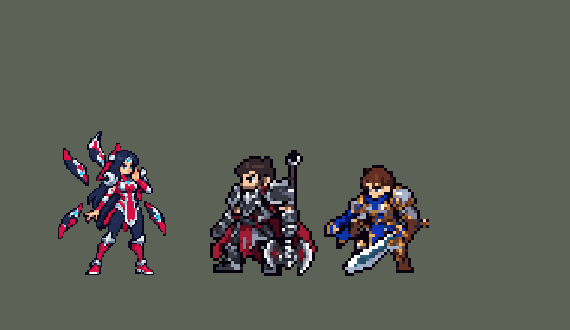

<!-- 本页上半部分由 tools/docs/gen_hero_docs.py 按仓库里现在的数据生成，手改会被覆盖；「开发记录」以下是手写的，生成时原样保留。 -->

# 艾瑞莉娅 Irelia


| 项目 | 内容 |
|---|---|
| id | `league_irelia` |
| 所属的包 | 主包（mod_id `league`） |
| 分路 | 上单 |
| 分类 / 标签 | 近战（Melee） · AD / Melee / CC / Heal |
| 高清帧 | PPU 2（画成 105%） |
| 附加包 | [艾瑞莉娅附加包：Q「利刃冲击」真正的刷新 + 跳兵线](#附加包)（`league_irelia`） |



其他预览：[逐帧预览](../preview/league_irelia_frames.png)、[特效表](../preview/league_irelia_effects.png)

## 现在的技能

下面是游戏里显示的技能说明（`league/text/champion.i18n` 的简体中文，去掉了颜色和图标），冷却、距离来自 `league/champion/league_irelia.data_champion`；1 秒 = 60 tick。

### 普攻 / 被动（被动「艾欧尼亚热诚」）

*攻击间隔 1.03 秒 · 攻击距离 25000*

被动艾欧尼亚热诚：Q命中或技能命中英雄时获得1层，每层攻速+11%，最多4层6秒；满层时普攻额外造成12 + 20% 攻击力物理伤害。

### 技能1 · 利刃冲击

*冷却 7 秒 · 施放距离 45000 · 施放：指定目标 · 敌人（不含防御塔）*

冲向目标造成38 + 80% 攻击力物理伤害并回复10 + 13% 攻击力生命。目标带印记或被击杀时立刻再冲一次，一次最多3段。

### 技能2 · 比翼双刃

*冷却 5 秒 · 施放距离 50000 · 施放：指定目标 · 敌方英雄*

两把飞刃合拢，路线上的敌人受到60 + 80% 攻击力物理伤害并眩晕0.75秒，英雄被印记。冷却时贴身改用距破之舞：蓄力减免50%普攻伤害，再斩出40 + 115% 攻击力物理伤害。

### 大招 · 先锋之刃

*冷却 60 秒 · 施放距离 70000 · 施放：指定目标 · 敌方英雄*

射出刃群，碰到英雄炸开，扇形内敌人受到120 + 85% 攻击力物理伤害、减速70%并缴械1秒，英雄被印记；留下刃墙2.5秒，墙内敌人减速40%。

### 数值

攻击力 85（每级 +17）、生命 980（每级 +102）、护甲 32（每级 +8）、魔抗 25（每级 +4）、移速 1000（每级 +11）。

## 附加包

附加包是可选的原生代码 mod（都在附加包合集 `league_addons` 里），**不装主包里的英雄也是完整的**。

### 艾瑞莉娅附加包：Q「利刃冲击」真正的刷新 + 跳兵线

[艾瑞莉娅附加包：Q「利刃冲击」真正的刷新 + 跳兵线](../../addons/league_irelia/README.md)：`league_irelia` v0.1.3

- E「比翼双刃」、R「先锋之刃」打中英雄时，在**她自己身上**挂一面旗子 `mk` 代替印记，下一次 Q 施放时附近有敌方英雄就算「打到了带印记的」；
- Q 打死目标靠 league_jinx 的击杀触发器（一个 3 tick 的持续效果在目标活着时拿掉旗子）近似。

## 相关脚本和素材

- [`tools/kit/build_irelia.py`](../../tools/kit/build_irelia.py)
- [`tools/kit/setup_irelia.py`](../../tools/kit/setup_irelia.py)
- [`tools/lol/extract_irelia.py`](../../tools/lol/extract_irelia.py)
- [`tools/art/preview_irelia.py`](../../tools/art/preview_irelia.py)
- [`tools/art/import_irelia.py`](../../tools/art/import_irelia.py)
- [`assets/source/irelia/`](../../assets/source/irelia)

## 开发记录

> 下面是原来 README 里「英雄：艾瑞莉娅」一节，原样搬过来（只改了相对链接）。

| 部分 | 内容 |
|---|---|
| 定位 | 上单（Melee，标签 AD / Melee / CC / Heal），第 91 位英雄。刀锋舞者 艾瑞莉娅：用意念驱动身边浮着的四把刀（用户的造型：「英雄联盟里面刀妹是通过意念驱动身后的武器来攻击的」），Q 冲刺遇到印记或击杀就再冲，E 两刀合拢眩晕一条线，R 刀群打中英雄后炸开、缴械，留下一圈刀墙。用户的选择：技能都按推荐（W 并进 E 的技能位、Q 的真实刷新做成附加包） |
| 普攻 | 浮刀飞过去砍一下，攻击距离 25000，第 8 tick 命中，攻击间隔 62 tick |
| 被动 | 「艾欧尼亚热诚」：Q 每打中一个单位、E / W / R 每打中一个英雄叠一层，每层攻速 +11%，最多 4 层 360 tick（6 秒）；满层时普攻额外造成 12 + 20% 攻击力物理伤害，身边的刀发青光 |
| 技能1 | Q「利刃冲击」：冷却 420 tick（7 秒），冲向 45000 内的敌人（小兵野怪也算），38 + 80% 攻击力物理伤害并回复 10 + 13% 攻击力生命；目标带印记（E、R 打中的英雄）或被这一下打死时立刻再冲一段（先找被控的英雄，再找英雄，再找最近的单位），一次施放最多 3 段。主包里印记和击杀是近似判断（数据读不到目标身上的 buff）；附加包 [`addons/league_irelia`](../../addons/league_irelia/README.md)（在附加包合集里）换成真实印记和真实击杀，还会借能一刀打死的小兵跳向英雄 |
| 技能2 | E「比翼双刃」：冷却 720 tick（12 秒），对 50000 内的敌方英雄放，一把刀插在她脚边、一把在目标身后，第 18 tick 会合：从她穿过目标长 80000 的一条线上，敌人受到 60 + 80% 攻击力物理伤害并眩晕 45 tick（0.75 秒），英雄被打上印记（5 秒）。E 冷却时这个技能位放 W「距破之舞」：冷却 720 tick，蓄力 32 tick（期间受到的普攻伤害减半），再沿直线 55000 斩出一刀，40 + 115% 攻击力物理伤害 |
| 大招 | R「先锋之刃」：冷却 3600 tick（60 秒），两个敌方英雄在 70000 内或一个英雄被控时立刻放，否则蓄着等普攻时再判；刀群（每 tick 6000，飞 85000）碰到第一个英雄停下炸开：身后 35000 的扇形里敌人受到 120 + 85% 攻击力物理伤害、减速 70% 并缴械 60 tick，英雄被打上印记；再留下半径 30000 的刀墙 150 tick（2.5 秒），墙里的敌人减速 40%。R 放出后若 E 好了，紧接着对射程内的英雄放 E |
| 数值 | 攻击 85（+17）、生命 980（+102）、护甲 32（+8）、魔抗 25（+4）、移速 1000（+11），攻击间隔 62 tick。对战模拟（上路对 6 个基础上单 × 3 套阵容 × 两边 × 两批各 24 个种子，每局 600 秒；用户：「然后你跑平衡吧」）：第一版击杀差 −0.28，明显比本包其他上单弱（鳄鱼 +1.43、格温 +1.32、剑姬 +1.40，两批平均）；Q、E、R、W 倍率、被动攻速、Q 回血、攻击和生命一起加强后 +1.67 / +1.29（平均 +1.48），对 6 个对手都占优（最低对 lancer +0.5） |
| 精灵图 | 9 个动作 51 帧，Codex 照用户的新造型（浮刀、空手）重画的动作稿，在原稿自己的网格上读回（84 行，用户：「这个最完美」），按 2:1 缩成游戏尺寸，再逐帧对着原稿手修（`assets/source/irelia/design_v2/frames/`）。所有帧用同一张正脸（「在正脸的基础上 做后续的run动作不就行了吗」「剑姬卡密尔都没单独做侧面啊」），脸按原稿 1:1 保留、只压缩头发；待机是手画的身体，四把刀错开上下浮动；跑步是待机的上半身配交叉步的腿（女警、泽丽的做法）|
| 高密度帧 | 主包的 PPU（league.dll）：刀妹 PPU 2（2026-10-13 放大 15%，用户：「刀妹在游戏里看着也太小了啊」「就用1.15」：hd.rs SIZES 1.15 由 league.dll 放大，帧逐像素不变、整体上移 3 格让脚踩在地上——先试过重新取样，深藏青的头发和衣服发暗，「刀妹有点怪啊」；头像中心点 (0, −31) → (0, −37)），`hd_<动作>` 直接用 Codex 原稿（读回 84 行，正好是 1x 的两倍），头身比例照原稿，所有帧贴同一张 idle 原稿的脸；跑步照 1x 的做法用原稿的上半身配交叉步的腿（`tools/art/ppu_irelia.py` → `assets/source/ppu/irelia_<动作>.png`，`tools/art/ppu_hd.py` 放进她的图集） |
| 特效 | Codex 生图的 18 张（游戏尺寸版逐格切，`import_irelia.py`；E、W 的线和 R 的刀群上下对称，其余左右对称）：都是她自己的刀和绯红、青色的光——普攻 / 满层被动 / Q / E / W / R 的打中、满层青光、印记、眩晕、E 脚下出手和两刀会合的线、W 护身的两把刀 / 出手 / 刀光、R 飞出的刀群、刀墙和两种减速 |
| 音效 | 英雄联盟的音效和配音，版权属于 Riot Games，**不提交到仓库**，本地生成 |

重新生成：

```bash
python tools/kit/build_irelia.py           # 技能数据，数字都在脚本的参数表 P 里
python tools/kit/setup_irelia.py           # 五种语言的文字、音效配置、共享文件里她的键
python tools/art/strips_irelia.py          # 动作：读回 Codex 的动作稿、2:1、贴脸、读入手修的帧；--base 写出自动底稿
python tools/art/import_native.py --hero irelia
python tools/art/ppu_irelia.py             # PPU 2 的高密度条带（再跑一次 import_native 放进图集）
python tools/art/import_irelia.py          # 特效
python addons/league_irelia/make_override.py   # 附加包的副本（主包的艾瑞莉娅改了就重跑）
python tools/art/preview_irelia.py         # 预览和演示 GIF（她按游戏里的样子画：hd_ 帧、PPU 2）
```

美术提示词见 [`assets/source/irelia/`](../../assets/source/irelia)（`PROMPTS_FX.md` 是特效）。

逐帧预览：[`docs/preview/league_irelia_frames.png`](../preview/league_irelia_frames.png?v=1014g)（1x 和游戏里用的 hd_ 高密度帧），特效：[`docs/preview/league_irelia_effects.png`](../preview/league_irelia_effects.png?v=1014g)。
