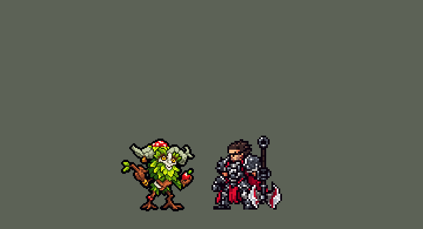

<!-- 本页上半部分由 tools/docs/gen_hero_docs.py 按仓库里现在的数据生成，手改会被覆盖；「开发记录」以下是手写的，生成时原样保留。 -->

# 艾翁 Ivern


| 项目 | 内容 |
|---|---|
| id | `league_ivern` |
| 所属的包 | 主包（mod_id `league`） |
| 分路 | 打野 |
| 分类 / 标签 | 功能型（Util） · AP / Magic / Range / CC / Shield |
| 高清帧 | PPU 1.5 |
| 附加包 | [艾翁附加包](#附加包)（`league_ivern`） |



其他预览：[逐帧预览](../preview/league_ivern_frames.png)、[特效表](../preview/league_ivern_effects.png)

## 现在的技能

下面是游戏里显示的技能说明（`league/text/champion.i18n` 的简体中文，去掉了颜色和图标），冷却、距离来自 `league/champion/league_ivern.data_champion`；1 秒 = 60 tick。

### 普攻 / 被动

*攻击间隔 1.33 秒 · 攻击距离 47500*

扔出一颗种子。揠苗助攻：每次种豆得瓜都在脚下长出草丛4秒，草丛里的队友攻击+15%，他自己的普攻追加15 + 15% 法强魔法伤害。

### 技能1 · 种豆得瓜

*冷却 1 秒 · 施放距离 50000 · 施放：指定目标 · 敌人（不含防御塔）*

给身边的队友（没有就给自己）种下种子：护盾60 + 45% 法强，2秒后爆开，对周围敌人造成50 + 50% 法强魔法伤害并减速50%。

### 技能2 · 根深敌固

*冷却 1 秒 · 施放距离 75000 · 施放：指定目标 · 敌人（不含防御塔）*

甩出荆棘藤，造成60 + 50% 法强魔法伤害并禁锢1.25秒；身边的队友移速+35%冲过去。

### 大招 · 小菊！

*冷却 40 秒 · 施放距离 70000 · 施放：指定目标 · 敌方英雄*

召唤小菊落到敌方英雄身上，击飞并造成60 + 40% 法强魔法伤害；之后8秒内每秒一拳25 + 20% 法强，每第三拳砸地再加40 + 30% 法强并击飞。

### 数值

攻击力 60（每级 +6）、法强 40（每级 +20）、生命 950（每级 +95）、护甲 24（每级 +7）、魔抗 22（每级 +4）、移速 1000（每级 +10）。

## 附加包

附加包是可选的原生代码 mod（都在附加包合集 `league_addons` 里），**不装主包里的英雄也是完整的**。

### 艾翁附加包

[艾翁附加包](../../addons/league_ivern/README.md)：`league_ivern` v0.2.0

| 技能 | 主包（纯数据） | 附加包 |
|---|---|---|
| 揠苗助攻 | 长草那一刻身边的队友攻击 +`w_atk`%，持续 `w_t` tick | 草丛记在他长草的地方（半径 `w_r`、`w_t` tick 后枯掉，他死了也还在）；**站在里面**的队友每 tick 续上攻击 +`w_atk`%；站在里面的每个英雄（两边都算）挂 2 tick 的 `league_ivern_in_brush` |
| 联动 | — | 雷恩加尔（`league_rengar_bush` 0.1.2 起）身上有这个标记就算站在草丛里，能扑；奇亚娜（`league_qiyana` 0.2.1 起）突进落地时身上有它就算身边有草，拿草元素 |
| 小菊！（0.2.0） | 落在敌方英雄身上，之后 8 秒是挂在他身上的画面和伤害（每秒一拳，每第三拳砸地击飞），打不到、不会走 | 真的单位（`spawn_unit`，单位图 `league_ivern_daisy`）：落下以后站在他身后，自己走、自己打，生命是艾翁上限的 120%，能被打死，连着打同一个英雄的第三拳砸地击飞；生成不了就照旧挂在他身上 |

装上附加包后游戏里显示的说明（和主包不同的部分）：

- **普攻 / 被动**：【附加包】扔出一颗种子。揠苗助攻：每次种豆得瓜都在脚下长出一片真正的草丛4秒，站在里面的队友攻击+15%，雷恩加尔能从里面扑出去，奇亚娜能从里面拿草元素；他自己的普攻追加15 + 15% 法强魔法伤害。
- **大招 · 小菊！**：【附加包】召唤小菊落到敌方英雄身上，击飞并造成60 + 40% 法强魔法伤害；之后她留在场上、能被击杀，8秒内每秒一拳25 + 20% 法强，打同一个英雄每第三拳砸地再加40 + 30% 法强并击飞。

## 相关脚本和素材

- [`tools/kit/build_ivern.py`](../../tools/kit/build_ivern.py)
- [`tools/kit/setup_ivern.py`](../../tools/kit/setup_ivern.py)
- [`tools/lol/extract_ivern.py`](../../tools/lol/extract_ivern.py)
- [`tools/art/preview_ivern.py`](../../tools/art/preview_ivern.py)
- [`tools/art/rig_ivern.py`](../../tools/art/rig_ivern.py)
- [`assets/source/ivern/`](../../assets/source/ivern)

## 开发记录

> 下面是原来 README 里「英雄：艾翁」一节，原样搬过来（只改了相对链接）。

| 部分 | 内容 |
|---|---|
| 定位 | 打野（Util，标签 AP / Magic / Range / CC / Shield），第 155 位英雄（G 组；计划里是辅助替补，用户选了打野）。翠神 艾翁：会走路的树人，浅灰白树皮的小圆脸、琥珀色眼睛、大鼻子、咧嘴笑，一大把亮绿树叶胡子，两只浅灰绿羊角，头顶红色白点蘑菇，耳边挂个小木环，棕色木头身子、树叶裙和一道白布条，一手带两片叶子的小树枝（手腕两道金环）、一手红苹果，深红棕树皮腿和分叉的根脚、近侧小腿上长着红浆果。技能方案 A（用户选）：种豆得瓜 / 根深敌固 / 小菊！，揠苗助攻并进被动；附加包「需要就做」 |
| 普攻 / 被动 | 扔出一颗发光的种子（射程 47500，100% 攻击）。**揠苗助攻**并进被动：每次种豆得瓜在脚下长出草丛 4 秒（半径 26000），长草那一刻草里的队友攻击 +15%（持续 4 秒），他自己 4 秒内的普攻追加 15 + 15% 法强 魔法伤害。英雄联盟的森林之友（野怪营地长小植被）在团战经理里没有可落的地方，被动就是揠苗助攻 |
| 技能1 | **种豆得瓜**（冷却 9 秒，对 `EnemyWithoutTower`、射程 50000：野怪兵线也放）：身边 45000 内最近的友方英雄（没有就是他自己，打野时多半如此）得到 60 + 45% 法强 的护盾、胸口一颗种子，2 秒后在那人身上爆开，周围 22000 的敌人 50 + 50% 法强 魔法伤害、减速 50% 1.5 秒（护盾分数对谁都一样，所以对着敌人放、再交给队友，迦娜 E 的做法）。每次放都长一丛揠苗助攻的草 |
| 技能2 | **根深敌固**（冷却 11 秒，射程 75000，对 `EnemyWithoutTower`）：甩出荆棘藤追着目标，60 + 50% 法强 魔法伤害、禁锢 1.25 秒；身边 60000 内的队友移速 +35% 1.5 秒冲上去（英雄联盟队友可以直接突进到被禁锢的人身边，数据做不出位移） |
| 大招 | **小菊！**（冷却 40 秒，射程 70000，只对敌方英雄；安妮提伯斯的做法）：小菊从目标身后的地里钻出来，60 + 40% 法强 魔法伤害并击飞；之后 8 秒每秒一拳 25 + 20% 法强，每第三拳双拳砸地再加 40 + 30% 法强 并击飞；目标死了小菊就走，活到最后她挥挥手沉回地里。小菊画在目标身后（被目标挡在前面），打中的那一下落在她出拳的帧上 |
| 连招 | 「有连招要做连招」：**Q → E**：荆棘藤打中时种豆得瓜好了就马上放（种子给身边的队友、爆炸落在被缠住的人身上）；**R → Q**：小菊落地 0.13 秒后，根深敌固好了就把同一个英雄缠住 |
| 数值 | 攻击 60（+6）、法强 40（+20）、生命 950（+95）、护甲 24（+7）、魔抗 22（+4）、移速 1000（+10）、射程 47500 |
| 平衡 | 经典引擎模拟（打野，对忍者、恶魔、猎人、狼人、吸血鬼，两边三套阵容）：草稿 +0.88 / +1.95（种子 1-8 / 9-16，平均 +1.42；同一天原版猎人 +0.59）；追踪的对局里护盾给队友、给自己、爆炸、禁锢、小菊的拳和砸地、两个连招、草丛加成全都出现；画面和出手时间定稿、禁锢改成 1.5 秒后 +2.67 太强，禁锢 80 tick +1.79，Q 55 + 45%、禁锢 1.25 秒 +1.35，定稿 Q 60 + 50%、禁锢 1.25 秒 +1.74 / +1.57（平均 +1.66，彗定稿 +1.60）。补刀偏少（每局 33，原版猎人 48），靠帮队友打架赢（每局 5.4 次助攻） |
| 附加包 | [`addons/league_ivern`](../../addons/league_ivern/README.md)（`league_ivern` 0.1.0，合集里也有）：揠苗助攻的草丛记在长草的地方，**站在里面**的队友每 tick 续上攻击加成；站在里面的英雄（两边都算）挂 2 tick 的 `league_ivern_in_brush`：**雷恩加尔**（`league_rengar_bush` 0.1.2）站在里面能扑（用户：「还有艾翁的W能触发雷恩加尔的跳 别忘了」），**奇亚娜**（`league_qiyana` 0.2.1）突进落地时身上有它就拿草元素（用户：「还有奇安娜也可以触发元素 艾翁的这个草 你们两可以联动一下」）。佛耶戈、塞拉斯、凯隐、大招按键的英雄表也加上了他 |
| 精灵图（高清帧 PPU 1.5） | Codex 第 0 步画了 A（四分之三侧面）、SA 和小菊 D，[`tools/art/design_ivern_hd.py`](../../tools/art/design_ivern_hd.py) 按各自的格子读回；用户选「艾翁蘑菇顶到脚底 40 游戏像素，小菊 40，PPU 1.5，只做四分之三侧面」：60 行。第 1 步两稿，用户选 A-2（61 × 60，[`tools/art/design_ivern_model.py`](../../tools/art/design_ivern_model.py)），小菊用不裁的原样（95 × 76，PPU 1.9）。动作：用户「动作帧让gpt做吧」，[`tools/art/pack_ivern_poses.py`](../../tools/art/pack_ivern_poses.py) 按英雄联盟的片段画了 15 个艾翁骨架（定稿的骨长：腿 16 格，拿树枝的手臂 27 格、拿苹果的 18 格）和 6 个小菊正面姿势；[`tools/art/design_ivern_poses.py`](../../tools/art/design_ivern_poses.py) 按头的大小读回、贴回定稿的头。站着的 11 张腿又画长了（21–25 格），[`tools/art/pack_ivern_legs.py`](../../tools/art/pack_ivern_legs.py) 出了只重画腿的包（上身逐格保留、按定稿腿长的骨架，跑步四帧两腿轮流），[`tools/art/design_ivern_legs.py`](../../tools/art/design_ivern_legs.py) 读回接上。[`tools/art/rig_ivern.py`](../../tools/art/rig_ivern.py) 照英雄联盟的动作拼：普攻（扬枝蓄力、远侧手扔种子；Codex 的普攻蓄力把树枝画到了另一只手，改用 Q 的蓄力帧）、种豆得瓜（蹲下捧种、抬手抛出）、根深敌固（拧身扬枝、大步甩藤）、大招（蹲下、跳起举枝召唤、落地举枝）、跑步四帧、死亡（踉跄、苹果掉落、瘫坐：头整块贴上去、横躺不了）。**小菊**四张自己的高清表（PPU 1.9，`league_main` hd.rs EFFECTS，黑默丁格炮台的做法）：从地里钻出、举拳砸下、双拳举起砸地、挥手沉下；脚站在目标脚底往后 9 个游戏像素（提伯斯的 9） |
| 特效 | 15 张特效（[`tools/art/pack_ivern_fx.py`](../../tools/art/pack_ivern_fx.py) 的提示词，参考是英雄联盟里艾翁自己的贴图），Codex 画、按格取好色（`pixel_1x`），[`tools/art/import_ivern_fx.py`](../../tools/art/import_ivern_fx.py) 检查对称后切成 `league_ivern_fx` / `league_ivern_big`：发光的种子和它的爆开、草丛 4 秒（长出、随风摇、缩回）、草里的魔法伤害、队友脚下的叶子、种子护盾 2 秒、护盾爆开、减速的嫩藤、荆棘藤和它的缠绕、缠腿的荆棘、冲刺的叶旋风、小菊钻地的尘土、砸地的冲击波、拳头打中的石屑 |
| 音效 | 英雄联盟的音效和配音（[`tools/lol/extract_ivern.py`](../../tools/lol/extract_ivern.py)）：普攻和命中、草丛长出，种豆得瓜的出手、爆开和命中，根深敌固的出手和命中，小菊！的出手、钻出、出拳和砸地，三句台词 |
| 图标 | 官方技能图标（种豆得瓜、根深敌固、小菊！），从本地客户端取 |
| 动作补帧（2026-11-14） | 用户：「还有有的动画感觉只有一帧 不如oppi的地方都要补 参考联盟的动画」。对照表里他的普攻 4 帧只有 3 个不同的姿势，种豆得瓜、根深敌固各 3 帧但只有 2 个（出手那张放了两遍），阵亡 4 帧只有 2 个。没有新画，也没交给 Codex：[`tools/art/inbetween.py`](../../tools/art/inbetween.py) 用他已有的关键姿势做中间帧——伸在角外面的那条枝条手臂绕肩膀转一个角度（放大 8 倍、转过去、再缩回原来的格子，只用这一块自己的颜色，接口藏在叶子后面）；阵亡时掉下的苹果按它在图里自己连着的那片整格往下落。举在角前面的手臂（根深敌固的蓄力、小菊！）不转：手臂底下的角没画，转开会露出缺口。头（蘑菇、角、脸）和这几块以外的身体逐格不变（[`tools/art/rig_ivern.py`](../../tools/art/rig_ivern.py) 每一帧都核对，部件的格子先减掉头的格子）。下面写的是「几帧，其中几个不同的姿势」：同一张图整个挪几格不算新姿势。**普攻** 4 帧（3 个姿势）→ 5 帧，其中 5 个不同的姿势：蓄力；扔的时候手还高着（还差 25 度，120 毫秒）、扔出、手往下带 12 度；回待机。**种豆得瓜** 3 帧（2 个姿势）→ 4 帧，其中 4 个：蹲着捧种子；手臂抬起来（还差 30 度，140 毫秒）、递出、手再往上 10 度。**根深敌固** 3 帧（2 个姿势）→ 4 帧，其中 4 个：蓄力；甩过来时枝条还高着（还差 30 度，130 毫秒）、甩出、往下带 12 度。**阵亡** 4 帧（2 个姿势）→ 5 帧，其中 3 个不同的姿势：受击、苹果还在往下掉（两步，身子是同一张）；坐倒（340 毫秒，同一张离地 3 格）、坐定。每个动作总时长不变，括号里的起点都是原来的毫秒数，没有短于 50 毫秒的帧，技能数据没改；跑步、待机、受击、小菊！和小菊自己的特效表逐帧没变。每帧 3 倍看过，转过的 5 倍看过。图集 1953×410 → 2029×492，选人格子用的那张 0.52 → 0.88 MiB。游戏里还没看过 |
| 小菊是真的单位（附加包 0.2.0，2026-11-14） | 用户看了「和英雄联盟不一样的地方」清单后说「全改吧」（其中一条是「召唤物不会走、不会打、打不掉」），之后「召唤物的全做啊」。英雄联盟（wiki 现行页面）：小菊落在艾翁身前，最多留 45 秒，有自己的生命（1000–4400 + 50% 法强）、护甲、魔抗，自己走、自己打最近的敌人，敌人打得到、打得死；连续三下打同一个英雄时第三下是一道冲击波，击飞（晕眩）1 秒。这里原来她钻在敌方英雄身后，8 秒是挂在他身上的画面和伤害（每秒一拳 25 + 20% 法强，每第三拳砸地再加 40 + 30% 并击飞），打不到、不会走，他死了她就走。现在只在附加包里（主包的数据没动，主包多一张单位图 `league/champions/league_ivern_daisy`）：落下那一下还是数据（伤害、击飞、R → Q）；落下的画面放完（0.9 秒）附加包在画面里她站的地方用稳定 mod API 的 `spawn_unit` 生成一个叫 `league_ivern_daisy` 的单位，活 480 tick（挂在身上那个的 8 秒），生命是艾翁上限的 120%、护甲魔抗 +20、移速是他的 130%（英雄联盟 430 对他 330），每拳 25 + 20% 法强（单位的普攻是物理伤害），每 60 tick 一拳；成功了给艾翁挂 `league_ivern_d_unit`，副本里那串拳和最后挥手的画面每一次都先看它，有就不放（AI 估伤害时没有这个标记，看到的还是原来那一支）。第三拳：被动听得到她的出拳就数她连着打同一个英雄的次数，听不到就按她的出拳节奏数，第三拳补 40 + 30% 法强魔法伤害并击飞 50 tick。单位图（`tools/art/unit_ivern_daisy.py`）用她自己的帧做：站立、拳（四帧）、挥手沉进地里（死亡），走路是用站立那一帧按整像素挪出来的四帧（正面看：两脚落地时身子沉一格，轮流抬起一条小腿两格、身子往另一边歪一格），8 倍看过；1 倍帧和 PPU 1.333 的高清帧都有，和今天的画面一样高（57 游戏像素）——`league.dll` 登记之前画 1 倍帧。伤害的账：原来 6 拳 + 3 次砸地 = 345 + 270% 法强；现在落下时那一拳（数据）+ 一直够得着时 8 拳 + 2 次砸地 = 305 + 240%（0.88 倍），换来一个能挡伤害、能被打死、会走的小菊。生成不了就照旧挂在目标身上。经典引擎模拟（附加包的副本，打野，种子 1–8，240 局）改前改后一模一样：击杀差 +1.53，伤害 5266，每局 R 5.6 次——经典引擎不跑原生代码，标记不会出现，走的是原来那一支；单位本身量不出来。没做的：不能指挥（API 没有下命令的接口）；砸地只打那个英雄、不是一条冲击波；单位的普攻是物理伤害；艾翁死后小菊接着打，但没有第三拳的击飞。游戏里还没看过：看 `league_ivern.log` 的 `DAISY` 行 |

重新生成（素材来自本机的英雄联盟客户端，音频不进仓库）：

```bash
python tools/lol/extract_ivern.py --lol "D:\WeGameApps\lol" --vgmstream <vgmstream-cli.exe>
python tools/kit/build_ivern.py                      # 技能数据，数字都在脚本的参数表 P 里
python tools/kit/setup_ivern.py --face 4,-29         # 五种语言的文字、音效配置、共享文件里他的键（脸 4,-29）
python tools/art/design_ivern_hd.py                  # Codex 第 0 步的原图读回（A、SA、D）
python tools/art/design_ivern_model.py               # Codex 第 1 步的造型读回（A-2、小菊原样）
python tools/art/design_ivern_poses.py               # Codex 的姿势读回（贴回定稿的头）
python tools/art/design_ivern_legs.py                # 腿重画的读回，接回原来的上身
python tools/art/import_ivern_fx.py                  # 特效 -> league_ivern_fx / league_ivern_big
python tools/art/rig_ivern.py                        # 1 倍帧和 1.5 的原帧，小菊的四张高清表
python tools/art/ppu_restyle.py --hero ivern         # 外描边、脸的位置
python tools/art/ppu_hd.py --hero ivern              # hd_ / lo_ 帧
python tools/art/hero_reels.py --hero ivern          # 待机和选人卡片的小动作
python tools/art/preview_ivern.py                    # 预览和演示 GIF
python addons/league_ivern/make_override.py          # 附加包的副本
```
