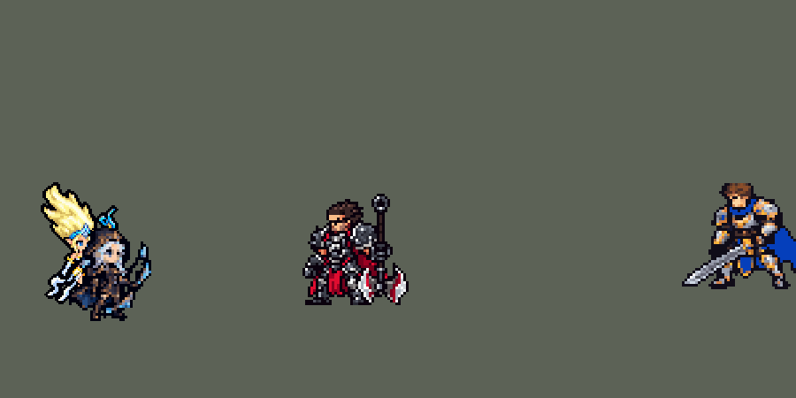

<!-- 本页上半部分由 tools/docs/gen_hero_docs.py 按仓库里现在的数据生成，手改会被覆盖；「开发记录」以下是手写的，生成时原样保留。 -->

# 迦娜 Janna


| 项目 | 内容 |
|---|---|
| id | `league_janna` |
| 所属的包 | 主包（mod_id `league`） |
| 分路 | 辅助 |
| 分类 / 标签 | 功能型（Util） · AP / Magic / CC / Shield / Heal |
| 高清帧 | PPU 1.5 |
| 附加包 | [辅助挑人附加包：迦娜、娑娜、璐璐](#附加包)（`league_support_pick`）、[游戏 AI 不按的技能替它按](#附加包)（`league_ult_press`） |



其他预览：[逐帧预览](../preview/league_janna_frames.png)、[特效表](../preview/league_janna_effects.png)

## 现在的技能

下面是游戏里显示的技能说明（`league/text/champion.i18n` 的简体中文，去掉了颜色和图标），冷却、距离来自 `league/champion/league_janna.data_champion`；1 秒 = 60 tick。

### 普攻 / 被动（被动「顺风而行」）

*攻击间隔 1.5 秒 · 攻击距离 60000*

普攻吹出一道风弹，造成100% 攻击力的物理伤害。被动 顺风而行：战斗中，她和身边的友方英雄移动速度提高8%。

### 技能1 · 飓风呼啸

*冷却 9 秒 · 施放距离 75000 · 施放：方向 · 敌人（不含防御塔）*

放出一道龙卷风，对直线上的敌人造成80 + 60% 法术强度的魔法伤害，并击飞0.75秒。

### 技能2 · 风暴之眼

*冷却 5 秒 · 施放距离 90000 · 施放：指定目标 · 敌方英雄*

对一名敌方英雄放出和风守护，造成60 + 40% 法术强度的魔法伤害并减速30%，持续2秒。同时以风暴之眼为身边一名友方英雄提供150 + 75% 法术强度的护盾，持续4秒，护盾存在时攻击力提高15%；身边没有队友时护住自己。

### 大招 · 复苏季风

*冷却 50 秒 · 施放距离 40000 · 施放：指定目标 · 友方英雄*

击退身边的敌人，然后引导3秒，每秒为身边的友方英雄（包括自己）回复130 + 50% 法术强度的生命值，共4次。受到控制或阵亡时中断。

### 数值

攻击力 80（每级 +6）、法强 30（每级 +15）、生命 900（每级 +80）、护甲 20（每级 +8）、魔抗 20（每级 +4）、移速 1000（每级 +10）。

## 附加包

附加包是可选的原生代码 mod（都在附加包合集 `league_addons` 里），**不装主包里的英雄也是完整的**。

### 辅助挑人附加包：迦娜、娑娜、璐璐

[辅助挑人附加包：迦娜、娑娜、璐璐](../../addons/league_support_pick/README.md)：`league_support_pick` v0.1.0

| 英雄 | 主包（纯数据） | 装了附加包 |
|---|---|---|
| 迦娜 E 风暴之眼（50000 内） | 随机一名队友 | 有危险的队友（生命不高于 50%，或身边 25000 内有 2 个以上敌方英雄）里生命比例最低的；都没危险就给离敌方英雄最近的（正在打的那个） |

### 游戏 AI 不按的技能替它按

[游戏 AI 不按的技能替它按](../../addons/league_ult_press/README.md)：`league_ult_press` v0.5.7（通用附加包，下面只列和迦娜有关的部分）

|  | 装了附加包，什么时候按 |
|---|---|
| 迦娜 R | 她或身边 40000 内的队友**生命不到 35%** 而 50000 内有敌方英雄，或**两人以上生命不到 60%** 而她身边有敌方英雄。对生命最低的那位放（治疗是她身边一圈，对谁放都一样） |

## 相关脚本和素材

- [`tools/lol/extract_janna.py`](../../tools/lol/extract_janna.py)
- [`tools/art/preview_janna.py`](../../tools/art/preview_janna.py)
- [`tools/art/import_janna.py`](../../tools/art/import_janna.py)
- [`assets/source/janna/`](../../assets/source/janna)

## 开发记录

> 下面是原来 README 里「英雄：迦娜」一节，原样搬过来（只改了相对链接）。

| 部分 | 内容 |
|---|---|
| 定位 | 辅助（Util），第三组的辅助，本包第三个辅助（索拉卡、蕾欧娜之后） |
| 普攻 | 吹出一道风弹，100% 攻击力的物理伤害 |
| 被动 | 「顺风而行」：战斗中她和身边（半径 40000）的友方英雄移速 +8%。引擎没有常驻光环，做成和阿木木「绝望」一样的脉冲：她每次出手（普攻、Q、E）开始一串 4 秒的脉冲（正在进行就不重开），每秒给范围内的友方英雄挂 1 秒加速。英雄联盟里她的普攻还按额外移速附加魔法伤害，这里不做 |
| 技能1 | Q「飓风呼啸」：朝目标方向吹出龙卷风，0.57 秒沿直线走 85000（半径 10000），穿过的敌人受到 80 + 60% 法术强度的魔法伤害并被击飞 0.75 秒。射程 75000，冷却 9 秒，也对小兵和野怪放。英雄联盟里可以蓄力，蓄得越久吹得越远、击飞越久；这里不蓄力 |
| 技能2 | E「风暴之眼」：对一名敌方英雄（射程 90000）放出 W「和风守护」的风灵，造成 60 + 40% 法术强度的魔法伤害并减速 30%，持续 2 秒；同时给自己身边（半径 50000）一名其他友方英雄 150 + 75% 法术强度的护盾 4 秒，护盾存在时攻击力 +15%，身边没有队友时护住自己。冷却 5 秒。英雄联盟里 E 直接放在队友身上；可引擎给护盾估值时不看目标（期望值只算护盾量），放在队友身上的 E 会在没打架时一冷却好就放掉。改成对敌方英雄施放后，只有敌方英雄在 90000 内才放，护盾出现在交战时。W 的被动（加移速）不做 |
| 大招 | R「复苏季风」：把身边（半径 40000）的敌人往外吹开，然后原地引导 3 秒，每秒给范围内的友方英雄（包括自己）回复 130 + 50% 法术强度的生命，共 4 次。被眩晕、禁锢、击飞、击退、恐惧、魅惑或阵亡时中断（和厄运小姐的 R 一样，每次治疗前先检查自己是否被控制）。施放目标是身边的友方英雄，AI 按治疗量和对方缺的血估值，所以队友受伤时才放。冷却 50 秒 |
| 附加包 | 可选的附加包 [`addons/league_support_pick`](../../addons/league_support_pick/README.md)（在附加包合集里，原生代码，主包不装它也完整）：E 风暴之眼的护盾照英雄联盟给 50000 内最需要的队友（生命不高于 50% 或被 2 个以上敌方英雄围住的里生命比例最低的；都没危险就给离敌方英雄最近、正在打的那个；主包随机一名） |
| 附加包（替 AI 按） | 可选的附加包 [`addons/league_ult_press`](../../addons/league_ult_press/README.md)（在附加包合集里，原生代码，主包不装它也完整）：游戏 0.6.4 的 AI 从来不按她的 R（只读观察包：113 局 0 次）。附加包按局面替 AI 按（用户：「有问题的英雄全部改成rust」）：她或身边 40000 内的队友生命不到 35% 而 50000 内有敌方英雄，或两人以上生命不到 60% 而她身边有敌方英雄 |
| 数值 | 攻击 80（+6）、法术强度 30（+15）、生命 900（+80）、护甲 20（+8）、魔抗 20（+4）、移速 1000（+10），射程 60000，攻击间隔 1.5 秒，和原版辅助 `priest` 完全一样。数值是自己设计的，用 SDK 对战模拟调：打辅助位，对 5 个原版辅助（`priest`、`bard`、`enchanter`、`monk`、`taoist`），两边、三套队友阵容各 24 局，团队击杀差 +0.11；同一批里索拉卡 −0.07、蕾欧娜 +0.78、原版 `priest` +1.10。把出手时刻对齐动画（普攻、Q 第 13 tick，E 第 11 tick，R 的击退从第 10 tick 挪到第 20 tick）之前是 +0.29，对齐后掉到 −0.42，于是护盾从 120 + 60% 提到 150 + 75%、每次治疗从 100 + 40% 提到 130 + 50%（只提护盾 −0.20，只提治疗 −0.15）。E 最初直接放在队友身上（冷却 7 秒）：AI 一冷却好就放，多半给了自己，团队击杀差 −1.32 |
| 亚索联动 | Q 的击飞和 R 的击退都算亚索大招要的控制。亚索打上路、迦娜在他队里打辅助时，他每局放 R 0.92 次；辅助换成蕾欧娜是 1.85 次，索拉卡 0.54 次，原版 `priest` 0.48 次。迦娜在没有硬控的辅助和蕾欧娜之间，亚索不用调 |
| 精灵图 | 9 个动作 52 帧：待机、跑步、普攻、Q、E、R 起手、R 引导、受击、死亡。一直浮在离地 3 px 的空中，发尖到脚底 33 px，27 色，动作全部取自英雄联盟原版动画 |
| 高清帧（PPU 1.5） | 2026-10-16 按 Codex 的新原画用 PPU 重做（用户：「帮我利用PPU重做一下娜美 莫甘娜 锐雯的模型吧 动作帧就不让codex做了 参照塔姆那样慢慢做就行了 特效还是老样子」，后来「娜美 风女 莫甘娜可以先合并」）：原画读成 PPU 1.5 的造型，切成几个零件，动作不让 Codex 画，全部从造型自己摆（[`tools/art/ppu_rig.py`](../../tools/art/ppu_rig.py)），零件只整格移动或从原画按角度重新取样，身体本身不变形（[`tools/art/rig_janna_hd.py`](../../tools/art/rig_janna_hd.py)，原画 [`assets/source/janna/hd/picture.png`](../../assets/source/janna/hd/picture.png) 按它自己约 21 px 的格子逐格读回，45 个游戏像素高）：法杖从原画切出来按握点转，杖身任何角度都画成直线，手套留在手上；腰间的飘带按列抬起来飘；腿跟着上半身一起动（「风女身体有点变形？」之后改的）；一直浮着，待机和移动整体上下浮动。画风统一只把外描边加粗一格（[`tools/art/ppu_restyle.py`](../../tools/art/ppu_restyle.py)），每个动作的帧数、时间和站位和原来一样，特效照旧；`hd_` 帧由 [`tools/art/ppu_hd.py`](../../tools/art/ppu_hd.py) 写进图里。 |
| 特效 | 普攻风弹和命中、飓风呼啸的龙卷风和击飞旋风、和风守护的风灵和命中、风暴之眼的护盾（成形、风暴、消散三段）、复苏季风的冲击环、地面风暴和治疗风 |
| 图标 | 官方技能图标（Q / E / R），64×64 |
| 音频 | 从本地客户端提取的 7 条技能音效和 1 条中文语音（R）。不提交到仓库，按下面的命令在本地生成 |

```bash
python tools/lol/extract_janna.py --lol "D:\WeGameApps\lol" --vgmstream "<vgmstream-cli.exe 路径>"
python tools/lol/native_pose.py assets/source/janna/poses.json --out <渲染文件夹> --alpha --parts
python tools/art/restyle_native.py assets/source/janna/poses.json --renders <渲染文件夹>   # 角色图
python tools/art/import_native.py --hero janna
python tools/art/import_janna.py      # 特效；--raw <Codex 的交付文件夹> 先把原始图转成原尺寸条
python tools/art/rig_janna_hd.py      # 高清帧（PPU 1.5）：从原画的造型摆出全部动作，写 assets/source/ppu/orig/
python tools/art/ppu_restyle.py --hero janna
python tools/art/ppu_hd.py --hero janna
python tools/art/preview_janna.py
```

美术（提示词见 [`assets/source/janna/PROMPTS.md`](../../assets/source/janna/PROMPTS.md)）：
- 分工：角色图由 Claude 画，Codex 只画特效。
- 悬浮：英雄联盟里迦娜一直飘在空中，待机离地 12–39、跑步滑行时上下起伏 47、R 升到 64（英雄联盟单位）。离地 0 / 3 / 6 px 里用户选了 3 px（原版的幽灵约 6 px）：`native_pose.py` 新增 `"hover"`，锚点下移，每一帧都离地 3 px；跑步去掉起伏（`flat`），R 升起四成，死亡时逐帧落回地面（`"sink"`）。跑步最初保留七成英雄联盟的前倾滑行：身体前倾、腿拖在后面，每帧倾斜不同，而贴上去的头始终竖直，游戏里用户看到身体在头下面动、头像脱节了一样。往待机姿势混合 45% / 60% / 85% 的三版和原来并排做成循环动图，用户选了 85%：几乎是待机姿势飘着走，裙摆和腿轻轻往后飘，和原版的幽灵一样。
- 比例和镜头：镜头 yaw 45、pitch 25，镜像（不镜像时法杖挡在脸前）。四种比例里用户选了 D：头 2.0、头发 0.5、腿 0.8，英雄联盟的身体头顶到脚底 28 px。身材纤细，这个尺寸下手臂、腿和裙摆的布条只有一两个像素宽，每条都描边会把她切成一道道黑线（描边像素和身体像素一样多）。`restyle_native.py` 新增 `"cover": 0.3`（一个方块有 30% 被覆盖就算不透明）和 `"close": 1`（补上两个身体像素之间的空隙），裙摆成了一整块白色；`"weapon_materials"` 按色相把法杖上的橙色宝石和蓝色分开。
- 造型图：头 2.0 时英雄联盟的脸在头发下只有 4×3 格，所以头部逐格画：上扬的金色头发（英雄联盟的头在游戏尺寸上投色，再加三个发尖和发丝，免得像巫师帽）、原版风格的圆脸（6 格宽，原版眼睛配蓝色虹膜）、蓝色头饰和水晶、脑后的尖耳朵。三个脸里用户选了 B：一格暗红小嘴。
- 动作图：头部贴在每一帧英雄联盟头部关节的位置。死亡躺倒的两帧（−47°、−65°）头转 90°（`"turn": {"dead": 45, "*": 180}`）。用户看展示 GIF 时发现大招时头像脱离了身体、中间像一根管子：贴上去的头带着设计稿里待机姿势的两行脖子（中间还有一条黑线），R 的动作里英雄联盟又把身体侧过来，躯干只有 3 格宽。三个修法里用户选了"不要脖子、上身加宽"：头块只留到下巴下一行，这行涂成一整块皮肤（`"paint"`），头下移 2 格坐在肩上，下巴下 3 行身体补宽到 7、6、6 格（`restyle_native.py` 新增 `"shoulders"`）。
- 特效用 Codex 画的 11 张（生图原稿）：`import_janna.py --raw` 按交付的 manifest 切帧，按技能范围定大小：风弹 12 px、命中 16 px、风灵 14 px、风灵命中 18 px、龙卷风的旋涡 26 px（带尾迹 34 px）、击飞旋风和治疗风按 34 px 高的英雄、护盾风暴 36 px 高、复苏季风的冲击环 84 px 宽（半径 40000）、地面风暴压成 84 × 42（Codex 画成 1.47:1，地面上的椭圆是 2:1）。投射物的画面会随施放方向旋转，所以龙卷风要的是俯视的旋涡：漏斗形的龙卷风往左放时会倒着飞。护盾是三段式 buff 画面（`ThreePhase`）：风暴之眼成形、护盾存在时循环的风暴、成形倒放当作消散；三段引擎都要，少了 `remove_tag` 整个英雄读不出来。复苏季风的冲击环和地面风暴画在单位下层。
- 出手时刻和动画对齐：普攻、Q 第 13 tick，E 第 11 tick，R 第 20 tick 吹开敌人，第 35、95、155、215 tick 治疗。
- 0.21.0 重画（做凯尔时，用户说迦娜的模型不满意、脖子和身体看起来分离）：贴上去的头约 15 格宽，英雄联盟比例的身体只有 5 格宽，细脖子一连就像头浮在身体上。渲染时英雄联盟的头改成 1.6 倍（原来 2.0）、高度 30 px（原来 28），身体分到更多高度、粗了约两成，头重新坐到肩上；普攻、Q、E 的第 2–5 帧往待机混合 35%（英雄联盟在这几帧把她侧过身、腿甩到身后，身体挂在头的一角）。头部重画：两缕头发照英雄联盟往后上方扬起（不再是尖帽子），额饰加上 V 形；皮肤和白衣服的暗部调亮（深棕和石板灰在白衣服上像脏污）。
- 结果：32 色，和右边像素同色的比例 31%（原版英雄 18%–46%）。头像截取点 (−1, −33)。

逐帧预览：[`docs/preview/league_janna_frames.png`](../preview/league_janna_frames.png?v=1017a)，特效：[`docs/preview/league_janna_effects.png`](../preview/league_janna_effects.png?v=1017a)。
