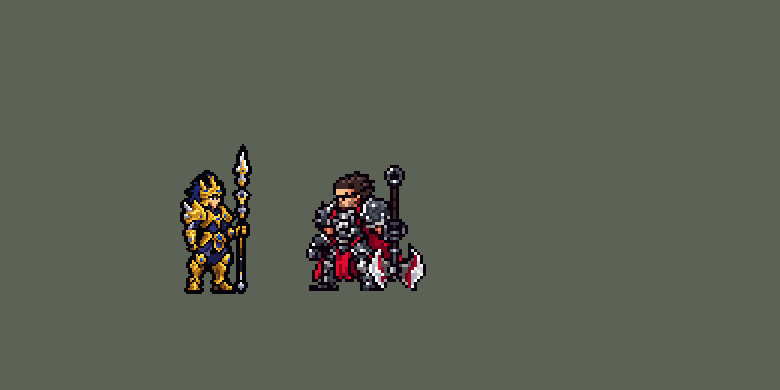

<!-- 本页上半部分由 tools/docs/gen_hero_docs.py 按仓库里现在的数据生成，手改会被覆盖；「开发记录」以下是手写的，生成时原样保留。 -->

# 嘉文四世 Jarvan IV


| 项目 | 内容 |
|---|---|
| id | `league_jarvaniv` |
| 所属的包 | 主包（mod_id `league`） |
| 分路 | 打野 |
| 分类 / 标签 | 近战（Melee） · AD / Melee / CC / Tank |
| 高清帧 | PPU 1.5 |
| 附加包 | [嘉文四世附加包](#附加包)（`league_jarvaniv`） |



其他预览：[ring](../preview/league_jarvaniv_ring.gif)、[逐帧预览](../preview/league_jarvaniv_frames.png)、[特效表](../preview/league_jarvaniv_effects.png)

## 现在的技能

下面是游戏里显示的技能说明（`league/text/champion.i18n` 的简体中文，去掉了颜色和图标），冷却、距离来自 `league/champion/league_jarvaniv.data_champion`；1 秒 = 60 tick。

### 普攻 / 被动

*攻击间隔 1 秒 · 攻击距离 26000*

骑枪刺击，攻速+20%。战争律动：对每名英雄每3秒的第一下额外造成其8%最大生命伤害。黄金圣盾：交战时自动获得60 + 30% 攻击力护盾4秒（身边每名敌方英雄+25），身边敌人减速25%。

### 技能1 · 德邦军旗

*冷却 11 秒 · 施放距离 55000 · 施放：指定目标 · 敌人（不含防御塔）*

掷出军旗：造成60 + 40% 攻击力物理伤害，军旗立8秒，附近友方英雄攻速+20%。3级起随后冲向军旗：沿途和落点的敌人击飞0.75秒，受到40 + 75% 攻击力物理伤害，护甲-20%。

### 技能2 · 巨龙撞击

*冷却 8 秒 · 施放距离 50000 · 施放：指定目标 · 敌人（不含防御塔）*

骑枪向前刺出：直线上的敌人受到40 + 75% 攻击力物理伤害，护甲-20%，持续3秒。

### 大招 · 天崩地裂

*冷却 60 秒 · 施放距离 60000 · 施放：指定目标 · 敌方英雄*

跃向敌方英雄砸下：周围敌人受到90 + 100% 攻击力物理伤害，升起岩墙环将敌方英雄困住3.5秒，想跑出去会被拉回。有被击飞的敌人或2名敌方英雄在身边时才放。

### 数值

攻击力 76（每级 +16）、生命 1000（每级 +104）、护甲 34（每级 +8）、魔抗 25（每级 +4）、移速 1000（每级 +11）。

## 附加包

附加包是可选的原生代码 mod（都在附加包合集 `league_addons` 里），**不装主包里的英雄也是完整的**。

### 嘉文四世附加包

[嘉文四世附加包](../../addons/league_jarvaniv/README.md)：`league_jarvaniv` v0.1.1

|  | 主包（不装附加包） | 装了附加包 |
|---|---|---|
| 天崩地裂的岩墙环 | 落地后 `r_t` tick（3.5 秒）困住**落点周围的敌方英雄**：每 `r_lp` tick 探一次，离他超过 `r_leash` 就被拉回他身边（照卡蜜尔大招）；他自己走出岩墙环，环就塌了 | **真的墙**：以落点为圆心、`r_r` 为半径立一圈墙 `r_t` tick。立墙时在圈里的单位（两边的英雄、小兵、野怪、召唤物，他自己也算）出不去，在圈外的进不来 |

## 相关脚本和素材

- [`tools/kit/build_jarvaniv.py`](../../tools/kit/build_jarvaniv.py)
- [`tools/kit/setup_jarvaniv.py`](../../tools/kit/setup_jarvaniv.py)
- [`tools/lol/extract_jarvaniv.py`](../../tools/lol/extract_jarvaniv.py)
- [`tools/art/preview_jarvaniv.py`](../../tools/art/preview_jarvaniv.py)
- [`tools/art/rig_jarvaniv.py`](../../tools/art/rig_jarvaniv.py)
- [`assets/source/jarvaniv/`](../../assets/source/jarvaniv)

## 开发记录

> 下面是原来 README 里「英雄：嘉文四世」一节，原样搬过来（只改了相对链接）。

| 部分 | 内容 |
|---|---|
| 定位 | 打野（Melee，标签 AD / Melee / CC / Tank），第 122 位英雄。德玛西亚皇子 嘉文四世：金甲长枪的德玛西亚王子。用户的选择：「全按推荐做：打野、布局A、做扩展包、PPU 1.5、加高手连招」。技能 1 = E → Q 连招（德邦军旗 → 巨龙撞击），技能 2 = Q 巨龙撞击单放，大招 = R 天崩地裂；W 黄金圣盾没有自己的格子，守望在打架时自动放。技能名照英雄联盟 16.20 的官方中文 |
| 普攻 / 被动 | 长枪直刺（第 9 tick 打中，防御塔也打），攻击间隔 60 tick，射程 26000。**战争律动**：歇够 3 秒后对英雄的下一次普攻额外造成目标最大生命 8% 的伤害（英雄联盟是当前生命的 8%、每个目标各自冷却：数据读不到当前生命，也读不到目标身上的计时，所以按他自己的冷却，照艾克的 Z 型驱动共振）。E 的被动：攻击速度 +20%（每条命第一次普攻或按 R 时挂上） |
| 技能1 | **E 德邦军旗 → Q 巨龙撞击**（对 55000 内的敌人放，小兵、野怪也打）：第 8 tick 把军旗扔向目标出手时站的位置（走开就躲得掉），落地时半径 16000 内受到 60 + 40% 攻击力物理伤害（英雄联盟是 80% 法术强度魔法伤害：他没有法术强度），军旗立 8 秒：40000 内的友方英雄（他自己也算）攻击速度 +20%。军旗落地 2 tick 后长枪飞向军旗（40 + 75% 攻击力物理伤害，护甲 −20% 3 秒），他跟着冲过去：枪穿过的敌人和落点 16000 内的敌人被击飞 0.75 秒。技能 1 从 1 级就能用，用户问「皇子为什么1级就可以EQ二连」（英雄联盟要 2 级才有 E 和 Q）：数据里只有 `SwitchByLevel3` 读得到等级，所以 1、2 级只扔旗，3 级起才接巨龙撞击（技能 2 的 Q 单放也是 3 级解锁）。冷却 11 秒 |
| 连招 | 用户的「加高手连招」：E → Q 击飞到英雄就打开大招的时机（`eq_up` 1.5 秒），守望下一次看就跳上去砸下天崩地裂，再自动开黄金圣盾 |
| 技能2 | **Q 巨龙撞击**（对 50000 内的敌人放）：先锁定方向（出手前 8 tick 定下落点，英雄联盟的技能弹道），第 11 tick 长枪直刺 50000：40 + 75% 攻击力物理伤害，护甲 −20% 3 秒。英雄联盟里 Q 碰到立着的军旗会把他拉过去：数据不知道军旗立在哪，所以只有 E → Q 连招会冲。冷却 8 秒 |
| W | **黄金圣盾**（守望自动放，10 秒一次）：打架时（普攻、技能打过英雄 3 秒内）30000 内有敌方英雄就放：护盾 60 + 30% 攻击力，身边每个敌方英雄再加 25，持续 4 秒；30000 内的敌人减速 25% 2 秒 |
| 大招 | **R 天崩地裂**，**看场面才放**（用户的规则：看好时机）：按 R 只是待命 10 秒，守望每 12 tick 看一次：45000 内有两个敌方英雄，或打架时有一个，或 E → Q 刚击飞了人，就跳向 60000 内最近打过的敌方英雄（跳在空中免控）；10 秒没等到就退还冷却（只留 1 秒）。落地时半径 36000 内 90 + 100% 攻击力物理伤害，升起岩墙环 3.5 秒：主包里环内的敌方英雄被困住——每 3 tick 探一次，离他超过 28000 就被拉回他身边（照卡蜜尔的大招；28000 在石环半径 36000 以内，3 tick 走不出石环，用户：「皇子的大招是必框到人的吧」——第一版是 40000，会先走到石头外面才被拉回）；他自己走出环，环就塌了。冷却 60 秒 |
| 附加包 | 可选的附加包 [`addons/league_jarvaniv`](../../addons/league_jarvaniv/README.md)（在附加包合集里，原生代码，主包不装它也完整）：**真岩墙环**——以落点为圆心立一圈墙 3.5 秒，立墙时在圈里的单位（两边的英雄、小兵、野怪，他自己也算）出不去，在圈外的进不来；副本里没有主包的「探测 + 拉回」。日志 `league_jarvaniv.log`（SPAWN、RING、KEPT IN、KEPT OUT） |
| 数值 | 攻击 76（+16）、生命 1000（+104）、护甲 34（+8）、魔抗 25（+4）、移速 1000（+11）、射程 26000 |
| 平衡 | 打野对蔚、赵信（同批），三套阵容、两边各打、16 个种子，10 分钟经典引擎模拟，对手 demon / circus_blade / hunter / inquisitor / ninja：草案（攻击 84 +18、Q 90%、R 120 + 120%、W 40%）+3.28（蔚 +2.37、赵信 +0.95）；拉回距离收进石环（28000）后更强，只降 R 的基础伤害 +3.89、只降 W +3.32；攻击 78、Q 80%、R 100、W 30% +3.43；定稿攻击 76（+16）、Q 75%、R 90 + 100%、W 30% **+2.41**（和蔚持平）。之后 E → Q 改成 3 级起（0.139.3），同一批模拟只剩 +1.97，E 的基础伤害 50 → 60 补回前期：E 65 +2.91、E 58 +2.14、**E 60 +2.61** |
| 精灵图（高清帧 PPU 1.5） | Codex 第 0 步画了竖枪待机（A）和低身备战（B）两张原画（[`tools/art/pack_jarvaniv_picture.py`](../../tools/art/pack_jarvaniv_picture.py)），[`tools/art/review_jarvaniv_size.py`](../../tools/art/review_jarvaniv_size.py) 和打野们按游戏大小并排，用户：「选 A（竖枪待机），身体 40，第 1 步头放大到约四分之一」。第 1 步 Codex 在游戏格子上重画（[`tools/art/pack_jarvaniv_model.py`](../../tools/art/pack_jarvaniv_model.py)），[`tools/art/design_jarvaniv_cut.py`](../../tools/art/design_jarvaniv_cut.py) 读回、整行整列删到游戏大小（脸和枪杆的行列保留），用户选 A-2。动作照塔姆的做法（用户：「动作帧按照塔姆那样做吧 做到完美了喊我review」）：[`tools/art/rig_jarvaniv.py`](../../tools/art/rig_jarvaniv.py) 在定稿上把长枪、两条手臂、上身、裙甲、两条腿切成整块，只做整格移动、绕半格点的直角转动和镜像（长枪竖着、平端向前刺、平端向后扛、枪尖朝下插地）。走路改了很多轮（往里迈步、膝盖分块、布隆式、Codex 画腿、重画造型都被否：「腿部不还是变形？」「这腿感觉画的不对啊」），用户拿回早先的版本：「用之前这个在这个基础上略微修复到完美」——整条腿画在裙甲前面、步幅以站姿为中心左右各 1 格、膝间的深色裤料补成藏青（「这里有问题你真的看不出吗」），用户：「走路可以了」。上下起伏不压裙甲（「还有上下摆动模型变形」「没上下摆动有点僵硬啊」）：整个人下沉 1 格，只从小腿的一行素色里抽掉，靴子不动。2026-10-21 用户：「皇子的走路步伐太小 想办法改进一下」，整条腿迈大一点又被说变形（「怎么腿变形 参考现在已经完美的英雄 你好好改」），改成全包认可的跑法（慎、赵信、盖伦）：两条腿按英雄联盟 jarvanIV_run 的关节角度画在关节上（`assets/source/jarvaniv/run_joints.json`，踩地的那只脚用两段腿解出膝盖），大腿和护胫用造型自己的金色画、膝甲和战靴用造型原件盖在膝和踝上（踩地时靴子平放在地面行，后踢时转 90° 脚尖朝下），远侧腿整条暗一档（换成造型里更暗的金色）、整条在裙甲后面，近侧腿的护胫、膝甲、战靴在裙甲前面；身体比髋部靠前 1 格、跟着英雄联盟的髋部上下起伏 0–2 格，长枪照旧扛着。动作：待机（呼吸）、走路（扛枪）、普攻、E 扔旗、Q 冲锋 / 落地、Q 单放、W、R、挨打、阵亡 |
| 特效 | 第 3 步 15 张特效（[`tools/art/pack_jarvaniv_fx.py`](../../tools/art/pack_jarvaniv_fx.py)，颜色照英雄联盟：金色、德玛西亚蓝，Q 的破甲是红色裂盾，岩墙环是灰褐色的石头），Codex 画并读回成游戏大小（`assets/source/jarvaniv/codex_fx`），全部左右对称（游戏不镜像特效图）。[`tools/art/import_jarvaniv_fx.py`](../../tools/art/import_jarvaniv_fx.py)：打中的在身上，Q 的落地冲击波在他脚下，军旗立在落点（3–6 帧循环撑满 8 秒），W 的金壳盖在他身上、护盾跟着他，岩墙环在落点地上（4–7 帧循环撑满 3.5 秒），拉回的闪光在被拉的人身上。写成 `league_jarvaniv_fx` 和 `league_jarvaniv_big` |
| 音效 | 英雄联盟的音效和配音（[`tools/lol/extract_jarvaniv.py`](../../tools/lol/extract_jarvaniv.py)，18 段）：普攻出手 / 打中、战争律动、军旗出手 / 落地 / 打中、巨龙撞击出手 / 冲锋 / 落地 / 打中、黄金圣盾、天崩地裂起跳 / 落地 / 打中，配音是他的 Q / E / W / R 台词（中文） |
| 图标 | 官方技能图标（德邦军旗、巨龙撞击、天崩地裂，另有黄金圣盾和战争律动），从本地客户端取 |

重新生成（素材来自本机的英雄联盟客户端，音频不进仓库）：

```bash
python tools/lol/extract_jarvaniv.py --lol "D:\WeGameApps\lol" --vgmstream <vgmstream-cli.exe>
python tools/kit/build_jarvaniv.py                   # 技能数据，数字都在脚本的参数表 P 里
python tools/kit/setup_jarvaniv.py                   # 五种语言的文字、音效配置、共享文件里他的键
python tools/art/design_jarvaniv_cut.py              # Codex 第 1 步的造型读回（A-2）
python tools/art/rig_jarvaniv.py                     # 1 倍帧和 1.5 的原帧（整块摆；跑步的腿按英雄联盟的关节画）
python tools/art/ppu_restyle.py --hero jarvaniv      # 描边（不要加 --preview）
python tools/art/ppu_hd.py --hero jarvaniv           # hd_ / lo_ 帧
python tools/art/import_jarvaniv_fx.py               # 特效
python tools/art/preview_jarvaniv.py                 # 预览和演示 GIF
python addons/league_jarvaniv/make_override.py       # 附加包的副本（主包的嘉文四世改了就重跑）
```

美术提示词见 [`assets/source/jarvaniv/`](../../assets/source/jarvaniv) 里的 `PICTURE_PROMPT.md`、`MODEL_PROMPTS.md`、`PROMPTS_FX.md`；Codex 的交付在 `codex_picture/`、`codex_model/`、`codex_fx/`。

逐帧预览：[`docs/preview/league_jarvaniv_frames.png`](../preview/league_jarvaniv_frames.png?v=1021r)，特效：[`docs/preview/league_jarvaniv_effects.png`](../preview/league_jarvaniv_effects.png?v=1018a)，附加包的真岩墙环：[`docs/preview/league_jarvaniv_ring.gif`](../preview/league_jarvaniv_ring.gif?v=1021r)。
