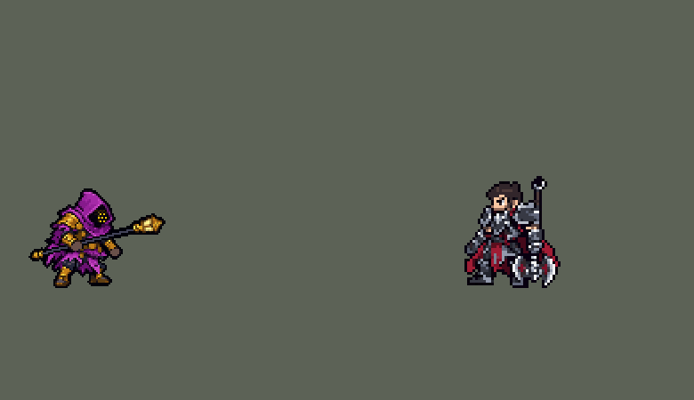

<!-- 本页上半部分由 tools/docs/gen_hero_docs.py 按仓库里现在的数据生成，手改会被覆盖；「开发记录」以下是手写的，生成时原样保留。 -->

# 贾克斯 Jax


| 项目 | 内容 |
|---|---|
| id | `league_jax` |
| 所属的包 | 主包（mod_id `league`） |
| 分路 | 上单 |
| 分类 / 标签 | 近战（Melee） · AD / Melee / CC |
| 高清帧 | PPU 1.5 |
| 附加包 | 无 |



其他预览：[逐帧预览](../preview/league_jax_frames.png)、[特效表](../preview/league_jax_effects.png)

## 现在的技能

下面是游戏里显示的技能说明（`league/text/champion.i18n` 的简体中文，去掉了颜色和图标），冷却、距离来自 `league/champion/league_jax.data_champion`；1 秒 = 60 tick。

### 普攻 / 被动（被动「无情连打」）

*攻击间隔 1.07 秒 · 攻击距离 25000*

普攻造成100% 攻击力的物理伤害。被动 无情连打：每次普攻+7% 攻速，持续2.5秒，最多8层，逐层消失。2.5秒内的第3次普攻额外造成40 + 60% 法术强度的魔法伤害。

### 技能1 · 跳斩

*冷却 7 秒 · 施放距离 50000 · 施放：指定目标 · 敌人（不含防御塔）*

跳向目标，造成70 + 110% 攻击力的物理伤害。蓄力一击（冷却5秒）：就绪时，下一次普攻或跳斩额外造成50 + 100% 法术强度的魔法伤害。

### 技能2 · 反击风暴

*冷却 8 秒 · 施放距离 25000 · 施放：无目标 · 敌人（不含防御塔）*

进入1.5秒防御姿态（照常行动）：躲闪所有普攻，受到的技能伤害降低25%。然后对周围敌人造成60 + 100% 法术强度的魔法伤害并眩晕1秒，英雄另受4% 最大生命值的真实伤害。

### 大招 · 武器大师

*冷却 40 秒 · 施放距离 30000 · 施放：无目标 · 敌方英雄*

砸下灯柱，对周围敌人造成100 + 150% 法术强度的魔法伤害。命中英雄则8秒内获得40 护甲和魔抗，每多命中一名英雄再+15；期间每第2次普攻就触发被动的魔法伤害。

### 数值

攻击力 108（每级 +20）、法强 30（每级 +10）、生命 1120（每级 +100）、护甲 36（每级 +8）、魔抗 30（每级 +4）、移速 1050（每级 +11）。

## 相关脚本和素材

- [`tools/lol/extract_jax.py`](../../tools/lol/extract_jax.py)
- [`tools/art/preview_jax.py`](../../tools/art/preview_jax.py)
- [`tools/art/import_jax.py`](../../tools/art/import_jax.py)
- [`tools/art/design_jax.py`](../../tools/art/design_jax.py)
- [`assets/source/jax/`](../../assets/source/jax)

## 开发记录

> 下面是原来 README 里「英雄：贾克斯」一节，原样搬过来（只改了相对链接）。

| 部分 | 内容 |
|---|---|
| 定位 | 上单（Melee），第七组的上单；本包第七个上单（盖伦、德莱厄斯、提莫、墨菲特、凯尔、锐雯之后） |
| 普攻 | 抡灯柱砸，100% 攻击力的物理伤害，射程 25000，攻击间隔 64 tick（1.07 秒），第 10 tick 命中（动作第 4 帧）。第 1 tick 选挥法：蓄力一击好了就播蓄力重砸，大招期间播反手突刺，反击风暴的架势里播架势挥击，其余普通横砸 |
| 被动 | 「无情连打」：每次普攻攻速 +7%，最多 8 层（+56%）；2.5 秒不再攻击就从最上面一层开始，每 0.25 秒掉一层 |
| 技能1 | Q「跳斩」，合并 W「蓄力一击」（用户选的 A）：对 50000 内的敌人施放（小兵和野怪也算，清线、打野也用），冷却 7 秒。跳到目标身上（每 tick 4000），落地造成 70 + 110% 攻击力的物理伤害。W 有自己的 5 秒冷却，好了的时候下一次普攻或跳斩落地（先到的那个）额外造成 50 + 100% 法术强度的魔法伤害。方案里 Q 优先跳英雄（贝蕾亚的做法：射程内随机挑一个敌方英雄），模拟里常跳进后排、被整队围住，同一套数值比跳 AI 自己选的目标少 1.2 个击杀差（-1.25 对 -0.09），所以改成跳 AI 选的目标：射程内有英雄时 AI 本来就挑英雄（每局 41 次里约 13 次） |
| 技能2 | E「反击风暴」：对 25000 内的敌人施放（小兵和野怪也算），冷却 8 秒。灯柱在头顶转一圈，进入 1.5 秒架势：打他的普攻全部落空（模拟里伤害为 0），技能伤害 -25%，他照常走动、攻击。架势结束时灯柱一抡，周围 32000 内的敌人受到 60 + 100% 法术强度的魔法伤害并眩晕 1 秒，敌方英雄另受 4% 最大生命值的伤害（野怪不受，免得大龙被秒）。英雄联盟里每躲一次普攻伤害 +20%，这个游戏里被打时没有效果可挂、数不了，伤害固定；提前再按一次结束架势 AI 用不了，去掉；架势从 2 秒缩到 1.5 秒，好让眩晕赶在团战散开之前 |
| 大招 | R「武器大师」（用户选的 A，现版）：30000 内有敌方英雄时施放，冷却 40 秒。跳起砸地，第 15 tick 落地，35000 内的敌人受到 100 + 150% 法术强度的魔法伤害；之后 8 秒护甲、魔抗各 +40，每多砸中一个英雄再各 +15。被动：2.5 秒内连着打，每第 3 次普攻额外造成 40 + 60% 法术强度的魔法伤害，大招期间每第 2 次，挥法换成反手突刺。从 1 级就有，不看 5 级 |
| 连招 | 用户要求：「有连招要做连招」「都要帮我补」。英雄联盟的 **E → Q**：开反击风暴，跳斩跳到英雄身上，落地马上再按 E 晕住他。原来反击风暴只能等满 1.5 秒自己爆，跳过去以后还要再等。**E→Q**：反击风暴开着（`league_jax_e_on`）时放 Q，跳斩落地就提前引爆反击风暴：同样的爆发动作、4 tick 后 32000 内 60 + 100% 法强、眩晕 1 秒、对英雄 4% 最大生命，然后才是跳斩那一下；闪避随之结束，E 自己的计时找不到状态就不再爆，一次 E 仍只爆一次。爆发挂在贾克斯自己身上（`RandomTarget AllyOnlySelf`），跳斩把目标打死也不丢。站姿开着时 AI 读到的 Q 价值带上爆发和眩晕，更倾向在站姿里跳。数值、冷却不变。数据由 [`tools/fix/combo_jax.py`](../../tools/fix/combo_jax.py) 改 |
| 数值 | 攻击 108（+20）、法术强度 30（+10）、生命 1120（+100）、护甲 36（+8）、魔抗 30（+4）、移速 1050（+11），攻击间隔 1.07 秒。数值是自己设计的，用 SDK 对战模拟调：上路，对 6 个原版上单（`fighter`、`executioner`、`lancer`、`pole_warrior`、`knight`、`berserker`），两边、三套队友阵容各 24 局，一批 864 局。初稿 -2.83，太弱；逐项加回技能看，Q 跳进人堆送死最多（死亡从 1.3 涨到 2.7）。Q 改跳 AI 选的目标、各技能加强后 +0.08，再加属性（生命 1120、护甲 36、魔抗 30、攻击 108）两批 +0.97 / +0.84：和锐雯（+0.95 / +0.80）、墨菲特（+0.91 / +1.02）、原版战士（+0.93 / +1.08）相当，比德莱厄斯（+1.33 / +1.30）弱一点。每局放 Q 约 42 次（跳英雄约 13.5 次）、E 约 22 次、R 约 4 次 |
| 亚索联动 | E 的眩晕是亚索大招要的硬控：贾克斯打上路时，亚索（中单）每局 R 到被控英雄 0.77 次（同一批原版战士 1.94、锐雯 2.42、德莱厄斯 1.42）。眩晕要等 1.5 秒架势结束才出，给亚索的机会比别的上单少，亚索不用调 |
| 精灵图 | 12 个动作 74 帧：待机、移动、普攻、蓄力一击、架势中普攻、大招中普攻（反手突刺）、Q、E 起手、E 爆发、R、受击、死亡。造型按用户在 Codex 里画的图，由 Codex 按游戏尺寸画，用户选的 A41：品红兜帽，青铜面具上四颗青色灯眼（2×2），蓝色羽饰，淡紫皮肤，棕色皮手套，灯柱一头是青铜弯钩、一头是带尖刺的灯笼。羽饰顶到脚底 41 px，24 色 |
| 高清帧（PPU 1.5） | 2026-10-16/17 按 Codex 重画的 Q 版造型用 PPU 重做（用户：「帮我利用PPU重做一下……动作帧就不让codex做了 参照塔姆那样慢慢做就行了 特效还是老样子」）。第一版 Q 版正对镜头（「你不应该学其他已经完美的英雄四分之三站姿吗」），镜像也不对（「这是右前方？」），用户选了让 Codex 重画造型：提示词包 [`tools/art/pack_jax_picture.py`](../../tools/art/pack_jax_picture.py) / [`assets/source/jax/PICTURE_PROMPT.md`](../../assets/source/jax/PICTURE_PROMPT.md)，交付的原图存成 [`assets/source/jax/hd/codex.png`](../../assets/source/jax/hd/codex.png)。`rig_jax_hd.py --prepare` 把它整理成造型原图 [`picture.png`](../../assets/source/jax/hd/picture.png)：去掉柔光；灯笼原来竖着挂在灯杆侧面（「贾克斯灯笼反了」），切下来转到灯杆的轴上、底座接在铜箍上。读成 PPU 1.5 的造型（兜帽顶到脚底 36 个游戏像素）后，七个眼点逐格重画成一圈六个加中间一个。动作不让 Codex 画，逐帧照英雄联盟原版动画的骨骼摆（「锐雯诺手贾克斯还有曙光和娜美的动作极度没有还原LOL里面」，[`tools/art/rig_jax_hd.py`](../../tools/art/rig_jax_hd.py)，[`tools/lol/league_joints.py`](../../tools/lol/league_joints.py) + `ppu_rig.Driver`）：拿灯的手臂按英雄联盟从待机起的转动转，灯杆按灯头相对胸口的位置瞄准（Q 版手臂短，照英雄联盟的方向会指偏），砸地时灯不扎进地面、落在英雄联盟灯头那一侧，杆身任何角度都是带描边的直线；腿的膝盖在护腿顶上，护腿和靴子是一整块，按英雄联盟大腿的转动绕膝盖摆，露在袍子下的那截裤腿跟身体走（「贾克斯的脚有点变形」之后改的）；移动用布隆、诺提勒斯那种走法（「这走路步伐也不对啊」）：两条腿按原画不转，每帧轮流抬起一条往前迈，落脚和英雄联盟的同一帧，人略微上浮，上半身比臀部靠前 3 格，手臂和灯照英雄联盟的跑姿；2026-10-21 用户：「贾克斯的走路也改一改 非常奇怪」——腿在袍子下只挪 2 格、灯杆每帧按英雄联盟的灯头去瞄，6 帧斜向上、2 帧水平，跑起来一直晃：改成腿按英雄联盟双脚的位置迈剪刀步（`assets/source/jax/run_joints.json`，腿从袍子里的髋部直线伸到脚踝，裤腿接护腿用原画的颜色画，脚上是原画的靴子；弯膝会让后腿整条藏进到膝的长袍里），灯杆整段跑步固定比原画抬 20°、平端在腰间（英雄联盟的跑姿），人跟着英雄联盟的髋部上下 0–2 格；死亡最后几帧整体转 90° 躺下、头朝前。画风统一只把外描边加粗一格（[`tools/art/ppu_restyle.py`](../../tools/art/ppu_restyle.py)），每个动作的帧数、时间和站位和原来一样，特效照旧。 |
| 特效 | 普攻的灯火火舌，蓄力一击的紫能环，大招被动的金色四角星，跳斩落地的尘土，反击风暴脚下的紫色旋风（架势）、爆发的火环和头顶的眩晕星，武器大师砸地的裂地冲击波、砸中的命中和大招期间的金色光环 |
| 图标 | 官方技能图标（Q / E / R），64×64 |
| 音频 | 从本地客户端提取的 12 条技能音效和 4 条中文语音（W、Q、E、R）。不提交到仓库，按下面的命令在本地生成 |

```bash
python tools/lol/extract_jax.py --lol "D:\WeGameApps\lol" --vgmstream "<vgmstream-cli.exe 路径>"
python tools/lol/native_pose.py assets/source/jax/poses.json --out <渲染文件夹>   # 动作参考帧
python tools/art/design_jax.py       # 造型：Codex 的原稿按它自己的格子取像素，按行列删到 41 行
python tools/art/export_jax.py <Codex 的动作交付> <输出文件夹> --fix <返修帧文件夹> --idle <包里的 jax_idle.png> --install
python tools/art/shrink_jax.py       # 缩到 36 行：从 jax/native41/ 里 41 行的定稿和动作条起算（重新导出后先删掉这个文件夹）；最后补洞、补普攻第 3 帧的腿（fix_jax_frames.py）
python tools/art/import_native.py --hero jax
python tools/art/import_jax.py       # 特效；--raw <Codex 的特效交付文件夹>（--gaps 按空白列切帧）先把原稿转成原尺寸条
python tools/art/pack_jax_picture.py --out dist/jax_packs/jax_pack0   # 高清造型：给 Codex 的重画包
python tools/art/rig_jax_hd.py --prepare assets/source/jax/hd/codex.png   # Codex 的原图 -> 造型原图 picture.png
python tools/lol/league_joints.py assets/source/jax/poses.json --out <关节文件夹>   # 英雄联盟每帧的关节位置
python tools/art/rig_jax_hd.py --joints <关节文件夹>/jax_joints.json   # 高清帧（PPU 1.5）：照英雄联盟的骨骼摆，写 assets/source/ppu/orig/
python tools/art/ppu_restyle.py --hero jax
python tools/art/ppu_hd.py --hero jax
python tools/art/preview_jax.py
```

美术（造型的提示词见 [`assets/source/jax/MODEL_PROMPTS.md`](../../assets/source/jax/MODEL_PROMPTS.md)，11 条动作的见 [`MODEL_STRIPS.md`](../../assets/source/jax/MODEL_STRIPS.md)，两轮返修见 [`FIX1.md`](../../assets/source/jax/FIX1.md)、[`FIX2.md`](../../assets/source/jax/FIX2.md)，特效的见 [`PROMPTS_FX.md`](../../assets/source/jax/PROMPTS_FX.md)）：
- 分工：模型和特效都由 Codex 画，Claude 写提示词包、整理和导入，按"造型 → 动作 → 特效"分三步。
- 造型：用户先在 Codex 里画了一张图，按它出游戏尺寸的造型包（兜帽顶到脚底 34 格，加羽饰 7 格）。Codex 交回的 A、B 两版没按要求的格子画（A 46×55、B 52×64），用技能的 `regrid.py` 按原稿自己的格子取回像素，再做 45、43、41 行几个版本，用户选了 A41。`design_jax.py`：取像素、对到 24 色（灯眼的青色 `#46F0FF` 只留在面具上）、按行列删到 41 行（脸那几行、几列不删），只留一圈描边。
- 动作参考（`poses.json`）：镜头 yaw 55、pitch 25，镜像，头 2.0、腿 0.8，高度 34，96×96 的格子，脚底在站位点下 11 行。皮肤默认把灯柱这块网格（`Weapon`）藏起来，要显示并贴上 `Jax_Base_Weapon_TX_CM`；两条鱼（`Bluefish`、`Goldfish`）藏掉。待机 `Idle1_v04`，移动 `Jax_Run2`（8 帧 × 133 ms），普攻 `Attack_1`，蓄力一击 `Crit`，架势中普攻 `Spell3_Attack1`，大招中普攻 `Spell4_Attack_reverse`，Q `Spell1`，E 起手 `Spell3_Idle_Cycle`，E 爆发 `Spell3_B_Idle`，R `Spell4_test` 接 `Spell4_Idle`，受击 `Stunned`，死亡 `Death1`。英雄联盟蓄力一击那一下把灯柱拉弯了（动画的拉伸），我们画成直的。
- 动作：Codex 交的是图像模型的原稿（1536×1024 或 1774×887 的整张图，品红或透明底，约 5–9 px 一格，人物画到 44–52 行）。`export_jax.py` 去掉底色（品红和它往描边过渡的颜色；灯柱的紫色 `#9C1EA3` 一类蓝过红，不算底色，映射成定稿的灯柱色 `#693A5D`）、按每块图的中心分给格子、按面积定取样间距（每帧和定稿一样大）、贴定稿的面具、按英雄联盟的头和脚底线放进格子，只留一圈描边。细灯柱落在取样点之间会断成几截：格子里灯柱紫占到四分之一就补成灯柱色，和身体分开的小块沿原稿覆盖三成以上的格子接回去；E 起手 6 帧的灯柱（原稿是粉到蓝的渐变）沿钩到灯笼的线重画成一根，拳头在前；两处披风爪尖用一条披风色细条接回；每帧都留在格子里（离边至少一格，空中的帧往下挪）。
- 返修两轮：第一轮（用户选的"小返修包给 Codex"）重画大招第 3、4 帧（原来画成背影，看不到面具）和蓄力一击第 3 帧（灯柱画成弯的）；第二轮是用户看 GIF 时指出的"攻击的时候武器是歪的"：普攻第 1、6 帧灯柱缩成头边一团金色、第 4、5 帧灯笼竖着插在斜杆上，大招中普攻第 1、2、6 帧钩端画成金球、没有灯笼，Q 第 2 帧和死亡第 1 帧没有灯柱，一共 9 帧，每帧附一张指引图（现在的帧上画出钩到灯笼的线）。返修帧单张导入：第一轮按被替换那帧的面积定大小，第二轮的原稿照着贴好面具的现帧画，按四颗灯眼的间距定大小（按面积会把新画上的整根灯柱算进去，身体小 1–19%）。
- 导入：待机 6 帧用定稿，灯笼和腿在同几行，第 3–5 帧从第 4 行往下沉一格呼吸（`BOB`）；按灯眼 `#46F0FF` 定头的位置（`EYES`）；描边补齐（`COMPLETE`）。
- 尺寸（2026-10-01，用户：「贾克斯模型被反应尺寸太大」）：41 行、50 列时待机占 1158 个像素，全包除了墨菲特最大（德莱厄斯 998、盖伦 722）。按 39、37、36、35 行出了几个版本和别的英雄排在一起，用户选了 36 行。`shrink_jax.py` 用缩小崔丝塔娜的办法：不重画、不重新取样，整行整列删掉——定稿删 5 行 6 列：面具上面 2 行（羽饰、兜帽顶），下面 3 行（肩、身体、腿），左边 3 列（灯柱钩、披风、兜帽后沿），右边 3 列（手臂、灯柱、灯笼）；一次在整个高度上挑，5 行全落在长得一样的羽饰上，身体一点没小，所以按面具上下左右分开挑。面具那几行几列和脚不删。每个动作帧先找到贴好的面具，在它上下左右按定稿在那一块删的比例删（灯柱举得比羽饰高、甩得比定稿远的部分按全图的比例）；每块按要删的行数等分成几段、每段删一行，挑和邻行最像的、不连着删、优先挑定稿删的那几行，压到灯柱（`#693A5D`）、灯笼玻璃和鞋子的行列加代价。第一版在每块里整体挑最省的行，逐帧审查发现均匀的灯柱删起来不花代价：W 第 2 帧的斜灯柱被删断、举过头顶的灯柱缩成一半、灯笼贴到手上，脚底只护 4 行时鞋面的品红绑带有的帧删了有的没删；现在脚底护 5 行，每帧还是一整块。待机就是定稿删同样的行列，死亡最后两帧躺着没有面具，按全图的比例删。删掉的行列上原来是描边的地方在新的边上补回，每帧还在原来的站位点上、脚底不动。41 行的定稿和动作条留在 [`jax/native41/`](../../assets/source/jax/native41)。现在待机 959 个像素、最高处 −24（原来 −29）：头像截取点 −33 → −30，选人卡片不用 `banpick_center` 了（原来 −10）。
- 黑边（2026-10-01，用户：「贾克斯也清理一下」）：缩小后再加进 `CLEAN`（`COMPLETE` 原来就有）：外圈三种几乎一样的近黑（`#0F0213`、`#17021C`、`#110315`）统一成一种，双层描边的内鼓包 267 格、碎点 372 格、斜阶梯多出的一格 34 格，面具不动；兜帽、披风最深的紫和羽饰最深的蓝不涂黑。`metrics` 的描边 100%，内部近黑 27% → 26%。
- 配色（2026-10-01，玩家：「贾克斯的颜色太丑」，用户：「能不能换个颜色 模型没问题」）：原图的兜帽和披风是高饱和的玫红、羽饰亮蓝，和淡紫皮肤、铜金面具撞在一起。出了紫金、深蓝、酒红三套，用户选了 A 紫金：兜帽和披风四色换成皇家紫（`#BB1E8E` → `#7E4FB5` 等），羽饰三色换成深一点的蓝，皮肤三色稍微压灰，让铜金面具更突出；模型、面具、灯柱、描边不变。换色写在 `shrink_jax.py` 的 `RECOLOUR`，缩小之后最后一步上色，所以从原稿重新导出时颜色也跟着走。新的中间紫比原来的暗玫红亮（亮度 50 → 73），导入补描边时多补了几格。
- 逐帧检查（2026-10-02，用户：「我发现贾克斯这里腿部也变形了」「还有这里也有模型缺失」「贾克斯还是有点怪 请认真修复」「在详细检查贾克斯 还有没有哪里有问题的」）：12 个动作 74 帧（游戏里显示的帧）逐帧和英雄联盟同一帧（`native_pose.py` 的游戏尺寸渲染）对照。Codex 的动作帧是从生图原稿取样来的，50 帧身上有透出地面的洞，共 347 格：大部分动作在兜帽、披风、腿上 1–8 格（待机每帧兜帽上 2 格），E 爆发和躺倒的死亡 15–21 格，死亡第 6 帧脸旁边 67 格；普攻第 3 帧近侧的腿只剩一小块浮着的脚。`shrink_jax.py` 第 5 步（`fix_jax_frames.py`）：普攻第 3 帧去掉那块脚，垫上第 2 帧的后腿（英雄联盟这一帧也是弓步、后腿在后）；每个洞——帧里围住的，和导入补描边后会被围住的——连同补描边会围出的那一圈，按周围颜色一圈圈往里填（每格取 8 邻里最多的非描边色），6 格以下的洞自己的暗圈也换成周围的颜色，身体里不留黑点；手臂、灯柱、披风和身体之间本来就有的空隙（英雄联盟里也是空的）按位置留着（`KEEP`），导入时描边的清理又封成洞的 4 处一起填（`EXTRA`）。待机呼吸（`BOB`）在近侧脚边封出的 1 格洞由 `import_native.py` 的 `PLUG` 补上。补完洞后 E 爆发 6 帧和死亡第 2–8 帧还是很「花」（每种颜色碎成单个像素，是从大图取样留下的），用户：「这个拜托codex吧」——重画包 [`REDO13.md`](../../assets/source/jax/REDO13.md)：每帧附游戏里现在的帧（96 × 96 画布，脚底线和站位点）、英雄联盟同一帧的游戏尺寸渲染、8 倍渲染和分部位图，要求按游戏尺寸在原画布上画、只用定稿 24 色、每种材质 2–3 个平涂色阶、身体里不留洞。Codex 在原像素上按材质重新分区平涂、理直灯杆，轮廓、面具、站位和英雄联盟里也有的空隙不变（交接和 QA 在 [`codex_redo13/`](../../assets/source/jax/codex_redo13)）；`fix_jax_frames.py` 第 0 步用这 13 张 1 倍图替换原帧，再补洞。E 爆发第 4 帧重新上色时在羽饰里留下一个浅色十字（皮肤色），`RECOLOUR` 换回羽饰的蓝（用户：「有问题的地方还是你帮我修吧」）。
- 特效用 Codex 画的 10 张（59 帧，纯黑底，交付说明里写了取帧区域）：`import_jax.py --raw` 按等宽格子切帧（E 爆发和 R 砸地的圈比格子宽，按离分界线最近的空白列切），按技能范围定大小：普攻命中 16 px，蓄力一击 26 px，大招被动 22 px，跳斩落地 32 px 宽，眩晕星 18 px，架势旋风环 52 px，E 爆发 96 px 和 R 砸地 104 px（半径加上双方的碰撞半径约 17000），砸中 20 px，大招光环 56 px 宽。锚点量在图上：命中量亮核或第一张完整帧的中间、放在上半身，落地尘土量最低一行、放在脚底线，眩晕星放在头顶，旋风、火环和砸地量地面圈的圆心、放在脚下，光环量光圈最低一行、放在脚底线下 2.5 格。架势旋风、火环、砸地和光环都画在人物下层。
- 出手时刻和动画对齐：普攻第 4 帧（第 10 tick），Q 在跳到目标身上时落地（`MoveToTarget` 到达，演示里约第 15 tick），E 爆发动作的第 4 tick 放出火环，R 第 15 tick 砸地。

逐帧预览：[`docs/preview/league_jax_frames.png`](../preview/league_jax_frames.png?v=1021r)，特效：[`docs/preview/league_jax_effects.png`](../preview/league_jax_effects.png?v=1017b)。
