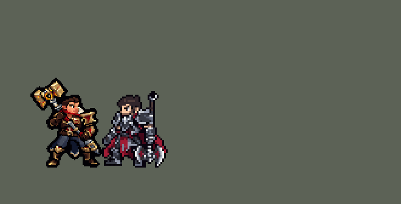

<!-- 本页上半部分由 tools/docs/gen_hero_docs.py 按仓库里现在的数据生成，手改会被覆盖；「开发记录」以下是手写的，生成时原样保留。 -->

# 杰斯 Jayce


| 项目 | 内容 |
|---|---|
| id | `league_jayce` |
| 所属的包 | 主包（mod_id `league`） |
| 分路 | 上单 |
| 分类 / 标签 | 近战（Melee） · AD / Melee / Range / CC |
| 高清帧 | PPU 1.5 |
| 附加包 | [杰斯附加包](#附加包)（`league_jayce`） |



其他预览：[逐帧预览](../preview/league_jayce_frames.png)、[特效表](../preview/league_jayce_effects.png)

## 现在的技能

下面是游戏里显示的技能说明（`league/text/champion.i18n` 的简体中文，去掉了颜色和图标），冷却、距离来自 `league/champion/league_jayce.data_champion`；1 秒 = 60 tick。

### 普攻 / 被动

*攻击间隔 1.07 秒 · 攻击距离 25000*

海克斯科技电容：出手前按战况切换锤（近战）和炮（远程），间隔6秒，每次移速+25%。变炮后下次攻击使目标护甲和魔抗-20%（5秒）；变锤获得护甲和魔抗+25%（4秒）。

### 技能1 · 苍穹之跃 / 电能震荡

*冷却 1 秒 · 施放距离 75000 · 施放：指定目标 · 敌人（不含防御塔）*

锤：跃向敌人，对周围造成90+105% 攻击力物理伤害并减速40%。电能震荡：发射电能球，命中首个敌人后爆炸，造成100+115% 攻击力物理伤害。

### 技能2 · 雷霆一击 / 超能电荷

*冷却 1 秒 · 施放距离 55000 · 施放：无目标 · 敌人（不含防御塔）*

锤：击退敌人，造成40+60% 法强魔法伤害，对英雄另加8%最大生命值真实伤害；冷却时闪电领域每0.5秒造成14+12% 法强魔法伤害。炮：之后3次攻击攻速+120%，造成120%攻击力伤害。

### 大招 · 加速之门

*冷却 25 秒 · 施放距离 90000 · 施放：指定目标 · 敌方英雄*

变为炮形态，放置加速之门（移速+40%，3秒），向敌方英雄射出加速电能球，造成140+161% 攻击力物理伤害，爆炸范围更大。

### 数值

攻击力 94（每级 +19）、法强 20（每级 +8）、生命 1120（每级 +106）、护甲 34（每级 +8）、魔抗 28（每级 +4）、移速 1000（每级 +12）。

## 附加包

附加包是可选的原生代码 mod（都在附加包合集 `league_addons` 里），**不装主包里的英雄也是完整的**。

### 杰斯附加包

[杰斯附加包](../../addons/league_jayce/README.md)：`league_jayce` v0.1.2

|  | 主包（纯数据） | 装了附加包 |
|---|---|---|
| 炮形态的样子 | 只有出招（普攻、电能震荡、超能电荷、变身、大招）是炮的动作，待机、跑步、受击还是锤子（游戏按名字自动播这几个，数据换不了） | **整个身体**都是炮：待机、跑步、受击播 `c_idle` / `c_run` / `c_hit`（只在游戏 0.6.4 上，别的版本退回左边那样）；阵亡还是锤子的倒地 |
| 雷霆一击往哪推 | 笔直推离杰斯 | 打中的敌方英雄推向**他这边**：8 万内有他的友方英雄就推向它们的中心，没有就推向离目标最近的己方塔；这个方向 35000 内碰到墙就左右最多偏 60°，都不行（或者没有友方和塔）才笔直推开。距离、速度和主包一样；小兵、野怪照旧 |
| 加速电炮打谁 | AI 选的英雄 | 射程内、线上没有别的英雄挡着（电炮停在第一个英雄身上）的敌方英雄：**这一炮打得死的**先（生命 + 护盾不超过估算的伤害，按护甲打折），再是受了伤的里生命比例最低的，都满血就挑**最远的** |

## 相关脚本和素材

- [`tools/kit/build_jayce.py`](../../tools/kit/build_jayce.py)
- [`tools/kit/setup_jayce.py`](../../tools/kit/setup_jayce.py)
- [`tools/lol/extract_jayce.py`](../../tools/lol/extract_jayce.py)
- [`tools/art/preview_jayce.py`](../../tools/art/preview_jayce.py)
- [`tools/art/rig_jayce.py`](../../tools/art/rig_jayce.py)
- [`assets/source/jayce/`](../../assets/source/jayce)

## 开发记录

> 下面是原来 README 里「英雄：杰斯」一节，原样搬过来（只改了相对链接）。

| 部分 | 内容 |
|---|---|
| 定位 | 上单（Fighter，标签 AD / Melee / Range / CC），第 106 位英雄。未来守护者 杰斯（客户端里名字和称号是反着的，按官方）：锤形近战、炮形远程的 AD 战士，手里的海克斯科技武器在墨丘利之锤和墨丘利之炮之间变形。用户的选择（除画质外全按推荐）：上单 AD 战士；形态从 1 级起在普攻槽里切换（奈德丽的做法）；技能 1 = 锤形 Q 苍穹之跃 / 炮形 Q 电能震荡，技能 2 = 锤形 E 雷霆一击（E 冷却时开 W 闪电领域）/ 炮形 W 超能电荷，大招 = 「加速电炮」（E→Q）；被动主包数据全做；附加包要；高清 PPU 1.5；职业连招开 |
| 普攻 / 形态 | 锤形大锤横扫（近战，攻击距离 25000，攻击间隔 64 tick，第 18 tick 打中）；炮形电光弹（再加 25000 射程的永久 buff `league_jayce_cn`，第 6 tick 出膛，从炮口飞出）。变形（英雄联盟的 R，内部冷却 360 tick）在每次普攻的第一刻按规则判断：锤形的 Q（3 级起还有 E）都用掉就变炮放风筝；被贴脸（30000 内有敌方英雄）而锤形技能好了、或炮形技能都冷却时变回锤形；超能电荷还有子弹时不变 |
| 被动 | 「海克斯科技电容」：每次变形移速 +25% 1 秒。变炮后的第一发电光弹让目标护甲、魔抗 −20% 5 秒；变锤形时自己护甲、魔抗 +25% 4 秒（英雄联盟的墨丘利之炮 / 墨丘利之锤变形加成） |
| 技能1 | 锤形 Q「苍穹之跃」：冷却 480 tick，48000 内有敌人时跳过去砸下（第 11 tick 起跳），落点半径 18000 内 90 + 105% 攻击物理、减速 40% 2 秒。炮形 Q「电能震荡」：冷却 420 tick，第 20 tick 打出电球，撞到第一个敌人在半径 15000 爆炸，100 + 115% 攻击物理。小兵、野怪也会打 |
| 技能2 | 锤形 E「雷霆一击」：冷却 540 tick，第 18 tick 把敌人击飞，40 + 60% 法强魔法，对英雄另加 8% 最大生命（真实伤害：数据里魔法伤害没有最大生命百分比）；E 冷却、身边有敌方英雄时开 W「闪电领域」：4 秒内每半秒电一下半径 20000 内的敌人（14 + 12% 法强魔法）。炮形 W「超能电荷」：冷却 600 tick，敌方英雄在 55000 内时开，接下来 3 发电光弹攻速 +120%、每发 120% 攻击 |
| 大招 | 「加速电炮」（E→Q）：冷却 1500 tick，90000 内有敌方英雄时放：立刻变炮，脚下立起加速之门（移速 +40% 3 秒），第 26 tick 打出穿门的大电球（电能震荡的 140%：140 + 161% 攻击，爆炸半径 21000），电球穿过小兵飞向第一个英雄（这是我自己定的，英雄联盟里打到第一个单位就停） |
| 附加包 | 可选的附加包 [`addons/league_jayce`](../../addons/league_jayce/README.md)（在附加包合集里，原生代码，主包不装它也完整）：**整身变炮**——炮形态时待机、跑步、受击也是炮的样子（奈德丽变豹的做法，炮形开火的第一帧也换成炮，不闪回锤子）；**雷霆一击击退向己方**——打英雄时把他推向 80000 内己方英雄的中间，没有队友就推向离他最近的己方塔，撞墙时左右各试到 60°，都不行才照原样往外推（小兵、野怪照数据击退）；**加速电炮挑目标**——只看电球线上没被别的英雄挡住的，先打一炮打得死的（血最少的先），再打 90% 血以下里血量比例最低的，都满血就打最远的。日志 `league_jayce.log` |
| 数值 | 攻击 94（+19）、生命 1120（+106）、护甲 34（+8）、魔抗 28（+4）、移速 1000（+12）；法强 20（+8），让雷霆一击和闪电领域随等级长（贾克斯的做法） |
| 平衡 | 上路对六个基础英雄（斗士、处刑人、枪兵、长柄兵、骑士、狂战士），三种阵容、两边各打，10 分钟经典引擎模拟两批 24 个种子：平均 +0.85 / +0.80（同样的种子上主包的上单：德莱厄斯 +1.73 / +1.36、雷克顿 +1.78 / +1.07、亚托克斯 +1.32 / +1.16、盖伦 −1.05 / −1.57，平均 +0.95 / +0.51）。先用占位的出手时间定了一版（+0.89 / +0.81），按动作重排时间后抬手变长掉到 −0.28 / −0.55，于是攻击 88→94（成长 18→19）、生命 1080→1120、苍穹之跃 70→90、电能震荡 80→100、雷霆一击 7%→8%（试过的几组在 `tools/kit/build_jayce.py` 的注释里） |
| 精灵图（高清帧 PPU 1.5） | Codex 第 0 步画了锤形、炮形各两张原画，用户选锤形 A2、炮形 B2、头顶到鞋底 38 个游戏行；第 1 步 Codex 第一次用脚本逐格写了一版（样子丢了很多，没用），重做时用画图模型在原画的密度上画侧身，用户选两张侧身 2。[`tools/art/design_jayce_hd.py`](../../tools/art/design_jayce_hd.py) 按各自的格子读回、统一成一套 40 色、A2 那颗头贴到其他三张。Codex 照英雄联盟的骨架画了 71 帧动作（锤形 40、炮形 31，苍穹之跃避开了原版的空中翻跟头），[`tools/art/rig_jayce.py`](../../tools/art/rig_jayce.py) 读回：每帧找到 Codex 画的头，换成造型那颗（Codex 的头大小在 0.85–1.15 之间，身体没变，所以只换头、身体不缩放），雷霆一击第 4、5 帧和闪电领域第 3 帧的身体放大到配得上头，Q 落地两帧下移踩地，横扫的锤柄重画成连续的一根，炮形的毛领保住，1 格的缝补上；三轮独立审图后定稿。跑步第一版两只脚基本停在原地（用户：「跑步时腿没感觉到明显换位置啊」），按米利欧的办法让 Codex 照每帧的腿线只重画腿（[`tools/art/pack_jayce_run.py`](../../tools/art/pack_jayce_run.py)），再从原稿把腿取出来放到长衣摆前面（后腿被衣摆盖住了）。降到 1.5、待机呼吸（锤形、炮形各一套）、受击闪白 |
| 特效 | Codex 第 3 步的 21 个特效 + 10 张画进帧的图（`assets/source/jayce/codex_fx`）。[`tools/art/import_jayce_fx.py`](../../tools/art/import_jayce_fx.py)：这次 Codex 的读回在游戏尺寸上就够清楚，直接用，逐格核对对称；画进帧的 10 张（横扫的电光拖影、锤头砸地、上挑电弧、举锤闪电、三种炮口火光和两次炮口蓄能、超能电荷充能）在 `rig_jayce.py --pinholes` 叠到高清帧上。飞行物按炮口高度出手（电光弹 9、电球 8、大电球 12 个游戏像素）；加速之门画在他身后 |
| 音效 | 英雄联盟的音效和配音（`tools/lol/extract_jayce.py`，27 段） |
| 图标 | 官方技能图标（苍穹之跃 / 雷霆一击 / 加速之门，另有电能震荡、闪电领域、超能电荷、变形和被动），从本地客户端取 |

重新生成（素材来自本机的英雄联盟客户端，音频不进仓库）：

```bash
python tools/lol/extract_jayce.py
python tools/kit/build_jayce.py                    # 技能数据，数字都在脚本的参数表 P 里
python tools/kit/setup_jayce.py                    # 五种语言的文字、音效配置、共享文件里他的键
python tools/art/design_jayce_hd.py                # Codex 的原画和侧身读回成四张造型
python tools/art/rig_jayce.py                      # 1 倍帧和 1.5 的高清帧（--prepare / --prepare-run 读 Codex 的交付）
python tools/art/ppu_restyle.py --hero jayce       # 描边
python tools/art/import_jayce_fx.py                # 特效和画进帧的图
python tools/art/rig_jayce.py --pinholes           # 补小洞、叠上画进帧的图
python tools/art/ppu_hd.py --hero jayce            # hd_ / lo_ 帧
python tools/art/preview_jayce.py                  # 预览和演示 GIF
python addons/league_jayce/make_override.py        # 附加包的副本（主包的杰斯改了就重跑）
```

美术提示词见 [`assets/source/jayce/`](../../assets/source/jayce) 里的 `PICTURE_PROMPT.md`、`MODEL_PROMPTS.md`、`SIDE_PROMPTS.md`、`MODEL_STRIPS.md`、`RUN_PROMPT.md`、`PROMPTS_FX.md`；Codex 的交付在 `codex_picture/`、`codex_model/`（没用的脚本版）、`codex_side/`、`codex_strips/`、`codex_fx/`。

逐帧预览：[`docs/preview/league_jayce_frames.png`](../preview/league_jayce_frames.png?v=1015a)，特效：[`docs/preview/league_jayce_effects.png`](../preview/league_jayce_effects.png?v=1015a)。
